# Slate — Master Technical Architecture & Implementation Plan

> **Version:** 1.0.0-draft  
> **Status:** APPROVED FOR IMPLEMENTATION  
> **Target Release:** v1.0 (Zero feature deferral — all core, MCP, UI, audio, and analysis capabilities ship in v1)  
> **Architectural Paradigm:** Headless-First Non-Linear Video Engine with Deep Model Context Protocol (MCP) Integration & Reactive Desktop UI

---

## Executive Summary

**Slate** is an open-source, high-performance, non-linear video editing system engineered entirely in Rust. It merges professional desktop video editing ergonomics with first-class programmatic control via the Model Context Protocol (MCP). Slate is architected from day one as a dual-surface application: every operation possible via the mouse and keyboard in its GPU-accelerated desktop UI is identically accessible to Large Language Models and external automation agents through an embedded MCP server and a fast local JSON-RPC socket.

Unlike traditional NLEs (Non-Linear Editors) that retrofit scripting via fragile Python wrappers or clunky plugin hooks, Slate’s core data structures, undo/redo engine, and rendering graph treat human interaction and AI agent invocation as completely interchangeable inputs to an immutable, command-pattern-driven timeline engine.

---

## 1. Document Index

The design and implementation of Slate is detailed across 17 comprehensive specification documents stored under `/docs`. Every document serves as an exhaustive blueprint for its respective domain.

| Doc ID | Document Path | Primary Target Domain / Crate | One-Line Description |
| :--- | :--- | :--- | :--- |
| **00** | [`docs/00-master-plan.md`](file:///Users/adityakinjawadekar/Documents/100xcode/video-editor/docs/00-master-plan.md) | Workspace Architecture & Strategy | Master blueprint, workspace layout, build phases, architectural decisions (ADRs), and success metrics. |
| **01** | `docs/01-timeline-model.md` | `slate-core` | Nanosecond/rational timeline DAG, track/clip hierarchy, command pattern, transactional undo/redo stack, and integrity validation. |
| **02** | `docs/02-media-pipeline.md` | `slate-media` | Hardware-accelerated decode/encode via `ffmpeg-next`, multi-stream demuxing, frame-seek caching, and VFR-to-CFR conforming. |
| **03** | `docs/03-compositor-gpu.md` | `slate-render` | Headless & onscreen `wgpu` render graph, multi-layer alpha compositing, color space conversions, text rendering (`glyphon`), and export pipelines. |
| **04** | `docs/04-audio-engine.md` | `slate-audio` | Real-time `cpal` low-latency audio output, software mixer, `rubato` sample-rate conversion, EBU R128 loudness metering, and master clock sync. |
| **05** | `docs/05-ai-analysis.md` | `slate-analysis` | Local speech-to-text via Whisper (`candle`/`whisper-rs`), Silero VAD silence detection, visual scene-cut detection, and waveform peak caching. |
| **06** | `docs/06-ipc-protocol.md` | `slate-ipc` | High-throughput JSON-RPC 2.0 engine server over domain sockets/named pipes via `jsonrpsee`, state synchronization, and binary shared memory. |
| **07** | `docs/07-mcp-server.md` | `slate-mcp` | Model Context Protocol implementation via `rmcp`, exposing atomic timeline operations, dynamic resources, and prompt templates to AI agents. |
| **08** | `docs/08-desktop-ui.md` | `slate-ui` | High-DPI desktop UI using `egui`/`eframe`, virtualized multi-track canvas, zero-copy preview viewport, inspector panels, and transcript editor. |
| **09** | `docs/09-cli-headless.md` | `slate-cli` | Command-line interface (`clap`) for batch rendering, pipeline headless execution, MCP daemon spawning, and project validation. |
| **10** | `docs/10-project-format.md` | `slate-core` / File System | Directory bundle specification (`.slate`), transactional JSON/Bincode manifests, asset hashing, proxy management, and crash recovery. |
| **11** | `docs/11-effects-engine.md` | `slate-render` | Built-in GPU shader effects suite (color grading, 3D LUTs, chroma key, blurs, transform matrix), transitions, and hot-reload WGSL plugins. |
| **12** | `docs/12-interop-otio.md` | `slate-core` / External Interop | OpenTimelineIO (OTIO) bidirectional translation, Final Cut Pro XML / Premiere EDL interchange, and SRT/VTT subtitle synchronization. |
| **13** | `docs/13-testing-qa.md` | All Crates / Test Suite | Comprehensive testing matrix: property-based timeline invariants (`proptest`), golden-frame SSIM perceptual diffs, audio bit tests, and agent evals. |
| **14** | `docs/14-perf-optimization.md` | Engine Core / Rendering | Frame-budget analysis (16.6ms deadline), zero-copy buffer pools, lock-free audio ringbuffers, cache eviction policies, and SIMD optimizations. |
| **15** | `docs/15-security-sandboxing.md` | `slate-mcp` / Plugins | Filesystem sandboxing for MCP tools, WGSL shader validation via `naga`, IPC client authentication, and denial-of-service resource limits. |
| **16** | `docs/16-build-distribution.md` | CI/CD / Packaging | Multi-platform build matrices (macOS Universal + Notarization, Linux AppImage, Windows MSIX), FFmpeg static linkage, and CD release pipelines. |

---

## 2. Cargo Workspace Layout

The project is structured as a tightly decoupled Cargo workspace. Strict boundary enforcement is maintained: domain logic (`slate-core`) has zero dependencies on graphics APIs, audio drivers, or UI frameworks.

```
slate/
├── Cargo.toml                    # Root workspace manifest with inherited dependencies
├── Cargo.lock
├── rust-toolchain.toml           # Pinned stable Rust toolchain (MSRV 1.82+)
├── README.md
├── LICENSE-MIT
├── LICENSE-APACHE
├── crates/
│   ├── slate-core/              # Pure timeline model, ops, undo stack, rational time, project schema
│   ├── slate-media/             # FFmpeg bindings, hardware decode/encode, stream demuxing, probing
│   ├── slate-render/            # wgpu multi-pass render graph, compositing, WGSL shaders, text rasterization
│   ├── slate-audio/             # cpal output, real-time mixer, rubato resampler, loudness, master clock
│   ├── slate-analysis/          # Whisper transcription, Silero VAD, scene cut detector, thumbnail extraction
│   ├── slate-ipc/               # JSON-RPC 2.0 over UNIX domain socket / named pipes via jsonrpsee
│   ├── slate-mcp/               # Model Context Protocol server (rmcp), tools, resources, prompt templates
│   ├── slate-ui/                # egui/eframe desktop application, timeline widget, preview viewport
│   └── slate-cli/               # CLI binary (clap), headless batch renderer, standalone MCP runner
├── shaders/                      # Core WGSL shader files
│   ├── composite.wgsl            # Multi-layer blending & transfer modes
│   ├── color_grade.wgsl          # Lift/Gamma/Gain, saturation, exposure, contrast
│   ├── lut3d.wgsl                # Tetrahedral 3D LUT interpolation
│   ├── chroma_key.wgsl           # GPU green/blue screen matte generation
│   ├── transform.wgsl            # Affine transformations (scale, rotate, translate, crop)
│   └── transition_dissolve.wgsl  # Crossfade and dissolve transitions
├── assets/                       # Default fonts, LUTs, test media, and icons
│   ├── fonts/                    # Inter, JetBrains Mono
│   ├── luts/                     # Standard Rec.709 neutral and creative LUTs
│   └── icons/                    # Vector icons for UI controls
├── tests/                        # Integration, golden-frame, and agent evaluation tests
│   ├── golden_frames/            # Reference rendered PNGs for visual regression testing
│   ├── media/                    # Short synthetic test clips (CFR, VFR, SMPTE bars, tone)
│   ├── test_timeline_ops.rs      # Proptest timeline mutation suites
│   ├── test_headless_render.rs   # Headless export integration tests
│   └── test_mcp_agent_eval.rs    # Automated LLM scenario test harness
└── docs/                         # Exhaustive technical documentation (00-16)
```

### Detailed Crate Specifications & Boundary Enforcement

#### 1. `slate-core`
- **Purpose**: Pure, deterministic non-linear editing domain model. Contains time arithmetic, clip/track hierarchy, command-pattern operations, transactional undo/redo history, and project schema serialization. Completely headless and platform-agnostic.
- **Key Types & Traits**:
  ```rust
  pub struct RationalTime { num: i64, den: u32 }
  pub struct TimeRange { start: RationalTime, duration: RationalTime }
  pub struct Timeline { id: Uuid, tracks: Vec<Track>, ... }
  pub struct Track { id: Uuid, kind: TrackKind, clips: Vec<Clip>, ... }
  pub enum TrackKind { Video, Audio }
  pub struct Clip { id: Uuid, asset_id: Uuid, place_range: TimeRange, source_range: TimeRange, ... }
  pub trait Operation: Send + Sync + std::fmt::Debug {
      fn execute(&self, timeline: &mut Timeline) -> Result<Box<dyn Operation>, CoreError>;
      fn name(&self) -> &'static str;
  }
  pub struct UndoStack { ... }
  pub struct ProjectManifest { ... }
  ```
- **Workspace Dependencies**: *None* (Root foundational crate).
- **External Dependencies**: `serde`, `serde_json`, `num-rational`, `num-traits`, `uuid`, `thiserror`, `tracing`, `proptest` (dev).
- **Boundary Enforcement**: STRICTLY FORBIDDEN: `wgpu`, `ffmpeg`, `cpal`, `egui`, `tokio`, `rmcp`. It must compile to `wasm32-unknown-unknown` without features.

#### 2. `slate-media`
- **Purpose**: Native media ingestion, demuxing, stream probing, hardware-accelerated decoding/encoding via FFmpeg C-bindings, frame-seeking caches, and automatic Variable Frame Rate (VFR) conforming.
- **Key Types & Traits**:
  ```rust
  pub struct MediaProbe { pub duration: RationalTime, pub video_streams: Vec<VideoStreamInfo>, pub audio_streams: Vec<AudioStreamInfo> }
  pub struct VideoStreamInfo { pub width: u32, pub height: u32, pub frame_rate: RationalTime, pub pixel_format: PixelFormat, ... }
  pub trait VideoDecoder: Send {
      fn seek(&mut self, pts: RationalTime) -> Result<(), MediaError>;
      fn next_frame(&mut self) -> Result<Option<DecodedVideoFrame>, MediaError>;
  }
  pub struct DecodedVideoFrame { pub pts: RationalTime, pub data: Arc<FrameBuffer>, pub format: PixelFormat, ... }
  pub trait AudioDecoder: Send {
      fn seek(&mut self, pts: RationalTime) -> Result<(), MediaError>;
      fn next_samples(&mut self) -> Result<Option<DecodedAudioBuffer>, MediaError>;
  }
  pub struct Conformer { ... } // VFR -> CFR pipeline
  ```
- **Workspace Dependencies**: `slate-core`.
- **External Dependencies**: `ffmpeg-next`, `crossbeam-channel`, `parking_lot`, `lru`, `thiserror`, `tracing`.
- **Boundary Enforcement**: STRICTLY FORBIDDEN: `wgpu` (outputs raw host memory buffers), `cpal`, `egui`, `rmcp`.

#### 3. `slate-render`
- **Purpose**: GPU-accelerated compositing and rendering pipeline built on `wgpu`. Handles color space transformation, multi-layer blending, WGSL effect processing, text/subtitle rasterization via `glyphon`, and offscreen export render targets.
- **Key Types & Traits**:
  ```rust
  pub struct RenderEngine { device: Arc<wgpu::Device>, queue: Arc<wgpu::Queue>, ... }
  pub struct RenderGraph { ... }
  pub struct CompositePass { ... }
  pub trait GpuEffect: Send + Sync {
      fn apply(&self, ctx: &mut RenderContext, input: &wgpu::TextureView, output: &wgpu::TextureView) -> Result<(), RenderError>;
  }
  pub struct TextRenderer { ... }
  pub struct OffscreenRenderer { ... }
  ```
- **Workspace Dependencies**: `slate-core`, `slate-media`.
- **External Dependencies**: `wgpu`, `naga`, `glyphon`, `image`, `bytemuck`, `pollster`, `thiserror`, `tracing`.
- **Boundary Enforcement**: STRICTLY FORBIDDEN: `egui` (returns texture view descriptors or host memory, does not render UI), `cpal`, `rmcp`.

#### 4. `slate-audio`
- **Purpose**: Low-latency multi-track software audio mixer, real-time audio playback device abstraction (`cpal`), `rubato` sinc resampler, EBU R128 loudness measurement, and master synchronization clock.
- **Key Types & Traits**:
  ```rust
  pub struct AudioEngine { ... }
  pub trait AudioSink: Send {
      fn start(&mut self) -> Result<(), AudioError>;
      fn pause(&mut self) -> Result<(), AudioError>;
      fn get_clock_pts(&self) -> RationalTime;
  }
  pub struct AudioMixer { ... }
  pub struct ResamplingSource { ... }
  pub struct LoudnessAnalyzer { ... } // EBU R128 integrated, momentary, short-term
  ```
- **Workspace Dependencies**: `slate-core`.
- **External Dependencies**: `cpal`, `rubato`, `dasp`, `ebur128`, `ringbuf`, `parking_lot`, `thiserror`, `tracing`.
- **Boundary Enforcement**: STRICTLY FORBIDDEN: `wgpu`, `ffmpeg-next` (operates solely on normalized `f32` PCM), `egui`, `rmcp`.

#### 5. `slate-analysis`
- **Purpose**: Offline and asynchronous media intelligence: speech transcription via local Whisper (`candle`/`whisper-rs`), voice activity detection via Silero VAD, visual scene-cut detection, audio peak waveform extraction, and fast video thumbnail generation.
- **Key Types & Traits**:
  ```rust
  pub struct SpeechTranscriber { ... }
  pub struct Transcript { pub segments: Vec<TranscriptSegment> }
  pub struct TranscriptSegment { pub text: String, pub range: TimeRange, pub words: Vec<WordTiming> }
  pub struct VadDetector { ... }
  pub struct SceneCutDetector { ... }
  pub struct WaveformPyramid { ... }
  ```
- **Workspace Dependencies**: `slate-core`, `slate-media`.
- **External Dependencies**: `candle-core`, `candle-transformers` (or `whisper-rs`), `image`, `rayon`, `tokio`, `thiserror`, `tracing`.
- **Boundary Enforcement**: STRICTLY FORBIDDEN: `wgpu`, `cpal`, `egui`, `rmcp`.

#### 6. `slate-ipc`
- **Purpose**: Local inter-process communication bridge exposing a JSON-RPC 2.0 engine server over UNIX domain sockets (`.sock`) on macOS/Linux and Named Pipes on Windows using `jsonrpsee`. Bridges headless engines, external scripts, and desktop UI instances.
- **Key Types & Traits**:
  ```rust
  #[jsonrpsee::proc_macros::rpc(server, client)]
  pub trait EngineRpc {
      #[method(name = "timeline.apply_operation")]
      async fn apply_operation(&self, op: OperationPayload) -> Result<OperationResult, IpcError>;
      #[method(name = "timeline.get_state")]
      async fn get_state(&self) -> Result<TimelineState, IpcError>;
      #[subscription(name = "timeline.events", item = EngineEvent)]
      async fn subscribe_events(&self) -> jsonrpsee::core::SubscriptionResult;
  }
  pub struct IpcServer { ... }
  pub struct IpcClient { ... }
  ```
- **Workspace Dependencies**: `slate-core`.
- **External Dependencies**: `jsonrpsee` (server, client, proc-macros), `tokio`, `serde`, `serde_json`, `tower`, `thiserror`, `tracing`.
- **Boundary Enforcement**: STRICTLY FORBIDDEN: `wgpu`, `cpal`, `egui`, `rmcp`.

#### 7. `slate-mcp`
- **Purpose**: Official Model Context Protocol (rmcp) implementation for Slate. Translates AI agent intents into atomic `slate-core` operations. Exposes tools (cut, ripple delete, split, insert, grade), resources (timeline snapshots, transcripts, scene boundaries), and standardized prompt templates.
- **Key Types & Traits**:
  ```rust
  pub struct SlateMcpServer { ... }
  pub struct McpToolHandler { ... }
  pub struct TimelineResourceProvider { ... }
  pub struct SlatePromptRegistry { ... }
  ```
- **Workspace Dependencies**: `slate-core`, `slate-ipc`.
- **External Dependencies**: `rmcp`, `schemars`, `tokio`, `serde`, `serde_json`, `thiserror`, `tracing`.
- **Boundary Enforcement**: STRICTLY FORBIDDEN: `wgpu`, `cpal`, `egui`.

#### 8. `slate-ui`
- **Purpose**: Hardware-accelerated desktop user interface built with `egui` and `eframe`. Features an interactive multi-track timeline widget, synchronized preview viewport integrating `wgpu` render surfaces, audio peak meters, inspector panels, text-based transcript editor, and a live MCP agent activity stream.
- **Key Types & Traits**:
  ```rust
  pub struct SlateApp { ... }
  pub struct TimelineCanvasWidget { ... }
  pub struct ViewportWidget { ... }
  pub struct TranscriptEditorWidget { ... }
  pub struct AgentActivityPanel { ... }
  ```
- **Workspace Dependencies**: `slate-core`, `slate-media`, `slate-render`, `slate-audio`, `slate-analysis`, `slate-ipc`.
- **External Dependencies**: `eframe`, `egui`, `egui_extras`, `wgpu`, `rfd`, `parking_lot`, `thiserror`, `tracing`.
- **Boundary Enforcement**: STRICTLY FORBIDDEN: Direct linkage to `rmcp` internals (UI communicates with agent subsystem strictly through the engine/IPC layer).

#### 9. `slate-cli`
- **Purpose**: Unified binary entrypoint for headless workflows: project compilation, timeline validation, offline batch video rendering, media asset probing, and launching standalone background MCP daemons.
- **Key Types & Traits**:
  ```rust
  #[derive(clap::Parser)]
  pub struct CliArgs { ... }
  #[derive(clap::Subcommand)]
  pub enum Commands { Render(...), Mcp(...), Inspect(...), Validate(...) }
  ```
- **Workspace Dependencies**: `slate-core`, `slate-media`, `slate-render`, `slate-audio`, `slate-analysis`, `slate-ipc`, `slate-mcp`.
- **External Dependencies**: `clap` (derive), `tokio`, `indicatif`, `tracing-subscriber`, `anyhow`.

---

## 3. Crate Dependency Graph

The architecture enforces an unambiguous acyclic hierarchy. The domain foundation (`slate-core`) rests at the lowest layer, completely shielded from rendering, device I/O, and UI frameworks.

```mermaid
flowchart TD
    classDef core fill:#2b3a4a,stroke:#4a90e2,stroke-width:2px,color:#fff;
    classDef media fill:#2a4d3a,stroke:#50e3c2,stroke-width:2px,color:#fff;
    classDef render fill:#4a3b2a,stroke:#f5a623,stroke-width:2px,color:#fff;
    classDef audio fill:#3a2a4d,stroke:#bd10e0,stroke-width:2px,color:#fff;
    classDef analysis fill:#4d2a3a,stroke:#e02020,stroke-width:2px,color:#fff;
    classDef ipc fill:#334433,stroke:#7ed321,stroke-width:2px,color:#fff;
    classDef mcp fill:#223344,stroke:#00bcd4,stroke-width:2px,color:#fff;
    classDef app fill:#443322,stroke:#ff9800,stroke-width:2px,color:#fff;

    Core["slate-core\n(Timeline DAG, RationalTime, Ops, Undo)"]:::core
    Media["slate-media\n(FFmpeg, HW Decode/Encode, Probing)"]:::media
    Render["slate-render\n(wgpu, WGSL Shaders, Compositor, Text)"]:::render
    Audio["slate-audio\n(cpal, Mixer, Rubato, Loudness, Clock)"]:::audio
    Analysis["slate-analysis\n(Whisper, Silero VAD, Scenes, Waveforms)"]:::analysis
    IPC["slate-ipc\n(jsonrpsee, UNIX Domain Sockets / Pipes)"]:::ipc
    MCP["slate-mcp\n(rmcp, LLM Tools, Resources, Prompts)"]:::mcp
    UI["slate-ui\n(egui/eframe, Virtual Timeline, Preview Viewport)"]:::app
    CLI["slate-cli\n(clap, Headless Render, Daemon Runner)"]:::app

    %% Dependencies
    Media --> Core
    Audio --> Core
    Render --> Core
    Render --> Media
    Analysis --> Core
    Analysis --> Media
    IPC --> Core
    MCP --> Core
    MCP --> IPC
    UI --> Core
    UI --> Media
    UI --> Render
    UI --> Audio
    UI --> Analysis
    UI --> IPC
    CLI --> Core
    CLI --> Media
    CLI --> Render
    CLI --> Audio
    CLI --> Analysis
    CLI --> IPC
    CLI --> MCP
```



### Architectural Integrity Rules
1. **No Circular Dependencies**: Workspace crates form a strict Directed Acyclic Graph (DAG).
2. **Core Isolation**: `slate-core` compiles with zero system C-libraries, zero GPU bindings, and zero network stacks.
3. **Dual Render Parity**: `slate-render` is agnostic to whether it is rendering offscreen into an FFmpeg encoder surface (`slate-cli`) or into an onscreen `wgpu` texture handle for the GUI (`slate-ui`).
4. **Operation Symmetry**: Any state mutation executed by an AI agent over `slate-mcp` produces an identical `Operation` record to one executed via user mouse/keyboard input in `slate-ui`.

---

## 4. Build Order & Implementation Phases

Slate follows a strict **engine-first, headless-first** build strategy. The core data models, decoding/compositing pipelines, and MCP server are completely implemented and proven via CLI tests and LLM evaluation suites before the graphical desktop interface is constructed.

```mermaid
flowchart TD
    subgraph P1["Phase 1: Core Engine & Headless Pipeline"]
        direction TB
        C1["slate-core (Model, Ops, Time, Serde)"] --> M1["slate-media (FFmpeg, Decode, CFR)"]
        M1 --> A1["slate-audio (cpal, Mixer, Resampler)"]
        A1 --> R1["slate-render (wgpu Headless, Compositor)"]
        R1 --> CLI1["slate-cli & Golden-Frame Verification"]
    end

    subgraph P2["Phase 2: Analysis Engine & MCP Server"]
        direction TB
        AN2["slate-analysis (Whisper, VAD, Waveforms)"] --> IPC2["slate-ipc (jsonrpsee Sockets & Sync)"]
        IPC2 --> MCP2["slate-mcp (rmcp Tools, Resources)"]
        MCP2 --> EVAL2["Headless Agent Evaluation Suite"]
    end

    subgraph P3["Phase 3: High-Performance Desktop UI"]
        direction TB
        UI3["slate-ui (egui Window & Virtual Timeline)"] --> PV3["Preview Viewport (wgpu Paint Callback)"]
        PV3 --> AM3["Audio Meters & Scrubbing Latency"]
        AM3 --> TR3["Transcript Text-Based Editing View"]
        TR3 --> ATT3["Attached MCP Mode & Agent Synchronization"]
        ATT3 --> ACT3["Agent Activity Panel & Review System"]
        ACT3 --> AS3["Asset Management & File Drag-and-Drop"]
    end

    subgraph P4["Phase 4: Polish, Effects, Plugins & Shipping"]
        direction TB
        FX4["Effects Suite (LUTs, Chroma, Blends)"] --> PLUG4["WGSL Plugin Sandboxing & Naga Validation"]
        PLUG4 --> OTIO4["OpenTimelineIO (OTIO) & Subtitles"]
        OTIO4 --> PERF4["SIMD, Zero-Copy & 4K60 Optimization"]
        PERF4 --> STRESS4["Stress Testing & Memory Auditing"]
        STRESS4 --> DIST4["Cross-Platform Packaging & v1.0 Release"]
    end

    P1 --> P2 --> P3 --> P4
```



### Phase Breakdown

#### Phase 1: Core Engine + Headless Pipeline
*Goal*: Fully functional command-line video editor capable of assembling multi-track timelines and exporting pixel-perfect 1080p60 MP4 files without any graphical UI.

- **Milestone 1.1: `slate-core` Foundational Domain**
  - Implement `RationalTime`, `TimeRange`, and `Timecode` using `num_rational::Rational64`.
  - Build `Timeline`, `Track`, `Clip`, and `Transition` data structures.
  - Implement the atomic command pattern: `Operation` trait, invertible operations (`InsertClip`, `SplitClip`, `MoveClip`, `TrimClip`, `DeleteClipRipple`), and `UndoStack`.
  - JSON serialization of `.slate` project manifest.
  - Unit tests and property-based test harness with `proptest`.
- **Milestone 1.2: `slate-media` Decoding & Conforming**
  - Bind `ffmpeg-next` for container demuxing and stream probing.
  - Implement video frame decoder with hardware acceleration (VideoToolbox on macOS, NVDEC on Linux/Windows).
  - Audio stream decoding into planar `f32` chunks.
  - Build VFR-to-CFR conforming filter to eliminate variable frame rate drift.
  - Implement an LRU memory-bounded decoded frame seek cache.
- **Milestone 1.3: `slate-audio` Mixing & Output**
  - Implement software audio mixer supporting unlimited stereo/mono audio tracks.
  - Sinc interpolation resampling via `rubato` to standard 48kHz output rate.
  - Volume fader curves, logarithmic dB conversions, and pan laws.
  - Audio ringbuffer and real-time playback device sink via `cpal`.
  - Synchronized Master Playback Clock driven by audio hardware buffer consumption.
- **Milestone 1.4: `slate-render` wgpu Compositor**
  - Initialize headless `wgpu::Instance`, `wgpu::Adapter`, and `wgpu::Device`.
  - Write multi-layer alpha compositing WGSL shader (`composite.wgsl`).
  - Pixel format conversion shaders: YUV420p / NV12 to linear RGBA.
  - Offscreen render target pipeline: readback pixel buffer into FFmpeg video encoder.
  - Golden-frame visual regression testing harness.
- **Milestone 1.5: `slate-cli` Render Subcommand**
  - Build CLI binary using `clap`.
  - Command: `slate render --project <path> --output <out.mp4> --preset <1080p60|4k30>`.
  - Progress reporting via `indicatif`.
  - Phase 1 milestone sign-off: Headless export verified against golden frames.

#### Phase 2: Analysis Engine + MCP Server
*Goal*: Fully autonomous AI video editing capability over Model Context Protocol, verifiable in headless mode via Cursor/Claude.

- **Milestone 2.1: `slate-analysis` AI Subsystems**
  - Local speech-to-text pipeline via Whisper (`candle` / `whisper-rs`), outputting word-level timestamps.
  - Voice Activity Detection (Silero VAD) to segment raw audio into speech/silence intervals.
  - Visual scene-cut detection using color histogram difference thresholds on downscaled video frames.
  - Audio waveform peak pyramid generation for instant multi-scale timeline visualization.
  - Fast thumbnail extraction pipeline.
- **Milestone 2.2: `slate-ipc` Local Socket Bridge**
  - High-performance JSON-RPC 2.0 daemon using `jsonrpsee`.
  - UNIX domain socket on macOS/Linux (`/tmp/slate-<pid>.sock`), Windows Named Pipe (`\\.\pipe\slate-<pid>`).
  - Bi-directional pub/sub event dispatching (timeline mutated, render progress, playback state).
- **Milestone 2.3: `slate-mcp` Server Implementation**
  - Embed `rmcp` server supporting stdio and IPC transport modes.
  - Implement complete tool surface:
    - `get_timeline`, `add_clip`, `split_clip`, `ripple_delete`, `trim_clip`, `reorder_clips`.
    - `detect_silence`, `remove_silence` (bulk ripple edit).
    - `transcribe_clip`, `search_transcript`, `cut_transcript_range`.
    - `apply_color_grade`, `add_text_overlay`.
  - Implement MCP Resources: `timeline://current`, `transcript://clip/{id}`, `media://library`.
  - Implement MCP Prompts: `rough_cut_assembly`, `jump_cut_silence`, `generate_broll_markers`.
- **Milestone 2.4: Headless Agent Evaluation Suite**
  - Automated benchmark harness: feeding raw podcasts and multicam footage to LLMs via MCP.
  - Verify deterministic project mutation, error recovery, and valid timeline state.
  - Phase 2 milestone sign-off: Headless engine successfully executes complex prompt edits.

#### Phase 3: High-Performance Desktop UI
*Goal*: Native, fluid 60fps desktop editing application in `egui` featuring live MCP agent synchronization.

- **Milestone 3.1: `slate-ui` Timeline Canvas**
  - Custom virtualized multi-track timeline widget using `egui::Painter`.
  - Sub-pixel horizontal time scrolling, logarithmic zooming, and magnetic clip edge snapping.
  - Track headers (mute, solo, lock, volume, visibility).
  - Selection marquee, clip drag-and-drop, slip/slide editing handles.
- **Milestone 3.2: Preview Viewport Integration**
  - Native `wgpu` render pass inside `egui` via `egui::PaintCallback`.
  - Zero-copy hardware frame rendering directly to screen surface.
  - Real-time transport controls: Play, Pause, JKL fast scrub (1x, 2x, 4x, 8x, reverse).
- **Milestone 3.3: Audio Meters & Scrubbing Ergonomics**
  - Real-time stereo peak meter and RMS loudness display.
  - Micro-sliced audio scrub playback (smooth 20ms audio buffer jogging during mouse scrubbing).
- **Milestone 3.4: Transcript-Based Text Editor**
  - Dual-pane transcript view linked to timeline playhead.
  - Word-level highlighting during playback.
  - "Edit video like a text document": selecting text and pressing Delete triggers timeline ripple delete.
- **Milestone 3.5: Attached MCP Mode & Agent Synchronization**
  - Slate desktop UI connects directly to internal engine IPC socket.
  - Live agent visualization: colored "Agent Cursor" showing where the AI is analyzing or cutting in real time.
  - Instant UI reactivity: timeline redraws seamlessly as MCP tools are invoked remotely.
- **Milestone 3.6: Agent Activity Panel & Review System**
  - Dedicated side-dock panel showing incoming MCP agent actions with diff summaries.
  - Visual timeline "ghost tracks" for proposed edits with one-click "Accept / Reject" buttons.
- **Milestone 3.7: Asset Library & File Management**
  - Media pool grid/list view with cached thumbnails and hover-scrub preview.
  - Drag-and-drop file ingestion from OS file manager.
  - Phase 3 milestone sign-off: Human and AI collaboratively editing simultaneously in desktop UI.

#### Phase 4: Polish, Effects, Plugins & Shipping
*Goal*: Production-grade stability, comprehensive effects suite, OTIO interop, packaging, and v1.0 release.

- **Milestone 4.1: Comprehensive GPU Effects Suite**
  - 3-Way Color Wheels (Lift, Gamma, Gain) and parametric saturation/contrast.
  - 3D LUT loader (.cube format) with tetrahedral GPU interpolation.
  - Real-time green/blue screen Chroma Keyer with despill and edge erosion.
  - Video transitions: Dissolve, Dip to Black, Cross Zoom, Push, Slide.
- **Milestone 4.2: Hot-Reloading WGSL Plugin Engine**
  - User-extensible shader plugin architecture.
  - Dynamic shader loading and validation using `naga` (prevents GPU driver crashes or malicious code).
  - Automatic uniform buffer GUI generation in the Inspector panel.
- **Milestone 4.3: OpenTimelineIO & Subtitle Interoperability**
  - Bidirectional OpenTimelineIO (`.otio`) import and export.
  - Final Cut Pro XML (`.fcpxml`) and Premiere EDL import.
  - Subtitle track burning and export to `.srt` / `.vtt`.
- **Milestone 4.4: Deep Performance Optimization**
  - Zero-copy buffer recycling pools across decoding and GPU upload.
  - SIMD acceleration (AVX2 / ARM NEON) for audio mixing and peak calculation.
  - Smooth 4K60 playback optimization on modern multi-core systems.
- **Milestone 4.5: Stress Testing & Memory Auditing**
  - 24-hour continuous playback and stress export test without memory leakage.
  - 500-clip multi-track timeline benchmark.
- **Milestone 4.6: Cross-Platform Packaging & v1.0 Release**
  - macOS: Universal Binary (Apple Silicon + Intel), `.dmg` package, Apple Code Signing & Notarization.
  - Windows: Self-contained installer and MSIX bundle with bundled FFmpeg runtime.
  - Linux: Distro-independent `.AppImage` and Flatpak.
  - Release documentation, API references, and v1.0 tag.

---

## 5. Cross-Cutting Concerns

### Error Handling Strategy
Slate enforces clean segregation between recoverable library errors and application binary boundaries:
- **Library Crates** (`slate-core`, `slate-media`, `slate-render`, etc.):
  - Exclusively use `thiserror` to define granular, strongly-typed error enums.
  - No `unwrap()` or `expect()` in non-test code paths.
  - Every error enum contains contextual diagnostic data (e.g., `ClipNotFound(Uuid)`, `InvalidTimecode { time: RationalTime, reason: String }`).
- **Binary & Boundary Crates** (`slate-cli`, `slate-mcp`, `slate-ui` top-level):
  - Use `anyhow::Result` for top-level entrypoints and user-facing error reporting.
  - MCP errors map cleanly to JSON-RPC error codes (-32000 through -32099) with full textual explanation for LLM self-correction.

```rust
// crates/slate-core/src/error.rs
use thiserror::Error;
use uuid::Uuid;
use crate::time::RationalTime;

#[derive(Error, Debug, Clone, PartialEq)]
pub enum CoreError {
    #[error("Clip {0} not found on timeline")]
    ClipNotFound(Uuid),
    #[error("Track {0} not found on timeline")]
    TrackNotFound(Uuid),
    #[error("Invalid time range [{start}, {end}): duration must be positive")]
    InvalidTimeRange { start: RationalTime, end: RationalTime },
    #[error("Track collision: clip {incoming_id} overlaps existing clip {existing_id} at {time}")]
    TrackCollision { incoming_id: Uuid, existing_id: Uuid, time: RationalTime },
    #[error("Undo stack empty")]
    UndoStackEmpty,
    #[error("Redo stack empty")]
    RedoStackEmpty,
}
```

### Logging, Metrics & Tracing
- Instrumentation via the `tracing` crate across all crates.
- Every timeline operation, frame render cycle, and MCP tool call is wrapped in a dedicated `tracing::span`.
- Spans include structured fields: `operation_id`, `track_id`, `pts_nanos`, `agent_id`.
- Execution configurations:
  - **CLI**: `tracing-subscriber` writes human-readable colorized output or JSON lines to `stderr`.
  - **Desktop UI**: Tracing messages are mirrored to an in-memory ringbuffer to populate the real-time "Agent Activity & Log Panel".

### Comprehensive Testing Matrix
Slate maintains four distinct testing tiers:

```
Testing Pyramid
      /\
     /  \    Tier 4: Agent Evaluation Suite (Synthetic LLM edit benchmarks)
    /----\
   /      \   Tier 3: Golden-Frame Visual Regression (SSIM / Perceptual Diffs)
  /--------\
 /          \  Tier 2: Property-Based Operation Inversion (proptest timeline state)
/------------\
-------------- Tier 1: Unit Tests (Time math, decoding, mixer math, serde)
```

1. **Unit Tests**:
   - Precise arithmetic verification for `RationalTime` (frame rounding, dropped frame rates like 29.97).
   - Audio buffer gain calculations and SIMD mixing math.
2. **Property-Based Testing (`proptest`)**:
   - Random sequences of operations (insert, split, trim, move, delete) are generated.
   - Core Invariant: `undo()` of any sequence must return the timeline to its exact bitwise initial state.
   - Integrity Invariant: No two clips on the same non-audio track may overlap in timeline space.
3. **Golden-Frame Visual & Audio Regression**:
   - Deterministic test timelines rendered via `slate-render` offscreen.
   - Rendered frames are compared pixel-by-pixel against reference PNGs using structural similarity (SSIM > 0.999).
   - Rendered audio buffers verified against calibrated EBU R128 integrated loudness levels (-24 LUFS ± 0.1 LUFS).
4. **Agent Evaluation Suite**:
   - Automated integration tests where an MCP client executes multi-step prompt workflows (e.g. "find silences longer than 700ms and remove them, then crossfade remaining cuts").
   - Timeline outcome verified against ground-truth validation rules.

### Feature Flags Matrix
Optional capabilities are partitioned behind Cargo feature flags to allow lightweight builds:

| Feature Flag | Default | Crates Affected | Description |
| :--- | :--- | :--- | :--- |
| `hw-accel` | **Yes** | `slate-media` | Enables platform hardware decoding/encoding (VideoToolbox, NVCODEC, VAAPI). |
| `whisper-metal`| macOS | `slate-analysis` | Enables Apple Silicon GPU acceleration for Whisper via Metal Performance Shaders. |
| `whisper-cuda` | No | `slate-analysis` | Enables NVIDIA CUDA acceleration for Whisper on Linux and Windows. |
| `otio` | **Yes** | `slate-core`, `slate-cli` | Compiles OpenTimelineIO file interchange capabilities. |
| `standalone-mcp` | **Yes** | `slate-cli` | Enables running the standalone background MCP daemon without UI dependencies. |

---

## 6. Key Architectural Decisions (ADRs)

### ADR-001: Rational Time Representation
- **Status**: ACCEPTED
- **Context**: Standard floating-point time (`f64`/`f32`) suffers from cumulative precision loss and rounding errors. Non-integer broadcast frame rates (e.g. 23.976 fps = $24000/1001$, 29.97 fps = $30000/1001$) drift significantly over multi-hour timelines when represented as floats or fixed integer ticks.
- **Decision**: Represent all timeline time values, durations, and playhead positions using `RationalTime` backed by `num_rational::Rational64` (a 64-bit integer numerator and 32-bit unsigned denominator).
- **Consequences**: Exact representation of any standard or non-standard frame rate without drift. Frame-accurate trimming and cuts guaranteed across infinite project durations. Floating-point conversions occur strictly at the final GPU vertex shader or audio DAC boundary.

### ADR-002: Command Pattern for Operations & Undo/Redo
- **Status**: ACCEPTED
- **Context**: Video editors require robust undo/redo capabilities. With external AI agents simultaneously editing the timeline alongside human users, state mutations must be atomic, deterministic, reversible, and auditable.
- **Decision**: All timeline modifications must be encapsulated in concrete structs implementing the `Operation` trait. Each operation's `execute(&self, timeline: &mut Timeline)` returns an inverted `Box<dyn Operation>` that precisely reverses the mutation.
- **Consequences**:
  - Direct mutations to `Timeline` fields are restricted to crate-internal operation handlers.
  - Full transactional history: any sequence of edits can be rolled back or replayed.
  - Serialization: operations can be streamed across IPC sockets or stored in audit logs.

### ADR-003: Single Unified Render Path for Preview and Export
- **Status**: ACCEPTED
- **Context**: Many NLEs maintain two separate rendering engines: an OpenGL/Metal pipeline for interactive UI preview and a software/CPU pipeline for final export. This causes "preview discrepancy" where colors, blending, and text placement subtly differ between what the user sees and what exports.
- **Decision**: Implement a single unified `wgpu` render graph in `slate-render`. Both the interactive UI preview viewport (`slate-ui`) and the headless export pipeline (`slate-cli`) execute the exact same WGSL shaders and composition passes.
- **Consequences**: 100% visual parity between preview and export. A bug or artifact in preview is guaranteed to be detected before export. Eliminates code duplication across graphics backends.

### ADR-004: Engine IPC via JSON-RPC 2.0 Local Sockets
- **Status**: ACCEPTED
- **Context**: Slate requires loose coupling between the headless core engine, the MCP server, and the desktop GUI. The engine must be able to run as a standalone background daemon or directly embedded in-process.
- **Decision**: Standardize all external engine communications on JSON-RPC 2.0 over local domain sockets (UNIX socket on macOS/Linux, Named Pipes on Windows) implemented via `jsonrpsee`.
- **Consequences**: High throughput, low latency (< 1ms round-trip for local RPC calls). Language-agnostic external scripting (Python, Node.js, Bash can query Slate). Zero TCP port collision issues or local firewall warnings.

### ADR-005: 1:1 Mapping Between MCP Tools and Timeline Operations
- **Status**: ACCEPTED
- **Context**: Large Language Models require simple, well-defined tool abstractions to edit media reliably. If MCP tools provide higher-level "magic" that bypasses the core operation engine, the UI cannot visualize or undo agent actions.
- **Decision**: Every MCP editing tool maps directly to one or a discrete macro sequence of `slate-core` `Operation` structs.
- **Consequences**: Every edit made by an AI agent lands immediately on the user's undo stack in the desktop UI with a descriptive label (e.g. `Undo: Agent Silence Removal`). The human editor can press `Cmd+Z` to reverse any AI edit instantly.

### ADR-006: Project Format as Self-Contained Directory Bundle (`.slate`)
- **Status**: ACCEPTED
- **Context**: Monolithic single-file project databases (like SQLite or giant XML files) are vulnerable to corruption during crashes and complicate caching of waveforms, transcripts, and proxies.
- **Decision**: Define the Slate project format as a directory bundle (`MyProject.slate/`) containing:
  - `project.json`: Human-readable timeline state and track/clip DAG.
  - `project.lock`: Crash-recovery journal and lockfile.
  - `cache/waveforms/`: Pre-computed audio peak pyramids.
  - `cache/transcripts/`: Cached speech-to-text JSON data.
  - `proxies/`: Generated lightweight editing proxies.
- **Consequences**: Atomic saves via atomic rename of temporary JSON files. Clean cache eviction without touching core timeline data. Extremely fast git-friendly project tracking.

### ADR-007: Audio as A/V Synchronization Master Clock
- **Status**: ACCEPTED
- **Context**: The human brain detects audio jitter, pops, and desync far more acutely than dropped video frames. System video displays run at variable refresh rates (60Hz, 120Hz, ProMotion), while audio DACs consume samples at an inflexible, continuous hardware rate (e.g., 48,000 samples/sec).
- **Decision**: The real-time playback clock is anchored exclusively to the physical audio output buffer consumption reported by `cpal`. The video compositor acts as a slave: it queries the master audio clock and displays or drops video frames to match the audio clock PTS.
- **Consequences**: Flawless, click-free audio playback. Zero audio drift over long editing sessions. Video dynamically adapts to display refresh intervals without tearing or pitch distortion.

### ADR-008: VFR to CFR Conforming on Ingestion
- **Status**: ACCEPTED
- **Context**: Mobile phones (iPhones, Android) and screen recordings (OBS, Zoom) record in Variable Frame Rate (VFR) to conserve bandwidth or manage thermal throttling. Standard video editing pipelines assume Constant Frame Rate (CFR); slicing VFR media directly leads to severe cumulative A/V desync.
- **Decision**: When VFR media is imported, `slate-media` probes the container packet timestamps. If timestamp intervals vary beyond a 0.5% threshold, the media is tagged as VFR. The ingestion pipeline either:
  1. Generates an indexed PTS lookup table for hardware seek, or
  2. Conforms the clip into an editing-optimized ProRes/DNxHR or CFR H.264 proxy in the project bundle.
- **Consequences**: Completely prevents audio/video sync drift during complex multi-track ripple edits. Editing performance is dramatically improved by scrubbing CFR keyframes.

---

## 7. Success Metrics & Quality Gates

Success is evaluated across three core dimensions: Performance, Stability, and AI Integration.

| Phase | Metric Category | Concrete Target Metric | Validation Method |
| :--- | :--- | :--- | :--- |
| **Phase 1** | Render Parity | **SSIM > 0.999** compared to reference frames | Golden-frame image perceptual diff suite |
| **Phase 1** | Export Performance | **> 2.5x Realtime** for 1080p60 H.264 export (Apple M-series / 8-core x86) | Headless benchmark render CLI command |
| **Phase 1** | Operation Invariants | **100% Round-trip Reversibility** on 10,000 random operations | Property-based testing via `proptest` |
| **Phase 2** | Transcription Speed | **< 0.25x Realtime** for Whisper Base model on Apple Silicon / CUDA | Speech analysis benchmarking harness |
| **Phase 2** | VAD Precision | **> 98% Silence Detection Accuracy** (tested against synthetic speech datasets) | Automated VAD segment ground-truth test |
| **Phase 2** | MCP Latency | **< 15ms** tool execution round-trip latency over local IPC socket | Synthetic MCP client load harness |
| **Phase 2** | Agent Eval Score | **> 95% Pass Rate** on standard AI editing benchmark suite (10 complex tasks) | LLM automated scenario harness |
| **Phase 3** | UI Framerate | **Consistent 60 FPS** UI redraw during timeline scrub with 50+ tracks | In-app frame-time profiler (`egui`) |
| **Phase 3** | Scrubbing Latency | **< 30ms** from mouse move to viewport frame display | High-speed software frame-latency probe |
| **Phase 3** | A/V Sync Lock | **< 2ms Max Jitter** between audio DAC playhead and video frame display | Oscilloscope / hardware audio-video sync test |
| **Phase 4** | Cold Launch Time | **< 1.0 Second** to interactive desktop UI on standard SSD | Automated system startup benchmark |
| **Phase 4** | Memory Footprint | **< 250MB Base RAM** (excluding active decoded video frame cache) | Memory leak & profiling audit (`valgrind`/`Instruments`) |
| **Phase 4** | Stability | **Zero Crashes** over 48-hour continuous headless and GUI playback loop | Stress-test soak testing suite |

---

## 8. Next Steps & Execution Plan

1. **Workspace Bootstrap**: Initialize the Cargo workspace with the root `Cargo.toml` and crate scaffolds.
2. **Execute Phase 1**:
   - Author `docs/01-timeline-model.md` covering the mathematical and data structures of `slate-core`.
   - Implement `slate-core` and its associated unit/property tests.
   - Author `docs/02-media-pipeline.md` and implement `slate-media`.
3. **Continuous Documentation Updates**: As architecture evolves during implementation, keep all documents in `docs/` synchronized with the production code.
