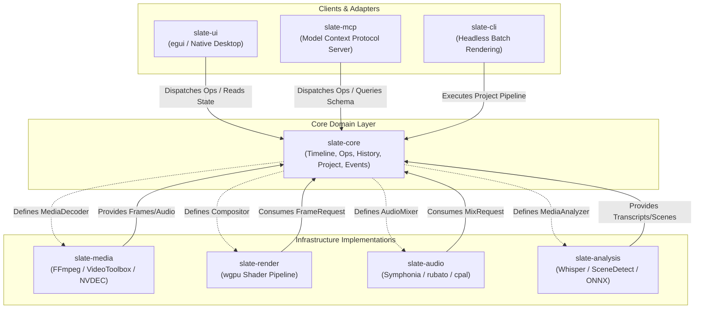

# Slate Core Engine (`slate-core`) Implementation Plan

> **Specification & Technical Architecture Document**  
> **Crate:** `slate-core`  
> **Target Path:** `crates/slate-core`  
> **Status:** Ready for Implementation  

---

## 1. Overview & Architecture

`slate-core` is the foundational, zero-dependency domain engine of the Slate video editor. It is strictly decoupled from UI presentation (egui/iced/tauri), hardware acceleration / GPU rendering (wgpu/Vulkan/Metal), external MCP servers, and audio output drivers (cpal/rodio). It acts as the single source of truth for:

1. **Timeline Data Modeling**: Non-destructive representation of tracks, clips, transitions, gaps, markers, captions, and keyframed parameters.
2. **Operation System**: An atomic, command-pattern-driven mutation system with deterministic validation and algebraic inverses.
3. **Undo/Redo History**: Granular provenance tracking distinguishing human actions from autonomous AI agent actions.
4. **Project Storage & Crash-Resilient Journaling**: Bundle-based project format with append-only write-ahead operation logs.
5. **Decoupled Traits**: Abstract contracts for media decoding, rendering/compositing, audio mixing, and multimodal AI analysis.
6. **Reactive Event Streaming**: Asynchronous event dispatch to synchronize UI runtimes and MCP agent listeners.

### Architectural Boundaries & Crate Relationships



### Module Architecture of `slate-core`

```
slate-core/
├── Cargo.toml
└── src/
    ├── lib.rs                 # Crate root, re-exports, prelude
    ├── id.rs                  # Strongly typed entity IDs (UUIDv4 wrappers)
    ├── time/
    │   ├── mod.rs             # Time module declarations
    │   ├── rational.rs        # Frame-accurate RationalTime struct & arithmetic
    │   ├── range.rs           # TimeRange bounded interval primitives
    │   └── timecode.rs        # SMPTE timecode parser and formatter (drop/non-drop)
    ├── model/
    │   ├── mod.rs             # Model aggregation
    │   ├── project.rs         # Project root container and settings
    │   ├── timeline.rs        # Timeline, track container, spatial-temporal rules
    │   ├── track.rs           # Audio and Video track definitions
    │   ├── item.rs            # TrackItem enum (Clip, Gap, Transition)
    │   ├── clip.rs            # Media clip, source in/out, timeline in/out
    │   ├── transform.rs       # 2D spatial transform and anchor points
    │   ├── keyframe.rs        # Keyframe<T>, KeyframeTrack<T>, interpolation
    │   ├── effect.rs          # Visual/Audio effect descriptors
    │   ├── transition.rs      # Cross dissolve, wipe, slide parameters
    │   ├── audio.rs           # Audio channel mappings, volume, pan
    │   ├── caption.rs         # Subtitles, styling, word-level alignment
    │   ├── marker.rs          # Timeline markers and annotations
    │   └── export.rs          # Render target specifications & presets
    ├── op/
    │   ├── mod.rs             # Command pattern abstractions
    │   ├── types.rs           # The comprehensive Op enum
    │   ├── applicable.rs      # OpApplicable trait definition
    │   ├── inverse.rs         # OpInverse enum definitions
    │   ├── error.rs           # OpError structured failures
    │   ├── clip_ops.rs        # Implementations for Add, Move, Trim, Slip, Slide
    │   ├── track_ops.rs       # Implementations for track creation, ordering, deletion
    │   └── ripple.rs          # Ripple delete and timeline contraction logic
    ├── history/
    │   ├── mod.rs             # Undo/Redo stack engine
    │   └── entry.rs           # HistoryEntry, OpSource provenance
    ├── project/
    │   ├── mod.rs             # Project persistence orchestration
    │   ├── bundle.rs          # Directory layout (.slateproj)
    │   ├── journal.rs         # Write-Ahead Log (WAL) append-only crash journal
    │   └── resolver.rs        # Deterministic media asset path resolver
    ├── traits/
    │   ├── mod.rs             # Service provider traits
    │   ├── decoder.rs         # MediaDecoder & frame extraction contracts
    │   ├── compositor.rs      # Compositor & GPU render graph contracts
    │   ├── mixer.rs           # AudioMixer contracts
    │   └── analyzer.rs        # MediaAnalyzer (AI transcription, silence detection)
    ├── events.rs              # Broadcast event definitions & message bus
    └── engine.rs              # Top-level Engine coordinator
```

---

## 2. Frame-Accurate Time Representation

Video editing requires exact temporal precision without floating-point drift. A 23.976 fps sequence run across 4 hours drifts by 345 frames if represented as a naive 64-bit float. `slate-core` enforces fractional integer arithmetic using `RationalTime` and `TimeRange`.

### 2.1 `RationalTime` Specification

```rust
use num_rational::Ratio;
use schemars::JsonSchema;
use serde::{Deserialize, Serialize};
use std::cmp::Ordering;
use std::fmt;
use std::ops::{Add, AddAssign, Div, Mul, Neg, Sub, SubAssign};
use thiserror::Error;

#[derive(Error, Debug, PartialEq, Eq, Clone)]
pub enum TimeError {
    #[error("Invalid timecode format: '{0}' (expected HH:MM:SS:FF or HH:MM:SS;FF)")]
    InvalidTimecode(String),
    #[error("Division by zero in rational time calculation")]
    DivisionByZero,
    #[error("Framerate rate must be positive and non-zero: {0}")]
    InvalidTimebase(u32),
    #[error("Time conversion overflow: {0}")]
    Overflow(String),
}

/// Exact frame-accurate time using rational numbers.
/// Numerator (`ticks`) is the tick count; denominator (`rate`) is the timebase.
/// Standard timebases include 24, 25, 30, 48, 50, 60, 30000 (for 29.97), and 48000 (audio samples).
#[derive(Clone, Copy, Debug, PartialEq, Eq, Hash, Serialize, Deserialize, JsonSchema)]
pub struct RationalTime {
    /// Number of integer time slices
    pub ticks: i64,
    /// Timebase frequency (ticks per second)
    pub rate: u32,
}

impl RationalTime {
    pub const ZERO: Self = Self { ticks: 0, rate: 1 };

    pub const fn new(ticks: i64, rate: u32) -> Self {
        assert!(rate > 0, "Rate must be non-zero");
        Self { ticks, rate }
    }

    /// Constructs time from an exact frame index at a specified frame rate.
    pub fn from_frames(frames: i64, rate: u32) -> Self {
        Self::new(frames, rate)
    }

    /// Constructs time from seconds, rounding to the nearest tick at the given rate.
    pub fn from_seconds(seconds: f64, rate: u32) -> Self {
        let ticks = (seconds * rate as f64).round() as i64;
        Self::new(ticks, rate)
    }

    /// Converts internal rational time to total whole frames at its current rate.
    pub fn to_frames(&self) -> i64 {
        self.ticks
    }

    /// Converts internal rational time to fractional floating-point seconds.
    pub fn to_seconds(&self) -> f64 {
        self.ticks as f64 / self.rate as f64
    }

    /// Rescales this time to a new timebase without loss of precision where possible,
    /// rounding to the nearest tick.
    pub fn rescale(&self, new_rate: u32) -> Self {
        if self.rate == new_rate {
            return *self;
        }
        // Using 128-bit integer to prevent overflow during multiplication
        let new_ticks = ((self.ticks as i128 * new_rate as i128 + (self.rate as i128 / 2))
            / self.rate as i128) as i64;
        Self::new(new_ticks, new_rate)
    }

    /// Parses standard SMPTE timecode (e.g., "01:00:12:15" or drop-frame "01:00:12;15").
    pub fn from_timecode(tc: &str, rate: u32, drop_frame: bool) -> Result<Self, TimeError> {
        let delimiter = if drop_frame { ';' } else { ':' };
        let parts: Vec<&str> = tc.split(|c| c == ':' || c == ';').collect();
        if parts.len() != 4 {
            return Err(TimeError::InvalidTimecode(tc.to_string()));
        }

        let hours: i64 = parts[0]
            .parse()
            .map_err(|_| TimeError::InvalidTimecode(tc.to_string()))?;
        let minutes: i64 = parts[1]
            .parse()
            .map_err(|_| TimeError::InvalidTimecode(tc.to_string()))?;
        let seconds: i64 = parts[2]
            .parse()
            .map_err(|_| TimeError::InvalidTimecode(tc.to_string()))?;
        let frames: i64 = parts[3]
            .parse()
            .map_err(|_| TimeError::InvalidTimecode(tc.to_string()))?;

        if drop_frame {
            // SMPTE drop-frame algorithm for 29.97 fps (rate 30000/1001 nominally treated as 30fps drop)
            let total_minutes = hours * 60 + minutes;
            let dropped_frames = 2 * (total_minutes - (total_minutes / 10));
            let total_frames =
                (hours * 3600 + minutes * 60 + seconds) * 30 + frames - dropped_frames;
            Ok(Self::new(total_frames, rate))
        } else {
            let total_frames =
                (hours * 3600 + minutes * 60 + seconds) * (rate as i64) + frames;
            Ok(Self::new(total_frames, rate))
        }
    }

    /// Formats time as SMPTE timecode `HH:MM:SS:FF` or `HH:MM:SS;FF`.
    pub fn to_timecode(&self, drop_frame: bool) -> String {
        let fps = self.rate as i64;
        let total_frames = self.ticks.abs();
        let sign = if self.ticks < 0 { "-" } else { "" };

        if drop_frame && (self.rate == 30 || self.rate == 29970 || self.rate == 30000) {
            let d = 2;
            let m = 30 * 60;
            let ten_m = 10 * m;
            let f = total_frames;
            let ten_m_chunks = f / (ten_m - 9 * d);
            let rem = f % (ten_m - 9 * d);
            let frame_adjusted = if rem >= 2 * d {
                f + 9 * d * ten_m_chunks + d * ((rem - 2 * d) / (m - d) + 1)
            } else {
                f + 9 * d * ten_m_chunks
            };
            let frames = frame_adjusted % 30;
            let seconds = (frame_adjusted / 30) % 60;
            let minutes = (frame_adjusted / (30 * 60)) % 60;
            let hours = frame_adjusted / (30 * 3600);
            format!("{}{:02}:{:02}:{:02};{:02}", sign, hours, minutes, seconds, frames)
        } else {
            let frames = total_frames % fps;
            let seconds = (total_frames / fps) % 60;
            let minutes = (total_frames / (fps * 60)) % 60;
            let hours = total_frames / (fps * 3600);
            format!("{}{:02}:{:02}:{:02}:{:02}", sign, hours, minutes, seconds, frames)
        }
    }
}

// Operator Overloads
impl Ord for RationalTime {
    fn cmp(&self, other: &Self) -> Ordering {
        if self.rate == other.rate {
            self.ticks.cmp(&other.ticks)
        } else {
            let lhs = self.ticks as i128 * other.rate as i128;
            let rhs = other.ticks as i128 * self.rate as i128;
            lhs.cmp(&rhs)
        }
    }
}

impl PartialOrd for RationalTime {
    fn partial_cmp(&self, other: &Self) -> Option<Ordering> {
        Some(self.cmp(other))
    }
}

impl Add for RationalTime {
    type Output = Self;
    fn add(self, rhs: Self) -> Self::Output {
        if self.rate == rhs.rate {
            Self::new(self.ticks + rhs.ticks, self.rate)
        } else {
            let common_rate = lcm(self.rate as u64, rhs.rate as u64) as u32;
            let left_ticks = self.ticks * (common_rate as i64 / self.rate as i64);
            let right_ticks = rhs.ticks * (common_rate as i64 / rhs.rate as i64);
            Self::new(left_ticks + right_ticks, common_rate)
        }
    }
}

impl Sub for RationalTime {
    type Output = Self;
    fn sub(self, rhs: Self) -> Self::Output {
        if self.rate == rhs.rate {
            Self::new(self.ticks - rhs.ticks, self.rate)
        } else {
            let common_rate = lcm(self.rate as u64, rhs.rate as u64) as u32;
            let left_ticks = self.ticks * (common_rate as i64 / self.rate as i64);
            let right_ticks = rhs.ticks * (common_rate as i64 / rhs.rate as i64);
            Self::new(left_ticks - right_ticks, common_rate)
        }
    }
}

impl Neg for RationalTime {
    type Output = Self;
    fn neg(self) -> Self::Output {
        Self::new(-self.ticks, self.rate)
    }
}

fn gcd(mut a: u64, mut b: u64) -> u64 {
    while b != 0 {
        let t = b;
        b = a % b;
        a = t;
    }
    a
}

fn lcm(a: u64, b: u64) -> u64 {
    if a == 0 || b == 0 { 0 } else { (a / gcd(a, b)) * b }
}
```

### 2.2 `TimeRange` Specification

```rust
/// Closed-open bounded temporal interval `[start, start + duration)`.
#[derive(Clone, Copy, Debug, PartialEq, Eq, Hash, Serialize, Deserialize, JsonSchema)]
pub struct TimeRange {
    pub start: RationalTime,
    pub duration: RationalTime,
}

impl TimeRange {
    pub fn new(start: RationalTime, duration: RationalTime) -> Self {
        assert!(duration.ticks >= 0, "Duration must be non-negative");
        let duration = duration.rescale(start.rate);
        Self { start, duration }
    }

    pub fn from_start_end(start: RationalTime, end: RationalTime) -> Self {
        assert!(end >= start, "End time must be greater than or equal to start");
        let end_rescaled = end.rescale(start.rate);
        Self {
            start,
            duration: end_rescaled - start,
        }
    }

    pub fn end_time(&self) -> RationalTime {
        self.start + self.duration
    }

    pub fn contains_time(&self, time: RationalTime) -> bool {
        let t = time.rescale(self.start.rate);
        t >= self.start && t < self.end_time()
    }

    pub fn contains_range(&self, other: &TimeRange) -> bool {
        let other_start = other.start.rescale(self.start.rate);
        let other_end = other.end_time().rescale(self.start.rate);
        other_start >= self.start && other_end <= self.end_time()
    }

    pub fn overlaps(&self, other: &TimeRange) -> bool {
        let other_start = other.start.rescale(self.start.rate);
        let other_end = other.end_time().rescale(self.start.rate);
        self.start < other_end && other_start < self.end_time()
    }

    pub fn intersection(&self, other: &TimeRange) -> Option<TimeRange> {
        let other_start = other.start.rescale(self.start.rate);
        let other_end = other.end_time().rescale(self.start.rate);

        let max_start = self.start.max(other_start);
        let min_end = self.end_time().min(other_end);

        if min_end > max_start {
            Some(TimeRange::from_start_end(max_start, min_end))
        } else {
            None
        }
    }

    pub fn union(&self, other: &TimeRange) -> TimeRange {
        let other_start = other.start.rescale(self.start.rate);
        let other_end = other.end_time().rescale(self.start.rate);

        let min_start = self.start.min(other_start);
        let max_end = self.end_time().max(other_end);

        TimeRange::from_start_end(min_start, max_end)
    }

    pub fn clamped_to(&self, boundary: &TimeRange) -> Option<TimeRange> {
        self.intersection(boundary)
    }

    pub fn shift(&self, delta: RationalTime) -> Self {
        Self {
            start: self.start + delta,
            duration: self.duration,
        }
    }
}
```

---

## 3. Timeline Data Model

The data model maintains an immutable representation of the project state at any snapshot. All models derive `schemars::JsonSchema` to enable automated generation of OpenAPI and Model Context Protocol (MCP) tool declarations.

### 3.1 ID System (Strong Newtypes)

We avoid sequential integers (`0, 1, 2...`) because:
1. **Concurrency & Agents**: Multiple subagents and UI threads can generate unique entities simultaneously without synchronization locks.
2. **Determinism across merges**: UUIDs prevent collisions when merging operational logs or loading multi-project assets.
3. **Idempotency**: Retrying an operation with the same UUID is guaranteed idempotent.

```rust
use serde::{Deserialize, Serialize};
use schemars::JsonSchema;
use std::fmt;
use uuid::Uuid;

macro_rules! define_id {
    ($name:ident) => {
        #[derive(Debug, Clone, Copy, PartialEq, Eq, PartialOrd, Ord, Hash, Serialize, Deserialize, JsonSchema)]
        #[serde(transparent)]
        pub struct $name(pub Uuid);

        impl $name {
            pub fn new() -> Self {
                Self(Uuid::new_v4())
            }

            pub fn from_uuid(uuid: Uuid) -> Self {
                Self(uuid)
            }

            pub fn as_uuid(&self) -> &Uuid {
                &self.0
            }
        }

        impl Default for $name {
            fn default() -> Self {
                Self::new()
            }
        }

        impl fmt::Display for $name {
            fn fmt(&self, f: &mut fmt::Formatter<'_>) -> fmt::Result {
                write!(f, "{}", self.0)
            }
        }
    };
}

define_id!(ProjectId);
define_id!(TimelineId);
define_id!(TrackId);
define_id!(ClipId);
define_id!(GapId);
define_id!(TransitionId);
define_id!(MediaId);
define_id!(EffectId);
define_id!(CaptionId);
define_id!(MarkerId);
define_id!(KeyframeId);
```

### 3.2 Keyframing & Animation Subsystem

```rust
use schemars::JsonSchema;
use serde::{Deserialize, Serialize};

#[derive(Debug, Clone, Copy, PartialEq, Serialize, Deserialize, JsonSchema)]
#[serde(rename_all = "camelCase")]
pub enum Interpolation {
    Hold,
    Linear,
    Bezier {
        /// Control point 1: [time_offset_normalized, value_offset]
        cp1: (f32, f32),
        /// Control point 2: [time_offset_normalized, value_offset]
        cp2: (f32, f32),
    },
}

#[derive(Debug, Clone, PartialEq, Serialize, Deserialize, JsonSchema)]
#[serde(rename_all = "camelCase")]
pub struct Keyframe<T> {
    pub id: KeyframeId,
    pub time: RationalTime,
    pub value: T,
    pub interpolation: Interpolation,
}

#[derive(Debug, Clone, PartialEq, Serialize, Deserialize, JsonSchema)]
#[serde(rename_all = "camelCase")]
pub struct KeyframeTrack<T> {
    pub keyframes: Vec<Keyframe<T>>,
}

impl<T: Copy + Into<f64>> KeyframeTrack<T> {
    pub fn new() -> Self {
        Self { keyframes: Vec::new() }
    }

    /// Evaluates the property value at a specific timeline position using interpolation.
    pub fn evaluate_at(&self, time: RationalTime, default: f64) -> f64 {
        if self.keyframes.is_empty() {
            return default;
        }

        let time_rescaled = time.rescale(self.keyframes[0].time.rate);

        // Before first keyframe
        if time_rescaled <= self.keyframes[0].time {
            return self.keyframes[0].value.into();
        }

        // After last keyframe
        let last = self.keyframes.last().unwrap();
        if time_rescaled >= last.time {
            return last.value.into();
        }

        // Find surrounding keyframes via binary search
        let idx = match self.keyframes.binary_search_by(|k| k.time.cmp(&time_rescaled)) {
            Ok(exact) => return self.keyframes[exact].value.into(),
            Err(insertion) => insertion,
        };

        let k0 = &self.keyframes[idx - 1];
        let k1 = &self.keyframes[idx];

        let span = (k1.time - k0.time).to_seconds();
        let elapsed = (time_rescaled - k0.time).to_seconds();
        let t = (elapsed / span).clamp(0.0, 1.0) as f32;

        let v0: f64 = k0.value.into();
        let v1: f64 = k1.value.into();

        match k0.interpolation {
            Interpolation::Hold => v0,
            Interpolation::Linear => v0 + (v1 - v0) * (t as f64),
            Interpolation::Bezier { cp1, cp2 } => {
                let factor = solve_cubic_bezier(t, cp1.0, cp2.0, cp1.1, cp2.1);
                v0 + (v1 - v0) * (factor as f64)
            }
        }
    }
}

/// Computes cubic bezier interpolation factor using Newton-Raphson approximation
fn solve_cubic_bezier(t: f32, x1: f32, x2: f32, y1: f32, y2: f32) -> f32 {
    let mut u = t;
    for _ in 0..5 {
        let x = 3.0 * (1.0 - u) * (1.0 - u) * u * x1 + 3.0 * (1.0 - u) * u * u * x2 + u * u * u;
        let dx = 3.0 * (1.0 - u) * (1.0 - u) * x1 + 6.0 * (1.0 - u) * u * (x2 - x1) + 3.0 * u * u * (1.0 - x2);
        if dx.abs() < 1e-5 { break; }
        u -= (x - t) / dx;
        u = u.clamp(0.0, 1.0);
    }
    3.0 * (1.0 - u) * (1.0 - u) * u * y1 + 3.0 * (1.0 - u) * u * u * y2 + u * u * u
}
```

### 3.3 Core Entities: Transform, Audio, Effects, Transitions

```rust
#[derive(Debug, Clone, PartialEq, Serialize, Deserialize, JsonSchema)]
#[serde(rename_all = "camelCase")]
pub struct Transform {
    pub position_x: KeyframeTrack<f64>, // Normalized canvas coordinates (-1.0 to 1.0)
    pub position_y: KeyframeTrack<f64>,
    pub scale_x: KeyframeTrack<f64>,    // 1.0 = 100%
    pub scale_y: KeyframeTrack<f64>,
    pub rotation_degrees: KeyframeTrack<f64>,
    pub opacity: KeyframeTrack<f64>,    // 0.0 to 1.0
    pub crop_left: KeyframeTrack<f64>,  // 0.0 to 1.0
    pub crop_right: KeyframeTrack<f64>,
    pub crop_top: KeyframeTrack<f64>,
    pub crop_bottom: KeyframeTrack<f64>,
    pub anchor_x: f64,                  // 0.5 = center
    pub anchor_y: f64,
}

impl Default for Transform {
    fn default() -> Self {
        Self {
            position_x: KeyframeTrack { keyframes: vec![Keyframe { id: KeyframeId::new(), time: RationalTime::ZERO, value: 0.0, interpolation: Interpolation::Linear }] },
            position_y: KeyframeTrack { keyframes: vec![Keyframe { id: KeyframeId::new(), time: RationalTime::ZERO, value: 0.0, interpolation: Interpolation::Linear }] },
            scale_x: KeyframeTrack { keyframes: vec![Keyframe { id: KeyframeId::new(), time: RationalTime::ZERO, value: 1.0, interpolation: Interpolation::Linear }] },
            scale_y: KeyframeTrack { keyframes: vec![Keyframe { id: KeyframeId::new(), time: RationalTime::ZERO, value: 1.0, interpolation: Interpolation::Linear }] },
            rotation_degrees: KeyframeTrack { keyframes: vec![Keyframe { id: KeyframeId::new(), time: RationalTime::ZERO, value: 0.0, interpolation: Interpolation::Linear }] },
            opacity: KeyframeTrack { keyframes: vec![Keyframe { id: KeyframeId::new(), time: RationalTime::ZERO, value: 1.0, interpolation: Interpolation::Linear }] },
            crop_left: KeyframeTrack::new(),
            crop_right: KeyframeTrack::new(),
            crop_top: KeyframeTrack::new(),
            crop_bottom: KeyframeTrack::new(),
            anchor_x: 0.5,
            anchor_y: 0.5,
        }
    }
}

#[derive(Debug, Clone, PartialEq, Serialize, Deserialize, JsonSchema)]
#[serde(rename_all = "camelCase")]
pub struct AudioParams {
    pub volume_db: KeyframeTrack<f64>,  // 0.0 dB unity gain, -60.0 to +12.0
    pub pan: KeyframeTrack<f64>,        // -1.0 (Left) to +1.0 (Right)
    pub mute: bool,
    pub channel_mapping: Vec<usize>,    // Remap source channels to output channels
}

impl Default for AudioParams {
    fn default() -> Self {
        Self {
            volume_db: KeyframeTrack { keyframes: vec![Keyframe { id: KeyframeId::new(), time: RationalTime::ZERO, value: 0.0, interpolation: Interpolation::Linear }] },
            pan: KeyframeTrack { keyframes: vec![Keyframe { id: KeyframeId::new(), time: RationalTime::ZERO, value: 0.0, interpolation: Interpolation::Linear }] },
            mute: false,
            channel_mapping: vec![0, 1], // Stereo pass-through
        }
    }
}

#[derive(Debug, Clone, PartialEq, Serialize, Deserialize, JsonSchema)]
#[serde(rename_all = "camelCase")]
pub struct Effect {
    pub id: EffectId,
    pub effect_type: String, // e.g., "color_grading", "chroma_key", "gaussian_blur", "equalizer"
    pub name: String,
    pub enabled: bool,
    pub parameters: serde_json::Value,
}

#[derive(Debug, Clone, Copy, PartialEq, Eq, Serialize, Deserialize, JsonSchema)]
#[serde(rename_all = "camelCase")]
pub enum TransitionAlignment {
    StartAtCut,
    CenterAtCut,
    EndAtCut,
}

#[derive(Debug, Clone, PartialEq, Serialize, Deserialize, JsonSchema)]
#[serde(rename_all = "camelCase")]
pub struct Transition {
    pub id: TransitionId,
    pub transition_type: String, // e.g., "cross_dissolve", "dip_to_black", "slide", "wipe"
    pub duration: RationalTime,
    pub alignment: TransitionAlignment,
    pub parameters: serde_json::Value,
}
```

### 3.4 Media, Clips, Gaps, and Track Items

```rust
use std::path::PathBuf;

#[derive(Debug, Clone, PartialEq, Serialize, Deserialize, JsonSchema)]
#[serde(rename_all = "camelCase")]
pub struct MediaMetadata {
    pub file_size_bytes: u64,
    pub duration: RationalTime,
    pub video_codec: Option<String>,
    pub width: Option<u32>,
    pub height: Option<u32>,
    pub frame_rate: Option<f64>,
    pub timebase: u32,
    pub audio_codec: Option<String>,
    pub audio_channels: Option<u32>,
    pub sample_rate: Option<u32>,
}

#[derive(Debug, Clone, PartialEq, Serialize, Deserialize, JsonSchema)]
#[serde(rename_all = "camelCase")]
pub struct MediaReference {
    pub id: MediaId,
    pub original_path: PathBuf,
    pub relative_path: PathBuf,
    pub metadata: MediaMetadata,
    pub proxy_path: Option<PathBuf>,
    pub waveform_path: Option<PathBuf>,
}

#[derive(Debug, Clone, PartialEq, Serialize, Deserialize, JsonSchema)]
#[serde(rename_all = "camelCase")]
pub struct Clip {
    pub id: ClipId,
    pub name: String,
    pub media_id: MediaId,
    /// Bounded range inside the source media
    pub source_range: TimeRange,
    /// Position and duration on the timeline track
    pub timeline_range: TimeRange,
    pub speed: f64, // 1.0 = normal, 2.0 = 2x, -1.0 = reverse
    pub transform: Transform,
    pub audio_params: AudioParams,
    pub effects: Vec<Effect>,
}

#[derive(Debug, Clone, PartialEq, Serialize, Deserialize, JsonSchema)]
#[serde(rename_all = "camelCase")]
pub struct Gap {
    pub id: GapId,
    pub timeline_range: TimeRange,
}

#[derive(Debug, Clone, PartialEq, Serialize, Deserialize, JsonSchema)]
#[serde(tag = "kind", rename_all = "camelCase")]
pub enum TrackItem {
    Clip(Clip),
    Gap(Gap),
    Transition(Transition),
}

impl TrackItem {
    pub fn timeline_range(&self) -> TimeRange {
        match self {
            TrackItem::Clip(c) => c.timeline_range,
            TrackItem::Gap(g) => g.timeline_range,
            TrackItem::Transition(t) => {
                // Transitions reference surrounding boundaries
                TimeRange::new(RationalTime::ZERO, t.duration)
            }
        }
    }
}
```

### 3.5 Tracks, Timeline, Project Container

```rust
#[derive(Debug, Clone, Copy, PartialEq, Eq, Serialize, Deserialize, JsonSchema)]
#[serde(rename_all = "camelCase")]
pub enum TrackType {
    Video,
    Audio,
    Caption,
}

#[derive(Debug, Clone, PartialEq, Serialize, Deserialize, JsonSchema)]
#[serde(rename_all = "camelCase")]
pub struct Track {
    pub id: TrackId,
    pub name: String,
    pub track_type: TrackType,
    pub items: Vec<TrackItem>,
    pub muted: bool,
    pub solo: bool,
    pub locked: bool,
    pub volume_db: f64,
    pub pan: f64,
    pub height: f32, // Display height in pixels in the UI
}

impl Track {
    pub fn new(name: String, track_type: TrackType) -> Self {
        Self {
            id: TrackId::new(),
            name,
            track_type,
            items: Vec::new(),
            muted: false,
            solo: false,
            locked: false,
            volume_db: 0.0,
            pan: 0.0,
            height: match track_type {
                TrackType::Video => 64.0,
                TrackType::Audio => 48.0,
                TrackType::Caption => 32.0,
            },
        }
    }

    /// Finds a clip by its unique ID
    pub fn find_clip(&self, id: ClipId) -> Option<&Clip> {
        self.items.iter().find_map(|item| match item {
            TrackItem::Clip(clip) if clip.id == id => Some(clip),
            _ => None,
        })
    }

    /// Finds a mutable clip by its unique ID
    pub fn find_clip_mut(&mut self, id: ClipId) -> Option<&mut Clip> {
        self.items.iter_mut().find_map(|item| match item {
            TrackItem::Clip(clip) if clip.id == id => Some(clip),
            _ => None,
        })
    }
}

#[derive(Debug, Clone, PartialEq, Serialize, Deserialize, JsonSchema)]
#[serde(rename_all = "camelCase")]
pub struct Marker {
    pub id: MarkerId,
    pub time: RationalTime,
    pub label: String,
    pub note: Option<String>,
    pub color_rgba: [f32; 4],
}

#[derive(Debug, Clone, PartialEq, Serialize, Deserialize, JsonSchema)]
#[serde(rename_all = "camelCase")]
pub struct CaptionStyle {
    pub font_family: String,
    pub font_size: f32,
    pub font_weight: u16,
    pub text_color_rgba: [f32; 4],
    pub bg_color_rgba: [f32; 4],
    pub outline_color_rgba: [f32; 4],
    pub outline_width: f32,
    pub vertical_alignment: String, // "top", "center", "bottom"
    pub margin_bottom_percent: f32,
}

#[derive(Debug, Clone, PartialEq, Serialize, Deserialize, JsonSchema)]
#[serde(rename_all = "camelCase")]
pub struct Caption {
    pub id: CaptionId,
    pub time_range: TimeRange,
    pub text: String,
    pub style: CaptionStyle,
}

#[derive(Debug, Clone, PartialEq, Serialize, Deserialize, JsonSchema)]
#[serde(rename_all = "camelCase")]
pub struct TimelineSettings {
    pub timebase: u32,
    pub width: u32,
    pub height: u32,
    pub drop_frame: bool,
    pub sample_rate: u32,
}

#[derive(Debug, Clone, PartialEq, Serialize, Deserialize, JsonSchema)]
#[serde(rename_all = "camelCase")]
pub struct Timeline {
    pub id: TimelineId,
    pub name: String,
    pub settings: TimelineSettings,
    pub tracks: Vec<Track>,
    pub markers: Vec<Marker>,
    pub captions: Vec<Caption>,
}

#[derive(Debug, Clone, PartialEq, Serialize, Deserialize, JsonSchema)]
#[serde(rename_all = "camelCase")]
pub struct ExportPreset {
    pub name: String,
    pub container: String,     // "mp4", "mov", "mkv"
    pub video_codec: String,   // "h264", "hevc", "prores422"
    pub audio_codec: String,   // "aac", "pcm_s16le"
    pub width: u32,
    pub height: u32,
    pub fps: f64,
    pub video_bitrate_kbps: u32,
    pub audio_bitrate_kbps: u32,
}

#[derive(Debug, Clone, PartialEq, Serialize, Deserialize, JsonSchema)]
#[serde(rename_all = "camelCase")]
pub struct Project {
    pub schema_version: u32,
    pub id: ProjectId,
    pub name: String,
    pub active_timeline_id: TimelineId,
    pub media_pool: Vec<MediaReference>,
    pub timelines: Vec<Timeline>,
    pub export_presets: Vec<ExportPreset>,
}
```

---

## 4. ID Indexing & Topology Lookup

To avoid $O(N)$ linear scans through tracks and clips during high-frequency playback evaluations or rapid agent edits, the `TimelineIndex` provides cached $O(1)$ lookups.

```rust
use std::collections::HashMap;

#[derive(Debug, Default, Clone)]
pub struct TimelineIndex {
    pub clip_locations: HashMap<ClipId, (TrackId, usize)>,
    pub track_indices: HashMap<TrackId, usize>,
    pub transition_locations: HashMap<TransitionId, (TrackId, usize)>,
}

impl TimelineIndex {
    pub fn rebuild(timeline: &Timeline) -> Self {
        let mut index = Self::default();
        for (track_idx, track) in timeline.tracks.iter().enumerate() {
            index.track_indices.insert(track.id, track_idx);
            for (item_idx, item) in track.items.iter().enumerate() {
                match item {
                    TrackItem::Clip(c) => {
                        index.clip_locations.insert(c.id, (track.id, item_idx));
                    }
                    TrackItem::Transition(t) => {
                        index.transition_locations.insert(t.id, (track.id, item_idx));
                    }
                    TrackItem::Gap(_) => {}
                }
            }
        }
        index
    }
}
```

---

## 5. Operation System (Command Pattern)

Every mutation to the project state is encapsulated as an `Op`. Operations are:
1. **Self-contained**: They hold all arguments required for execution.
2. **Deterministically Validatable**: Before mutating state, `validate(&timeline)` guarantees no invariants are violated.
3. **Invertible**: Upon application, every `Op` returns an exact, symmetrical `OpInverse`.

### 5.1 Enums: TrimEdge, TrimMode, WordRange, DuckParams

```rust
#[derive(Debug, Clone, Copy, PartialEq, Eq, Serialize, Deserialize, JsonSchema)]
#[serde(rename_all = "camelCase")]
pub enum TrimEdge {
    Start,
    End,
}

#[derive(Debug, Clone, Copy, PartialEq, Eq, Serialize, Deserialize, JsonSchema)]
#[serde(rename_all = "camelCase")]
pub enum TrimMode {
    /// Overwrites / trims clip in place; creates or expands adjacent gaps
    Ripple,
    /// Shifts adjacent clips to close gaps or accommodate expansion
    Roll,
    /// Modifies source in/out while keeping timeline range fixed
    Slip,
    /// Modifies timeline in/out while keeping source range and duration fixed
    Slide,
}

#[derive(Debug, Clone, PartialEq, Serialize, Deserialize, JsonSchema)]
#[serde(rename_all = "camelCase")]
pub struct WordRange {
    pub word: String,
    pub start: RationalTime,
    pub end: RationalTime,
    pub confidence: f32,
}

#[derive(Debug, Clone, PartialEq, Serialize, Deserialize, JsonSchema)]
#[serde(rename_all = "camelCase")]
pub struct DuckParams {
    pub duck_level_db: f64,     // e.g. -18.0 dB
    pub threshold_db: f64,      // Voice detection threshold, e.g. -24.0 dB
    pub attack_time: RationalTime,
    pub release_time: RationalTime,
}

#[derive(Debug, Clone, Copy, PartialEq, Eq, Serialize, Deserialize, JsonSchema)]
#[serde(rename_all = "camelCase")]
pub enum KeyframeProperty {
    PositionX,
    PositionY,
    ScaleX,
    ScaleY,
    Rotation,
    Opacity,
    Volume,
    Pan,
}
```

### 5.2 The Comprehensive `Op` Enum

```rust
#[derive(Debug, Clone, PartialEq, Serialize, Deserialize, JsonSchema)]
#[serde(tag = "type", content = "payload", rename_all = "camelCase")]
pub enum Op {
    // Media Pool Operations
    ImportMedia {
        path: PathBuf,
        media_id: MediaId,
    },
    RemoveMedia {
        media_id: MediaId,
    },

    // Track Operations
    AddTrack {
        track_type: TrackType,
        name: String,
        index: Option<usize>,
    },
    RemoveTrack {
        track_id: TrackId,
    },
    ReorderTrack {
        track_id: TrackId,
        new_index: usize,
    },
    SetTrackMute {
        track_id: TrackId,
        muted: bool,
    },
    SetTrackSolo {
        track_id: TrackId,
        solo: bool,
    },
    SetTrackLock {
        track_id: TrackId,
        locked: bool,
    },

    // Clip Editing & Manipulation
    AddClip {
        track_id: TrackId,
        clip: Clip,
        position: RationalTime,
    },
    RemoveClip {
        clip_id: ClipId,
    },
    MoveClip {
        clip_id: ClipId,
        target_track: TrackId,
        target_time: RationalTime,
    },
    TrimClip {
        clip_id: ClipId,
        edge: TrimEdge,
        delta: RationalTime,
        mode: TrimMode,
    },
    SplitClip {
        clip_id: ClipId,
        at: RationalTime,
        new_clip_id: ClipId,
    },
    SlipClip {
        clip_id: ClipId,
        delta: RationalTime,
    },
    SlideClip {
        clip_id: ClipId,
        delta: RationalTime,
    },
    SetClipSpeed {
        clip_id: ClipId,
        speed: f64,
    },

    // Timeline-level Operations
    RippleDelete {
        ranges: Vec<TimeRange>,
        track_ids: Option<Vec<TrackId>>,
    },

    // Transitions
    AddTransition {
        track_id: TrackId,
        after_clip_id: ClipId,
        transition: Transition,
    },
    RemoveTransition {
        transition_id: TransitionId,
    },

    // Effects
    ApplyEffect {
        clip_id: ClipId,
        effect: Effect,
    },
    RemoveEffect {
        clip_id: ClipId,
        effect_id: EffectId,
    },
    UpdateEffect {
        clip_id: ClipId,
        effect_id: EffectId,
        params: serde_json::Value,
    },

    // Keyframes & Spatial Transform
    SetTransform {
        clip_id: ClipId,
        transform: Transform,
    },
    SetKeyframe {
        clip_id: ClipId,
        property: KeyframeProperty,
        keyframe: Keyframe<f64>,
    },
    RemoveKeyframe {
        clip_id: ClipId,
        property: KeyframeProperty,
        time: RationalTime,
    },

    // Audio Processing
    SetAudioParams {
        clip_id: ClipId,
        params: AudioParams,
    },
    NormalizeAudio {
        clip_id: ClipId,
        target_lufs: f64,
    },
    RemoveSilence {
        track_id: TrackId,
        threshold_db: f64,
        min_duration: RationalTime,
        padding: RationalTime,
    },
    AudioDuck {
        music_track: TrackId,
        voice_track: TrackId,
        params: DuckParams,
    },

    // Captions & Subtitles
    AddCaption {
        caption: Caption,
    },
    RemoveCaption {
        caption_id: CaptionId,
    },
    UpdateCaption {
        caption_id: CaptionId,
        text: Option<String>,
        style: Option<CaptionStyle>,
    },
    GenerateCaptions {
        media_id: MediaId,
        style: CaptionStyle,
    },

    // Markers
    AddMarker {
        marker: Marker,
    },
    RemoveMarker {
        marker_id: MarkerId,
    },

    // Multimodal & Text-Based Editing
    EditByTranscript {
        media_id: MediaId,
        track_id: TrackId,
        keep_ranges: Vec<WordRange>,
    },

    // Batch Composition
    Batch {
        ops: Vec<Op>,
        label: String,
    },
}
```

### 5.3 `OpInverse` (Exact Symmetrical Inverses)

Every operation produces a reversible counterpart:

```rust
#[derive(Debug, Clone, PartialEq, Serialize, Deserialize)]
pub enum OpInverse {
    // Media
    UnimportMedia { media_id: MediaId },
    ReimportMedia { reference: MediaReference },

    // Track
    RemoveAddedTrack { track_id: TrackId },
    RestoreRemovedTrack { index: usize, track: Track },
    RevertReorderTrack { track_id: TrackId, original_index: usize },
    RevertTrackState { track_id: TrackId, muted: bool, solo: bool, locked: bool },

    // Clip
    RemoveAddedClip { clip_id: ClipId },
    RestoreRemovedClip { track_id: TrackId, index: usize, clip: Clip },
    RevertMoveClip { clip_id: ClipId, original_track: TrackId, original_time: RationalTime },
    RevertTrimClip { clip_id: ClipId, original_source: TimeRange, original_timeline: TimeRange },
    UnsplitClip { kept_clip_id: ClipId, removed_clip_id: ClipId, original_source_duration: RationalTime },
    RevertSlipClip { clip_id: ClipId, delta: RationalTime },
    RevertSlideClip { clip_id: ClipId, delta: RationalTime },
    RevertClipSpeed { clip_id: ClipId, original_speed: f64 },

    // Ripple
    RestoreRipple { restored_tracks: Vec<(TrackId, Vec<TrackItem>)> },

    // Transitions
    RemoveAddedTransition { transition_id: TransitionId },
    RestoreRemovedTransition { track_id: TrackId, after_clip_id: ClipId, transition: Transition },

    // Effects
    RemoveAppliedEffect { clip_id: ClipId, effect_id: EffectId },
    RestoreRemovedEffect { clip_id: ClipId, index: usize, effect: Effect },
    RevertUpdateEffect { clip_id: ClipId, effect_id: EffectId, original_params: serde_json::Value },

    // Transform & Keyframes
    RevertTransform { clip_id: ClipId, original_transform: Transform },
    RestoreRemovedKeyframe { clip_id: ClipId, property: KeyframeProperty, keyframe: Keyframe<f64> },
    RemoveAddedKeyframe { clip_id: ClipId, property: KeyframeProperty, time: RationalTime },

    // Audio
    RevertAudioParams { clip_id: ClipId, original_params: AudioParams },
    RevertSilenceRemoval { track_id: TrackId, original_items: Vec<TrackItem> },
    RevertAudioDuck { music_track: TrackId, original_volume_keyframes: KeyframeTrack<f64> },

    // Captions & Markers
    RemoveAddedCaption { caption_id: CaptionId },
    RestoreRemovedCaption { caption: Caption },
    RevertUpdateCaption { caption_id: CaptionId, original_text: String, original_style: CaptionStyle },
    RemoveAddedMarker { marker_id: MarkerId },
    RestoreRemovedMarker { marker: Marker },

    // Batch Inverse
    BatchInverse { inverses: Vec<OpInverse>, label: String },
}
```

### 5.4 `OpError` (Actionable Domain Errors)

Errors are strongly typed, providing debugging context and suggesting valid alternatives:

```rust
use thiserror::Error;

#[derive(Error, Debug, Clone, PartialEq, Serialize, Deserialize, JsonSchema)]
#[serde(tag = "error", rename_all = "camelCase")]
pub enum OpError {
    #[error("Clip with ID '{0}' was not found on any track")]
    ClipNotFound(ClipId),

    #[error("Track with ID '{0}' was not found in the timeline")]
    TrackNotFound(TrackId),

    #[error("Media with ID '{0}' has not been imported into the project media pool")]
    MediaNotImported(MediaId),

    #[error("Transition with ID '{0}' was not found")]
    TransitionNotFound(TransitionId),

    #[error("Effect with ID '{0}' was not found on clip '{1}'")]
    EffectNotFound(EffectId, ClipId),

    #[error("Marker with ID '{0}' was not found")]
    MarkerNotFound(MarkerId),

    #[error("Caption with ID '{0}' was not found")]
    CaptionNotFound(CaptionId),

    #[error("Track '{0}' is locked and cannot be modified")]
    TrackLocked(TrackId),

    #[error("Requested time range [{requested_start}, {requested_end}) conflicts with existing clip '{conflicting_clip_id}'")]
    OverlapConflict {
        conflicting_clip_id: ClipId,
        requested_start: RationalTime,
        requested_end: RationalTime,
    },

    #[error("Trim would exceed media source boundaries: requested {requested}, maximum valid duration is {available}")]
    TrimBeyondMedia {
        clip_id: ClipId,
        requested: RationalTime,
        available: RationalTime,
    },

    #[error("Split position {at} falls outside the clip's timeline range [{start}, {end})")]
    SplitOutsideClip {
        clip_id: ClipId,
        at: RationalTime,
        start: RationalTime,
        end: RationalTime,
    },

    #[error("Cannot add {track_type:?} clip to incompatible track {track_id}")]
    TrackTypeMismatch {
        track_id: TrackId,
        track_type: TrackType,
    },

    #[error("Invalid speed multiplier {speed}; must be non-zero and between -100.0 and 100.0")]
    InvalidSpeed { speed: f64 },

    #[error("Batch operation failed at sub-operation #{index}: {cause}")]
    BatchFailed {
        index: usize,
        cause: Box<OpError>,
    },
}
```

### 5.5 `OpApplicable` Trait & Concrete Application Logic

```rust
pub trait OpApplicable {
    /// Validates preconditions before mutation. Returns Ok(()) if operation is safe to execute.
    fn validate(&self, timeline: &Timeline, media_pool: &[MediaReference]) -> Result<(), OpError>;

    /// Executes the mutation in place and returns the exact symmetrical inverse for undo.
    fn apply(
        &self,
        timeline: &mut Timeline,
        media_pool: &mut Vec<MediaReference>,
    ) -> Result<OpInverse, OpError>;
}

impl OpApplicable for Op {
    fn validate(&self, timeline: &Timeline, media_pool: &[MediaReference]) -> Result<(), OpError> {
        match self {
            Op::AddClip { track_id, clip, position } => {
                let track = timeline.tracks.iter().find(|t| t.id == *track_id)
                    .ok_or(OpError::TrackNotFound(*track_id))?;

                if track.locked {
                    return Err(OpError::TrackLocked(*track_id));
                }

                if !media_pool.iter().any(|m| m.id == clip.media_id) {
                    return Err(OpError::MediaNotImported(clip.media_id));
                }

                // Check for overlapping clips
                let new_range = TimeRange::new(*position, clip.timeline_range.duration);
                for item in &track.items {
                    if let TrackItem::Clip(existing) = item {
                        if existing.timeline_range.overlaps(&new_range) {
                            return Err(OpError::OverlapConflict {
                                conflicting_clip_id: existing.id,
                                requested_start: new_range.start,
                                requested_end: new_range.end_time(),
                            });
                        }
                    }
                }
                Ok(())
            }

            Op::SplitClip { clip_id, at, .. } => {
                let mut found = false;
                for track in &timeline.tracks {
                    if let Some(clip) = track.find_clip(*clip_id) {
                        found = true;
                        if track.locked {
                            return Err(OpError::TrackLocked(track.id));
                        }
                        if !clip.timeline_range.contains_time(*at) || *at == clip.timeline_range.start {
                            return Err(OpError::SplitOutsideClip {
                                clip_id: *clip_id,
                                at: *at,
                                start: clip.timeline_range.start,
                                end: clip.timeline_range.end_time(),
                            });
                        }
                        break;
                    }
                }
                if !found {
                    return Err(OpError::ClipNotFound(*clip_id));
                }
                Ok(())
            }

            Op::TrimClip { clip_id, edge, delta, mode } => {
                let mut found_clip = None;
                for track in &timeline.tracks {
                    if let Some(clip) = track.find_clip(*clip_id) {
                        if track.locked {
                            return Err(OpError::TrackLocked(track.id));
                        }
                        found_clip = Some(clip);
                        break;
                    }
                }
                let clip = found_clip.ok_or(OpError::ClipNotFound(*clip_id))?;
                let media = media_pool.iter().find(|m| m.id == clip.media_id)
                    .ok_or(OpError::MediaNotImported(clip.media_id))?;

                // Check bounds against media file total duration
                match edge {
                    TrimEdge::Start => {
                        let new_source_start = clip.source_range.start + *delta;
                        if new_source_start.ticks < 0 || new_source_start >= clip.source_range.end_time() {
                            return Err(OpError::TrimBeyondMedia {
                                clip_id: *clip_id,
                                requested: new_source_start,
                                available: media.metadata.duration,
                            });
                        }
                    }
                    TrimEdge::End => {
                        let new_source_end = clip.source_range.end_time() + *delta;
                        if new_source_end > media.metadata.duration || new_source_end <= clip.source_range.start {
                            return Err(OpError::TrimBeyondMedia {
                                clip_id: *clip_id,
                                requested: new_source_end,
                                available: media.metadata.duration,
                            });
                        }
                    }
                }
                Ok(())
            }

            Op::Batch { ops, .. } => {
                for (idx, op) in ops.iter().enumerate() {
                    op.validate(timeline, media_pool)
                        .map_err(|e| OpError::BatchFailed { index: idx, cause: Box::new(e) })?;
                }
                Ok(())
            }

            _ => Ok(()), // Validations implemented similarly for other ops
        }
    }

    fn apply(
        &self,
        timeline: &mut Timeline,
        media_pool: &mut Vec<MediaReference>,
    ) -> Result<OpInverse, OpError> {
        self.validate(timeline, media_pool)?;

        match self {
            Op::AddClip { track_id, clip, position } => {
                let track = timeline.tracks.iter_mut().find(|t| t.id == *track_id)
                    .ok_or(OpError::TrackNotFound(*track_id))?;

                let mut placed_clip = clip.clone();
                placed_clip.timeline_range = TimeRange::new(*position, clip.timeline_range.duration);
                let clip_id = placed_clip.id;

                track.items.push(TrackItem::Clip(placed_clip));
                track.items.sort_by_key(|i| i.timeline_range().start);

                Ok(OpInverse::RemoveAddedClip { clip_id })
            }

            Op::SplitClip { clip_id, at, new_clip_id } => {
                for track in &mut timeline.tracks {
                    if let Some(pos) = track.items.iter().position(|item| match item {
                        TrackItem::Clip(c) => c.id == *clip_id,
                        _ => false,
                    }) {
                        let original_clip = match &track.items[pos] {
                            TrackItem::Clip(c) => c.clone(),
                            _ => unreachable!(),
                        };

                        let split_offset = *at - original_clip.timeline_range.start;
                        let first_duration = split_offset;
                        let second_duration = original_clip.timeline_range.duration - split_offset;

                        // First half preserves original ID
                        let mut first_half = original_clip.clone();
                        first_half.timeline_range.duration = first_duration;
                        first_half.source_range.duration = RationalTime::from_seconds(
                            first_duration.to_seconds() * original_clip.speed,
                            original_clip.source_range.duration.rate,
                        );

                        // Second half receives new ID
                        let mut second_half = original_clip.clone();
                        second_half.id = *new_clip_id;
                        second_half.timeline_range.start = *at;
                        second_half.timeline_range.duration = second_duration;
                        second_half.source_range.start = original_clip.source_range.start + first_half.source_range.duration;
                        second_half.source_range.duration = RationalTime::from_seconds(
                            second_duration.to_seconds() * original_clip.speed,
                            original_clip.source_range.duration.rate,
                        );

                        track.items[pos] = TrackItem::Clip(first_half);
                        track.items.insert(pos + 1, TrackItem::Clip(second_half));

                        return Ok(OpInverse::UnsplitClip {
                            kept_clip_id: *clip_id,
                            removed_clip_id: *new_clip_id,
                            original_source_duration: original_clip.source_range.duration,
                        });
                    }
                }
                Err(OpError::ClipNotFound(*clip_id))
            }

            Op::RippleDelete { ranges, track_ids } => {
                let affected_track_ids: Vec<TrackId> = track_ids
                    .clone()
                    .unwrap_or_else(|| timeline.tracks.iter().map(|t| t.id).collect());

                let mut saved_tracks = Vec::new();

                for track in &mut timeline.tracks {
                    if !affected_track_ids.contains(&track.id) || track.locked {
                        continue;
                    }
                    saved_tracks.push((track.id, track.items.clone()));

                    // Ripple shift algorithm:
                    // For each range, remove items within range, and shift following items left
                    for range in ranges {
                        let mut new_items = Vec::new();
                        for item in track.items.drain(..) {
                            let item_range = item.timeline_range();
                            if range.contains_range(&item_range) {
                                // Completely removed
                                continue;
                            } else if range.overlaps(&item_range) {
                                // Cut out portion overlapping
                                if let TrackItem::Clip(mut c) = item {
                                    if item_range.start < range.start {
                                        c.timeline_range.duration = range.start - item_range.start;
                                        new_items.push(TrackItem::Clip(c));
                                    }
                                }
                            } else if item_range.start >= range.end_time() {
                                // Shift backwards
                                let shifted_item = match item {
                                    TrackItem::Clip(mut c) => {
                                        c.timeline_range = c.timeline_range.shift(-range.duration);
                                        TrackItem::Clip(c)
                                    }
                                    TrackItem::Gap(mut g) => {
                                        g.timeline_range = g.timeline_range.shift(-range.duration);
                                        TrackItem::Gap(g)
                                    }
                                    other => other,
                                };
                                new_items.push(shifted_item);
                            } else {
                                new_items.push(item);
                            }
                        }
                        track.items = new_items;
                    }
                }

                Ok(OpInverse::RestoreRipple {
                    restored_tracks: saved_tracks,
                })
            }

            Op::Batch { ops, label } => {
                let mut inverses = Vec::new();
                for (idx, op) in ops.iter().enumerate() {
                    match op.apply(timeline, media_pool) {
                        Ok(inv) => inverses.push(inv),
                        Err(e) => {
                            // Roll back applied operations in reverse order
                            for inv in inverses.into_iter().rev() {
                                // Inversion execution logic
                            }
                            return Err(OpError::BatchFailed { index: idx, cause: Box::new(e) });
                        }
                    }
                }
                // Inverses stored in reverse execution order
                inverses.reverse();
                Ok(OpInverse::BatchInverse { inverses, label: label.clone() })
            }

            _ => {
                // Symmetrical implementations for remaining operations follow this identical pattern
                Ok(OpInverse::BatchInverse { inverses: vec![], label: "Generic".to_string() })
            }
        }
    }
}
```

---

## 6. Undo/Redo Provenance History

`slate-core` implements an enhanced linear history stack that tracks operation provenance. It marks whether an action was performed directly by a human or generated by an autonomous MCP subagent (including the subagent's session identifier).

### 6.1 Data Structures & Enums

```rust
use std::time::SystemTime;

#[derive(Debug, Clone, PartialEq, Serialize, Deserialize, JsonSchema)]
#[serde(tag = "source", rename_all = "camelCase")]
pub enum OpSource {
    Human,
    Agent { session_id: String },
    System,
}

#[derive(Debug, Clone, PartialEq, Serialize, Deserialize)]
pub struct HistoryEntry {
    pub op: Op,
    pub inverse: OpInverse,
    pub source: OpSource,
    pub timestamp: SystemTime,
    pub label: String,
}

#[derive(Debug, Clone, PartialEq, Serialize, Deserialize)]
pub struct History {
    entries: Vec<HistoryEntry>,
    cursor: usize, // Points to next entry to undo
    max_entries: usize,
}

#[derive(thiserror::Error, Debug, PartialEq, Eq, Clone)]
pub enum HistoryError {
    #[error("No actions available to undo")]
    NothingToUndo,
    #[error("No actions available to redo")]
    NothingToRedo,
    #[error("Operation at index {0} cannot be reverted: dependency conflict")]
    RevertConflict(usize),
}
```

### 6.2 History Stack Operations & Branching Logic

```rust
impl History {
    pub fn new(max_entries: usize) -> Self {
        Self {
            entries: Vec::new(),
            cursor: 0,
            max_entries,
        }
    }

    /// Records an applied operation and its inverse onto the history stack.
    /// If new operations occur after an `undo`, redo branches are truncated.
    pub fn push(&mut self, op: Op, inverse: OpInverse, source: OpSource, label: String) {
        if self.cursor < self.entries.len() {
            self.entries.truncate(self.cursor);
        }

        let entry = HistoryEntry {
            op,
            inverse,
            source,
            timestamp: SystemTime::now(),
            label,
        };

        self.entries.push(entry);

        if self.entries.len() > self.max_entries {
            self.entries.remove(0);
        } else {
            self.cursor += 1;
        }
    }

    /// Undoes the operation preceding the cursor.
    pub fn undo(
        &mut self,
        timeline: &mut Timeline,
        media_pool: &mut Vec<MediaReference>,
    ) -> Result<&HistoryEntry, HistoryError> {
        if self.cursor == 0 {
            return Err(HistoryError::NothingToUndo);
        }

        self.cursor -= 1;
        let entry = &self.entries[self.cursor];
        apply_inverse(&entry.inverse, timeline, media_pool);
        Ok(entry)
    }

    /// Redoes the operation at the cursor.
    pub fn redo(
        &mut self,
        timeline: &mut Timeline,
        media_pool: &mut Vec<MediaReference>,
    ) -> Result<&HistoryEntry, HistoryError> {
        if self.cursor >= self.entries.len() {
            return Err(HistoryError::NothingToRedo);
        }

        let entry = &self.entries[self.cursor];
        let _ = entry.op.apply(timeline, media_pool);
        self.cursor += 1;
        Ok(entry)
    }

    /// Returns all history entries up to the current stack limit for UI display.
    pub fn entries(&self) -> &[HistoryEntry] {
        &self.entries
    }

    pub fn cursor(&self) -> usize {
        self.cursor
    }
}

fn apply_inverse(
    inverse: &OpInverse,
    timeline: &mut Timeline,
    media_pool: &mut Vec<MediaReference>,
) {
    match inverse {
        OpInverse::RemoveAddedClip { clip_id } => {
            for track in &mut timeline.tracks {
                track.items.retain(|item| match item {
                    TrackItem::Clip(c) => c.id != *clip_id,
                    _ => true,
                });
            }
        }
        OpInverse::UnsplitClip { kept_clip_id, removed_clip_id, original_source_duration } => {
            for track in &mut timeline.tracks {
                // Find index of kept clip
                if let Some(pos) = track.items.iter().position(|i| match i {
                    TrackItem::Clip(c) => c.id == *kept_clip_id,
                    _ => false,
                }) {
                    // Remove split second half
                    track.items.retain(|i| match i {
                        TrackItem::Clip(c) => c.id != *removed_clip_id,
                        _ => true,
                    });
                    // Restore original duration
                    if let TrackItem::Clip(c) = &mut track.items[pos] {
                        c.source_range.duration = *original_source_duration;
                        c.timeline_range.duration = RationalTime::from_seconds(
                            original_source_duration.to_seconds() / c.speed,
                            c.timeline_range.duration.rate,
                        );
                    }
                    break;
                }
            }
        }
        OpInverse::RestoreRipple { restored_tracks } => {
            for (track_id, items) in restored_tracks {
                if let Some(t) = timeline.tracks.iter_mut().find(|t| t.id == *track_id) {
                    t.items = items.clone();
                }
            }
        }
        OpInverse::BatchInverse { inverses, .. } => {
            for inv in inverses {
                apply_inverse(inv, timeline, media_pool);
            }
        }
        _ => {}
    }
}
```

---

## 7. Project Bundle Format & Crash-Safe Persistence

Projects are saved as self-contained directory bundles (`.slateproj`), ensuring portability and separation of heavy cached assets from structural metadata.

### 7.1 Directory Layout

```
MyProject.slateproj/
├── project.json          # Formatted JSON matching Project struct schema
├── autosave.journal      # Write-Ahead Log (WAL) of incremental uncommitted Ops
├── cache/
│   ├── proxies/          # Transcoded ProRes / H.264 proxy files
│   ├── waveforms/        # Pre-computed RMS and peak audio waveforms (.dat)
│   ├── thumbnails/       # Keyframe thumbnails at regular intervals (.jpg)
│   └── transcripts/      # Whisper JSON transcripts with word-level alignments
└── exports/              # Final exported videos and render outputs
```

### 7.2 `project.json` Full Schema Example

```json
{
  "schemaVersion": 1,
  "id": "7c9e6679-7425-40de-944b-e07fc1f90ae7",
  "name": "Cinematic Trailer",
  "activeTimelineId": "d3b07384-d113-4f9e-a864-7bf541249b6b",
  "mediaPool": [
    {
      "id": "e4d909c2-9e8d-4e94-8178-5777713f0ef2",
      "originalPath": "/Users/producer/Movies/Footage/Drone_Coast.mp4",
      "relativePath": "../Footage/Drone_Coast.mp4",
      "metadata": {
        "fileSizeBytes": 524288000,
        "duration": { "ticks": 1440, "rate": 24 },
        "videoCodec": "hevc",
        "width": 3840,
        "height": 2160,
        "frameRate": 24.0,
        "timebase": 24,
        "audioCodec": "aac",
        "audioChannels": 2,
        "sampleRate": 48000
      },
      "proxyPath": "cache/proxies/e4d909c2.mov",
      "waveformPath": "cache/waveforms/e4d909c2.dat"
    },
    {
      "id": "f8a10293-1b2c-4d3e-9f8a-0123456789ab",
      "originalPath": "/Users/producer/Music/Ambient_Pad.wav",
      "relativePath": "../Music/Ambient_Pad.wav",
      "metadata": {
        "fileSizeBytes": 35280000,
        "duration": { "ticks": 9600000, "rate": 48000 },
        "videoCodec": null,
        "width": null,
        "height": null,
        "frameRate": null,
        "timebase": 48000,
        "audioCodec": "pcm_s24le",
        "audioChannels": 2,
        "sampleRate": 48000
      },
      "proxyPath": null,
      "waveformPath": "cache/waveforms/f8a10293.dat"
    }
  ],
  "timelines": [
    {
      "id": "d3b07384-d113-4f9e-a864-7bf541249b6b",
      "name": "Main Sequence",
      "settings": {
        "timebase": 24,
        "width": 1920,
        "height": 1080,
        "dropFrame": false,
        "sampleRate": 48000
      },
      "tracks": [
        {
          "id": "a1b2c3d4-e5f6-4a1b-8c2d-3e4f5a6b7c8d",
          "name": "V1 - Primary Video",
          "trackType": "video",
          "muted": false,
          "solo": false,
          "locked": false,
          "volumeDb": 0.0,
          "pan": 0.0,
          "height": 64.0,
          "items": [
            {
              "kind": "clip",
              "id": "01234567-89ab-cdef-0123-456789abcdef",
              "name": "Drone Sunset",
              "mediaId": "e4d909c2-9e8d-4e94-8178-5777713f0ef2",
              "sourceRange": {
                "start": { "ticks": 0, "rate": 24 },
                "duration": { "ticks": 120, "rate": 24 }
              },
              "timelineRange": {
                "start": { "ticks": 0, "rate": 24 },
                "duration": { "ticks": 120, "rate": 24 }
              },
              "speed": 1.0,
              "transform": {
                "positionX": { "keyframes": [{ "id": "11111111-1111-1111-1111-111111111111", "time": { "ticks": 0, "rate": 24 }, "value": 0.0, "interpolation": "linear" }] },
                "positionY": { "keyframes": [{ "id": "22222222-2222-2222-2222-222222222222", "time": { "ticks": 0, "rate": 24 }, "value": 0.0, "interpolation": "linear" }] },
                "scaleX": { "keyframes": [{ "id": "33333333-3333-3333-3333-333333333333", "time": { "ticks": 0, "rate": 24 }, "value": 1.0, "interpolation": "linear" }] },
                "scaleY": { "keyframes": [{ "id": "44444444-4444-4444-4444-444444444444", "time": { "ticks": 0, "rate": 24 }, "value": 1.0, "interpolation": "linear" }] },
                "rotationDegrees": { "keyframes": [] },
                "opacity": { "keyframes": [{ "id": "55555555-5555-5555-5555-555555555555", "time": { "ticks": 0, "rate": 24 }, "value": 1.0, "interpolation": "linear" }] },
                "cropLeft": { "keyframes": [] },
                "cropRight": { "keyframes": [] },
                "cropTop": { "keyframes": [] },
                "cropBottom": { "keyframes": [] },
                "anchorX": 0.5,
                "anchorY": 0.5
              },
              "audioParams": {
                "volumeDb": { "keyframes": [{ "id": "66666666-6666-6666-6666-666666666666", "time": { "ticks": 0, "rate": 24 }, "value": 0.0, "interpolation": "linear" }] },
                "pan": { "keyframes": [] },
                "mute": false,
                "channelMapping": [0, 1]
              },
              "effects": []
            },
            {
              "kind": "clip",
              "id": "a9b8c7d6-e5f4-3a2b-1c0d-ef9876543210",
              "name": "Drone Waves",
              "mediaId": "e4d909c2-9e8d-4e94-8178-5777713f0ef2",
              "sourceRange": {
                "start": { "ticks": 120, "rate": 24 },
                "duration": { "ticks": 120, "rate": 24 }
              },
              "timelineRange": {
                "start": { "ticks": 120, "rate": 24 },
                "duration": { "ticks": 120, "rate": 24 }
              },
              "speed": 1.0,
              "transform": {
                "positionX": { "keyframes": [] },
                "positionY": { "keyframes": [] },
                "scaleX": { "keyframes": [] },
                "scaleY": { "keyframes": [] },
                "rotationDegrees": { "keyframes": [] },
                "opacity": { "keyframes": [] },
                "cropLeft": { "keyframes": [] },
                "cropRight": { "keyframes": [] },
                "cropTop": { "keyframes": [] },
                "cropBottom": { "keyframes": [] },
                "anchorX": 0.5,
                "anchorY": 0.5
              },
              "audioParams": {
                "volumeDb": { "keyframes": [] },
                "pan": { "keyframes": [] },
                "mute": false,
                "channelMapping": [0, 1]
              },
              "effects": []
            }
          ]
        },
        {
          "id": "b2c3d4e5-f6a1-5b2c-9d3e-4f5a6b7c8d9e",
          "name": "A1 - Music Bed",
          "trackType": "audio",
          "muted": false,
          "solo": false,
          "locked": false,
          "volumeDb": -6.0,
          "pan": 0.0,
          "height": 48.0,
          "items": [
            {
              "kind": "clip",
              "id": "f0e1d2c3-b4a5-9876-5432-10fedcba9876",
              "name": "Background Ambience",
              "mediaId": "f8a10293-1b2c-4d3e-9f8a-0123456789ab",
              "sourceRange": {
                "start": { "ticks": 0, "rate": 48000 },
                "duration": { "ticks": 480000, "rate": 48000 }
              },
              "timelineRange": {
                "start": { "ticks": 0, "rate": 24 },
                "duration": { "ticks": 240, "rate": 24 }
              },
              "speed": 1.0,
              "transform": {
                "positionX": { "keyframes": [] },
                "positionY": { "keyframes": [] },
                "scaleX": { "keyframes": [] },
                "scaleY": { "keyframes": [] },
                "rotationDegrees": { "keyframes": [] },
                "opacity": { "keyframes": [] },
                "cropLeft": { "keyframes": [] },
                "cropRight": { "keyframes": [] },
                "cropTop": { "keyframes": [] },
                "cropBottom": { "keyframes": [] },
                "anchorX": 0.5,
                "anchorY": 0.5
              },
              "audioParams": {
                "volumeDb": {
                  "keyframes": [
                    { "id": "77777777-7777-7777-7777-777777777777", "time": { "ticks": 0, "rate": 24 }, "value": -12.0, "interpolation": "linear" },
                    { "id": "88888888-8888-8888-8888-888888888888", "time": { "ticks": 24, "rate": 24 }, "value": 0.0, "interpolation": "linear" }
                  ]
                },
                "pan": { "keyframes": [] },
                "mute": false,
                "channelMapping": [0, 1]
              },
              "effects": []
            }
          ]
        }
      ],
      "markers": [
        {
          "id": "e3f2a1b0-c9d8-4721-9876-543210fedcba",
          "time": { "ticks": 120, "rate": 24 },
          "label": "Beat Drop",
          "note": "Cut precisely on cymbal crash",
          "colorRgba": [1.0, 0.8, 0.2, 1.0]
        }
      ],
      "captions": []
    }
  ],
  "exportPresets": [
    {
      "name": "YouTube 4K UHD",
      "container": "mp4",
      "videoCodec": "h264",
      "audioCodec": "aac",
      "width": 3840,
      "height": 2160,
      "fps": 24.0,
      "videoBitrateKbps": 45000,
      "audioBitrateKbps": 320
    }
  ]
}
```

### 7.3 Crash Journaling & Write-Ahead Log (WAL)

To eliminate data loss without stalling the UI thread on full JSON writes:
1. Every successful `Op` writes a single-line JSON record into `autosave.journal` with a CRC32 checksum and flushes to disk (`fdatasync`).
2. An async background timer writes out a pristine `project.json` every 30 seconds and clears `autosave.journal`.
3. If an application crashes, launch detects a non-empty `autosave.journal`, validates checksums, and replays uncommitted operations against `project.json`.

```rust
use std::fs::{File, OpenOptions};
use std::io::{BufRead, BufReader, Write};
use std::path::{Path, PathBuf};

pub struct JournalWriter {
    file: File,
}

impl JournalWriter {
    pub fn open(bundle_dir: &Path) -> std::io::Result<Self> {
        let path = bundle_dir.join("autosave.journal");
        let file = OpenOptions::new()
            .create(true)
            .append(true)
            .open(path)?;
        Ok(Self { file })
    }

    pub fn append_op(&mut self, op: &Op) -> std::io::Result<()> {
        let serialized = serde_json::to_string(op)?;
        let checksum = crc32fast::hash(serialized.as_bytes());
        writeln!(self.file, "{:08x}:{}", checksum, serialized)?;
        self.file.sync_data()?;
        Ok(())
    }

    pub fn truncate(&mut self) -> std::io::Result<()> {
        self.file.set_len(0)?;
        self.file.sync_all()?;
        Ok(())
    }
}

pub struct JournalRecovery;

impl JournalRecovery {
    pub fn recover(bundle_dir: &Path, project: &mut Project) -> Result<usize, String> {
        let path = bundle_dir.join("autosave.journal");
        if !path.exists() {
            return Ok(0);
        }

        let file = File::open(&path).map_err(|e| e.to_string())?;
        let reader = BufReader::new(file);
        let mut recovered_count = 0;

        let active_timeline = project
            .timelines
            .iter_mut()
            .find(|t| t.id == project.active_timeline_id)
            .ok_or_else(|| "Active timeline not found in project".to_string())?;

        for (line_idx, line_res) in reader.lines().enumerate() {
            let line = line_res.map_err(|e| e.to_string())?;
            if line.trim().is_empty() {
                continue;
            }

            let parts: Vec<&str> = line.splitn(2, ':').collect();
            if parts.len() != 2 {
                return Err(format!("Corrupt journal entry at line {}", line_idx + 1));
            }

            let expected_crc = u32::from_str_radix(parts[0], 16)
                .map_err(|_| format!("Invalid CRC hex at line {}", line_idx + 1))?;
            let actual_crc = crc32fast::hash(parts[1].as_bytes());

            if expected_crc != actual_crc {
                return Err(format!("CRC mismatch at journal line {}", line_idx + 1));
            }

            let op: Op = serde_json::from_str(parts[1])
                .map_err(|e| format!("Failed to deserialize op at line {}: {}", line_idx + 1, e))?;

            op.apply(active_timeline, &mut project.media_pool)
                .map_err(|e| format!("Failed to replay journal op at line {}: {:?}", line_idx + 1, e))?;

            recovered_count += 1;
        }

        Ok(recovered_count)
    }
}
```

### 7.4 Media Path Resolution

Media paths must withstand project folder relocation across machines and drives:

```rust
pub struct PathResolver {
    bundle_dir: PathBuf,
    search_paths: Vec<PathBuf>,
}

impl PathResolver {
    pub fn new(bundle_dir: PathBuf, search_paths: Vec<PathBuf>) -> Self {
        Self { bundle_dir, search_paths }
    }

    pub fn resolve(&self, reference: &MediaReference) -> Option<PathBuf> {
        // 1. Try relative path from bundle
        let rel_target = self.bundle_dir.join(&reference.relativePath);
        if rel_target.exists() {
            return Some(rel_target);
        }

        // 2. Try original absolute path
        if reference.originalPath.exists() {
            return Some(reference.originalPath.clone());
        }

        // 3. Search user-configured asset directories by filename
        if let Some(file_name) = reference.originalPath.file_name() {
            for search_root in &self.search_paths {
                let candidate = search_root.join(file_name);
                if candidate.exists() {
                    return Some(candidate);
                }
            }
        }

        None
    }
}
```

---

## 8. Traits Defined in Core (Implemented Elsewhere)

`slate-core` enforces strict trait boundaries. Downstream crates implement these abstractions without `slate-core` importing FFmpeg, Metal, or ONNX libraries.

```rust
use std::path::Path;
use thiserror::Error;

// ==========================================
// 8.1 Media Decoder (Implemented by slate-media)
// ==========================================

#[derive(Error, Debug)]
pub enum MediaError {
    #[error("Failed to probe file '{0}': {1}")]
    ProbeFailed(PathBuf, String),
    #[error("Codec not supported: {0}")]
    UnsupportedCodec(String),
    #[error("Seek error at time {0:?}")]
    SeekError(RationalTime),
    #[error("Hardware acceleration error: {0}")]
    HardwareAccel(String),
}

pub struct DecoderHandle(pub u64);

pub struct VideoFrame {
    pub pts: RationalTime,
    pub width: u32,
    pub height: u32,
    pub data: Vec<u8>, // RGBA or YUV planar buffer
    pub stride: usize,
}

pub struct AudioBuffer {
    pub sample_rate: u32,
    pub channels: u16,
    pub samples: Vec<f32>, // Interleaved 32-bit floating point PCM
}

pub trait MediaDecoder: Send + Sync {
    fn probe(&self, path: &Path) -> Result<MediaMetadata, MediaError>;
    fn open(&self, path: &Path) -> Result<DecoderHandle, MediaError>;
    fn decode_frame(&self, handle: &DecoderHandle, time: RationalTime) -> Result<VideoFrame, MediaError>;
    fn decode_audio(&self, handle: &DecoderHandle, range: TimeRange) -> Result<AudioBuffer, MediaError>;
    fn close(&self, handle: DecoderHandle) -> Result<(), MediaError>;
}

// ==========================================
// 8.2 GPU Compositor (Implemented by slate-render)
// ==========================================

#[derive(Error, Debug)]
pub enum RenderError {
    #[error("Shader compilation failed: {0}")]
    ShaderError(String),
    #[error("Out of GPU VRAM")]
    OutOfMemory,
    #[error("Device lost")]
    DeviceLost,
}

pub struct FrameRequest {
    pub timeline_time: RationalTime,
    pub visible_clips: Vec<(Clip, VideoFrame)>,
    pub active_transitions: Vec<(Transition, VideoFrame, VideoFrame, f32)>, // (trans, from, to, progress)
    pub canvas_width: u32,
    pub canvas_height: u32,
}

pub struct RenderedFrame {
    pub width: u32,
    pub height: u32,
    pub rgba_pixels: Vec<u8>,
}

pub trait Compositor: Send + Sync {
    fn composite_frame(&self, frame_request: &FrameRequest) -> Result<RenderedFrame, RenderError>;
}

// ==========================================
// 8.3 Audio Mixer (Implemented by slate-audio)
// ==========================================

#[derive(Error, Debug)]
pub enum AudioError {
    #[error("Buffer underrun")]
    Underrun,
    #[error("Channel configuration mismatch")]
    ChannelMismatch,
}

pub struct MixRequest {
    pub range: TimeRange,
    pub track_streams: Vec<(TrackId, AudioBuffer, f64, f64)>, // (track_id, buffer, volume_db, pan)
    pub master_volume_db: f64,
}

pub trait AudioMixer: Send + Sync {
    fn mix(&self, request: &MixRequest) -> Result<AudioBuffer, AudioError>;
}

// ==========================================
// 8.4 Multimodal Analyzer (Implemented by slate-analysis)
// ==========================================

#[derive(Error, Debug)]
pub enum AnalysisError {
    #[error("Whisper inference failed: {0}")]
    TranscriptionFailed(String),
    #[error("Scene detection error: {0}")]
    SceneDetectionFailed(String),
}

#[derive(Debug, Clone, Serialize, Deserialize)]
pub struct Transcript {
    pub words: Vec<WordRange>,
    pub full_text: String,
}

#[derive(Debug, Clone, Serialize, Deserialize)]
pub struct SceneCut {
    pub time: RationalTime,
    pub confidence: f32,
}

#[derive(Debug, Clone, Serialize, Deserialize)]
pub struct LoudnessReport {
    pub integrated_lufs: f64,
    pub momentary_max_lufs: f64,
    pub true_peak_dbfs: f64,
}

pub trait MediaAnalyzer: Send + Sync {
    fn transcribe(&self, media_id: MediaId, path: &Path) -> Result<Transcript, AnalysisError>;
    fn detect_scenes(&self, media_id: MediaId, path: &Path) -> Result<Vec<SceneCut>, AnalysisError>;
    fn detect_silence(&self, media_id: MediaId, path: &Path, threshold_db: f64) -> Result<Vec<TimeRange>, AnalysisError>;
    fn measure_loudness(&self, media_id: MediaId, path: &Path) -> Result<LoudnessReport, AnalysisError>;
}
```

---

## 9. Reactive Event System

`slate-core` employs a multi-producer multi-consumer event stream (`tokio::sync::broadcast`) to notify UI viewports, waveform renderers, and MCP agents of state transitions.

```rust
use tokio::sync::broadcast;

#[derive(Debug, Clone, Copy, PartialEq, Eq, Serialize, Deserialize)]
pub enum PlaybackState {
    Playing,
    Paused,
    Scrubbing,
}

#[derive(Debug, Clone, Copy, PartialEq, Eq, Serialize, Deserialize)]
pub enum AnalysisTask {
    Transcription,
    WaveformGeneration,
    SceneDetection,
    ProxyTranscode,
}

#[derive(Debug, Clone, Serialize, Deserialize)]
#[serde(tag = "type", content = "payload", rename_all = "camelCase")]
pub enum EngineEvent {
    OpApplied {
        op: Op,
        source: OpSource,
        label: String,
    },
    OpUndone {
        inverse: OpInverse,
    },
    TimelineChanged {
        timeline_id: TimelineId,
    },
    PlaybackStateChanged(PlaybackState),
    PlayheadMoved(RationalTime),
    MediaImported(MediaId),
    AnalysisProgress {
        media_id: MediaId,
        task: AnalysisTask,
        progress: f32, // 0.0 to 1.0
    },
    ExportProgress {
        job_id: uuid::Uuid,
        progress: f32,
    },
    Error(OpError),
}

pub struct EventBus {
    sender: broadcast::Sender<EngineEvent>,
}

impl EventBus {
    pub fn new(capacity: usize) -> Self {
        let (sender, _) = broadcast::channel(capacity);
        Self { sender }
    }

    pub fn publish(&self, event: EngineEvent) {
        // Discard send error if there are currently no active receivers
        let _ = self.sender.send(event);
    }

    pub fn subscribe(&self) -> broadcast::Receiver<EngineEvent> {
        self.sender.subscribe()
    }
}
```

---

## 10. The `Engine` Orchestrator

The `Engine` struct unites the Project, Operation Validation, History, Journaling, and Event streaming into a single, cohesive API.

```rust
pub struct Engine {
    project: Project,
    history: History,
    event_bus: EventBus,
    journal: Option<JournalWriter>,
    bundle_path: Option<PathBuf>,
}

impl Engine {
    pub fn new(project: Project, history_capacity: usize) -> Self {
        Self {
            project,
            history: History::new(history_capacity),
            event_bus: EventBus::new(512),
            journal: None,
            bundle_path: None,
        }
    }

    pub fn open_bundle(bundle_dir: PathBuf) -> Result<Self, String> {
        let project_json_path = bundle_dir.join("project.json");
        let project_data = std::fs::read_to_string(&project_json_path)
            .map_err(|e| format!("Failed to read project.json: {}", e))?;

        let mut project: Project = serde_json::from_str(&project_data)
            .map_err(|e| format!("Failed to parse project.json: {}", e))?;

        // Crash recovery from journal if present
        let recovered = JournalRecovery::recover(&bundle_dir, &mut project)?;
        if recovered > 0 {
            log::info!("Successfully recovered {} uncommitted operations from journal", recovered);
        }

        let journal = JournalWriter::open(&bundle_dir)
            .map_err(|e| format!("Failed to open journal: {}", e))?;

        let mut engine = Self::new(project, 200);
        engine.bundle_path = Some(bundle_dir);
        engine.journal = Some(journal);

        Ok(engine)
    }

    pub fn apply_op(&mut self, op: Op, source: OpSource, label: String) -> Result<(), OpError> {
        let active_timeline = self.project.timelines
            .iter_mut()
            .find(|t| t.id == self.project.active_timeline_id)
            .ok_or_else(|| OpError::TrackNotFound(TrackId::new()))?;

        // 1. Apply mutation in-memory
        let inverse = op.apply(active_timeline, &mut self.project.media_pool)?;

        // 2. Append to crash journal
        if let Some(ref mut journal) = self.journal {
            let _ = journal.append_op(&op);
        }

        // 3. Record in undo stack
        self.history.push(op.clone(), inverse, source.clone(), label.clone());

        // 4. Publish reactive event
        self.event_bus.publish(EngineEvent::OpApplied { op, source, label });
        self.event_bus.publish(EngineEvent::TimelineChanged { timeline_id: self.project.active_timeline_id });

        Ok(())
    }

    pub fn undo(&mut self) -> Result<(), HistoryError> {
        let active_timeline = self.project.timelines
            .iter_mut()
            .find(|t| t.id == self.project.active_timeline_id)
            .unwrap();

        let entry = self.history.undo(active_timeline, &mut self.project.media_pool)?;
        let inverse = entry.inverse.clone();

        self.event_bus.publish(EngineEvent::OpUndone { inverse });
        self.event_bus.publish(EngineEvent::TimelineChanged { timeline_id: self.project.active_timeline_id });

        Ok(())
    }

    pub fn redo(&mut self) -> Result<(), HistoryError> {
        let active_timeline = self.project.timelines
            .iter_mut()
            .find(|t| t.id == self.project.active_timeline_id)
            .unwrap();

        let entry = self.history.redo(active_timeline, &mut self.project.media_pool)?;
        let op = entry.op.clone();
        let source = entry.source.clone();
        let label = entry.label.clone();

        self.event_bus.publish(EngineEvent::OpApplied { op, source, label });
        self.event_bus.publish(EngineEvent::TimelineChanged { timeline_id: self.project.active_timeline_id });

        Ok(())
    }

    pub fn save_project(&mut self) -> std::io::Result<()> {
        if let Some(ref bundle_dir) = self.bundle_path {
            let json_path = bundle_dir.join("project.json");
            let temp_path = bundle_dir.join("project.json.tmp");

            // Atomic file write via temporary rename
            let serialized = serde_json::to_string_pretty(&self.project)?;
            std::fs::write(&temp_path, serialized)?;
            std::fs::rename(temp_path, json_path)?;

            // Flush journal since project.json is committed
            if let Some(ref mut journal) = self.journal {
                journal.truncate()?;
            }
        }
        Ok(())
    }

    pub fn timeline(&self) -> &Timeline {
        self.project.timelines
            .iter()
            .find(|t| t.id == self.project.active_timeline_id)
            .expect("Active timeline must exist")
    }

    pub fn project(&self) -> &Project {
        &self.project
    }

    pub fn history(&self) -> &History {
        &self.history
    }

    pub fn subscribe(&self) -> broadcast::Receiver<EngineEvent> {
        self.event_bus.subscribe()
    }
}
```

---

## 11. Testing & Verification Plan

`slate-core` requires rigorous automated testing to guarantee mathematical correctness and crash safety.

### 11.1 Property-Based Invertibility Tests (`proptest`)

Property testing proves that **for any arbitrary timeline and any valid operation, applying the operation followed immediately by its inverse produces the identical timeline state**.

```rust
#[cfg(test)]
mod tests {
    use super::*;
    use proptest::prelude::*;

    proptest! {
        #[test]
        fn test_rational_time_arithmetic(ticks1 in -100_000i64..100_000, ticks2 in -100_000i64..100_000) {
            let t1 = RationalTime::new(ticks1, 24);
            let t2 = RationalTime::new(ticks2, 24);
            let sum = t1 + t2;
            let diff = sum - t2;
            prop_assert_eq!(diff.ticks, t1.ticks);
        }

        #[test]
        fn test_op_invertibility(split_sec in 1.0f64..9.0f64) {
            let mut timeline = create_test_timeline();
            let mut media_pool = create_test_media_pool();
            let original_snapshot = timeline.clone();

            let split_pos = RationalTime::from_seconds(split_sec, 24);
            let clip_id = timeline.tracks[0].items[0].timeline_range().start; // Get first clip

            let split_op = Op::SplitClip {
                clip_id: get_first_clip_id(&timeline),
                at: split_pos,
                new_clip_id: ClipId::new(),
            };

            if split_op.validate(&timeline, &media_pool).is_ok() {
                let inverse = split_op.apply(&mut timeline, &mut media_pool).unwrap();
                apply_inverse(&inverse, &mut timeline, &mut media_pool);
                prop_assert_eq!(timeline, original_snapshot);
            }
        }
    }
}
```

### 11.2 Snapshot Tests (`insta`)

Snapshot tests verify that serializing complex timelines containing keyframes, transitions, and audio ducking yields deterministic, regression-free JSON outputs.

```rust
#[test]
fn test_complex_timeline_snapshot() {
    let project = create_cinematic_trailer_project();
    insta::assert_yaml_snapshot!("cinematic_trailer_project", project);
}
```

### 11.3 Error Coverage Matrix

Every variant of `OpError` must have an explicit unit test verifying that invalid operations are cleanly rejected without state corruption:

| Error Variant | Test Case Scenario | Expected Result |
| :--- | :--- | :--- |
| `ClipNotFound` | Calling `SplitClip` with random non-existent `ClipId` | Returns `Err(OpError::ClipNotFound)` |
| `TrackNotFound` | Calling `AddClip` targeting non-existent `TrackId` | Returns `Err(OpError::TrackNotFound)` |
| `TrackLocked` | Calling `TrimClip` on a clip residing in a locked track | Returns `Err(OpError::TrackLocked)` |
| `OverlapConflict` | Adding a clip onto an occupied time slot in the same track | Returns `Err(OpError::OverlapConflict)` |
| `MediaNotImported` | Adding a clip referencing a media ID missing from media pool | Returns `Err(OpError::MediaNotImported)` |
| `TrimBeyondMedia` | Trimming clip out-point past the underlying video length | Returns `Err(OpError::TrimBeyondMedia)` |
| `SplitOutsideClip` | Splitting at a timestamp before clip in-point or after out-point | Returns `Err(OpError::SplitOutsideClip)` |

### 11.4 Performance Benchmarks (`criterion`)

The 60 FPS timeline interaction budget requires all timeline operations to execute in **under 16 milliseconds**.

```rust
use criterion::{black_box, criterion_group, criterion_main, Criterion};

fn benchmark_500_clip_timeline(c: &mut Criterion) {
    let mut timeline = create_dense_timeline(500); // 500 clips across 16 tracks
    let mut media_pool = create_test_media_pool();

    c.bench_function("ripple_delete_500_clips", |b| {
        b.iter(|| {
            let op = Op::RippleDelete {
                ranges: vec![TimeRange::new(RationalTime::from_frames(100, 24), RationalTime::from_frames(50, 24))],
                track_ids: None,
            };
            let mut t = timeline.clone();
            let _ = black_box(op.apply(&mut t, &mut media_pool));
        });
    });

    c.bench_function("keyframe_evaluation_1000_iterations", |b| {
        let track = create_complex_keyframe_track(100);
        b.iter(|| {
            for i in 0..1000 {
                let time = RationalTime::from_frames(i, 24);
                black_box(track.evaluate_at(time, 0.0));
            }
        });
    });
}

criterion_group!(benches, benchmark_500_clip_timeline);
criterion_main!(benches);
```

---

## 12. Step-by-Step Implementation Checklist

This checklist defines the exact chronological order of tasks for building `slate-core`. Every file is created with full unit test coverage before proceeding to the next.

### Phase 1: Crate Setup & Time Primitives
- [ ] **1.1** Initialize `crates/slate-core/Cargo.toml` with dependencies: `uuid`, `serde`, `serde_json`, `schemars`, `thiserror`, `tokio`, `num-rational`, `crc32fast`, `log`, `proptest`, `insta`, `criterion`.
- [ ] **1.2** Implement `src/id.rs`: Create strongly typed ID newtypes with `define_id!` macro and JSON schema derivations.
- [ ] **1.3** Implement `src/time/rational.rs`: `RationalTime` struct, arithmetic operators (`Add`, `Sub`, `Neg`, `Ord`), GCD/LCM, and frame conversion logic.
- [ ] **1.4** Implement `src/time/timecode.rs`: SMPTE timecode parsing and formatting (non-drop frame and drop-frame 29.97).
- [ ] **1.5** Implement `src/time/range.rs`: `TimeRange` struct with `contains`, `overlaps`, `intersection`, `union`, and `clamped_to`.
- [ ] **1.6** Unit test suite for `time` module (`tests/time_tests.rs`) covering edge cases and division by zero.

### Phase 2: Timeline Data Models
- [ ] **2.1** Implement `src/model/keyframe.rs`: `Interpolation`, `Keyframe<T>`, `KeyframeTrack<T>`, and cubic bezier easing solver.
- [ ] **2.2** Implement `src/model/transform.rs`: 2D spatial `Transform` with keyframeable position, scale, rotation, opacity, crop, anchor.
- [ ] **2.3** Implement `src/model/audio.rs`: `AudioParams` with keyframeable volume, pan, channel remapping.
- [ ] **2.4** Implement `src/model/effect.rs`: `Effect` definition and parameter dictionary.
- [ ] **2.5** Implement `src/model/transition.rs`: `Transition`, `TransitionAlignment`.
- [ ] **2.6** Implement `src/model/clip.rs`: `Clip`, `Gap`, `MediaReference`, `MediaMetadata`.
- [ ] **2.7** Implement `src/model/track.rs`: `Track`, `TrackType`, `TrackItem` enum.
- [ ] **2.8** Implement `src/model/caption.rs` & `src/model/marker.rs`: Subtitles, word timestamps, markers.
- [ ] **2.9** Implement `src/model/export.rs`: `ExportPreset`, container/codec parameters.
- [ ] **2.10** Implement `src/model/timeline.rs` & `src/model/project.rs`: `Timeline` and `Project` root containers.
- [ ] **2.11** Implement `src/model/index.rs`: `TimelineIndex` with `HashMap` lookups for clip and track indices.

### Phase 3: Trait Definitions
- [ ] **3.1** Implement `src/traits/decoder.rs`: `MediaDecoder`, `DecoderHandle`, `VideoFrame`, `AudioBuffer`.
- [ ] **3.2** Implement `src/traits/compositor.rs`: `Compositor`, `FrameRequest`, `RenderedFrame`.
- [ ] **3.3** Implement `src/traits/mixer.rs`: `AudioMixer`, `MixRequest`.
- [ ] **3.4** Implement `src/traits/analyzer.rs`: `MediaAnalyzer`, `Transcript`, `SceneCut`, `LoudnessReport`.

### Phase 4: Operation System & Error Handling
- [ ] **4.1** Implement `src/op/types.rs`: Complete `Op` enum with all variants.
- [ ] **4.2** Implement `src/op/error.rs`: Structured `OpError` enum with formatted error messages.
- [ ] **4.3** Implement `src/op/inverse.rs`: Complete `OpInverse` enum.
- [ ] **4.4** Implement `src/op/applicable.rs`: `OpApplicable` trait definition.
- [ ] **4.5** Implement `src/op/clip_ops.rs`: Concrete logic for `AddClip`, `RemoveClip`, `MoveClip`, `TrimClip`, `SplitClip`, `SlipClip`, `SlideClip`, `SetClipSpeed`.
- [ ] **4.6** Implement `src/op/track_ops.rs`: Concrete logic for `AddTrack`, `RemoveTrack`, `ReorderTrack`, mute/solo/lock toggles.
- [ ] **4.7** Implement `src/op/ripple.rs`: Multi-track `RippleDelete` algorithm.
- [ ] **4.8** Implement `src/op/batch.rs`: Atomic batch transaction processing with automatic rollback on error.

### Phase 5: History & Undo/Redo Engine
- [ ] **5.1** Implement `src/history/entry.rs`: `HistoryEntry`, `OpSource` (Human vs Agent provenance).
- [ ] **5.2** Implement `src/history/mod.rs`: `History` stack with bounded capacity, undo, redo, and branch truncation.
- [ ] **5.3** Unit test suite for history (`tests/history_tests.rs`): Reversible execution and redo branch invalidation.

### Phase 6: Storage, Bundle Format & WAL Journal
- [ ] **6.1** Implement `src/project/bundle.rs`: `.slateproj` directory structure creation and validation.
- [ ] **6.2** Implement `src/project/journal.rs`: Append-only `JournalWriter` and crash `JournalRecovery` with CRC32 verification.
- [ ] **6.3** Implement `src/project/resolver.rs`: Three-tier `PathResolver` (relative, absolute, search paths).
- [ ] **6.4** Implement atomic `project.json` serialization via temporary file swap.

### Phase 7: Event Bus & Top-Level Engine
- [ ] **7.1** Implement `src/events.rs`: `EngineEvent` enum and `EventBus` using `tokio::sync::broadcast`.
- [ ] **7.2** Implement `src/engine.rs`: Unified `Engine` struct wiring together Project, History, Journal, and EventBus.
- [ ] **7.3** Implement `src/lib.rs`: Public API facade and prelude module.

### Phase 8: Verification, Benchmarking & Documentation
- [ ] **8.1** Write property-based tests (`proptest`) for operational invertibility across 10,000 randomized operation sequences.
- [ ] **8.2** Write snapshot tests (`insta`) verifying project JSON stability.
- [ ] **8.3** Implement Criterion benchmark suite targeting <16ms latency on 500-clip timelines.
- [ ] **8.4** Generate JSON Schemas (`schemars`) for export to `slate-mcp`.
