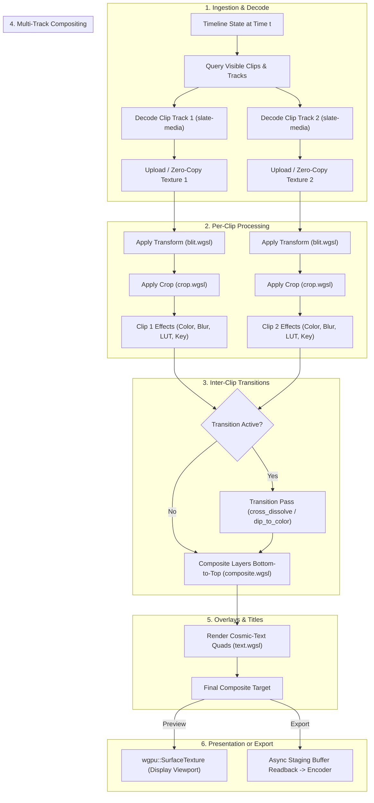
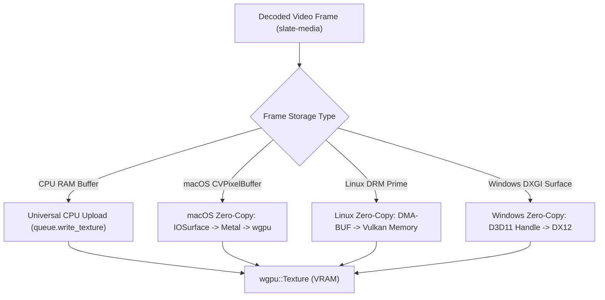

# 03 — GPU Render Pipeline (`slate-render`)

This document is the authoritative technical implementation specification for `slate-render`, the high-performance GPU compositor powering the Slate video editor. `slate-render` provides a single, unified rendering engine built on [`wgpu`](https://wgpu.rs) and WebGPU Shading Language ([WGSL](https://www.w3.org/TR/WGSL/)) that services both real-time interactive preview and high-fidelity offline export.

---

## 1. Overview

`slate-render` is responsible for transforming a temporal sequence of decoded video frames, audio tracks, vector titles, and visual effects into composite output frames according to the timeline state defined in `slate-core`.

```
                       ┌──────────────────────┐
                       │     slate-core      │
                       │ (Timeline, Effects)  │
                       └──────────┬───────────┘
                                  │ FrameRequest
                                  ▼
┌──────────────────┐   ┌──────────────────────┐   ┌──────────────────────┐
│   slate-media   │──▶│    slate-render     │──▶│     Preview GUI      │
│ (Decoded Frames) │   │  (GPU Compositor)    │   │ (wgpu::Surface)      │
└──────────────────┘   └──────────┬───────────┘   └──────────────────────┘
                                  │
                                  ▼ RenderedFrame (Offscreen)
                       ┌──────────────────────┐
                       │   slate-media Enc   │
                       │   (H.264/HEVC/ProRes)│
                       └──────────────────────┘
```

### Core Tenets
1. **Single Render Path (WYSIWYG Parity)**: The exact same WGSL shaders, color math, compositing operations, and geometry transformations are used for previewing in the timeline viewport and rendering master exports. There is no separate "fast preview math" that deviates from export colorimetry.
2. **Deterministic Output**: Given the same frame timestamp, project state, and asset sources, the compositor produces identical pixel values across repeated runs.
3. **Hardware Acceleration First**: Texture uploads leverage platform-native zero-copy sharing (Metal IOSurface on macOS, DMA-BUF on Linux, D3D11/12 shared handles on Windows) with transparent fallbacks to high-throughput CPU staging buffers.
4. **Zero-Allocation Render Loops**: GPU textures, bind groups, vertex buffers, and staging buffers are recycled through a typed `TexturePool` to prevent runtime GPU allocation stalls.

### Crate Structure
```
crates/slate-render/
├── Cargo.toml
└── src/
    ├── lib.rs                  # Crate root, re-exports, Compositor trait implementation
    ├── context.rs              # GpuContext, adapter/device selection, surface management
    ├── graph.rs                # Frame evaluation render graph & layer dependency resolution
    ├── protocol.rs             # FrameRequest, RenderedFrame, RenderQuality, error types
    ├── compositor.rs           # GpuCompositor coordinating decode, passes, and presentation
    ├── texture_pool.rs         # Scratch texture recycling and descriptor hashing
    ├── pipelines/              # Cached wgpu::RenderPipeline objects and layouts
    │   ├── mod.rs
    │   ├── blit.rs             # Affine transform & blit pipeline
    │   ├── composite.rs        # Porter-Duff alpha compositing
    │   ├── crop.rs             # Parametric crop with feathering
    │   ├── transitions.rs      # Cross-dissolve, dip-to-color
    │   ├── color_adjust.rs     # Exposure, contrast, saturation, temperature/tint
    │   ├── lut.rs              # 3D LUT cube application
    │   ├── blur.rs             # Two-pass separable Gaussian blur
    │   ├── chroma_key.rs       # Chroma extraction, spill suppression, edge erosion
    │   └── text.rs             # Cosmic-text quad rendering
    ├── shaders/                # Raw WGSL source files compiled via include_str!
    │   ├── blit.wgsl
    │   ├── composite.wgsl
    │   ├── crop.wgsl
    │   ├── cross_dissolve.wgsl
    │   ├── dip_to_color.wgsl
    │   ├── color_adjust.wgsl
    │   ├── lut_apply.wgsl
    │   ├── blur.wgsl
    │   ├── chroma_key.wgsl
    │   └── text.wgsl
    ├── text/                   # Text shaping, rasterization, glyph texture atlas
    │   ├── mod.rs
    │   ├── atlas.rs            # Shelf-bin glyph texture atlas allocator
    │   └── layout.rs           # Cosmic-text buffer shaping and run analysis
    ├── upload/                 # Platform-specific zero-copy & CPU texture upload
    │   ├── mod.rs
    │   ├── cpu.rs              # Fallback queue.write_texture with pitch alignment
    │   ├── macos.rs            # IOSurface -> Metal -> wgpu texture
    │   ├── linux.rs            # DMA-BUF -> Vulkan external memory
    │   └── windows.rs          # D3D11/DXGI shared handle -> DX12
    ├── export.rs               # Headless export loop, readback staging, audio sync
    └── plugins/                # Dynamic WGSL effect loading and sandboxing
        ├── mod.rs
        ├── schema.rs           # JSON Schema validator for effect parameters
        └── watcher.rs          # Development hot-reloader for custom shaders
```

---

## 2. Architecture

### Render Graph
Each frame evaluation executes a deterministic Directed Acyclic Graph (DAG) derived from the timeline state at timestamp $t$.



#### Detailed Pass Sequencing
1. **Clip Discovery**: Query all active tracks in `request.timeline`. For each track, locate visible video clips overlapping `request.time`.
2. **Frame Fetch**: Dispatch asynchronous decode requests to `slate-media`'s frame cache. Obtain either an in-memory raw frame buffer (`I420`, `NV12`, or `RGBA`) or a hardware zero-copy handle (`IOSurfaceRef`, `DMABufFd`, `DXGIHandle`).
3. **GPU Texture Upload**: Upload frame data into cached `wgpu::Texture` objects allocated from `TexturePool`.
4. **Per-Clip Transform & Crop**:
   - Render clip into a scratch render target matching project dimensions.
   - Apply translation, scale, rotation, anchor offset, and opacity via `blit.wgsl`.
   - Apply boundary cropping with optional feathering via `crop.wgsl`.
5. **Per-Clip Effects Chain**:
   - Ping-pong through scratch textures for each active effect attached to the clip:
     - `color_adjust.wgsl`: Adjust white balance, exposure, contrast, saturation, highlights/shadows.
     - `lut_apply.wgsl`: Apply 3D Look-Up Table via hardware 3D texture trilinear interpolation.
     - `chroma_key.wgsl`: Isolate key color, generate matte, apply spill suppression.
     - `blur.wgsl`: Two-pass Gaussian blur (horizontal ping pass, vertical pong pass).
6. **Transitions**:
   - If two overlapping clips share an active transition (e.g., cross-dissolve, dip-to-color), execute the corresponding transition pipeline with normalized progress $p \in [0.0, 1.0]$.
7. **Multi-Track Compositing**:
   - Iterate through tracks bottom-to-top (Track 0 $\rightarrow$ Track $N$).
   - Blend upper tracks onto the accumulated composite buffer using Porter-Duff source-over blending in linear color space.
8. **Text & Vector Overlays**:
   - Query visible title/subtitle elements.
   - Shape text runs via `cosmic-text`.
   - Batch-render glyph quads from the dynamic `GlyphAtlas` directly onto the composite target.
9. **Target Output**:
   - In **Preview mode**: Blit composite target onto the viewport surface texture and present.
   - In **Export mode**: Copy composite target to a staging buffer, map asynchronously, and feed pixel buffers to the output encoder.

---

### wgpu Setup & GpuContext

```rust
use std::sync::Arc;
use wgpu::{Adapter, Device, Instance, Queue, Surface, SurfaceConfiguration, TextureFormat};

pub struct GpuContext {
    pub instance: Instance,
    pub adapter: Adapter,
    pub device: Arc<Device>,
    pub queue: Arc<Queue>,
    pub surface: Option<Surface<'static>>,
    pub surface_config: parking_lot::RwLock<Option<SurfaceConfiguration>>,
    pub is_headless: bool,
    pub preferred_format: TextureFormat,
}
```

#### Device & Adapter Selection Strategy
1. **Discrete GPU Priority**: Request `PowerPreference::HighPerformance`. If a discrete GPU (e.g. Apple Silicon M-Max, NVIDIA RTX, AMD Radeon) is present, it is selected over integrated graphics.
2. **Platform Backend Mapping**:
   - **macOS / iOS**: `wgpu::Backends::METAL`
   - **Linux / Android**: `wgpu::Backends::VULKAN`
   - **Windows**: `wgpu::Backends::DX12` (with DX11 fallback if DX12 is unavailable)
3. **Headless Mode Support**: When initializing without a window (offline export CLI, continuous integration, regression tests), `GpuContext` creates an adapter and device without attaching a `wgpu::Surface`.
4. **Shared Context**: The GUI viewport and export worker threads share the same `GpuContext` (`Arc<Device>`, `Arc<Queue>`). This eliminates costly inter-device texture copies and context-switch synchronization.

#### GpuContext Initialization Code
```rust
impl GpuContext {
    pub async fn init_windowed(window: Arc<winit::window::Window>) -> Result<Self, RenderError> {
        let instance = Instance::new(wgpu::InstanceDescriptor {
            backends: wgpu::Backends::all(),
            flags: wgpu::InstanceFlags::default(),
            dx12_shader_compiler: wgpu::Dx12Compiler::Fxc,
            gles_minor_version: wgpu::Gles3MinorVersion::Automatic,
        });

        let surface = instance.create_surface(window.clone())
            .map_err(|e| RenderError::SurfaceCreation(e.to_string()))?;

        let adapter = instance.request_adapter(&wgpu::RequestAdapterOptions {
            power_preference: wgpu::PowerPreference::HighPerformance,
            compatible_surface: Some(&surface),
            force_fallback_adapter: false,
        }).await.ok_or(RenderError::NoSuitableAdapter)?;

        let (device, queue) = adapter.request_device(&wgpu::DeviceDescriptor {
            label: Some("Slate Render Device"),
            required_features: wgpu::Features::TEXTURE_ADAPTER_SPECIFIC_FORMAT_FEATURES
                | wgpu::Features::FLOAT32_FILTERABLE,
            required_limits: wgpu::Limits::default(),
            memory_hints: wgpu::MemoryHints::Performance,
        }, None).await.map_err(|e| RenderError::DeviceRequest(e.to_string()))?;

        let swapchain_capabilities = surface.get_capabilities(&adapter);
        let preferred_format = swapchain_capabilities.formats.iter()
            .copied()
            .find(|f| f.is_srgb())
            .unwrap_or(swapchain_capabilities.formats[0]);

        Ok(Self {
            instance,
            adapter,
            device: Arc::new(device),
            queue: Arc::new(queue),
            surface: Some(surface),
            surface_config: parking_lot::RwLock::new(None),
            is_headless: false,
            preferred_format,
        })
    }

    pub async fn init_headless() -> Result<Self, RenderError> {
        let instance = Instance::new(wgpu::InstanceDescriptor {
            backends: wgpu::Backends::all(),
            ..Default::default()
        });

        let adapter = instance.request_adapter(&wgpu::RequestAdapterOptions {
            power_preference: wgpu::PowerPreference::HighPerformance,
            compatible_surface: None,
            force_fallback_adapter: false,
        }).await.ok_or(RenderError::NoSuitableAdapter)?;

        let (device, queue) = adapter.request_device(&wgpu::DeviceDescriptor {
            label: Some("Slate Headless Render Device"),
            required_features: wgpu::Features::FLOAT32_FILTERABLE,
            required_limits: wgpu::Limits::default(),
            memory_hints: wgpu::MemoryHints::Performance,
        }, None).await.map_err(|e| RenderError::DeviceRequest(e.to_string()))?;

        Ok(Self {
            instance,
            adapter,
            device: Arc::new(device),
            queue: Arc::new(queue),
            surface: None,
            surface_config: parking_lot::RwLock::new(None),
            is_headless: true,
            preferred_format: TextureFormat::Rgba8UnormSrgb,
        })
    }
}
```

---

## 3. Frame Request Protocol

The frame request protocol defines the contract between the playback controller/export pipeline and the render engine.

### Types and Structs
```rust
use std::fmt;
use slate_core::time::RationalTime;
use slate_core::timeline::Timeline;

#[derive(Debug, Clone, Copy, PartialEq, Eq)]
pub enum RenderQuality {
    /// Optimized for 60fps playback: allows proxy assets, 1/2 resolution blur, lower tap count
    Preview,
    /// Exact full-resolution render: 100% full-resolution assets, 16-tap blur, 32-bit float color
    Export,
}

pub struct FrameRequest<'a> {
    /// Exact timeline timestamp requested
    pub time: RationalTime,
    /// Requested output resolution (width, height) in pixels
    pub output_size: (u32, u32),
    /// Immutable snapshot of the timeline at request time
    pub timeline: &'a Timeline,
    /// Quality level directing asset selection and shader precision
    pub quality: RenderQuality,
}

pub struct RenderedFrame {
    /// Completed GPU texture resident in VRAM
    pub texture: Arc<wgpu::Texture>,
    /// Optional mapped CPU buffer (populated in Export mode or when explicit readback requested)
    pub cpu_data: Option<Vec<u8>>,
    /// Timestamp matching the request
    pub timestamp: RationalTime,
    /// Frame dimensions in pixels (width, height)
    pub dimensions: (u32, u32),
    /// Texture pixel format
    pub format: wgpu::TextureFormat,
}

#[derive(Debug)]
pub enum RenderError {
    NoSuitableAdapter,
    DeviceRequest(String),
    SurfaceCreation(String),
    DeviceLost,
    OutOfMemory,
    ClipDecodeFailed { clip_id: u64, error: String },
    ShaderCompilationFailed { shader_name: String, error: String },
    TextureUploadFailed(String),
    ReadbackFailed(String),
    UnsupportedPixelFormat(wgpu::TextureFormat),
    Cancelled,
}

impl fmt::Display for RenderError {
    fn fmt(&self, f: &mut fmt::Formatter<'_>) -> fmt::Result {
        match self {
            Self::NoSuitableAdapter => write!(f, "No suitable GPU adapter found matching requirements"),
            Self::DeviceRequest(e) => write!(f, "Failed to request GPU device: {e}"),
            Self::SurfaceCreation(e) => write!(f, "Failed to create window surface: {e}"),
            Self::DeviceLost => write!(f, "GPU device was lost or disconnected"),
            Self::OutOfMemory => write!(f, "GPU allocation exceeded available VRAM"),
            Self::ClipDecodeFailed { clip_id, error } => write!(f, "Failed to decode clip {clip_id}: {error}"),
            Self::ShaderCompilationFailed { shader_name, error } => {
                write!(f, "Failed to compile WGSL shader '{shader_name}': {error}")
            }
            Self::TextureUploadFailed(e) => write!(f, "Failed to upload texture data: {e}"),
            Self::ReadbackFailed(e) => write!(f, "Asynchronous texture readback failed: {e}"),
            Self::UnsupportedPixelFormat(fmt) => write!(f, "Unsupported texture format: {fmt:?}"),
            Self::Cancelled => write!(f, "Render operation was cancelled"),
        }
    }
}

impl std::error::Error for RenderError {}
```

---

## 4. WGSL Shaders

All shaders are written in WGSL and adhere strictly to WebGPU specification guidelines. They use full-screen quad procedural vertex generation to eliminate vertex buffer overhead.

### Full-Screen Quad Vertex Shader Standard
All single-input and two-input passes use a standard procedural vertex shader (`vs_fullscreen`) that outputs a clip-space quad and UV coordinates without needing a vertex buffer:
```wgsl
struct VertexOutput {
    @builtin(position) position: vec4<f32>,
    @location(0) uv: vec2<f32>,
};

@vertex
fn vs_fullscreen(@builtin(vertex_index) in_vertex_index: u32) -> VertexOutput {
    var out: VertexOutput;
    // Generate full-screen triangle: (0,0), (2,0), (0,2) covering (-1,-1) to (1,1)
    let x = f32(i32(in_vertex_index << 1u) & 2) * 2.0 - 1.0;
    let y = f32(i32(in_vertex_index & 2u)) * -2.0 + 1.0;
    out.position = vec4<f32>(x, y, 0.0, 1.0);
    out.uv = vec2<f32>((x + 1.0) * 0.5, (1.0 - y) * 0.5);
    return out;
}
```

---

### 4.1 Core Shaders

#### `blit.wgsl`
Transforms an incoming clip texture using an affine 2D transform matrix (translation, rotation, scale, anchor point) and modulates master opacity.

##### Bind Group Layout
- **Group 0**: Uniform buffer `BlitUniforms` (`@binding(0)`: Uniform)
- **Group 1**: Texture `t_diffuse` (`@binding(0)`: `texture_2d<f32>`), Sampler `s_diffuse` (`@binding(1)`: `sampler`)

##### Uniform Buffer Structure
```rust
#[repr(C)]
#[derive(Debug, Clone, Copy, bytemuck::Pod, bytemuck::Zeroable)]
pub struct BlitUniforms {
    /// 3x3 affine transform matrix embedded into 4x4 (column-major)
    pub transform: [[f32; 4]; 4],
    /// Normalized opacity [0.0, 1.0]
    pub opacity: f32,
    pub _padding: [f32; 3],
}
```

```wgsl
struct BlitUniforms {
    transform: mat4x4<f32>,
    opacity: f32,
    _pad0: f32,
    _pad1: f32,
    _pad2: f32,
};
```

##### WGSL Source Skeleton
```wgsl
struct VertexOutput {
    @builtin(position) position: vec4<f32>,
    @location(0) uv: vec2<f32>,
};

@group(0) @binding(0) var<uniform> uniforms: BlitUniforms;
@group(1) @binding(0) var t_diffuse: texture_2d<f32>;
@group(1) @binding(1) var s_diffuse: sampler;

@vertex
fn vs_main(@builtin(vertex_index) vertex_index: u32) -> VertexOutput {
    var out: VertexOutput;
    // Base unit quad vertices: (0,0), (1,0), (0,1), (1,1)
    var pos = vec2<f32>(0.0, 0.0);
    if (vertex_index == 1u) { pos = vec2<f32>(1.0, 0.0); }
    else if (vertex_index == 2u) { pos = vec2<f32>(0.0, 1.0); }
    else if (vertex_index == 3u) { pos = vec2<f32>(1.0, 1.0); }

    let transformed = uniforms.transform * vec4<f32>(pos, 0.0, 1.0);
    out.position = vec4<f32>(transformed.xy, 0.0, 1.0);
    out.uv = pos;
    return out;
}

@fragment
fn fs_main(in: VertexOutput) -> @location(0) vec4<f32> {
    if (in.uv.x < 0.0 || in.uv.x > 1.0 || in.uv.y < 0.0 || in.uv.y > 1.0) {
        return vec4<f32>(0.0);
    }
    let color = textureSample(t_diffuse, s_diffuse, in.uv);
    return vec4<f32>(color.rgb * uniforms.opacity, color.a * uniforms.opacity);
}
```

---

#### `composite.wgsl`
Performs Porter-Duff source-over compositing of a source layer onto a destination buffer in linear color space.

##### Bind Group Layout
- **Group 0**: Uniform buffer `CompositeUniforms` (`@binding(0)`: Uniform)
- **Group 1**: Destination texture `t_dst` (`@binding(0)`), Sampler `s_dst` (`@binding(1)`)
- **Group 2**: Source texture `t_src` (`@binding(0)`), Sampler `s_src` (`@binding(1)`)

##### Uniform Buffer Structure
```rust
#[repr(C)]
#[derive(Debug, Clone, Copy, bytemuck::Pod, bytemuck::Zeroable)]
pub struct CompositeUniforms {
    pub blend_mode: u32,       // 0: Normal (Source-Over), 1: Multiply, 2: Screen, 3: Add
    pub src_opacity: f32,      // Multiplier for source layer
    pub is_premultiplied: u32, // 1 if source texture is premultiplied alpha
    pub _padding: f32,
}
```

```wgsl
struct CompositeUniforms {
    blend_mode: u32,
    src_opacity: f32,
    is_premultiplied: u32,
    _pad0: f32,
};
```

##### WGSL Source Skeleton
```wgsl
struct VertexOutput {
    @builtin(position) position: vec4<f32>,
    @location(0) uv: vec2<f32>,
};

@group(0) @binding(0) var<uniform> uniforms: CompositeUniforms;
@group(1) @binding(0) var t_dst: texture_2d<f32>;
@group(1) @binding(1) var s_dst: sampler;
@group(2) @binding(0) var t_src: texture_2d<f32>;
@group(2) @binding(1) var s_src: sampler;

@vertex
fn vs_main(@builtin(vertex_index) id: u32) -> VertexOutput {
    var out: VertexOutput;
    let x = f32(i32(id << 1u) & 2) * 2.0 - 1.0;
    let y = f32(i32(id & 2u)) * -2.0 + 1.0;
    out.position = vec4<f32>(x, y, 0.0, 1.0);
    out.uv = vec2<f32>((x + 1.0) * 0.5, (1.0 - y) * 0.5);
    return out;
}

@fragment
fn fs_main(in: VertexOutput) -> @location(0) vec4<f32> {
    let dst = textureSample(t_dst, s_dst, in.uv);
    var src = textureSample(t_src, s_src, in.uv);

    var src_a = src.a * uniforms.src_opacity;
    var src_rgb = src.rgb;
    if (uniforms.is_premultiplied == 0u) {
        src_rgb = src_rgb * src_a;
    } else {
        src_rgb = src_rgb * uniforms.src_opacity;
    }

    // Porter-Duff Source-Over equation: C_out = C_src + C_dst * (1.0 - A_src)
    var out_rgb: vec3<f32>;
    let out_a = src_a + dst.a * (1.0 - src_a);

    switch uniforms.blend_mode {
        case 1u: { // Multiply
            out_rgb = src_rgb * dst.rgb + src_rgb * (1.0 - dst.a) + dst.rgb * (1.0 - src_a);
        }
        case 2u: { // Screen
            out_rgb = src_rgb + dst.rgb - (src_rgb * dst.rgb);
        }
        case 3u: { // Additive
            out_rgb = src_rgb + dst.rgb;
        }
        default: { // 0u: Normal Source-Over
            out_rgb = src_rgb + dst.rgb * (1.0 - src_a);
        }
    }

    return vec4<f32>(out_rgb, out_a);
}
```

---

#### `crop.wgsl`
Applies a rectangular crop box with customizable soft feathering around the boundary edges.

##### Bind Group Layout
- **Group 0**: Uniform buffer `CropUniforms` (`@binding(0)`: Uniform)
- **Group 1**: Input texture `t_input` (`@binding(0)`), Sampler `s_input` (`@binding(1)`)

##### Uniform Buffer Structure
```rust
#[repr(C)]
#[derive(Debug, Clone, Copy, bytemuck::Pod, bytemuck::Zeroable)]
pub struct CropUniforms {
    /// Inset margins: [left, top, right, bottom] in normalized 0.0..1.0
    pub margins: [f32; 4],
    /// Soft edge width in normalized coordinates
    pub feather: f32,
    pub _padding: [f32; 3],
}
```

```wgsl
struct CropUniforms {
    margins: vec4<f32>, // x: left, y: top, z: right, w: bottom
    feather: f32,
    _pad0: f32,
    _pad1: f32,
    _pad2: f32,
};
```

##### WGSL Source Skeleton
```wgsl
struct VertexOutput {
    @builtin(position) position: vec4<f32>,
    @location(0) uv: vec2<f32>,
};

@group(0) @binding(0) var<uniform> uniforms: CropUniforms;
@group(1) @binding(0) var t_input: texture_2d<f32>;
@group(1) @binding(1) var s_input: sampler;

@vertex
fn vs_main(@builtin(vertex_index) id: u32) -> VertexOutput {
    var out: VertexOutput;
    let x = f32(i32(id << 1u) & 2) * 2.0 - 1.0;
    let y = f32(i32(id & 2u)) * -2.0 + 1.0;
    out.position = vec4<f32>(x, y, 0.0, 1.0);
    out.uv = vec2<f32>((x + 1.0) * 0.5, (1.0 - y) * 0.5);
    return out;
}

@fragment
fn fs_main(in: VertexOutput) -> @location(0) vec4<f32> {
    let color = textureSample(t_input, s_input, in.uv);
    let left = uniforms.margins.x;
    let top = uniforms.margins.y;
    let right = 1.0 - uniforms.margins.z;
    let bottom = 1.0 - uniforms.margins.w;
    let f = max(uniforms.feather, 1e-5);

    let edge_l = smoothstep(left, left + f, in.uv.x);
    let edge_r = smoothstep(right, right - f, in.uv.x);
    let edge_t = smoothstep(top, top + f, in.uv.y);
    let edge_b = smoothstep(bottom, bottom - f, in.uv.y);

    let mask = edge_l * edge_r * edge_t * edge_b;
    return vec4<f32>(color.rgb * mask, color.a * mask);
}
```

---

### 4.2 Transition Shaders

#### `cross_dissolve.wgsl`
Interpolates smoothly between an outgoing clip $A$ and an incoming clip $B$.

##### Bind Group Layout
- **Group 0**: Uniform buffer `TransitionUniforms` (`@binding(0)`: Uniform)
- **Group 1**: Texture Clip A `t_clip_a` (`@binding(0)`), Sampler `s_clip_a` (`@binding(1)`)
- **Group 2**: Texture Clip B `t_clip_b` (`@binding(0)`), Sampler `s_clip_b` (`@binding(1)`)

##### Uniform Buffer Structure
```rust
#[repr(C)]
#[derive(Debug, Clone, Copy, bytemuck::Pod, bytemuck::Zeroable)]
pub struct TransitionUniforms {
    pub progress: f32, // 0.0 (all A) -> 1.0 (all B)
    pub ease_curve: u32, // 0: Linear, 1: SmoothStep, 2: EaseInOutCubic
    pub _padding: [f32; 2],
}
```

```wgsl
struct TransitionUniforms {
    progress: f32,
    ease_curve: u32,
    _pad0: f32,
    _pad1: f32,
};
```

##### WGSL Source Skeleton
```wgsl
struct VertexOutput {
    @builtin(position) position: vec4<f32>,
    @location(0) uv: vec2<f32>,
};

@group(0) @binding(0) var<uniform> uniforms: TransitionUniforms;
@group(1) @binding(0) var t_clip_a: texture_2d<f32>;
@group(1) @binding(1) var s_clip_a: sampler;
@group(2) @binding(0) var t_clip_b: texture_2d<f32>;
@group(2) @binding(1) var s_clip_b: sampler;

@vertex
fn vs_main(@builtin(vertex_index) id: u32) -> VertexOutput {
    var out: VertexOutput;
    let x = f32(i32(id << 1u) & 2) * 2.0 - 1.0;
    let y = f32(i32(id & 2u)) * -2.0 + 1.0;
    out.position = vec4<f32>(x, y, 0.0, 1.0);
    out.uv = vec2<f32>((x + 1.0) * 0.5, (1.0 - y) * 0.5);
    return out;
}

@fragment
fn fs_main(in: VertexOutput) -> @location(0) vec4<f32> {
    let col_a = textureSample(t_clip_a, s_clip_a, in.uv);
    let col_b = textureSample(t_clip_b, s_clip_b, in.uv);

    var p = clamp(uniforms.progress, 0.0, 1.0);
    if (uniforms.ease_curve == 1u) {
        p = smoothstep(0.0, 1.0, p);
    } else if (uniforms.ease_curve == 2u) {
        if (p < 0.5) {
            p = 4.0 * p * p * p;
        } else {
            let f = (2.0 * p) - 2.0;
            p = 0.5 * f * f * f + 1.0;
        }
    }

    return mix(col_a, col_b, p);
}
```

---

#### `dip_to_color.wgsl`
Fades out clip $A$ to a solid color (e.g. solid black or white) at $p = 0.5$, then fades in clip $B$ from $0.5 \rightarrow 1.0$.

##### Bind Group Layout
- **Group 0**: Uniform buffer `DipUniforms` (`@binding(0)`: Uniform)
- **Group 1**: Texture Clip A `t_clip_a` (`@binding(0)`), Sampler `s_clip_a` (`@binding(1)`)
- **Group 2**: Texture Clip B `t_clip_b` (`@binding(0)`), Sampler `s_clip_b` (`@binding(1)`)

##### Uniform Buffer Structure
```rust
#[repr(C)]
#[derive(Debug, Clone, Copy, bytemuck::Pod, bytemuck::Zeroable)]
pub struct DipUniforms {
    pub dip_color: [f32; 4], // RGBA color to dip into (e.g. [0, 0, 0, 1] for black)
    pub progress: f32,       // 0.0 to 1.0
    pub _padding: [f32; 3],
}
```

```wgsl
struct DipUniforms {
    dip_color: vec4<f32>,
    progress: f32,
    _pad0: f32,
    _pad1: f32,
    _pad2: f32,
};
```

##### WGSL Source Skeleton
```wgsl
struct VertexOutput {
    @builtin(position) position: vec4<f32>,
    @location(0) uv: vec2<f32>,
};

@group(0) @binding(0) var<uniform> uniforms: DipUniforms;
@group(1) @binding(0) var t_clip_a: texture_2d<f32>;
@group(1) @binding(1) var s_clip_a: sampler;
@group(2) @binding(0) var t_clip_b: texture_2d<f32>;
@group(2) @binding(1) var s_clip_b: sampler;

@vertex
fn vs_main(@builtin(vertex_index) id: u32) -> VertexOutput {
    var out: VertexOutput;
    let x = f32(i32(id << 1u) & 2) * 2.0 - 1.0;
    let y = f32(i32(id & 2u)) * -2.0 + 1.0;
    out.position = vec4<f32>(x, y, 0.0, 1.0);
    out.uv = vec2<f32>((x + 1.0) * 0.5, (1.0 - y) * 0.5);
    return out;
}

@fragment
fn fs_main(in: VertexOutput) -> @location(0) vec4<f32> {
    let p = uniforms.progress;
    if (p < 0.5) {
        let t = p * 2.0; // 0.0 -> 1.0 (fade A to dip_color)
        let col_a = textureSample(t_clip_a, s_clip_a, in.uv);
        return mix(col_a, uniforms.dip_color, t);
    } else {
        let t = (p - 0.5) * 2.0; // 0.0 -> 1.0 (fade dip_color to B)
        let col_b = textureSample(t_clip_b, s_clip_b, in.uv);
        return mix(uniforms.dip_color, col_b, t);
    }
}
```

---

### 4.3 Effect Shaders

#### `color_adjust.wgsl`
Primary color grading pass: Exposure (EV stops), Contrast, Saturation, Temperature, Tint, and tonal range adjustments.

##### Bind Group Layout
- **Group 0**: Uniform buffer `ColorAdjustUniforms` (`@binding(0)`: Uniform)
- **Group 1**: Texture `t_input` (`@binding(0)`), Sampler `s_input` (`@binding(1)`)

##### Uniform Buffer Structure
```rust
#[repr(C)]
#[derive(Debug, Clone, Copy, bytemuck::Pod, bytemuck::Zeroable)]
pub struct ColorAdjustUniforms {
    pub exposure: f32,    // EV stops [-5.0, 5.0], default 0.0
    pub contrast: f32,    // Multiplier [0.0, 3.0], default 1.0
    pub saturation: f32,  // Multiplier [0.0, 3.0], default 1.0
    pub temperature: f32, // Kelvin shift [-1.0 (cool), 1.0 (warm)], default 0.0
    pub tint: f32,        // Green/Magenta shift [-1.0, 1.0], default 0.0
    pub highlights: f32,  // Tone curve highlight offset [-1.0, 1.0]
    pub shadows: f32,     // Tone curve shadow offset [-1.0, 1.0]
    pub _padding: f32,
}
```

```wgsl
struct ColorAdjustUniforms {
    exposure: f32,
    contrast: f32,
    saturation: f32,
    temperature: f32,
    tint: f32,
    highlights: f32,
    shadows: f32,
    _pad0: f32,
};
```

##### WGSL Source Skeleton
```wgsl
struct VertexOutput {
    @builtin(position) position: vec4<f32>,
    @location(0) uv: vec2<f32>,
};

@group(0) @binding(0) var<uniform> uniforms: ColorAdjustUniforms;
@group(1) @binding(0) var t_input: texture_2d<f32>;
@group(1) @binding(1) var s_input: sampler;

@vertex
fn vs_main(@builtin(vertex_index) id: u32) -> VertexOutput {
    var out: VertexOutput;
    let x = f32(i32(id << 1u) & 2) * 2.0 - 1.0;
    let y = f32(i32(id & 2u)) * -2.0 + 1.0;
    out.position = vec4<f32>(x, y, 0.0, 1.0);
    out.uv = vec2<f32>((x + 1.0) * 0.5, (1.0 - y) * 0.5);
    return out;
}

const REC709_LUMA: vec3<f32> = vec3<f32>(0.2126, 0.7152, 0.0722);

@fragment
fn fs_main(in: VertexOutput) -> @location(0) vec4<f32> {
    let raw = textureSample(t_input, s_input, in.uv);
    var rgb = raw.rgb;

    // 1. Exposure: 2^EV
    rgb = rgb * exp2(uniforms.exposure);

    // 2. White Balance / Temperature & Tint
    let temp_shift = vec3<f32>(uniforms.temperature * 0.1, 0.0, -uniforms.temperature * 0.1);
    let tint_shift = vec3<f32>(uniforms.tint * 0.05, -uniforms.tint * 0.1, uniforms.tint * 0.05);
    rgb = max(rgb + temp_shift + tint_shift, vec3<f32>(0.0));

    // 3. Contrast around midpoint 0.18 (linear scene reference)
    rgb = max((rgb - vec3<f32>(0.18)) * uniforms.contrast + vec3<f32>(0.18), vec3<f32>(0.0));

    // 4. Highlights & Shadows
    let luma = dot(rgb, REC709_LUMA);
    let shadow_mask = 1.0 - smoothstep(0.0, 0.5, luma);
    let highlight_mask = smoothstep(0.5, 1.0, luma);
    rgb = rgb + (rgb * uniforms.shadows * shadow_mask * 0.5);
    rgb = rgb + (rgb * uniforms.highlights * highlight_mask * 0.5);

    // 5. Saturation
    let final_luma = dot(rgb, REC709_LUMA);
    rgb = mix(vec3<f32>(final_luma), rgb, uniforms.saturation);

    return vec4<f32>(max(rgb, vec3<f32>(0.0)), raw.a);
}
```

---

#### `lut_apply.wgsl`
Applies industry-standard 3D Look-Up Tables (`.cube` files parsed into a 3D texture). Trilinear interpolation is executed in hardware using a 3D texture sampler.

##### Bind Group Layout
- **Group 0**: Uniform buffer `LutUniforms` (`@binding(0)`: Uniform)
- **Group 1**: 2D Input texture `t_input` (`@binding(0)`), 2D Sampler `s_input` (`@binding(1)`)
- **Group 2**: 3D LUT texture `t_lut` (`@binding(0)`: `texture_3d<f32>`), 3D Filtering Sampler `s_lut` (`@binding(1)`: `sampler`)

##### Uniform Buffer Structure
```rust
#[repr(C)]
#[derive(Debug, Clone, Copy, bytemuck::Pod, bytemuck::Zeroable)]
pub struct LutUniforms {
    pub lut_size: f32,  // Edge dimension, typically 33.0 or 65.0
    pub intensity: f32, // Blend weight [0.0, 1.0]
    pub _padding: [f32; 2],
}
```

```wgsl
struct LutUniforms {
    lut_size: f32,
    intensity: f32,
    _pad0: f32,
    _pad1: f32,
};
```

##### WGSL Source Skeleton
```wgsl
struct VertexOutput {
    @builtin(position) position: vec4<f32>,
    @location(0) uv: vec2<f32>,
};

@group(0) @binding(0) var<uniform> uniforms: LutUniforms;
@group(1) @binding(0) var t_input: texture_2d<f32>;
@group(1) @binding(1) var s_input: sampler;
@group(2) @binding(0) var t_lut: texture_3d<f32>;
@group(2) @binding(1) var s_lut: sampler;

@vertex
fn vs_main(@builtin(vertex_index) id: u32) -> VertexOutput {
    var out: VertexOutput;
    let x = f32(i32(id << 1u) & 2) * 2.0 - 1.0;
    let y = f32(i32(id & 2u)) * -2.0 + 1.0;
    out.position = vec4<f32>(x, y, 0.0, 1.0);
    out.uv = vec2<f32>((x + 1.0) * 0.5, (1.0 - y) * 0.5);
    return out;
}

@fragment
fn fs_main(in: VertexOutput) -> @location(0) vec4<f32> {
    let original = textureSample(t_input, s_input, in.uv);
    let clamped_rgb = clamp(original.rgb, vec3<f32>(0.0), vec3<f32>(1.0));

    // Proper half-texel offset for 3D LUT sampling:
    // coord = (color * (size - 1.0) + 0.5) / size
    let scale = (uniforms.lut_size - 1.0) / uniforms.lut_size;
    let offset = 0.5 / uniforms.lut_size;
    let lut_coord = clamped_rgb * scale + vec3<f32>(offset);

    let graded = textureSample(t_lut, s_lut, lut_coord).rgb;
    let final_rgb = mix(original.rgb, graded, uniforms.intensity);
    return vec4<f32>(final_rgb, original.a);
}
```

---

#### `blur.wgsl`
Two-pass separable Gaussian blur (Horizontal pass followed by Vertical pass) executing in $O(2N)$ instead of $O(N^2)$.

##### Bind Group Layout
- **Group 0**: Uniform buffer `BlurUniforms` (`@binding(0)`: Uniform)
- **Group 1**: Input texture `t_input` (`@binding(0)`), Sampler `s_input` (`@binding(1)`)

##### Uniform Buffer Structure
```rust
#[repr(C)]
#[derive(Debug, Clone, Copy, bytemuck::Pod, bytemuck::Zeroable)]
pub struct BlurUniforms {
    /// Direction vector: [1.0 / width, 0.0] for Horiz, [0.0, 1.0 / height] for Vert
    pub direction: [f32; 2],
    /// Blur tap radius (up to 15 taps)
    pub radius: i32,
    pub sigma: f32,
    /// Precomputed Gaussian weights (packed as vec4s for 16-byte alignment)
    pub weights: [[f32; 4]; 4],
}
```

```wgsl
struct BlurUniforms {
    direction: vec2<f32>,
    radius: i32,
    sigma: f32,
    weights_0: vec4<f32>,
    weights_1: vec4<f32>,
    weights_2: vec4<f32>,
    weights_3: vec4<f32>,
};
```

##### WGSL Source Skeleton
```wgsl
struct VertexOutput {
    @builtin(position) position: vec4<f32>,
    @location(0) uv: vec2<f32>,
};

@group(0) @binding(0) var<uniform> uniforms: BlurUniforms;
@group(1) @binding(0) var t_input: texture_2d<f32>;
@group(1) @binding(1) var s_input: sampler;

@vertex
fn vs_main(@builtin(vertex_index) id: u32) -> VertexOutput {
    var out: VertexOutput;
    let x = f32(i32(id << 1u) & 2) * 2.0 - 1.0;
    let y = f32(i32(id & 2u)) * -2.0 + 1.0;
    out.position = vec4<f32>(x, y, 0.0, 1.0);
    out.uv = vec2<f32>((x + 1.0) * 0.5, (1.0 - y) * 0.5);
    return out;
}

fn get_weight(index: i32) -> f32 {
    let idx = clamp(index, 0, 15);
    let vec_idx = idx / 4;
    let comp_idx = idx % 4;
    var w_vec: vec4<f32>;
    if (vec_idx == 0) { w_vec = uniforms.weights_0; }
    else if (vec_idx == 1) { w_vec = uniforms.weights_1; }
    else if (vec_idx == 2) { w_vec = uniforms.weights_2; }
    else { w_vec = uniforms.weights_3; }
    return w_vec[comp_idx];
}

@fragment
fn fs_main(in: VertexOutput) -> @location(0) vec4<f32> {
    var accum = textureSample(t_input, s_input, in.uv) * get_weight(0);
    let r = uniforms.radius;

    for (var i = 1; i <= r; i = i + 1) {
        let offset = uniforms.direction * f32(i);
        let w = get_weight(i);
        let sample_pos = textureSample(t_input, s_input, in.uv + offset);
        let sample_neg = textureSample(t_input, s_input, in.uv - offset);
        accum = accum + (sample_pos + sample_neg) * w;
    }

    return accum;
}
```

---

#### `chroma_key.wgsl`
Green screen / blue screen extraction with similarity thresholding, edge smoothness, and despill suppression.

##### Bind Group Layout
- **Group 0**: Uniform buffer `ChromaKeyUniforms` (`@binding(0)`: Uniform)
- **Group 1**: Input texture `t_input` (`@binding(0)`), Sampler `s_input` (`@binding(1)`)

##### Uniform Buffer Structure
```rust
#[repr(C)]
#[derive(Debug, Clone, Copy, bytemuck::Pod, bytemuck::Zeroable)]
pub struct ChromaKeyUniforms {
    pub key_color: [f32; 4],     // Target color [R, G, B, 1.0]
    pub similarity: f32,        // Threshold cutoff [0.0, 1.0]
    pub smoothness: f32,        // Falloff feathering [0.0, 1.0]
    pub spill_suppression: f32, // Despill intensity [0.0, 1.0]
    pub edge_erosion: f32,      // Edge contraction [-1.0, 1.0]
}
```

```wgsl
struct ChromaKeyUniforms {
    key_color: vec4<f32>,
    similarity: f32,
    smoothness: f32,
    spill_suppression: f32,
    edge_erosion: f32,
};
```

##### WGSL Source Skeleton
```wgsl
struct VertexOutput {
    @builtin(position) position: vec4<f32>,
    @location(0) uv: vec2<f32>,
};

@group(0) @binding(0) var<uniform> uniforms: ChromaKeyUniforms;
@group(1) @binding(0) var t_input: texture_2d<f32>;
@group(1) @binding(1) var s_input: sampler;

@vertex
fn vs_main(@builtin(vertex_index) id: u32) -> VertexOutput {
    var out: VertexOutput;
    let x = f32(i32(id << 1u) & 2) * 2.0 - 1.0;
    let y = f32(i32(id & 2u)) * -2.0 + 1.0;
    out.position = vec4<f32>(x, y, 0.0, 1.0);
    out.uv = vec2<f32>((x + 1.0) * 0.5, (1.0 - y) * 0.5);
    return out;
}

fn rgb_to_ycbcr(rgb: vec3<f32>) -> vec3<f32> {
    let y = 0.299 * rgb.r + 0.587 * rgb.g + 0.114 * rgb.b;
    let cb = -0.168736 * rgb.r - 0.331264 * rgb.g + 0.5 * rgb.b;
    let cr = 0.5 * rgb.r - 0.418688 * rgb.g - 0.081312 * rgb.b;
    return vec3<f32>(y, cb, cr);
}

@fragment
fn fs_main(in: VertexOutput) -> @location(0) vec4<f32> {
    var col = textureSample(t_input, s_input, in.uv);
    let sample_yuv = rgb_to_ycbcr(col.rgb);
    let key_yuv = rgb_to_ycbcr(uniforms.key_color.rgb);

    // Color distance in chromaticity space (Cb, Cr)
    let d = distance(sample_yuv.yz, key_yuv.yz);

    let sim = uniforms.similarity;
    let sm = max(uniforms.smoothness, 1e-4);
    var alpha = smoothstep(sim, sim + sm, d);

    // Apply edge erosion
    alpha = clamp(alpha + uniforms.edge_erosion, 0.0, 1.0);

    // Spill suppression: reduce green/blue cast on foreground
    var rgb = col.rgb;
    if (uniforms.spill_suppression > 0.0) {
        if (uniforms.key_color.g > uniforms.key_color.b) {
            // Green despill: limit G to max(R, B)
            let max_rb = max(rgb.r, rgb.b);
            let despill_g = mix(rgb.g, min(rgb.g, max_rb), uniforms.spill_suppression);
            rgb.g = despill_g;
        } else {
            // Blue despill: limit B to max(R, G)
            let max_rg = max(rgb.r, rgb.g);
            let despill_b = mix(rgb.b, min(rgb.b, max_rg), uniforms.spill_suppression);
            rgb.b = despill_b;
        }
    }

    return vec4<f32>(rgb * alpha, col.a * alpha);
}
```

---

### 4.4 Text Rendering

#### Layout & Atlas Management
- Text layout and shaping are handled via [`cosmic-text`](https://github.com/pop-os/cosmic-text), supporting complex scripts, BiDi Arabic/Hebrew, font fallback, and OpenType ligatures.
- Shaped glyphs are cached in a single-channel `R8Unorm` texture atlas (`GlyphAtlas`).
- Dynamic shelf-bin allocation maps character glyphs into coordinates with subpixel offsets.

#### `text.wgsl`
Renders instanced or batched glyph quads from the glyph texture atlas with customizable font colors, outlines, drop shadows, and background bounding boxes.

##### Vertex Format & Uniforms
```rust
#[repr(C)]
#[derive(Debug, Clone, Copy, bytemuck::Pod, bytemuck::Zeroable)]
pub struct TextUniforms {
    pub projection: [[f32; 4]; 4], // Orthographic projection: screen coords -> clip space
}

#[repr(C)]
#[derive(Debug, Clone, Copy, bytemuck::Pod, bytemuck::Zeroable)]
pub struct GlyphVertex {
    pub position: [f32; 2],       // Quad screen coordinates (x, y)
    pub uv: [f32; 2],             // UV coordinates in GlyphAtlas texture
    pub color: [f32; 4],          // Glyph primary color (RGBA)
    pub outline_color: [f32; 4],  // Stroke/outline color (RGBA)
    pub outline_width: f32,       // Outline width (0.0 for none)
    pub shadow_offset: [f32; 2],  // Drop shadow offset
    pub shadow_color: [f32; 4],   // Drop shadow color
}
```

##### WGSL Source Skeleton
```wgsl
struct TextUniforms {
    projection: mat4x4<f32>,
};

@group(0) @binding(0) var<uniform> uniforms: TextUniforms;
@group(1) @binding(0) var t_atlas: texture_2d<f32>;
@group(1) @binding(1) var s_atlas: sampler;

struct VertexInput {
    @location(0) position: vec2<f32>,
    @location(1) uv: vec2<f32>,
    @location(2) color: vec4<f32>,
    @location(3) outline_color: vec4<f32>,
    @location(4) outline_width: f32,
    @location(5) shadow_offset: vec2<f32>,
    @location(6) shadow_color: vec4<f32>,
};

struct VertexOutput {
    @builtin(position) position: vec4<f32>,
    @location(0) uv: vec2<f32>,
    @location(1) color: vec4<f32>,
    @location(2) outline_color: vec4<f32>,
    @location(3) outline_width: f32,
    @location(4) shadow_offset: vec2<f32>,
    @location(5) shadow_color: vec4<f32>,
};

@vertex
fn vs_main(in: VertexInput) -> VertexOutput {
    var out: VertexOutput;
    out.position = uniforms.projection * vec4<f32>(in.position, 0.0, 1.0);
    out.uv = in.uv;
    out.color = in.color;
    out.outline_color = in.outline_color;
    out.outline_width = in.outline_width;
    out.shadow_offset = in.shadow_offset;
    out.shadow_color = in.shadow_color;
    return out;
}

@fragment
fn fs_main(in: VertexOutput) -> @location(0) vec4<f32> {
    // Single-channel R8Unorm atlas: red channel stores alpha coverage
    let glyph_coverage = textureSample(t_atlas, s_atlas, in.uv).r;

    // Optional Drop Shadow sample
    var shadow_alpha = 0.0;
    if (in.shadow_color.a > 0.0) {
        let shadow_coverage = textureSample(t_atlas, s_atlas, in.uv - in.shadow_offset).r;
        shadow_alpha = shadow_coverage * in.shadow_color.a;
    }

    // Blend: Shadow -> Outline -> Glyph
    var out_rgb = in.color.rgb;
    var out_a = glyph_coverage * in.color.a;

    if (in.outline_width > 0.0 && glyph_coverage < 0.9) {
        // Outline stroke falloff
        let stroke = smoothstep(0.0, in.outline_width, glyph_coverage);
        out_rgb = mix(in.outline_color.rgb, out_rgb, glyph_coverage);
        out_a = max(out_a, stroke * in.outline_color.a);
    }

    if (shadow_alpha > out_a) {
        out_rgb = mix(in.shadow_color.rgb, out_rgb, out_a);
        out_a = max(out_a, shadow_alpha);
    }

    return vec4<f32>(out_rgb * out_a, out_a);
}
```

---

## 5. Render Pipeline Objects

The compositor encapsulates all GPU state in `RenderPipelines`. Pipelines and bind group layouts are compiled once during startup.

```rust
use std::sync::Arc;
use wgpu::{BindGroupLayout, Device, RenderPipeline, Sampler, TextureFormat};
use crate::text::atlas::GlyphAtlas;
use crate::pipelines::lut::LutCache;

pub struct RenderPipelines {
    pub blit: RenderPipeline,
    pub blit_layout: BindGroupLayout,

    pub composite: RenderPipeline,
    pub composite_layout: BindGroupLayout,

    pub crop: RenderPipeline,
    pub crop_layout: BindGroupLayout,

    pub cross_dissolve: RenderPipeline,
    pub cross_dissolve_layout: BindGroupLayout,

    pub dip_to_color: RenderPipeline,
    pub dip_to_color_layout: BindGroupLayout,

    pub color_adjust: RenderPipeline,
    pub color_adjust_layout: BindGroupLayout,

    pub lut_apply: RenderPipeline,
    pub lut_layout: BindGroupLayout,

    pub blur: RenderPipeline,
    pub blur_layout: BindGroupLayout,

    pub chroma_key: RenderPipeline,
    pub chroma_key_layout: BindGroupLayout,

    pub text: RenderPipeline,
    pub text_layout: BindGroupLayout,

    // Shared samplers
    pub linear_clamp_sampler: Arc<Sampler>,
    pub linear_3d_sampler: Arc<Sampler>,

    // Dynamic caches
    pub glyph_atlas: GlyphAtlas,
    pub lut_cache: LutCache,
}
```

### Pipeline Creation Specifications

| Pipeline | Primitive Topology | Blend State | Target Color Format |
| :--- | :--- | :--- | :--- |
| `blit` | `TriangleList` | `Replace` (or Premultiplied) | `Rgba8UnormSrgb` / `Rgba16Float` |
| `composite` | `TriangleList` | `PREMULTIPLIED_ALPHA_BLENDING` | `Rgba8UnormSrgb` / `Rgba16Float` |
| `crop` | `TriangleList` | `Replace` | `Rgba8UnormSrgb` / `Rgba16Float` |
| `cross_dissolve` | `TriangleList` | `Replace` | `Rgba8UnormSrgb` / `Rgba16Float` |
| `dip_to_color` | `TriangleList` | `Replace` | `Rgba8UnormSrgb` / `Rgba16Float` |
| `color_adjust` | `TriangleList` | `Replace` | `Rgba8UnormSrgb` / `Rgba16Float` |
| `lut_apply` | `TriangleList` | `Replace` | `Rgba8UnormSrgb` / `Rgba16Float` |
| `blur` | `TriangleList` | `Replace` | `Rgba8UnormSrgb` / `Rgba16Float` |
| `chroma_key` | `TriangleList` | `Replace` | `Rgba8UnormSrgb` / `Rgba16Float` |
| `text` | `TriangleList` | `PREMULTIPLIED_ALPHA_BLENDING` | `Rgba8UnormSrgb` / `Rgba16Float` |

---

## 6. Compositor Implementation

`slate-render` exposes `GpuCompositor`, implementing the `slate_core::compositor::Compositor` trait.

```rust
use async_trait::async_trait;
use std::sync::Arc;
use crate::context::GpuContext;
use crate::pipelines::RenderPipelines;
use crate::protocol::{FrameRequest, RenderError, RenderQuality, RenderedFrame};
use crate::texture_pool::{TextureKey, TexturePool};

pub struct GpuCompositor {
    pub context: Arc<GpuContext>,
    pub pipelines: Arc<RenderPipelines>,
    pub texture_pool: Arc<TexturePool>,
}

#[async_trait]
pub trait Compositor: Send + Sync {
    async fn composite_frame(&self, request: &FrameRequest<'_>) -> Result<RenderedFrame, RenderError>;
}

#[async_trait]
impl Compositor for GpuCompositor {
    async fn composite_frame(&self, request: &FrameRequest<'_>) -> Result<RenderedFrame, RenderError> {
        let (width, height) = request.output_size;
        let device = &self.context.device;
        let queue = &self.context.queue;

        // 1. Determine visible clips at request.time
        let visible_clips = request.timeline.query_visible_clips(request.time);

        // 2. Acquire main composite scratch target from pool
        let format = match request.quality {
            RenderQuality::Preview => self.context.preferred_format,
            RenderQuality::Export => wgpu::TextureFormat::Rgba8UnormSrgb,
        };
        let composite_target = self.texture_pool.acquire(
            device,
            TextureKey { width, height, format, usage: wgpu::TextureUsages::RENDER_ATTACHMENT | wgpu::TextureUsages::TEXTURE_BINDING | wgpu::TextureUsages::COPY_SRC },
        );

        // 3. Clear composite target with project background color (typically solid black)
        let mut encoder = device.create_command_encoder(&wgpu::CommandEncoderDescriptor {
            label: Some("Frame Composite Encoder"),
        });

        {
            let _pass = encoder.begin_render_pass(&wgpu::RenderPassDescriptor {
                label: Some("Clear Pass"),
                color_attachments: &[Some(wgpu::RenderPassColorAttachment {
                    view: &composite_target.create_view(&Default::default()),
                    resolve_target: None,
                    ops: wgpu::Operations {
                        load: wgpu::LoadOp::Clear(wgpu::Color::BLACK),
                        store: wgpu::StoreOp::Store,
                    },
                })],
                depth_stencil_attachment: None,
                timestamp_writes: None,
                occlusion_query_set: None,
            });
        }

        // 4. Iterate bottom-to-top through visible tracks and clips
        for clip in visible_clips {
            // A. Acquire decoded frame texture (CPU upload or Zero-Copy import)
            let clip_texture = self.fetch_or_upload_clip_frame(clip, request).await?;

            // B. Apply Transforms & Crop into clip scratch buffer
            let clip_scratch = self.texture_pool.acquire(
                device,
                TextureKey { width, height, format, usage: wgpu::TextureUsages::RENDER_ATTACHMENT | wgpu::TextureUsages::TEXTURE_BINDING },
            );

            self.render_clip_transform_pass(
                &mut encoder,
                &clip_texture,
                &clip_scratch,
                clip.transform_at(request.time),
                clip.opacity_at(request.time),
            );

            // C. Apply effects stack sequentially (Color Adjust -> LUT -> Blur -> Chroma)
            let mut current_source = clip_scratch;
            for effect in clip.effects_at(request.time) {
                let effect_target = self.texture_pool.acquire(
                    device,
                    TextureKey { width, height, format, usage: wgpu::TextureUsages::RENDER_ATTACHMENT | wgpu::TextureUsages::TEXTURE_BINDING },
                );
                self.apply_effect_pass(&mut encoder, &current_source, &effect_target, effect);
                self.texture_pool.release(current_source);
                current_source = effect_target;
            }

            // D. Composite clip layer onto main composite target (Porter-Duff Source-Over)
            let blend_scratch = self.texture_pool.acquire(
                device,
                TextureKey { width, height, format, usage: wgpu::TextureUsages::RENDER_ATTACHMENT | wgpu::TextureUsages::TEXTURE_BINDING },
            );

            self.render_composite_pass(&mut encoder, &composite_target, &current_source, &blend_scratch);
            self.texture_pool.release(current_source);
            self.texture_pool.copy_texture_to_texture(&mut encoder, &blend_scratch, &composite_target);
            self.texture_pool.release(blend_scratch);
        }

        // 5. Render Cosmic-Text overlay (subtitles, titles)
        if request.timeline.has_text_overlays(request.time) {
            self.render_text_overlay_pass(&mut encoder, &composite_target, request);
        }

        // 6. Handle export readback staging buffer if in Export mode
        let mut readback_buffer = None;
        if request.quality == RenderQuality::Export {
            let buffer = self.stage_texture_readback(&mut encoder, &composite_target, width, height);
            readback_buffer = Some(buffer);
        }

        // 7. Submit commands to GPU queue
        queue.submit(Some(encoder.finish()));

        // 8. Map CPU buffer asynchronously if exporting
        let cpu_data = if let Some(buffer) = readback_buffer {
            Some(self.wait_and_read_buffer(buffer, width, height).await?)
        } else {
            None
        };

        Ok(RenderedFrame {
            texture: Arc::new(composite_target),
            cpu_data,
            timestamp: request.time,
            dimensions: (width, height),
            format,
        })
    }
}
```

---

## 7. Preview vs Export Path

Both preview and export paths use identical shader math and render passes. The only differences lie in swapchain presentation versus CPU readback.

```
                    ┌────────────────────────────┐
                    │      GpuCompositor         │
                    │  (Shaders, Passes, Math)   │
                    └─────────────┬──────────────┘
                                  │
                  ┌───────────────┴───────────────┐
                  ▼                               ▼
       [ RenderQuality::Preview ]      [ RenderQuality::Export ]
                  │                               │
        Proxy Frame Decoding            Full Resolution Master Decoding
                  │                               │
       Full Speed (e.g. 60 FPS)         Deterministic Sequential Frame Step
                  │                               │
     Blit to wgpu::SurfaceTexture      Offscreen Texture (Rgba8/Rgba16F)
                  │                               │
         surface.present()             copy_texture_to_buffer()
                  │                               │
        (No CPU readback overhead)      Async CPU Staging Readback
                                                  │
                                       slate-media VideoEncoder
```

### Preview Pipeline Characteristics
- **Surface Direct Blit**: Renders directly to `wgpu::SurfaceTexture` obtained via `surface.get_current_texture()`.
- **Zero CPU Readback**: VRAM never leaves the GPU; latency is limited purely by GPU render pass execution (< 15ms).
- **Graceful Frame Dropping**: If frame composition exceeds the timeline frame duration budget (e.g., 33.3ms for 30fps), the engine drops intermediate frames to maintain audio clock synchronization.
- **Proxy Acceleration**: `slate-media` supplies 1/2 or 1/4 resolution proxy frames when scrubbing rapidly.

### Export Pipeline Characteristics
- **Offscreen Target**: Renders into an offscreen scratch texture sized to the master project export resolution (up to 4K / 8K).
- **Asynchronous Readback**: Texture data is copied to a `wgpu::Buffer` with `MAP_READ | COPY_DST`.
- **Strict Row Pitch Alignment**: WebGPU requires texture-to-buffer copies to have rows aligned to 256 bytes (`wgpu::COPY_BYTES_PER_ROW_ALIGNMENT`):
  $$\text{bytes\_per\_row} = (\text{width} \times 4 + 255) \ \& \ \sim 255$$
- **100% Determinism**: Frame processing is driven sequentially; no frames are skipped, and all blur and color passes run at maximum quality.

---

## 8. Frame Upload Strategies

To support high-throughput multi-track playback, `slate-render` implements both universal CPU staging uploads and platform-specific zero-copy texture sharing.



### Universal Fallback (CPU Upload)
Decoded frames stored in main memory are uploaded using `wgpu::Queue::write_texture`:
```rust
pub fn upload_cpu_frame(
    queue: &wgpu::Queue,
    texture: &wgpu::Texture,
    data: &[u8],
    width: u32,
    height: u32,
) {
    let bytes_per_row = (width * 4 + 255) & !255;
    queue.write_texture(
        wgpu::ImageCopyTexture {
            texture,
            mip_level: 0,
            origin: wgpu::Origin3d::ZERO,
            aspect: wgpu::TextureAspect::All,
        },
        data,
        wgpu::ImageDataLayout {
            offset: 0,
            bytes_per_row: Some(bytes_per_row),
            rows_per_image: Some(height),
        },
        wgpu::Extent3d { width, height, depth_or_array_layers: 1 },
    );
}
```

### Platform Zero-Copy Paths

#### 1. macOS (`macos-iosurface` feature)
Hardware decoders in Apple Silicon (`VideoToolbox` / `AVFoundation`) output `CVPixelBufferRef` instances backed by `IOSurfaceRef`.
```rust
#[cfg(target_os = "macos")]
pub unsafe fn import_iosurface_to_wgpu(
    device: &wgpu::Device,
    io_surface: core_foundation::base::TCFTypeRef,
    width: u32,
    height: u32,
) -> Result<wgpu::Texture, RenderError> {
    // 1. Obtain native Metal Device from wgpu_hal
    // 2. Wrap IOSurface with [MTLDevice newTextureWithDescriptor:iosurface:plane:]
    // 3. Create wgpu::Texture from raw Metal handle via wgpu_hal::metal
    // Zero CPU copy, zero VRAM duplicate. Direct GPU sampling.
    todo!("macOS IOSurface Metal binding implementation")
}
```

#### 2. Linux (`linux-dmabuf` feature)
VA-API and NVDEC export DRM Prime file descriptors (`DMA-BUF`).
- Bound into Vulkan using `VK_KHR_external_memory_fd`.
- Imported into `wgpu` through `wgpu_hal::vulkan`.

#### 3. Windows (`windows-d3d12-sharing` feature)
Direct3D 11 / Media Foundation decoder surfaces share texture handles (`IDXGIResource::GetSharedHandle`).
- Opened in D3D12 using `ID3D12Device::OpenSharedHandle`.
- Wrapped into `wgpu` using `wgpu_hal::dx12`.

---

## 9. Export Pipeline

The offline export pipeline renders the timeline frame-by-frame and synchronizes video frames with mixed audio packets.

```rust
use std::sync::atomic::{AtomicBool, AtomicF32, Ordering};
use std::sync::Arc;
use tokio_util::sync::CancellationToken;
use slate_core::time::RationalTime;

pub type JobId = uuid::Uuid;

#[derive(Debug, Clone)]
pub struct ExportSettings {
    pub output_path: std::path::PathBuf,
    pub width: u32,
    pub height: u32,
    pub fps: RationalTime,
    pub video_codec: VideoCodec,
    pub video_bitrate_kbps: u32,
    pub audio_codec: AudioCodec,
    pub audio_bitrate_kbps: u32,
    pub color_space: ExportColorSpace,
}

#[derive(Debug, Clone, Copy, PartialEq, Eq)]
pub enum VideoCodec { H264, Hevc, ProRes422, ProRes4444, Av1 }

#[derive(Debug, Clone, Copy, PartialEq, Eq)]
pub enum AudioCodec { Aac, Opus, Pcm24 }

#[derive(Debug, Clone, Copy, PartialEq, Eq)]
pub enum ExportColorSpace { Rec709, Rec2020, DciP3 }

pub struct ExportJob {
    pub id: JobId,
    pub settings: ExportSettings,
    pub progress: Arc<AtomicF32>,
    pub is_cancelled: Arc<AtomicBool>,
    pub cancel_token: CancellationToken,
}
```

### Export Worker Thread Architecture
The export loop runs on a **dedicated OS thread** (`std::thread::spawn`) rather than inside Tokio async tasks. This isolates heavy blocking GPU map readbacks from the UI event loop and ensures deterministic thread scheduling.

```rust
pub fn run_export_thread(
    job: ExportJob,
    compositor: Arc<GpuCompositor>,
    timeline: Arc<slate_core::timeline::Timeline>,
    progress_sender: crossbeam_channel::Sender<EngineEvent>,
) -> Result<(), RenderError> {
    let total_frames = timeline.duration().to_frame_count(job.settings.fps);
    let frame_duration = RationalTime::from_frames(1, job.settings.fps.den as u32);

    // Initialize VideoEncoder from slate-media
    let mut encoder = slate_media::encoder::VideoEncoder::new(&job.settings)?;

    for frame_idx in 0..total_frames {
        if job.cancel_token.is_cancelled() {
            encoder.abort()?;
            return Err(RenderError::Cancelled);
        }

        let current_time = frame_duration * (frame_idx as i64);

        // 1. Request full-quality export composite
        let request = FrameRequest {
            time: current_time,
            output_size: (job.settings.width, job.settings.height),
            timeline: &timeline,
            quality: RenderQuality::Export,
        };

        let rendered_frame = pollster::block_on(compositor.composite_frame(&request))?;
        let pixel_bytes = rendered_frame.cpu_data
            .ok_or_else(|| RenderError::ReadbackFailed("No CPU data returned for export frame".into()))?;

        // 2. Submit frame to encoder
        encoder.encode_video_frame(&pixel_bytes, frame_idx, current_time)?;

        // 3. Update atomic progress
        let pct = (frame_idx as f32) / (total_frames as f32);
        job.progress.store(pct, Ordering::Relaxed);

        // 4. Send engine event
        let _ = progress_sender.send(EngineEvent::ExportProgress {
            job_id: job.id,
            progress: pct,
            current_frame: frame_idx,
            total_frames,
        });
    }

    // Flush encoder & finalize container muxing
    encoder.finalize()?;
    job.progress.store(1.0, Ordering::Release);
    Ok(())
}
```

---

## 10. Golden Frame Tests

To guarantee deterministic rendering across platforms and driver updates, `slate-render` includes a comprehensive visual regression suite based on **Golden Frame Testing**.

### Verification Metrics
- **PSNR (Peak Signal-to-Noise Ratio)**: Must exceed $\ge 45\text{ dB}$ across all test cases.
- **SSIM (Structural Similarity Index)**: Must score $\ge 0.995$.
- **Bit-Exact CPU Mode**: A software reference rasterizer running in CI must produce byte-identical PNG hashes for deterministic transforms and color math.

$$\text{MSE} = \frac{1}{3 W H} \sum_{c=0}^2 \sum_{y=0}^{H-1} \sum_{x=0}^{W-1} [I_{\text{test}}(x,y,c) - I_{\text{golden}}(x,y,c)]^2$$

$$\text{PSNR} = 10 \cdot \log_{10} \left( \frac{255^2}{\text{MSE}} \right)$$

### Test Suite Matrix

| Test ID | Scene Configuration | Expected Validation |
| :--- | :--- | :--- |
| `TEST-01-BLIT` | Single 1080p clip with affine transform (scaled 0.75x, rotated 15 deg) | PSNR $\ge 48\text{ dB}$ |
| `TEST-02-OVERLAY` | 3 tracks: video, semi-transparent title card, caption text | PSNR $\ge 46\text{ dB}$ |
| `TEST-03-XFADE` | 2 overlapping clips at $p = 0.5$ cross-dissolve | PSNR $\ge 47\text{ dB}$ |
| `TEST-04-COLOR` | Color adjustment: $+1.5\text{ EV}$, $1.2\text{ contrast}$, $1.4\text{ saturation}$ | PSNR $\ge 48\text{ dB}$ |
| `TEST-05-CHROMA` | Green screen asset with despill and soft edge feathering | PSNR $\ge 45\text{ dB}$ |
| `TEST-06-BLUR` | Two-pass Gaussian blur with $\sigma = 8.0$, 15 taps | PSNR $\ge 46\text{ dB}$ |
| `TEST-07-CROP` | Crop: left 10%, top 20%, right 15%, bottom 5%, feather 0.05 | PSNR $\ge 48\text{ dB}$ |

---

## 11. Performance Targets

The render engine is tuned to meet strict real-time playback budgets on modern workstations.

### Latency Budget (1080p30 / 1080p60)
For $30\text{ fps}$, the total per-frame budget is $33.3\text{ ms}$. For $60\text{ fps}$, it is $16.6\text{ ms}$.

```
1080p30 Frame Budget (33.3ms total)
├─ Upload / Zero-copy acquire: 2.0ms ───┐
├─ Transforms & Crop:          2.5ms    │ Total GPU Time: ~14.5ms
├─ Effect Chain Passes:        5.5ms    │ (Headroom: 18.8ms for OS/GUI)
├─ Track Compositing:          2.5ms    │
├─ Text & Caption Overlays:    1.0ms    │
└─ Surface Presentation:       1.0ms ───┘
```

### Interactive Scrubbing & Export Benchmarks
- **Cached Frame Scrub**: $< 100\text{ ms}$ response from slider scrub event to viewport pixel presentation.
- **Cold Seek Latency**: $< 250\text{ ms}$ (including disk seek, I-frame decode, and GPU composite).
- **Export Throughput**: $\ge 3\times$ real-time on hardware encoders ($> 90\text{ fps}$ for 1080p30, $> 180\text{ fps}$ for 720p).
- **Texture Pool Memory Cap**: Total pooled VRAM capped at $\le 512\text{ MB}$ for 1080p projects and $\le 1.5\text{ GB}$ for 4K projects.

---

## 12. Plugin Effect System (v1)

`slate-render` supports user-authored custom visual effects via sandboxed WGSL shaders paired with declarative JSON Schema manifests.

### Plugin Directory Structure
```
effects/
└── vignette/
    ├── effect.json       # Metadata & UI parameter definitions
    └── vignette.wgsl     # Shader source code
```

### Parameter Schema (`effect.json`)
```json
{
  "id": "slate.fx.vignette",
  "name": "Cinematic Vignette",
  "version": "1.0.0",
  "author": "Slate Community",
  "parameters": [
    {
      "key": "radius",
      "label": "Radius",
      "type": "float",
      "default": 0.75,
      "min": 0.1,
      "max": 2.0
    },
    {
      "key": "softness",
      "label": "Softness",
      "type": "float",
      "default": 0.45,
      "min": 0.01,
      "max": 1.0
    },
    {
      "key": "color",
      "label": "Tint Color",
      "type": "color",
      "default": [0.0, 0.0, 0.0, 1.0]
    }
  ]
}
```

### Sandboxing & Security Rules
1. **Restricted Bind Groups**: Custom shaders are only granted access to:
   - `@group(0) @binding(0)`: Uniform buffer matching the packed struct generated from the JSON schema.
   - `@group(1) @binding(0)`: Input texture (`texture_2d<f32>`).
   - `@group(1) @binding(1)`: Sampler (`sampler`).
2. **No Storage Writes**: Shaders cannot declare `var<storage, read_write>`, preventing GPU memory corruptions or side-channel exploits.
3. **Naga Pre-Validation**: Every shader module is validated through `naga` before pipeline compilation. Any validation error falls back to a neutral bypass pass and surfaces an inline editor error.
4. **Development Hot-Reloading**: In debug builds, a file watcher monitors the `effects/` directory. Modifications to `.wgsl` files recompile pipelines in real time without restarting the editor.

---

## 13. Step-by-Step Implementation Checklist

### Phase 1: Core Setup & Context (`context.rs`, `protocol.rs`)
- [ ] Initialize `crates/slate-render` with `wgpu`, `pollster`, `bytemuck`, and `thiserror` dependencies.
- [ ] Implement `GpuContext::init_windowed` and `GpuContext::init_headless`.
- [ ] Implement adapter selection prioritizing discrete GPUs (`HighPerformance`).
- [ ] Implement `TexturePool` with descriptor hashing and LRU recycling.
- [ ] Write integration test verifying headless GPU initialization and texture allocation.

### Phase 2: Core Render Pipelines (`pipelines/`)
- [ ] Implement `blit.wgsl` and `blit.rs` pipeline with affine matrix math.
- [ ] Implement `composite.wgsl` and `composite.rs` with Porter-Duff alpha compositing.
- [ ] Implement `crop.wgsl` and `crop.rs` with soft edge feathering.
- [ ] Write unit tests verifying uniform buffer struct byte alignments.

### Phase 3: Transition & Color Pipelines
- [ ] Implement `cross_dissolve.wgsl` with linear and easing curve support.
- [ ] Implement `dip_to_color.wgsl` with custom dip target colors.
- [ ] Implement `color_adjust.wgsl` (exposure, contrast, saturation, temperature, tint).
- [ ] Implement `lut_apply.wgsl` and `.cube` file parser in `lut.rs`.
- [ ] Implement two-pass separable `blur.wgsl` with dynamic Gaussian kernel weights.
- [ ] Implement `chroma_key.wgsl` with YCbCr chromaticity distance and despill.

### Phase 4: Text Engine Integration (`text/`)
- [ ] Integrate `cosmic-text` for glyph shaping and layout.
- [ ] Implement shelf-bin `GlyphAtlas` allocating into an `R8Unorm` texture.
- [ ] Implement `text.wgsl` supporting font colors, outlines, drop shadows, and background boxes.
- [ ] Write test verifying subtitle layout rendering to texture.

### Phase 5: Compositor Logic (`compositor.rs`)
- [ ] Implement `Compositor` trait on `GpuCompositor`.
- [ ] Implement 8-step render graph execution (Clip discovery $\rightarrow$ Transforms $\rightarrow$ Effects $\rightarrow$ Transitions $\rightarrow$ Composite $\rightarrow$ Text).
- [ ] Implement scratch texture acquisition and recycling via `TexturePool`.
- [ ] Implement universal fallback CPU texture upload with 256-byte pitch alignment.

### Phase 6: Hardware Zero-Copy Uploads (`upload/`)
- [ ] Implement macOS `IOSurface` Metal texture sharing (`macos-iosurface`).
- [ ] Implement Linux `DMA-BUF` Vulkan external memory import (`linux-dmabuf`).
- [ ] Implement Windows D3D11/12 shared handle import (`windows-d3d12-sharing`).
- [ ] Implement runtime fallback to CPU upload if zero-copy import fails.

### Phase 7: Export Pipeline & Readback (`export.rs`)
- [ ] Implement dedicated OS export worker thread with `std::thread::spawn`.
- [ ] Implement asynchronous staging buffer copy and mapping loop (`map_async`).
- [ ] Hook up progress reporting via `EngineEvent::ExportProgress`.
- [ ] Implement graceful cancellation token handling and encoder abort.

### Phase 8: Testing & Verification
- [ ] Implement Golden Frame test harness with PSNR ($\ge 45\text{ dB}$) and SSIM calculators.
- [ ] Generate golden reference frames for all core shaders.
- [ ] Benchmark 1080p30 4-track timeline to ensure $< 15\text{ ms}$ GPU execution time.
- [ ] Verify memory stability over 10,000 continuous composite cycles.
