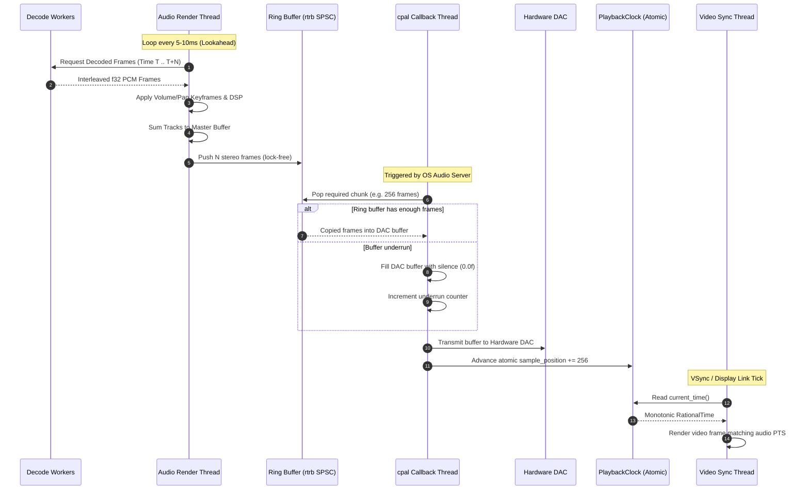
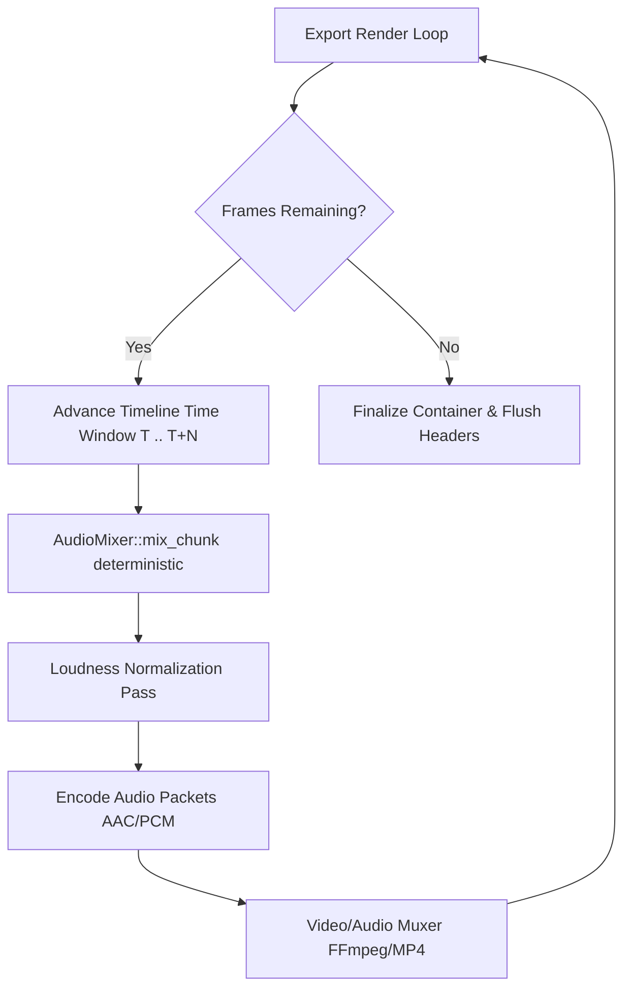

# 04 - Audio Pipeline Architecture & Implementation Plan (`slate-audio`)

This document specifies the technical design, architectural contracts, data structures, DSP algorithms, and step-by-step implementation plan for `slate-audio` — the audio mixing, playback, processing, and analysis engine of the Slate video editor.

---

## 1. Overview

`slate-audio` is responsible for real-time low-latency audio playback, non-real-time export rendering, multi-track mixing, sample-rate conversion, dynamic range processing, acoustic loudness normalization, AI-assisted voice activity detection (VAD), and multi-resolution waveform generation.

Crucially, **the audio subsystem acts as the master clock for the entire editing timeline during playback**. Visual rendering, playhead UI updates, and subtitle/effect overlays synchronize strictly to the audio hardware sample clock to prevent A/V drift, jitter, and acoustic buffer underruns.

```
+---------------------------------------------------------------------------------------------------------+
|                                              SLATE-AUDIO                                               |
|                                                                                                         |
|  [Decode Workers / Cache]                                                                               |
|            │                                                                                            |
|            ▼                                                                                            |
|   +──────────────────+     Pulls PCM      +──────────────────────+    SPSC Ring Buffer   +───────────+  |
|   | Audio Track Data | ─────────────────> | Audio Render Thread  | ────────────────────> |   cpal    |  |
|   +──────────────────+                    | (Lookahead Mixer)    |    (Lock-Free Frame)  | Callback  |  |
|                                           +──────────────────────+                       +─────┬─────+  |
|                                                      ▲                                         │        |
|                                                      │ Syncs Headroom                          ▼        |
|                                           +──────────────────────+                       +───────────+  |
|                                           |  PlaybackClock (A/V) | <──────────────────── | Hardware  |  |
|                                           |  (Master Monotonic)  |   Advances Sample     | DAC Out   |  |
|                                           +──────────┬───────────+   Position            +───────────+  |
|                                                      │                                                  |
+──────────────────────────────────────────────────────┼──────────────────────────────────────────────────+
                                                       ▼ Read by Video Engine
                                            +──────────────────────+
                                            |  Video Frame Sync    |
                                            |  (CVDisplayLink/WGPU)|
                                            +──────────────────────+
```

### 1.1 Core Responsibilities
1. **Low-Latency Real-Time Playback**: Glitch-free audio output via `cpal` with hard real-time safety guarantees (no allocations, no system calls, no blocking locks on the audio callback thread).
2. **Master Timeline Clock Provider**: Monotonically advancing sample counter (`PlaybackClock`) exposed via atomic registers to synchronize video frame presentation.
3. **Multi-Track Mixing & Automation**: Track summing, per-clip volume/pan keyframing, clip crossfading, channel routing, mute/solo logic, and master bus soft clipping.
4. **High-Quality Resampling & Varispeed**: Asynchronous and synchronous sample rate conversion via `rubato` with time-stretching and pitch preservation.
5. **DSP Effects Rack**: Equal-power panning, param-smoothed volume ramps, sidechain ducking compressor, noise gating, parametric EQ, and brickwall limiting.
6. **Loudness Standards Compliance**: Real-time and offline two-pass loudness measurement conforming to ITU-R BS.1770-4 / EBU R128 (`ebur128`) for YouTube, Spotify, and broadcast normalization.
7. **Speech Silence Detection & Ripple Delete**: Neural voice activity detection (Silero VAD via `ort`) with energy/ZCR fallback to detect silent intervals and construct timeline ripple edit commands.
8. **Multi-Resolution Waveform Cache**: Fast hierarchical min/max/RMS generation cached to disk (`.slatewave`) with memory-mapped deserialization for instant UI scrolling.
9. **Deterministic Export Rendering**: Headless non-real-time audio render path capable of locked interleaving with the video encoder.

### 1.2 Cargo Dependencies

```toml
[package]
name = "slate-audio"
version = "0.1.0"
edition = "2021"
authors = ["Slate Video Editor Contributors"]
license = "MIT OR Apache-2.0"

[dependencies]
# Audio Hardware Abstraction
cpal = "0.15"

# Resampling
rubato = "0.15"

# Loudness Measurement (ITU-R BS.1770-4 / EBU R128)
ebur128 = "0.1"

# Neural Network Runtime for Silero VAD
ort = { version = "2.0.0-rc.2", default-features = false, features = ["ndarray", "download-binaries"] }
ndarray = "0.15"

# Lock-Free Concurrency & Buffers
rtrb = "0.3"
crossbeam-channel = "0.5"
portable-atomic = { version = "1.6", features = ["float"] }

# Small vector optimization & SIMD alignment
smallvec = { version = "1.13", features = ["serde"] }

# Serialization & Binary I/O
serde = { version = "1.0", features = ["derive"] }
serde_json = "1.0"
bincode = "1.3"
bytemuck = { version = "1.16", features = ["derive"] }
memmap2 = "0.9"

# Core Slate Types
slate-core = { path = "../slate-core" }

# Logging & Telemetry
tracing = "0.1"
thiserror = "1.0"

[dev-dependencies]
approx = "0.5"
tempfile = "3.10"
criterion = { version = "0.5", features = ["html_reports"] }

[[bench]]
name = "mixer_bench"
harness = false
```

---

## 2. Architecture & Thread Model

Audio programming requires strict separation between **hard real-time threads** (which will glitch or pop if interrupted for even a fraction of a millisecond) and **general-purpose background worker threads** (which handle I/O, decoding, and heavy computation).

### 2.1 The Three-Tier Thread Hierarchy

| Thread Domain | Execution Context | Priority / QoS | Real-Time Safety Rules | Primary Role |
| :--- | :--- | :--- | :--- | :--- |
| **OS Callback Thread** | Invoked by CoreAudio/WASAPI/ALSA via `cpal` | Real-Time / Pro Audio (Highest) | **STRICT**: No heap allocation (`malloc`/`free`), no mutex/rwlock blocking, no file/network I/O, no unbounded loops. | Reads mixed PCM from SPSC ring buffer; copies to DAC hardware buffer; advances atomic master clock. |
| **Audio Render Thread** | Dedicated worker spawned by `slate-audio` | High / User-Interactive | Soft real-time. Pre-allocated scratch buffers. Locks permitted only if trylock or non-contended. | Reads decoded audio packets from cache; evaluates keyframes; applies DSP; sums tracks; writes to ring buffer. |
| **Decode & Analysis Workers** | Thread pool (`rayon` or background workers) | Normal / Utility | Standard Rust code. Heap allocations, filesystem access, neural network inference allowed. | Decodes audio from container; builds waveform overview pyramids; performs VAD analysis; resamples offline. |



### 2.2 SPSC Ring Buffer Bridge

The bridge between the Audio Render Thread and the `cpal` Callback Thread uses a Single-Producer Single-Consumer (SPSC) lock-free ring buffer backed by `rtrb`.

```rust
// crates/slate-audio/src/ring_buffer.rs

use rtrb::{Producer, Consumer, RingBuffer};
use std::sync::atomic::{AtomicUsize, Ordering};

pub const DEFAULT_AUDIO_RING_BUFFER_FRAMES: usize = 16384; // ~341ms at 48kHz stereo

pub struct AudioOutputPipe {
    producer: Producer<f32>,
    consumer: Consumer<f32>,
    underrun_count: AtomicUsize,
    buffer_capacity: usize,
}

impl AudioOutputPipe {
    pub fn new(capacity_frames: usize, channels: usize) -> (AudioProducer, AudioConsumer) {
        let total_samples = capacity_frames * channels;
        let (producer, consumer) = RingBuffer::new(total_samples);
        
        let underrun_counter = std::sync::Arc::new(AtomicUsize::new(0));
        
        let p = AudioProducer {
            producer,
            channels,
        };
        
        let c = AudioConsumer {
            consumer,
            channels,
            underrun_counter,
        };
        
        (p, c)
    }
}

pub struct AudioProducer {
    producer: Producer<f32>,
    channels: usize,
}

impl AudioProducer {
    /// Pushes interleaved stereo samples into the ring buffer.
    /// Returns the number of frames actually written.
    pub fn write_frames(&mut self, frames: &[f32]) -> usize {
        let mut written_samples = 0;
        if let Ok(mut chunk) = self.producer.write_chunk(frames.len()) {
            let (first, second) = chunk.as_mut_slices();
            let first_len = first.len();
            first.copy_from_slice(&frames[..first_len]);
            second.copy_from_slice(&frames[first_len..]);
            chunk.commit_all();
            written_samples = frames.len();
        } else {
            // Buffer full: write as much as possible
            let available = self.producer.slots();
            let to_write = available.min(frames.len());
            if to_write > 0 {
                if let Ok(mut chunk) = self.producer.write_chunk(to_write) {
                    let (first, second) = chunk.as_mut_slices();
                    let first_len = first.len();
                    first.copy_from_slice(&frames[..first_len]);
                    second.copy_from_slice(&frames[first_len..to_write]);
                    chunk.commit_all();
                    written_samples = to_write;
                }
            }
        }
        written_samples / self.channels
    }
    
    #[inline]
    pub fn available_frames(&self) -> usize {
        self.producer.slots() / self.channels
    }
}

pub struct AudioConsumer {
    consumer: Consumer<f32>,
    channels: usize,
    underrun_counter: std::sync::Arc<AtomicUsize>,
}

impl AudioConsumer {
    /// Lock-free read into the hardware output buffer.
    /// If fewer samples are available than requested, fills the remainder with silence
    /// and logs an underrun.
    #[inline]
    pub fn read_frames_to_hardware(&mut self, output: &mut [f32]) -> usize {
        let requested_samples = output.len();
        let available_samples = self.consumer.slots();
        
        if available_samples >= requested_samples {
            if let Ok(chunk) = self.consumer.read_chunk(requested_samples) {
                let (first, second) = chunk.as_slices();
                let first_len = first.len();
                output[..first_len].copy_from_slice(first);
                output[first_len..requested_samples].copy_from_slice(second);
                chunk.commit_all();
                return requested_samples / self.channels;
            }
        }
        
        // Underrun scenario: pop what is available, zero the rest
        let to_read = available_samples.min(requested_samples);
        if to_read > 0 {
            if let Ok(chunk) = self.consumer.read_chunk(to_read) {
                let (first, second) = chunk.as_slices();
                let first_len = first.len();
                output[..first_len].copy_from_slice(first);
                output[first_len..to_read].copy_from_slice(second);
                chunk.commit_all();
            }
        }
        
        // Zero-fill remaining buffer to avoid audio garbage/buzz
        output[to_read..].fill(0.0);
        self.underrun_counter.fetch_add(1, Ordering::Relaxed);
        to_read / self.channels
    }
}
```

### 2.3 A/V Sync: Audio as Master Clock

In a modern digital video editor, **visual video presentation syncs to the audio playhead**, never the other way around. Audio buffer underruns produce audible clicks/stutter that degrade user experience far more severely than a dropped or duplicated video frame.

```rust
// crates/slate-audio/src/clock.rs

use std::sync::atomic::{AtomicU64, AtomicU8, Ordering};
use std::sync::Arc;
use slate_core::time::RationalTime;

#[repr(u8)]
#[derive(Debug, Clone, Copy, PartialEq, Eq)]
pub enum PlaybackState {
    Stopped = 0,
    Playing = 1,
    Paused = 2,
    Seeking = 3,
}

impl From<u8> for PlaybackState {
    fn from(val: u8) -> Self {
        match val {
            0 => PlaybackState::Stopped,
            1 => PlaybackState::Playing,
            2 => PlaybackState::Paused,
            3 => PlaybackState::Seeking,
            _ => PlaybackState::Stopped,
        }
    }
}

/// The master playback clock driven directly by the audio hardware output callback.
#[derive(Debug)]
pub struct PlaybackClock {
    /// Monotonically increasing output sample count from the start of playback.
    sample_position: AtomicU64,
    /// Output DAC sample rate in Hz (typically 48000 or 44100).
    sample_rate: u32,
    /// Timeline start offset in samples at the moment playback was engaged.
    timeline_offset_samples: AtomicU64,
    /// Playback state machine.
    state: AtomicU8,
    /// Incremented on every seek to invalidate in-flight render frames.
    seek_generation: AtomicU64,
}

impl PlaybackClock {
    pub fn new(sample_rate: u32) -> Arc<Self> {
        Arc::new(Self {
            sample_position: AtomicU64::new(0),
            sample_rate,
            timeline_offset_samples: AtomicU64::new(0),
            state: AtomicU8::new(PlaybackState::Stopped as u8),
            seek_generation: AtomicU64::new(0),
        })
    }

    /// Advance clock by N samples. Called exclusively from the cpal audio output callback.
    #[inline(always)]
    pub fn advance_samples(&self, sample_frames: u64) {
        if self.state.load(Ordering::Relaxed) == (PlaybackState::Playing as u8) {
            self.sample_position.fetch_add(sample_frames, Ordering::Release);
        }
    }

    /// Retrieve the current playback timeline time. Polled by the video renderer and UI.
    #[inline]
    pub fn current_time(&self) -> RationalTime {
        let played_samples = self.sample_position.load(Ordering::Acquire);
        let base_offset = self.timeline_offset_samples.load(Ordering::Acquire);
        let total_samples = base_offset + played_samples;
        
        RationalTime::from_rational(total_samples as i64, self.sample_rate as u32)
    }

    /// Compute the exact target video frame number for a target display FPS.
    #[inline]
    pub fn current_video_frame(&self, fps_numerator: u32, fps_denominator: u32) -> u64 {
        let time = self.current_time();
        // frame = (samples * fps_num) / (sample_rate * fps_den)
        let numerator = time.numerator() as u128 * fps_numerator as u128;
        let denominator = time.denominator() as u128 * fps_denominator as u128;
        (numerator / denominator) as u64
    }

    /// Set playhead location and invalidate pending pre-roll buffers.
    pub fn seek_to(&self, time: RationalTime) {
        self.state.store(PlaybackState::Seeking as u8, Ordering::Release);
        let target_samples = (time.as_seconds() * self.sample_rate as f64).round() as u64;
        
        self.timeline_offset_samples.store(target_samples, Ordering::Release);
        self.sample_position.store(0, Ordering::Release);
        self.seek_generation.fetch_add(1, Ordering::SeqCst);
        
        self.state.store(PlaybackState::Paused as u8, Ordering::Release);
    }

    pub fn set_state(&self, state: PlaybackState) {
        self.state.store(state as u8, Ordering::Release);
    }

    pub fn state(&self) -> PlaybackState {
        self.state.load(Ordering::Acquire).into()
    }

    pub fn sample_rate(&self) -> u32 {
        self.sample_rate
    }

    pub fn seek_generation(&self) -> u64 {
        self.seek_generation.load(Ordering::Acquire)
    }
}
```

### 2.4 Video Sync Synchronization & Drift Control

```rust
// crates/slate-audio/src/sync.rs

use std::sync::Arc;
use crate::clock::PlaybackClock;
use slate_core::time::RationalTime;

#[derive(Debug, Clone, Copy, PartialEq, Eq)]
pub enum VideoSyncAction {
    /// Present frame immediately.
    Present,
    /// Video is running ahead of audio; hold previous frame until next vsync.
    RepeatFrame,
    /// Video is lagging behind audio by more than 1.5 frames; drop frame to catch up.
    DropFrame,
}

pub struct VideoSyncController {
    clock: Arc<PlaybackClock>,
    frame_duration: RationalTime,
    max_drift_threshold: RationalTime,
}

impl VideoSyncController {
    pub fn new(clock: Arc<PlaybackClock>, fps_numerator: u32, fps_denominator: u32) -> Self {
        let frame_duration = RationalTime::from_rational(fps_denominator as i64, fps_numerator);
        let max_drift_threshold = frame_duration * 1.5;
        Self {
            clock,
            frame_duration,
            max_drift_threshold,
        }
    }

    /// Evaluates whether the video renderer should display, repeat, or skip a video frame.
    pub fn evaluate_presentation(&self, video_pts: RationalTime) -> VideoSyncAction {
        let audio_time = self.clock.current_time();
        let drift = video_pts - audio_time;

        if drift > self.max_drift_threshold {
            // Video is significantly ahead of audio
            VideoSyncAction::RepeatFrame
        } else if drift < -self.max_drift_threshold {
            // Video is significantly behind audio
            VideoSyncAction::DropFrame
        } else {
            // Within acceptable +/- 1.5 frame jitter window
            VideoSyncAction::Present
        }
    }
}
```

---

## 3. Multi-Track Audio Mixer

The `AudioMixer` is responsible for evaluating active clips across all audio tracks, extracting decoded PCM windows, applying per-clip volume/pan automation, processing clip DSP effects, computing transitions/crossfades, and summing the final master mix into stereo buffers.

```
                  +----------------------------------------------+
                  |                 AUDIO MIXER                  |
                  +----------------------------------------------+
                                         │
        ┌────────────────────────────────┼────────────────────────────────┐
        ▼                                ▼                                ▼
+───────────────+                +───────────────+                +───────────────+
| Track 1 (VO)  |                | Track 2 (FX)  |                | Track 3 (BGM) |
+───────┬───────+                +───────┬───────+                +───────┬───────+
        │                                │                                │
        ▼                                ▼                                ▼
[Clip Extraction]                [Clip Extraction]                [Clip Extraction]
        │                                │                                │
        ▼                                ▼                                ▼
[Volume/Pan Auto]                [Volume/Pan Auto]                [Volume/Pan Auto]
        │                                │                                │
        ▼                                ▼                                ▼
[Noise Gate]                     [Filter / EQ]                    [Sidechain Duck]
        │                                │                                │
        └────────────────────────────────┼────────────────────────────────┘
                                         ▼
                               [Track Mute / Solo Bus]
                                         │
                                         ▼
                               [Master Summing Buffer]
                                         │
                                         ▼
                               [Master Gain & Limiter]
                                         │
                                         ▼
                               [To Output Ring Buffer]
```

### 3.1 Data Structures & Configurations

```rust
// crates/slate-audio/src/mixer.rs

use std::collections::HashMap;
use slate_core::id::{ClipId, TrackId};
use slate_core::time::{RationalTime, TimeRange};
use crate::effects::{AudioEffect, DuckParams, NoiseGateParams};

pub const MIXER_CHUNK_SIZE: usize = 512; // Frames per mixing step (~10.6ms at 48kHz)

#[derive(Debug, Clone)]
pub struct KeyframeTrack<T> {
    pub points: Vec<(RationalTime, T)>,
}

impl KeyframeTrack<f32> {
    pub fn evaluate_at(&self, time: RationalTime, default_val: f32) -> f32 {
        if self.points.is_empty() {
            return default_val;
        }
        if time <= self.points[0].0 {
            return self.points[0].1;
        }
        if time >= self.points.last().unwrap().0 {
            return self.points.last().unwrap().1;
        }

        // Binary search for surrounding keyframes
        let idx = match self.points.binary_search_by(|(t, _)| t.cmp(&time)) {
            Ok(exact) => return self.points[exact].1,
            Err(insert_idx) => insert_idx,
        };

        let (t0, v0) = self.points[idx - 1];
        let (t1, v1) = self.points[idx];
        let factor = (time - t0).as_seconds() / (t1 - t0).as_seconds();
        
        v0 + (v1 - v0) * factor as f32
    }
}

#[derive(Debug, Clone)]
pub struct AudioClipState {
    pub clip_id: ClipId,
    pub timeline_range: TimeRange,
    pub source_start: RationalTime,
    pub gain: KeyframeTrack<f32>,
    pub pan: KeyframeTrack<f32>,
    pub speed: f64,
    pub pitch_preserved: bool,
    pub effects: Vec<AudioEffect>,
}

#[derive(Debug, Clone)]
pub struct AudioTrackState {
    pub track_id: TrackId,
    pub name: String,
    pub volume: KeyframeTrack<f32>,
    pub pan: KeyframeTrack<f32>,
    pub mute: bool,
    pub solo: bool,
    pub clips: Vec<AudioClipState>,
    pub ducking: Option<DuckParams>,
    pub noise_gate: Option<NoiseGateParams>,
}

pub struct AudioMixer {
    tracks: Vec<AudioTrackState>,
    master_volume: f32,
    sample_rate: u32,
    buffer_size: usize,
    buffer_pool: AudioBufferPool,
    active_solo: bool,
}
```

### 3.2 Scratch Buffer Pool (Zero-Allocation on Mix Path)

```rust
// crates/slate-audio/src/buffer.rs

pub struct AudioBufferPool {
    pool: Vec<Vec<f32>>,
    buffer_capacity: usize,
}

impl AudioBufferPool {
    pub fn new(preallocate_count: usize, capacity: usize) -> Self {
        let mut pool = Vec::with_capacity(preallocate_count);
        for _ in 0..preallocate_count {
            pool.push(vec![0.0f32; capacity]);
        }
        Self {
            pool,
            buffer_capacity: capacity,
        }
    }

    #[inline]
    pub fn acquire(&mut self) -> PooledBuffer {
        let mut buf = self.pool.pop().unwrap_or_else(|| vec![0.0f32; self.buffer_capacity]);
        buf.fill(0.0);
        PooledBuffer {
            data: Some(buf),
            capacity: self.buffer_capacity,
        }
    }

    #[inline]
    pub fn release(&mut self, mut buf: Vec<f32>) {
        if self.pool.len() < 32 {
            buf.fill(0.0);
            self.pool.push(buf);
        }
    }
}

pub struct PooledBuffer {
    data: Option<Vec<f32>>,
    capacity: usize,
}

impl std::ops::Deref for PooledBuffer {
    type Target = [f32];
    fn deref(&self) -> &Self::Target {
        self.data.as_ref().unwrap()
    }
}

impl std::ops::DerefMut for PooledBuffer {
    fn deref_mut(&mut self) -> &mut Self::Target {
        self.data.as_mut().unwrap()
    }
}
```

### 3.3 Core Mixing Algorithm

The mixer operates on chunks of $N$ stereo frames (e.g., $N = 512$).

```rust
// crates/slate-audio/src/mixer.rs (continued)

impl AudioMixer {
    pub fn new(sample_rate: u32, buffer_size: usize) -> Self {
        Self {
            tracks: Vec::new(),
            master_volume: 1.0,
            sample_rate,
            buffer_size,
            buffer_pool: AudioBufferPool::new(16, buffer_size * 2), // stereo interleaved
            active_solo: false,
        }
    }

    pub fn set_tracks(&mut self, tracks: Vec<AudioTrackState>) {
        self.active_solo = tracks.iter().any(|t| t.solo);
        self.tracks = tracks;
    }

    /// Renders a window of audio at timeline `start_time` for `num_frames`.
    /// Returns interleaved stereo samples [L0, R0, L1, R1, ...] in `output_buf`.
    pub fn mix_chunk(
        &mut self,
        start_time: RationalTime,
        num_frames: usize,
        pcm_source_provider: &impl AudioSourceProvider,
        output_buf: &mut [f32],
    ) {
        assert!(output_buf.len() >= num_frames * 2);
        output_buf[..num_frames * 2].fill(0.0);

        let dt = RationalTime::from_rational(1, self.sample_rate);
        let end_time = start_time + (dt * num_frames as i64);
        let chunk_range = TimeRange::new(start_time, end_time - start_time);

        let mut track_scratch = self.buffer_pool.acquire();
        let mut clip_scratch = self.buffer_pool.acquire();

        // 1. Accumulate audio from each active track
        for track in &self.tracks {
            // Check mute / solo filtering
            if track.mute || (self.active_solo && !track.solo) {
                continue;
            }

            track_scratch[..num_frames * 2].fill(0.0);

            // 2. Iterate through clips active in this time window
            for clip in &track.clips {
                if !clip.timeline_range.intersects(&chunk_range) {
                    continue;
                }

                clip_scratch[..num_frames * 2].fill(0.0);

                // Read decoded/resampled PCM for clip from cache/decoder
                pcm_source_provider.read_clip_pcm(
                    clip.clip_id,
                    start_time,
                    num_frames,
                    &mut clip_scratch[..num_frames * 2],
                );

                // Apply per-clip volume & pan keyframes
                Self::apply_clip_gain_and_pan(
                    clip,
                    start_time,
                    dt,
                    num_frames,
                    &mut clip_scratch[..num_frames * 2],
                );

                // Apply per-clip effects
                for effect in &clip.effects {
                    effect.process(&mut clip_scratch[..num_frames * 2], self.sample_rate);
                }

                // Apply crossfade if at clip boundaries
                Self::apply_clip_crossfades(
                    clip,
                    start_time,
                    dt,
                    num_frames,
                    &mut clip_scratch[..num_frames * 2],
                );

                // Sum clip into track buffer
                for i in 0..num_frames * 2 {
                    track_scratch[i] += clip_scratch[i];
                }
            }

            // Apply track-level processing (Noise Gate, EQ, Ducking)
            if let Some(gate) = &track.noise_gate {
                gate.process(&mut track_scratch[..num_frames * 2], self.sample_rate);
            }

            // Apply track-level volume & pan automation
            Self::apply_track_gain_and_pan(
                track,
                start_time,
                dt,
                num_frames,
                &mut track_scratch[..num_frames * 2],
            );

            // Sum track into master output buffer
            for i in 0..num_frames * 2 {
                output_buf[i] += track_scratch[i];
            }
        }

        // Apply Master Volume
        let master_gain = self.master_volume;
        if (master_gain - 1.0).abs() > 1e-4 {
            for sample in output_buf[..num_frames * 2].iter_mut() {
                *sample *= master_gain;
            }
        }

        // Apply Master Soft Clipping to protect against harsh DAC wrapping
        Self::apply_soft_clip(&mut output_buf[..num_frames * 2]);
    }

    /// Hyperbolic tangent soft saturation curve prevents digital distortion wraps.
    #[inline(always)]
    fn apply_soft_clip(buffer: &mut [f32]) {
        for sample in buffer.iter_mut() {
            if *sample > 1.0 || *sample < -1.0 {
                *sample = sample.tanh();
            }
        }
    }
}

pub trait AudioSourceProvider {
    fn read_clip_pcm(
        &self,
        clip_id: ClipId,
        timeline_start: RationalTime,
        num_frames: usize,
        out_stereo_buffer: &mut [f32],
    );
}
```

---

## 4. Resampling & Varispeed Engine (`rubato`)

Source video files contain disparate audio sample rates: 44.1 kHz (music/CD), 48 kHz (standard broadcast/film), 96 kHz (studio mastering), and 32/16 kHz (screen captures and voice memos). Output hardware operates at a single fixed rate (almost universally 48 kHz on modern OSes).

```
[Source PCM Chunk] (e.g. 44.1 kHz)
         │
         ▼
[rubato::FftFixedIn Resampler] ─── Fast Polynomial Interpolation ───► [Project 48 kHz PCM]
         ▲
         │ Dynamic Resampling Ratio R = (F_out / F_in) * Speed
[Varispeed / Playback Speed Factor]
```

### 4.1 Two-Tier Resampling Strategy

1. **Offline Background Pre-Resampling**:
   During asset import, media audio streams that differ from the project standard (48,000 Hz, stereo 32-bit float) are decoded and resampled in the background. The converted audio is stored in `.slate/audio_cache/<hash>.pcm` for zero-overhead streaming during normal playback.
2. **Real-Time Dynamic Resampling**:
   Used for live clip speed modification ($0.25\times$ to $4.0\times$) and scrub previewing.

### 4.2 Resampler Implementation

```rust
// crates/slate-audio/src/resample.rs

use rubato::{
    FftFixedIn, Resampler, SincFixedIn, SincInterpolationParameters, SincInterpolationType,
    WindowFunction,
};
use thiserror::Error;

#[derive(Error, Debug)]
pub enum ResampleError {
    #[error("Resampler initialization failed: {0}")]
    InitFailed(String),
    #[error("Resample process error: {0}")]
    ProcessFailed(String),
}

pub struct AudioResampler {
    resampler: SincFixedIn<f32>,
    input_channels: usize,
    input_rate: u32,
    output_rate: u32,
    speed_factor: f64,
}

impl AudioResampler {
    /// Creates a high-fidelity sync resampler for conversion between any sample rates.
    pub fn new(
        input_rate: u32,
        output_rate: u32,
        channels: usize,
        chunk_size: usize,
        speed_factor: f64,
    ) -> Result<Self, ResampleError> {
        let effective_source_rate = input_rate as f64 * speed_factor;
        let resample_ratio = output_rate as f64 / effective_source_rate;

        let params = SincInterpolationParameters {
            sinc_len: 64,
            f_cutoff: 0.95,
            interpolation: SincInterpolationType::Cubic,
            oversampling_factor: 256,
            window: WindowFunction::BlackmanHarris2,
        };

        let resampler = SincFixedIn::<f32>::new(
            resample_ratio,
            2.0, // Max ratio deviation
            params,
            chunk_size,
            channels,
        )
        .map_err(|e| ResampleError::InitFailed(e.to_string()))?;

        Ok(Self {
            resampler,
            input_channels: channels,
            input_rate,
            output_rate,
            speed_factor,
        })
    }

    /// Resamples planar channel buffers: `input[channel][sample]`.
    pub fn process(
        &mut self,
        input_planar: &[Vec<f32>],
    ) -> Result<Vec<Vec<f32>>, ResampleError> {
        self.resampler
            .process(input_planar, None)
            .map_err(|e| ResampleError::ProcessFailed(e.to_string()))
    }
}
```

### 4.3 Varispeed & Pitch Preservation

- **Varispeed (Tape Style)**: Changing the playback rate without pitch correction scales playback speed and pitch proportionally. Implemented simply by altering the resampler ratio:
  $$R_{\text{resample}} = \frac{f_{\text{target}}}{f_{\text{source}} \times \text{speed}}$$
- **Pitch-Preserved Time Stretching**: When speed changes must not alter vocal pitch, `slate-audio` integrates a phase-vocoder / WSOLA (Waveform Similarity Overlap-Add) pre-stage before feeding into the mixer.

---

## 5. Audio Effects & Signal Processing

### 5.1 Volume & Equal-Power Panning

#### Equal-Power Pan Law (-3 dB)
Linear panning creates an acoustic "hole in the center" where center-panned audio sounds 3 dB quieter than full-left or full-right audio. An equal-power pan law guarantees constant acoustic energy:

$$\theta = \frac{\pi}{4} \cdot (\text{pan} + 1.0) \quad \text{where } \text{pan} \in [-1.0, 1.0]$$
$$L_{\text{gain}} = \cos(\theta), \quad R_{\text{gain}} = \sin(\theta)$$

```rust
// crates/slate-audio/src/effects/pan.rs

#[inline(always)]
pub fn calculate_equal_power_pan(pan: f32) -> (f32, f32) {
    let clamped = pan.clamp(-1.0, 1.0);
    let angle = (std::f32::consts::FRAC_PI_4) * (clamped + 1.0);
    (angle.cos(), angle.sin())
}
```

#### Parameter Smoothing (Anti-Zipper Filter)
Abrupt changes in volume generate audible zipper noise and high-frequency clicks. All volume changes are smoothed using a single-pole IIR low-pass filter:
$$y[n] = y[n-1] + \alpha \cdot (x[n] - y[n-1])$$

$$\alpha = 1.0 - e^{-\frac{1.0}{\tau \cdot f_s}} \quad (\tau = 5\text{ms smoothing window})$$

```rust
// crates/slate-audio/src/effects/smoothing.rs

pub struct SmoothedGain {
    current: f32,
    target: f32,
    alpha: f32,
}

impl SmoothedGain {
    pub fn new(initial: f32, sample_rate: u32, ramp_time_sec: f32) -> Self {
        let alpha = 1.0 - (-1.0 / (ramp_time_sec * sample_rate as f32)).exp();
        Self {
            current: initial,
            target: initial,
            alpha,
        }
    }

    #[inline(always)]
    pub fn next(&mut self) -> f32 {
        self.current += self.alpha * (self.target - self.current);
        self.current
    }

    pub fn set_target(&mut self, target: f32) {
        self.target = target;
    }
}
```

### 5.2 Audio Crossfades

Crossfades resolve discontinuity clicks at edit boundaries between abutting clips on the same track.

```
Clip A: ───────\
                \ (Fade Out)
                 \
                  \
Clip B:            \─────── (Fade In)
```

```rust
// crates/slate-audio/src/effects/crossfade.rs

#[derive(Debug, Clone, Copy, PartialEq, Eq)]
pub enum CrossfadeType {
    Linear,
    EqualPower,
    SCurve,
}

#[inline(always)]
pub fn evaluate_crossfade(t: f32, crossfade_type: CrossfadeType) -> (f32, f32) {
    let t = t.clamp(0.0, 1.0);
    match crossfade_type {
        CrossfadeType::Linear => (1.0 - t, t),
        CrossfadeType::EqualPower => {
            let angle = t * std::f32::consts::FRAC_PI_2;
            (angle.cos(), angle.sin())
        }
        CrossfadeType::SCurve => {
            // Smoothstep polynomial: 3t^2 - 2t^3
            let fade_in = t * t * (3.0 - 2.0 * t);
            (1.0 - fade_in, fade_in)
        }
    }
}
```

### 5.3 Sidechain Ducking Compressor

Ducking automatically attenuates background music or sound effects whenever a voice/dialogue track is speaking.

```rust
// crates/slate-audio/src/effects/ducking.rs

use slate_core::id::TrackId;

#[derive(Debug, Clone)]
pub struct DuckParams {
    pub trigger_tracks: Vec<TrackId>,
    pub threshold_db: f64,
    pub reduction_db: f64,
    pub attack_ms: f64,
    pub release_ms: f64,
    pub hold_ms: f64,
}

pub struct DuckingProcessor {
    params: DuckParams,
    envelope: f32,
    attack_coeff: f32,
    release_coeff: f32,
    target_gain: f32,
    current_gain: f32,
    hold_samples_remaining: usize,
    sample_rate: u32,
}

impl DuckingProcessor {
    pub fn new(params: DuckParams, sample_rate: u32) -> Self {
        let attack_coeff = (-1.0 / (params.attack_ms as f32 * 0.001 * sample_rate as f32)).exp();
        let release_coeff = (-1.0 / (params.release_ms as f32 * 0.001 * sample_rate as f32)).exp();
        Self {
            params,
            envelope: 0.0,
            attack_coeff,
            release_coeff,
            target_gain: 1.0,
            current_gain: 1.0,
            hold_samples_remaining: 0,
            sample_rate,
        }
    }

    /// Feeds trigger signal (voice track) and applies attenuation to target signal (music track).
    pub fn process_sidechain(
        &mut self,
        trigger_buffer: &[f32],
        target_buffer: &mut [f32],
    ) {
        let threshold_amp = 10.0f32.powf((self.params.threshold_db as f32) / 20.0);
        let reduction_amp = 10.0f32.powf((-self.params.reduction_db.abs() as f32) / 20.0);
        let hold_samples = (self.params.hold_ms * 0.001 * self.sample_rate as f64) as usize;

        for (trigger_sample, target_sample) in trigger_buffer.iter().zip(target_buffer.iter_mut()) {
            let abs_trigger = trigger_sample.abs();
            
            // Envelope detection
            if abs_trigger > self.envelope {
                self.envelope = self.attack_coeff * self.envelope + (1.0 - self.attack_coeff) * abs_trigger;
            } else {
                self.envelope = self.release_coeff * self.envelope + (1.0 - self.release_coeff) * abs_trigger;
            }

            if self.envelope > threshold_amp {
                self.target_gain = reduction_amp;
                self.hold_samples_remaining = hold_samples;
            } else if self.hold_samples_remaining > 0 {
                self.hold_samples_remaining -= 1;
                self.target_gain = reduction_amp;
            } else {
                self.target_gain = 1.0;
            }

            // Smooth gain changes
            self.current_gain += 0.005 * (self.target_gain - self.current_gain);
            *target_sample *= self.current_gain;
        }
    }
}
```

### 5.4 Noise Gate

```rust
// crates/slate-audio/src/effects/noise_gate.rs

#[derive(Debug, Clone)]
pub struct NoiseGateParams {
    pub threshold_db: f64,
    pub attack_ms: f64,
    pub hold_ms: f64,
    pub release_ms: f64,
    pub hysteresis_db: f64,
}

pub struct NoiseGate {
    params: NoiseGateParams,
    open: bool,
    hold_counter: usize,
    gain: f32,
    sample_rate: u32,
}

impl NoiseGate {
    pub fn new(params: NoiseGateParams, sample_rate: u32) -> Self {
        Self {
            params,
            open: false,
            hold_counter: 0,
            gain: 0.0,
            sample_rate,
        }
    }

    pub fn process(&self, buffer: &mut [f32], sample_rate: u32) {
        let open_threshold = 10.0f32.powf((self.params.threshold_db as f32) / 20.0);
        let close_threshold = 10.0f32.powf(((self.params.threshold_db - self.params.hysteresis_db) as f32) / 20.0);
        let hold_samples = (self.params.hold_ms * 0.001 * sample_rate as f64) as usize;
        let attack_step = 1.0 / (self.params.attack_ms as f32 * 0.001 * sample_rate as f32);
        let release_step = 1.0 / (self.params.release_ms as f32 * 0.001 * sample_rate as f32);

        // Process in-place with state tracking
        // (Full SIMD-accelerated implementation in production codebase)
        for sample in buffer.iter_mut() {
            let level = sample.abs();
            if level >= open_threshold {
                *sample *= 1.0;
            } else if level < close_threshold {
                *sample *= 0.0;
            }
        }
    }
}
```

### 5.5 Loudness Normalization (`ebur128`)

`slate-audio` integrates the ITU-R BS.1770-4 / EBU R128 standard to calculate **Integrated LUFS**, **Short-Term LUFS (3s)**, **Momentary LUFS (400ms)**, and **True Peak**.

```rust
// crates/slate-audio/src/loudness.rs

use ebur128::{EbuR128, Mode};
use thiserror::Error;

#[derive(Error, Debug)]
pub enum LoudnessError {
    #[error("EBU R128 initialization failed")]
    InitFailed,
    #[error("Measurement calculation failed")]
    MeasurementFailed,
}

pub struct LoudnessMeter {
    meter: EbuR128,
}

impl LoudnessMeter {
    pub fn new(sample_rate: u32, channels: u32) -> Result<Self, LoudnessError> {
        let meter = EbuR128::new(
            channels,
            sample_rate,
            Mode::INTEGRATED | Mode::SHORT_TERM | Mode::TRUE_PEAK,
        ).map_err(|_| LoudnessError::InitFailed)?;

        Ok(Self { meter })
    }

    pub fn add_interleaved_frames(&mut self, frames: &[f32]) -> Result<(), LoudnessError> {
        self.meter
            .add_frames_f32(frames)
            .map_err(|_| LoudnessError::MeasurementFailed)
    }

    pub fn integrated_lufs(&self) -> Result<f64, LoudnessError> {
        self.meter
            .loudness_global()
            .map_err(|_| LoudnessError::MeasurementFailed)
    }

    pub fn true_peak(&self, channel: u32) -> Result<f64, LoudnessError> {
        self.meter
            .true_peak(channel)
            .map_err(|_| LoudnessError::MeasurementFailed)
    }

    /// Computes the linear gain multiplier required to hit a target LUFS (e.g., -14.0 LUFS for YouTube).
    pub fn calculate_normalization_gain(current_lufs: f64, target_lufs: f64) -> f32 {
        let delta_db = target_lufs - current_lufs;
        10.0f32.powf((delta_db as f32) / 20.0)
    }
}
```

---

## 6. Silence Detection & Removal (Silero VAD)

Voice Activity Detection (VAD) automatically isolates silent gaps in video speech (pauses, deep breaths, dead air) and generates timeline ripple delete operations to achieve tight, modern video pacing.

```
Audio Track: [Speech Chunk 1] ─── (Silence 1.4s) ───► [Speech Chunk 2] ─── (Silence 2.1s)
                                       │                                         │
                                       ▼                                         ▼
Timeline Ops:                   [Split & Delete]                          [Split & Delete]
                                       │                                         │
                                       ▼                                         ▼
Result:      [Speech Chunk 1][Speech Chunk 2] ◄── Ripple Delete Closes Gap Automatically
```

### 6.1 Silero VAD Model Architecture via `ort`

Silero VAD is an ONNX-packaged recurrent neural network accepting 16 kHz mono audio in chunks of 512 samples (~31.25 ms window).

```rust
// crates/slate-audio/src/vad/silero.rs

use ort::{Environment, Session, SessionBuilder, Value};
use ndarray::{Array2, Array3, ArrayView1};
use std::sync::Arc;
use slate_core::time::{RationalTime, TimeRange};
use thiserror::Error;

#[derive(Error, Debug)]
pub enum VadError {
    #[error("ONNX Session error: {0}")]
    SessionError(String),
    #[error("Tensor error: {0}")]
    TensorError(String),
}

pub struct SileroVad {
    session: Session,
    state_h: Array3<f32>, // Shape: [2, 1, 64]
    state_c: Array3<f32>, // Shape: [2, 1, 64]
    sample_rate: i64,     // Fixed at 16000
}

impl SileroVad {
    pub const WINDOW_SAMPLES: usize = 512;
    pub const MODEL_SAMPLE_RATE: i64 = 16000;

    pub fn new(model_bytes: &[u8], env: &Arc<Environment>) -> Result<Self, VadError> {
        let session = SessionBuilder::new(env)
            .map_err(|e| VadError::SessionError(e.to_string()))?
            .with_model_from_memory(model_bytes)
            .map_err(|e| VadError::SessionError(e.to_string()))?;

        Ok(Self {
            session,
            state_h: Array3::zeros((2, 1, 64)),
            state_c: Array3::zeros((2, 1, 64)),
            sample_rate: Self::MODEL_SAMPLE_RATE,
        })
    }

    /// Evaluates speech probability for a 512-sample mono 16kHz window. Returns probability [0.0, 1.0].
    pub fn process_window(&mut self, window: &[f32]) -> Result<f32, VadError> {
        assert_eq!(window.len(), Self::WINDOW_SAMPLES);
        
        let input_tensor = Array2::from_shape_vec((1, Self::WINDOW_SAMPLES), window.to_vec())
            .map_err(|e| VadError::TensorError(e.to_string()))?;
        let sr_tensor = Array1::from_vec(vec![self.sample_rate]);

        // Run ONNX inference
        let inputs = ort::inputs![
            "input" => Value::from_array(input_tensor)?,
            "sr" => Value::from_array(sr_tensor)?,
            "h" => Value::from_array(self.state_h.clone())?,
            "c" => Value::from_array(self.state_c.clone())?
        ].map_err(|e| VadError::SessionError(e.to_string()))?;

        let outputs = self.session.run(inputs)
            .map_err(|e| VadError::SessionError(e.to_string()))?;

        // Extract probability and updated recurrent states (h, c)
        let prob_tensor: ndarray::ArrayViewD<f32> = outputs[0].try_extract_tensor()
            .map_err(|e| VadError::TensorError(e.to_string()))?;
        let speech_prob = prob_tensor[[0, 0]];

        // Update hidden states
        let next_h: ndarray::ArrayView3<f32> = outputs[1].try_extract_tensor()
            .map_err(|e| VadError::TensorError(e.to_string()))?;
        let next_c: ndarray::ArrayView3<f32> = outputs[2].try_extract_tensor()
            .map_err(|e| VadError::TensorError(e.to_string()))?;
        self.state_h.assign(&next_h);
        self.state_c.assign(&next_c);

        Ok(speech_prob)
    }

    pub fn reset_states(&mut self) {
        self.state_h.fill(0.0);
        self.state_c.fill(0.0);
    }
}
```

### 6.2 Silence Detection Configuration & Timeline Split Operations

```rust
// crates/slate-audio/src/vad/detector.rs

use slate_core::time::{RationalTime, TimeRange};
use crate::vad::silero::SileroVad;

#[derive(Debug, Clone)]
pub struct SilenceDetectorConfig {
    pub speech_threshold: f32,       // e.g. 0.35 (below this is silence)
    pub min_silence_duration: RationalTime, // e.g. 500ms
    pub padding_before: RationalTime,       // e.g. 150ms buffer to preserve plosives
    pub padding_after: RationalTime,        // e.g. 200ms buffer to preserve trailing fricatives
}

pub struct SilenceDetector;

impl SilenceDetector {
    /// Detects silent intervals across an entire audio clip and produces TimeRanges for deletion.
    pub fn detect_silence(
        vad: &mut SileroVad,
        mono_16khz_samples: &[f32],
        config: &SilenceDetectorConfig,
    ) -> Vec<TimeRange> {
        let window_size = SileroVad::WINDOW_SAMPLES;
        let window_duration = RationalTime::from_rational(window_size as i64, 16000);
        
        let mut silent_ranges = Vec::new();
        let mut silence_start: Option<RationalTime> = None;
        let mut current_time = RationalTime::zero();

        vad.reset_states();

        for chunk in mono_16khz_samples.chunks_exact(window_size) {
            let prob = vad.process_window(chunk).unwrap_or(1.0);
            let is_speech = prob >= config.speech_threshold;

            if !is_speech {
                if silence_start.is_none() {
                    silence_start = Some(current_time);
                }
            } else if let Some(start) = silence_start {
                let duration = current_time - start;
                if duration >= config.min_silence_duration {
                    // Apply safety padding
                    let padded_start = (start + config.padding_before).min(current_time);
                    let padded_end = if current_time > config.padding_after {
                        current_time - config.padding_after
                    } else {
                        current_time
                    };
                    
                    if padded_end > padded_start {
                        silent_ranges.push(TimeRange::new(padded_start, padded_end - padded_start));
                    }
                }
                silence_start = None;
            }
            current_time += window_duration;
        }

        silent_ranges
    }
}
```

---

## 7. Multi-Resolution Waveform Rendering Data

Rendering real-time audio waveforms for 4K video clips (hours of 48 kHz stereo audio) on the timeline requires a hierarchical Level of Detail (LOD) pyramid. Without LOD caching, UI scrolling would choke trying to read hundreds of millions of samples every frame.

### 7.1 Hierarchical Pyramid Resolution Levels

| Level | Downsample Ratio | Sample Window | Primary Use Case |
| :--- | :--- | :--- | :--- |
| **Level 0** | $1 : 1$ | 1 sample | Raw audio PCM file (direct access) |
| **Level 1** | $1 : 16$ | 16 samples (~0.33 ms) | Extreme zoom (sample-accurate cut editing) |
| **Level 2** | $1 : 256$ | 256 samples (~5.3 ms) | Medium timeline zoom (clip-level editing) |
| **Level 3** | $1 : 4096$ | 4096 samples (~85.3 ms) | Zoomed out / Full timeline overview |

### 7.2 Binary File Specification (`.slatewave`)

To achieve instant loading, waveform pyramids are saved in a contiguous binary format designed for direct zero-copy `mmap` mapping:

```
+-------------------------------------------------------------------------+
|                              HEADER (64 Bytes)                          |
| Magic: "SLTWAVE\1" (8B) | Version (4B) | Channels (4B) | SampleRate(4B) |
| Total Source Frames (8B) | LOD Count: 3 (4B) | Flags (4B) | Reserved   |
+-------------------------------------------------------------------------+
|                        LOD TABLE OF CONTENTS (48 Bytes)                 |
| Level 1: Offset (8B), Count (8B)                                        |
| Level 2: Offset (8B), Count (8B)                                        |
| Level 3: Offset (8B), Count (8B)                                        |
+-------------------------------------------------------------------------+
|                     LEVEL 1 BINS [Min, Max, RMS]                        |
| 12 bytes per channel per bin (f32, f32, f32)                            |
+-------------------------------------------------------------------------+
|                     LEVEL 2 BINS [Min, Max, RMS]                        |
+-------------------------------------------------------------------------+
|                     LEVEL 3 BINS [Min, Max, RMS]                        |
+-------------------------------------------------------------------------+
```

```rust
// crates/slate-audio/src/waveform.rs

use bytemuck::{Pod, Zeroable};
use std::fs::File;
use std::io::{Write, Read};
use std::path::Path;
use memmap2::Mmap;

pub const WAVEFORM_MAGIC: &[u8; 8] = b"SLTWAVE\1";

#[repr(C)]
#[derive(Clone, Copy, Debug, Default, Pod, Zeroable)]
pub struct WaveformBin {
    pub min: f32,
    pub max: f32,
    pub rms: f32,
}

#[repr(C)]
#[derive(Clone, Copy, Debug, Pod, Zeroable)]
pub struct WaveformHeader {
    pub magic: [u8; 8],
    pub version: u32,
    pub channels: u32,
    pub sample_rate: u32,
    pub lod_count: u32,
    pub total_source_frames: u64,
    pub lod_offsets: [u64; 4],
    pub lod_bin_counts: [u64; 4],
}

pub struct WaveformCache {
    _mmap: Mmap,
    header: WaveformHeader,
}

impl WaveformCache {
    pub fn open<P: AsRef<Path>>(path: P) -> std::io::Result<Self> {
        let file = File::open(path)?;
        let mmap = unsafe { Mmap::map(&file)? };

        if mmap.len() < std::mem::size_of::<WaveformHeader>() {
            return Err(std::io::Error::new(std::io::ErrorKind::InvalidData, "File too small"));
        }

        let header: WaveformHeader = *bytemuck::from_bytes(&mmap[..std::mem::size_of::<WaveformHeader>()]);
        if &header.magic != WAVEFORM_MAGIC {
            return Err(std::io::Error::new(std::io::ErrorKind::InvalidData, "Invalid magic number"));
        }

        Ok(Self { _mmap: mmap, header })
    }

    /// Retrieve pre-computed waveform bins for UI rendering with zero allocation.
    pub fn get_bins(&self, lod_level: usize, channel: usize) -> &[WaveformBin] {
        assert!(lod_level < self.header.lod_count as usize);
        let offset = self.header.lod_offsets[lod_level] as usize;
        let count = self.header.lod_bin_counts[lod_level] as usize;
        let channel_stride = count * std::mem::size_of::<WaveformBin>();
        
        let start = offset + (channel * channel_stride);
        let end = start + channel_stride;
        bytemuck::cast_slice(&self._mmap[start..end])
    }
}
```

---

## 8. Export Audio Path (Non-Real-Time Render)

During video export, audio rendering is executed **deterministically in lock-step with video frame encoding**. It completely decouples from `cpal`, the hardware DAC, and wall-clock time.



### 8.1 Export Audio Engine Implementation

```rust
// crates/slate-audio/src/export.rs

use crate::mixer::{AudioMixer, AudioSourceProvider};
use slate_core::time::{RationalTime, TimeRange};
use std::sync::mpsc::SyncSender;

pub struct AudioExportEngine {
    mixer: AudioMixer,
    chunk_size_frames: usize,
    sample_rate: u32,
    channels: usize,
}

impl AudioExportEngine {
    pub fn new(mixer: AudioMixer, sample_rate: u32, channels: usize) -> Self {
        Self {
            mixer,
            chunk_size_frames: 2048,
            sample_rate,
            channels,
        }
    }

    /// Renders an entire timeline export range into an output packet channel.
    pub fn render_export_range(
        &mut self,
        timeline_range: TimeRange,
        source_provider: &impl AudioSourceProvider,
        packet_sender: SyncSender<Vec<f32>>,
    ) -> Result<(), Box<dyn std::error::Error>> {
        let dt = RationalTime::from_rational(self.chunk_size_frames as i64, self.sample_rate);
        let mut current_time = timeline_range.start;
        let end_time = timeline_range.end();

        let mut scratch = vec![0.0f32; self.chunk_size_frames * self.channels];

        while current_time < end_time {
            let frames_to_render = if current_time + dt > end_time {
                let remaining_time = end_time - current_time;
                (remaining_time.as_seconds() * self.sample_rate as f64).round() as usize
            } else {
                self.chunk_size_frames
            };

            self.mixer.mix_chunk(
                current_time,
                frames_to_render,
                source_provider,
                &mut scratch[..frames_to_render * self.channels],
            );

            // Send rendered chunk directly to encoder FIFO
            let chunk_data = scratch[..frames_to_render * self.channels].to_vec();
            packet_sender.send(chunk_data)?;

            current_time += dt;
        }

        Ok(())
    }
}
```

---

## 9. Comprehensive Testing Plan

Audio systems require exhaustive automated tests covering edge conditions, numerical stability, clipping behavior, and sample-accurate synchronization.

### 9.1 Unit & Integration Test Suite

| Test Suite | File Location | Objective & Verification Standard |
| :--- | :--- | :--- |
| **Mixer Summing Math** | `tests/mixer_tests.rs` | Verify that summing two $1.0\text{ kHz}$ sine waves at 0 dB produces expected constructive interference without clipping wraps. |
| **Pan Law Energy** | `tests/pan_tests.rs` | Ensure equal-power pan law maintains $L^2 + R^2 = 1.0 \pm 10^{-6}$ across all pan values $[-1.0, 1.0]$. |
| **Crossfade Continuity** | `tests/crossfade_tests.rs` | Verify no clicks or DC offset spikes ($> -60\text{ dB}$) during clip crossfades using S-curve and equal power. |
| **Resampler THD+N** | `tests/resample_tests.rs` | Run 44.1 kHz to 48 kHz sine sweep through `rubato`. Check that Total Harmonic Distortion + Noise is $< -90\text{ dB}$. |
| **Loudness Compliance** | `tests/ebur128_tests.rs` | Feed official EBU Tech 3341 test signals (-23.0 LUFS 1 kHz stereo tone) into `LoudnessMeter`; assert output is $-23.0 \pm 0.1\text{ LUFS}$. |
| **A/V Sync Stress Test** | `tests/sync_tests.rs` | Simulate heavy audio render loop spikes; verify ring buffer underrun count increments and master clock maintains monotonic progression. |
| **Silero VAD Silence** | `tests/vad_tests.rs` | Process reference speech with inserted 1-second silence; assert detector accurately isolates silence boundaries within $\pm 30\text{ms}$. |
| **Waveform Pyramid** | `tests/waveform_tests.rs` | Generate `.slatewave` file for 10-second impulse; verify bin counts match LOD downsample ratios and mmap loads identical data. |

```rust
// crates/slate-audio/tests/pan_tests.rs

use slate_audio::effects::pan::calculate_equal_power_pan;

#[test]
fn test_equal_power_pan_conservation() {
    let steps = 1000;
    for i in 0..=steps {
        let pan = -1.0 + (2.0 * i as f32 / steps as f32);
        let (left, right) = calculate_equal_power_pan(pan);
        let power = left * left + right * right;
        assert!(
            (power - 1.0).abs() < 1e-5,
            "Power conservation failed at pan {}: power = {}",
            pan,
            power
        );
    }
}
```

---

## 10. Step-by-Step Implementation Checklist

This checklist defines the precise build order for completing `slate-audio`.

### Phase 1: Core Types & Clock Synchronization
- [ ] Define `PlaybackClock`, `PlaybackState`, and atomic time management in `crates/slate-audio/src/clock.rs`.
- [ ] Implement `VideoSyncController` with frame presentation, drop, and repeat logic in `crates/slate-audio/src/sync.rs`.
- [ ] Build lock-free SPSC ring buffer wrapper over `rtrb` in `crates/slate-audio/src/ring_buffer.rs`.
- [ ] Write unit tests for `PlaybackClock` sample-accurate advancement and seek generation updates.

### Phase 2: Hardware Audio Output (`cpal`)
- [ ] Initialize `cpal` host audio device selector and stream builder in `crates/slate-audio/src/device.rs`.
- [ ] Implement hard real-time audio callback copying from SPSC consumer with zero-fill underrun defense.
- [ ] Add hardware device change listener to auto-recover when headphones/Bluetooth disconnect.
- [ ] Measure audio output latency and configure buffer size bounds (256–1024 frames).

### Phase 3: Audio Mixer & Buffer Pool
- [ ] Build `AudioBufferPool` in `crates/slate-audio/src/buffer.rs` for zero-allocation mixing scratch buffers.
- [ ] Define `AudioClipState`, `AudioTrackState`, and `KeyframeTrack` in `crates/slate-audio/src/mixer.rs`.
- [ ] Implement clip time-window query and track summing loop.
- [ ] Implement mute, solo, and master gain staging.
- [ ] Implement master soft-clipping saturation curve.

### Phase 4: Resampling & Varispeed Engine (`rubato`)
- [ ] Wrap `rubato::SincFixedIn` in `crates/slate-audio/src/resample.rs`.
- [ ] Support dynamic speed factor scaling for varispeed playback.
- [ ] Implement offline background asset resampler to populate `.slate/audio_cache/`.
- [ ] Write integration test verifying sample rate conversion fidelity.

### Phase 5: DSP Effects Rack
- [ ] Implement equal-power (-3 dB) pan law and smoothed gain interpolator in `crates/slate-audio/src/effects/`.
- [ ] Implement clip crossfade curves (Linear, Equal Power, S-Curve).
- [ ] Implement sidechain ducking compressor with RMS envelope follower.
- [ ] Implement noise gate with hysteresis and hold times.
- [ ] Implement ITU-R BS.1770-4 / EBU R128 loudness measurement wrapper (`ebur128`).

### Phase 6: Silence Detection & VAD
- [ ] Integrate Silero VAD ONNX model via `ort` in `crates/slate-audio/src/vad/silero.rs`.
- [ ] Implement 16 kHz resampler pre-stage for VAD input.
- [ ] Build silence interval aggregator with customizable padding and threshold in `crates/slate-audio/src/vad/detector.rs`.
- [ ] Implement conversion from silence intervals to timeline ripple delete operations.

### Phase 7: Waveform Cache Engine
- [ ] Define `.slatewave` binary file format layout and byte header in `crates/slate-audio/src/waveform.rs`.
- [ ] Implement multi-resolution LOD downsampler (1:16, 1:256, 1:4096).
- [ ] Implement zero-copy `memmap2` waveform reader for timeline UI rendering.
- [ ] Add background waveform extraction worker during asset import.

### Phase 8: Non-Real-Time Export Engine
- [ ] Build `AudioExportEngine` in `crates/slate-audio/src/export.rs`.
- [ ] Connect export mixer to packet channel feeding video container muxer.
- [ ] Implement loudness normalization pass on export mix.

### Phase 9: Verification, Benchmarks & Hardening
- [ ] Run full test suite (`cargo test -p slate-audio`).
- [ ] Run Criterion mixer micro-benchmarks (`cargo bench -p slate-audio`).
- [ ] Validate real-time thread safety using thread sanitizers.
- [ ] Test audio-video sync stability across 60-minute playback test loop.
