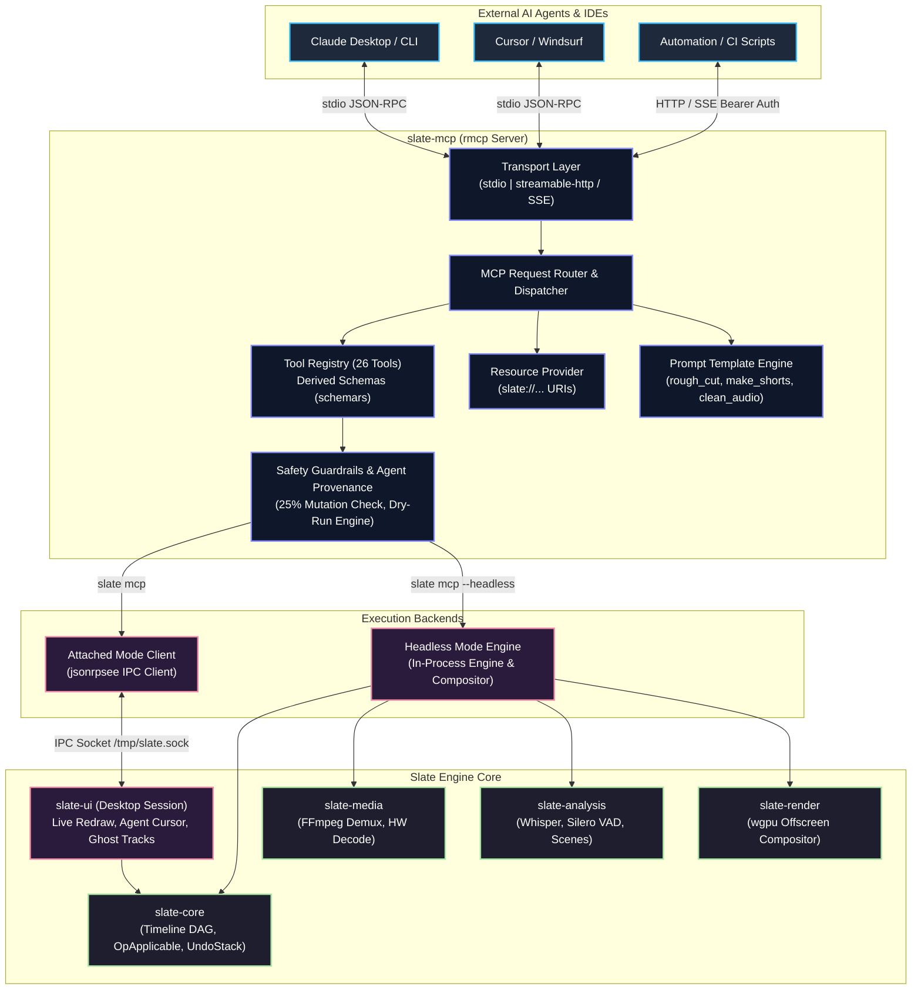

# Slate MCP Server (`slate-mcp`) Implementation Plan

> **Specification & Technical Architecture Document**  
> **Crate:** `slate-mcp`  
> **Target Path:** `crates/slate-mcp`  
> **Status:** Ready for Implementation  
> **Target Release:** v1.0  
> **Architectural Role:** Core AI Agent Interface & Autonomous Editing Control Plane  

---

## 1. Overview & Architecture

`slate-mcp` is the official **Model Context Protocol (MCP)** server for Slate. It serves as the primary technical differentiator of the Slate video editing system: turning a professional, high-performance, non-linear video editing engine into a first-class, fully observable, and autonomously controllable environment for AI agents (such as Claude Desktop, Cursor, Windsurf, custom LLM agents, and automated batch processing systems).

Traditional video editors treat automation as an afterthought—exposing fragile, blocking Python scripts or clumsy plugin APIs that operate outside the core undo system and provide zero real-time perceptual feedback. In Slate, **every single human user interaction is architecturally symmetric to an MCP tool invocation**. When a human drags a clip boundary in `slate-ui`, or an agent invokes `clip_trim` over an MCP stdio pipe, both produce identical, validated, and invertible `slate-core::Op` records on the unified undo/redo history stack.

`slate-mcp` is built on top of the official Rust MCP SDK (`rmcp`) and interacts with the Slate ecosystem in two interchangeable operational modes:
1. **Attached Mode**: Connects over a high-speed local IPC socket (UNIX domain socket or Named Pipe via `jsonrpsee`) to an active `slate-ui` desktop session. Edits, playhead movements, and agent actions appear live on screen with visual indicators (Agent Cursors and Ghost Tracks).
2. **Headless Mode**: Embeds the Slate core engine, `slate-media` decoding, `slate-analysis` multimodal models, and `slate-render` offscreen GPU compositor directly in-process. It executes full editing pipelines, renders preview frames, and exports broadcast-ready video files in headless CI/CD, cloud, or CLI environments without requiring any desktop window or display server.



### Architectural Boundaries & Dependencies

`slate-mcp` is designed with strict module boundaries. It relies on:
- `rmcp`: The official Rust Model Context Protocol SDK implementing MCP JSON-RPC transports, capabilities, tool dispatch, resource routing, and prompt templating.
- `schemars`: Generates strict, standards-compliant JSON Schema definitions directly from Rust request/response structs, providing a single source of truth between code and LLM tool definitions.
- `slate-core`: Provides pure domain models (`Timeline`, `Track`, `Clip`, `TimeRange`, `RationalTime`), atomic operations (`Op`, `OpInverse`), and domain error types (`OpError`).
- `slate-ipc`: Provides the typed JSON-RPC 2.0 client/server abstractions and shared events used when running in Attached Mode.
- `slate-media`: Used in Headless Mode for probing container metadata, audio extraction, and decoding.
- `slate-analysis`: Used in Headless Mode for local Whisper speech transcription, Silero Voice Activity Detection (VAD), and color-histogram scene boundary detection.
- `slate-render`: Used in Headless Mode for offscreen `wgpu` frame composition to support `render_frame` and `render_contact_sheet`.
- `tokio`: Asynchronous runtime for stdio, IPC, and HTTP streaming tasks.
- `axum`: Powers the optional Streamable HTTP / Server-Sent Events (SSE) transport.

---

## 2. Modes of Operation & Transports

`slate-mcp` supports two mutually exclusive runtime modes (Attached vs. Headless) and two interchangeable network transports (stdio vs. Streamable HTTP).

### 2.1 Attached Mode (`slate mcp`)

In Attached Mode, `slate-mcp` acts as a lightweight satellite process that connects to an already running `slate-ui` desktop application session via a local domain socket or named pipe.

```bash
# Launch MCP server attached to active editor
slate mcp
```

#### Operational Workflow:
1. **Discovery & Handshake**: On startup, `slate-mcp` inspects the default IPC socket path:
   - macOS / Linux: `/tmp/slate-$UID/slate.sock` (or `/tmp/slate-$USER/slate.sock`)
   - Windows: `\\.\pipe\slate-$USERNAME`
   If an optional `--socket <path>` is supplied, it targets that explicit path.
2. **Liveness Verification**: It performs a lightweight `engine.ping` RPC request using `jsonrpsee`.
   - **If editor is running**: It retrieves project metadata, hooks into the event stream (`timeline.events`), and prints readiness to stderr:
     ```
     [slate-mcp] Attached to Slate Editor (PID: 48102, Project: "Podcast_Ep42.slateproj")
     [slate-mcp] MCP server initialized on stdio. Listening for agent requests...
     ```
   - **If editor is NOT running**: It exits cleanly with status code `1` and a structured, actionable error message on stderr:
     ```
     [slate-mcp] ERROR: Could not connect to running Slate desktop editor at /tmp/slate-501/slate.sock
     [slate-mcp] REASON: Connection refused (os error 61).
     [slate-mcp] REMEDY:
       1. Launch the Slate desktop app first, OR
       2. Run in headless mode: `slate mcp --headless path/to/project.slateproj`
     ```
3. **Live UI Synchronization**: Every operation dispatched by the agent is sent via IPC to the engine. The engine applies the operation, tags it with `OpSource::Agent { agent_id, tool_name }`, updates the undo stack, and broadcasts an IPC mutation event.
4. **Agent Visual Presence**:
   - **Agent Cursor**: While an agent is analyzing or editing, `slate-mcp` transmits playhead hints so the desktop UI displays a glowing secondary playhead labeled with the agent's name.
   - **Ghost Tracks & Diffs**: When operations are executed in `dry_run` mode, the UI renders the proposed modifications as semi-transparent "ghost clips", allowing human editors to visually approve cuts.

### 2.2 Headless Mode (`slate mcp --headless <project>`)

In Headless Mode, `slate-mcp` spins up the entire Slate non-linear editing stack directly inside its own process. No desktop GUI, X11, Wayland, or Quartz display connection is required.

```bash
# Launch MCP server in headless mode on an existing or new project
slate mcp --headless ./projects/commercial_v2.slateproj
```

#### Headless Capabilities:
- **In-Memory & Persistent Storage**: Loads the `.slateproj` directory bundle (manifest, WAL journal, cache). If the path does not exist, a new project can be created via `project_new`.
- **Headless GPU Acceleration**: Uses `wgpu::Instance::new(wgpu::Backends::all())` with an offscreen surface to render composite frames and contact sheets on GPU hardware (Metal on macOS, Vulkan/NVDEC on Linux/Windows) or falling back to software rasterization (`llvmpipe`) in CI containers.
- **Embedded Perception Models**: Executes Whisper speech-to-text, Silero VAD, and scene-cut detection using local CPU/GPU compute without external API keys.
- **Direct Export Rendering**: Capable of executing full multi-track H.264/ProRes exports via `slate-render` and `slate-media` directly to disk.

### 2.3 Transports

`slate-mcp` conforms strictly to the Model Context Protocol transport specification.

| Transport | CLI Invocation | Default Binding | Target Clients | Authentication |
| :--- | :--- | :--- | :--- | :--- |
| **stdio** (Default) | `slate mcp` | Standard Input / Output | Claude Desktop, Cursor, Windsurf, Zed | Process isolation (inherited stdin/stdout) |
| **Streamable HTTP** | `slate mcp --http :8765` | `127.0.0.1:8765` | Remote agents, web IDEs, shared servers | Bearer Token (auto-generated or env) |

#### stdio Transport:
The default mode communicating over standard input and standard output using newline-delimited JSON-RPC messages. To ensure clean protocol communication:
- `stdout` is strictly reserved for valid MCP JSON-RPC protocol messages.
- All diagnostic logs, tracing spans, and debugging info are routed exclusively to `stderr` via `tracing_subscriber::fmt().with_writer(std::io::stderr)`.

#### Streamable HTTP Transport:
When invoked with `--http [HOST]:PORT`, `slate-mcp` launches an `axum` HTTP server implementing the MCP Server-Sent Events (SSE) and HTTP POST specification:
- **Binding Security**: By default, it binds strictly to the loopback interface (`127.0.0.1:[PORT]`). Exposing the server to remote networks requires explicit confirmation: `--bind 0.0.0.0 --insecure-remote-access`.
- **Bearer Token Authentication**: On launch, the server generates a cryptographically secure 256-bit entropy token (or reads `SLATE_MCP_TOKEN` from the environment).
  - The token is output to `stderr` and written to a permissions-restricted file (`0600`) at `/tmp/slate-$UID/mcp.token`.
  - Every incoming HTTP request must include the header: `Authorization: Bearer <TOKEN>`. Unauthenticated requests return `401 Unauthorized`.
- **Endpoints**:
  - `GET /sse`: Establishes the Server-Sent Events channel for streaming server notifications and event subscriptions.
  - `POST /message?session_id=<id>`: Receives client JSON-RPC requests.

---

## 3. Time Argument Handling & Ergonomics

One of the largest friction points for Large Language Models interacting with video editors is time representation. LLMs may think in frames, fractional seconds, or standard broadcast SMPTE timecode. `slate-mcp` solves this by introducing a **Universal Time Argument (`TimeArg`) parser** that accepts any valid representation and normalizes it to `slate-core::RationalTime`. Furthermore, **all tool responses returning time values ALWAYS return a tri-format object** providing frames, timecode, and seconds simultaneously.

### 3.1 Unified `TimeArg` Parser

```rust
// crates/slate-mcp/src/types/time.rs
use schemars::JsonSchema;
use serde::{Deserialize, Deserializer, Serialize, Serializer};
use slate_core::time::{RationalTime, TimecodeRate};
use std::fmt;
use std::str::FromStr;
use thiserror::Error;

#[derive(Error, Debug, PartialEq)]
pub enum TimeArgError {
    #[error("Empty time string provided")]
    Empty,
    #[error("Invalid unit or suffix in '{0}': expected 'f' (frames), 's' (seconds), or SMPTE timecode 'HH:MM:SS:FF'")]
    InvalidSuffix(String),
    #[error("Could not parse numeric component: {0}")]
    ParseNumeric(#[from] std::num::ParseFloatError),
    #[error("Could not parse integer frames: {0}")]
    ParseInt(#[from] std::num::ParseIntError),
    #[error("Invalid SMPTE timecode format '{0}': must be HH:MM:SS:FF or HH:MM:SS;FF")]
    InvalidTimecode(String),
}

/// Flexible input time argument accepting frames, seconds, timecode, or raw integer ticks.
#[derive(Debug, Clone, Copy, PartialEq, JsonSchema)]
#[schemars(description = "Flexible time representation: '120f' (frames), '4.5s' (seconds), '00:01:23:15' (timecode), or raw frame integer 120")]
pub struct TimeArg {
    #[schemars(skip)]
    pub inner: RationalTime,
}

impl TimeArg {
    pub fn new(rational: RationalTime) -> Self {
        Self { inner: rational }
    }

    pub fn to_rational(&self) -> RationalTime {
        self.inner
    }

    /// Parses an input string in any supported format given the project frame rate
    pub fn parse(input: &str, project_rate: u32) -> Result<Self, TimeArgError> {
        let trimmed = input.trim();
        if trimmed.is_empty() {
            return Err(TimeArgError::Empty);
        }

        // Case 1: Frames explicit suffix "123f" or "123F"
        if let Some(num_str) = trimmed.strip_suffix('f').or_else(|| trimmed.strip_suffix('F')) {
            let frames: i64 = num_str.parse()?;
            return Ok(Self::new(RationalTime::from_frames(frames, project_rate)));
        }

        // Case 2: Seconds explicit suffix "83.5s" or "83.5S"
        if let Some(num_str) = trimmed.strip_suffix('s').or_else(|| trimmed.strip_suffix('S')) {
            let seconds: f64 = num_str.parse()?;
            return Ok(Self::new(RationalTime::from_seconds(seconds, project_rate)));
        }

        // Case 3: SMPTE timecode "00:01:23:15" or drop-frame "00:01:23;15"
        if trimmed.contains(':') || trimmed.contains(';') {
            let drop_frame = trimmed.contains(';');
            let rt = RationalTime::from_timecode(trimmed, project_rate, drop_frame)
                .map_err(|_| TimeArgError::InvalidTimecode(trimmed.to_string()))?;
            return Ok(Self::new(rt));
        }

        // Case 4: Plain numeric string without suffix (treated as integer frames)
        if let Ok(frames) = trimmed.parse::<i64>() {
            return Ok(Self::new(RationalTime::from_frames(frames, project_rate)));
        }

        // Case 5: Plain floating point string without suffix (treated as seconds)
        if let Ok(seconds) = trimmed.parse::<f64>() {
            return Ok(Self::new(RationalTime::from_seconds(seconds, project_rate)));
        }

        Err(TimeArgError::InvalidSuffix(trimmed.to_string()))
    }
}

impl<'de> Deserialize<'de> for TimeArg {
    fn deserialize<D>(deserializer: D) -> Result<Self, D::Error>
    where
        D: Deserializer<'de>,
    {
        #[derive(Deserialize)]
        #[serde(untagged)]
        enum RawTime {
            String(String),
            Integer(i64),
            Float(f64),
        }

        let raw = RawTime::deserialize(deserializer)?;
        // Note: Actual conversion uses context frame rate during validation/execution.
        // Default standard baseline is 30fps if unconfigured.
        match raw {
            RawTime::String(s) => TimeArg::parse(&s, 30).map_err(serde::de::Error::custom),
            RawTime::Integer(f) => Ok(TimeArg::new(RationalTime::from_frames(f, 30))),
            RawTime::Float(s) => Ok(TimeArg::new(RationalTime::from_seconds(s, 30))),
        }
    }
}

impl Serialize for TimeArg {
    fn serialize<S>(&self, serializer: S) -> Result<S::Ok, S::Error>
    where
        S: Serializer,
    {
        // Serializes as canonical timecode string
        serializer.serialize_str(&self.inner.to_timecode(false))
    }
}
```

### 3.2 Universal Tri-Format `TimeResponse`

Every time an MCP tool reports a point in time or a duration, it outputs all three formats so the LLM can use whichever representation is most contextually relevant without performing mental arithmetic:

```rust
#[derive(Debug, Clone, PartialEq, Serialize, Deserialize, JsonSchema)]
#[serde(rename_all = "camelCase")]
pub struct TimeResponse {
    #[schemars(description = "Total whole frame index at project frame rate")]
    pub frames: i64,
    #[schemars(description = "SMPTE timecode string (HH:MM:SS:FF)")]
    pub timecode: String,
    #[schemars(description = "Floating-point duration/timestamp in seconds")]
    pub seconds: f64,
}

impl TimeResponse {
    pub fn from_rational(rt: RationalTime, drop_frame: bool) -> Self {
        Self {
            frames: rt.to_frames(),
            timecode: rt.to_timecode(drop_frame),
            seconds: (rt.to_seconds() * 1000.0).round() / 1000.0, // 3 decimal places
        }
    }
}
```

---

## 4. MCP Tools: Complete Specification

`slate-mcp` exposes 26 strongly-typed tools covering the complete surface of video editing, perception, audio mixing, history manipulation, and export.

```
Summary of 26 MCP Tools:
├── Project Tools (4): project_new, project_open, project_save, timeline_summary
├── Media Tools (3): media_import, media_list, media_probe
├── Perception Tools (6): media_transcript, media_scenes, media_silences, media_loudness, render_frame, render_contact_sheet
├── Editing Tools (10): clip_add, clip_trim, clip_split, clip_move, clip_remove, ripple_delete_ranges, track_add, transition_add, effect_apply, keyframe_set
├── Text-Based Editing Tools (3): edit_by_transcript, captions_generate, captions_style
├── Audio Tools (3): audio_duck, audio_normalize, audio_remove_silence
├── Batch Tools (1): ops_apply
├── History Tools (4): history_list, undo, redo, revert_op
└── Export Tools (3): export_start, job_status, job_cancel
```

---

### 4.1 Project Tools

#### `project_new`
Create a brand new empty Slate project with target timeline frame rate and resolution.
- **Description**: Creates a new project bundle with an empty multi-track timeline, initializing project settings (FPS, width, height) and default video/audio tracks.
- **Input Schema (Rust)**:
  ```rust
  #[derive(Debug, Clone, Serialize, Deserialize, JsonSchema)]
  pub struct ProjectNewRequest {
      #[schemars(description = "Human-readable project name")]
      pub name: String,
      #[schemars(description = "Timeline frame rate (e.g. 24, 25, 30, 60, or 29.97)", default = "default_fps")]
      pub fps: f64,
      #[schemars(description = "Timeline resolution [width, height] in pixels", example = "[1920, 1080]")]
      pub resolution: [u32; 2],
      #[schemars(description = "Optional destination file path on disk (must end in .slateproj)")]
      pub path: Option<String>,
  }
  ```
- **Output Format (Rust)**:
  ```rust
  #[derive(Debug, Clone, Serialize, Deserialize, JsonSchema)]
  pub struct ProjectNewResponse {
      pub project_id: String,
      pub path: String,
      pub fps: f64,
      pub resolution: [u32; 2],
  }
  ```
- **Error Cases**:
  - `InvalidResolution`: Dimensions must be even integers $\ge 64$ and $\le 8192$.
  - `InvalidFps`: Frame rate must be $\ge 1.0$ and $\le 240.0$.
  - `PathAlreadyExists`: Project bundle directory already exists and is non-empty.
- **Engine Op Mapping**: Initializes `ProjectManifest`, sets `Timeline::new()`, and dispatches default `Op::AddTrack` operations for V1 and A1.
- **Example Request / Response**:
  ```json
  // Request
  {
    "name": "Devlog Episode 1",
    "fps": 30,
    "resolution": [1920, 1080]
  }

  // Response
  {
    "project_id": "8fa1e0b5-7729-4d6f-b2b8-9f12d8a1e204",
    "path": "/Users/user/Movies/Devlog Episode 1.slateproj",
    "fps": 30.0,
    "resolution": [1920, 1080]
  }
  ```

---

#### `project_open`
Open an existing `.slateproj` project bundle from the local file system.
- **Description**: Loads an existing project into the engine, verifying manifest integrity, loading media pool references, and recovering any uncommitted journal entries.
- **Input Schema (Rust)**:
  ```rust
  #[derive(Debug, Clone, Serialize, Deserialize, JsonSchema)]
  pub struct ProjectOpenRequest {
      #[schemars(description = "Absolute or relative path to the .slateproj bundle")]
      pub path: String,
  }
  ```
- **Output Format (Rust)**:
  ```rust
  #[derive(Debug, Clone, Serialize, Deserialize, JsonSchema)]
  pub struct ProjectOpenResponse {
      pub project_id: String,
      pub name: String,
      pub timeline_summary: TimelineSummaryResponse,
  }
  ```
- **Error Cases**:
  - `ProjectNotFound`: File path does not exist.
  - `CorruptManifest`: `project.json` contains malformed JSON or invalid schema version.
  - `ProjectLocked`: Project is currently opened by another active process (`project.lock` active).
- **Engine Op Mapping**: Executes `Project::open(path)` and initializes the undo stack.
- **Example Request / Response**:
  ```json
  // Request
  {
    "path": "/Users/user/Movies/Podcast.slateproj"
  }

  // Response
  {
    "project_id": "c7a2b901-38ef-4177-83d2-d63faec89901",
    "name": "Podcast",
    "timeline_summary": {
      "duration": "00:15:30:00",
      "tracks": []
    }
  }
  ```

---

#### `project_save`
Commit the current timeline state to disk atomically.
- **Description**: Persists the timeline state, media pool references, and effect parameters to `project.json` inside the project bundle, clearing the journal.
- **Input Schema (Rust)**:
  ```rust
  #[derive(Debug, Clone, Serialize, Deserialize, JsonSchema)]
  pub struct ProjectSaveRequest {
      #[schemars(description = "Optional save-as path to create a copy at a new location")]
      pub path: Option<String>,
  }
  ```
- **Output Format (Rust)**:
  ```rust
  #[derive(Debug, Clone, Serialize, Deserialize, JsonSchema)]
  pub struct ProjectSaveResponse {
      pub saved_at: String,
      pub bytes_written: u64,
  }
  ```
- **Error Cases**:
  - `DiskFull`: Insufficient disk space to write temporary manifest.
  - `ReadOnlyFilesystem`: Permission denied on target directory.
- **Engine Op Mapping**: Flushes in-memory state via atomic file swap (`project.json.tmp` $\to$ `project.json`).
- **Example Request / Response**:
  ```json
  // Request
  {}

  // Response
  {
    "saved_at": "2026-10-14T14:22:10.842Z",
    "bytes_written": 24912
  }
  ```

---

#### `timeline_summary`
Retrieve a compact, token-light structural summary of the entire timeline.
- **Description**: **CRITICAL FOR AGENT REASONING**. Returns a compact summary of tracks and clips (< 2KB for 100 clips) without leaking verbose keyframe or internal engine parameters, keeping LLM context clean.
- **Input Schema (Rust)**:
  ```rust
  #[derive(Debug, Clone, Default, Serialize, Deserialize, JsonSchema)]
  pub struct TimelineSummaryRequest {}
  ```
- **Output Format (Rust)**:
  ```rust
  #[derive(Debug, Clone, Serialize, Deserialize, JsonSchema)]
  pub struct TimelineSummaryResponse {
      pub duration: String,
      pub tracks: Vec<TrackSummary>,
  }

  #[derive(Debug, Clone, Serialize, Deserialize, JsonSchema)]
  pub struct TrackSummary {
      pub id: String,
      #[serde(rename = "type")]
      pub track_type: String, // "video" | "audio" | "caption"
      pub clips: Vec<ClipSummary>,
  }

  #[derive(Debug, Clone, Serialize, Deserialize, JsonSchema)]
  pub struct ClipSummary {
      pub id: String,
      pub media: String,
      #[serde(rename = "in")]
      pub source_in: String,
      #[serde(rename = "out")]
      pub source_out: String,
      pub position: String,
  }
  ```
- **Error Cases**:
  - `NoActiveProject`: No project is currently loaded.
- **Engine Op Mapping**: Read-only projection over `Timeline.tracks`.
- **Example Request / Response**:
  ```json
  // Request
  {}

  // Response
  {
    "duration": "00:05:23:15",
    "tracks": [
      {
        "id": "t1",
        "type": "video",
        "clips": [
          { "id": "c1", "media": "interview.mp4", "in": "00:00:00:00", "out": "00:02:30:00", "position": "00:00:00:00" },
          { "id": "c2", "media": "broll.mp4", "in": "00:00:05:00", "out": "00:00:45:00", "position": "00:02:30:00" }
        ]
      },
      {
        "id": "t2",
        "type": "audio",
        "clips": [
          { "id": "c3", "media": "music.mp3", "in": "00:00:00:00", "out": "00:05:23:15", "position": "00:00:00:00" }
        ]
      }
    ]
  }
  ```

---

### 4.2 Media Ingestion & Probing Tools

#### `media_import`
Import one or more media files from disk into the project's media library pool.
- **Description**: Probes container streams, registers media references into the media pool, and optionally kicks off background proxy transcoding and Whisper speech-to-text transcription.
- **Input Schema (Rust)**:
  ```rust
  #[derive(Debug, Clone, Serialize, Deserialize, JsonSchema)]
  pub struct MediaImportRequest {
      #[schemars(description = "List of absolute file paths to media files on disk")]
      pub paths: Vec<String>,
      #[schemars(description = "If true, generates lightweight ProRes/H264 editing proxies in the background", default = "default_false")]
      pub generate_proxies: Option<bool>,
      #[schemars(description = "If true, automatically starts Whisper speech transcription", default = "default_false")]
      pub transcribe: Option<bool>,
  }
  ```
- **Output Format (Rust)**:
  ```rust
  #[derive(Debug, Clone, Serialize, Deserialize, JsonSchema)]
  pub struct MediaImportResponse {
      pub media: Vec<ImportedMediaItem>,
  }

  #[derive(Debug, Clone, Serialize, Deserialize, JsonSchema)]
  pub struct ImportedMediaItem {
      pub id: String,
      pub filename: String,
      pub duration: String,
      pub resolution: String,
      pub codec: String,
      pub has_audio: bool,
  }
  ```
- **Error Cases**:
  - `FileNotFound`: One of the specified paths does not exist on disk.
  - `UnsupportedCodec`: Demuxer cannot find readable audio or video elementary streams.
- **Engine Op Mapping**: Dispatches `Op::ImportMedia { reference }` for each file.
- **Example Request / Response**:
  ```json
  // Request
  {
    "paths": ["/Users/user/Videos/raw_interview.mov"],
    "generate_proxies": true,
    "transcribe": true
  }

  // Response
  {
    "media": [
      {
        "id": "m_81e9f1",
        "filename": "raw_interview.mov",
        "duration": "00:42:15:00",
        "resolution": "3840x2160",
        "codec": "hevc",
        "has_audio": true
      }
    ]
  }
  ```

---

#### `media_list`
List all media assets currently imported into the project.
- **Description**: Returns all assets registered in the project media pool with technical metadata and analysis status flags (proxy status, transcription status, scene detection status).
- **Input Schema (Rust)**:
  ```rust
  #[derive(Debug, Clone, Default, Serialize, Deserialize, JsonSchema)]
  pub struct MediaListRequest {}
  ```
- **Output Format (Rust)**:
  ```rust
  #[derive(Debug, Clone, Serialize, Deserialize, JsonSchema)]
  pub struct MediaListResponse {
      pub items: Vec<MediaItemMetadata>,
  }

  #[derive(Debug, Clone, Serialize, Deserialize, JsonSchema)]
  pub struct MediaItemMetadata {
      pub id: String,
      pub path: String,
      pub filename: String,
      pub duration: TimeResponse,
      pub resolution: [u32; 2],
      pub fps: f64,
      pub is_vfr: bool,
      pub has_transcript: bool,
      pub has_proxies: bool,
  }
  ```
- **Error Cases**: None.
- **Engine Op Mapping**: Read-only query over `Project.media_pool`.

---

#### `media_probe`
Inspect container details, stream configurations, and codec parameters for a media asset.
- **Description**: Probes elementary stream details (color primaries, sample rates, channel layouts, bit depths, packet timing regularity). Accepts either an imported `media_id` or a direct filesystem `path`.
- **Input Schema (Rust)**:
  ```rust
  #[derive(Debug, Clone, Serialize, Deserialize, JsonSchema)]
  pub struct MediaProbeRequest {
      #[schemars(description = "Unique ID of an imported media asset")]
      pub media_id: Option<String>,
      #[schemars(description = "Direct filesystem path to probe before importing")]
      pub path: Option<String>,
  }
  ```
- **Output Format (Rust)**:
  ```rust
  #[derive(Debug, Clone, Serialize, Deserialize, JsonSchema)]
  pub struct MediaProbeResponse {
      pub duration: TimeResponse,
      pub format_name: String,
      pub bit_rate_kbps: u64,
      pub video_streams: Vec<VideoStreamInfo>,
      pub audio_streams: Vec<AudioStreamInfo>,
  }

  #[derive(Debug, Clone, Serialize, Deserialize, JsonSchema)]
  pub struct VideoStreamInfo {
      pub index: usize,
      pub codec: String,
      pub width: u32,
      pub height: u32,
      pub pixel_format: String,
      pub color_space: String,
      pub fps: f64,
      pub is_vfr: bool,
  }

  #[derive(Debug, Clone, Serialize, Deserialize, JsonSchema)]
  pub struct AudioStreamInfo {
      pub index: usize,
      pub codec: String,
      pub sample_rate: u32,
      pub channels: u32,
      pub channel_layout: String,
  }
  ```
- **Error Cases**:
  - `InvalidArgument`: Neither `media_id` nor `path` was provided.
  - `MediaNotFound`: `media_id` not found in media pool.
- **Engine Op Mapping**: Direct invocation of `slate_media::probe::probe_media`.

---

### 4.3 Perception Tools (Agent Senses)

Agents cannot "see" or "hear" video files without sensory tools. The Perception suite provides multimodal eyes and ears to the agent.

#### `media_transcript`
Retrieve word-level transcript timestamps for an imported media file.
- **Description**: Returns the speech transcript generated by Whisper. Each word includes an explicit start and end timestamp and word index. If transcription is still processing, returns the current progress percentage.
- **Input Schema (Rust)**:
  ```rust
  #[derive(Debug, Clone, Serialize, Deserialize, JsonSchema)]
  pub struct MediaTranscriptRequest {
      #[schemars(description = "Unique ID of the media asset")]
      pub media_id: String,
      #[schemars(description = "Optional language code (e.g. 'en', 'es', 'auto')", default = "default_auto")]
      pub language: Option<String>,
  }
  ```
- **Output Format (Rust)**:
  ```rust
  #[derive(Debug, Clone, Serialize, Deserialize, JsonSchema)]
  #[serde(untagged)]
  pub enum MediaTranscriptResponse {
      Ready {
          media_id: String,
          language: String,
          segments: Vec<TranscriptSegmentData>,
      },
      Processing {
          media_id: String,
          status: String, // "transcribing"
          progress: f32,  // 0.0 to 1.0
          eta_seconds: u32,
      },
  }

  #[derive(Debug, Clone, Serialize, Deserialize, JsonSchema)]
  pub struct TranscriptSegmentData {
      pub id: usize,
      pub text: String,
      pub start: TimeResponse,
      pub end: TimeResponse,
      pub words: Vec<WordTimingData>,
  }

  #[derive(Debug, Clone, Serialize, Deserialize, JsonSchema)]
  pub struct WordTimingData {
      pub index: usize,
      pub word: String,
      pub start: TimeResponse,
      pub end: TimeResponse,
      pub probability: f32,
  }
  ```
- **Error Cases**:
  - `NoAudioTrack`: Media file does not contain an audio stream.
  - `TranscriptionFailed`: Whisper inference error.
- **Engine Op Mapping**: Reads cached transcript from `ProjectBundle::transcripts_dir` or spawns a background `slate_analysis::transcribe` task.
- **Example Request / Response**:
  ```json
  // Request
  {
    "media_id": "m_81e9f1"
  }

  // Response
  {
    "media_id": "m_81e9f1",
    "language": "en",
    "segments": [
      {
        "id": 0,
        "text": "Welcome back to the show.",
        "start": { "frames": 30, "timecode": "00:00:01:00", "seconds": 1.0 },
        "end": { "frames": 75, "timecode": "00:00:02:15", "seconds": 2.5 },
        "words": [
          { "index": 0, "word": "Welcome", "start": { "frames": 30, "timecode": "00:00:01:00", "seconds": 1.0 }, "end": { "frames": 42, "timecode": "00:00:01:12", "seconds": 1.4 }, "probability": 0.98 },
          { "index": 1, "word": "back", "start": { "frames": 43, "timecode": "00:00:01:13", "seconds": 1.43 }, "end": { "frames": 50, "timecode": "00:00:01:20", "seconds": 1.66 }, "probability": 0.99 }
        ]
      }
    ]
  }
  ```

---

#### `media_scenes`
Detect visual camera cuts and shot boundaries in video media.
- **Description**: Runs color-histogram difference detection to locate shot cuts and camera transitions. Returns time ranges for every visual scene.
- **Input Schema (Rust)**:
  ```rust
  #[derive(Debug, Clone, Serialize, Deserialize, JsonSchema)]
  pub struct MediaScenesRequest {
      #[schemars(description = "Unique ID of the media asset")]
      pub media_id: String,
      #[schemars(description = "Detection sensitivity threshold (0.0 to 1.0; default 0.35)", default = "default_threshold")]
      pub threshold: Option<f32>,
  }
  ```
- **Output Format (Rust)**:
  ```rust
  #[derive(Debug, Clone, Serialize, Deserialize, JsonSchema)]
  pub struct MediaScenesResponse {
      pub media_id: String,
      pub scene_count: usize,
      pub scenes: Vec<SceneCutData>,
  }

  #[derive(Debug, Clone, Serialize, Deserialize, JsonSchema)]
  pub struct SceneCutData {
      pub index: usize,
      pub start: TimeResponse,
      pub end: TimeResponse,
      pub duration: TimeResponse,
  }
  ```
- **Error Cases**:
  - `NoVideoStream`: Specified media has no video track.
- **Engine Op Mapping**: Invokes `slate_analysis::scene_detect::detect_scene_cuts`.

---

#### `media_silences`
Detect pauses, hesitations, and silent intervals using Voice Activity Detection.
- **Description**: Analyzes audio using Silero VAD to identify sections where no human speech is detected. Essential for automated jump-cuts and podcast cleanup.
- **Input Schema (Rust)**:
  ```rust
  #[derive(Debug, Clone, Serialize, Deserialize, JsonSchema)]
  pub struct MediaSilencesRequest {
      #[schemars(description = "Unique ID of the media asset")]
      pub media_id: String,
      #[schemars(description = "Volume threshold in negative decibels (e.g. -35.0)", default = "default_silence_db")]
      pub threshold_db: Option<f64>,
      #[schemars(description = "Minimum silence duration in seconds to report (default 0.5s)", default = "default_min_duration")]
      pub min_duration_seconds: Option<f64>,
  }
  ```
- **Output Format (Rust)**:
  ```rust
  #[derive(Debug, Clone, Serialize, Deserialize, JsonSchema)]
  pub struct MediaSilencesResponse {
      pub media_id: String,
      pub total_silence_duration: TimeResponse,
      pub silences: Vec<SilenceRangeData>,
  }

  #[derive(Debug, Clone, Serialize, Deserialize, JsonSchema)]
  pub struct SilenceRangeData {
      pub index: usize,
      pub start: TimeResponse,
      pub end: TimeResponse,
      pub duration: TimeResponse,
  }
  ```
- **Error Cases**:
  - `NoAudioStream`: Specified media contains no audio.
- **Engine Op Mapping**: Invokes `slate_analysis::vad::detect_silence_ranges`.

---

#### `media_loudness`
Analyze audio loudness according to the EBU R128 / ITU-R BS.1770 broadcast standard.
- **Description**: Returns integrated loudness (LUFS), True Peak (dBTP), Loudness Range (LRA), and momentary/short-term peaks.
- **Input Schema (Rust)**:
  ```rust
  #[derive(Debug, Clone, Serialize, Deserialize, JsonSchema)]
  pub struct MediaLoudnessRequest {
      #[schemars(description = "Unique ID of the media asset")]
      pub media_id: String,
  }
  ```
- **Output Format (Rust)**:
  ```rust
  #[derive(Debug, Clone, Serialize, Deserialize, JsonSchema)]
  pub struct MediaLoudnessResponse {
      pub media_id: String,
      pub integrated_lufs: f64,
      pub true_peak_dbtp: f64,
      pub loudness_range_lu: f64,
      pub momentary_max_lufs: f64,
      pub compliant_ebu_r128: bool, // true if integrated is -23 LUFS ± 0.5
      pub compliant_youtube: bool,  // true if integrated is -14 LUFS ± 1.0
  }
  ```
- **Error Cases**:
  - `NoAudioStream`: Specified media contains no audio.
- **Engine Op Mapping**: Invokes `slate_audio::loudness::analyze_ebu_r128`.

---

#### `render_frame`
Render a single frame from the timeline or a media item and return a base64-encoded image.
- **Description**: Gives the agent visual feedback of the timeline composition at any timecode. **Guaranteed p95 latency < 500ms**. The agent can inspect visual styling, titles, framing, and color grading.
- **Input Schema (Rust)**:
  ```rust
  #[derive(Debug, Clone, Serialize, Deserialize, JsonSchema)]
  pub struct RenderFrameRequest {
      #[schemars(description = "Timeline timecode or frame to render (e.g. '00:01:23:15' or '120f')")]
      pub time: TimeArg,
      #[schemars(description = "Image encoding format ('jpeg' or 'png')", default = "default_jpeg")]
      pub format: Option<String>,
      #[schemars(description = "JPEG compression quality (1 to 100; default 80)", default = "default_quality")]
      pub quality: Option<u8>,
      #[schemars(description = "Optional downscale width for faster transmission (e.g. 640)", default = "default_width")]
      pub width: Option<u32>,
  }
  ```
- **Output Format (Rust)**:
  ```rust
  #[derive(Debug, Clone, Serialize, Deserialize, JsonSchema)]
  pub struct RenderFrameResponse {
      pub time: TimeResponse,
      pub format: String,
      pub width: u32,
      pub height: u32,
      #[schemars(description = "Standard base64 encoded image string (e.g. data:image/jpeg;base64,...)")]
      pub image_base64: String,
      pub render_latency_ms: u64,
  }
  ```
- **Error Cases**:
  - `TimeOutOfBounds`: Time is negative or exceeds timeline duration.
  - `GpuRenderError`: Offscreen `wgpu` render pass encountered a pipeline error.
- **Engine Op Mapping**: Queries composite frame from `slate_render::OffscreenRenderer`.

---

#### `render_contact_sheet`
Render a grid contact sheet of video frames across a media file or timeline section.
- **Description**: Returns a single composite image containing an $N \times M$ grid of video thumbnails evenly sampled across the specified time range. Enables agents to see the visual arc of a video in one token-efficient request.
- **Input Schema (Rust)**:
  ```rust
  #[derive(Debug, Clone, Serialize, Deserialize, JsonSchema)]
  pub struct RenderContactSheetRequest {
      #[schemars(description = "Media asset ID (or omit to render entire timeline)")]
      pub media_id: Option<String>,
      #[schemars(description = "Total number of thumbnail frames to sample (default 9)", default = "default_count")]
      pub count: Option<usize>,
      #[schemars(description = "Number of columns in the grid (default 3)", default = "default_columns")]
      pub columns: Option<usize>,
      #[schemars(description = "Optional sub-range to sample [start, end]")]
      pub range: Option<TimeRangeArg>,
  }
  ```
- **Output Format (Rust)**:
  ```rust
  #[derive(Debug, Clone, Serialize, Deserialize, JsonSchema)]
  pub struct RenderContactSheetResponse {
      pub frame_count: usize,
      pub columns: usize,
      pub rows: usize,
      pub image_base64: String,
  }
  ```
- **Engine Op Mapping**: Decodes seek frames via `slate_media` and stitches thumbnails using `image::RgbImage`.

---

### 4.4 Editing Tools

The Editing Tools allow agents to construct and modify the timeline. Every tool maps directly to an atomic `slate_core::Op`.

#### `clip_add`
Add a clip from an imported media asset onto a specific timeline track.
- **Description**: Places a segment of source media onto a track at a specified timeline position.
- **Input Schema (Rust)**:
  ```rust
  #[derive(Debug, Clone, Serialize, Deserialize, JsonSchema)]
  pub struct ClipAddRequest {
      #[schemars(description = "Target track ID (e.g. 'v1' or UUID)")]
      pub track_id: String,
      #[schemars(description = "Imported media asset ID to place")]
      pub media_id: String,
      #[schemars(description = "In-point inside the source media (default '00:00:00:00')")]
      pub source_in: Option<TimeArg>,
      #[schemars(description = "Out-point inside the source media (default end of media)")]
      pub source_out: Option<TimeArg>,
      #[schemars(description = "Placement position on the timeline track (default append to end)")]
      pub position: Option<TimeArg>,
  }
  ```
- **Output Format (Rust)**:
  ```rust
  #[derive(Debug, Clone, Serialize, Deserialize, JsonSchema)]
  pub struct ClipAddResponse {
      pub clip_id: String,
      pub track_id: String,
      pub position: TimeResponse,
      pub duration: TimeResponse,
  }
  ```
- **Error Cases**:
  - `TrackNotFound`: Specified track ID does not exist.
  - `TrackLocked`: Target track is locked against editing.
  - `OverlapConflict`: Adding this clip would collide with an existing clip on the same non-audio track.
  - `InvalidTimeRange`: `source_in` is greater than or equal to `source_out`.
- **Engine Op Mapping**: `Op::AddClip { track_id, clip, position }`.
- **Example Request / Response**:
  ```json
  // Request
  {
    "track_id": "v1",
    "media_id": "m_81e9f1",
    "source_in": "00:00:05:00",
    "source_out": "00:00:15:00",
    "position": "00:01:00:00"
  }

  // Response
  {
    "clip_id": "c_90fa2b",
    "track_id": "v1",
    "position": { "frames": 1800, "timecode": "00:01:00:00", "seconds": 60.0 },
    "duration": { "frames": 300, "timecode": "00:00:10:00", "seconds": 10.0 }
  }
  ```

---

#### `clip_trim`
Adjust the in-point or out-point of an existing clip on the timeline.
- **Description**: Trims either the head or tail of a clip, either in-place (leaving gaps) or rippling subsequent clips forward or backward.
- **Input Schema (Rust)**:
  ```rust
  #[derive(Debug, Clone, Serialize, Deserialize, JsonSchema)]
  pub struct ClipTrimRequest {
      #[schemars(description = "Unique ID of the clip to trim")]
      pub clip_id: String,
      #[schemars(description = "Which boundary edge to trim ('in' for head, 'out' for tail)")]
      pub edge: TrimEdge, // "in" | "out"
      #[schemars(description = "New source boundary position")]
      pub new_time: TimeArg,
      #[schemars(description = "If true, shifts all downstream clips to prevent gaps (ripple trim)", default = "default_false")]
      pub ripple: Option<bool>,
  }

  #[derive(Debug, Clone, Copy, Serialize, Deserialize, JsonSchema)]
  #[serde(rename_all = "lowercase")]
  pub enum TrimEdge {
      In,
      Out,
  }
  ```
- **Output Format (Rust)**:
  ```rust
  #[derive(Debug, Clone, Serialize, Deserialize, JsonSchema)]
  pub struct ClipTrimResponse {
      pub clip_id: String,
      pub new_timeline_range: TimeRangeResponse,
      pub new_source_range: TimeRangeResponse,
  }
  ```
- **Error Cases**:
  - `ClipNotFound`: Clip ID does not exist on any track.
  - `TrimBeyondMedia`: Requested trim point exceeds the available media duration on disk. Actionable error includes `available_duration`.
  - `NegativeDuration`: In-point trimmed past the out-point.
- **Engine Op Mapping**: `Op::TrimClip { clip_id, edge, delta }` or `Op::RippleTrim`.

---

#### `clip_split`
Split an existing clip into two distinct clips at a specified timeline position (razor tool).
- **Description**: Slices a clip into two adjoining clips at the split point. Both clips retain original transform and audio settings.
- **Input Schema (Rust)**:
  ```rust
  #[derive(Debug, Clone, Serialize, Deserialize, JsonSchema)]
  pub struct ClipSplitRequest {
      #[schemars(description = "Unique ID of the clip to split")]
      pub clip_id: String,
      #[schemars(description = "Timeline position where the cut occurs")]
      pub at: TimeArg,
  }
  ```
- **Output Format (Rust)**:
  ```rust
  #[derive(Debug, Clone, Serialize, Deserialize, JsonSchema)]
  pub struct ClipSplitResponse {
      pub original_clip_id: String,
      pub new_clip_id: String,
      pub split_position: TimeResponse,
  }
  ```
- **Error Cases**:
  - `SplitOutsideClip`: Split position does not fall strictly inside `[start, end)` of the target clip.
- **Engine Op Mapping**: `Op::SplitClip { clip_id, at, new_clip_id }`.

---

#### `clip_move`
Move a clip to a new position on the same track or to a different compatible track.
- **Description**: Translates a clip's timeline in-point to a new timestamp, optionally moving it to another track.
- **Input Schema (Rust)**:
  ```rust
  #[derive(Debug, Clone, Serialize, Deserialize, JsonSchema)]
  pub struct ClipMoveRequest {
      #[schemars(description = "Unique ID of the clip to move")]
      pub clip_id: String,
      #[schemars(description = "Target timeline position for the clip's head")]
      pub new_position: TimeArg,
      #[schemars(description = "Optional destination track ID (default keeps on current track)")]
      pub target_track_id: Option<String>,
  }
  ```
- **Output Format (Rust)**:
  ```rust
  #[derive(Debug, Clone, Serialize, Deserialize, JsonSchema)]
  pub struct ClipMoveResponse {
      pub clip_id: String,
      pub track_id: String,
      pub new_position: TimeResponse,
  }
  ```
- **Error Cases**:
  - `TrackTypeMismatch`: Attempted to move a video clip onto an audio track.
  - `OverlapConflict`: Moving here overlaps another clip on the destination track.
- **Engine Op Mapping**: `Op::MoveClip { clip_id, target_track, new_position }`.

---

#### `clip_remove`
Delete a clip from the timeline.
- **Description**: Removes a clip from its track. If `ripple` is true, collapses the empty duration by shifting downstream clips to the left.
- **Input Schema (Rust)**:
  ```rust
  #[derive(Debug, Clone, Serialize, Deserialize, JsonSchema)]
  pub struct ClipRemoveRequest {
      #[schemars(description = "Unique ID of the clip to delete")]
      pub clip_id: String,
      #[schemars(description = "If true, closes the gap left by the clip (ripple delete)", default = "default_false")]
      pub ripple: Option<bool>,
  }
  ```
- **Output Format (Rust)**:
  ```rust
  #[derive(Debug, Clone, Serialize, Deserialize, JsonSchema)]
  pub struct ClipRemoveResponse {
      pub removed_clip_id: String,
      pub closed_gap: bool,
  }
  ```
- **Error Cases**:
  - `ClipNotFound`: Clip ID does not exist.
  - `TrackLocked`: Clip is located on a locked track.
- **Engine Op Mapping**: `Op::RemoveClip { clip_id }` or `Op::DeleteClipRipple { clip_id }`.

---

#### `ripple_delete_ranges`
Delete multiple arbitrary time intervals across the timeline, collapsing all gaps.
- **Description**: **HIGHEST-EFFICIENCY EDITING PRIMITIVE**. Cuts out a list of time intervals across all unlocked tracks and shifts downstream media leftward in a single atomic transaction.
- **Input Schema (Rust)**:
  ```rust
  #[derive(Debug, Clone, Serialize, Deserialize, JsonSchema)]
  pub struct RippleDeleteRangesRequest {
      #[schemars(description = "List of timeline intervals to delete [start, end]")]
      pub ranges: Vec<TimeRangeArg>,
      #[schemars(description = "Optional list of track IDs to affect. If omitted, ripples all unlocked tracks.")]
      pub track_ids: Option<Vec<String>>,
  }
  ```
- **Output Format (Rust)**:
  ```rust
  #[derive(Debug, Clone, Serialize, Deserialize, JsonSchema)]
  pub struct RippleDeleteRangesResponse {
      pub ranges_removed: usize,
      pub total_duration_removed: TimeResponse,
      pub new_timeline_duration: TimeResponse,
  }
  ```
- **Error Cases**:
  - `OverlappingRanges`: Input ranges must be sorted and non-overlapping.
- **Engine Op Mapping**: `Op::RippleDelete { ranges, track_ids }`.

---

#### `track_add`
Create a new track on the timeline.
- **Description**: Adds an empty video, audio, or caption track to the timeline canvas.
- **Input Schema (Rust)**:
  ```rust
  #[derive(Debug, Clone, Serialize, Deserialize, JsonSchema)]
  pub struct TrackAddRequest {
      #[schemars(description = "Human-readable track name (e.g. 'B-Roll' or 'Sound Effects')")]
      pub name: String,
      #[schemars(description = "Type of track: 'video', 'audio', or 'caption'")]
      pub track_type: String,
      #[schemars(description = "Zero-based layer index (0 is bottom). If omitted, adds to top.")]
      pub index: Option<usize>,
  }
  ```
- **Output Format (Rust)**:
  ```rust
  #[derive(Debug, Clone, Serialize, Deserialize, JsonSchema)]
  pub struct TrackAddResponse {
      pub track_id: String,
      pub name: String,
      pub track_type: String,
      pub index: usize,
  }
  ```
- **Engine Op Mapping**: `Op::AddTrack { name, track_type, index }`.

---

#### `transition_add`
Insert a visual or audio transition between two adjacent clips.
- **Description**: Adds a crossfade, dissolve, wipe, or audio cross-fade across the edit point between two touching clips.
- **Input Schema (Rust)**:
  ```rust
  #[derive(Debug, Clone, Serialize, Deserialize, JsonSchema)]
  pub struct TransitionAddRequest {
      #[schemars(description = "Track ID containing the clips")]
      pub track_id: String,
      #[schemars(description = "Clip ID preceding the edit point")]
      pub leading_clip_id: String,
      #[schemars(description = "Transition type: 'cross_dissolve', 'dip_to_black', 'slide', 'wipe', 'audio_crossfade'")]
      pub kind: String,
      #[schemars(description = "Duration of the transition centered on the cut (e.g. '15f' or '0.5s')")]
      pub duration: TimeArg,
  }
  ```
- **Output Format (Rust)**:
  ```rust
  #[derive(Debug, Clone, Serialize, Deserialize, JsonSchema)]
  pub struct TransitionAddResponse {
      pub transition_id: String,
      pub kind: String,
      pub duration: TimeResponse,
  }
  ```
- **Error Cases**:
  - `ClipsNotAdjoining`: Leading and following clips must touch without an intermediate gap.
  - `InsufficientHandles`: Clips do not have sufficient unused source media ("handles") before the in-point or after the out-point to cover the transition overlap.
- **Engine Op Mapping**: `Op::AddTransition { track_id, after_clip_id, transition }`.

---

#### `effect_apply`
Add a GPU visual shader effect or audio filter to a clip.
- **Description**: Attaches an effect processor (such as Color Grading, 3D LUT, Chroma Key, Blur, or EQ) to a clip.
- **Input Schema (Rust)**:
  ```rust
  #[derive(Debug, Clone, Serialize, Deserialize, JsonSchema)]
  pub struct EffectApplyRequest {
      #[schemars(description = "Unique ID of the clip")]
      pub clip_id: String,
      #[schemars(description = "Effect type: 'color_grade', 'lut3d', 'chroma_key', 'box_blur', 'transform2d'")]
      pub effect_type: String,
      #[schemars(description = "JSON object containing effect parameters")]
      pub params: serde_json::Value,
  }
  ```
- **Output Format (Rust)**:
  ```rust
  #[derive(Debug, Clone, Serialize, Deserialize, JsonSchema)]
  pub struct EffectApplyResponse {
      pub effect_id: String,
      pub clip_id: String,
      pub effect_type: String,
  }
  ```
- **Engine Op Mapping**: `Op::ApplyEffect { clip_id, effect }`.

---

#### `keyframe_set`
Animate a property over time by inserting a keyframe.
- **Description**: Sets a keyframe value and interpolation curve (Linear, Bezier, Hold) for an animatable clip property (opacity, scale, position_x, volume, etc.).
- **Input Schema (Rust)**:
  ```rust
  #[derive(Debug, Clone, Serialize, Deserialize, JsonSchema)]
  pub struct KeyframeSetRequest {
      #[schemars(description = "Unique ID of the clip")]
      pub clip_id: String,
      #[schemars(description = "Property path (e.g. 'transform.scale', 'transform.opacity', 'audio.volume_db')")]
      pub property: String,
      #[schemars(description = "Timeline or clip-relative timestamp for the keyframe")]
      pub time: TimeArg,
      #[schemars(description = "Numeric target value")]
      pub value: f64,
      #[schemars(description = "Interpolation curve: 'linear', 'ease_in', 'ease_out', 'bezier', 'hold'", default = "default_linear")]
      pub interpolation: Option<String>,
  }
  ```
- **Output Format (Rust)**:
  ```rust
  #[derive(Debug, Clone, Serialize, Deserialize, JsonSchema)]
  pub struct KeyframeSetResponse {
      pub clip_id: String,
      pub property: String,
      pub time: TimeResponse,
      pub value: f64,
  }
  ```
- **Engine Op Mapping**: `Op::SetKeyframe { clip_id, property, keyframe }`.

---

### 4.5 Text-Based & Semantic Editing Tools

These tools enable "editing video like a word processor"—the killer capability for LLM-driven video workflows.

#### `edit_by_transcript`
Cut video footage based on word indices from speech transcription.
- **Description**: **HIGHEST-LEVERAGE AGENT TOOL**. The agent selects word index ranges from `media_transcript` and specifies whether to "keep" only those words or "delete" them. The tool calculates exact frame-accurate cuts and updates the timeline in one call.
- **Input Schema (Rust)**:
  ```rust
  #[derive(Debug, Clone, Serialize, Deserialize, JsonSchema)]
  pub struct EditByTranscriptRequest {
      #[schemars(description = "Media asset ID whose transcript was analyzed")]
      pub media_id: String,
      #[schemars(description = "Target video track ID (default 'v1')", default = "default_v1")]
      pub track_id: Option<String>,
      #[schemars(description = "Editing action: 'keep' (assemble selected ranges) or 'delete' (cut out selected ranges)")]
      pub action: TranscriptAction, // "keep" | "delete"
      #[schemars(description = "List of word index intervals: [{ start_word: 0, end_word: 45 }]")]
      pub word_ranges: Vec<WordRangeInput>,
  }

  #[derive(Debug, Clone, Copy, Serialize, Deserialize, JsonSchema)]
  #[serde(rename_all = "lowercase")]
  pub enum TranscriptAction {
      Keep,
      Delete,
  }

  #[derive(Debug, Clone, Copy, Serialize, Deserialize, JsonSchema)]
  pub struct WordRangeInput {
      pub start_word: usize,
      pub end_word: usize,
  }
  ```
- **Output Format (Rust)**:
  ```rust
  #[derive(Debug, Clone, Serialize, Deserialize, JsonSchema)]
  pub struct EditByTranscriptResponse {
      pub clips_created: usize,
      pub timeline_summary: TimelineSummaryResponse,
  }
  ```
- **Error Cases**:
  - `NoTranscriptAvailable`: Media file has not yet been transcribed.
  - `IndexOutOfBounds`: Word index exceeds the maximum word count in the transcript.
- **Engine Op Mapping**: Translates word bounds $\to$ PTS time ranges $\to$ batch sequence of `Op::AddClip` or `Op::RippleDelete`.
- **Example Request / Response**:
  ```json
  // Request: Keep only the introduction and key argument
  {
    "media_id": "m_81e9f1",
    "track_id": "v1",
    "action": "keep",
    "word_ranges": [
      { "start_word": 0, "end_word": 54 },
      { "start_word": 120, "end_word": 380 }
    ]
  }

  // Response
  {
    "clips_created": 2,
    "timeline_summary": {
      "duration": "00:03:12:10",
      "tracks": [
        {
          "id": "v1",
          "type": "video",
          "clips": [
            { "id": "c_01", "media": "m_81e9f1", "in": "00:00:01:00", "out": "00:00:24:15", "position": "00:00:00:00" },
            { "id": "c_02", "media": "m_81e9f1", "in": "00:01:10:00", "out": "00:03:57:25", "position": "00:00:24:15" }
          ]
        }
      ]
    }
  }
  ```

---

#### `captions_generate`
Auto-generate synchronized on-screen animated captions from transcript data.
- **Description**: Generates subtitle/caption blocks aligned with audio timing, placing them on a dedicated Caption Track. Supports word-by-word highlight karaoke animations.
- **Input Schema (Rust)**:
  ```rust
  #[derive(Debug, Clone, Serialize, Deserialize, JsonSchema)]
  pub struct CaptionsGenerateRequest {
      #[schemars(description = "Media asset ID or omit to transcribe current timeline audio")]
      pub media_id: Option<String>,
      #[schemars(description = "Visual typography style configuration")]
      pub style: Option<CaptionStyleSchema>,
  }

  #[derive(Debug, Clone, Serialize, Deserialize, JsonSchema)]
  pub struct CaptionStyleSchema {
      pub font_family: Option<String>,
      pub font_size: Option<f32>,
      pub primary_color: Option<String>, // Hex "#FFFFFF"
      pub highlight_color: Option<String>, // Hex "#FFFF00" (karaoke word highlight)
      pub background_box: Option<bool>,
      pub position_y_percent: Option<f32>, // 0.0 (top) to 1.0 (bottom); default 0.85
  }
  ```
- **Output Format (Rust)**:
  ```rust
  #[derive(Debug, Clone, Serialize, Deserialize, JsonSchema)]
  pub struct CaptionsGenerateResponse {
      pub caption_track_id: String,
      pub caption_count: usize,
  }
  ```
- **Engine Op Mapping**: `Op::GenerateCaptions { media_id, style }`.

---

#### `captions_style`
Update the visual styling and layout of all captions across the timeline.
- **Description**: Changes fonts, sizes, colors, and animations across all existing caption blocks in one call.
- **Input Schema (Rust)**:
  ```rust
  #[derive(Debug, Clone, Serialize, Deserialize, JsonSchema)]
  pub struct CaptionsStyleRequest {
      pub style: CaptionStyleSchema,
  }
  ```
- **Output Format (Rust)**:
  ```rust
  #[derive(Debug, Clone, Serialize, Deserialize, JsonSchema)]
  pub struct CaptionsStyleResponse {
      pub captions_updated: usize,
  }
  ```
- **Engine Op Mapping**: Iterates caption track items and dispatches `Op::UpdateCaption`.

---

### 4.6 Audio Tools

#### `audio_duck`
Automatically duck background music beneath voice speech tracks.
- **Description**: Analyzes dialogue on a voice track and calculates automated volume keyframes on the music track, lowering music volume when speech occurs and smoothly raising it during pauses.
- **Input Schema (Rust)**:
  ```rust
  #[derive(Debug, Clone, Serialize, Deserialize, JsonSchema)]
  pub struct AudioDuckRequest {
      #[schemars(description = "Track ID containing background music")]
      pub music_track_id: String,
      #[schemars(description = "Track ID containing dialogue / speech")]
      pub voice_track_id: String,
      #[schemars(description = "Ducking parameters (attenuation dB, attack, release)")]
      pub params: Option<DuckParamsSchema>,
  }

  #[derive(Debug, Clone, Serialize, Deserialize, JsonSchema)]
  pub struct DuckParamsSchema {
      #[schemars(description = "Volume reduction in dB when voice is active (default -16.0)", default = "default_duck_db")]
      pub attenuation_db: Option<f64>,
      #[schemars(description = "Fade down speed in milliseconds (default 200ms)", default = "default_attack")]
      pub attack_ms: Option<u64>,
      #[schemars(description = "Fade back up speed in milliseconds (default 500ms)", default = "default_release")]
      pub release_ms: Option<u64>,
      #[schemars(description = "Silence hold time before fading up in milliseconds (default 300ms)", default = "default_hold")]
      pub hold_ms: Option<u64>,
  }
  ```
- **Output Format (Rust)**:
  ```rust
  #[derive(Debug, Clone, Serialize, Deserialize, JsonSchema)]
  pub struct AudioDuckResponse {
      pub music_track_id: String,
      pub keyframes_generated: usize,
  }
  ```
- **Engine Op Mapping**: `Op::AudioDuck { music_track, voice_track, params }`.

---

#### `audio_normalize`
Normalize audio loudness to target broadcast or streaming standards (EBU R128 / YouTube).
- **Description**: Adjusts clip or track gain so integrated loudness matches a target LUFS level (e.g. -14 LUFS for YouTube, -23 LUFS for broadcast television).
- **Input Schema (Rust)**:
  ```rust
  #[derive(Debug, Clone, Serialize, Deserialize, JsonSchema)]
  pub struct AudioNormalizeRequest {
      #[schemars(description = "Target specific track ID")]
      pub track_id: Option<String>,
      #[schemars(description = "Target specific clip ID")]
      pub clip_id: Option<String>,
      #[schemars(description = "Target integrated loudness in LUFS (default -14.0 for web)", default = "default_target_lufs")]
      pub target_lufs: Option<f64>,
  }
  ```
- **Output Format (Rust)**:
  ```rust
  #[derive(Debug, Clone, Serialize, Deserialize, JsonSchema)]
  pub struct AudioNormalizeResponse {
      pub original_lufs: f64,
      pub target_lufs: f64,
      pub gain_applied_db: f64,
  }
  ```
- **Engine Op Mapping**: `Op::NormalizeAudio { clip_id, target_lufs }`.

---

#### `audio_remove_silence`
Strip out pauses and silent sections from audio/video tracks in bulk.
- **Description**: Uses VAD to find all silent segments and ripple-deletes them. Supports `dry_run` to inspect cuts before applying.
- **Input Schema (Rust)**:
  ```rust
  #[derive(Debug, Clone, Serialize, Deserialize, JsonSchema)]
  pub struct AudioRemoveSilenceRequest {
      #[schemars(description = "Volume threshold in dB (default -35.0)", default = "default_silence_db")]
      pub threshold_db: Option<f64>,
      #[schemars(description = "Minimum silence duration in seconds to cut (default 0.6s)", default = "default_min_duration")]
      pub min_duration_seconds: Option<f64>,
      #[schemars(description = "Padding in seconds left around cuts so words aren't clipped (default 0.1s)", default = "default_padding")]
      pub padding_seconds: Option<f64>,
      #[schemars(description = "If true, simulates cuts and returns diff without mutating timeline", default = "default_false")]
      pub dry_run: Option<bool>,
  }
  ```
- **Output Format (Rust)**:
  ```rust
  #[derive(Debug, Clone, Serialize, Deserialize, JsonSchema)]
  pub struct AudioRemoveSilenceResponse {
      pub silences_detected: usize,
      pub duration_removed: TimeResponse,
      pub dry_run: bool,
      pub resulting_duration: TimeResponse,
  }
  ```
- **Engine Op Mapping**: `Op::RemoveSilence { threshold_db, min_duration, padding }`.

---

### 4.7 Batch Tools

#### `ops_apply`
Execute a sequence of atomic operations in a single transactional batch.
- **Description**: **THE PRIMARY WORKHORSE FOR AUTONOMOUS AGENTS**. An agent can compile an entire edit script (100+ cuts, trims, and effects) and apply them all in a single MCP round-trip. If `dry_run` is true, returns a structural diff without altering project state. If any sub-operation fails, the entire batch rolls back atomically.
- **Input Schema (Rust)**:
  ```rust
  #[derive(Debug, Clone, Serialize, Deserialize, JsonSchema)]
  pub struct OpsApplyRequest {
      #[schemars(description = "Ordered list of engine operations to execute")]
      pub ops: Vec<serde_json::Value>,
      #[schemars(description = "Human-readable label for the undo history stack (e.g. 'Agent: Assemble Rough Cut')")]
      pub label: Option<String>,
      #[schemars(description = "If true, validates operations and returns state diff without modifying timeline", default = "default_false")]
      pub dry_run: Option<bool>,
  }
  ```
- **Output Format (Rust)**:
  ```rust
  #[derive(Debug, Clone, Serialize, Deserialize, JsonSchema)]
  pub struct OpsApplyResponse {
      pub applied: bool,
      pub op_count: usize,
      pub execution_time_ms: u64,
      pub timeline_summary: TimelineSummaryResponse,
      pub diff: Option<BatchDiffSummary>,
  }

  #[derive(Debug, Clone, Serialize, Deserialize, JsonSchema)]
  pub struct BatchDiffSummary {
      pub duration_delta_seconds: f64,
      pub clips_added: usize,
      pub clips_removed: usize,
      pub clips_modified: usize,
  }
  ```
- **Error Cases**:
  - `BatchFailed { index, cause }`: Sub-operation at `index` failed validation. Entire batch is aborted with zero mutations.
- **Engine Op Mapping**: `Op::Batch { ops, label }`.

---

### 4.8 History Tools

#### `history_list`
Query the undo and redo history stack.
- **Description**: Lists past operations, displaying who executed them (`human` vs `agent`), the tool used, timestamps, and whether they can currently be undone or redone.
- **Input Schema (Rust)**:
  ```rust
  #[derive(Debug, Clone, Default, Serialize, Deserialize, JsonSchema)]
  pub struct HistoryListRequest {
      #[schemars(description = "Maximum entries to return (default 20)", default = "default_limit")]
      pub limit: Option<usize>,
  }
  ```
- **Output Format (Rust)**:
  ```rust
  #[derive(Debug, Clone, Serialize, Deserialize, JsonSchema)]
  pub struct HistoryListResponse {
      pub can_undo: bool,
      pub can_redo: bool,
      pub undo_stack_depth: usize,
      pub redo_stack_depth: usize,
      pub entries: Vec<HistoryEntryData>,
  }

  #[derive(Debug, Clone, Serialize, Deserialize, JsonSchema)]
  pub struct HistoryEntryData {
      pub index: usize,
      pub label: String,
      pub source: String, // "human" | "agent"
      pub timestamp: String,
  }
  ```
- **Engine Op Mapping**: Read-only query over `UndoStack`.

---

#### `undo`
Reverse the most recent operation or batch on the undo stack.
- **Description**: Reverts the last $N$ operations, restoring the timeline to its exact prior state.
- **Input Schema (Rust)**:
  ```rust
  #[derive(Debug, Clone, Default, Serialize, Deserialize, JsonSchema)]
  pub struct UndoRequest {
      #[schemars(description = "Number of steps to undo (default 1)", default = "default_one")]
      pub count: Option<usize>,
  }
  ```
- **Output Format (Rust)**:
  ```rust
  #[derive(Debug, Clone, Serialize, Deserialize, JsonSchema)]
  pub struct UndoResponse {
      pub steps_undone: usize,
      pub current_head_label: Option<String>,
      pub timeline_summary: TimelineSummaryResponse,
  }
  ```
- **Error Cases**:
  - `UndoStackEmpty`: Nothing left to undo.
- **Engine Op Mapping**: Calls `UndoStack::undo(&mut timeline)`.

---

#### `redo`
Re-apply the most recently undone operation or batch.
- **Description**: Re-executes the last undone action.
- **Input Schema (Rust)**:
  ```rust
  #[derive(Debug, Clone, Default, Serialize, Deserialize, JsonSchema)]
  pub struct RedoRequest {
      #[schemars(description = "Number of steps to redo (default 1)", default = "default_one")]
      pub count: Option<usize>,
  }
  ```
- **Output Format (Rust)**:
  ```rust
  #[derive(Debug, Clone, Serialize, Deserialize, JsonSchema)]
  pub struct RedoResponse {
      pub steps_redone: usize,
      pub current_head_label: Option<String>,
      pub timeline_summary: TimelineSummaryResponse,
  }
  ```
- **Error Cases**:
  - `RedoStackEmpty`: Nothing left to redo.
- **Engine Op Mapping**: Calls `UndoStack::redo(&mut timeline)`.

---

#### `revert_op`
Revert an arbitrary historical operation by its index in the history stack.
- **Description**: Inverts a specific targeted operation without blowing away the entire undo history.
- **Input Schema (Rust)**:
  ```rust
  #[derive(Debug, Clone, Serialize, Deserialize, JsonSchema)]
  pub struct RevertOpRequest {
      #[schemars(description = "Zero-based history entry index to reverse")]
      pub index: usize,
  }
  ```
- **Output Format (Rust)**:
  ```rust
  #[derive(Debug, Clone, Serialize, Deserialize, JsonSchema)]
  pub struct RevertOpResponse {
      pub reverted_label: String,
      pub timeline_summary: TimelineSummaryResponse,
  }
  ```
- **Engine Op Mapping**: Executes the symmetrical `OpInverse` stored in the history entry.

---

### 4.9 Export Tools

#### `export_start`
Trigger an asynchronous background video rendering job.
- **Description**: Starts rendering the timeline to an output media file (e.g. MP4, MOV, ProRes). Returns a `job_id` immediately. The agent can monitor progress via `job_status` or listen for MCP notifications.
- **Input Schema (Rust)**:
  ```rust
  #[derive(Debug, Clone, Serialize, Deserialize, JsonSchema)]
  pub struct ExportStartRequest {
      #[schemars(description = "Output destination file path (e.g. '/Users/user/Movies/final_render.mp4')")]
      pub output_path: String,
      #[schemars(description = "Export preset or custom encoding settings")]
      pub settings: Option<ExportSettingsSchema>,
  }

  #[derive(Debug, Clone, Serialize, Deserialize, JsonSchema)]
  pub struct ExportSettingsSchema {
      pub preset: Option<String>, // "1080p60_h264" | "4k30_h265" | "prores422"
      pub video_bitrate_kbps: Option<u32>,
      pub audio_bitrate_kbps: Option<u32>,
      pub hardware_accel: Option<bool>,
  }
  ```
- **Output Format (Rust)**:
  ```rust
  #[derive(Debug, Clone, Serialize, Deserialize, JsonSchema)]
  pub struct ExportStartResponse {
      pub job_id: String,
      pub output_path: String,
      pub estimated_duration_seconds: f64,
  }
  ```
- **Error Cases**:
  - `EmptyTimeline`: Timeline duration is zero; nothing to export.
  - `InvalidOutputPath`: Destination directory is not writable.
- **Engine Op Mapping**: Spawns an offscreen rendering worker via `slate_render::export::ExportJob`.

---

#### `job_status`
Poll the progress and status of a running export or analysis job.
- **Description**: Checks current render state (`running`, `complete`, `failed`, `cancelled`), completion percentage (0.0 to 1.0), and encoding speed (FPS).
- **Input Schema (Rust)**:
  ```rust
  #[derive(Debug, Clone, Serialize, Deserialize, JsonSchema)]
  pub struct JobStatusRequest {
      #[schemars(description = "Job ID returned by export_start")]
      pub job_id: String,
  }
  ```
- **Output Format (Rust)**:
  ```rust
  #[derive(Debug, Clone, Serialize, Deserialize, JsonSchema)]
  pub struct JobStatusResponse {
      pub job_id: String,
      pub state: String, // "running" | "complete" | "failed" | "cancelled"
      pub progress: f32, // 0.0 to 1.0
      pub fps: f32,
      pub output_path: Option<String>,
      pub error: Option<String>,
  }
  ```

---

#### `job_cancel`
Terminate an active export or background analysis task.
- **Description**: Aborts a running job immediately, cleaning up partial file buffers.
- **Input Schema (Rust)**:
  ```rust
  #[derive(Debug, Clone, Serialize, Deserialize, JsonSchema)]
  pub struct JobCancelRequest {
      pub job_id: String,
  }
  ```
- **Output Format (Rust)**:
  ```rust
  #[derive(Debug, Clone, Serialize, Deserialize, JsonSchema)]
  pub struct JobCancelResponse {
      pub job_id: String,
      pub cancelled: bool,
  }
  ```

---

## 5. MCP Resources: Media & Project State

In the Model Context Protocol, **Resources** are URI-addressable data documents that agents can read into their prompt context. While tools are meant for targeted mutations and token-light summaries, resources provide full, unstructured documents (such as complete timeline DAGs or thousands of lines of transcripts).

```
Slate MCP URI Scheme:
├── slate://project/timeline          -> Full timeline JSON document
├── slate://media/{id}/transcript     -> Full word-level speech transcript
├── slate://media/{id}/scenes         -> Visual scene boundary list
└── slate://history                   -> Full undo/redo transaction log
```

### 5.1 Resource Specifications

| URI Pattern | Name | MIME Type | Description & Pagination |
| :--- | :--- | :--- | :--- |
| `slate://project/timeline` | Active Timeline State | `application/json` | Full JSON representation of all tracks, clips, gaps, transitions, and keyframe points. |
| `slate://media/{id}/transcript` | Media Speech Transcript | `application/json` | Complete Whisper transcript with word timestamps. Supports query parameters `?offset=0&limit=500` for huge transcripts. |
| `slate://media/{id}/scenes` | Visual Scene Cuts | `application/json` | Complete list of all detected camera shot boundaries with timestamps. |
| `slate://history` | Transaction Log | `application/json` | Complete chronological history of operations, provenance, and inverse operations. |

### 5.2 Dynamic Resource Subscriptions
Clients can subscribe to resources using the MCP `resources/subscribe` protocol message. When the timeline changes:
- `slate-mcp` sends a `notifications/resources/updated` notification with `uri: "slate://project/timeline"`.
- Agents can reactively invalidate their cached models without polling.

---

## 6. MCP Prompts: Autonomous Workflow Templates

MCP Prompts are pre-configured workflow templates that guide LLMs through complex multi-step editing operations.

### 6.1 `rough_cut`
**Goal**: Take raw, unedited footage and assemble a structured, coherent rough cut with silences removed, transcripts aligned, and captions rendered.

```json
{
  "name": "rough_cut",
  "description": "Assemble a complete rough cut from raw footage: import media, transcribe speech, remove silences/hesitations, cut out filler words, generate styled captions, and export a preview.",
  "arguments": [
    {
      "name": "media_path",
      "description": "Path to the raw video file on disk",
      "required": true
    },
    {
      "name": "style",
      "description": "Editing pacing: 'punchy' (tight pauses), 'conversational' (natural pauses), or 'documentary'",
      "required": false
    }
  ]
}
```

#### Prompt Instructions Provided to LLM:
> "You are an expert video editor assembling a rough cut. Follow this strict execution procedure:
> 1. Call `media_import` with the provided `media_path`, enabling `transcribe: true`.
> 2. Call `media_silences` to detect dead air. If style is 'punchy', identify all pauses $> 0.5s$; if 'conversational', pauses $> 0.8s$.
> 3. Call `media_transcript` to review the dialogue. Note repetitive takes or filler phrases ('um', 'uh', false starts).
> 4. Use `edit_by_transcript` with `action: 'keep'` to assemble only the strongest takes onto track `v1`.
> 5. Call `captions_generate` with modern subtitle styling.
> 6. Call `timeline_summary` and `render_frame` at the start, middle, and end to visually verify your edit.
> 7. Report back to the user with a summary of the edits and total duration saved."

---

### 6.2 `make_shorts`
**Goal**: Transform a horizontal 16:9 long-form video into a high-engagement vertical 9:16 short for TikTok, Reels, or YouTube Shorts.

```json
{
  "name": "make_shorts",
  "description": "Repurpose long-form video into vertical 9:16 short-form clips: find highest-energy highlights, center speaker, add animated karaoke captions.",
  "arguments": [
    {
      "name": "media_id",
      "description": "Imported media asset ID",
      "required": true
    },
    {
      "name": "target_duration_seconds",
      "description": "Desired length of the short in seconds (e.g. 30 to 60)",
      "required": false
    }
  ]
}
```

---

### 6.3 `clean_audio`
**Goal**: Perform a professional audio cleanup pass across the timeline.

```json
{
  "name": "clean_audio",
  "description": "Clean and balance timeline audio: remove background room tone silences, normalize speech to -14 LUFS, and duck background music under vocals.",
  "arguments": [
    {
      "name": "voice_track_id",
      "description": "Track ID containing speaker vocals",
      "required": true
    },
    {
      "name": "music_track_id",
      "description": "Track ID containing background music",
      "required": false
    }
  ]
}
```

---

## 7. Error Handling & Actionable Recovery

LLMs hallucinate invalid IDs or impossible trim parameters if error responses are vague. `slate-mcp` implements **actionable error reporting**: every error explicitly tells the model *why* it failed, *what current limits exist*, and *which alternative values or IDs are valid*.

### 7.1 MCP Error Code Taxonomy

| Code | Error Variant | Meaning & Actionable Remedy |
| :--- | :--- | :--- |
| `-32602` | `InvalidParams` | Input schema violation (unparseable timecode, negative dimension). |
| `-32001` | `ClipNotFound` | Specified `clip_id` does not exist. Returns list of all active clip IDs. |
| `-32002` | `TrackNotFound` | Specified `track_id` does not exist. Returns valid track IDs. |
| `-32003` | `OverlapConflict` | Clip would collide on track. Returns colliding clip ID and valid placement range. |
| `-32004` | `TrimBeyondMedia` | Trim exceeds available file handles. Returns `max_trim_seconds`. |
| `-32005` | `SafetyGuardTriggered` | Mutation exceeds 25% timeline threshold without `confirm: true`. |
| `-32006` | `MediaNotReady` | Background transcription or proxy generation is still in progress. Returns progress %. |

### 7.2 Structured Error Response Example

```json
{
  "jsonrpc": "2.0",
  "id": 14,
  "error": {
    "code": -32004,
    "message": "Trim point exceeds source media boundaries",
    "data": {
      "error_type": "TrimBeyondMedia",
      "clip_id": "c_90fa2b",
      "requested_time": "00:05:30:00",
      "available_limit": "00:04:12:15",
      "suggestion": "Adjust new_time to be less than or equal to '00:04:12:15'.",
      "valid_alternatives": {
        "max_out_timecode": "00:04:12:15",
        "max_out_frames": 7575
      }
    }
  }
}
```

---

## 8. Safety Rules, Guardrails & Audit Logging

When autonomous agents edit media, safety mechanisms prevent accidental destruction of human work.

### 8.1 The 25% Timeline Mutation Threshold Rule
Any destructive operation or batch that deletes or overwrites **more than 25% of the total timeline duration** or removes more than 25% of active clips triggers a safety lock.
- The tool call is rejected with `SafetyGuardTriggered`.
- To bypass, the agent must either:
  1. First execute the call with `"dry_run": true` to inspect the diff, and
  2. Include `"confirm": true` in the subsequent call.

### 8.2 Agent Provenance
Every operation originating from `slate-mcp` is tagged with structured provenance in the project journal:
```rust
pub enum OpSource {
    Human { user_id: String },
    Agent {
        agent_id: String,
        tool_name: String,
        session_id: String,
    },
}
```
This enables the desktop UI to display distinct color highlights for agent edits and allows the human editor to filter or undo all edits performed by a specific agent.

### 8.3 Rate Limiting & Read-Only Flags
- `--read-only`: Disables all editing, batch, and export tools. The agent can only read timeline summaries, resources, and render preview frames.
- **Token Bucket Rate Limiting**: Defaults to 60 tool calls per minute to prevent runaway recursive LLM loops.

---

## 9. Schema Generation & Type Safety Pipeline

`slate-mcp` guarantees that documentation, LLM schemas, and Rust engine code never desynchronize.

```rust
// Automatic schema emission via schemars
#[derive(JsonSchema, Serialize, Deserialize)]
pub struct ClipAddSchema { ... }

let schema = schemars::schema_for!(ClipAddSchema);
let json_schema_val = serde_json::to_value(&schema)?;
```

A dedicated CI test suite asserts that every tool in the registry can generate a valid JSON Schema conformant to draft-07 and validates sample requests against it using `jsonschema`.

---

## 10. Testing, Benchmarks & Evaluation Suite

### 10.1 Latency Budgets (p95 Targets)

| Operation / Tool | Latency Budget (p95) | Validation Environment |
| :--- | :--- | :--- |
| `timeline_summary` | **< 5 ms** | 100 clips, 10 tracks |
| `clip_split` / `clip_trim` | **< 8 ms** | Local IPC socket |
| `ops_apply` (50 operations) | **< 20 ms** | Transactional atomic batch |
| `render_frame` | **< 500 ms** | 1080p offscreen wgpu render pass |
| `edit_by_transcript` | **< 25 ms** | 500-word selection cut |

### 10.2 The 20-Task Agent Evaluation Suite

To ensure autonomous agents can reliably drive Slate without human assistance, `slate-mcp` includes an automated benchmark test suite running 20 realistic end-to-end scenarios:

1. **Podcast Rough Cut Assembly**: Given raw multicam video, remove pauses $>0.75s$ and assemble a 5-minute cut.
2. **Filler Word Purge**: Locate and slice out all occurrences of "um" and "uh" from transcript word bounds.
3. **Smart B-Roll Cutaway**: Insert 5 B-roll clips on track `v2` overlapping speech pauses on track `v1`.
4. **Music Auto-Ducking**: Duck a background music track under dialogue vocals by exactly -16 dB.
5. **Vertical Short Reframe**: Crop and position a horizontal video to 9:16, keeping the active speaker centered.
6. **Animated Karaoke Subtitles**: Generate subtitles with word-by-word yellow highlight animation.
7. **J-Cut Audio Transition**: Extend dialogue audio 1 second before visual cut point.
8. **L-Cut Audio Transition**: Extend outgoing audio 1.5 seconds past visual cut point.
9. **Multi-Track Ripple Delete**: Ripple delete a 10-second gap across 4 simultaneous video/audio tracks.
10. **Loudness Compliance**: Normalize an interview track from -28 LUFS to exact YouTube -14 LUFS standard.
11. **Scene Cut Segmentation**: Split a continuous 30-minute archive reel into individual clips at scene boundaries.
12. **Color Grade Application**: Apply a Rec.709 warm LUT and boost saturation by 15% across all clips.
13. **Audio Cross-Fade Insertion**: Insert 15-frame crossfades across 10 audio edit points to eliminate clicks.
14. **Contact Sheet Visual Survey**: Generate a $4 \times 4$ contact sheet and report visual lighting consistency.
15. **Speed Ramp Effect**: Split an action clip into three sections and set center section speed to 0.5x slow motion.
16. **Lower Third Title Overlay**: Add a caption block at position $Y=0.85$ displaying interviewee name for 5 seconds.
17. **Full Rollback Recovery**: Apply a 20-op batch, detect a simulated error, and assert 100% undo recovery.
18. **Ghost Track Preview Approval**: Execute an edit with `dry_run: true`, inspect diff, and confirm apply.
19. **VFR Ingestion Conforming**: Import variable frame rate phone footage and assert zero A/V sync drift.
20. **Headless Batch Export**: Execute complete assembly and export a 1080p60 MP4 in headless mode.

---

## 11. Step-by-Step Implementation Checklist

### Phase 1: Foundations & Type System (`crates/slate-mcp/src/types`)
- [ ] Define `TimeArg` parser with unit tests for frames, seconds, timecode, and integers (`types/time.rs`).
- [ ] Define `TimeResponse` universal tri-format response serializer.
- [ ] Implement `schemars` derivations for all 26 tool request and response types.
- [ ] Implement structured `McpError` error codes and actionable suggestion constructors (`error.rs`).

### Phase 2: Transports & Server Shell (`crates/slate-mcp/src/server`)
- [ ] Set up `rmcp` server builder supporting stdio transport.
- [ ] Implement optional `axum` Streamable HTTP / SSE transport with Bearer token authentication.
- [ ] Implement command line argument parsing via `clap` (`--headless`, `--http`, `--socket`, `--read-only`).
- [ ] Implement socket detection and clear fallback error reporting for Attached Mode.

### Phase 3: Project & Media Tool Handlers (`src/tools/`)
- [ ] Implement `project_new`, `project_open`, `project_save`.
- [ ] Implement token-light `timeline_summary` (< 2KB for 100 clips).
- [ ] Implement `media_import`, `media_list`, and `media_probe`.

### Phase 4: Perception Handlers (`src/tools/perception.rs`)
- [ ] Implement `media_transcript` reading cached Whisper output.
- [ ] Implement `media_scenes` connecting to `slate-analysis::scene_detect`.
- [ ] Implement `media_silences` connecting to `slate-analysis::vad`.
- [ ] Implement `media_loudness` connecting to `slate-audio::loudness`.
- [ ] Implement `render_frame` with offscreen `wgpu` readback and base64 encoding (< 500ms p95).
- [ ] Implement `render_contact_sheet` thumbnail stitching.

### Phase 5: Editing & Semantic Tools (`src/tools/edit.rs`)
- [ ] Implement `clip_add`, `clip_trim`, `clip_split`, `clip_move`, `clip_remove`.
- [ ] Implement `ripple_delete_ranges` and `track_add`.
- [ ] Implement `transition_add`, `effect_apply`, and `keyframe_set`.
- [ ] Implement high-leverage `edit_by_transcript` mapping word ranges to timeline cuts.
- [ ] Implement `captions_generate` and `captions_style`.

### Phase 6: Audio, Batch & History Handlers (`src/tools/audio.rs`, `batch.rs`, `history.rs`)
- [ ] Implement `audio_duck`, `audio_normalize`, and `audio_remove_silence`.
- [ ] Implement `ops_apply` with transactional rollback and `dry_run` diff generator.
- [ ] Implement `history_list`, `undo`, `redo`, and `revert_op`.
- [ ] Implement 25% timeline mutation safety guardrail.

### Phase 7: Export, Resources & Prompts (`src/resources/`, `src/prompts/`)
- [ ] Implement `export_start`, `job_status`, and `job_cancel`.
- [ ] Register MCP resources (`slate://project/timeline`, `slate://media/{id}/transcript`, etc.).
- [ ] Implement resource pagination and `notifications/resources/updated`.
- [ ] Register MCP prompt templates (`rough_cut`, `make_shorts`, `clean_audio`).

### Phase 8: Verification & Benchmark Suite (`tests/`)
- [ ] Write tool-by-tool integration tests with mocked and real engine backends.
- [ ] Run latency benchmarks asserting p95 targets.
- [ ] Implement and pass all 20 scenarios in the Agent Evaluation Suite.
- [ ] Validate end-to-end headless mode execution in CI pipeline.
