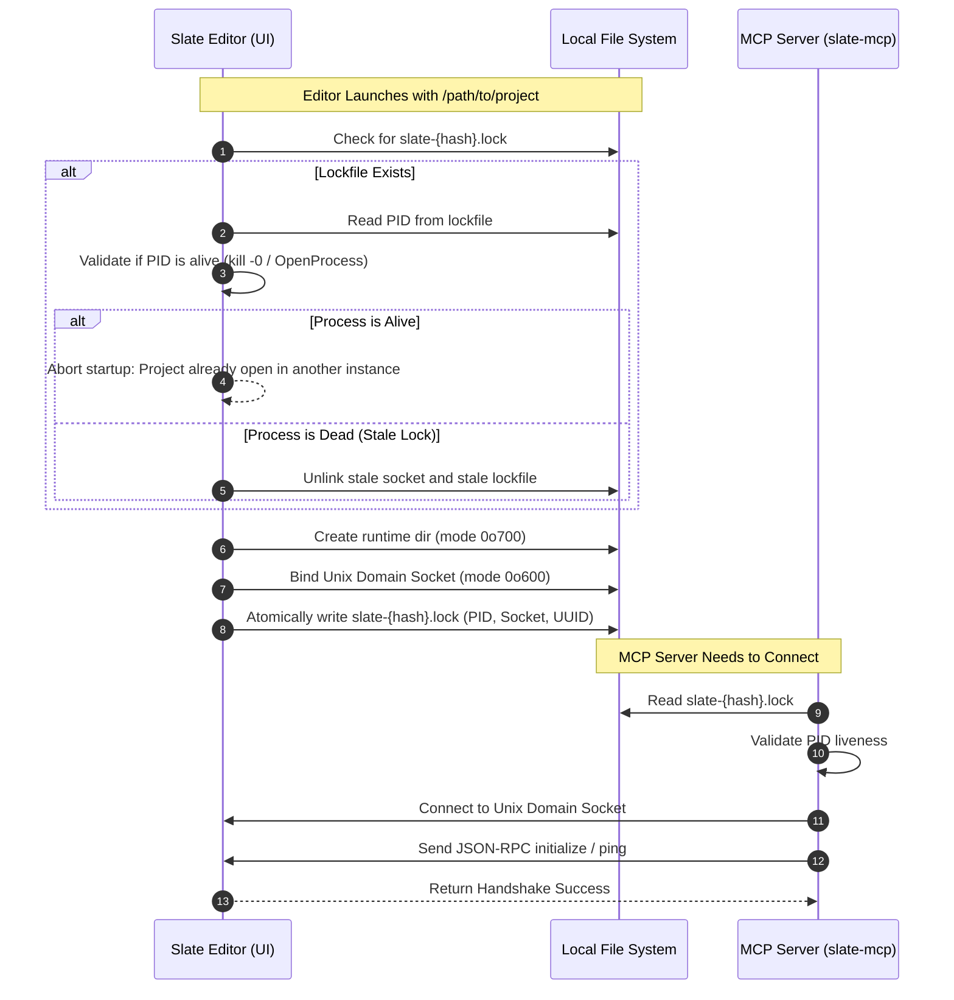
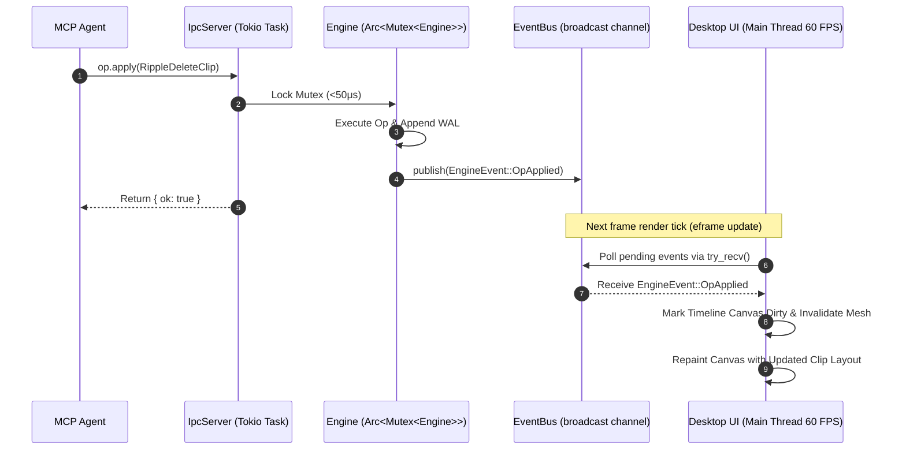
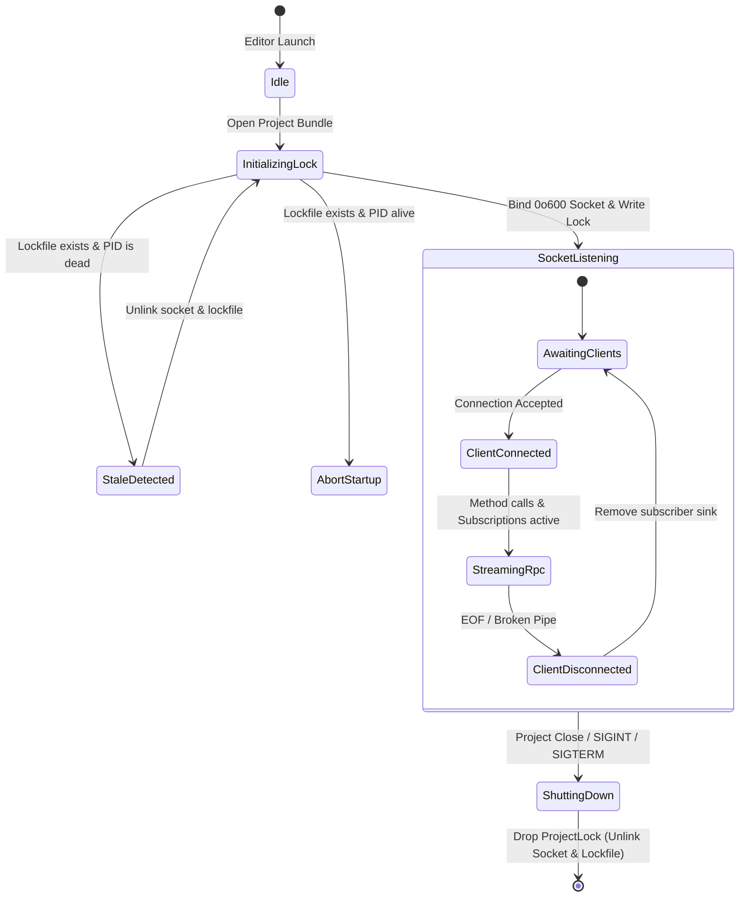
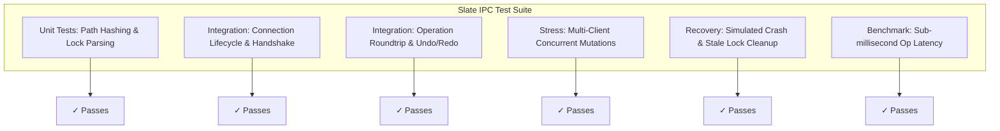

# Slate IPC Protocol (`slate-ipc`) Implementation Plan

> **Specification & Technical Architecture Document**  
> **Crate:** `slate-ipc`  
> **Target Path:** `crates/slate-ipc`  
> **Status:** APPROVED FOR IMPLEMENTATION  
> **Target Release:** v1.0  
> **Related Documents:**  
> - [docs/00-master-plan.md](file:///Users/adityakinjawadekar/Documents/100xcode/video-editor/docs/00-master-plan.md) — Master Architecture & Workspace Layout  
> - [docs/01-core-engine.md](file:///Users/adityakinjawadekar/Documents/100xcode/video-editor/docs/01-core-engine.md) — Timeline Model, Operations & Undo Stack  
> - [docs/02-media-pipeline.md](file:///Users/adityakinjawadekar/Documents/100xcode/video-editor/docs/02-media-pipeline.md) — Media Ingestion, Demuxing & Probing  
> - [docs/04-audio-pipeline.md](file:///Users/adityakinjawadekar/Documents/100xcode/video-editor/docs/04-audio-pipeline.md) — Low-Latency Audio & Loudness Engine  

---

## 1. Overview & Architectural Role

Slate is engineered as a **dual-surface Non-Linear Video Editor (NLE)**. Every capability accessible to a human editor through the desktop user interface (`slate-ui`) is simultaneously and identically exposed to autonomous AI agents (`slate-mcp`) and automated batch scripts (`slate-cli`).

The bridge making this seamless co-existence possible is `slate-ipc`. When the Slate desktop editor is running, it does not lock external processes out of the project; instead, it opens a high-throughput, low-latency local inter-process communication (IPC) channel. External processes connect to this socket and communicate with the live editor engine via a strongly typed JSON-RPC 2.0 protocol implemented with [`jsonrpsee`](https://github.com/paritytech/jsonrpsee).

```mermaid
flowchart TD
    subgraph UI_Process["Slate Desktop Application (slate-ui)"]
        UI_Loop["egui / eframe Event Loop (60 FPS)"]
        Engine["Arc<Mutex<Engine>> (slate-core)"]
        EventBus["EventBus (tokio::sync::broadcast)"]
        IpcServer["IpcServer (jsonrpsee)"]
        
        UI_Loop -->|Dispatches Human Ops| Engine
        Engine -->|Publishes OpApplied / Events| EventBus
        EventBus -->|Notifies UI to Repaint| UI_Loop
        IpcServer -->|Dispatches Agent Ops| Engine
        EventBus -->|Streams Events to Clients| IpcServer
    end

    subgraph External_Clients["External Clients & Automation"]
        MCP["slate-mcp (AI Agent Daemon)"]
        CLI["slate-cli (Terminal Automation)"]
        Scripts["Custom Python/Rust Scripts"]
    end

    MCP -->|EngineClient (JSON-RPC over IPC)| IpcServer
    CLI -->|EngineClient (JSON-RPC over IPC)| IpcServer
    Scripts -->|JSON-RPC 2.0 Client| IpcServer
```

### 1.1 Core Responsibilities of `slate-ipc`

1. **Live Bidirectional Synchronization**: When an AI agent executes a tool (e.g., `split_clip`, `ripple_delete`, `color_grade`), the mutation executes directly within the active editor's memory space, updates the timeline, writes to the Write-Ahead Log (WAL), and immediately repaints the desktop UI at 60 FPS without user intervention.
2. **Unified Provenance & Shared Undo Stack**: Operations submitted via IPC carry an explicit `OpSource::Agent { session_id }`. Both human and AI actions enter the identical linear undo/redo history, allowing the user to press `Cmd+Z` in the desktop GUI to undo an agent's edit, or allowing an agent to call `op.undo` to revert its own previous speculative action.
3. **Reactive Event Streaming**: Connected clients receive push notifications for every state change: clip mutations, playhead movements, playback state toggles, background speech transcription progress, and frame export progress.
4. **Platform-Native Transports**: Zero network overhead using Unix Domain Sockets on macOS/Linux and Named Pipes on Windows.
5. **Robust Instance Discovery & Crash Recovery**: Lockfile-based instance registry with automatic stale lock cleanup and process validation.

### 1.2 Crate Module Layout

```
crates/slate-ipc/
├── Cargo.toml
├── src/
│   ├── lib.rs                  # Crate root, re-exports, prelude
│   ├── error.rs                # IpcError, JsonRpcError mapping, codes
│   ├── types.rs                # Common DTOs, payload wrappers, summaries
│   ├── transport/
│   │   ├── mod.rs              # Transport abstraction module
│   │   ├── path.rs             # Socket and lockfile path resolution
│   │   ├── lock.rs             # Process lockfile management and stale recovery
│   │   ├── unix.rs             # Unix domain socket server and stream adapter
│   │   └── windows.rs          # Windows named pipe server and stream adapter
│   ├── protocol/
│   │   ├── mod.rs              # Protocol definitions
│   │   ├── rpc.rs              # #[jsonrpsee::proc_macros::rpc] trait definition
│   │   ├── requests.rs         # Strongly typed request parameter structs
│   │   ├── responses.rs        # Strongly typed RPC response structs
│   │   └── events.rs           # Push notification payloads and subscription events
│   ├── server/
│   │   ├── mod.rs              # Server module aggregation
│   │   ├── state.rs            # Shared server state (Engine, TaskTracker, Subscribers)
│   │   ├── handler.rs          # Implementation of EngineRpcServer
│   │   └── listener.rs         # Connection acceptor loop and signal shutdown
│   └── client/
│       ├── mod.rs              # Client module aggregation
│       ├── client.rs           # High-level EngineClient wrapper API
│       ├── discovery.rs        # Lockfile discovery, connection retry logic
│       └── subscriber.rs       # Stream adapter for push notifications
└── tests/
    ├── connection_lifecycle.rs # Connect, handshake, disconnect, drop
    ├── op_roundtrip.rs         # Op execution, state validation, undo roundtrip
    ├── multi_client.rs         # Concurrent agents, broadcast fan-out
    └── stale_lock_recovery.rs  # Crash simulation, PID validation, cleanup
```

### 1.3 Cargo Dependencies (`Cargo.toml`)

```toml
[package]
name = "slate-ipc"
version = "0.1.0"
edition = "2021"
authors = ["Slate Authors"]
description = "High-performance JSON-RPC 2.0 IPC protocol and client for the Slate video editor"
license = "MIT OR Apache-2.0"

[dependencies]
# Workspace dependencies
slate-core = { path = "../slate-core" }

# JSON-RPC 2.0 implementation
jsonrpsee = { version = "0.24", features = ["server", "client", "macros"] }

# Asynchronous runtime & networking
tokio = { version = "1.40", features = ["full"] }
tokio-stream = { version = "0.1", features = ["sync"] }
futures-util = "0.3"
async-trait = "0.1"

# Serialization & validation
serde = { version = "1.0", features = ["derive"] }
serde_json = "1.0"
schemars = "0.8"
uuid = { version = "1.10", features = ["v4", "serde"] }
sha2 = "0.10"
hex = "0.4"

# Error handling & logging
thiserror = "1.0"
tracing = "0.1"

# Platform specifics for lockfile & process checks
[target.'cfg(unix)'.dependencies]
libc = "0.2"

[target.'cfg(windows)'.dependencies]
windows-sys = { version = "0.52", features = [
    "Win32_Foundation",
    "Win32_System_Threading",
    "Win32_Security",
    "Win32_System_Pipes"
] }

[dev-dependencies]
tempfile = "3.12"
tokio-test = "0.4"
tracing-subscriber = { version = "0.3", features = ["env-filter"] }
```

---

## 2. Transport Layer & Discovery

Slate uses OS-native streaming IPC to achieve sub-millisecond call latency and zero TCP network stack overhead. It enforces strict OS-level permissions so unprivileged users cannot intercept video frames or inject malicious operations.

### 2.1 Transport Primitives

| Platform | IPC Mechanism | Path Pattern | File Permissions |
| :--- | :--- | :--- | :--- |
| **macOS** | Unix Domain Socket (`AF_UNIX`) | `/tmp/slate-$UID/slate-{hash}.sock` or `~/Library/Caches/slate/slate-{hash}.sock` | `0o600` (Owner read/write only) |
| **Linux** | Unix Domain Socket (`AF_UNIX`) | `$XDG_RUNTIME_DIR/slate/slate-{hash}.sock` (fallback: `/tmp/slate-$UID/`) | `0o600` (Owner read/write only) |
| **Windows** | Named Pipe | `\\.\pipe\slate-{hash}` | User SID DACL (`GENERIC_READ \| GENERIC_WRITE`) |

> [!IMPORTANT]
> The `{hash}` is a deterministic, lowercase 16-character hexadecimal string generated by taking the SHA-256 digest of the canonical, absolute filesystem path to the project bundle directory (e.g., `/Users/aditya/Projects/Documentary.slateproj`). This ensures that multiple open projects run independent IPC servers without namespace collisions.

### 2.2 Path Computation & Platform Abstraction

```rust
// crates/slate-ipc/src/transport/path.rs

use sha2::{Digest, Sha256};
use std::path::{Path, PathBuf};
use crate::error::IpcError;

/// Computes a deterministic 16-hex-character hash from a canonical project path.
pub fn compute_project_hash(project_path: &Path) -> Result<String, IpcError> {
    let canonical = project_path.canonicalize().map_err(|e| {
        IpcError::InvalidProjectPath {
            path: project_path.to_path_buf(),
            source: e,
        }
    })?;
    
    let path_str = canonical.to_string_lossy();
    let mut hasher = Sha256::new();
    hasher.update(path_str.as_bytes());
    let result = hasher.finalize();
    Ok(hex::encode(&result[..8])) // 8 bytes = 16 hex chars
}

/// Resolves the runtime directory for socket and lockfile storage.
pub fn resolve_runtime_dir() -> Result<PathBuf, IpcError> {
    #[cfg(target_os = "linux")]
    {
        if let Ok(runtime_dir) = std::env::var("XDG_RUNTIME_DIR") {
            let path = PathBuf::from(runtime_dir).join("slate");
            return Ok(path);
        }
        let uid = unsafe { libc::getuid() };
        Ok(PathBuf::from(format!("/tmp/slate-{}", uid)))
    }

    #[cfg(target_os = "macos")]
    {
        let uid = unsafe { libc::getuid() };
        // Check for standard user cache or fallback to safe /tmp user dir
        if let Some(mut cache_dir) = dirs::cache_dir() {
            cache_dir.push("slate");
            return Ok(cache_dir);
        }
        Ok(PathBuf::from(format!("/tmp/slate-{}", uid)))
    }

    #[cfg(windows)]
    {
        let local_app_data = std::env::var("LOCALAPPDATA")
            .unwrap_or_else(|_| "C:\\ProgramData".to_string());
        Ok(PathBuf::from(local_app_data).join("Slate").join("run"))
    }
}

/// Returns the exact socket address or named pipe path for a given project path.
pub fn get_socket_path(project_path: &Path) -> Result<PathBuf, IpcError> {
    let hash = compute_project_hash(project_path)?;
    
    #[cfg(unix)]
    {
        let runtime_dir = resolve_runtime_dir()?;
        Ok(runtime_dir.join(format!("slate-{}.sock", hash)))
    }

    #[cfg(windows)]
    {
        Ok(PathBuf::from(format!(r"\\.\pipe\slate-{}", hash)))
    }
}

/// Returns the lockfile path associated with a given project path.
pub fn get_lockfile_path(project_path: &Path) -> Result<PathBuf, IpcError> {
    let hash = compute_project_hash(project_path)?;
    let runtime_dir = resolve_runtime_dir()?;
    Ok(runtime_dir.join(format!("slate-{}.lock", hash)))
}
```

### 2.3 Discovery & Lockfile Management

The lockfile acts as the discovery registry and mutual exclusion guard. When the Slate editor opens a project, it writes a `.lock` file containing its PID, socket path, project UUID, and metadata. When an external client (`slate-mcp` or `slate-cli`) needs to connect to the project, it reads the lockfile to discover the socket.



#### Lockfile Data Schema

```rust
// crates/slate-ipc/src/transport/lock.rs

use serde::{Deserialize, Serialize};
use std::path::PathBuf;
use uuid::Uuid;

#[derive(Debug, Clone, PartialEq, Eq, Serialize, Deserialize)]
pub struct ProjectLockMetadata {
    pub pid: u32,
    pub project_path: PathBuf,
    pub project_id: Uuid,
    pub socket_path: PathBuf,
    pub created_at: u64, // Unix timestamp in seconds
    pub app_version: String,
    pub protocol_version: u32,
}
```

Example JSON representation on disk:

```json
{
  "pid": 48291,
  "project_path": "/Users/aditya/Projects/ShortFilm.slateproj",
  "project_id": "a50c822e-13c5-4309-9189-60144d4850fa",
  "socket_path": "/tmp/slate-501/slate-8f4b1c20e9a1.sock",
  "created_at": 1773489240,
  "app_version": "1.0.0",
  "protocol_version": 1
}
```

#### Lock Acquisition and Stale Process Detection

```rust
// crates/slate-ipc/src/transport/lock.rs

use std::fs::{self, File, OpenOptions};
use std::io::{Read, Write};
use std::path::{Path, PathBuf};
use std::time::SystemTime;
use uuid::Uuid;
use crate::error::{IpcError, LockError};
use crate::transport::path::{get_lockfile_path, get_socket_path, resolve_runtime_dir};

pub struct ProjectLock {
    lock_path: PathBuf,
    socket_path: PathBuf,
}

impl ProjectLock {
    /// Attempts to acquire an exclusive project lock. Cleans up stale artifacts if previous process crashed.
    pub fn acquire(project_path: &Path, project_id: Uuid) -> Result<Self, IpcError> {
        let runtime_dir = resolve_runtime_dir()?;
        fs::create_dir_all(&runtime_dir).map_err(|e| IpcError::Io {
            action: "creating runtime directory",
            path: runtime_dir.clone(),
            source: e,
        })?;

        #[cfg(unix)]
        {
            use std::os::unix::fs::PermissionsExt;
            let _ = fs::set_permissions(&runtime_dir, fs::Permissions::from_mode(0o700));
        }

        let lock_path = get_lockfile_path(project_path)?;
        let socket_path = get_socket_path(project_path)?;

        // Check if existing lockfile exists
        if lock_path.exists() {
            match Self::read_lock(&lock_path) {
                Ok(meta) => {
                    if is_process_alive(meta.pid) {
                        return Err(IpcError::Lock(LockError::AlreadyRunning {
                            pid: meta.pid,
                            project_path: project_path.to_path_buf(),
                        }));
                    } else {
                        tracing::warn!(
                            stale_pid = meta.pid,
                            "Detected stale lockfile from crashed editor instance. Cleaning up."
                        );
                        Self::cleanup_files(&lock_path, &socket_path);
                    }
                }
                Err(err) => {
                    tracing::warn!("Corrupted lockfile detected: {}. Cleaning up.", err);
                    Self::cleanup_files(&lock_path, &socket_path);
                }
            }
        }

        // Clean up orphaned socket if present
        if socket_path.exists() {
            let _ = fs::remove_file(&socket_path);
        }

        // Write lockfile atomically using exclusive creation
        let current_pid = std::process::id();
        let now = SystemTime::now()
            .duration_since(SystemTime::UNIX_EPOCH)
            .unwrap_or_default()
            .as_secs();

        let metadata = ProjectLockMetadata {
            pid: current_pid,
            project_path: project_path.canonicalize().unwrap_or_else(|_| project_path.to_path_buf()),
            project_id,
            socket_path: socket_path.clone(),
            created_at: now,
            app_version: env!("CARGO_PKG_VERSION").to_string(),
            protocol_version: 1,
        };

        let serialized = serde_json::to_string_pretty(&metadata)
            .map_err(|e| IpcError::Serialization(e.to_string()))?;

        // Write with O_CREAT | O_EXCL
        let mut file = OpenOptions::new()
            .write(true)
            .create_new(true)
            .open(&lock_path)
            .map_err(|e| IpcError::Lock(LockError::AcquisitionFailed(e.to_string())))?;

        #[cfg(unix)]
        {
            use std::os::unix::fs::PermissionsExt;
            let _ = fs::set_permissions(&lock_path, fs::Permissions::from_mode(0o600));
        }

        file.write_all(serialized.as_bytes()).map_err(|e| IpcError::Io {
            action: "writing project lockfile",
            path: lock_path.clone(),
            source: e,
        })?;
        file.flush().map_err(|e| IpcError::Io {
            action: "flushing project lockfile",
            path: lock_path.clone(),
            source: e,
        })?;

        Ok(Self {
            lock_path,
            socket_path,
        })
    }

    pub fn read_lock(lock_path: &Path) -> Result<ProjectLockMetadata, IpcError> {
        let mut file = File::open(lock_path).map_err(|e| IpcError::Io {
            action: "opening lockfile",
            path: lock_path.to_path_buf(),
            source: e,
        })?;
        let mut content = String::new();
        file.read_to_string(&mut content).map_err(|e| IpcError::Io {
            action: "reading lockfile",
            path: lock_path.to_path_buf(),
            source: e,
        })?;
        let meta: ProjectLockMetadata = serde_json::from_str(&content)
            .map_err(|e| IpcError::Serialization(e.to_string()))?;
        Ok(meta)
    }

    fn cleanup_files(lock_path: &Path, socket_path: &Path) {
        if lock_path.exists() {
            let _ = fs::remove_file(lock_path);
        }
        if socket_path.exists() {
            let _ = fs::remove_file(socket_path);
        }
    }
}

impl Drop for ProjectLock {
    fn drop(&mut self) {
        tracing::info!("Releasing project lock and removing IPC socket.");
        Self::cleanup_files(&self.lock_path, &self.socket_path);
    }
}

/// Robust cross-platform check whether a process with the given PID is actively running.
pub fn is_process_alive(pid: u32) -> bool {
    #[cfg(unix)]
    {
        // kill(pid, 0) checks existence without sending a real signal
        let res = unsafe { libc::kill(pid as libc::pid_t, 0) };
        if res == 0 {
            return true;
        }
        let err = std::io::Error::last_os_error().raw_os_error();
        // EPERM means process exists but belongs to another user (still alive)
        err == Some(libc::EPERM)
    }

    #[cfg(windows)]
    {
        use windows_sys::Win32::Foundation::{CloseHandle, FALSE};
        use windows_sys::Win32::System::Threading::{
            GetExitCodeProcess, OpenProcess, PROCESS_QUERY_LIMITED_INFORMATION,
        };

        unsafe {
            let handle = OpenProcess(PROCESS_QUERY_LIMITED_INFORMATION, FALSE, pid);
            if handle.is_null() {
                return false;
            }
            let mut exit_code: u32 = 0;
            let status = GetExitCodeProcess(handle, &mut exit_code);
            CloseHandle(handle);
            // STILL_ACTIVE is 259
            status != 0 && exit_code == 259
        }
    }
}
```

---

## 3. JSON-RPC 2.0 Protocol Specification

`slate-ipc` exposes a complete JSON-RPC 2.0 service over the socket using the official `jsonrpsee` framework. The protocol is divided into two communication planes:
1. **Methods (Request/Response)**: Synchronous or asynchronous remote procedure calls executed against the engine.
2. **Subscriptions (Push Notifications)**: Real-time event streams multiplexed over the same connection.

### 3.1 The Engine RPC Interface Trait

```rust
// crates/slate-ipc/src/protocol/rpc.rs

use jsonrpsee::proc_macros::rpc;
use jsonrpsee::core::SubscriptionResult;
use crate::error::IpcError;
use crate::protocol::requests::*;
use crate::protocol::responses::*;
use crate::protocol::events::EngineEvent;

#[rpc(server, client, namespace = "")]
pub trait EngineRpc {
    // -------------------------------------------------------------------------
    // Operations & Undo/Redo Engine
    // -------------------------------------------------------------------------
    #[method(name = "op.apply")]
    async fn apply_op(&self, params: ApplyOpParams) -> Result<ApplyOpResult, IpcError>;

    #[method(name = "op.batch")]
    async fn apply_batch(&self, params: ApplyBatchParams) -> Result<ApplyBatchResult, IpcError>;

    #[method(name = "op.undo")]
    async fn undo(&self, params: UndoParams) -> Result<UndoResult, IpcError>;

    #[method(name = "op.redo")]
    async fn redo(&self, params: RedoParams) -> Result<RedoResult, IpcError>;

    #[method(name = "op.revert")]
    async fn revert(&self, params: RevertParams) -> Result<RevertResult, IpcError>;

    #[method(name = "history.list")]
    async fn list_history(&self, params: ListHistoryParams) -> Result<HistoryListResult, IpcError>;

    // -------------------------------------------------------------------------
    // Timeline Queries & State
    // -------------------------------------------------------------------------
    #[method(name = "timeline.get")]
    async fn get_timeline(&self, params: GetTimelineParams) -> Result<TimelineResult, IpcError>;

    #[method(name = "timeline.summary")]
    async fn get_timeline_summary(&self, params: GetSummaryParams) -> Result<TimelineSummaryResult, IpcError>;

    // -------------------------------------------------------------------------
    // Media Pool & Probing
    // -------------------------------------------------------------------------
    #[method(name = "media.list")]
    async fn list_media(&self) -> Result<MediaListResult, IpcError>;

    #[method(name = "media.probe")]
    async fn probe_media(&self, params: ProbeMediaParams) -> Result<ProbeMediaResult, IpcError>;

    #[method(name = "media.import")]
    async fn import_media(&self, params: ImportMediaParams) -> Result<ImportMediaResult, IpcError>;

    // -------------------------------------------------------------------------
    // Playback & Transport Control
    // -------------------------------------------------------------------------
    #[method(name = "playback.play")]
    async fn playback_play(&self, params: PlayParams) -> Result<PlaybackResult, IpcError>;

    #[method(name = "playback.pause")]
    async fn playback_pause(&self) -> Result<PlaybackResult, IpcError>;

    #[method(name = "playback.seek")]
    async fn playback_seek(&self, params: SeekParams) -> Result<PlaybackResult, IpcError>;

    // -------------------------------------------------------------------------
    // Rendering & Export
    // -------------------------------------------------------------------------
    #[method(name = "render.frame")]
    async fn render_frame(&self, params: RenderFrameParams) -> Result<RenderFrameResult, IpcError>;

    #[method(name = "export.start")]
    async fn export_start(&self, params: ExportStartParams) -> Result<ExportStartResult, IpcError>;

    #[method(name = "export.status")]
    async fn export_status(&self, params: ExportStatusParams) -> Result<ExportStatusResult, IpcError>;

    #[method(name = "export.cancel")]
    async fn export_cancel(&self, params: ExportCancelParams) -> Result<ExportCancelResult, IpcError>;

    // -------------------------------------------------------------------------
    // Multimodal AI Analysis
    // -------------------------------------------------------------------------
    #[method(name = "analysis.transcribe")]
    async fn analysis_transcribe(&self, params: TranscribeParams) -> Result<JobStartedResult, IpcError>;

    #[method(name = "analysis.scenes")]
    async fn analysis_scenes(&self, params: SceneDetectParams) -> Result<JobStartedResult, IpcError>;

    #[method(name = "analysis.silences")]
    async fn analysis_silences(&self, params: SilenceDetectParams) -> Result<SilenceDetectResult, IpcError>;

    #[method(name = "analysis.loudness")]
    async fn analysis_loudness(&self, params: LoudnessParams) -> Result<LoudnessResult, IpcError>;

    // -------------------------------------------------------------------------
    // Subscriptions (Push Notifications)
    // -------------------------------------------------------------------------
    #[subscription(name = "events.subscribe", item = EngineEvent)]
    async fn subscribe_events(&self) -> SubscriptionResult;
}
```

### 3.2 Detailed Method Specifications

#### 1. `op.apply`
Applies a single atomic timeline operation. Validates invariants, applies mutation in-memory, appends to write-ahead journal, records undo entry with provenance, and broadcasts `event.op_applied` to all listeners.

- **Request Payload**:
```json
{
  "jsonrpc": "2.0",
  "id": 1,
  "method": "op.apply",
  "params": {
    "op": {
      "type": "splitClip",
      "clipId": "c478a873-e38c-47bc-9f87-e2518e11b402",
      "splitPoint": { "ticks": 120, "rate": 24 }
    },
    "source": {
      "source": "agent",
      "sessionId": "mcp-claude-agent-42"
    },
    "label": "Split Clip at 00:00:05:00"
  }
}
```

- **Response Payload (Success)**:
```json
{
  "jsonrpc": "2.0",
  "id": 1,
  "result": {
    "ok": true,
    "timelineId": "a1b2c3d4-e5f6-7890-abcd-ef1234567890",
    "inverse": {
      "type": "mergeClips",
      "leftClipId": "c478a873-e38c-47bc-9f87-e2518e11b402",
      "rightClipId": "9d82fb10-44ec-4f40-b8dc-37e408e01103"
    }
  }
}
```

- **Response Payload (Error)**:
```json
{
  "jsonrpc": "2.0",
  "id": 1,
  "error": {
    "code": -32001,
    "message": "Operation rejected by timeline integrity validation",
    "data": {
      "errorType": "ClipNotFound",
      "details": "Clip c478a873-e38c-47bc-9f87-e2518e11b402 does not exist on active timeline"
    }
  }
}
```

#### 2. `op.batch`
Applies a vector of operations **atomically**. If any operation in the batch fails validation or execution, all prior operations in the batch are rolled back immediately using their generated inverses, and the engine state remains completely untouched.

- **Request**:
```json
{
  "jsonrpc": "2.0",
  "id": 2,
  "method": "op.batch",
  "params": {
    "ops": [
      {
        "type": "trimClipStart",
        "clipId": "c478a873-e38c-47bc-9f87-e2518e11b402",
        "newIn": { "ticks": 48, "rate": 24 }
      },
      {
        "type": "rippleDelete",
        "trackId": "t1111111-2222-3333-4444-555555555555",
        "range": {
          "start": { "ticks": 0, "rate": 24 },
          "duration": { "ticks": 48, "rate": 24 }
        }
      }
    ],
    "source": { "source": "agent", "sessionId": "mcp-batch-runner" },
    "label": "Trim head and ripple delete gap"
  }
}
```

- **Response**:
```json
{
  "jsonrpc": "2.0",
  "id": 2,
  "result": {
    "ok": true,
    "opsApplied": 2
  }
}
```

#### 3. `op.undo` / `op.redo` / `op.revert`
- `op.undo`: Undoes the top operation on the active timeline. Dispatches `event.op_undone`.
- `op.redo`: Redoes the previously undone operation. Dispatches `event.op_applied`.
- `op.revert`: Inverts a specific operation at a historical index without truncating the forward redo tree if dependencies allow.

#### 4. `timeline.get` vs `timeline.summary`
- `timeline.get`: Serializes and returns the complete, exhaustive `Timeline` struct (including all tracks, clips, keyframes, transitions, and effects). Used for full serialization and UI state loading.
- `timeline.summary`: Returns a compact, **token-optimized summary** specifically designed for LLMs. It summarizes the active timeline down to track names, clip counts, durations, time ranges, and clip labels — reducing context window token consumption by **90%**.

- **Summary Response**:
```json
{
  "jsonrpc": "2.0",
  "id": 4,
  "result": {
    "timelineId": "a1b2c3d4-e5f6-7890-abcd-ef1234567890",
    "name": "Main Sequence",
    "duration": { "ticks": 7200, "rate": 24, "timecode": "00:05:00:00" },
    "tracks": [
      {
        "id": "t1111111-2222-3333-4444-555555555555",
        "name": "V1",
        "kind": "video",
        "clipCount": 3,
        "clips": [
          { "id": "c1", "name": "Interview_A.mov", "range": "00:00:00:00 - 00:01:30:00" },
          { "id": "c2", "name": "B_Roll_Park.mp4", "range": "00:01:30:00 - 00:03:00:00" },
          { "id": "c3", "name": "Interview_B.mov", "range": "00:03:00:00 - 00:05:00:00" }
        ]
      },
      {
        "id": "t2222222-3333-4444-5555-666666666666",
        "name": "A1",
        "kind": "audio",
        "clipCount": 2,
        "clips": [
          { "id": "c4", "name": "Dialogue_Stem.wav", "range": "00:00:00:00 - 00:05:00:00" },
          { "id": "c5", "name": "Music_Background.mp3", "range": "00:00:00:00 - 00:05:00:00" }
        ]
      }
    ],
    "markerCount": 4
  }
}
```

#### 5. `render.frame`
Renders a single frame at an exact `RationalTime` using the GPU compositing engine (`slate-render`). Returns the frame encoded as a base64 string (PNG or JPEG) or raw buffer metadata. Crucial for multimodal vision models (e.g., Claude 3.5 Sonnet / GPT-4o) to visually inspect cuts, color grades, and graphics.

- **Request**:
```json
{
  "jsonrpc": "2.0",
  "id": 5,
  "method": "render.frame",
  "params": {
    "time": { "ticks": 240, "rate": 24 },
    "width": 1280,
    "height": 720,
    "format": "jpeg",
    "quality": 85
  }
}
```

- **Response**:
```json
{
  "jsonrpc": "2.0",
  "id": 5,
  "result": {
    "time": { "ticks": 240, "rate": 24 },
    "width": 1280,
    "height": 720,
    "format": "image/jpeg",
    "dataBase64": "/9j/4AAQSkZJRgABAQEASABIAAD/2wBD..."
  }
}
```

#### 6. `export.start` / `export.status` / `export.cancel`
Non-blocking background batch rendering. Agents can start an export with specified codec and bitrate presets, poll or stream its progress, and receive notification when the MP4/ProRes file is ready.

#### 7. `analysis.transcribe` / `analysis.scenes` / `analysis.silences` / `analysis.loudness`
Triggers background multimodal analysis via `slate-analysis`. Transcriptions generate word-level timestamped transcripts for speech-to-text editing. Silence detection locates dead air for automatic jump-cut generation.

### 3.3 Event Subscriptions & Push Notifications

When a client calls `events.subscribe`, the server opens a persistent subscription stream. The server broadcasts engine events using `tokio::sync::broadcast`.

```rust
// crates/slate-ipc/src/protocol/events.rs

use serde::{Deserialize, Serialize};
use uuid::Uuid;
use slate_core::id::{MediaId, TimelineId};
use slate_core::model::RationalTime;
use slate_core::op::{Op, OpInverse, OpSource};

#[derive(Debug, Clone, Serialize, Deserialize)]
#[serde(tag = "type", content = "payload", rename_all = "camelCase")]
pub enum EngineEvent {
    /// Dispatched whenever any mutation is committed to the timeline
    OpApplied {
        op: Op,
        source: OpSource,
        label: String,
        timeline_id: TimelineId,
        timestamp_ms: u64,
    },
    /// Dispatched when an operation is undone
    OpUndone {
        inverse: OpInverse,
        timeline_id: TimelineId,
    },
    /// Dispatched when the active timeline switches or is restructured
    TimelineChanged {
        timeline_id: TimelineId,
    },
    /// Playback state updates (playing, paused, looping, speed)
    PlaybackState {
        is_playing: bool,
        speed: f64,
        position: RationalTime,
    },
    /// Playhead position update during scrubbing or playback
    PlayheadMoved {
        position: RationalTime,
    },
    /// Background media analysis progress updates (Whisper, Silero VAD, Scene Cut)
    AnalysisProgress {
        job_id: Uuid,
        media_id: MediaId,
        task: String,
        progress: f32, // 0.0 to 1.0
        stage: String,
    },
    /// Background video export progress updates
    ExportProgress {
        job_id: Uuid,
        progress: f32,
        current_frame: u64,
        total_frames: u64,
        fps: f64,
        eta_seconds: Option<f32>,
    },
    /// Media asset successfully ingested and probed
    MediaImported {
        media_id: MediaId,
        name: String,
        duration: RationalTime,
    },
}
```

Subscription push notification wire format:
```json
{
  "jsonrpc": "2.0",
  "method": "events.subscribe",
  "params": {
    "subscription": "9f71ab82c0de4418",
    "result": {
      "type": "opApplied",
      "payload": {
        "op": {
          "type": "addClip",
          "trackId": "t1111111-2222-3333-4444-555555555555",
          "clip": { ... }
        },
        "source": { "source": "agent", "sessionId": "claude-session-1" },
        "label": "Insert B-Roll clip at 00:01:30:00",
        "timelineId": "a1b2c3d4-e5f6-7890-abcd-ef1234567890",
        "timestampMs": 1773489241020
      }
    }
  }
}
```

---

## 4. Client Library Architecture (`EngineClient`)

`slate-ipc` provides a high-level, ergonomics-first async client struct: `EngineClient`. This struct encapsulates discovery, automatic socket reconnection, serialization, type conversion, and event streaming. It is consumed directly by `slate-mcp` and `slate-cli`.

```rust
// crates/slate-ipc/src/client/client.rs

use std::path::Path;
use std::sync::Arc;
use std::time::Duration;
use futures_util::{Stream, StreamExt};
use jsonrpsee::core::client::{ClientT, SubscriptionClientT};
use jsonrpsee::core::Subscription;
use slate_core::id::{MediaId, TimelineId};
use slate_core::model::{RationalTime, Timeline};
use slate_core::op::{Op, OpSource};

use crate::error::IpcError;
use crate::protocol::rpc::EngineRpcClient;
use crate::protocol::requests::*;
use crate::protocol::responses::*;
use crate::protocol::events::EngineEvent;
use crate::client::discovery::discover_and_connect;

#[derive(Clone)]
pub struct EngineClient {
    rpc: Arc<jsonrpsee::core::client::Client>,
}

impl EngineClient {
    /// Discovers the active Slate editor for a project path via lockfile and establishes an IPC connection.
    pub async fn connect_project(project_path: impl AsRef<Path>) -> Result<Self, IpcError> {
        let client = discover_and_connect(project_path.as_ref(), Duration::from_secs(5)).await?;
        Ok(Self { rpc: Arc::new(client) })
    }

    /// Directly connects to a specific Unix socket path or Windows Named Pipe.
    pub async fn connect_socket(socket_path: impl AsRef<Path>) -> Result<Self, IpcError> {
        let client = crate::transport::unix::connect_unix_client(socket_path.as_ref()).await?;
        Ok(Self { rpc: Arc::new(client) })
    }

    // -------------------------------------------------------------------------
    // Operations
    // -------------------------------------------------------------------------

    /// Applies a single timeline operation with provenance.
    pub async fn apply_op(
        &self,
        op: Op,
        source: OpSource,
        label: impl Into<String>,
    ) -> Result<ApplyOpResult, IpcError> {
        let params = ApplyOpParams {
            op,
            source,
            label: Some(label.into()),
        };
        self.rpc.apply_op(params).await.map_err(IpcError::from)
    }

    /// Applies multiple timeline operations atomically in a single batch.
    pub async fn apply_batch(
        &self,
        ops: Vec<Op>,
        source: OpSource,
        label: impl Into<String>,
    ) -> Result<ApplyBatchResult, IpcError> {
        let params = ApplyBatchParams {
            ops,
            source,
            label: label.into(),
        };
        self.rpc.apply_batch(params).await.map_err(IpcError::from)
    }

    /// Undoes the last operation.
    pub async fn undo(&self, timeline_id: Option<TimelineId>) -> Result<UndoResult, IpcError> {
        self.rpc.undo(UndoParams { timeline_id }).await.map_err(IpcError::from)
    }

    /// Redoes the previously undone operation.
    pub async fn redo(&self, timeline_id: Option<TimelineId>) -> Result<RedoResult, IpcError> {
        self.rpc.redo(RedoParams { timeline_id }).await.map_err(IpcError::from)
    }

    // -------------------------------------------------------------------------
    // Timeline Queries
    // -------------------------------------------------------------------------

    /// Retrieves the entire exhaustive timeline schema.
    pub async fn get_timeline(&self, timeline_id: Option<TimelineId>) -> Result<Timeline, IpcError> {
        let res = self.rpc.get_timeline(GetTimelineParams { timeline_id }).await.map_err(IpcError::from)?;
        Ok(res.timeline)
    }

    /// Retrieves a token-optimized compact timeline summary for LLM context injection.
    pub async fn get_timeline_summary(
        &self,
        timeline_id: Option<TimelineId>,
    ) -> Result<TimelineSummaryResult, IpcError> {
        self.rpc.get_timeline_summary(GetSummaryParams { timeline_id }).await.map_err(IpcError::from)
    }

    // -------------------------------------------------------------------------
    // Multimodal Rendering & Playback
    // -------------------------------------------------------------------------

    /// Requests the editor to render a frame at an exact timestamp and returns base64 image data.
    pub async fn render_frame(
        &self,
        time: RationalTime,
        width: u32,
        height: u32,
    ) -> Result<RenderFrameResult, IpcError> {
        let params = RenderFrameParams {
            time,
            width,
            height,
            format: "jpeg".to_string(),
            quality: Some(85),
        };
        self.rpc.render_frame(params).await.map_err(IpcError::from)
    }

    /// Seeks the active editor playhead to a specific frame.
    pub async fn seek(&self, position: RationalTime) -> Result<(), IpcError> {
        self.rpc.playback_seek(SeekParams { position }).await.map_err(IpcError::from)?;
        Ok(())
    }

    // -------------------------------------------------------------------------
    // Reactive Subscriptions
    // -------------------------------------------------------------------------

    /// Subscribes to real-time engine push notifications. Returns an async Stream of `EngineEvent`.
    pub async fn subscribe_events(&self) -> Result<impl Stream<Item = EngineEvent>, IpcError> {
        let sub: Subscription<EngineEvent> = self.rpc
            .subscribe("events.subscribe", jsonrpsee::rpc_params![], "events.unsubscribe")
            .await
            .map_err(IpcError::from)?;

        Ok(sub.filter_map(|item| async move { item.ok() }))
    }
}
```

---

## 5. Server Architecture & Desktop UI Integration

The server component lives inside the desktop editor or headless daemon. It must service incoming RPC calls and push events without interfering with the 60 FPS UI render thread or holding long locks during frame decoding.

### 5.1 Shared Server State & Mutex Strategy

```rust
// crates/slate-ipc/src/server/state.rs

use std::sync::Arc;
use parking_lot::Mutex;
use tokio::sync::broadcast;
use slate_core::engine::Engine;
use slate_core::events::EngineEvent;

pub struct ServerState {
    pub engine: Arc<Mutex<Engine>>,
    pub event_tx: broadcast::Sender<EngineEvent>,
    pub app_version: String,
}

impl ServerState {
    pub fn new(engine: Arc<Mutex<Engine>>, event_tx: broadcast::Sender<EngineEvent>) -> Self {
        Self {
            engine,
            event_tx,
            app_version: env!("CARGO_PKG_VERSION").to_string(),
        }
    }
}
```

> [!TIP]
> We employ `parking_lot::Mutex` for synchronizing `Engine`. Operations on the timeline graph are pure in-memory pointer arithmetic and take less than **50 microseconds**. Long-running asynchronous tasks (video decoding, audio filtering, Whisper AI transcription, and frame rendering) are delegated to worker thread pools *outside* the `Engine` lock, passing snapshot handles or bounded IDs.

### 5.2 Server RPC Handler Implementation

```rust
// crates/slate-ipc/src/server/handler.rs

use std::sync::Arc;
use async_trait::async_trait;
use jsonrpsee::core::{RpcResult, SubscriptionResult};
use jsonrpsee::PendingSubscriptionSink;
use slate_core::model::Timeline;
use crate::error::{IpcError, OpRpcError};
use crate::protocol::rpc::EngineRpcServer;
use crate::protocol::requests::*;
use crate::protocol::responses::*;
use crate::protocol::events::EngineEvent;
use crate::server::state::ServerState;

pub struct EngineRpcHandler {
    state: Arc<ServerState>,
}

impl EngineRpcHandler {
    pub fn new(state: Arc<ServerState>) -> Self {
        Self { state }
    }
}

#[async_trait]
impl EngineRpcServer for EngineRpcHandler {
    async fn apply_op(&self, params: ApplyOpParams) -> RpcResult<ApplyOpResult> {
        let mut engine = self.state.engine.lock();
        let label = params.label.unwrap_or_else(|| "IPC Operation".to_string());
        
        let op_clone = params.op.clone();
        let source_clone = params.source.clone();

        match engine.apply_op(params.op, params.source, label) {
            Ok(inverse) => {
                let timeline_id = engine.project().active_timeline_id;
                
                // Broadcast event to all IPC subscribers and UI listeners
                let _ = self.state.event_tx.send(EngineEvent::OpApplied {
                    op: op_clone,
                    source: source_clone,
                    label: "IPC Operation".to_string(),
                    timeline_id,
                    timestamp_ms: std::time::SystemTime::now()
                        .duration_since(std::time::UNIX_EPOCH)
                        .unwrap_or_default()
                        .as_millis() as u64,
                });

                Ok(ApplyOpResult {
                    ok: true,
                    timeline_id,
                    inverse,
                })
            }
            Err(op_err) => {
                Err(IpcError::OpRejected(OpRpcError::from(op_err)).into())
            }
        }
    }

    async fn apply_batch(&self, params: ApplyBatchParams) -> RpcResult<ApplyBatchResult> {
        let mut engine = self.state.engine.lock();
        let total = params.ops.len();
        
        // Execute transactionally
        match engine.apply_batch(params.ops, params.source, params.label) {
            Ok(_) => Ok(ApplyBatchResult {
                ok: true,
                ops_applied: total,
            }),
            Err(e) => Err(IpcError::OpRejected(OpRpcError::from(e)).into()),
        }
    }

    async fn undo(&self, _params: UndoParams) -> RpcResult<UndoResult> {
        let mut engine = self.state.engine.lock();
        match engine.undo() {
            Ok(entry) => {
                let timeline_id = engine.project().active_timeline_id;
                let _ = self.state.event_tx.send(EngineEvent::OpUndone {
                    inverse: entry.inverse.clone(),
                    timeline_id,
                });
                Ok(UndoResult {
                    undone_op: entry.op,
                    inverse: entry.inverse,
                })
            }
            Err(e) => Err(IpcError::HistoryError(e.to_string()).into()),
        }
    }

    async fn redo(&self, _params: RedoParams) -> RpcResult<RedoResult> {
        let mut engine = self.state.engine.lock();
        match engine.redo() {
            Ok(entry) => {
                let timeline_id = engine.project().active_timeline_id;
                let _ = self.state.event_tx.send(EngineEvent::OpApplied {
                    op: entry.op.clone(),
                    source: entry.source.clone(),
                    label: entry.label.clone(),
                    timeline_id,
                    timestamp_ms: std::time::SystemTime::now()
                        .duration_since(std::time::UNIX_EPOCH)
                        .unwrap_or_default()
                        .as_millis() as u64,
                });
                Ok(RedoResult { redone_op: entry.op })
            }
            Err(e) => Err(IpcError::HistoryError(e.to_string()).into()),
        }
    }

    async fn revert(&self, params: RevertParams) -> RpcResult<RevertResult> {
        let mut engine = self.state.engine.lock();
        match engine.revert_entry(params.history_index) {
            Ok(reverted_op) => Ok(RevertResult {
                ok: true,
                reverted_op,
            }),
            Err(e) => Err(IpcError::HistoryError(e.to_string()).into()),
        }
    }

    async fn list_history(&self, params: ListHistoryParams) -> RpcResult<HistoryListResult> {
        let engine = self.state.engine.lock();
        let history = engine.history();
        let entries = history.entries_window(params.offset.unwrap_or(0), params.limit.unwrap_or(50));
        
        Ok(HistoryListResult {
            cursor: history.cursor(),
            total_entries: history.len(),
            entries,
        })
    }

    async fn get_timeline(&self, params: GetTimelineParams) -> RpcResult<TimelineResult> {
        let engine = self.state.engine.lock();
        let timeline_id = params.timeline_id.unwrap_or_else(|| engine.project().active_timeline_id);
        
        let timeline = engine.project().timelines.iter()
            .find(|t| t.id == timeline_id)
            .cloned()
            .ok_or_else(|| IpcError::EntityNotFound(format!("Timeline {}", timeline_id)))?;

        Ok(TimelineResult { timeline })
    }

    async fn get_timeline_summary(&self, params: GetSummaryParams) -> RpcResult<TimelineSummaryResult> {
        let engine = self.state.engine.lock();
        let timeline_id = params.timeline_id.unwrap_or_else(|| engine.project().active_timeline_id);
        
        let timeline = engine.project().timelines.iter()
            .find(|t| t.id == timeline_id)
            .ok_or_else(|| IpcError::EntityNotFound(format!("Timeline {}", timeline_id)))?;

        let summary = build_compact_summary(timeline, engine.project());
        Ok(summary)
    }

    async fn list_media(&self) -> RpcResult<MediaListResult> {
        let engine = self.state.engine.lock();
        let items = engine.project().media_pool.values().cloned().collect();
        Ok(MediaListResult { items })
    }

    async fn probe_media(&self, params: ProbeMediaParams) -> RpcResult<ProbeMediaResult> {
        // Delegate media probing to media pipeline without holding engine lock
        let probe = slate_media::probe::probe_file(&params.path)
            .map_err(|e| IpcError::Media(e.to_string()))?;
        Ok(ProbeMediaResult { probe })
    }

    async fn import_media(&self, params: ImportMediaParams) -> RpcResult<ImportMediaResult> {
        let mut engine = self.state.engine.lock();
        let media_id = engine.import_media_asset(&params.path, params.generate_proxies)
            .map_err(|e| IpcError::Media(e.to_string()))?;
        
        let asset = engine.project().media_pool.get(&media_id).cloned().unwrap();
        Ok(ImportMediaResult {
            media_id,
            asset,
        })
    }

    async fn playback_play(&self, params: PlayParams) -> RpcResult<PlaybackResult> {
        let speed = params.speed.unwrap_or(1.0);
        let _ = self.state.event_tx.send(EngineEvent::PlaybackState {
            is_playing: true,
            speed,
            position: self.state.engine.lock().playhead(),
        });
        Ok(PlaybackResult { ok: true })
    }

    async fn playback_pause(&self) -> RpcResult<PlaybackResult> {
        let _ = self.state.event_tx.send(EngineEvent::PlaybackState {
            is_playing: false,
            speed: 0.0,
            position: self.state.engine.lock().playhead(),
        });
        Ok(PlaybackResult { ok: true })
    }

    async fn playback_seek(&self, params: SeekParams) -> RpcResult<PlaybackResult> {
        let mut engine = self.state.engine.lock();
        engine.set_playhead(params.position);
        
        let _ = self.state.event_tx.send(EngineEvent::PlayheadMoved {
            position: params.position,
        });
        Ok(PlaybackResult { ok: true })
    }

    async fn render_frame(&self, params: RenderFrameParams) -> RpcResult<RenderFrameResult> {
        // Take a cheap clone/snapshot of active timeline and media pool
        let (timeline, media_pool) = {
            let engine = self.state.engine.lock();
            let tl = engine.active_timeline().clone();
            let mp = engine.project().media_pool.clone();
            (tl, mp)
        };

        // Render asynchronously via slate-render offscreen renderer
        let rendered = slate_render::OffscreenRenderer::render_still_frame(
            &timeline,
            &media_pool,
            params.time,
            params.width,
            params.height,
        ).await.map_err(|e| IpcError::Render(e.to_string()))?;

        // Encode to requested format (JPEG or PNG)
        let base64_data = rendered.to_base64(&params.format, params.quality.unwrap_or(80))
            .map_err(|e| IpcError::Render(e.to_string()))?;

        Ok(RenderFrameResult {
            time: params.time,
            width: params.width,
            height: params.height,
            format: format!("image/{}", params.format),
            data_base64: base64_data,
        })
    }

    async fn export_start(&self, params: ExportStartParams) -> RpcResult<ExportStartResult> {
        let job_id = uuid::Uuid::new_v4();
        let engine_arc = Arc::clone(&self.state.engine);
        let event_tx = self.state.event_tx.clone();

        // Spawn export in detached background task
        tokio::spawn(async move {
            run_export_task(job_id, engine_arc, params, event_tx).await;
        });

        Ok(ExportStartResult { job_id })
    }

    async fn export_status(&self, params: ExportStatusParams) -> RpcResult<ExportStatusResult> {
        // Query global task tracker
        let status = get_export_job_status(params.job_id)?;
        Ok(status)
    }

    async fn export_cancel(&self, params: ExportCancelParams) -> RpcResult<ExportCancelResult> {
        let cancelled = cancel_export_job(params.job_id);
        Ok(ExportCancelResult { cancelled })
    }

    async fn analysis_transcribe(&self, params: TranscribeParams) -> RpcResult<JobStartedResult> {
        let job_id = uuid::Uuid::new_v4();
        let event_tx = self.state.event_tx.clone();
        
        tokio::spawn(async move {
            run_whisper_transcription(job_id, params, event_tx).await;
        });

        Ok(JobStartedResult { job_id })
    }

    async fn analysis_scenes(&self, params: SceneDetectParams) -> RpcResult<JobStartedResult> {
        let job_id = uuid::Uuid::new_v4();
        let event_tx = self.state.event_tx.clone();
        
        tokio::spawn(async move {
            run_scene_detection(job_id, params, event_tx).await;
        });

        Ok(JobStartedResult { job_id })
    }

    async fn analysis_silences(&self, params: SilenceDetectParams) -> RpcResult<SilenceDetectResult> {
        let silences = slate_analysis::detect_silences(
            params.media_id,
            params.noise_threshold_db.unwrap_or(-40.0),
            params.min_silence_duration.unwrap_or(slate_core::model::RationalTime::new(1, 2)), // 500ms
        ).await.map_err(|e| IpcError::Analysis(e.to_string()))?;

        Ok(SilenceDetectResult { silences })
    }

    async fn analysis_loudness(&self, params: LoudnessParams) -> RpcResult<LoudnessResult> {
        let stats = slate_audio::measure_ebur128(params.media_id)
            .await
            .map_err(|e| IpcError::Audio(e.to_string()))?;

        Ok(LoudnessResult {
            integrated_lufs: stats.integrated,
            loudness_range_lu: stats.range,
            true_peak_dbfs: stats.true_peak,
        })
    }

    async fn subscribe_events(&self, pending: PendingSubscriptionSink) -> SubscriptionResult {
        let sink = pending.accept().await?;
        let mut rx = self.state.event_tx.subscribe();

        tokio::spawn(async move {
            while let Ok(event) = rx.recv().await {
                let msg = jsonrpsee::SubscriptionMessage::from_json(&event)
                    .unwrap_or_else(|_| jsonrpsee::SubscriptionMessage::from_json(&"serialization_error").unwrap());
                
                if sink.send(msg).await.is_err() {
                    break; // Client disconnected
                }
            }
        });

        Ok(())
    }
}
```

### 5.3 Desktop UI Integration (`slate-ui`)

The desktop application runs an `egui`/`eframe` immediate-mode event loop at 60 FPS on the main OS thread. To prevent frame drops or stutter, the UI and the IPC server communicate purely via asynchronous channels and atomic flags.



Inside `slate-ui::app::SlateApp`:

```rust
// In slate-ui main app update loop
impl eframe::App for SlateApp {
    fn update(&mut self, ctx: &egui::Context, _frame: &mut eframe::Frame) {
        // Drain any incoming IPC events from broadcast receiver without blocking
        while let Ok(event) = self.ipc_event_rx.try_recv() {
            match event {
                EngineEvent::OpApplied { op, source, label, .. } => {
                    self.timeline_widget.mark_dirty();
                    self.activity_panel.log_agent_action(source, label);
                    ctx.request_repaint();
                }
                EngineEvent::OpUndone { .. } => {
                    self.timeline_widget.mark_dirty();
                    ctx.request_repaint();
                }
                EngineEvent::PlayheadMoved { position } => {
                    self.playback_controller.set_local_playhead(position);
                    ctx.request_repaint();
                }
                EngineEvent::ExportProgress { progress, fps, .. } => {
                    self.modal_export.update_progress(progress, fps);
                    ctx.request_repaint();
                }
                _ => {}
            }
        }

        // Render UI panels (Timeline, Viewport, Audio Meters, Inspector)
        self.render_panels(ctx);
    }
}
```

---

## 6. Connection Lifecycle & State Transitions

The connection lifecycle guarantees complete isolation between projects, fast crash recovery, and seamless reconnects for automation tooling.



### Detailed Lifecycle Steps

1. **Editor Startup**:
   - The user opens a project bundle (e.g., `Documentary.slateproj`).
   - The editor initializes `ProjectLock::acquire(project_path, project_id)`.
   - The runtime directory is created with `0o700` permissions.
   - The socket address is bound with `0o600` permissions.
   - The lockfile is written with PID and metadata.
   - `IpcServer::start` spawns a background Tokio task running the JSON-RPC listener.

2. **Client Discovery & Connect**:
   - An MCP agent (`slate-mcp`) is invoked by an AI coding assistant.
   - The agent calls `EngineClient::connect_project("/path/to/Documentary.slateproj")`.
   - The client reads the lockfile, confirms the PID is alive, and establishes a stream connection to the socket.
   - The client calls `events.subscribe` to receive real-time updates.

3. **Active Mutation Flow**:
   - The agent sends an `op.apply` JSON-RPC request.
   - The server acquires the short-lived `Engine` lock, applies the mutation, records undo history, and appends the operation to the write-ahead journal (`WAL`).
   - The server releases the lock and pushes `EngineEvent::OpApplied` through the broadcast bus.
   - All connected MCP clients, CLI watchers, and the live desktop UI receive the event.
   - The server responds with `{"ok": true}` and the generated inverse.

4. **Client Disconnection**:
   - If an agent task finishes or crashes, the socket connection closes.
   - The server's `PendingSubscriptionSink` task detects EOF and exits cleanly.
   - The editor continues running without interruption.

5. **Clean Editor Shutdown**:
   - The user exits the desktop app or sends `SIGTERM`.
   - The `IpcServer` stops accepting new connections and drops its stop handle.
   - The `ProjectLock` instance is dropped, executing its RAII destructor which unlinks both the `.sock` and `.lock` files from the filesystem.

---

## 7. Concurrency & Deadlock Prevention

Because multiple autonomous agents, the CLI, and the human editor can issue mutations concurrently, `slate-ipc` enforces strict serialization and non-blocking rules.

### 7.1 Operation Serialization & Causal Ordering

```mermaid
flowchart LR
    ClientA["MCP Agent A (Audio)"] -->|op.apply (Volume)| Queue
    ClientB["MCP Agent B (Transcript)"] -->|op.apply (Split)| Queue
    HumanUI["Human UI (Drag Clip)"] -->|op.apply (Move)| Queue

    subgraph Lock_Boundary["Engine Lock Guard Boundary"]
        Queue -->|Acquires Mutex| Engine["Engine Execution"]
        Engine -->|1. Validate Invariants| Valid{Valid?}
        Valid -->|Yes| Apply["2. In-Memory Mutation"]
        Apply -->|3. Append WAL| WAL["Journal Disk Flush"]
        WAL -->|4. Push Undo Stack| History["History Stack"]
        History --> Release["5. Release Lock"]
    end

    Release --> EventBus["Publish EngineEvent"]
    EventBus --> Fanout["Fan-out to Client A, B & UI"]
```

- **Single Writer Serialization**: In-memory mutations are strictly sequential. Two operations cannot mutate the timeline simultaneously.
- **Atomic Journaling**: Every operation writes to the crash journal within the mutation transaction. If the computer loses power during an edit, the next startup recovers from the exact last valid op.
- **Deterministic Timestamping**: Every applied operation is stamped with a monotonic sequence number and an exact system timestamp, establishing a total order across all connected agents.

### 7.2 Deadlock Prevention Rules

1. **Zero I/O inside `Engine` Mutex**: Never perform file reads, network calls, FFmpeg demuxing, or GPU render passes while holding the `Mutex<Engine>` lock. Always fetch the required IDs or lightweight snapshot data, release the lock, perform the heavy computation, and re-acquire the lock if applying a result.
2. **Short Critical Sections**: Mutex lock duration is bounded strictly to memory tree manipulation (< 100 microseconds).
3. **Lock Acquisition Order**: If multiple locks are ever required, they must always be acquired in the fixed order:
   `Storage/ProjectLock` $\rightarrow$ `ServerState::Engine` $\rightarrow$ `TaskTracker`.
4. **Subscription Channel Bounding**: The broadcast channel uses a fixed buffer capacity (e.g., 1024 events). If a slow client fails to consume events in time, it receives a `Lagged` error and is instructed to refresh its state via `timeline.get`, preventing slow clients from consuming unbounded server RAM.

---

## 8. Error Handling & Error Codes

`slate-ipc` adopts the official JSON-RPC 2.0 error specification. Standard protocol errors use the reserved range `-32700` to `-32603`. Application-specific domain errors (e.g., timeline invariant violations, out-of-range trims, media decoding failures) use structured codes in the `-32000` to `-32099` range.

### 8.1 JSON-RPC Error Code Matrix

| Error Code | Constant | Meaning / Cause |
| :--- | :--- | :--- |
| `-32700` | `PARSE_ERROR` | Invalid JSON received by the server. |
| `-32600` | `INVALID_REQUEST` | The JSON sent is not a valid JSON-RPC 2.0 Request object. |
| `-32601` | `METHOD_NOT_FOUND` | The method does not exist / is not registered on the server. |
| `-32602` | `INVALID_PARAMS` | Invalid method parameter types or missing required fields. |
| `-32603` | `INTERNAL_ERROR` | Unhandled internal server panic or unexpected error. |
| **`-32000`** | `ENGINE_BUSY` | Engine is shutting down or currently unavailable. |
| **`-32001`** | `OP_REJECTED` | Operation violated timeline integrity or entity was not found. |
| **`-32002`** | `HISTORY_ERROR` | Undo/Redo failure (e.g., stack empty or dependency conflict). |
| **`-32003`** | `MEDIA_ERROR` | Asset missing, invalid codec, or probe failure. |
| **`-32004`** | `RENDER_ERROR` | Offscreen GPU render failure or shader compilation error. |
| **`-32005`** | `EXPORT_ERROR` | Hardware video encoder failure, disk full, or bad preset. |
| **`-32006`** | `ANALYSIS_ERROR` | Whisper STT, Silero VAD, or scene cut detection failed. |
| **`-32007`** | `LOCK_ERROR` | Lockfile conflict, project already running, or permission denied. |
| **`-32008`** | `TIMEOUT_ERROR` | The requested operation timed out on the server. |

### 8.2 Strongly Typed Error Definitions

```rust
// crates/slate-ipc/src/error.rs

use std::path::PathBuf;
use jsonrpsee::types::ErrorObjectOwned;
use thiserror::Error;
use slate_core::op::OpError;

#[derive(Error, Debug)]
pub enum IpcError {
    #[error("I/O error during {action} for path '{path}': {source}")]
    Io {
        action: &'static str,
        path: PathBuf,
        source: std::io::Error,
    },

    #[error("Invalid project path '{path}': {source}")]
    InvalidProjectPath {
        path: PathBuf,
        source: std::io::Error,
    },

    #[error("Project lock error: {0}")]
    Lock(#[from] LockError),

    #[error("Serialization error: {0}")]
    Serialization(String),

    #[error("Operation rejected: {0}")]
    OpRejected(#[from] OpRpcError),

    #[error("History error: {0}")]
    HistoryError(String),

    #[error("Entity not found: {0}")]
    EntityNotFound(String),

    #[error("Media error: {0}")]
    Media(String),

    #[error("Render error: {0}")]
    Render(String),

    #[error("Export error: {0}")]
    Export(String),

    #[error("Analysis error: {0}")]
    Analysis(String),

    #[error("Audio error: {0}")]
    Audio(String),

    #[error("RPC transport error: {0}")]
    Transport(#[from] jsonrpsee::core::ClientError),

    #[error("Operation timed out after {0:?}")]
    Timeout(std::time::Duration),
}

#[derive(Error, Debug, Clone)]
pub enum LockError {
    #[error("Project is already open in another Slate editor instance (PID: {pid}, path: '{project_path}')")]
    AlreadyRunning {
        pid: u32,
        project_path: PathBuf,
    },

    #[error("Failed to acquire project lock: {0}")]
    AcquisitionFailed(String),

    #[error("Editor instance not running (no active lockfile found for project '{0}')")]
    EditorNotRunning(PathBuf),
}

#[derive(Error, Debug, Clone, serde::Serialize, serde::Deserialize)]
#[error("{kind}: {details}")]
pub struct OpRpcError {
    pub kind: String,
    pub details: String,
}

impl From<OpError> for OpRpcError {
    fn from(err: OpError) -> Self {
        Self {
            kind: format!("{:?}", err),
            details: err.to_string(),
        }
    }
}

/// Converts `IpcError` into a formal `jsonrpsee::types::ErrorObjectOwned`.
impl From<IpcError> for ErrorObjectOwned {
    fn from(err: IpcError) -> Self {
        match err {
            IpcError::OpRejected(op_err) => {
                let data = serde_json::to_value(&op_err).ok();
                ErrorObjectOwned::owned(-32001, "Operation rejected", data)
            }
            IpcError::HistoryError(msg) => {
                ErrorObjectOwned::owned(-32002, msg, None::<()>)
            }
            IpcError::EntityNotFound(msg) => {
                ErrorObjectOwned::owned(-32001, format!("Entity not found: {}", msg), None::<()>)
            }
            IpcError::Media(msg) => {
                ErrorObjectOwned::owned(-32003, msg, None::<()>)
            }
            IpcError::Render(msg) => {
                ErrorObjectOwned::owned(-32004, msg, None::<()>)
            }
            IpcError::Export(msg) => {
                ErrorObjectOwned::owned(-32005, msg, None::<()>)
            }
            IpcError::Analysis(msg) => {
                ErrorObjectOwned::owned(-32006, msg, None::<()>)
            }
            IpcError::Lock(lock_err) => {
                ErrorObjectOwned::owned(-32007, lock_err.to_string(), None::<()>)
            }
            IpcError::Timeout(d) => {
                ErrorObjectOwned::owned(-32008, format!("Operation timed out after {:?}", d), None::<()>)
            }
            other => {
                ErrorObjectOwned::owned(-32603, other.to_string(), None::<()>)
            }
        }
    }
}
```

---

## 9. Comprehensive Testing Plan

The IPC protocol requires end-to-end verification covering connection reliability, transactional atomicity, multi-client event fan-out, and crash recovery.



### 9.1 Test Cases & Test Scenarios

#### 1. Unit Tests (`crates/slate-ipc/src/transport/`)
- **Deterministic Hash Test**: Verify identical project paths always generate identical 16-character hashes across repeated invocations.
- **Lockfile Roundtrip**: Serialize `ProjectLockMetadata`, write to disk, read back, and assert exact equality.
- **Process Liveness Test**: Verify `is_process_alive(current_pid)` returns `true` and `is_process_alive(9999999)` returns `false`.

#### 2. Connection Lifecycle Test (`tests/connection_lifecycle.rs`)
- Spawn an in-memory `IpcServer` on a temporary socket in `tempfile::tempdir()`.
- Connect an `EngineClient`.
- Send a ping / get timeline call; verify successful response.
- Drop the client; verify server remains running.
- Drop the server; verify the `.sock` and `.lock` files are deleted from the temp directory.

#### 3. Operation Roundtrip & Undo Verification (`tests/op_roundtrip.rs`)
```rust
#[tokio::test]
async fn test_op_roundtrip_and_undo() {
    let harness = TestServerHarness::new().await;
    let client = harness.client();

    let mut events = client.subscribe_events().await.unwrap();

    // 1. Add Track
    let track_id = slate_core::id::TrackId::new();
    let op = slate_core::op::Op::AddTrack {
        track_id,
        kind: slate_core::model::TrackKind::Video,
        name: "V1".to_string(),
        index: 0,
    };

    let result = client.apply_op(op, slate_core::op::OpSource::Human, "Add V1").await.unwrap();
    assert!(result.ok);

    // 2. Verify Event Received
    let event = tokio::time::timeout(std::time::Duration::from_secs(1), events.next())
        .await.unwrap().unwrap();
    
    match event {
        slate_ipc::protocol::events::EngineEvent::OpApplied { label, .. } => {
            assert_eq!(label, "Add V1");
        }
        _ => panic!("Unexpected event"),
    }

    // 3. Verify Timeline has 1 track
    let timeline = client.get_timeline(None).await.unwrap();
    assert_eq!(timeline.tracks.len(), 1);

    // 4. Undo Operation
    let undo_res = client.undo(None).await.unwrap();
    assert_eq!(undo_res.inverse, result.inverse);

    // 5. Verify Timeline has 0 tracks
    let timeline_after_undo = client.get_timeline(None).await.unwrap();
    assert_eq!(timeline_after_undo.tracks.len(), 0);
}
```

#### 4. Multi-Client Fan-Out & Concurrency Test (`tests/multi_client.rs`)
- Spawn one server and **three** concurrent `EngineClient` instances (Simulated Human UI, Claude Agent, and Transcript Watcher).
- All three subscribe to `events.subscribe`.
- Client 1 applies an edit (`AddClip`).
- Assert that Client 2, Client 3, and Client 1 all receive the exact same `OpApplied` notification with the identical sequence timestamp.
- Client 2 and Client 3 simultaneously dispatch 50 operations each. Verify that all 100 operations serialize without errors or data races, and the final undo history has exactly 100 entries.

#### 5. Stale Lock Recovery Test (`tests/stale_lock_recovery.rs`)
- Create a temporary project directory.
- Manually create a `slate-{hash}.lock` file containing a dead PID (e.g., `4194304`).
- Create a dummy `.sock` file at the target path.
- Call `ProjectLock::acquire(...)`.
- Assert that `acquire` succeeds, logs a warning, deletes the stale files, and writes a fresh lockfile with the current PID.

#### 6. Latency & Performance Benchmarks (`benches/ipc_bench.rs`)
- Target SLA metrics:
  - `op.apply` round-trip latency: **< 1.5ms** (p99 < 3.0ms).
  - `timeline.summary` round-trip latency: **< 0.8ms**.
  - Event notification fan-out throughput: **> 10,000 events/second**.

---

## 10. Step-by-Step Implementation Checklist

This checklist specifies the exact file-by-file implementation sequence for engineers developing the `slate-ipc` crate.

### Phase 1: Workspace Scaffolding & Error Types
- [ ] Create `crates/slate-ipc/Cargo.toml` with dependencies (`jsonrpsee`, `tokio`, `serde`, `slate-core`, `sha2`, `libc`, `windows-sys`).
- [ ] Implement `crates/slate-ipc/src/error.rs`:
  - [ ] Define `IpcError` with `thiserror`.
  - [ ] Define `LockError` and `OpRpcError`.
  - [ ] Implement `From<IpcError> for ErrorObjectOwned` mapping JSON-RPC error codes (-32000 to -32008).
- [ ] Implement `crates/slate-ipc/src/types.rs`:
  - [ ] Define common DTOs, timeline summary structures, and parameter payloads.

### Phase 2: Transport Layer & Lockfile Discovery
- [ ] Implement `crates/slate-ipc/src/transport/path.rs`:
  - [ ] Write `compute_project_hash` using SHA-256.
  - [ ] Write `resolve_runtime_dir` with cross-platform Linux/macOS/Windows paths.
  - [ ] Write `get_socket_path` and `get_lockfile_path`.
- [ ] Implement `crates/slate-ipc/src/transport/lock.rs`:
  - [ ] Define `ProjectLockMetadata` with `serde`.
  - [ ] Implement `is_process_alive(pid)` using `libc::kill` on Unix and `OpenProcess` on Windows.
  - [ ] Implement `ProjectLock::acquire` with atomic file creation and stale file cleanup.
  - [ ] Implement `Drop for ProjectLock` with file unlinking.
- [ ] Implement `crates/slate-ipc/src/transport/unix.rs`:
  - [ ] Configure `tokio::net::UnixListener` and stream wrapping.
- [ ] Implement `crates/slate-ipc/src/transport/windows.rs`:
  - [ ] Configure Windows Named Pipe server and security descriptors.

### Phase 3: Protocol Trait & DTO Serialization
- [ ] Implement `crates/slate-ipc/src/protocol/requests.rs`:
  - [ ] `ApplyOpParams`, `ApplyBatchParams`, `UndoParams`, `RedoParams`, `RevertParams`.
  - [ ] `GetTimelineParams`, `GetSummaryParams`, `ProbeMediaParams`, `ImportMediaParams`.
  - [ ] `PlayParams`, `SeekParams`, `RenderFrameParams`, `ExportStartParams`, `TranscribeParams`.
- [ ] Implement `crates/slate-ipc/src/protocol/responses.rs`:
  - [ ] `ApplyOpResult`, `ApplyBatchResult`, `UndoResult`, `RedoResult`, `TimelineSummaryResult`, `RenderFrameResult`.
- [ ] Implement `crates/slate-ipc/src/protocol/events.rs`:
  - [ ] Define `EngineEvent` enum with JSON tag/payload serialization.
- [ ] Implement `crates/slate-ipc/src/protocol/rpc.rs`:
  - [ ] Annotate `pub trait EngineRpc` with `#[rpc(server, client)]`.

### Phase 4: Server Implementation & Engine Binding
- [ ] Implement `crates/slate-ipc/src/server/state.rs`:
  - [ ] Create `ServerState` with `Arc<parking_lot::Mutex<Engine>>` and `broadcast::Sender<EngineEvent>`.
- [ ] Implement `crates/slate-ipc/src/server/handler.rs`:
  - [ ] Implement `EngineRpcServer` for `EngineRpcHandler`.
  - [ ] Wire operations through `Engine` mutex.
  - [ ] Hook background export and AI analysis tasks.
  - [ ] Implement `subscribe_events` push notifications via `PendingSubscriptionSink`.
- [ ] Implement `crates/slate-ipc/src/server/listener.rs`:
  - [ ] Implement `IpcServer::start` binding socket and returning server handle.
  - [ ] Add graceful cancellation and cleanup hooks.

### Phase 5: Client Implementation & Event Stream Adapter
- [ ] Implement `crates/slate-ipc/src/client/discovery.rs`:
  - [ ] Implement `discover_and_connect` reading lockfile with timeout and retry.
- [ ] Implement `crates/slate-ipc/src/client/client.rs`:
  - [ ] Implement `EngineClient` wrapper struct.
  - [ ] Implement `apply_op`, `apply_batch`, `undo`, `redo`, `get_timeline`, `get_timeline_summary`.
  - [ ] Implement `render_frame`, `seek`, `play`, `pause`.
  - [ ] Implement `subscribe_events` returning `impl Stream<Item = EngineEvent>`.

### Phase 6: Integration Testing & Verification
- [ ] Write `tests/connection_lifecycle.rs`: Test start, connect, ping, drop, cleanup.
- [ ] Write `tests/op_roundtrip.rs`: Test op application, undo/redo, timeline inspection.
- [ ] Write `tests/multi_client.rs`: Test multi-agent event broadcast and concurrent ops.
- [ ] Write `tests/stale_lock_recovery.rs`: Test crash simulation and auto-cleanup.
- [ ] Benchmark IPC roundtrip latency and optimize memory allocations.
