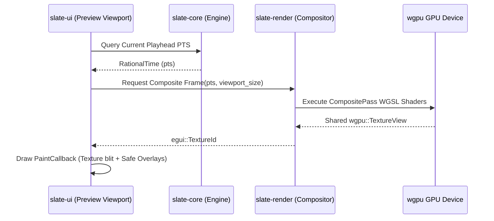
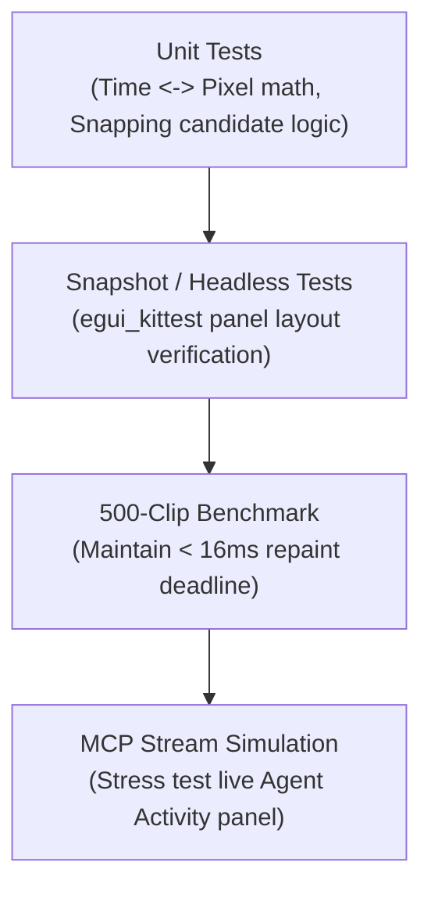

# Slate Desktop UI — Architecture & Implementation Plan (`slate-ui`)

> **Document ID:** `08-desktop-ui`  
> **Workspace Crate:** `crates/slate-ui`  
> **Status:** APPROVED FOR IMPLEMENTATION  
> **Target Release:** v1.0  
> **Primary Technology Stack:** Rust, `egui` 0.29+, `eframe` (wgpu backend), `slate-core`, `slate-render`, `slate-audio`, `slate-ipc`

---

## 1. Overview & System Architecture

`slate-ui` is the native graphical desktop interface for the Slate non-linear video editing system. Engineered with an immediate-mode paradigm using `egui` and `eframe`, it provides an ultra-responsive 60 FPS editing surface capable of handling dense multi-track timelines, real-time video compositing viewports, sample-accurate audio meters, and live AI agent collaborative workflows.

`slate-ui` functions as a thin, highly reactive client over the headless `slate-core` timeline engine and `slate-render` compositor. Rather than maintaining duplicated editing state, `slate-ui` directly manipulates `slate-core` via transactional `Operation` commands and reacts in real-time to mutations originating either from local user interaction (keyboard/mouse) or from remote Large Language Models operating through the Model Context Protocol (`slate-mcp`).

```
+---------------------------------------------------------------------------------------+
|                                    slate-ui (eframe / egui)                          |
|                                                                                       |
|  +-------------------+  +-------------------------+  +----------------------------+  |
|  |   Media Browser   |  |   Preview Monitor (wgpu)|  |      Inspector Panel       |  |
|  +-------------------+  +-------------------------+  +----------------------------+  |
|  +---------------------------------------------------------------------------------+  |
|  |                     Interactive Virtual Timeline (Custom Painter)               |  |
|  +---------------------------------------------------------------------------------+  |
|  +------------------------------------+  +-----------------------------------------+  |
|  |     Agent Activity Panel (E11)     |  |          Transcript Editor (E12)        |  |
|  +------------------------------------+  +-----------------------------------------+  |
+---------------------------------------------------------------------------------------+
           |                                   ^                           ^
           | Dispatches Operations             | Renders Shared Texture    | Events
           v                                   |                           |
+----------------------+              +------------------+       +------------------+
|     slate-core      |              |  slate-render   |       |    slate-ipc    |
| (Timeline DAG, Undo) |              | (wgpu Compositor)|       | (jsonrpsee PubSub)|
+----------------------+              +------------------+       +------------------+
           ^                                                               ^
           |                                                               |
           +==================== Model Context Protocol ===================+
                                    (slate-mcp)
```

### 1.1 Architectural Tenets

1. **Zero-Copy Video Viewport**: The preview monitor shares the underlying `wgpu::Device` and `wgpu::Queue` directly with `slate-render`. Decoded, composited, and color-graded frames are rendered straight into a shared GPU texture handle and blitted to screen without CPU memory readback.
2. **Immediate-Mode Timeline Virtualization**: Even with 500+ clips across 32 tracks, only the clips and elements intersecting the active horizontal viewport are computed and rasterized by `egui::Painter`.
3. **Agent-Human Parity**: Edits initiated by AI agents via MCP arrive over an asynchronous event channel (`tokio::sync::broadcast`) and apply identical `Operation` deltas as manual mouse cuts. The UI surfaces agent changes with visual diff highlights and single-click reverts.
4. **Master Clock Decoupling**: Viewport synchronization slaves to the `slate-audio` playback clock to prevent audio buffer underruns, while the UI render loop maintains smooth 60–120Hz display refresh.

### 1.2 Crate File Structure

```
crates/slate-ui/
├── Cargo.toml
├── src/
│   ├── lib.rs                  # Crate root, App bootstrap, eframe runner
│   ├── app.rs                  # Top-level SlateApp struct, state orchestration
│   ├── state.rs                # UI state (selection, zoom, scroll, active tool)
│   ├── events.rs               # Engine event listener & async message dispatcher
│   ├── layout/
│   │   ├── mod.rs              # Panel docking, visibility toggles, menu bar
│   │   ├── menu.rs             # Application menu bar (File, Edit, View, Tools)
│   │   └── dialogs/
│   │       ├── mod.rs          # Modal overlay management
│   │       ├── export.rs       # Export settings modal (codec, resolution, range)
│   │       ├── import.rs       # Media import picker & proxy config
│   │       └── preferences.rs  # Audio device, scratch disk, hotkeys modal
│   ├── panels/
│   │   ├── mod.rs              # Panel trait & registration
│   │   ├── monitor.rs          # Video preview viewport, wgpu callback, overlays
│   │   ├── transport.rs        # Transport controls, JKL shuttle, timecode HUD
│   │   ├── timeline/
│   │   │   ├── mod.rs          # Virtualized timeline canvas orchestrator
│   │   │   ├── coords.rs       # Screen <-> Time coordinate mapping
│   │   │   ├── ruler.rs        # Timecode ruler, sub-ticks, markers
│   │   │   ├── minimap.rs      # High-level timeline overview bar
│   │   │   ├── track_header.rs # Track controls (name, mute, solo, lock, height)
│   │   │   ├── clip_item.rs    # Clip rounded rect, title, borders, trim handles
│   │   │   ├── thumbnails.rs   # Async filmstrip thumbnail cache & painter
│   │   │   ├── waveforms.rs    # Audio peak pyramid renderer & cache
│   │   │   ├── transitions.rs  # Clip overlap zones, dissolve/wipe handles
│   │   │   ├── playhead.rs     # Scrub playhead line, handle, hover indicator
│   │   │   ├── snapping.rs     # Magnetic snapping engine (edges, playhead, markers)
│   │   │   └── interactions.rs # Mouse drag state machine (select, blade, trim, slip, slide)
│   │   ├── media_browser.rs    # Asset bin tree, file grid, hover scrub, proxy badge
│   │   ├── inspector.rs        # Contextual inspector (Clip, Transform, Effects, Audio)
│   │   ├── agent_activity.rs   # MCP agent stream, visual diffs, single-click undo
│   │   └── transcript.rs       # Text-based editing, word tokens, ripple delete sync
│   ├── widgets/
│   │   ├── mod.rs              # Reusable custom egui widgets
│   │   ├── curve_editor.rs     # Keyframe bezier curve editor
│   │   ├── audio_meter.rs      # Stereo peak meter & EBU R128 LUFS bar
│   │   ├── timecode_input.rs   # Interactive HH:MM:SS:FF numeric scrub field
│   │   └── icon_button.rs      # Vector icon buttons with tooltip & hotkey badge
│   ├── style/
│   │   ├── mod.rs              # Theme setup, visual overrides
│   │   ├── colors.rs           # Dark, Light, and High-Contrast color palettes
│   │   ├── fonts.rs            # Embedded typography (Inter, JetBrains Mono)
│   │   └── icons.rs            # Vector icons / phosphor glyph definitions
│   └── util/
│       ├── format.rs           # Timecode, duration, file size string formatters
│       └── keyboard.rs         # Shortcut table, modifier parsing, dispatch table
└── tests/
    ├── layout_snapshots.rs     # Visual / layout regression test harness
    ├── timeline_coords.rs      # Coordinate transformation & zoom unit tests
    └── mock_engine.rs          # Mock engine event stream for headless UI tests
```

### 1.3 Cargo Dependencies (`Cargo.toml`)

```toml
[package]
name = "slate-ui"
version = "0.1.0"
edition = "2021"
authors = ["Slate Authors"]
license = "MIT OR Apache-2.0"

[dependencies]
# Workspace crates
slate-core = { path = "../slate-core" }
slate-media = { path = "../slate-media" }
slate-render = { path = "../slate-render" }
slate-audio = { path = "../slate-audio" }
slate-analysis = { path = "../slate-analysis" }
slate-ipc = { path = "../slate-ipc" }

# GUI framework
eframe = { version = "0.29", default-features = false, features = [
    "default_fonts",
    "wgpu",
    "wayland",
    "x11",
] }
egui = { version = "0.29", features = ["serde"] }
egui_extras = { version = "0.29", features = ["image", "svg"] }
egui_wgpu = { version = "0.29", features = ["wgpu"] }

# Graphics & Math
wgpu = "22.0"
bytemuck = { version = "1.18", features = ["derive"] }
glam = "0.28"
num-rational = { version = "0.4", features = ["serde"] }
uuid = { version = "1.10", features = ["v4", "serde"] }

# Concurrency & Async
tokio = { version = "1.40", features = ["sync", "rt-multi-thread"] }
crossbeam-channel = "0.5"
parking_lot = { version = "0.12", features = ["serde"] }
lru = "0.12"

# System dialogs & clipboard
rfd = "0.14"
arboard = "3.4"

# Logging & Serialization
tracing = "0.1"
serde = { version = "1.0", features = ["derive"] }
serde_json = "1.0"
thiserror = "1.0"

[dev-dependencies]
proptest = "1.5"
```

---

## 2. Window Layout & Docking Architecture

The Slate window layout is partitioned into five primary functional regions organized around a centralized preview monitor and bottom multi-track timeline. All panels are dockable, resizable via splitter drag handles, and can be toggled using dedicated hotkeys or the `View` menu.

```
+----------------------------------------------------------------------------------------------------+
|  [Menu Bar] File   Edit   View   Tools   Help                    [Timecode HUD: 00:01:24:12] [Agent] |
+-----------------------------+------------------------------------------------+---------------------+
|                             |                                                |                     |
|  Media Browser              |     Preview Monitor                            |  Inspector          |
|  - Bins & Folders           |     (Zero-copy wgpu viewport)                  |  - Clip Attributes  |
|  - Asset Grid / List        |     - Safe Area Overlays                       |  - Transform Matrix |
|  - Hover Scrubbing          |     - Rule-of-Thirds Grid                      |  - GPU Effects List |
|  - Proxy Status Badges      |                                                |  - Bezier Keyframes |
|                             +------------------------------------------------+  - Audio Channel Pan|
|                             |  Transport Controls                            |                     |
|                             |  [|<] [<<] [ > ] [>>] [>|]  00:01:24:12  [Vol] |                     |
+-----------------------------+------------------------------------------------+---------------------+
|                                                                                                    |
|  Interactive Virtual Timeline                                                                      |
|  - Timecode Ruler & Playhead Marker                                                                |
|  - V2: B-Roll Video [====================] [===============]                                       |
|  - V1: A-Roll Video [=============] [==============================]                               |
|  - A1: Dialog Audio [=============] [==============================]                               |
|  - A2: Music Audio  [=============================================]                                |
|                                                                                                    |
+--------------------------------------------------+-------------------------------------------------+
|  Agent Activity Panel (E11)                      |  Transcript Editor (E12)                        |
|  - Real-time MCP Tool Stream                     |  - Whisper Word Timestamps                      |
|  - Visual Diffs & Revert Controls                |  - Text Selection -> Timeline In/Out Sync       |
|  - Proposed Ghost Edits                          |  - Edit Text to Ripple Delete Timeline          |
+--------------------------------------------------+-------------------------------------------------+
```

### 2.1 Layout State Representation

```rust
// crates/slate-ui/src/layout/mod.rs

use serde::{Deserialize, Serialize};

#[derive(Debug, Clone, Serialize, Deserialize)]
pub struct PanelVisibility {
    pub show_media_browser: bool,
    pub show_preview_monitor: bool,
    pub show_inspector: bool,
    pub show_timeline: bool,
    pub show_agent_activity: bool,
    pub show_transcript: bool,
    pub show_audio_meters: bool,
}

impl Default for PanelVisibility {
    fn default() -> Self {
        Self {
            show_media_browser: true,
            show_preview_monitor: true,
            show_inspector: true,
            show_timeline: true,
            show_agent_activity: true,
            show_transcript: true,
            show_audio_meters: true,
        }
    }
}

#[derive(Debug, Clone, Serialize, Deserialize)]
pub struct DockingSplitSizes {
    pub left_panel_width: f32,       // Media Browser width
    pub right_panel_width: f32,      // Inspector width
    pub top_panel_height: f32,      // Preview monitor region height
    pub bottom_panel_height: f32,   // Agent/Transcript split height
    pub bottom_split_ratio: f32,    // Agent Activity vs Transcript ratio
}

impl Default for DockingSplitSizes {
    fn default() -> Self {
        Self {
            left_panel_width: 280.0,
            right_panel_width: 320.0,
            top_panel_height: 420.0,
            bottom_panel_height: 220.0,
            bottom_split_ratio: 0.5,
        }
    }
}
```

---

## 3. Detailed Panel Specifications

### 3.1 Preview Monitor & Viewport

The preview monitor renders composite video at the current playhead timestamp. To eliminate frame-readback latency, it shares the `wgpu::Device` with `slate-render`.



#### Shared GPU Texture Lifecycle & Viewport Registration

```rust
// crates/slate-ui/src/panels/monitor.rs

use std::sync::Arc;
use egui::{epaint::PaintCallback, Rect, Sense, Ui, Vec2};
use slate_core::time::RationalTime;
use slate_render::RenderEngine;

pub struct PreviewMonitorPanel {
    pub safe_margins: bool,
    pub title_safe: bool,
    pub rule_of_thirds: bool,
    pub center_crosshair: bool,
    pub current_texture_id: Option<egui::TextureId>,
    pub cached_frame_size: (u32, u32),
}

impl PreviewMonitorPanel {
    pub fn new() -> Self {
        Self {
            safe_margins: false,
            title_safe: false,
            rule_of_thirds: false,
            center_crosshair: false,
            current_texture_id: None,
            cached_frame_size: (1920, 1080),
        }
    }

    pub fn ui(&mut self, ui: &mut Ui, renderer: &mut RenderEngine, pts: RationalTime) {
        let available_size = ui.available_size();
        let aspect_ratio = 16.0 / 9.0;

        // Compute letterboxed viewport rect
        let mut target_width = available_size.x;
        let mut target_height = target_width / aspect_ratio;

        if target_height > available_size.y {
            target_height = available_size.y;
            target_width = target_height * aspect_ratio;
        }

        let (rect, response) = ui.allocate_exact_size(
            Vec2::new(target_width, target_height),
            Sense::click_and_drag(),
        );

        // 1. Draw video composite texture
        let painter = ui.painter();
        if let Some(tex_id) = self.current_texture_id {
            painter.image(
                tex_id,
                rect,
                Rect::from_min_max(egui::pos2(0.0, 0.0), egui::pos2(1.0, 1.0)),
                egui::Color32::WHITE,
            );
        } else {
            painter.rect_filled(rect, 0.0, egui::Color32::BLACK);
        }

        // 2. Render Overlays
        self.draw_overlays(painter, rect);
    }

    fn draw_overlays(&self, painter: &egui::Painter, rect: Rect) {
        let stroke = egui::Stroke::new(1.0, egui::Color32::from_rgba_unmultiplied(255, 255, 255, 60));
        let accent_stroke = egui::Stroke::new(1.0, egui::Color32::from_rgba_unmultiplied(0, 200, 255, 120));

        // SMPTE Action Safe (90%)
        if self.safe_margins {
            let margin_x = rect.width() * 0.05;
            let margin_y = rect.height() * 0.05;
            painter.rect_stroke(rect.shrink2(Vec2::new(margin_x, margin_y)), 0.0, stroke);
        }

        // SMPTE Title Safe (80%)
        if self.title_safe {
            let margin_x = rect.width() * 0.10;
            let margin_y = rect.height() * 0.10;
            painter.rect_stroke(rect.shrink2(Vec2::new(margin_x, margin_y)), 0.0, stroke);
        }

        // Rule of Thirds (3x3 grid)
        if self.rule_of_thirds {
            let w3 = rect.width() / 3.0;
            let h3 = rect.height() / 3.0;
            for i in 1..=2 {
                let x = rect.min.x + w3 * i as f32;
                painter.line_segment([egui::pos2(x, rect.min.y), egui::pos2(x, rect.max.y)], stroke);
                let y = rect.min.y + h3 * i as f32;
                painter.line_segment([egui::pos2(rect.min.x, y), egui::pos2(rect.max.x, y)], stroke);
            }
        }

        // Center Crosshair
        if self.center_crosshair {
            let center = rect.center();
            painter.line_segment([center - Vec2::new(12.0, 0.0), center + Vec2::new(12.0, 0.0)], accent_stroke);
            painter.line_segment([center - Vec2::new(0.0, 12.0), center + Vec2::new(0.0, 12.0)], accent_stroke);
        }
    }
}
```

#### Transport Controls & J/K/L Shuttle State Machine

The transport control bar provides hardware-style shuttle and playback rates:
- **J**: Step reverse / double reverse speed ($-1\times \to -2\times \to -4\times \to -8\times$).
- **K**: Pause playback / freeze frame.
- **L**: Step forward / double forward speed ($1\times \to 2\times \to 4\times \to 8\times$).

```rust
// crates/slate-ui/src/panels/transport.rs

#[derive(Debug, Clone, Copy, PartialEq)]
pub enum PlaybackState {
    Paused,
    PlayingForward { speed: f32 },
    PlayingReverse { speed: f32 },
}

pub struct TransportController {
    pub state: PlaybackState,
}

impl TransportController {
    pub fn new() -> Self {
        Self { state: PlaybackState::Paused }
    }

    pub fn handle_j(&mut self) {
        self.state = match self.state {
            PlaybackState::Paused => PlaybackState::PlayingReverse { speed: 1.0 },
            PlaybackState::PlayingForward { .. } => PlaybackState::Paused,
            PlaybackState::PlayingReverse { speed } if speed < 8.0 => {
                PlaybackState::PlayingReverse { speed: speed * 2.0 }
            }
            s => s,
        };
    }

    pub fn handle_k(&mut self) {
        self.state = PlaybackState::Paused;
    }

    pub fn handle_l(&mut self) {
        self.state = match self.state {
            PlaybackState::Paused => PlaybackState::PlayingForward { speed: 1.0 },
            PlaybackState::PlayingReverse { .. } => PlaybackState::Paused,
            PlaybackState::PlayingForward { speed } if speed < 8.0 => {
                PlaybackState::PlayingForward { speed: speed * 2.0 }
            }
            s => s,
        };
    }

    pub fn toggle_play_pause(&mut self) {
        self.state = match self.state {
            PlaybackState::Paused => PlaybackState::PlayingForward { speed: 1.0 },
            _ => PlaybackState::Paused,
        };
    }
}
```

---

### 3.2 Interactive Timeline Canvas (Custom Painted)

The timeline panel is the primary editing workspace. Built entirely on `egui::Painter`, it handles sub-pixel coordinate conversions, track virtualization, magnetic snapping, and interactive clip manipulation.

```
+-------------------------------------------------------------------------------------------------------+
| Minimap / Timeline Overview Bar [=============[  Active Viewport  ]=================================] |
+-------------------------------------------------------------------------------------------------------+
| 00:00:00:00        00:00:15:00        00:00:30:00        00:00:45:00        00:01:00:00        Ruler  |
+-------------------------------------------------------------------------------------------------------+
| [V2] [Eye][Lock] |                  [Clip B-Roll 01] [Agent Dissolve]                                 |
| [V1] [Eye][Lock] | [Clip A-Roll 01] [Clip A-Roll 02                   ] [Clip A-Roll 03]              |
+------------------+------------------------------------------------------------------------------------+
| [A1] [M][S][Vol] | [~~~~~~~~ Waveform Dialog A1 ~~~~~~~~~~~~~~~~~~~~~~]                               |
| [A2] [M][S][Vol] | [~~~~~~~~~~~~~~~~~~~~ Waveform Stereo Music A2 ~~~~~~~~~~~~~~~~~~~~~~~~~~~~~~~~~~] |
+-------------------------------------------------------------------------------------------------------+
|                                              | <--- Playhead Line (Magnetic, Scrubbable)              |
+-------------------------------------------------------------------------------------------------------+
```

#### Coordinate Transformation System

The timeline defines a bidirectional coordinate translation between continuous `RationalTime` and physical UI screen pixels.

```rust
// crates/slate-ui/src/panels/timeline/coords.rs

use egui::{Pos2, Rect};
use slate_core::time::RationalTime;

#[derive(Debug, Clone)]
pub struct TimelineViewCoordinates {
    /// Starting time of the visible timeline window
    pub scroll_time: RationalTime,
    /// Horizontal scale: pixels per rational second
    pub pixels_per_second: f32,
    /// Physical canvas bounds allocated in egui
    pub canvas_rect: Rect,
    /// Width reserved on the left for track headers
    pub header_width: f32,
    /// Height of a standard video track lane in pixels
    pub video_track_height: f32,
    /// Height of a standard audio track lane in pixels
    pub audio_track_height: f32,
}

impl TimelineViewCoordinates {
    #[inline]
    pub fn time_to_screen_x(&self, time: RationalTime) -> f32 {
        let delta_secs = (time - self.scroll_time).to_f64() as f32;
        self.canvas_rect.min.x + self.header_width + (delta_secs * self.pixels_per_second)
    }

    #[inline]
    pub fn screen_x_to_time(&self, x: f32) -> RationalTime {
        let offset_x = (x - (self.canvas_rect.min.x + self.header_width)).max(0.0);
        let delta_secs = offset_x / self.pixels_per_second;
        self.scroll_time + RationalTime::from_seconds_f64(delta_secs as f64)
    }

    #[inline]
    pub fn track_to_screen_y(&self, video_tracks_above: usize, audio_tracks_above: usize) -> f32 {
        let ruler_height = 28.0;
        self.canvas_rect.min.y
            + ruler_height
            + (video_tracks_above as f32 * self.video_track_height)
            + (audio_tracks_above as f32 * self.audio_track_height)
    }
}
```

#### Magnetic Snapping Engine

Snapping eliminates micro-gaps and alignment errors during drag and trim operations.

```rust
// crates/slate-ui/src/panels/timeline/snapping.rs

use slate_core::time::RationalTime;

#[derive(Debug, Clone, Copy, PartialEq)]
pub enum SnapTargetKind {
    Playhead,
    ClipInPoint,
    ClipOutPoint,
    Marker,
    TransitionBoundary,
}

#[derive(Debug, Clone)]
pub struct SnapCandidate {
    pub time: RationalTime,
    pub kind: SnapTargetKind,
}

pub struct SnappingEngine {
    pub enabled: bool,
    /// Snapping sensitivity threshold in screen pixels (default: 8.0px)
    pub threshold_pixels: f32,
}

impl SnappingEngine {
    pub fn find_snap(
        &self,
        target_time: RationalTime,
        candidates: &[SnapCandidate],
        pixels_per_second: f32,
    ) -> Option<(RationalTime, SnapTargetKind)> {
        if !self.enabled {
            return None;
        }

        let mut closest: Option<(RationalTime, SnapTargetKind, f32)> = None;

        for c in candidates {
            let diff_secs = (c.time - target_time).abs().to_f64() as f32;
            let diff_pixels = diff_secs * pixels_per_second;

            if diff_pixels <= self.threshold_pixels {
                match closest {
                    Some((_, _, best_dist)) if diff_pixels < best_dist => {
                        closest = Some((c.time, c.kind, diff_pixels));
                    }
                    None => {
                        closest = Some((c.time, c.kind, diff_pixels));
                    }
                    _ => {}
                }
            }
        }

        closest.map(|(t, k, _)| (t, k))
    }
}
```

#### Clip Block & Waveform Rendering

Clips are drawn as rounded rectangular blocks. Visible video clips render cached filmstrips; audio clips render cached waveform peak pyramids.

```rust
// crates/slate-ui/src/panels/timeline/clip_item.rs

use egui::{Color32, Pos2, Rect, Rounding, Stroke, Ui, Vec2};
use slate_core::clip::Clip;
use crate::panels::timeline::coords::TimelineViewCoordinates;

pub struct ClipPaintContext<'a> {
    pub coords: &'a TimelineViewCoordinates,
    pub is_selected: bool,
    pub is_agent_modified: bool,
    pub agent_flash_intensity: f32, // 0.0 to 1.0 (decays over 1.5 seconds)
}

pub fn paint_clip_block(
    ui: &mut Ui,
    clip: &Clip,
    track_y: f32,
    track_height: f32,
    ctx: &ClipPaintContext,
) {
    let start_x = ctx.coords.time_to_screen_x(clip.place_range.start);
    let end_x = ctx.coords.time_to_screen_x(clip.place_range.end());

    let clip_rect = Rect::from_min_max(
        Pos2::new(start_x, track_y + 2.0),
        Pos2::new(end_x, track_y + track_height - 2.0),
    );

    // Viewport Culling: Skip if clip is completely outside visible canvas
    if clip_rect.max.x < ctx.coords.canvas_rect.min.x || clip_rect.min.x > ctx.coords.canvas_rect.max.x {
        return;
    }

    let painter = ui.painter();

    // 1. Base Fill Color
    let base_color = match clip.kind {
        slate_core::track::TrackKind::Video => Color32::from_rgb(45, 75, 115),
        slate_core::track::TrackKind::Audio => Color32::from_rgb(35, 95, 70),
    };

    // Blend agent modification glow if recently mutated by AI
    let fill_color = if ctx.agent_flash_intensity > 0.0 {
        let glow = Color32::from_rgb(180, 70, 240);
        lerp_color(base_color, glow, ctx.agent_flash_intensity)
    } else {
        base_color
    };

    // 2. Selection Border Stroke
    let stroke = if ctx.is_selected {
        Stroke::new(2.0, Color32::from_rgb(255, 200, 50))
    } else if ctx.is_agent_modified {
        Stroke::new(1.5, Color32::from_rgb(200, 100, 255))
    } else {
        Stroke::new(1.0, Color32::from_rgb(20, 20, 25))
    };

    painter.rect(clip_rect, Rounding::same(3.0), fill_color, stroke);

    // 3. Header Label & In/Out Duration text
    let label_rect = Rect::from_min_max(
        clip_rect.min + Vec2::new(6.0, 2.0),
        Pos2::new(clip_rect.max.x - 6.0, clip_rect.min.y + 16.0),
    );
    painter.text(
        label_rect.min,
        egui::Align2::LEFT_TOP,
        &clip.name,
        egui::FontId::proportional(11.0),
        Color32::WHITE,
    );
}

fn lerp_color(a: Color32, b: Color32, t: f32) -> Color32 {
    let inv = 1.0 - t;
    Color32::from_rgba_unmultiplied(
        (a.r() as f32 * inv + b.r() as f32 * t) as u8,
        (a.g() as f32 * inv + b.g() as f32 * t) as u8,
        (a.b() as f32 * inv + b.b() as f32 * t) as u8,
        255,
    )
}
```

#### Timeline Editing Interactions

| Editing Tool | Shortcut / Trigger | Mouse Action | Operational Outcome |
| :--- | :--- | :--- | :--- |
| **Selection Tool** | `V` | Left-Click Clip | Selects clip. `Shift+Click` appends to selection set. |
| **Move Clip** | `V` | Drag clip body | Dispatches `MoveClip { clip_id, new_track, new_start }` with magnetic snapping. |
| **Trim In-Point** | `V` | Drag left edge | Dispatches `TrimClip { clip_id, TrimEdge::In, new_time }`. |
| **Trim Out-Point**| `V` | Drag right edge | Dispatches `TrimClip { clip_id, TrimEdge::Out, new_time }`. |
| **Ripple Trim** | `Alt` + Drag edge | Drag left/right edge | Trims clip and ripples all subsequent clips on track forward/backward. |
| **Roll Edit** | `Cmd/Ctrl` + Drag boundary | Drag between two adjacent clips | Adjusts cut point simultaneously altering out-point of clip A and in-point of clip B. |
| **Blade Tool** | `B` | Left-Click clip | Dispatches `SplitClip { clip_id, split_time }` creating two distinct clips. |
| **Slip Tool** | `Alt+Drag` clip interior | Drag inside clip | Keeps placement fixed; shifts underlying `source_range` media window. |
| **Slide Tool** | `Alt+Shift+Drag` | Drag clip between neighbors | Moves clip while trimming predecessor out-point and successor in-point. |
| **Delete** | `Delete` / `Backspace` | Key press | Removes clip leaving an empty gap on the track. |
| **Ripple Delete**| `Shift+Delete` | Key press | Dispatches `DeleteClipRipple` removing clip and shifting subsequent media. |

---

### 3.3 Media Browser (Asset Pool)

The Media Browser organizes imported raw footage, audio tracks, images, and project bins.

- **Dual View Modes**: Hierarchical tree view (nested folders/bins) or thumbnail card grid view.
- **Drag-and-Drop Ingestion**: Dropping files from macOS Finder / Windows Explorer triggers background probing and metadata extraction.
- **Proxy Status Badges**:
  - `Ready` (Green): CFR ProRes / H.264 proxy generated and linked.
  - `Generating [42%]` (Yellow progress ring): Background FFmpeg transcode active.
  - `Original Only` (Gray): Using raw source media.
- **Hover-Scrubbing**: Moving mouse horizontally across an asset thumbnail previews video frames across its normalized 0.0–1.0 timeline duration.

---

### 3.4 Inspector Panel

The Inspector displays and edits properties of the current selection (Clip, Track, Transition, or Project).

```rust
// crates/slate-ui/src/panels/inspector.rs

use egui::{DragValue, Slider, Ui};
use slate_core::clip::Clip;

pub struct InspectorPanel;

impl InspectorPanel {
    pub fn show_clip_inspector(ui: &mut Ui, clip: &mut Clip) {
        ui.heading("Clip Properties");
        ui.label(format!("ID: {}", clip.id));
        ui.text_edit_singleline(&mut clip.name);

        ui.separator();
        ui.collapsing("Transform Matrix", |ui| {
            ui.horizontal(|ui| {
                ui.label("Position X:");
                ui.add(DragValue::new(&mut clip.transform.position.x).speed(1.0));
                ui.label("Y:");
                ui.add(DragValue::new(&mut clip.transform.position.y).speed(1.0));
            });

            ui.horizontal(|ui| {
                ui.label("Scale:");
                ui.add(Slider::new(&mut clip.transform.scale.x, 0.1..=5.0).text("X"));
                ui.add(Slider::new(&mut clip.transform.scale.y, 0.1..=5.0).text("Y"));
            });

            ui.horizontal(|ui| {
                ui.label("Rotation:");
                ui.add(Slider::new(&mut clip.transform.rotation_degrees, -180.0..=180.0).suffix("°"));
            });

            ui.horizontal(|ui| {
                ui.label("Opacity:");
                ui.add(Slider::new(&mut clip.transform.opacity, 0.0..=1.0).custom_formatter(|v, _| {
                    format!("{:.0}%", v * 100.0)
                }));
            });
        });

        ui.separator();
        ui.collapsing("Audio Controls", |ui| {
            ui.horizontal(|ui| {
                ui.label("Volume:");
                ui.add(Slider::new(&mut clip.audio_gain_db, -60.0..=12.0).suffix(" dB"));
            });
            ui.horizontal(|ui| {
                ui.label("Pan:");
                ui.add(Slider::new(&mut clip.audio_pan, -1.0..=1.0));
            });
        });
    }
}
```

---

### 3.5 Agent Activity & Audit Panel (E11 - Critical)

The Agent Activity Panel surfaces real-time transparency for all autonomous or assisted edits performed via `slate-mcp`. Every tool call dispatched by an AI agent appears in a live scrollable ledger with diff summaries and single-click reverts.

```
+----------------------------------------------------------------------------------------------------+
| Agent Activity & Audit Stream                             [Filter: All | AI Only | Human] [Search] |
+----------------------------------------------------------------------------------------------------+
| [14:24:02] Model: Claude 3.5 Sonnet                                          [Status: APPLIED]     |
| Op: RemoveSilenceBatch (12 cuts)                                              [ REVERT OP ]        |
| Diff: Removed 14.2s of audio dead zones across Track A1 between 00:01:10 and 00:03:45              |
+----------------------------------------------------------------------------------------------------+
| [14:23:48] Model: Claude 3.5 Sonnet                                          [Status: APPLIED]     |
| Op: SplitClip & InsertBroll                                                   [ REVERT OP ]        |
| Diff: Split V1 at 00:00:42; Inserted 'drone_shot.mp4' on V2 (00:00:42 -> 00:00:48)                 |
+----------------------------------------------------------------------------------------------------+
| [14:21:10] Human Editor                                                      [Status: USER ACTION] |
| Op: TrimClip (InPoint 00:00:02:00 -> 00:00:04:12)                                                  |
+----------------------------------------------------------------------------------------------------+
```

#### Agent Audit Data Structures

```rust
// crates/slate-ui/src/panels/agent_activity.rs

use chrono::{DateTime, Utc};
use serde::{Deserialize, Serialize};
use uuid::Uuid;
use slate_core::operation::Operation;

#[derive(Debug, Clone, PartialEq, Serialize, Deserialize)]
pub enum OperationAuthor {
    Human,
    Agent { model_name: String, conversation_id: String },
}

#[derive(Debug, Clone, PartialEq, Serialize, Deserialize)]
pub enum OperationStatus {
    Proposed,
    Applied,
    Reverted,
    Conflicted,
}

#[derive(Debug, Clone, Serialize, Deserialize)]
pub struct AuditLogEntry {
    pub id: Uuid,
    pub timestamp: DateTime<Utc>,
    pub author: OperationAuthor,
    pub operation_type: String,
    pub description: String,
    pub affected_clip_ids: Vec<Uuid>,
    pub status: OperationStatus,
    #[serde(skip)]
    pub inverse_op: Option<Box<dyn Operation>>,
}

pub struct AgentActivityPanel {
    pub entries: Vec<AuditLogEntry>,
    pub filter_author: Option<OperationAuthor>,
    pub selected_entry: Option<Uuid>,
}

impl AgentActivityPanel {
    pub fn ui(&mut self, ui: &mut egui::Ui, on_revert: impl FnOnce(Uuid)) {
        ui.horizontal(|ui| {
            ui.heading("Agent Audit Log");
            // Filter buttons...
        });
        ui.separator();

        egui::ScrollArea::vertical().stick_to_bottom(true).show(ui, |ui| {
            for entry in &mut self.entries {
                let is_agent = matches!(entry.author, OperationAuthor::Agent { .. });
                let frame_color = if is_agent {
                    egui::Color32::from_rgb(35, 25, 45) // Subtle purple tint
                } else {
                    egui::Color32::from_rgb(25, 25, 30)
                };

                egui::Frame::none()
                    .fill(frame_color)
                    .rounding(4.0)
                    .inner_margin(6.0)
                    .show(ui, |ui| {
                        ui.horizontal(|ui| {
                            ui.label(entry.timestamp.format("%H:%M:%S").to_string());
                            match &entry.author {
                                OperationAuthor::Human => ui.colored_label(egui::Color32::LIGHT_BLUE, "[Human]"),
                                OperationAuthor::Agent { model_name, .. } => {
                                    ui.colored_label(egui::Color32::from_rgb(190, 100, 255), format!("[{}]", model_name))
                                }
                            };
                            ui.strong(&entry.operation_type);

                            ui.with_layout(egui::Layout::right_to_left(egui::Align::Center), |ui| {
                                if entry.status == OperationStatus::Applied && is_agent {
                                    if ui.button("Revert").clicked() {
                                        on_revert(entry.id);
                                    }
                                }
                            });
                        });
                        ui.label(&entry.description);
                    });
                ui.add_space(4.0);
            }
        });
    }
}
```

---

### 3.6 Transcript-Based Text Editor (E12 - Critical)

The transcript panel connects local Whisper transcription (`slate-analysis`) with the timeline, allowing users and agents to "edit video like a text document."

```
+----------------------------------------------------------------------------------------------------+
| Transcript Editor                                                    [Speaker: All] [Search Words] |
+----------------------------------------------------------------------------------------------------+
| 00:00:01:12 - Speaker 1:                                                                          |
| "Welcome [00:01:12] to [00:01:18] the [00:01:24] Slate [00:02:00] demonstration. [00:02:15]       |
|  Today we're going to show how ~~unwanted stutter words~~ can be highlighted and deleted."        |
|                                                                                                    |
| 00:00:08:04 - Speaker 2:                                                                          |
| "And the timeline immediately ripples the cuts without manually dragging edges."                   |
+----------------------------------------------------------------------------------------------------+
```

#### Transcript Interaction Mechanics

1. **Word-Level Playhead Synchronization**: Each word has an exact `TimeRange`. Clicking any word moves the timeline playhead to its start PTS. During playback, the current spoken word highlights in yellow with sub-frame accuracy.
2. **Text Selection to Timeline Range**: Highlighting a sentence or span of text selects the corresponding `TimeRange` on the timeline ruler and highlights the underlying media clips.
3. **Ripple Delete from Text**: Selecting text and pressing `Delete` or `Backspace` generates an atomic `DeleteClipRipple` operation in `slate-core`, deleting the corresponding audio and video ranges and immediately closing the timeline gap.
4. **Cut Words Grayed Out**: Struck-through text represents segments that were cut from the timeline. Clicking a cut word offers a "Restore Cut" contextual action.

```rust
// crates/slate-ui/src/panels/transcript.rs

use egui::{Color32, RichText, Sense, Ui};
use slate_analysis::Transcript;
use slate_core::time::{RationalTime, TimeRange};

pub struct TranscriptPanel {
    pub transcript: Option<Transcript>,
    pub selected_word_indices: Vec<usize>,
}

impl TranscriptPanel {
    pub fn ui(
        &mut self,
        ui: &mut Ui,
        current_playhead: RationalTime,
        on_seek: impl Fn(RationalTime),
        on_ripple_delete_range: impl Fn(TimeRange),
    ) {
        ui.heading("Transcript Editor");
        ui.separator();

        let Some(transcript) = &self.transcript else {
            ui.label("No transcript available. Ingest media with Whisper transcription enabled.");
            return;
        };

        egui::ScrollArea::vertical().show(ui, |ui| {
            ui.horizontal_wrapped(|ui| {
                for (idx, word) in transcript.words.iter().enumerate() {
                    let is_current = word.range.contains(current_playhead);
                    let is_cut = word.is_deleted_from_timeline;

                    let mut text = RichText::new(&word.text).size(15.0);

                    if is_current {
                        text = text.color(Color32::YELLOW).strong();
                    } else if is_cut {
                        text = text.color(Color32::DARK_GRAY).strikethrough();
                    } else {
                        text = text.color(Color32::WHITE);
                    }

                    let response = ui.add(egui::Label::new(text).sense(Sense::click()));
                    if response.clicked() {
                        on_seek(word.range.start);
                    }
                }
            });
        });
    }
}
```

---

## 4. Comprehensive Keyboard Shortcuts

Slate implements industry-standard NLE keyboard shortcuts. The input dispatcher isolates modal input (e.g., text entry in search boxes or inspector text fields) from triggering timeline edit operations.

```rust
// crates/slate-ui/src/util/keyboard.rs

use egui::{Key, Modifiers};

#[derive(Debug, Clone, Copy, PartialEq, Eq, Hash)]
pub enum Action {
    // Playback
    TogglePlayPause,
    ShuttleReverse,
    ShuttleStop,
    ShuttleForward,
    GoToTimelineStart,
    GoToTimelineEnd,
    StepBackwardOneFrame,
    StepForwardOneFrame,
    StepBackwardOneSecond,
    StepForwardOneSecond,

    // Editing Operations
    SelectTool,
    BladeTool,
    DeleteSelection,
    RippleDeleteSelection,
    SplitAtPlayhead,
    Undo,
    Redo,
    Cut,
    Copy,
    Paste,
    SelectAll,
    DeselectAll,

    // Navigation & Zoom
    ZoomIn,
    ZoomOut,
    ZoomToFit,
    ToggleSnapping,

    // Track Management
    AddVideoTrack,
    AddAudioTrack,

    // Project & Export
    AddMarker,
    ExportProject,
    SaveProject,
}
```

### Full Shortcut Reference Table

| Category | Action | macOS Shortcut | Windows / Linux Shortcut | Description |
| :--- | :--- | :--- | :--- | :--- |
| **Playback** | Play / Pause | `Space` | `Space` | Toggles real-time timeline playback |
| | Shuttle Reverse | `J` | `J` | Increments reverse playback speed ($-1\times$ to $-8\times$) |
| | Shuttle Stop | `K` | `K` | Stops playback instantly |
| | Shuttle Forward | `L` | `L` | Increments forward playback speed ($1\times$ to $8\times$) |
| | Go to Start | `Home` | `Home` | Jumps playhead to $t = 0$ |
| | Go to End | `End` | `End` | Jumps playhead to end of last clip |
| | Step Back 1 Frame | `Left Arrow` | `Left Arrow` | Steps playhead backward by 1 video frame |
| | Step Forward 1 Frame| `Right Arrow`| `Right Arrow`| Steps playhead forward by 1 video frame |
| | Step Back 1 Second | `Shift + Left`| `Shift + Left`| Steps playhead backward by $1.0\text{ s}$ |
| | Step Forward 1 Sec | `Shift + Right`| `Shift + Right`| Steps playhead forward by $1.0\text{ s}$ |
| **Editing** | Selection Tool | `V` | `V` | Activates standard pointer / move tool |
| | Blade Tool | `B` | `B` | Activates razor / split tool |
| | Split at Playhead | `Cmd + B` | `Ctrl + B` | Slices all unlocked clips at playhead PTS |
| | Delete Selection | `Backspace` / `Del` | `Delete` | Deletes selected clips, leaving track gap |
| | Ripple Delete | `Shift + Delete` | `Shift + Delete` | Deletes selected clips and ripples trailing media |
| | Undo | `Cmd + Z` | `Ctrl + Z` | Reverses last operation on undo stack |
| | Redo | `Cmd + Shift + Z` | `Ctrl + Shift + Z` | Reapplies inverted operation from redo stack |
| | Cut | `Cmd + X` | `Ctrl + X` | Copies selection to clipboard and ripple deletes |
| | Copy | `Cmd + C` | `Ctrl + C` | Copies selected clip descriptors to clipboard |
| | Paste | `Cmd + V` | `Ctrl + V` | Inserts clipboard media at playhead PTS |
| | Select All | `Cmd + A` | `Ctrl + A` | Selects all clips across all unlocked tracks |
| | Deselect All | `Escape` | `Escape` | Clears clip and marker selection sets |
| **Navigation**| Zoom In | `Cmd + =` / `+` | `Ctrl + =` / `+` | Increases horizontal timeline zoom |
| | Zoom Out | `Cmd + -` / `-` | `Ctrl + -` / `-` | Decreases horizontal timeline zoom |
| | Zoom to Fit | `Shift + Z` | `Shift + Z` | Adjusts zoom/scroll to fit entire project length |
| | Toggle Snapping | `N` | `N` | Toggles magnetic snapping on/off |
| **Tracks** | Add Video Track | `Cmd + Shift + T` | `Ctrl + Shift + T` | Appends new video lane $V_n$ to timeline |
| | Add Audio Track | `Cmd + Alt + T` | `Ctrl + Alt + T` | Appends new audio lane $A_n$ to timeline |
| **Markers** | Add Marker | `M` | `M` | Drops marker at current playhead PTS |
| **Project** | Save Project | `Cmd + S` | `Ctrl + S` | Transactional write of `.slate` project manifest |
| | Export Video | `Cmd + E` | `Ctrl + E` | Opens modal export settings dialog |

---

## 5. Theme, Styling & Design System

Slate ships with a dark workstation theme optimized for low eye fatigue during extended editing sessions, complemented by light and high-contrast accessibility themes.

```rust
// crates/slate-ui/src/style/colors.rs

use egui::Color32;

pub struct SlatePalette {
    pub bg_darkest: Color32,      // Window background, empty canvas (#121214)
    pub bg_panel: Color32,        // Panel interiors (#1A1A1E)
    pub bg_header: Color32,       // Track headers, menu bars (#222228)
    pub border: Color32,          // Panel splitters, subtle outlines (#2E2E38)
    pub text_primary: Color32,    // High contrast labels (#FFFFFF)
    pub text_secondary: Color32,  // Subtitles, metadata (#A0A0B0)
    pub accent_amber: Color32,    // Playhead, selection borders (#E5A93C)
    pub accent_purple: Color32,   // Agent activity, AI badges (#A855F7)
    pub video_clip: Color32,      // Default video clip background (#2B4C7E)
    pub audio_clip: Color32,      // Default audio clip background (#1F6B52)
}

pub const DARK_PALETTE: SlatePalette = SlatePalette {
    bg_darkest: Color32::from_rgb(18, 18, 20),
    bg_panel: Color32::from_rgb(26, 26, 30),
    bg_header: Color32::from_rgb(34, 34, 40),
    border: Color32::from_rgb(46, 46, 56),
    text_primary: Color32::from_rgb(245, 245, 250),
    text_secondary: Color32::from_rgb(160, 160, 176),
    accent_amber: Color32::from_rgb(229, 169, 60),
    accent_purple: Color32::from_rgb(168, 85, 247),
    video_clip: Color32::from_rgb(43, 76, 126),
    audio_clip: Color32::from_rgb(31, 107, 82),
};
```

### High-DPI & UI Scale Management

`slate-ui` natively honors OS scale factors (macOS Retina $2.0\times$, Linux Wayland fractional scaling) and provides user-adjustable scaling from $75\%$ to $200\%$ in Preferences.

```rust
pub fn apply_custom_style(ctx: &egui::Context, scale_factor: f32) {
    ctx.set_pixels_per_point(scale_factor);
    let mut style = (*ctx.style()).clone();

    style.spacing.item_spacing = egui::vec2(6.0, 4.0);
    style.spacing.window_margin = egui::Margin::same(8.0);
    style.visuals.window_rounding = egui::Rounding::same(6.0);
    style.visuals.widgets.noninteractive.bg_fill = DARK_PALETTE.bg_panel;
    style.visuals.widgets.inactive.bg_fill = DARK_PALETTE.bg_header;
    style.visuals.widgets.hovered.bg_fill = Color32::from_rgb(48, 48, 58);
    style.visuals.widgets.active.bg_fill = DARK_PALETTE.accent_amber;

    ctx.set_style(style);
}
```

---

## 6. Accessibility & Inclusivity (a11y)

1. **Screen Reader Integration**: Every custom painted widget (timeline tracks, clip blocks, playhead handle, transport buttons) populates `egui::WidgetInfo` with role declarations (e.g., `Button`, `Slider`, `Custom`) and descriptive speech strings (e.g., `"Playhead at 1 minute 24 seconds, Frame 12"`).
2. **Keyboard Focus Ring**: Focused panels and widgets display a high-contrast $2\text{px}$ blue focus outline (`#3B82F6`). Full Tab traversal allows moving between Media Browser $\to$ Viewport $\to$ Timeline $\to$ Inspector $\to$ Agent Ledger without mouse input.
3. **High-Contrast Palette**: An alternative theme strictly adhering to WCAG 2.1 AAA contrast ratios ($> 7:1$ for body text) is selectable in Preferences.

---

## 7. Engine Integration & Reactive Event Loop

`slate-ui` maintains thread safety by holding an `Arc<Mutex<Engine>>` for direct dispatch of transactional operations, while consuming an asynchronous event channel (`tokio::sync::broadcast`) for updates initiated by background tasks or MCP agents.

```rust
// crates/slate-ui/src/app.rs

use std::sync::Arc;
use parking_lot::Mutex;
use tokio::sync::broadcast;
use slate_core::engine::Engine;
use slate_ipc::protocol::EngineEvent;
use crate::state::UiState;

pub struct SlateApp {
    pub engine: Arc<Mutex<Engine>>,
    pub event_rx: broadcast::Receiver<EngineEvent>,
    pub ui_state: UiState,
    pub last_frame_time: std::time::Instant,
}

impl SlateApp {
    pub fn new(
        engine: Arc<Mutex<Engine>>,
        event_rx: broadcast::Receiver<EngineEvent>,
        cc: &eframe::CreationContext<'_>,
    ) -> Self {
        // Initialize wgpu texture registration with renderer
        Self {
            engine,
            event_rx,
            ui_state: UiState::default(),
            last_frame_time: std::time::Instant::now(),
        }
    }

    /// Process asynchronous engine events from local socket or MCP server
    pub fn pump_engine_events(&mut self, ctx: &egui::Context) {
        while let Ok(event) = self.event_rx.try_recv() {
            match event {
                EngineEvent::TimelineMutated { op_id, author, affected_clips } => {
                    tracing::info!(%op_id, ?author, "Received timeline mutation");
                    // Trigger visual decay flash on modified clips
                    self.ui_state.register_agent_modification(affected_clips);
                    ctx.request_repaint();
                }
                EngineEvent::PlaybackClockAdvanced { pts } => {
                    self.ui_state.current_playhead = pts;
                    ctx.request_repaint();
                }
                EngineEvent::ProxyGenerationProgress { asset_id, progress } => {
                    self.ui_state.update_proxy_progress(asset_id, progress);
                }
                EngineEvent::AnalysisComplete { asset_id, transcript } => {
                    self.ui_state.set_transcript(asset_id, transcript);
                    ctx.request_repaint();
                }
            }
        }
    }
}

impl eframe::App for SlateApp {
    fn update(&mut self, ctx: &egui::Context, frame: &mut eframe::Frame) {
        // 1. Drain incoming engine and agent events
        self.pump_engine_events(ctx);

        // 2. Render Menu Bar
        self.render_menu_bar(ctx);

        // 3. Render Central Docking Panels
        self.render_panels(ctx, frame);

        // 4. Decay visual flash timers
        self.ui_state.tick_animation_decay();
    }
}
```

---

## 8. Performance Targets & Optimization Strategies

To ensure immediate-mode rendering never stutters, `slate-ui` adheres to strict frame-budget allocations:

```
Frame Budget (16.6ms at 60 FPS)
+-----------------------------------------------------------------------+
|  egui Immediate Layout & Event Handling: < 3.5ms                      |
|  Timeline Virtualized Painter:           < 4.0ms                      |
|  Waveform / Thumbnail Texture Uploads:   < 2.5ms                      |
|  GPU Composite Viewport Blit:            < 3.0ms                      |
|  Headroom / VSync Wait:                  > 3.6ms                      |
+-----------------------------------------------------------------------+
```

### Optimization Implementations

1. **Timeline Virtualization**: Clips calculate horizontal start and end coordinates. If $[x_{min}, x_{max}] \cap [V_{left}, V_{right}] = \emptyset$, all shape generation, text layout, and texture lookups are skipped entirely.
2. **Audio Waveform Pyramids**: Waveforms are not computed from raw PCM in the UI thread. `slate-analysis` pre-generates multi-resolution peak pyramids (Level 0: 256 samples/px down to Level 4: 65,536 samples/px). The UI fetches only the pyramid level corresponding to the current horizontal zoom factor.
3. **Filmstrip LRU Texture Atlas**: Thumbnails are rendered asynchronously by background threads into a fixed-size $2048\times 2048$ GPU texture atlas. The UI binds atlas sub-rectangles, avoiding thousands of individual texture allocations.

---

## 9. Menu Bar & Command Palette

```
[File]
  ├── New Project                 Cmd+N
  ├── Open Project...             Cmd+O
  ├── Open Recent                 >
  ├── Save Project                Cmd+S
  ├── Save Project As...          Cmd+Shift+S
  ├── Ingest / Import Media...    Cmd+I
  ├── Export Video...             Cmd+E
  └── Quit                        Cmd+Q

[Edit]
  ├── Undo                        Cmd+Z
  ├── Redo                        Cmd+Shift+Z
  ├── Cut                         Cmd+X
  ├── Copy                        Cmd+C
  ├── Paste                       Cmd+V
  ├── Ripple Delete               Shift+Delete
  ├── Select All                  Cmd+A
  └── Preferences...              Cmd+,

[View]
  ├── Toggle Media Browser        Alt+1
  ├── Toggle Preview Monitor      Alt+2
  ├── Toggle Inspector            Alt+3
  ├── Toggle Timeline             Alt+4
  ├── Toggle Agent Activity       Alt+5
  ├── Toggle Transcript           Alt+6
  ├── Zoom In                     Cmd+=
  ├── Zoom Out                    Cmd+-
  └── Zoom to Fit                 Shift+Z

[Tools]
  ├── Selection Tool              V
  ├── Blade Tool                  B
  ├── Add Marker at Playhead      M
  └── Toggle Snapping             N

[Help]
  ├── Keyboard Shortcuts Reference
  ├── Model Context Protocol Guide
  └── About Slate
```

---

## 10. Modal Dialogs

### 10.1 Export Dialog (`export.rs`)
- **Containers**: MP4 (`.mp4`), QuickTime MOV (`.mov`), Matroska (`.mkv`).
- **Video Codecs**: H.264 (Hardware VideoToolbox/NVENC), ProRes 422 HQ, AV1.
- **Audio Bitrates**: 192 kbps, 320 kbps, Uncompressed 24-bit PCM.
- **Resolution Presets**: 1080p Full HD ($1920\times 1080$), 4K UHD ($3840\times 2160$), 9:16 Vertical Shorts ($1080\times 1920$).
- **Range**: Entire Project vs Custom In/Out Points.

### 10.2 Media Import Dialog (`import.rs`)
- Native OS file selection dialog via `rfd`.
- File validation check (ensuring container and streams can be demuxed by FFmpeg).
- Automatic CFR proxy transcoding checkbox with target resolution selector ($720\text{p} / 1080\text{p}$).

### 10.3 Preferences Dialog (`preferences.rs`)
- **Audio Output**: Device selector (`cpal` sink), buffer size ($128, 256, 512\text{ samples}$).
- **Video / GPU**: Adapter selector (Metal, Vulkan, DX12), maximum frame cache memory (MB).
- **Agent / MCP**: Local IPC socket path display, auto-accept low-risk agent edits toggle.

---

## 11. State Management Architecture

```rust
// crates/slate-ui/src/state.rs

use std::collections::HashSet;
use uuid::Uuid;
use slate_core::time::RationalTime;

#[derive(Debug, Clone, Copy, PartialEq, Eq)]
pub enum ActiveTool {
    Select,
    Blade,
    Slip,
    Slide,
}

#[derive(Debug, Default)]
pub struct SelectionState {
    pub selected_clip_ids: HashSet<Uuid>,
    pub selected_track_id: Option<Uuid>,
    pub selected_transition_id: Option<Uuid>,
    pub in_point: Option<RationalTime>,
    pub out_point: Option<RationalTime>,
}

#[derive(Debug)]
pub struct UiState {
    pub active_tool: ActiveTool,
    pub selection: SelectionState,
    pub current_playhead: RationalTime,
    pub zoom_level: f32, // Pixels per second (e.g. 50.0 to 1200.0)
    pub scroll_time: RationalTime,
    pub agent_modified_clips: Vec<(Uuid, std::time::Instant)>,
}

impl Default for UiState {
    fn default() -> Self {
        Self {
            active_tool: ActiveTool::Select,
            selection: SelectionState::default(),
            current_playhead: RationalTime::ZERO,
            zoom_level: 100.0,
            scroll_time: RationalTime::ZERO,
            agent_modified_clips: Vec::new(),
        }
    }
}

impl UiState {
    pub fn register_agent_modification(&mut self, clip_ids: Vec<Uuid>) {
        let now = std::time::Instant::now();
        for id in clip_ids {
            self.agent_modified_clips.push((id, now));
        }
    }

    pub fn tick_animation_decay(&mut self) {
        let now = std::time::Instant::now();
        self.agent_modified_clips.retain(|(_, timestamp)| {
            now.duration_since(*timestamp).as_secs_f32() < 1.5
        });
    }
}
```

---

## 12. Verification & Testing Strategy



1. **Coordinate Conversion Invariant**:
   $$\forall t \in \text{Timeline}, \quad \text{screen\_x\_to\_time}(\text{time\_to\_screen\_x}(t)) \approx t \quad (\pm 1\text{ video frame})$$
2. **500-Clip Stress Test**: Benchmark harness instantiating a timeline with 500 clips across 16 tracks. Assert that `update()` executes in $< 16\text{ ms}$ on standard Apple Silicon / modern x86 hardware.
3. **Agent Mutation Stress Test**: Fire 100 synthetic MCP operations per second over the event receiver. Ensure UI state never deadlocks and selection sets gracefully prune removed UUIDs.

---

## 13. Step-by-Step Implementation Checklist

### Phase 1: Workspace Scaffolding & Foundation
- [ ] Create `crates/slate-ui/Cargo.toml` with `eframe`, `egui`, `egui_wgpu`, and workspace dependencies.
- [ ] Implement `src/lib.rs` and `src/app.rs` with basic `eframe::App` event loop.
- [ ] Embed Inter and JetBrains Mono typography in `src/style/fonts.rs`.
- [ ] Implement `src/style/colors.rs` with `DARK_PALETTE` and high-contrast visuals.
- [ ] Implement `src/util/keyboard.rs` input dispatcher with full shortcut table.

### Phase 2: Preview Viewport & GPU Shared Surface
- [ ] Implement `src/panels/monitor.rs` with `egui_wgpu` shared texture binding.
- [ ] Add letterbox and pillarbox aspect ratio calculation math.
- [ ] Draw SMPTE Action Safe (90%) and Title Safe (80%) overlay rects.
- [ ] Implement Rule-of-Thirds and Center Crosshair guide overlays.
- [ ] Implement `src/panels/transport.rs` with J/K/L shuttle speed state machine.
- [ ] Connect transport play/pause button to `slate-audio` playback clock.

### Phase 3: Interactive Virtual Timeline Canvas
- [ ] Implement `src/panels/timeline/coords.rs` for sub-pixel `RationalTime` $\longleftrightarrow$ screen pixel mapping.
- [ ] Implement `src/panels/timeline/ruler.rs` with adaptive sub-second tick markers.
- [ ] Implement `src/panels/timeline/snapping.rs` with magnetic threshold calculation.
- [ ] Implement `src/panels/timeline/track_header.rs` (mute, solo, lock, volume faders).
- [ ] Implement `src/panels/timeline/clip_item.rs` with rounded rects, labels, and borders.
- [ ] Implement `src/panels/timeline/playhead.rs` with scrub dragging and magnetic snapping.
- [ ] Implement `src/panels/timeline/interactions.rs` handling Select, Move, Blade, and Trim operations.
- [ ] Implement `src/panels/timeline/waveforms.rs` fetching cached peak pyramids from `slate-analysis`.
- [ ] Implement `src/panels/timeline/thumbnails.rs` with async background LRU texture atlas.
- [ ] Implement `src/panels/timeline/minimap.rs` overview bar.

### Phase 4: Inspector & Media Browser
- [ ] Implement `src/panels/media_browser.rs` with folder tree and asset thumbnail cards.
- [ ] Add OS file drag-and-drop ingestion handler (`rfd` integration).
- [ ] Implement hover-scrubbing on media browser cards.
- [ ] Display real-time proxy generation status rings.
- [ ] Implement `src/panels/inspector.rs` with Transform matrix sliders.
- [ ] Build `src/widgets/curve_editor.rs` for interactive bezier keyframe curves.
- [ ] Add audio gain/pan sliders and GPU effect parameter controls.

### Phase 5: Agent Activity Stream (E11) & Transcript Editor (E12)
- [ ] Implement `src/panels/agent_activity.rs` consuming `slate-ipc` event notifications.
- [ ] Render live audit entries with author badges, timestamp, and parameter diffs.
- [ ] Implement the single-click "Revert" button dispatching inverted `Operation` structs.
- [ ] Implement visual clip highlighting for agent edits with 1.5s decay timers.
- [ ] Implement `src/panels/transcript.rs` displaying Whisper word timestamps.
- [ ] Link word clicks to playhead seek; highlight active word during playback.
- [ ] Implement "Text Delete $\to$ Timeline Ripple Delete" synchronization.

### Phase 6: Menus, Dialogs & Integration Verification
- [ ] Implement `src/layout/menu.rs` with full standard application menus.
- [ ] Implement `src/layout/dialogs/export.rs` with preset resolution and codec selectors.
- [ ] Implement `src/layout/dialogs/preferences.rs` with audio device and UI scaling settings.
- [ ] Write unit tests for timeline coordinate mapping and snapping math.
- [ ] Run 500-clip benchmark test and verify $< 16\text{ ms}$ frame budget compliance.
