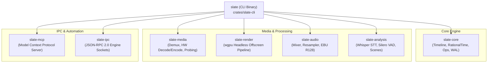
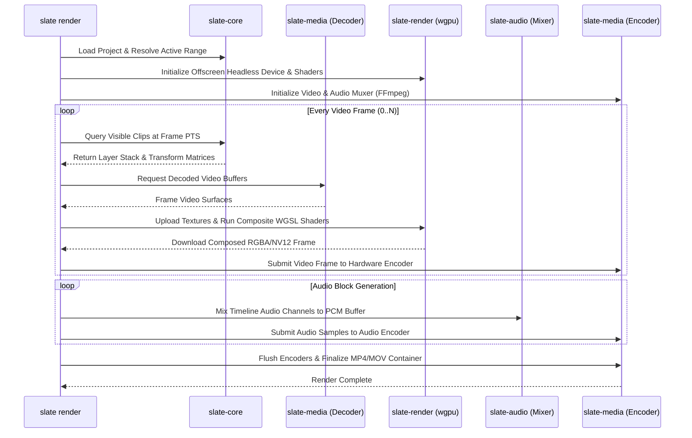
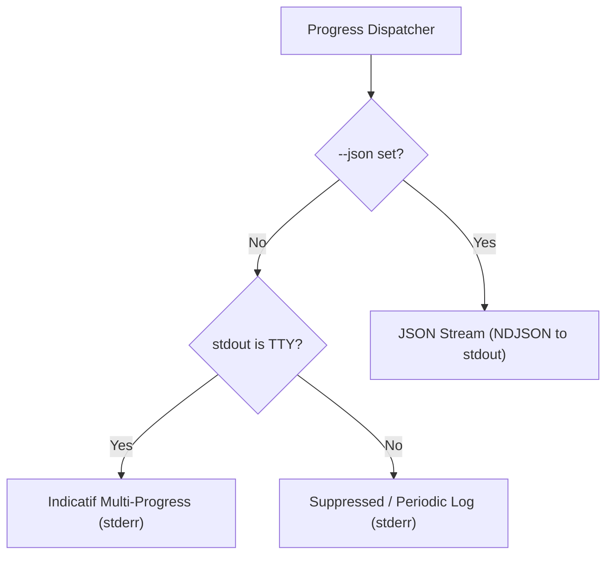

# Slate CLI (`slate-cli`) Implementation Plan

> **Specification & Technical Architecture Document**  
> **Crate:** `slate-cli`  
> **Target Path:** `crates/slate-cli`  
> **Binary Name:** `slate`  
> **Status:** Ready for Implementation  

---

## 1. Overview & Architecture

`slate-cli` is the unified command-line entry point for the Slate video editor ecosystem. It provides headless batch processing, automated rendering pipelines, continuous integration (CI/CD) validation, AI media analysis, and the Model Context Protocol (MCP) server daemon. 

Rather than wrapping an external scripting engine, `slate-cli` links directly against `slate-core`, `slate-media`, `slate-render`, `slate-audio`, `slate-analysis`, `slate-ipc`, and `slate-mcp`. This guarantees 100% semantic and operational parity with the desktop GUI (`slate-ui`) and AI agent interfaces.



### 1.1 Core Responsibilities

1. **Deterministic Project Lifecycle**: Create, inspect, validate, and serialize `.slateproj` directory bundles headlessly.
2. **High-Performance Headless Rendering**: Assemble multi-track timelines and encode pixel-perfect video/audio via `wgpu` offscreen render graphs and FFmpeg hardware codecs (VideoToolbox, NVENC, VAAPI).
3. **Automated Batch Mutations (`ops`)**: Apply transactional JSON mutation batches to timelines with atomic rollback guarantees and dry-run validation.
4. **Media Analysis Runner**: Execute local speech-to-text (Whisper), voice activity detection (Silero VAD), visual scene-cut detection, and loudness normalization.
5. **Model Context Protocol Daemon (`mcp`)**: Host the standalone MCP server over standard I/O (`stdio`) or HTTP/SSE for LLM agents (Claude Desktop, Cursor, external autonomous bots).
6. **Developer & CI/CD Utilities**: Asset probing, frame thumbnailing, contact sheet synthesis, undo provenance inspection, and system environment verification.

### 1.2 Crate Dependencies (`Cargo.toml`)

```toml
[package]
name = "slate-cli"
version = "0.1.0"
edition = "2021"
authors = ["Slate Video Authors"]
description = "Headless CLI and MCP daemon for the Slate video editor"
license = "MIT OR Apache-2.0"
default-run = "slate"

[[bin]]
name = "slate"
path = "src/main.rs"

[dependencies]
# Workspace Crates
slate-core = { path = "../slate-core" }
slate-media = { path = "../slate-media" }
slate-render = { path = "../slate-render" }
slate-audio = { path = "../slate-audio" }
slate-analysis = { path = "../slate-analysis" }
slate-ipc = { path = "../slate-ipc" }
slate-mcp = { path = "../slate-mcp" }

# Command-line Parsing & Terminal UI
clap = { version = "4.5", features = ["derive", "env", "cargo", "color", "string"] }
clap_complete = "4.5"
indicatif = { version = "0.17", features = ["tokio", "rayon"] }
console = "0.15"
comfy-table = { version = "7.1", features = ["custom_styling"] }
anstream = "0.6"
anstyle = "1.0"

# Async Runtime & Concurrency
tokio = { version = "1.38", features = ["full"] }
futures = "0.3"
tokio-util = { version = "0.7", features = ["compat"] }

# Serialization & Config
serde = { version = "1.0", features = ["derive"] }
serde_json = { version = "1.0" }
toml = "0.8"
directories = "5.0"

# Logging & Diagnostics
tracing = "0.1"
tracing-subscriber = { version = "0.3", features = ["env-filter", "fmt", "json"] }
miette = { version = "7.2", features = ["fancy"] }
thiserror = "1.0"
anyhow = "1.0"

# Media & Geometry
image = { version = "0.25", default-features = false, features = ["png", "jpeg", "webp"] }
uuid = { version = "1.8", features = ["v4", "serde"] }

[dev-dependencies]
assert_cmd = "2.0"
predicates = "3.1"
tempfile = "3.10"
insta = { version = "1.39", features = ["json"] }
```

### 1.3 Internal Module Layout

```
crates/slate-cli/
├── Cargo.toml
└── src/
    ├── main.rs                   # Async entrypoint, panic hook, signal handling, exit code mapping
    ├── cli.rs                    # Clap derive definitions (Cli, Commands, global flags)
    ├── config.rs                 # ~/.config/slate/config.toml resolution and merging
    ├── exit.rs                   # SlateExitCode enum and process termination
    ├── output/
    │   ├── mod.rs                # OutputFormat enum (Human, Json, Quiet, Verbose)
    │   ├── human.rs              # Colored terminal output, comfy-table formatting
    │   ├── json.rs               # Machine-readable JSON output schemas
    │   └── theme.rs              # Unified terminal styling and symbols
    ├── progress/
    │   ├── mod.rs                # Multi-mode progress dispatcher
    │   ├── tty.rs                # Indicatif interactive bars & spinners
    │   └── json_stream.rs        # NDJSON newline-delimited progress event emitter
    ├── parsers/
    │   ├── mod.rs                # Custom clap ValueParsers
    │   ├── resolution.rs         # Width x Height parsing (e.g., 1920x1080)
    │   ├── framerate.rs          # Rational framerate parser (30, 29.97, 60/1)
    │   ├── bitrate.rs            # Bitrate string parser (10M, 5000k, 1.5G)
    │   └── time_range.rs         # SMPTE range parser (00:01:00:00..00:02:30:00)
    └── commands/
        ├── mod.rs                # Command execution dispatch trait
        ├── new.rs                # `slate new` implementation
        ├── open.rs               # `slate open` project inspector
        ├── import.rs             # `slate import` asset ingestion & proxy generator
        ├── render.rs             # `slate render` offscreen pipeline coordinator
        ├── mcp.rs                # `slate mcp` daemon launcher (stdio/HTTP)
        ├── analyze.rs            # `slate analyze` Whisper/VAD/Scenes/Loudness runner
        ├── info.rs               # `slate info` deep media file probe
        ├── ops.rs                # `slate ops` batch transaction processor
        ├── history.rs            # `slate history` undo provenance inspector
        ├── thumbnail.rs          # `slate thumbnail` frame grab & contact sheet generator
        └── version.rs            # `slate version` diagnostics & GPU probe
```

---

## 2. Binary Structure & Global CLI Configuration

The CLI adheres to the Clap derive pattern with strict POSIX argument conventions, hierarchical logging, shell completions, and unified theme management.

### 2.1 Top-Level Clap Definition (`src/cli.rs`)

```rust
use clap::{Args, Parser, Subcommand, ValueEnum};
use std::path::PathBuf;

#[derive(Parser, Debug)]
#[command(
    name = "slate",
    bin_name = "slate",
    author,
    version,
    about = "High-performance non-linear video editing engine and MCP server",
    long_about = "Slate provides a unified CLI for video pipeline automation, headless rendering, \
                  media intelligence analysis, and Model Context Protocol (MCP) server execution.",
    propagate_version = true,
    styles = get_cli_styles()
)]
pub struct Cli {
    #[command(subcommand)]
    pub command: Commands,

    #[command(flatten)]
    pub global: GlobalArgs,
}

#[derive(Args, Debug, Clone)]
pub struct GlobalArgs {
    /// Output machine-readable JSON on stdout
    #[arg(long, global = true, conflicts_with = "quiet")]
    pub json: bool,

    /// Suppress all informative output; print only critical errors to stderr
    #[arg(short, long, global = true)]
    pub quiet: bool,

    /// Increase logging verbosity (-v for debug, -vv for trace)
    #[arg(short, long, action = clap::ArgAction::Count, global = true)]
    pub verbose: u8,

    /// Path to custom config file [default: ~/.config/slate/config.toml]
    #[arg(long, global = true, value_name = "PATH")]
    pub config: Option<PathBuf>,

    /// Force enable or disable interactive progress reporting
    #[arg(long, global = true)]
    pub progress: Option<bool>,

    /// Disable colored terminal output
    #[arg(long, global = true, env = "NO_COLOR")]
    pub no_color: bool,
}

#[derive(Subcommand, Debug)]
pub enum Commands {
    /// Create a new empty Slate project bundle
    New(crate::commands::new::NewArgs),

    /// Inspect an existing project's structure, tracks, clips, and assets
    Open(crate::commands::open::OpenArgs),

    /// Ingest media assets into a project bundle
    Import(crate::commands::import::ImportArgs),

    /// Render and export a timeline to a target video/audio container
    Render(crate::commands::render::RenderArgs),

    /// Launch the Model Context Protocol (MCP) server
    Mcp(crate::commands::mcp::McpArgs),

    /// Run multimodal AI analysis (Whisper, VAD, scene cut, loudness) on media
    Analyze(crate::commands::analyze::AnalyzeArgs),

    /// Probe and inspect a media container, streams, codecs, and VFR jitter
    Info(crate::commands::info::InfoArgs),

    /// Apply an atomic batch of operations from a JSON file
    Ops(crate::commands::ops::OpsArgs),

    /// Inspect the project's transaction history and undo/redo provenance
    History(crate::commands::history::HistoryArgs),

    /// Extract video thumbnails or synthesize a multi-frame contact sheet
    Thumbnail(crate::commands::thumbnail::ThumbnailArgs),

    /// Display version, build commit, FFmpeg codecs, and GPU capabilities
    Version(crate::commands::version::VersionArgs),
}

fn get_cli_styles() -> clap::builder::Styles {
    use anstyle::{AnsiColor, Color, Style};
    clap::builder::Styles::styled()
        .header(Style::new().bold().fg_color(Some(Color::Ansi(AnsiColor::Cyan))))
        .usage(Style::new().bold().fg_color(Some(Color::Ansi(AnsiColor::Green))))
        .literal(Style::new().bold().fg_color(Some(Color::Ansi(AnsiColor::White))))
        .placeholder(Style::new().fg_color(Some(Color::Ansi(AnsiColor::BrightBlack))))
}
```

---

## 3. Subcommand Specifications

Every subcommand is fully typed, deterministic, and supports dual-mode output (rich ANSI terminal tables vs. structured JSON).

### 3.1 `slate new`

Creates a new `.slateproj` directory bundle containing the initial project manifest, default tracks (Video 1 and Audio 1), asset catalog, and write-ahead log (WAL) directory.

#### Arguments & Definition

```rust
// src/commands/new.rs
use clap::Args;
use std::path::PathBuf;
use crate::parsers::{parse_resolution, parse_framerate, Resolution};
use slate_core::time::RationalTime;

#[derive(Args, Debug)]
pub struct NewArgs {
    /// Name of the project (becomes the directory bundle name)
    #[arg(value_name = "NAME")]
    pub name: String,

    /// Sequence frame rate (e.g., 24, 25, 30, 29.97, 60)
    #[arg(long, default_value = "30", value_parser = parse_framerate)]
    pub fps: RationalTime,

    /// Sequence spatial resolution in WIDTHxHEIGHT
    #[arg(long, default_value = "1920x1080", value_parser = parse_resolution)]
    pub resolution: Resolution,

    /// Target destination directory for the project bundle
    #[arg(long, default_value = ".", value_name = "DIR")]
    pub output_dir: PathBuf,

    /// Audio sample rate in Hz
    #[arg(long, default_value = "48000")]
    pub sample_rate: u32,
}
```

#### Directory Layout Created

```
<output-dir>/<name>.slateproj/
├── project.json              # Canonical ProjectManifest (v1.0 schema)
├── wal/                      # Write-Ahead Log directory for atomic mutations
│   └── 0000000000.journal    # Initial checkpoint journal
├── assets/                   # Symlinked or ingested project assets
├── proxies/                  # Downscaled proxy media cache
└── cache/                    # Transcripts, waveforms, and thumbnail caches
```

#### JSON Output Schema

```json
{
  "status": "success",
  "project_id": "7b8e1f52-4a0b-4f81-8e9f-9a99786a9a7b",
  "name": "promo_video",
  "bundle_path": "/Users/user/projects/promo_video.slateproj",
  "settings": {
    "fps": { "num": 30, "den": 1 },
    "width": 1920,
    "height": 1080,
    "sample_rate": 48000
  },
  "created_at": "2026-10-14T14:32:00Z"
}
```

---

### 3.2 `slate open`

Inspects an existing project bundle without opening a graphical window or acquiring a write lock on the WAL. It reads the manifest and uncommitted journal entries to display sequence statistics, tracks, clips, and asset resolution statuses.

#### Arguments & Definition

```rust
// src/commands/open.rs
use clap::Args;
use std::path::PathBuf;

#[derive(Args, Debug)]
pub struct OpenArgs {
    /// Path to the .slateproj bundle or project.json file
    #[arg(value_name = "PROJECT_PATH")]
    pub project_path: PathBuf,

    /// Verify all media asset file paths on disk and compute checksums
    #[arg(long)]
    pub verify_assets: bool,
}
```

#### Human Terminal Output

```
Slate Project: documentary_v2.slateproj
ID: 550e8400-e29b-41d4-a716-446655440000
Version: 1.0.0 | Modified: 2026-10-14 12:45:10 UTC

SETTINGS
  Resolution:    1920x1080 (16:9)
  Framerate:     29.97 fps (30000/1001)
  Audio Rate:    48,000 Hz (Stereo)
  Duration:      00:04:12:15 (7,567 frames)

TRACK SUMMARY
  #   Type    Name        Clips   Transitions   Duration
  ────────────────────────────────────────────────────────────
  1   Video   V1 (Main)   14      3             00:04:12:15
  2   Video   V2 (B-Roll)  8      0             00:02:10:04
  3   Audio   A1 (Dialog) 14      2             00:04:12:15
  4   Audio   A2 (Music)   2      1             00:04:00:00

REFERENCED ASSETS (4 Files, 18.4 GB)
  Status   ID       Codec   Res/Rate      Path
  ────────────────────────────────────────────────────────────
  [OK]     a10f...  ProRes  1920x1080     /Volumes/Media/interview_raw.mov
  [OK]     b23e...  H.264   3840x2160     /Volumes/Media/broll_park.mp4
  [MISS]   c99d...  WAV     48kHz/24bit   /Volumes/Media/soundtrack_final.wav
```

---

### 3.3 `slate import`

Ingests external media assets into a project bundle. Performs FFmpeg stream probing, extracts metadata, registers the asset in `project.json`, and optionally triggers background transcription and proxy generation.

#### Arguments & Definition

```rust
// src/commands/import.rs
use clap::Args;
use std::path::PathBuf;

#[derive(Args, Debug)]
pub struct ImportArgs {
    /// Path to the target .slateproj bundle
    #[arg(value_name = "PROJECT_PATH")]
    pub project_path: PathBuf,

    /// Media files or directories to import
    #[arg(required = true, value_name = "MEDIA_FILES")]
    pub media_files: Vec<PathBuf>,

    /// Run local Whisper speech-to-text transcription immediately upon import
    #[arg(long)]
    pub transcribe: bool,

    /// Generate 720p ProRes/H.264 proxy files in the project bundle
    #[arg(long)]
    pub generate_proxies: bool,

    /// Copy media files directly into bundle instead of referencing external paths
    #[arg(long)]
    pub copy: bool,
}
```

#### Execution Logic

1. Resolve project bundle path and acquire project write lock.
2. For each input path (recursively expanding directories):
   - Invoke `slate_media::probe::probe_file(&path)` to extract container and stream descriptors.
   - Detect variable frame rates (VFR) and flag if conforming is necessary.
   - Compute blake3 asset hash for deduplication.
   - Register asset in `ProjectManifest.assets`.
3. If `--generate-proxies`:
   - Initialize `slate_media::encode::ProxyEncoder`.
   - Scale video streams to 1280x720, encode to ProRes Proxy or H.264 at fast preset.
   - Store under `<bundle>/proxies/<asset_id>_proxy.mp4`.
4. If `--transcribe`:
   - Demux primary audio stream to 16kHz mono PCM.
   - Invoke `slate_analysis::transcription::WhisperEngine`.
   - Write `.json` and `.vtt` transcripts to `<bundle>/cache/transcripts/<asset_id>.json`.
5. Commit project transaction and flush WAL.

---

### 3.4 `slate render`

Renders an entire sequence or designated sub-range to an exported video/audio file. Coordinates decoding via `slate-media`, GPU composition and color grading via `slate-render` (`wgpu`), audio mixing via `slate-audio`, and multiplexing via FFmpeg.

#### Arguments & Definition

```rust
// src/commands/render.rs
use clap::{Args, ValueEnum};
use std::path::PathBuf;
use crate::parsers::{parse_resolution, parse_framerate, parse_bitrate, parse_time_range, Resolution};
use slate_core::time::{RationalTime, TimeRange};

#[derive(ValueEnum, Clone, Copy, Debug, PartialEq, Eq)]
pub enum VideoCodecOption {
    H264,
    Hevc,
    Prores,
    Vp9,
    Av1,
}

#[derive(ValueEnum, Clone, Copy, Debug, PartialEq, Eq)]
pub enum AudioCodecOption {
    Aac,
    Wav,
    Flac,
    Mp3,
    Opus,
}

#[derive(ValueEnum, Clone, Copy, Debug, PartialEq, Eq)]
pub enum PresetOption {
    Ultrafast,
    Fast,
    Medium,
    Slow,
    Veryslow,
}

#[derive(Args, Debug)]
pub struct RenderArgs {
    /// Path to the .slateproj bundle to render
    #[arg(value_name = "PROJECT_PATH")]
    pub project_path: PathBuf,

    /// Output destination file (e.g., export.mp4, master.mov)
    #[arg(value_name = "OUTPUT_PATH")]
    pub output_path: PathBuf,

    /// Video export codec
    #[arg(long, value_enum, default_value = "h264")]
    pub codec: VideoCodecOption,

    /// Custom export resolution [default: matches project settings]
    #[arg(long, value_parser = parse_resolution)]
    pub resolution: Option<Resolution>,

    /// Custom export frame rate [default: matches project settings]
    #[arg(long, value_parser = parse_framerate)]
    pub fps: Option<RationalTime>,

    /// Target video bitrate (e.g., 10M, 5000k, 50M)
    #[arg(long, value_parser = parse_bitrate, default_value = "15M")]
    pub bitrate: u64,

    /// Encoder speed/compression preset
    #[arg(long, value_enum, default_value = "medium")]
    pub preset: PresetOption,

    /// Audio export codec
    #[arg(long, value_enum, default_value = "aac")]
    pub audio_codec: AudioCodecOption,

    /// Audio bitrate in kbps (for lossy codecs)
    #[arg(long, default_value = "320k")]
    pub audio_bitrate: String,

    /// Export audio mix only (suppresses video rendering)
    #[arg(long)]
    pub audio_only: bool,

    /// Sub-range to render in timecode or seconds (e.g., 00:01:00:00..00:02:30:00)
    #[arg(long, value_parser = parse_time_range)]
    pub range: Option<TimeRange>,

    /// Disable hardware acceleration and force software encoders
    #[arg(long)]
    pub software_encoder: bool,

    /// Number of parallel worker threads for rendering/decoding [default: CPU cores]
    #[arg(long)]
    pub threads: Option<usize>,
}
```

#### Detailed Execution Pipeline



---

### 3.5 `slate mcp`

Launches the Model Context Protocol (MCP) server daemon. By default, it runs over standard I/O (`stdio`) to interface directly with desktop AI applications (Claude Desktop, Cursor). It also supports headless project mounting and optional HTTP/SSE listening with bearer token authorization.

#### Arguments & Definition

```rust
// src/commands/mcp.rs
use clap::Args;
use std::path::PathBuf;

#[derive(Args, Debug)]
pub struct McpArgs {
    /// Mount a specific project directly in headless daemon mode
    #[arg(long, value_name = "PROJECT_PATH")]
    pub headless: Option<PathBuf>,

    /// Serve MCP over HTTP with Server-Sent Events (SSE) on the specified port
    #[arg(long, value_name = "PORT")]
    pub http: Option<u16>,

    /// Require Bearer token authentication for HTTP/SSE connections
    #[arg(long, env = "SLATE_MCP_TOKEN", value_name = "TOKEN")]
    pub token: Option<String>,

    /// UNIX domain socket path for local IPC bridging with slate-ui
    #[arg(long, value_name = "SOCKET_PATH")]
    pub ipc_socket: Option<PathBuf>,
}
```

#### Transport Routing Logic

- **Standard I/O (`stdio`)**: When `--http` is omitted, `slate-mcp` binds to `tokio::io::stdin()` and `tokio::io::stdout()`. All operational and error logging is diverted exclusively to `stderr` or a rotating file logger to prevent corrupting the JSON-RPC framing.
- **HTTP / SSE Transport**: When `--http <port>` is specified, an `axum` web server initializes endpoints:
  - `GET /sse`: Server-Sent Events notification stream.
  - `POST /message`: Incoming JSON-RPC client messages.
  - Validates `Authorization: Bearer <token>` if `--token` is set.
- **Headless Project Management**: When `--headless <path>` is passed, the MCP server opens the designated project in exclusive headless mode. Mutations executed by the LLM agent append directly to the project's WAL and persist to disk.

---

### 3.6 `slate analyze`

Executes high-performance media intelligence analyses on a video/audio asset or project timeline.

#### Arguments & Definition

```rust
// src/commands/analyze.rs
use clap::{Args, ValueEnum};
use std::path::PathBuf;

#[derive(ValueEnum, Clone, Copy, Debug, PartialEq, Eq)]
pub enum AnalysisOutputFormat {
    Text,
    Json,
}

#[derive(Args, Debug)]
pub struct AnalyzeArgs {
    /// Path to the .slateproj bundle or raw media file
    #[arg(value_name = "TARGET_PATH")]
    pub target_path: PathBuf,

    /// Specific Media Asset ID (if target_path is a project bundle)
    #[arg(long, value_name = "UUID")]
    pub media_id: Option<String>,

    /// Run local Whisper speech-to-text with word-level timestamps
    #[arg(long)]
    pub transcribe: bool,

    /// Detect visual scene cuts and shot boundaries
    #[arg(long)]
    pub scenes: bool,

    /// Detect speech silence gaps and pauses via Silero VAD
    #[arg(long)]
    pub silences: bool,

    /// Calculate EBU R128 integrated loudness, LUFS, and true peak
    #[arg(long)]
    pub loudness: bool,

    /// Output format for analysis results
    #[arg(long, value_enum, default_value = "text")]
    pub output: AnalysisOutputFormat,

    /// Whisper model size (tiny, base, small, medium, large-v3)
    #[arg(long, default_value = "base")]
    pub whisper_model: String,

    /// Silence threshold in decibels for silence detection
    #[arg(long, default_value = "-40.0")]
    pub silence_threshold_db: f32,

    /// Minimum silence duration in milliseconds
    #[arg(long, default_value = "500")]
    pub min_silence_ms: u64,
}
```

#### JSON Output Schema (`slate analyze --output json`)

```json
{
  "target": "/Volumes/Media/interview.mp4",
  "duration_seconds": 124.5,
  "transcription": [
    {
      "start_ms": 1200,
      "end_ms": 3400,
      "text": "Welcome to the Slate video editor demonstration.",
      "words": [
        { "word": "Welcome", "start_ms": 1200, "end_ms": 1500, "confidence": 0.98 },
        { "word": "to", "start_ms": 1520, "end_ms": 1600, "confidence": 0.99 },
        { "word": "the", "start_ms": 1610, "end_ms": 1700, "confidence": 0.99 },
        { "word": "Slate", "start_ms": 1720, "end_ms": 2100, "confidence": 0.97 }
      ]
    }
  ],
  "scene_cuts": [
    { "frame": 345, "timestamp": "00:00:11:15", "confidence": 0.92 },
    { "frame": 890, "timestamp": "00:00:29:20", "confidence": 0.88 }
  ],
  "silences": [
    { "start_ms": 3400, "end_ms": 4850, "duration_ms": 1450 }
  ],
  "loudness": {
    "integrated_lufs": -16.2,
    "loudness_range_lu": 4.5,
    "true_peak_dbfs": -1.1,
    "compliant_itu_r_bs_1770_4": true
  }
}
```

---

### 3.7 `slate info`

Inspects any media file using `slate-media` probing without requiring a Slate project.

#### Arguments & Definition

```rust
// src/commands/info.rs
use clap::Args;
use std::path::PathBuf;

#[derive(Args, Debug)]
pub struct InfoArgs {
    /// Path to the media file to inspect
    #[arg(value_name = "FILE_PATH")]
    pub file_path: PathBuf,

    /// Perform deep scan of all packet timestamps to detect VFR jitter
    #[arg(long)]
    pub scan_vfr: bool,
}
```

#### Human Terminal Output

```
File: /Volumes/Media/action_cam_recording.mp4
Container: QuickTime / MOV / MP4 | Size: 1.42 GB | Overall Bitrate: 48.2 Mbps
Duration: 00:04:02:12 (242.40s)

VIDEO STREAM #0 (Default)
  Codec:         HEVC (Main 10 Profile) [hvc1]
  Resolution:    3840x2160 (16:9, UHD 4K)
  Pixel Format:  yuv420p10le (10-bit Rec.709)
  Color Prim:    BT.709 | Transfer: BT.709 | Matrix: BT.709
  Framerate:     59.94 fps nominal
  VFR Detection: VARIABLE FRAME RATE DETECTED!
                 Min Delta: 15.2ms (65.8 fps) | Max Delta: 24.1ms (41.5 fps)
                 Jitter Standard Deviation: 2.14ms
                 Recommendation: Conform to CFR before precision frame edits

AUDIO STREAM #0 (Default)
  Codec:         AAC-LC (Advanced Audio Coding)
  Sample Rate:   48,000 Hz
  Channels:      2 (Stereo: L, R)
  Bitrate:       256 kbps

METADATA
  creation_time: 2026-10-14T09:12:44Z
  encoder:       Slate Native Probe v1.0
```

---

### 3.8 `slate ops`

Executes a sequence of atomic timeline operations defined in a JSON file against a target project. This command is the primary automation bridge for CI pipelines, external scripts, and offline AI agent dispatch.

#### Arguments & Definition

```rust
// src/commands/ops.rs
use clap::Args;
use std::path::PathBuf;

#[derive(Args, Debug)]
pub struct OpsArgs {
    /// Path to the .slateproj bundle
    #[arg(value_name = "PROJECT_PATH")]
    pub project_path: PathBuf,

    /// Path to the operations JSON batch file
    #[arg(value_name = "OPS_FILE")]
    pub ops_file: PathBuf,

    /// Validate and simulate operations without writing changes to disk
    #[arg(long)]
    pub dry_run: bool,
}
```

#### Operations JSON Batch Schema (`ops.json`)

```json
[
  {
    "op": "InsertClip",
    "track_id": "7531776b-9c3d-4c3e-8f24-6d9b01234567",
    "asset_id": "11223344-5566-7788-99aa-bbccddeeff00",
    "timeline_in": { "ticks": 0, "rate": 30 },
    "duration": { "ticks": 150, "rate": 30 },
    "source_in": { "ticks": 30, "rate": 30 }
  },
  {
    "op": "SplitClip",
    "clip_id": "88776655-4433-2211-00ff-eeddccbbaa99",
    "split_time": { "ticks": 75, "rate": 30 }
  },
  {
    "op": "RippleDelete",
    "track_id": "7531776b-9c3d-4c3e-8f24-6d9b01234567",
    "range": {
      "start": { "ticks": 75, "rate": 30 },
      "duration": { "ticks": 25, "rate": 30 }
    }
  }
]
```

#### Transaction Execution Guarantee

Operations are executed within an atomic `slate_core::project::Transaction`. If any operation fails validation (e.g. invalid track ID, overlapping unallowed bounds, or missing asset), the transaction aborts, no writes touch the WAL, and the process exits with exit code `3` or `1`.

---

### 3.9 `slate history`

Inspects the project's operation history and undo/redo stacks. Distinguishes whether each operation originated from human interaction or an autonomous AI agent (MCP).

#### Arguments & Definition

```rust
// src/commands/history.rs
use clap::Args;
use std::path::PathBuf;

#[derive(Args, Debug)]
pub struct HistoryArgs {
    /// Path to the .slateproj bundle
    #[arg(value_name = "PROJECT_PATH")]
    pub project_path: PathBuf,

    /// Maximum number of history entries to display
    #[arg(long, default_value = "50")]
    pub limit: usize,

    /// Show inverse rollback operation payload details
    #[arg(long)]
    pub show_inverses: bool,
}
```

#### Terminal Output Format

```
Project History: tutorial_edit.slateproj
Total Logged Operations: 142 | Current Head: #142

ID    INDEX   SOURCE       OPERATION         DETAILS                       TIMESTAMP
────────────────────────────────────────────────────────────────────────────────────────────
142   [142]   AI Agent     RippleDelete      Track V1, 00:00:15:00..18:12  14:22:04
141   [141]   AI Agent     SplitClip         Clip c19a at 00:00:15:00      14:22:01
140   [140]   Human (UI)   MoveClip          Clip b88d to 00:00:05:00      14:18:32
139   [139]   CLI Batch    InsertClip        Asset interview.mp4 to V1     14:15:00
```

---

### 3.10 `slate thumbnail`

Extracts high-resolution video frames at arbitrary timestamps or synthesizes a visual contact sheet grid.

#### Arguments & Definition

```rust
// src/commands/thumbnail.rs
use clap::Args;
use std::path::PathBuf;
use crate::parsers::{parse_resolution, Resolution};

#[derive(Args, Debug)]
pub struct ThumbnailArgs {
    /// Source media file or project bundle
    #[arg(value_name = "MEDIA_PATH")]
    pub media_path: PathBuf,

    /// Output image destination (supports .jpg, .png, .webp)
    #[arg(value_name = "OUTPUT_PATH")]
    pub output_path: PathBuf,

    /// Timestamp for single thumbnail extraction (SMPTE timecode or seconds)
    #[arg(long, default_value = "00:00:01:00")]
    pub time: String,

    /// Generate an evenly distributed contact sheet grid across media duration
    #[arg(long)]
    pub contact_sheet: bool,

    /// Total thumbnail frame count for contact sheet
    #[arg(long, default_value = "20")]
    pub count: usize,

    /// Column count for contact sheet grid
    #[arg(long, default_value = "5")]
    pub columns: usize,

    /// Maximum thumbnail dimensions in WIDTHxHEIGHT
    #[arg(long, value_parser = parse_resolution, default_value = "320x180")]
    pub size: Resolution,
}
```

---

### 3.11 `slate version`

Prints detailed build and diagnostic environment metadata.

#### Arguments & Definition

```rust
// src/commands/version.rs
use clap::Args;

#[derive(Args, Debug)]
pub struct VersionArgs {
    /// Probe and display low-level GPU adapter and driver details
    #[arg(long)]
    pub probe_gpu: bool,
}
```

#### Human Terminal Output

```
Slate Engine v0.1.0 (commit: 9f8a32b, profile: release, target: aarch64-apple-darwin)
Rustc: 1.82.0 | LLVM: 19.1.1

FFMPEG INTEGRATION
  FFmpeg Libav Version: 60.3.100 (FFmpeg 6.1.1)
  Hardware Acceleration Encoders:
    - h264_videotoolbox (Apple Silicon Hardware H.264)
    - hevc_videotoolbox (Apple Silicon Hardware HEVC 10-bit)
    - prores_videotoolbox (Apple Silicon Hardware ProRes)

GPU BACKEND (wgpu 22.0)
  Backend API: Metal
  Selected Adapter: Apple M3 Max (36 Core GPU)
  Driver: Version 32023.11.1
  Max Texture Size: 16384 x 16384
  Compute Workgroup Limits: X=1024, Y=1024, Z=1024

LOCAL AI MODELS
  Cache Directory: ~/.cache/slate/models
  Whisper Model:   base.en (Downloaded, 142 MB)
  Silero VAD:      v4.0 (Downloaded, 1.8 MB)
```

---

## 4. Exit Codes & Process Semantics

To ensure seamless integration with bash scripts, Makefiles, Docker entrypoints, and CI/CD runners, `slate-cli` standardizes semantic exit codes.

### 4.1 Exit Code Specification

| Code | Identifier | Semantic Meaning | Recommended Action |
| :---: | :--- | :--- | :--- |
| **0** | `SUCCESS` | Command completed successfully with zero fatal errors. | Proceed to next pipeline stage. |
| **1** | `GENERAL_ERROR` | Unhandled error, internal panic caught, or unexpected I/O fault. | Check system logs and disk health. |
| **2** | `INVALID_ARGUMENTS` | Command line arguments failed validation (Clap syntax error). | Review command usage via `--help`. |
| **3** | `PROJECT_ERROR` | Project bundle not found, corrupted manifest, or WAL lock failure. | Check project path and bundle integrity. |
| **4** | `MEDIA_ERROR` | Codec not supported, missing media asset file, or decode error. | Verify file formats and paths with `slate info`. |
| **5** | `RENDER_ERROR` | GPU pipeline crash, shader compilation error, or encoder failure. | Verify GPU drivers and output disk space. |
| **6** | `MCP_ERROR` | MCP protocol handshake error, transport failure, or auth error. | Inspect client configuration and token. |

### 4.2 Rust Implementation (`src/exit.rs`)

```rust
use std::process::{ExitCode, Termination};

#[derive(Debug, Clone, Copy, PartialEq, Eq)]
#[repr(u8)]
pub enum SlateExitCode {
    Success = 0,
    GeneralError = 1,
    InvalidArguments = 2,
    ProjectError = 3,
    MediaError = 4,
    RenderError = 5,
    McpError = 6,
}

impl SlateExitCode {
    pub fn as_i32(self) -> i32 {
        self as u8 as i32
    }
}

impl Termination for SlateExitCode {
    fn report(self) -> ExitCode {
        ExitCode::from(self as u8)
    }
}
```

---

## 5. Output Formats & Machine-Readable Contracts

The CLI operates in four mutually exclusive output modes:

1. **Human Mode (Default)**: Formatted ANSI colored text, unicode status badges (`[OK]`, `[FAIL]`), and ASCII/UTF-8 tables.
2. **JSON Mode (`--json`)**: Single structured JSON payload on `stdout`. Guarantees clean parseability without ANSI escape codes.
3. **Quiet Mode (`--quiet`)**: Zero output on `stdout`. Only fatal errors print to `stderr`.
4. **Verbose Mode (`-v`, `-vv`)**: Structured trace logs via `tracing_subscriber` directed to `stderr`.

### 5.1 JSON Response Contract Envelope

All JSON responses share a standard envelope:

```json
{
  "version": "1.0",
  "success": true,
  "command": "render",
  "data": { ... },
  "error": null
}
```

If an error occurs while `--json` is enabled:

```json
{
  "version": "1.0",
  "success": false,
  "command": "render",
  "data": null,
  "error": {
    "code": 5,
    "identifier": "RENDER_ERROR",
    "message": "GPU out of memory during composite pass at frame 4200",
    "details": "wgpu::SurfaceError::OutOfMemory"
  }
}
```

---

## 6. Real-Time Progress Reporting

Progress bars and spinners must never corrupt piped stdout or JSON streams. `slate-cli` implements an intelligent progress multiplexer.



### 6.1 TTY Progress Display (`indicatif`)

During `slate render`:

```
Rendering: documentary_v2.slateproj -> export.mp4
[=========================>---------------------] 54% | 4,086/7,567 frames | 142.4 fps (4.7x) | ETA: 00:00:24
Pass: Compositing [V1 + V2 + Text Overlay]
Audio: Mixing 4 channels (EBU R128: -16.2 LUFS)
```

### 6.2 NDJSON Progress Streaming (Scripting Mode)

When invoked as `slate render ... --progress --json`, real-time updates are emitted as Newline-Delimited JSON (NDJSON) over `stdout`:

```json
{"type":"progress","stage":"render","frame":100,"total_frames":7567,"percent":1.32,"fps":138.2,"eta_seconds":54.0}
{"type":"progress","stage":"render","frame":200,"total_frames":7567,"percent":2.64,"fps":141.5,"eta_seconds":52.1}
{"type":"complete","output_path":"export.mp4","total_duration_seconds":242.4,"file_size_bytes":452819200}
```

---

## 7. Global Configuration & Environment Variables

Settings are resolved in order of priority:
**CLI Flags** > **Environment Variables** > **`~/.config/slate/config.toml`** > **Engine Defaults**.

### 7.1 Configuration File Format (`~/.config/slate/config.toml`)

```toml
# Slate Global Configuration File

[defaults]
resolution = "1920x1080"
framerate = "30"
sample_rate = 48000
color_space = "rec709"

[render]
default_codec = "h264"
default_preset = "medium"
hardware_acceleration = true
thread_pool_size = 12

[proxy]
auto_generate = false
resolution = "1280x720"
codec = "prores_proxy"

[models]
cache_dir = "~/.cache/slate/models"
whisper_default = "base"
silero_vad = true

[mcp]
default_port = 8080
auth_required = false
```

### 7.2 Environment Variable Overrides

| Environment Variable | Target Setting | Description |
| :--- | :--- | :--- |
| `SLATE_CONFIG_PATH` | `--config` | Override path to `config.toml` |
| `SLATE_FFMPEG_PATH` | System FFmpeg | Path to custom FFmpeg dynamic libraries / binaries |
| `SLATE_MODEL_DIR` | `[models].cache_dir` | Directory containing local Whisper / Silero weights |
| `SLATE_NO_GPU` | `--software-encoder` | Force software rasterization and CPU encoding |
| `SLATE_MCP_TOKEN` | `--token` | Default bearer authentication token for MCP server |
| `SLATE_LOG` | `--verbose` | Tracing filter directive (e.g. `slate=debug,wgpu=warn`) |
| `NO_COLOR` | `--no-color` | Adheres to standard `NO_COLOR` specification |

---

## 8. Continuous Integration & Production Automation

### 8.1 GitHub Actions Workflow: Automated PR Video Render & Regression Check

```yaml
name: Video Render Regression Test

on:
  pull_request:
    paths:
      - 'tests/golden_projects/**'
      - 'crates/**'

jobs:
  render-test:
    runs-on: macos-14  # Apple Silicon M2 runner
    steps:
      - name: Checkout Repository
        uses: actions/checkout@v4

      - name: Install Rust Toolchain
        uses: dtolnay/rust-toolchain@stable

      - name: Install FFmpeg Libraries
        run: brew install ffmpeg pkg-config

      - name: Build Slate CLI
        run: cargo build --release --bin slate

      - name: Verify CLI Version & GPU Acceleration
        run: ./target/release/slate version --probe-gpu

      - name: Render Golden Sequence
        run: |
          ./target/release/slate render \
            tests/golden_projects/sample.slateproj \
            target/ci_render.mp4 \
            --codec h264 \
            --preset fast \
            --progress

      - name: Verify Exported Video Integrity
        run: ./target/release/slate info target/ci_render.mp4 --scan-vfr

      - name: Extract Verification Thumbnail
        run: |
          ./target/release/slate thumbnail \
            target/ci_render.mp4 \
            target/ci_thumb.png \
            --time 00:00:05:00

      - name: Compare with Golden Frame (SSIM)
        run: |
          python3 tests/scripts/compare_ssim.py \
            target/ci_thumb.png \
            tests/golden_frames/sample_05s.png \
            --threshold 0.995
```

### 8.2 Headless Docker Container for Cloud Rendering

```dockerfile
# Multi-stage Dockerfile for headless Linux rendering
FROM rust:1.82-bookworm AS builder

RUN apt-get update && apt-get install -y \
    libavcodec-dev \
    libavformat-dev \
    libavutil-dev \
    libswscale-dev \
    libswresample-dev \
    libvulkan-dev \
    pkg-config \
    clang

WORKDIR /slate
COPY . .
RUN cargo build --release --bin slate

FROM debian:bookworm-slim
RUN apt-get update && apt-get install -y \
    libavcodec60 \
    libavformat60 \
    libavutil58 \
    libswscale7 \
    libswresample4 \
    libvulkan1 \
    mesa-vulkan-drivers \
    ca-certificates \
    && rm -rf /var/lib/apt/lists/*

COPY --from=builder /slate/target/release/slate /usr/local/bin/slate

ENTRYPOINT ["/usr/local/bin/slate"]
CMD ["--help"]
```

---

## 9. Comprehensive Testing Plan

`slate-cli` employs a 4-tier testing hierarchy: Unit, Argument Parsing, Integration, and Golden Regression.

### 9.1 CLI Argument Parsing & Validation Tests (`tests/test_cli_args.rs`)

```rust
use assert_cmd::Command;
use predicates::prelude::*;

#[test]
fn test_cli_help_flag() {
    let mut cmd = Command::cargo_bin("slate").unwrap();
    cmd.arg("--help")
        .assert()
        .success()
        .stdout(predicate::str::contains("High-performance non-linear video editing engine"));
}

#[test]
fn test_invalid_resolution_argument() {
    let mut cmd = Command::cargo_bin("slate").unwrap();
    cmd.args(["new", "test_proj", "--resolution", "1920xABCD"])
        .assert()
        .failure()
        .code(2)
        .stderr(predicate::str::contains("Invalid resolution format"));
}

#[test]
fn test_missing_media_file_exit_code() {
    let mut cmd = Command::cargo_bin("slate").unwrap();
    cmd.args(["info", "non_existent_file.mp4"])
        .assert()
        .failure()
        .code(4); // Exit code 4: Media Error
}
```

### 9.2 End-to-End Headless Roundtrip Pipeline Test

```rust
#[tokio::test]
async fn test_full_headless_workflow() {
    let temp_dir = tempfile::tempdir().unwrap();
    let proj_dir = temp_dir.path().join("automated_test.slateproj");

    // 1. slate new
    Command::cargo_bin("slate")
        .unwrap()
        .args(["new", "automated_test", "--output-dir", temp_dir.path().to_str().unwrap()])
        .assert()
        .success()
        .code(0);

    // 2. slate import
    Command::cargo_bin("slate")
        .unwrap()
        .args(["import", proj_dir.to_str().unwrap(), "assets/tests/smpte_bars.mp4"])
        .assert()
        .success()
        .code(0);

    // 3. slate ops (assemble clip onto timeline)
    let ops_file = temp_dir.path().join("ops.json");
    std::fs::write(&ops_file, r#"[
        {
            "op": "InsertClip",
            "track_id": "00000000-0000-0000-0000-000000000001",
            "asset_id": "assets/tests/smpte_bars.mp4",
            "timeline_in": { "ticks": 0, "rate": 30 },
            "duration": { "ticks": 90, "rate": 30 },
            "source_in": { "ticks": 0, "rate": 30 }
        }
    ]"#).unwrap();

    Command::cargo_bin("slate")
        .unwrap()
        .args(["ops", proj_dir.to_str().unwrap(), ops_file.to_str().unwrap()])
        .assert()
        .success()
        .code(0);

    // 4. slate render
    let output_mp4 = temp_dir.path().join("output.mp4");
    Command::cargo_bin("slate")
        .unwrap()
        .args(["render", proj_dir.to_str().unwrap(), output_mp4.to_str().unwrap(), "--codec", "h264"])
        .assert()
        .success()
        .code(0);

    assert!(output_mp4.exists());
    assert!(output_mp4.metadata().unwrap().len() > 10_000);
}
```

---

## 10. Step-by-Step Implementation Checklist

### Phase 1: Foundations & Argument Engine
- [ ] Initialize crate `crates/slate-cli` with workspace inheritance in root `Cargo.toml`.
- [ ] Implement `src/exit.rs` with `SlateExitCode` and exit mapping for standard POSIX codes.
- [ ] Implement custom argument parsers under `src/parsers/`:
  - [ ] `resolution.rs` (`WIDTHxHEIGHT` parser with standard presets: 4k, 1080p, 720p).
  - [ ] `framerate.rs` (Rational timebase parser handling 23.976, 29.97, 59.94, and integers).
  - [ ] `bitrate.rs` (String byte multiplier parser: `10M` -> `10_000_000`).
  - [ ] `time_range.rs` (SMPTE timecode interval parser `IN..OUT`).
- [ ] Setup top-level Clap derive structs in `src/cli.rs`.
- [ ] Implement `src/config.rs` TOML resolution with `directories::ProjectDirs`.

### Phase 2: Output Multiplexing & Progress
- [ ] Create `src/output/` module:
  - [ ] Implement `OutputFormat` enum handling Human, Json, Quiet, and Verbose.
  - [ ] Implement `comfy-table` formatting helpers for tracks, clips, and probes.
  - [ ] Implement structured JSON envelope serialization in `src/output/json.rs`.
- [ ] Create `src/progress/` module:
  - [ ] Detect interactive TTY vs piped output via `std::io::stdout().is_terminal()`.
  - [ ] Implement `indicatif` multi-progress bar styling (spinner, ETA, rate multiplier).
  - [ ] Implement NDJSON progress streaming for automated tooling (`--json --progress`).

### Phase 3: Project Lifecycle Subcommands
- [ ] Implement `src/commands/new.rs`:
  - [ ] Validate project name and target path.
  - [ ] Construct bundle directory structure (`project.json`, `wal/`, `proxies/`, `cache/`).
  - [ ] Generate default master Video and Audio tracks with deterministic UUIDs.
- [ ] Implement `src/commands/open.rs`:
  - [ ] Read and deserialize `project.json` and active WAL journals.
  - [ ] Validate media asset paths on disk and format timeline summary table.
- [ ] Implement `src/commands/import.rs`:
  - [ ] Invoke `slate_media::probe` on input files.
  - [ ] Implement parallel proxy video generation pipeline.
  - [ ] Trigger background transcription tasks via `slate-analysis`.

### Phase 4: Media Inspection & Analysis Subcommands
- [ ] Implement `src/commands/info.rs`:
  - [ ] Probe containers, video streams, audio streams, and metadata tags.
  - [ ] Implement deep packet PTS scan to compute VFR jitter and standard deviation.
- [ ] Implement `src/commands/analyze.rs`:
  - [ ] Connect `slate-analysis::transcription` for Whisper speech-to-text.
  - [ ] Connect `slate-analysis::vad` for voice activity and silence detection.
  - [ ] Connect `slate-analysis::scenes` for visual scene cut detection.
  - [ ] Connect `slate-audio::loudness` for EBU R128 metering.
- [ ] Implement `src/commands/thumbnail.rs`:
  - [ ] Extract single video frame at exact SMPTE timecode.
  - [ ] Implement contact sheet montage grid layout and JPEG/PNG encoding.

### Phase 5: Pipeline & Mutation Execution Subcommands
- [ ] Implement `src/commands/ops.rs`:
  - [ ] Parse batch operations JSON array into `Vec<slate_core::op::Op>`.
  - [ ] Execute operations inside an atomic transaction with dry-run support.
  - [ ] Report applied count, duration modifications, and disk commit status.
- [ ] Implement `src/commands/history.rs`:
  - [ ] Traverse project WAL journals and deserialize `HistoryEntry` items.
  - [ ] Format human vs. AI provenance table.
- [ ] Implement `src/commands/render.rs`:
  - [ ] Instantiate `slate_render::OffscreenRenderer` and compile WGSL shader pipelines.
  - [ ] Configure `slate_media::encode::Muxer` with requested codec and hardware acceleration.
  - [ ] Execute synchronized frame loop (decode -> composite -> mix -> encode).
  - [ ] Emit interactive progress updates or JSON event streams.

### Phase 6: Server Daemons & Diagnostics
- [ ] Implement `src/commands/mcp.rs`:
  - [ ] Bind `slate-mcp` server to `tokio::io::stdin` and `stdout`.
  - [ ] Route all tracing and error diagnostics to `stderr` or rotating log files.
  - [ ] Support `--http` and `--token` SSE transport routes via `axum`.
- [ ] Implement `src/commands/version.rs`:
  - [ ] Report cargo version, git hash, compiler target triple.
  - [ ] Query FFmpeg linked library versions and available hardware acceleration codecs.
  - [ ] Query `wgpu::Instance` for detected GPU adapters, backends, and driver limits.

### Phase 7: Verification & Hardening
- [ ] Implement Clap integration tests under `tests/test_cli_args.rs`.
- [ ] Implement end-to-end headless CLI test suite (`new` -> `import` -> `ops` -> `render`).
- [ ] Verify signal handling: trap `SIGINT` (Ctrl+C) and `SIGTERM` to cleanly close open FFmpeg containers and delete partial render files.
- [ ] Validate memory benchmarks: ensure headless 4K render stays within configured frame buffer limits.
