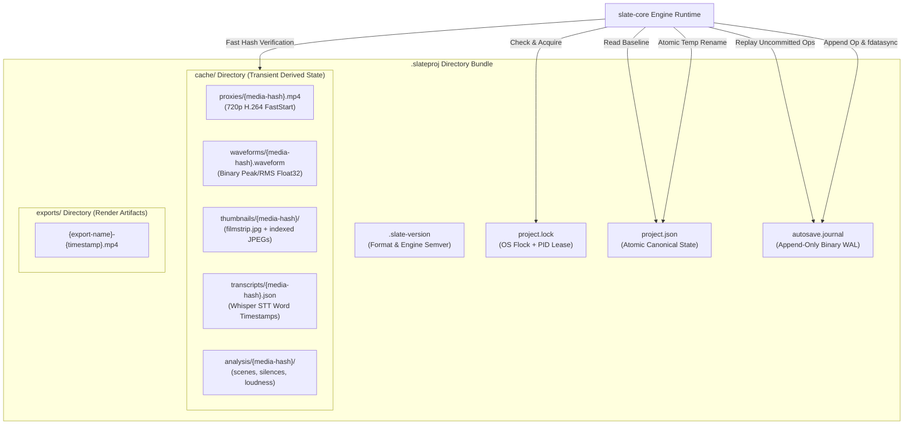
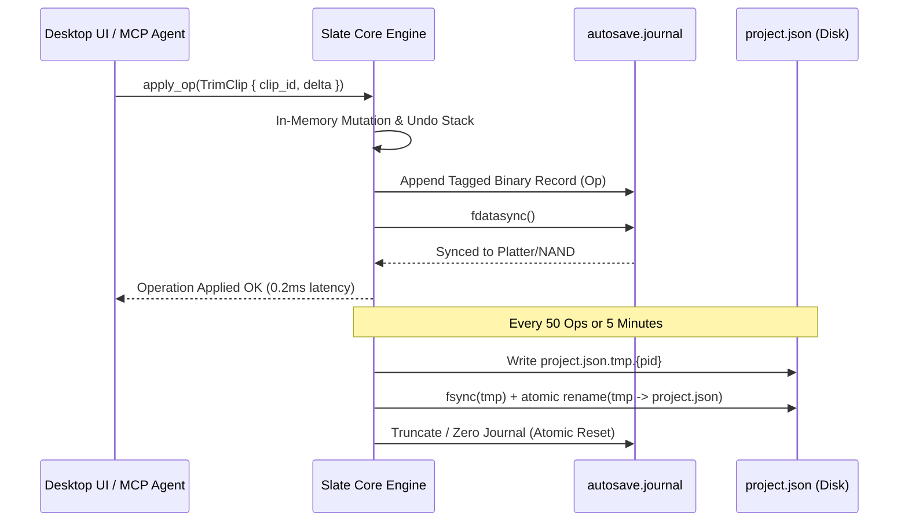
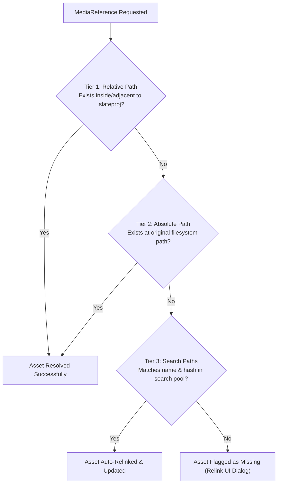

# Slate Project Format & Persistence Specification (`.slateproj`)

> **Specification & Technical Architecture Document**  
> **Crate Target:** `slate-core` (`src/project/*`), `slate-cli`  
> **Target Path:** [`docs/10-project-format.md`](file:///Users/adityakinjawadekar/Documents/100xcode/video-editor/docs/10-project-format.md)  
> **Specification Version:** 1.0.0  
> **Status:** APPROVED FOR IMPLEMENTATION (All features v1 — Zero feature deferral)  
> **Architectural Paradigm:** Self-Contained Directory Bundle, Transactional Write-Ahead Log (WAL), Fast Media Fingerprinting, and Zero-Data-Loss Crash Recovery  

---

## 1. Executive Overview & Design Principles

Video editing projects in professional non-linear editors (NLEs) are notoriously susceptible to project corruption, missing media link rot, massive cache bloat, and catastrophic data loss during unexpected crashes or power failures. Traditional monolithic XML or SQLite files conflate structural timeline topology with transient computational caches, leading to fragile migrations and unwieldy version control diffs.

**Slate** resolves these historical failure modes by standardizing on a **Directory Bundle Format** with the `.slateproj` extension (macOS bundle / package directory). A Slate project is not a single opaque binary file; it is an orchestrated directory containing human-readable declarative state, an append-only binary Write-Ahead Log (WAL), deterministic cached artifacts, and an active process concurrency lease.



### 1.1 Core Architectural Principles

1. **Separation of Concerns:** Timeline topology and editing intent (`project.json`) are completely decoupled from heavy derived computational assets (`cache/`). Deleting the entire `cache/` directory never causes data loss; all caches can be regenerated deterministically from the source media.
2. **Zero Data Loss Guarantee (`kill -9` Safe):** Slate uses an append-only binary journal (`autosave.journal`). Every user or AI agent mutation (`Op`) is committed to the journal and flushed to non-volatile storage with `fdatasync()` before the runtime event loop yields. At most one in-flight operation can ever be lost upon power cut or OS kernel panic.
3. **Atomic State Commits:** The canonical timeline file (`project.json`) is never modified in-place. Updates write to a temporary file in the same filesystem directory followed by an atomic POSIX `rename()` and parent directory directory-entry sync.
4. **Agent & Headless Parity:** The project bundle can be created, opened, inspected, mutated via Model Context Protocol (MCP) tool calls, rendered headlessly via `slate-cli`, or manipulated interactively in `slate-ui` with identical validation and locking semantics.
5. **Git & Diff Friendliness:** `project.json` is formatted with sorted keys, standardized 2-space indentation, and canonical float representations, ensuring clean, legible Git diffs. The bundle includes an out-of-the-box `.gitignore` to prevent caching artifacts from polluting repositories.
6. **Deterministic Media Relinking:** Assets are tracked using a dual absolute/relative path scheme combined with a multi-factor fast fingerprint: $\text{SHA-256}(\text{size} \parallel \text{mtime} \parallel \text{first 1 MB})$. Projects remain portable across macOS, Linux, and Windows systems.

---

## 2. Bundle Directory Anatomy

A `.slateproj` bundle adheres to the following explicit filesystem structure:

```
my-project.slateproj/
├── .slate-version            # Format version metadata for automated migrations
├── project.json              # Canonical serialized Project struct (timeline, tracks, clips, effects)
├── autosave.journal           # Append-only binary write-ahead log (WAL) of uncommitted Ops
├── project.lock               # Process lease lock file (prevents concurrent write corruption)
├── cache/                     # Derived computational caches (regenerable, gitignored)
│   ├── proxies/               # 720p H.264 proxy files for fluid real-time scrubbing
│   │   └── {media-hash}.mp4
│   ├── waveforms/             # High-density binary audio peak and RMS vectors
│   │   └── {media-hash}.waveform
│   ├── thumbnails/            # Extracted video frame thumbnails and contact sheets
│   │   └── {media-hash}/
│   │       ├── filmstrip.jpg  # 10x10 contact sheet of timeline scrub intervals
│   │       └── {frame_pts}.jpg # On-demand cached full-resolution preview frames
│   ├── transcripts/           # Local Whisper speech-to-text outputs with word alignments
│   │   └── {media-hash}.json
│   └── analysis/              # Multi-modal AI analysis outputs
│       └── {media-hash}/
│           ├── scenes.json    # Scene cut boundary timestamps and confidence scores
│           ├── silences.json  # Voice activity detection (Silero VAD) silence intervals
│           └── loudness.json  # EBU R128 integrated, momentary, and short-term loudness
└── exports/                   # Master renders and draft exports generated by slate-render
    └── {export-name}-{timestamp}.mp4
```

### 2.1 File & Directory Specification Matrix

| Component | Format / MIME | Lifetime / Persistence | Git Tracked | Purpose |
| :--- | :--- | :--- | :--- | :--- |
| `.slate-version` | JSON (`application/json`) | Permanent; updated on migration | Yes | Format version and engine compatibility assertions. |
| `project.json` | Pretty JSON (`application/json`) | Permanent; committed on save / checkpoint | Yes | Ground-truth representation of project settings, media pool, tracks, items, keyframes. |
| `autosave.journal` | Binary Tagged Records | Ephemeral; truncated upon atomic save | No | Write-Ahead Log capturing millisecond mutations between saves. |
| `project.lock` | JSON (`application/json`) + `flock` | Ephemeral; exists only while open | No | Prevents multiple GUI or CLI processes from mutating bundle concurrently. |
| `cache/proxies/` | MP4 (`video/mp4`, H.264/AAC) | Regenerable; managed by LRU quota | No | High-throughput, frame-accurate decoding proxies with `moov` at file header. |
| `cache/waveforms/` | Custom Binary (`application/octet-stream`) | Regenerable; keyed by media hash | No | Pre-computed min/max peak and RMS pairs across 4 mipmap zoom tiers. |
| `cache/thumbnails/` | JPEG (`image/jpeg`) | Regenerable; keyed by media hash | No | Contact sheets and scrubbing previews for rapid timeline rendering. |
| `cache/transcripts/` | JSON (`application/json`) | Regenerable (expensive); preserved | No | Word-level speech recognition timestamps, speakers, and confidence scores. |
| `cache/analysis/` | JSON (`application/json`) | Regenerable; keyed by media hash | No | Pre-computed scene cuts, silences, and loudness measurements. |
| `exports/` | MP4 / MOV / MKV | Permanent user output | Optional | Final rendered timelines and client review cuts. |

---

## 3. `project.json` Data Architecture & Complete Schema

The `project.json` file is the declarative, serialized representation of the [`Project`](file:///Users/adityakinjawadekar/Documents/100xcode/video-editor/crates/slate-core/src/model/project.rs) struct. It strictly adheres to camelCase serialization naming rules and guarantees frame-accurate rational integer time representations.

### 3.1 Rust Type Definitions (`slate-core`)

```rust
use serde::{Deserialize, Serialize};
use schemars::JsonSchema;
use std::path::PathBuf;
use uuid::Uuid;

#[derive(Debug, Clone, Copy, PartialEq, Eq, Hash, Serialize, Deserialize, JsonSchema)]
#[serde(transparent)]
pub struct ProjectId(pub Uuid);

#[derive(Debug, Clone, Copy, PartialEq, Eq, Hash, Serialize, Deserialize, JsonSchema)]
#[serde(transparent)]
pub struct TimelineId(pub Uuid);

#[derive(Debug, Clone, Copy, PartialEq, Eq, Hash, Serialize, Deserialize, JsonSchema)]
#[serde(transparent)]
pub struct TrackId(pub Uuid);

#[derive(Debug, Clone, Copy, PartialEq, Eq, Hash, Serialize, Deserialize, JsonSchema)]
#[serde(transparent)]
pub struct ClipId(pub Uuid);

#[derive(Debug, Clone, Copy, PartialEq, Eq, Hash, Serialize, Deserialize, JsonSchema)]
#[serde(transparent)]
pub struct MediaId(pub Uuid);

#[derive(Debug, Clone, Copy, PartialEq, Eq, Hash, Serialize, Deserialize, JsonSchema)]
#[serde(transparent)]
pub struct KeyframeId(pub Uuid);

#[derive(Debug, Clone, Copy, PartialEq, Eq, Hash, Serialize, Deserialize, JsonSchema)]
#[serde(transparent)]
pub struct TransitionId(pub Uuid);

#[derive(Debug, Clone, Copy, PartialEq, Eq, Hash, Serialize, Deserialize, JsonSchema)]
#[serde(transparent)]
pub struct MarkerId(pub Uuid);

#[derive(Debug, Clone, Copy, PartialEq, Eq, Hash, Serialize, Deserialize, JsonSchema)]
#[serde(transparent)]
pub struct CaptionId(pub Uuid);

/// Frame-accurate fractional time representation: time_in_seconds = ticks / rate
#[derive(Debug, Clone, Copy, PartialEq, Eq, Serialize, Deserialize, JsonSchema)]
#[serde(rename_all = "camelCase")]
pub struct RationalTime {
    pub ticks: i64,
    pub rate: u32,
}

impl RationalTime {
    pub const ZERO: Self = Self { ticks: 0, rate: 1 };
    
    pub fn new(ticks: i64, rate: u32) -> Self {
        Self { ticks, rate }
    }
}

/// Bounded time interval [start, start + duration)
#[derive(Debug, Clone, Copy, PartialEq, Eq, Serialize, Deserialize, JsonSchema)]
#[serde(rename_all = "camelCase")]
pub struct TimeRange {
    pub start: RationalTime,
    pub duration: RationalTime,
}

#[derive(Debug, Clone, PartialEq, Serialize, Deserialize, JsonSchema)]
#[serde(rename_all = "camelCase")]
pub struct ProbedMetadata {
    pub file_size_bytes: u64,
    pub duration: RationalTime,
    pub video_codec: Option<String>,
    pub width: Option<u32>,
    pub height: Option<u32>,
    pub frame_rate: Option<f64>,
    pub timebase: u32,
    pub audio_codec: Option<String>,
    pub audio_channels: Option<u16>,
    pub sample_rate: Option<u32>,
    pub bit_rate_bps: Option<u64>,
}

#[derive(Debug, Clone, PartialEq, Serialize, Deserialize, JsonSchema)]
#[serde(rename_all = "camelCase")]
pub struct MediaReference {
    pub id: MediaId,
    pub name: String,
    pub original_path: PathBuf,
    pub relative_path: PathBuf,
    pub file_hash: String,
    pub metadata: ProbedMetadata,
    pub proxy_path: Option<PathBuf>,
    pub waveform_path: Option<PathBuf>,
}

#[derive(Debug, Clone, Copy, PartialEq, Eq, Serialize, Deserialize, JsonSchema)]
#[serde(rename_all = "lowercase")]
pub enum Interpolation {
    Linear,
    Bezier,
    Hold,
}

#[derive(Debug, Clone, PartialEq, Serialize, Deserialize, JsonSchema)]
#[serde(rename_all = "camelCase")]
pub struct Keyframe<T> {
    pub id: KeyframeId,
    pub time: RationalTime,
    pub value: T,
    pub interpolation: Interpolation,
    #[serde(skip_serializing_if = "Option::is_none")]
    pub bezier_control_points: Option<[f32; 4]>,
}

#[derive(Debug, Clone, PartialEq, Serialize, Deserialize, JsonSchema)]
#[serde(rename_all = "camelCase")]
pub struct KeyframeTrack<T> {
    pub keyframes: Vec<Keyframe<T>>,
}

#[derive(Debug, Clone, PartialEq, Serialize, Deserialize, JsonSchema)]
#[serde(rename_all = "camelCase")]
pub struct Transform {
    pub position_x: KeyframeTrack<f64>,
    pub position_y: KeyframeTrack<f64>,
    pub scale_x: KeyframeTrack<f64>,
    pub scale_y: KeyframeTrack<f64>,
    pub rotation_degrees: KeyframeTrack<f64>,
    pub opacity: KeyframeTrack<f64>,
    pub crop_left: KeyframeTrack<f64>,
    pub crop_right: KeyframeTrack<f64>,
    pub crop_top: KeyframeTrack<f64>,
    pub crop_bottom: KeyframeTrack<f64>,
    pub anchor_x: f32,
    pub anchor_y: f32,
}

#[derive(Debug, Clone, PartialEq, Serialize, Deserialize, JsonSchema)]
#[serde(rename_all = "camelCase")]
pub struct AudioParams {
    pub volume_db: KeyframeTrack<f64>,
    pub pan: KeyframeTrack<f64>,
    pub mute: bool,
    pub channel_mapping: Vec<usize>,
}

#[derive(Debug, Clone, PartialEq, Serialize, Deserialize, JsonSchema)]
#[serde(rename_all = "camelCase")]
pub struct EffectDescriptor {
    pub id: Uuid,
    pub effect_type: String,
    pub enabled: bool,
    pub parameters: serde_json::Value,
}

#[derive(Debug, Clone, PartialEq, Serialize, Deserialize, JsonSchema)]
#[serde(rename_all = "camelCase")]
pub struct Clip {
    pub id: ClipId,
    pub name: String,
    pub media_id: MediaId,
    pub source_range: TimeRange,
    pub timeline_range: TimeRange,
    pub speed: f64,
    pub transform: Transform,
    pub audio_params: AudioParams,
    pub effects: Vec<EffectDescriptor>,
}

#[derive(Debug, Clone, Copy, PartialEq, Eq, Serialize, Deserialize, JsonSchema)]
#[serde(rename_all = "camelCase")]
pub enum TransitionAlignment {
    CenteredOnCut,
    StartAtCut,
    EndAtCut,
}

#[derive(Debug, Clone, PartialEq, Serialize, Deserialize, JsonSchema)]
#[serde(rename_all = "camelCase")]
pub struct Transition {
    pub id: TransitionId,
    pub transition_type: String,
    pub duration: RationalTime,
    pub alignment: TransitionAlignment,
    pub parameters: serde_json::Value,
}

#[derive(Debug, Clone, PartialEq, Serialize, Deserialize, JsonSchema)]
#[serde(rename_all = "camelCase")]
pub struct Gap {
    pub id: Uuid,
    pub timeline_range: TimeRange,
}

#[derive(Debug, Clone, PartialEq, Serialize, Deserialize, JsonSchema)]
#[serde(tag = "kind", rename_all = "camelCase")]
pub enum TrackItem {
    Clip(Clip),
    Gap(Gap),
    Transition(Transition),
}

#[derive(Debug, Clone, Copy, PartialEq, Eq, Serialize, Deserialize, JsonSchema)]
#[serde(rename_all = "lowercase")]
pub enum TrackType {
    Video,
    Audio,
    Caption,
}

#[derive(Debug, Clone, PartialEq, Serialize, Deserialize, JsonSchema)]
#[serde(rename_all = "camelCase")]
pub struct Track {
    pub id: TrackId,
    pub name: String,
    pub track_type: TrackType,
    pub muted: bool,
    pub solo: bool,
    pub locked: bool,
    pub volume_db: f64,
    pub pan: f64,
    pub height: f32,
    pub items: Vec<TrackItem>,
}

#[derive(Debug, Clone, PartialEq, Serialize, Deserialize, JsonSchema)]
#[serde(rename_all = "camelCase")]
pub struct Marker {
    pub id: MarkerId,
    pub time: RationalTime,
    pub label: String,
    pub note: Option<String>,
    pub color_rgba: [f32; 4],
}

#[derive(Debug, Clone, PartialEq, Serialize, Deserialize, JsonSchema)]
#[serde(rename_all = "camelCase")]
pub struct CaptionStyle {
    pub font_family: String,
    pub font_size: f32,
    pub font_weight: u16,
    pub text_color_rgba: [f32; 4],
    pub bg_color_rgba: [f32; 4],
    pub outline_color_rgba: [f32; 4],
    pub outline_width: f32,
    pub vertical_alignment: String,
    pub margin_bottom_percent: f32,
}

#[derive(Debug, Clone, PartialEq, Serialize, Deserialize, JsonSchema)]
#[serde(rename_all = "camelCase")]
pub struct Caption {
    pub id: CaptionId,
    pub time_range: TimeRange,
    pub text: String,
    pub style: CaptionStyle,
}

#[derive(Debug, Clone, PartialEq, Serialize, Deserialize, JsonSchema)]
#[serde(rename_all = "camelCase")]
pub struct TimelineSettings {
    pub timebase: u32,
    pub width: u32,
    pub height: u32,
    pub drop_frame: bool,
    pub sample_rate: u32,
}

#[derive(Debug, Clone, PartialEq, Serialize, Deserialize, JsonSchema)]
#[serde(rename_all = "camelCase")]
pub struct Timeline {
    pub id: TimelineId,
    pub name: String,
    pub settings: TimelineSettings,
    pub tracks: Vec<Track>,
    pub markers: Vec<Marker>,
    pub captions: Vec<Caption>,
}

#[derive(Debug, Clone, PartialEq, Serialize, Deserialize, JsonSchema)]
#[serde(rename_all = "camelCase")]
pub struct ExportPreset {
    pub name: String,
    pub container: String,
    pub video_codec: String,
    pub audio_codec: String,
    pub width: u32,
    pub height: u32,
    pub fps: f64,
    pub video_bitrate_kbps: u32,
    pub audio_bitrate_kbps: u32,
}

#[derive(Debug, Clone, PartialEq, Serialize, Deserialize, JsonSchema)]
#[serde(rename_all = "camelCase")]
pub struct ProjectMetadata {
    pub created_at: String,
    pub modified_at: String,
    pub author: Option<String>,
    pub engine_version: String,
    pub format_version: u32,
}

#[derive(Debug, Clone, PartialEq, Serialize, Deserialize, JsonSchema)]
#[serde(rename_all = "camelCase")]
pub struct Project {
    pub schema_version: u32,
    pub id: ProjectId,
    pub name: String,
    pub metadata: ProjectMetadata,
    pub active_timeline_id: TimelineId,
    pub media_pool: Vec<MediaReference>,
    pub timelines: Vec<Timeline>,
    pub export_presets: Vec<ExportPreset>,
}
```

---

### 3.2 Realistic Reference `project.json` Payload

Below is a complete, real-world, pretty-printed `project.json` containing:
- 3 Tracks (2 Video tracks `V1`, `V2`, and 1 Audio track `A1`)
- 5 Media clips with affine transforms and keyframes
- A cross-dissolve transition placed on track `V1`
- Dynamic audio volume automation keyframes on track `A1`
- 2 Timeline markers
- 3 Synchronized dialogue captions
- 2 Production export presets (YouTube 4K UHD and Web 1080p)

```json
{
  "schemaVersion": 1,
  "id": "7c9e6679-7425-40de-944b-e07fc1f90ae7",
  "name": "Neon Horizon — Cyberpunk Trailer",
  "metadata": {
    "createdAt": "2026-10-14T10:00:00.000Z",
    "modifiedAt": "2026-10-14T14:32:18.512Z",
    "author": "Chief Video Architect",
    "engineVersion": "0.1.0",
    "formatVersion": 1
  },
  "activeTimelineId": "d3b07384-d113-4f9e-a864-7bf541249b6b",
  "mediaPool": [
    {
      "id": "e4d909c2-9e8d-4e94-8178-5777713f0ef2",
      "name": "A001_C001_TokyoNight_4K.mov",
      "originalPath": "/Volumes/Footage/Cyberpunk/A001_C001_TokyoNight_4K.mov",
      "relativePath": "../Footage/A001_C001_TokyoNight_4K.mov",
      "fileHash": "7f83b1657ff1fc53b92dc18148a1d65dfc2d4b1fa3d677284addd200126d9069",
      "metadata": {
        "fileSizeBytes": 1073741824,
        "duration": {
          "ticks": 720,
          "rate": 24
        },
        "videoCodec": "prores422hq",
        "width": 3840,
        "height": 2160,
        "frameRate": 24.0,
        "timebase": 24,
        "audioCodec": "pcm_s24le",
        "audioChannels": 2,
        "sampleRate": 48000,
        "bitRateBps": 220000000
      },
      "proxyPath": "cache/proxies/7f83b1657ff1fc53b92dc18148a1d65dfc2d4b1fa3d677284addd200126d9069.mp4",
      "waveformPath": "cache/waveforms/7f83b1657ff1fc53b92dc18148a1d65dfc2d4b1fa3d677284addd200126d9069.waveform"
    },
    {
      "id": "c1a2b3c4-d5e6-4f7a-8b9c-0d1e2f3a4b5c",
      "name": "A001_C002_AlleyChase_4K.mov",
      "originalPath": "/Volumes/Footage/Cyberpunk/A001_C002_AlleyChase_4K.mov",
      "relativePath": "../Footage/A001_C002_AlleyChase_4K.mov",
      "fileHash": "e3b0c44298fc1c149afbf4c8996fb92427ae41e4649b934ca495991b7852b855",
      "metadata": {
        "fileSizeBytes": 891289600,
        "duration": {
          "ticks": 480,
          "rate": 24
        },
        "videoCodec": "prores422hq",
        "width": 3840,
        "height": 2160,
        "frameRate": 24.0,
        "timebase": 24,
        "audioCodec": "pcm_s24le",
        "audioChannels": 2,
        "sampleRate": 48000,
        "bitRateBps": 220000000
      },
      "proxyPath": "cache/proxies/e3b0c44298fc1c149afbf4c8996fb92427ae41e4649b934ca495991b7852b855.mp4",
      "waveformPath": "cache/waveforms/e3b0c44298fc1c149afbf4c8996fb92427ae41e4649b934ca495991b7852b855.waveform"
    },
    {
      "id": "f8a10293-1b2c-4d3e-9f8a-0123456789ab",
      "name": "Synthwave_Soundtrack_Master.wav",
      "originalPath": "/Volumes/Music/Cyberpunk/Synthwave_Soundtrack_Master.wav",
      "relativePath": "../Music/Synthwave_Soundtrack_Master.wav",
      "fileHash": "ca978112ca1bbdccafac231b39a23dc4da786eff8147c4e72b9807785afee48e",
      "metadata": {
        "fileSizeBytes": 57600000,
        "duration": {
          "ticks": 14400000,
          "rate": 48000
        },
        "videoCodec": null,
        "width": null,
        "height": null,
        "frameRate": null,
        "timebase": 48000,
        "audioCodec": "pcm_s24le",
        "audioChannels": 2,
        "sampleRate": 48000,
        "bitRateBps": 2304000
      },
      "proxyPath": null,
      "waveformPath": "cache/waveforms/ca978112ca1bbdccafac231b39a23dc4da786eff8147c4e72b9807785afee48e.waveform"
    }
  ],
  "timelines": [
    {
      "id": "d3b07384-d113-4f9e-a864-7bf541249b6b",
      "name": "Main Editorial Sequence",
      "settings": {
        "timebase": 24,
        "width": 3840,
        "height": 2160,
        "dropFrame": false,
        "sampleRate": 48000
      },
      "tracks": [
        {
          "id": "a1b2c3d4-e5f6-4a1b-8c2d-3e4f5a6b7c8d",
          "name": "V1 - Primary Narrative",
          "trackType": "video",
          "muted": false,
          "solo": false,
          "locked": false,
          "volumeDb": 0.0,
          "pan": 0.0,
          "height": 68.0,
          "items": [
            {
              "kind": "clip",
              "id": "01234567-89ab-cdef-0123-456789abcdef",
              "name": "Tokyo Skyline Wide",
              "mediaId": "e4d909c2-9e8d-4e94-8178-5777713f0ef2",
              "sourceRange": {
                "start": { "ticks": 0, "rate": 24 },
                "duration": { "ticks": 120, "rate": 24 }
              },
              "timelineRange": {
                "start": { "ticks": 0, "rate": 24 },
                "duration": { "ticks": 120, "rate": 24 }
              },
              "speed": 1.0,
              "transform": {
                "positionX": {
                  "keyframes": [
                    {
                      "id": "11111111-1111-1111-1111-111111111111",
                      "time": { "ticks": 0, "rate": 24 },
                      "value": 0.0,
                      "interpolation": "linear"
                    }
                  ]
                },
                "positionY": { "keyframes": [] },
                "scaleX": {
                  "keyframes": [
                    {
                      "id": "22222222-2222-2222-2222-222222222222",
                      "time": { "ticks": 0, "rate": 24 },
                      "value": 1.0,
                      "interpolation": "bezier",
                      "bezierControlPoints": [0.25, 0.1, 0.25, 1.0]
                    },
                    {
                      "id": "33333333-3333-3333-3333-333333333333",
                      "time": { "ticks": 120, "rate": 24 },
                      "value": 1.08,
                      "interpolation": "bezier",
                      "bezierControlPoints": [0.25, 0.1, 0.25, 1.0]
                    }
                  ]
                },
                "scaleY": {
                  "keyframes": [
                    {
                      "id": "44444444-4444-4444-4444-444444444444",
                      "time": { "ticks": 0, "rate": 24 },
                      "value": 1.0,
                      "interpolation": "bezier",
                      "bezierControlPoints": [0.25, 0.1, 0.25, 1.0]
                    },
                    {
                      "id": "55555555-5555-5555-5555-555555555555",
                      "time": { "ticks": 120, "rate": 24 },
                      "value": 1.08,
                      "interpolation": "bezier",
                      "bezierControlPoints": [0.25, 0.1, 0.25, 1.0]
                    }
                  ]
                },
                "rotationDegrees": { "keyframes": [] },
                "opacity": {
                  "keyframes": [
                    {
                      "id": "66666666-6666-6666-6666-666666666666",
                      "time": { "ticks": 0, "rate": 24 },
                      "value": 1.0,
                      "interpolation": "linear"
                    }
                  ]
                },
                "cropLeft": { "keyframes": [] },
                "cropRight": { "keyframes": [] },
                "cropTop": { "keyframes": [] },
                "cropBottom": { "keyframes": [] },
                "anchorX": 0.5,
                "anchorY": 0.5
              },
              "audioParams": {
                "volumeDb": { "keyframes": [] },
                "pan": { "keyframes": [] },
                "mute": false,
                "channelMapping": [0, 1]
              },
              "effects": [
                {
                  "id": "77777777-7777-7777-7777-777777777777",
                  "effectType": "colorGrade",
                  "enabled": true,
                  "parameters": {
                    "exposure": 0.15,
                    "contrast": 1.2,
                    "saturation": 1.35,
                    "temperature": -0.1
                  }
                }
              ]
            },
            {
              "kind": "transition",
              "id": "88888888-8888-8888-8888-888888888888",
              "transitionType": "cross_dissolve",
              "duration": { "ticks": 24, "rate": 24 },
              "alignment": "centeredOnCut",
              "parameters": {
                "curve": "smoothstep"
              }
            },
            {
              "kind": "clip",
              "id": "a9b8c7d6-e5f4-3a2b-1c0d-ef9876543210",
              "name": "Alleyway Chase Pursuit",
              "mediaId": "c1a2b3c4-d5e6-4f7a-8b9c-0d1e2f3a4b5c",
              "sourceRange": {
                "start": { "ticks": 24, "rate": 24 },
                "duration": { "ticks": 144, "rate": 24 }
              },
              "timelineRange": {
                "start": { "ticks": 120, "rate": 24 },
                "duration": { "ticks": 144, "rate": 24 }
              },
              "speed": 1.0,
              "transform": {
                "positionX": { "keyframes": [] },
                "positionY": { "keyframes": [] },
                "scaleX": { "keyframes": [] },
                "scaleY": { "keyframes": [] },
                "rotationDegrees": { "keyframes": [] },
                "opacity": { "keyframes": [] },
                "cropLeft": { "keyframes": [] },
                "cropRight": { "keyframes": [] },
                "cropTop": { "keyframes": [] },
                "cropBottom": { "keyframes": [] },
                "anchorX": 0.5,
                "anchorY": 0.5
              },
              "audioParams": {
                "volumeDb": { "keyframes": [] },
                "pan": { "keyframes": [] },
                "mute": false,
                "channelMapping": [0, 1]
              },
              "effects": []
            }
          ]
        },
        {
          "id": "b2c3d4e5-f6a1-5b2c-9d3e-4f5a6b7c8d9e",
          "name": "V2 - Overlays & Graphics",
          "trackType": "video",
          "muted": false,
          "solo": false,
          "locked": false,
          "volumeDb": 0.0,
          "pan": 0.0,
          "height": 60.0,
          "items": [
            {
              "kind": "clip",
              "id": "d0e1f2a3-b4c5-6789-0123-456789abcdef",
              "name": "Hologram HUD Overlay",
              "mediaId": "e4d909c2-9e8d-4e94-8178-5777713f0ef2",
              "sourceRange": {
                "start": { "ticks": 240, "rate": 24 },
                "duration": { "ticks": 72, "rate": 24 }
              },
              "timelineRange": {
                "start": { "ticks": 48, "rate": 24 },
                "duration": { "ticks": 72, "rate": 24 }
              },
              "speed": 1.0,
              "transform": {
                "positionX": {
                  "keyframes": [
                    {
                      "id": "99999999-9999-9999-9999-999999999999",
                      "time": { "ticks": 48, "rate": 24 },
                      "value": 150.0,
                      "interpolation": "linear"
                    }
                  ]
                },
                "positionY": {
                  "keyframes": [
                    {
                      "id": "aaaaaaaa-aaaa-aaaa-aaaa-aaaaaaaaaaaa",
                      "time": { "ticks": 48, "rate": 24 },
                      "value": -80.0,
                      "interpolation": "linear"
                    }
                  ]
                },
                "scaleX": {
                  "keyframes": [
                    {
                      "id": "bbbbbbbb-bbbb-bbbb-bbbb-bbbbbbbbbbbb",
                      "time": { "ticks": 48, "rate": 24 },
                      "value": 0.75,
                      "interpolation": "linear"
                    }
                  ]
                },
                "scaleY": {
                  "keyframes": [
                    {
                      "id": "cccccccc-cccc-cccc-cccc-cccccccccccc",
                      "time": { "ticks": 48, "rate": 24 },
                      "value": 0.75,
                      "interpolation": "linear"
                    }
                  ]
                },
                "rotationDegrees": {
                  "keyframes": [
                    {
                      "id": "dddddddd-dddd-dddd-dddd-dddddddddddd",
                      "time": { "ticks": 48, "rate": 24 },
                      "value": 0.0,
                      "interpolation": "linear"
                    },
                    {
                      "id": "eeeeeeee-eeee-eeee-eeee-eeeeeeeeeeee",
                      "time": { "ticks": 120, "rate": 24 },
                      "value": 5.0,
                      "interpolation": "linear"
                    }
                  ]
                },
                "opacity": {
                  "keyframes": [
                    {
                      "id": "ffffffff-ffff-ffff-ffff-ffffffffffff",
                      "time": { "ticks": 48, "rate": 24 },
                      "value": 0.0,
                      "interpolation": "linear"
                    },
                    {
                      "id": "10101010-1010-1010-1010-101010101010",
                      "time": { "ticks": 60, "rate": 24 },
                      "value": 0.85,
                      "interpolation": "linear"
                    },
                    {
                      "id": "20202020-2020-2020-2020-202020202020",
                      "time": { "ticks": 108, "rate": 24 },
                      "value": 0.85,
                      "interpolation": "linear"
                    },
                    {
                      "id": "30303030-3030-3030-3030-303030303030",
                      "time": { "ticks": 120, "rate": 24 },
                      "value": 0.0,
                      "interpolation": "linear"
                    }
                  ]
                },
                "cropLeft": { "keyframes": [] },
                "cropRight": { "keyframes": [] },
                "cropTop": { "keyframes": [] },
                "cropBottom": { "keyframes": [] },
                "anchorX": 0.5,
                "anchorY": 0.5
              },
              "audioParams": {
                "volumeDb": { "keyframes": [] },
                "pan": { "keyframes": [] },
                "mute": true,
                "channelMapping": []
              },
              "effects": []
            },
            {
              "kind": "clip",
              "id": "e5f6a7b8-c9d0-1234-5678-9abcdef01234",
              "name": "Glitch Texture Insert",
              "mediaId": "c1a2b3c4-d5e6-4f7a-8b9c-0d1e2f3a4b5c",
              "sourceRange": {
                "start": { "ticks": 200, "rate": 24 },
                "duration": { "ticks": 36, "rate": 24 }
              },
              "timelineRange": {
                "start": { "ticks": 180, "rate": 24 },
                "duration": { "ticks": 36, "rate": 24 }
              },
              "speed": 1.0,
              "transform": {
                "positionX": { "keyframes": [] },
                "positionY": { "keyframes": [] },
                "scaleX": { "keyframes": [] },
                "scaleY": { "keyframes": [] },
                "rotationDegrees": { "keyframes": [] },
                "opacity": {
                  "keyframes": [
                    {
                      "id": "40404040-4040-4040-4040-404040404040",
                      "time": { "ticks": 180, "rate": 24 },
                      "value": 0.7,
                      "interpolation": "linear"
                    }
                  ]
                },
                "cropLeft": {
                  "keyframes": [
                    {
                      "id": "50505050-5050-5050-5050-505050505050",
                      "time": { "ticks": 180, "rate": 24 },
                      "value": 0.1,
                      "interpolation": "linear"
                    }
                  ]
                },
                "cropRight": {
                  "keyframes": [
                    {
                      "id": "60606060-6060-6060-6060-606060606060",
                      "time": { "ticks": 180, "rate": 24 },
                      "value": 0.1,
                      "interpolation": "linear"
                    }
                  ]
                },
                "cropTop": { "keyframes": [] },
                "cropBottom": { "keyframes": [] },
                "anchorX": 0.5,
                "anchorY": 0.5
              },
              "audioParams": {
                "volumeDb": { "keyframes": [] },
                "pan": { "keyframes": [] },
                "mute": true,
                "channelMapping": []
              },
              "effects": []
            }
          ]
        },
        {
          "id": "c3d4e5f6-a7b8-6c3d-0e4f-5a6b7c8d9e0f",
          "name": "A1 - Music Bed & Score",
          "trackType": "audio",
          "muted": false,
          "solo": false,
          "locked": false,
          "volumeDb": -3.0,
          "pan": 0.0,
          "height": 52.0,
          "items": [
            {
              "kind": "clip",
              "id": "f0e1d2c3-b4a5-9876-5432-10fedcba9876",
              "name": "Main Synth Theme",
              "mediaId": "f8a10293-1b2c-4d3e-9f8a-0123456789ab",
              "sourceRange": {
                "start": { "ticks": 0, "rate": 48000 },
                "duration": { "ticks": 528000, "rate": 48000 }
              },
              "timelineRange": {
                "start": { "ticks": 0, "rate": 24 },
                "duration": { "ticks": 264, "rate": 24 }
              },
              "speed": 1.0,
              "transform": {
                "positionX": { "keyframes": [] },
                "positionY": { "keyframes": [] },
                "scaleX": { "keyframes": [] },
                "scaleY": { "keyframes": [] },
                "rotationDegrees": { "keyframes": [] },
                "opacity": { "keyframes": [] },
                "cropLeft": { "keyframes": [] },
                "cropRight": { "keyframes": [] },
                "cropTop": { "keyframes": [] },
                "cropBottom": { "keyframes": [] },
                "anchorX": 0.5,
                "anchorY": 0.5
              },
              "audioParams": {
                "volumeDb": {
                  "keyframes": [
                    {
                      "id": "70707070-7070-7070-7070-707070707070",
                      "time": { "ticks": 0, "rate": 24 },
                      "value": -24.0,
                      "interpolation": "linear"
                    },
                    {
                      "id": "80808080-8080-8080-8080-808080808080",
                      "time": { "ticks": 24, "rate": 24 },
                      "value": 0.0,
                      "interpolation": "linear"
                    },
                    {
                      "id": "90909090-9090-9090-9090-909090909090",
                      "time": { "ticks": 110, "rate": 24 },
                      "value": -6.0,
                      "interpolation": "linear"
                    },
                    {
                      "id": "a0a0a0a0-a0a0-a0a0-a0a0-a0a0a0a0a0a0",
                      "time": { "ticks": 120, "rate": 24 },
                      "value": 2.5,
                      "interpolation": "linear"
                    },
                    {
                      "id": "b0b0b0b0-b0b0-b0b0-b0b0-b0b0b0b0b0b0",
                      "time": { "ticks": 240, "rate": 24 },
                      "value": 0.0,
                      "interpolation": "linear"
                    },
                    {
                      "id": "c0c0c0c0-c0c0-c0c0-c0c0-c0c0c0c0c0c0",
                      "time": { "ticks": 264, "rate": 24 },
                      "value": -48.0,
                      "interpolation": "linear"
                    }
                  ]
                },
                "pan": {
                  "keyframes": [
                    {
                      "id": "d0d0d0d0-d0d0-d0d0-d0d0-d0d0d0d0d0d0",
                      "time": { "ticks": 0, "rate": 24 },
                      "value": 0.0,
                      "interpolation": "linear"
                    }
                  ]
                },
                "mute": false,
                "channelMapping": [0, 1]
              },
              "effects": []
            }
          ]
        }
      ],
      "markers": [
        {
          "id": "e3f2a1b0-c9d8-4721-9876-543210fedcba",
          "time": { "ticks": 0, "rate": 24 },
          "label": "Intro Hook",
          "note": "Atmospheric city establishing frame",
          "colorRgba": [0.2, 0.8, 0.4, 1.0]
        },
        {
          "id": "f4a3b2c1-d0e9-5832-0987-6543210fedcb",
          "time": { "ticks": 120, "rate": 24 },
          "label": "Bass Drop & Scene Cut",
          "note": "Sync cross-dissolve with main synthesizer transient",
          "colorRgba": [1.0, 0.2, 0.5, 1.0]
        }
      ],
      "captions": [
        {
          "id": "12345678-1234-1234-1234-123456789abc",
          "timeRange": {
            "start": { "ticks": 0, "rate": 24 },
            "duration": { "ticks": 48, "rate": 24 }
          },
          "text": "Tokyo, Neo-Shinjuku District.",
          "style": {
            "fontFamily": "Inter",
            "fontSize": 48.0,
            "fontWeight": 700,
            "textColorRgba": [1.0, 1.0, 1.0, 1.0],
            "bgColorRgba": [0.0, 0.0, 0.0, 0.6],
            "outlineColorRgba": [0.0, 0.0, 0.0, 1.0],
            "outlineWidth": 2.0,
            "verticalAlignment": "bottom",
            "marginBottomPercent": 8.0
          }
        },
        {
          "id": "23456789-2345-2345-2345-23456789abcd",
          "timeRange": {
            "start": { "ticks": 48, "rate": 24 },
            "duration": { "ticks": 72, "rate": 24 }
          },
          "text": "The neural link dropped three minutes ago.",
          "style": {
            "fontFamily": "Inter",
            "fontSize": 48.0,
            "fontWeight": 700,
            "textColorRgba": [1.0, 1.0, 1.0, 1.0],
            "bgColorRgba": [0.0, 0.0, 0.0, 0.6],
            "outlineColorRgba": [0.0, 0.0, 0.0, 1.0],
            "outlineWidth": 2.0,
            "verticalAlignment": "bottom",
            "marginBottomPercent": 8.0
          }
        },
        {
          "id": "3456789a-3456-3456-3456-3456789abcde",
          "timeRange": {
            "start": { "ticks": 120, "rate": 24 },
            "duration": { "ticks": 96, "rate": 24 }
          },
          "text": "Extract the core before they trace our telemetry.",
          "style": {
            "fontFamily": "Inter",
            "fontSize": 48.0,
            "fontWeight": 700,
            "textColorRgba": [1.0, 0.85, 0.3, 1.0],
            "bgColorRgba": [0.0, 0.0, 0.0, 0.6],
            "outlineColorRgba": [0.0, 0.0, 0.0, 1.0],
            "outlineWidth": 2.0,
            "verticalAlignment": "bottom",
            "marginBottomPercent": 8.0
          }
        }
      ]
    }
  ],
  "exportPresets": [
    {
      "name": "YouTube 4K UHD Master",
      "container": "mp4",
      "videoCodec": "h264",
      "audioCodec": "aac",
      "width": 3840,
      "height": 2160,
      "fps": 24.0,
      "videoBitrateKbps": 45000,
      "audioBitrateKbps": 320
    },
    {
      "name": "Web Proxy 1080p Preview",
      "container": "mp4",
      "videoCodec": "h264",
      "audioCodec": "aac",
      "width": 1920,
      "height": 1080,
      "fps": 24.0,
      "videoBitrateKbps": 8000,
      "audioBitrateKbps": 192
    }
  ]
}
```

### 3.3 Automated JSON Schema Generation via `schemars`

To validate agent payloads, provide IDE code completions, and enforce contract tests, `slate-core` exposes an automated JSON Schema exporter:

```rust
use schemars::schema_for;
use std::fs;
use std::path::Path;

pub fn generate_project_schema(destination: &Path) -> Result<(), std::io::Error> {
    let schema = schema_for!(Project);
    let json = serde_json::to_string_pretty(&schema)?;
    fs::write(destination, json)?;
    Ok(())
}
```

---

## 4. Versioning, Schema Evolution & Migration Engine

Projects created in older Slate engine builds must migrate transparently upon open, while newer project versions opened in older engine runtimes must fail cleanly with informative diagnostics instead of silently corrupting data.

### 4.1 The `.slate-version` Contract

At the root of every bundle is the `.slate-version` file:

```json
{
  "format_version": 1,
  "engine_version": "0.1.0",
  "min_compatible_version": 1
}
```

```rust
#[derive(Debug, Clone, Serialize, Deserialize, PartialEq, Eq)]
pub struct SlateVersion {
    pub format_version: u32,
    pub engine_version: String,
    pub min_compatible_version: u32,
}

impl SlateVersion {
    pub const CURRENT_FORMAT: u32 = 1;
    pub const CURRENT_ENGINE: &'static str = env!("CARGO_PKG_VERSION");

    pub fn current() -> Self {
        Self {
            format_version: Self::CURRENT_FORMAT,
            engine_version: Self::CURRENT_ENGINE.to_string(),
            min_compatible_version: 1,
        }
    }
}
```

### 4.2 Migration Pipeline & Trait Contracts

Migrations execute as pure JSON transformations before deserializing into Rust domain types. This decouples schema migration from Rust struct evolution.

```rust
use serde_json::Value;
use std::collections::BTreeMap;
use thiserror::Error;

#[derive(Error, Debug)]
pub enum MigrationError {
    #[error("Unsupported format version: project has v{project_version}, engine supports up to v{engine_version}")]
    VersionTooNew { project_version: u32, engine_version: u32 },
    #[error("Missing migration step from v{from} to v{to}")]
    MissingStep { from: u32, to: u32 },
    #[error("JSON transformation failed at step v{from}->v{to}: {details}")]
    TransformFailed { from: u32, to: u32, details: String },
    #[error("IO error during migration: {0}")]
    Io(#[from] std::io::Error),
}

pub trait Migration: Send + Sync {
    fn from_version(&self) -> u32;
    fn to_version(&self) -> u32;
    fn migrate(&self, root: &mut Value) -> Result<(), String>;
}

pub struct MigrationRegistry {
    steps: BTreeMap<u32, Box<dyn Migration>>,
}

impl MigrationRegistry {
    pub fn new() -> Self {
        Self { steps: BTreeMap::new() }
    }

    pub fn register(&mut self, migration: Box<dyn Migration>) {
        self.steps.insert(migration.from_version(), migration);
    }

    pub fn migrate_to_latest(&self, root: &mut Value, current_version: u32, target_version: u32) -> Result<(), MigrationError> {
        let mut ver = current_version;
        while ver < target_version {
            let step = self.steps.get(&ver).ok_or(MigrationError::MissingStep {
                from: ver,
                to: ver + 1,
            })?;
            step.migrate(root).map_err(|e| MigrationError::TransformFailed {
                from: ver,
                to: step.to_version(),
                details: e,
            })?;
            ver = step.to_version();
            root["schemaVersion"] = serde_json::json!(ver);
        }
        Ok(())
    }
}
```

### 4.3 Backward Compatibility Strategy & Backup Protocol

1. **Automatic Backup Before Migration:** Whenever `format_version < CURRENT_FORMAT`, Slate creates a timestamped copy: `project.json.v{N}.bak` before modifying the document.
2. **Forward Compatibility Check:** If `min_compatible_version > CURRENT_FORMAT`, opening is aborted with an error: *"This project was created with a newer version of Slate (format vX). Please upgrade Slate to open it."*
3. **Unknown Field Preservation:** For minor schema additions, fields not recognized by older readers are captured in an internal `serde_json::Value` extension map (`#[serde(flatten)]`) to prevent data loss on re-save.

---

## 5. Autosave, Write-Ahead Log (WAL) & Crash Recovery

High-performance video editing cannot afford to write and sync a 10MB `project.json` on every single edit (split, trim, nudge). Slate employs a two-tier persistence architecture:
1. **Append-Only Write-Ahead Log (`autosave.journal`):** High-frequency, low-latency binary journal capturing each mutation.
2. **Canonical Snapshot (`project.json`):** Low-frequency, atomic flush occurring on manual save, periodic checkpoint (every 5 minutes or 50 ops), or clean project close.



### 5.1 Binary Framing & Header Specification

The `autosave.journal` file consists of an immutable 48-byte header followed by variable-length, CRC-protected binary frames.

#### 5.1.1 Header Layout (48 Bytes Little-Endian)

```
0                   1                   2                   3
0 1 2 3 4 5 6 7 8 9 0 1 2 3 4 5 6 7 8 9 0 1 2 3 4 5 6 7 8 9 0 1
+-+-+-+-+-+-+-+-+-+-+-+-+-+-+-+-+-+-+-+-+-+-+-+-+-+-+-+-+-+-+-+-+
|       Magic Bytes: 'S' 'P' 'L' 'I' 'C' 'E' 'J' '1'            |
|                                                               |
+-+-+-+-+-+-+-+-+-+-+-+-+-+-+-+-+-+-+-+-+-+-+-+-+-+-+-+-+-+-+-+-+
|  Journal Ver  |     Flags     |      Reserved (4 Bytes)       |
+-+-+-+-+-+-+-+-+-+-+-+-+-+-+-+-+-+-+-+-+-+-+-+-+-+-+-+-+-+-+-+-+
|                                                               |
+                    Project UUID (16 Bytes)                    +
|                                                               |
+-+-+-+-+-+-+-+-+-+-+-+-+-+-+-+-+-+-+-+-+-+-+-+-+-+-+-+-+-+-+-+-+
|                 Base Checkpoint Timestamp (u64)               |
|                                                               |
+-+-+-+-+-+-+-+-+-+-+-+-+-+-+-+-+-+-+-+-+-+-+-+-+-+-+-+-+-+-+-+-+
|                      Header CRC32-C (u32)     |  Pad (4 Bytes)|
+-+-+-+-+-+-+-+-+-+-+-+-+-+-+-+-+-+-+-+-+-+-+-+-+-+-+-+-+-+-+-+-+
```

#### 5.1.2 Record Frame Layout

Every operation appended to the journal is framed:

```
[Start Magic: 0x53 ('S')]   1 byte
[Record Type: u8]           1 byte  (0x01 = Op, 0x02 = Checkpoint, 0xFF = Fence)
[Sequence ID: u64]          8 bytes (monotonically increasing)
[Timestamp Nanos: u64]      8 bytes (UNIX epoch nanoseconds)
[Payload Length: u32]       4 bytes (N)
[Payload Bytes]             N bytes (Bincode-encoded Op)
[Payload CRC32-C: u32]      4 bytes (Castagnoli CRC32 of payload)
[End Magic: 0x45 ('E')]     1 byte
```

### 5.2 Journal Implementation (`journal.rs`)

```rust
use byteorder::{LittleEndian, ReadBytesExt, WriteBytesExt};
use crc32fast::Hasher;
use std::fs::{File, OpenOptions};
use std::io::{self, Read, Seek, SeekFrom, Write};
use std::path::{Path, PathBuf};
use uuid::Uuid;

pub const JOURNAL_MAGIC: &[u8; 8] = b"SLATEJ1";
pub const FRAME_START: u8 = 0x53; // 'S'
pub const FRAME_END: u8 = 0x45;   // 'E'

pub const REC_OP: u8 = 0x01;
pub const REC_CHECKPOINT: u8 = 0x02;
pub const REC_FENCE: u8 = 0xFF;

pub struct JournalHeader {
    pub journal_version: u16,
    pub flags: u16,
    pub project_id: Uuid,
    pub base_timestamp_ns: u64,
}

pub struct JournalRecord {
    pub record_type: u8,
    pub seq_id: u64,
    pub timestamp_ns: u64,
    pub payload: Vec<u8>,
}

pub struct JournalWriter {
    file: File,
    path: PathBuf,
    current_seq: u64,
}

impl JournalWriter {
    pub fn open_or_create(path: &Path, project_id: Uuid) -> io::Result<Self> {
        let exists = path.exists();
        let mut file = OpenOptions::new()
            .read(true)
            .write(true)
            .create(true)
            .open(path)?;

        let mut current_seq = 0;

        if !exists || file.metadata()?.len() == 0 {
            // Write 48-byte header
            file.write_all(JOURNAL_MAGIC)?;
            file.write_u16::<LittleEndian>(1)?; // version
            file.write_u16::<LittleEndian>(0)?; // flags
            file.write_u32::<LittleEndian>(0)?; // reserved
            file.write_all(project_id.as_bytes())?;
            
            let now = std::time::SystemTime::now()
                .duration_since(std::time::UNIX_EPOCH)
                .unwrap_or_default()
                .as_nanos() as u64;
            file.write_u64::<LittleEndian>(now)?;

            let mut hasher = Hasher::new();
            hasher.update(JOURNAL_MAGIC);
            hasher.update(project_id.as_bytes());
            let crc = hasher.finalize();
            file.write_u32::<LittleEndian>(crc)?;
            file.write_u32::<LittleEndian>(0)?; // padding
            file.sync_data()?;
        } else {
            // Recover current seq by scanning to end
            current_seq = Self::scan_highest_seq(&mut file)?;
        }

        Ok(Self {
            file,
            path: path.to_path_buf(),
            current_seq,
        })
    }

    fn scan_highest_seq(file: &mut File) -> io::Result<u64> {
        file.seek(SeekFrom::Start(48))?;
        let mut highest = 0;
        let mut reader = std::io::BufReader::new(file);
        while let Ok(frame) = Self::read_next_record(&mut reader) {
            if frame.seq_id > highest {
                highest = frame.seq_id;
            }
        }
        Ok(highest)
    }

    pub fn append_record(&mut self, record_type: u8, payload: &[u8]) -> io::Result<u64> {
        self.current_seq += 1;
        let seq = self.current_seq;

        let now = std::time::SystemTime::now()
            .duration_since(std::time::UNIX_EPOCH)
            .unwrap_or_default()
            .as_nanos() as u64;

        let mut crc_hasher = Hasher::new();
        crc_hasher.update(payload);
        let crc = crc_hasher.finalize();

        self.file.seek(SeekFrom::End(0))?;
        self.file.write_u8(FRAME_START)?;
        self.file.write_u8(record_type)?;
        self.file.write_u64::<LittleEndian>(seq)?;
        self.file.write_u64::<LittleEndian>(now)?;
        self.file.write_u32::<LittleEndian>(payload.len() as u32)?;
        self.file.write_all(payload)?;
        self.file.write_u32::<LittleEndian>(crc)?;
        self.file.write_u8(FRAME_END)?;

        // Ensure transaction is committed to non-volatile disk
        self.file.sync_data()?;

        Ok(seq)
    }

    pub fn truncate_and_reset(&mut self, project_id: Uuid) -> io::Result<()> {
        self.file.set_len(0)?;
        self.file.seek(SeekFrom::Start(0))?;
        self.current_seq = 0;

        self.file.write_all(JOURNAL_MAGIC)?;
        self.file.write_u16::<LittleEndian>(1)?;
        self.file.write_u16::<LittleEndian>(0)?;
        self.file.write_u32::<LittleEndian>(0)?;
        self.file.write_all(project_id.as_bytes())?;
        let now = std::time::SystemTime::now()
            .duration_since(std::time::UNIX_EPOCH)
            .unwrap_or_default()
            .as_nanos() as u64;
        self.file.write_u64::<LittleEndian>(now)?;
        let mut hasher = Hasher::new();
        hasher.update(JOURNAL_MAGIC);
        hasher.update(project_id.as_bytes());
        self.file.write_u32::<LittleEndian>(hasher.finalize())?;
        self.file.write_u32::<LittleEndian>(0)?;
        self.file.sync_data()?;
        Ok(())
    }

    pub fn read_next_record<R: Read>(reader: &mut R) -> io::Result<JournalRecord> {
        let mut start_byte = [0u8; 1];
        reader.read_exact(&mut start_byte)?;
        if start_byte[0] != FRAME_START {
            return Err(io::Error::new(io::ErrorKind::InvalidData, "Invalid frame start byte"));
        }

        let record_type = reader.read_u8()?;
        let seq_id = reader.read_u64::<LittleEndian>()?;
        let timestamp_ns = reader.read_u64::<LittleEndian>()?;
        let payload_len = reader.read_u32::<LittleEndian>()? as usize;

        let mut payload = vec![0u8; payload_len];
        reader.read_exact(&mut payload)?;

        let expected_crc = reader.read_u32::<LittleEndian>()?;
        let end_byte = reader.read_u8()?;

        if end_byte != FRAME_END {
            return Err(io::Error::new(io::ErrorKind::InvalidData, "Invalid frame end byte"));
        }

        let mut hasher = Hasher::new();
        hasher.update(&payload);
        if hasher.finalize() != expected_crc {
            return Err(io::Error::new(io::ErrorKind::InvalidData, "Journal frame CRC32 mismatch"));
        }

        Ok(JournalRecord {
            record_type,
            seq_id,
            timestamp_ns,
            payload,
        })
    }
}
```

### 5.3 Recovery Pipeline & Truncation Handling

When a `.slateproj` is opened, the engine compares the filesystem timestamp of `project.json` against the records in `autosave.journal`.

```rust
pub struct JournalRecoveryResult {
    pub recovered_ops: usize,
    pub last_timestamp_ns: u64,
    pub cleanly_closed: bool,
}

pub struct JournalRecovery;

impl JournalRecovery {
    pub fn recover(bundle_path: &Path, project: &mut Project) -> io::Result<JournalRecoveryResult> {
        let journal_path = bundle_path.join("autosave.journal");
        if !journal_path.exists() {
            return Ok(JournalRecoveryResult {
                recovered_ops: 0,
                last_timestamp_ns: 0,
                cleanly_closed: true,
            });
        }

        let mut file = File::open(&journal_path)?;
        if file.metadata()?.len() <= 48 {
            return Ok(JournalRecoveryResult {
                recovered_ops: 0,
                last_timestamp_ns: 0,
                cleanly_closed: true,
            });
        }

        file.seek(SeekFrom::Start(48))?;
        let mut reader = std::io::BufReader::new(file);
        let mut recovered_ops = 0;
        let mut last_timestamp_ns = 0;
        let mut cleanly_closed = true;

        loop {
            match JournalWriter::read_next_record(&mut reader) {
                Ok(rec) => {
                    if rec.record_type == REC_OP {
                        let op: slate_core::op::Op = bincode::deserialize(&rec.payload)
                            .map_err(|e| io::Error::new(io::ErrorKind::InvalidData, e))?;
                        
                        let timeline = project.timelines.iter_mut()
                            .find(|t| t.id == project.active_timeline_id)
                            .ok_or_else(|| io::Error::new(io::ErrorKind::NotFound, "Active timeline missing"))?;

                        // Apply directly to reconstruct baseline in memory
                        op.apply(timeline, &mut project.media_pool)
                            .map_err(|e| io::Error::new(io::ErrorKind::Other, format!("{:?}", e)))?;

                        recovered_ops += 1;
                        last_timestamp_ns = rec.timestamp_ns;
                    }
                }
                Err(ref e) if e.kind() == io::ErrorKind::UnexpectedEof => {
                    // Normal EOF reached
                    break;
                }
                Err(_corrupt) => {
                    // Trailing incomplete write from crash (kill -9 during syscall)
                    cleanly_closed = false;
                    break;
                }
            }
        }

        Ok(JournalRecoveryResult {
            recovered_ops,
            last_timestamp_ns,
            cleanly_closed,
        })
    }
}
```

### 5.4 Sudden Power Cut & Kill -9 Hardening

To provide mathematically verified crash resistance:
1. **Atomic File Replacement:** `project.json` is never directly opened with `OpenOptions::write()`. It is written to `project.json.tmp.{pid}`, flushed via `sync_all()`, and renamed via `std::fs::rename()` which is POSIX atomic.
2. **Directory Syncing:** On Unix platforms, the parent directory (`.slateproj`) file descriptor is flushed with `fsync()` after the rename operation to ensure the new directory entry inode reaches non-volatile storage:

```rust
#[cfg(unix)]
fn sync_dir(dir_path: &Path) -> std::io::Result<()> {
    let dir = File::open(dir_path)?;
    dir.sync_all()
}

#[cfg(windows)]
fn sync_dir(_dir_path: &Path) -> std::io::Result<()> {
    Ok(()) // Windows NTFS automatically commits directory index modifications on file rename
}
```

---

## 6. Deterministic Media Path Resolution

A project should remain intact whether it is opened on the filmmaker's local workstation, copied to a colleague's laptop, or dispatched to a headless cloud rendering cluster.

### 6.1 Three-Tier Path Resolution Algorithm



```rust
use std::path::{Path, PathBuf};

pub enum MediaResolutionStatus {
    Found(PathBuf),
    AutoRelinked(PathBuf),
    Missing,
}

pub struct PathResolver<'a> {
    bundle_dir: &'a Path,
    search_paths: Vec<PathBuf>,
}

impl<'a> PathResolver<'a> {
    pub fn new(bundle_dir: &'a Path, search_paths: Vec<PathBuf>) -> Self {
        Self { bundle_dir, search_paths }
    }

    pub fn resolve(&self, media: &MediaReference) -> MediaResolutionStatus {
        // Tier 1: Relative Path relative to .slateproj directory
        let relative_target = self.bundle_dir.join(&media.relative_path);
        if relative_target.is_file() {
            return MediaResolutionStatus::Found(relative_target);
        }

        // Tier 2: Absolute Path fallback
        if media.original_path.is_file() {
            return MediaResolutionStatus::Found(media.original_path.clone());
        }

        // Tier 3: Search Paths heuristics (by filename + fast hash)
        for search_dir in &self.search_paths {
            if let Some(candidate) = self.search_directory(search_dir, &media.name, &media.file_hash) {
                return MediaResolutionStatus::AutoRelinked(candidate);
            }
        }

        MediaResolutionStatus::Missing
    }

    fn search_directory(&self, dir: &Path, expected_name: &str, expected_hash: &str) -> Option<PathBuf> {
        let entries = walkdir::WalkDir::new(dir)
            .follow_links(true)
            .max_depth(5)
            .into_iter()
            .filter_map(|e| e.ok());

        for entry in entries {
            let path = entry.path();
            if path.is_file() && path.file_name().map_or(false, |n| n == expected_name) {
                if let Ok(hash) = FastHasher::compute_hash(path) {
                    if hash == expected_hash {
                        return Some(path.to_path_buf());
                    }
                }
            }
        }
        None
    }
}
```

### 6.2 Fast Media Fingerprinting

Hashing 100 GB camera files on every project launch creates unbearable IO bottlenecks. Slate uses a fast, collision-resistant fingerprint composed of file size, modification timestamp, and the SHA-256 hash of the initial 1 megabyte header:

$$\text{FastHash} = \text{SHA-256}\Big(\text{size\_bytes} \,\|\, \text{mtime\_nanos} \,\|\, \text{data}[0 \dots \min(1\,\text{MB}, \text{len})]\Big)$$

```rust
use sha2::{Digest, Sha256};
use std::fs::File;
use std::io::{self, Read};
use std::path::Path;

pub struct FastHasher;

impl FastHasher {
    pub const HEAD_CHUNK_SIZE: usize = 1024 * 1024; // 1 MB

    pub fn compute_hash(path: &Path) -> io::Result<String> {
        let mut file = File::open(path)?;
        let metadata = file.metadata()?;
        let size = metadata.len();
        let mtime = metadata.modified()?
            .duration_since(std::time::UNIX_EPOCH)
            .unwrap_or_default()
            .as_nanos();

        let mut buffer = vec![0u8; Self::HEAD_CHUNK_SIZE.min(size as usize)];
        file.read_exact(&mut buffer)?;

        let mut hasher = Sha256::new();
        hasher.update(&size.to_le_bytes());
        hasher.update(&mtime.to_le_bytes());
        hasher.update(&buffer);

        Ok(hex::encode(hasher.finalize()))
    }
}
```

---

## 7. Cache Architecture & Lifecycle Management

All pre-rendered and pre-calculated media derivatives reside under `.slateproj/cache/`. They are strictly keyed by the source asset's 64-character hex `FastHash`.

```
cache/
├── proxies/
│   └── 7f83b1657ff1fc53b92dc18148a1d65dfc2d4b1fa3d677284addd200126d9069.mp4
├── waveforms/
│   └── 7f83b1657ff1fc53b92dc18148a1d65dfc2d4b1fa3d677284addd200126d9069.waveform
├── thumbnails/
│   └── 7f83b1657ff1fc53b92dc18148a1d65dfc2d4b1fa3d677284addd200126d9069/
│       ├── filmstrip.jpg
│       └── 00000000.jpg
├── transcripts/
│   └── 7f83b1657ff1fc53b92dc18148a1d65dfc2d4b1fa3d677284addd200126d9069.json
└── analysis/
    └── 7f83b1657ff1fc53b92dc18148a1d65dfc2d4b1fa3d677284addd200126d9069/
        ├── scenes.json
        ├── silences.json
        └── loudness.json
```

### 7.1 Cache Specifications

1. **Proxies (`cache/proxies/{hash}.mp4`):**
   - Transcoded down to 1280x720 (or sequence aspect ratio) using H.264 Baseline Profile.
   - Closed GOP structure, fixed GOP size of 12 frames, zero B-frames for instantaneous random access.
   - FastStart enabled: MP4 `moov` atom relocated to the beginning of the file.
2. **Binary Waveforms (`cache/waveforms/{hash}.waveform`):**
   - Compact binary structure storing 4 resolution mipmaps ($10\text{ ms}, 50\text{ ms}, 250\text{ ms}, 1\text{ s}$).
   - Stores normalized `[min_peak: f32, max_peak: f32, rms: f32]` per channel per sample bucket.
3. **Filmstrip Thumbnails (`cache/thumbnails/{hash}/filmstrip.jpg`):**
   - 10x10 grid JPEG contact sheet sampled across the file duration for smooth hover-scrubbing in UI bins.
4. **Whisper Transcripts (`cache/transcripts/{hash}.json`):**
   - Complete speech-to-text transcript generated by local Whisper (`whisper-rs` / `candle`). Includes word-level timestamps, speaker clusters, and token probabilities.
5. **AI Analysis Artifacts (`cache/analysis/{hash}/`):**
   - Scene boundary cuts (`scenes.json`), voice activity silence intervals (`silences.json`), and integrated BS.1770 / EBU R128 loudness metrics (`loudness.json`).

### 7.2 Garbage Collection & Cache Quota Enforcement

Over long editing cycles, deleted clips and replaced media leave behind orphaned cache files. The `CacheManager` provides deterministic garbage collection:

```rust
use std::collections::HashSet;
use std::fs;
use std::path::{Path, PathBuf};

pub struct CacheManager {
    cache_root: PathBuf,
}

impl CacheManager {
    pub fn new(bundle_path: &Path) -> Self {
        Self {
            cache_root: bundle_path.join("cache"),
        }
    }

    pub fn purge_orphaned_entries(&self, active_hashes: &HashSet<String>) -> std::io::Result<u64> {
        let mut bytes_freed = 0;
        let subdirs = ["proxies", "waveforms", "thumbnails", "transcripts", "analysis"];

        for sub in &subdirs {
            let dir = self.cache_root.join(sub);
            if !dir.is_dir() { continue; }

            for entry in fs::read_dir(dir)? {
                let entry = entry?;
                let path = entry.path();
                let file_name = path.file_stem().and_then(|s| s.to_str()).unwrap_or_default();

                if !active_hashes.contains(file_name) {
                    let len = entry.metadata()?.len();
                    if path.is_dir() {
                        fs::remove_dir_all(&path)?;
                    } else {
                        fs::remove_file(&path)?;
                    }
                    bytes_freed += len;
                }
            }
        }
        Ok(bytes_freed)
    }
}
```

---

## 8. Concurrency, Locking & Multi-Process Safety

Opening the same `.slateproj` folder in two separate GUI instances, or running a background CLI batch render while an editor is actively cutting, will result in race conditions. Slate enforces single-writer mutual exclusion via `project.lock`.

### 8.1 Lock File Payload Schema

The `project.lock` file contains diagnostic metadata about the current process owner:

```json
{
  "pid": 84192,
  "hostname": "workstation-01.local",
  "username": "adityakinjawadekar",
  "appInstanceId": "48b3dc36-963e-4b6e-a89c-367097c0da9e",
  "acquiredAtUtc": "2026-10-14T12:00:00.000Z",
  "heartbeatAtUtc": "2026-10-14T14:32:00.000Z"
}
```

### 8.2 Dual-Lock Acquisition Protocol

To prevent double-open on local machines while remaining reliable over SMB/NFS network shares, Slate pairs OS advisory file locking (`flock` on Unix / `LockFileEx` on Windows) with PID validation:

```rust
use fs2::FileExt;
use serde::{Deserialize, Serialize};
use std::fs::{File, OpenOptions};
use std::io::{self, Write};
use std::path::{Path, PathBuf};
use uuid::Uuid;

#[derive(Serialize, Deserialize)]
#[serde(rename_all = "camelCase")]
pub struct LockMetadata {
    pub pid: u32,
    pub hostname: String,
    pub username: String,
    pub app_instance_id: Uuid,
    pub acquired_at_utc: String,
    pub heartbeat_at_utc: String,
}

pub struct ProjectLock {
    file: File,
    path: PathBuf,
}

impl ProjectLock {
    pub fn acquire(bundle_dir: &Path) -> io::Result<Self> {
        let path = bundle_dir.join("project.lock");
        let file = OpenOptions::new()
            .read(true)
            .write(true)
            .create(true)
            .open(&path)?;

        // 1. Advisory kernel lock check
        match file.try_lock_exclusive() {
            Ok(()) => (),
            Err(e) => {
                let existing = Self::read_existing_metadata(&path);
                return Err(io::Error::new(
                    io::ErrorKind::AlreadyExists,
                    format!("Project is locked by PID {} on host {}", 
                        existing.as_ref().map_or(0, |m| m.pid),
                        existing.as_ref().map_or("unknown", |m| m.hostname.as_str())
                    )
                ));
            }
        }

        // 2. Check for stale lock if PID is dead on same hostname
        let hostname = whoami::fallible::hostname().unwrap_or_else(|_| "localhost".into());
        let username = whoami::fallible::username().unwrap_or_else(|_| "user".into());

        let meta = LockMetadata {
            pid: std::process::id(),
            hostname,
            username,
            app_instance_id: Uuid::new_v4(),
            acquired_at_utc: chrono::Utc::now().to_rfc3339(),
            heartbeat_at_utc: chrono::Utc::now().to_rfc3339(),
        };

        let json = serde_json::to_string_pretty(&meta)?;
        let mut file_mut = &file;
        file_mut.set_len(0)?;
        file_mut.write_all(json.as_bytes())?;
        file.sync_data()?;

        Ok(Self { file, path })
    }

    fn read_existing_metadata(path: &Path) -> Option<LockMetadata> {
        let content = std::fs::read_to_string(path).ok()?;
        serde_json::from_str(&content).ok()
    }

    pub fn is_pid_alive(pid: u32) -> bool {
        #[cfg(unix)]
        unsafe {
            libc::kill(pid as i32, 0) == 0
        }
        #[cfg(windows)]
        unsafe {
            use winapi::um::processthreadsapi::OpenProcess;
            use winapi::um::winnt::PROCESS_QUERY_LIMITED_INFORMATION;
            let handle = OpenProcess(PROCESS_QUERY_LIMITED_INFORMATION, 0, pid);
            if !handle.is_null() {
                winapi::um::handleapi::CloseHandle(handle);
                true
            } else {
                false
            }
        }
    }
}

impl Drop for ProjectLock {
    fn drop(&mut self) {
        let _ = self.file.unlock();
        let _ = std::fs::remove_file(&self.path);
    }
}
```

---

## 9. Portability, Archiving & Version Control Integration

### 9.1 Self-Contained Project Archiving (`.slaterec`)

When handing off an edit to a sound designer or colorist, Slate creates a consolidated project archive (`.slaterec` or `.slateproj.zip`). The archiver:
1. Copies all external media referenced in `mediaPool` into an internal `media/` folder inside the bundle.
2. Rewrites the `relativePath` for every clip to point to `./media/{filename}`.
3. Excludes `cache/`, `autosave.journal`, and `project.lock` to minimize payload size.
4. Validates that the newly packaged project opens headlessly without missing media flags.

### 9.2 Version Control (`.gitignore`) Best Practices

To check a `.slateproj` directory into Git, Subversion, or Perforce without checking in gigabytes of binary caches:

```gitignore
# Inside my-project.slateproj/.gitignore
project.lock
autosave.journal
cache/
exports/
*.tmp.*
*.bak
```

---

## 10. Verification, Fuzzing & Testing Matrix

| Test Domain | Target Invariant | Methodology | Pass Criteria |
| :--- | :--- | :--- | :--- |
| **Serialization Roundtrip** | $P \equiv \text{Deserialize}(\text{Serialize}(P))$ | Property testing (`proptest`) generating arbitrary timeline topologies, keyframe tracks, transitions. | Exact structural and bitwise equality. |
| **WAL Journal Crash Injection** | Zero corruption upon abrupt kill -9 | Fuzzer issues 100 continuous `Op`s, abruptly truncates journal file by $N \in [1, 32]$ bytes, reopens engine. | Engine recovers 99 intact ops; corrupt trailing byte is cleanly discarded. |
| **Atomic Commits** | `project.json` never left half-written | Kill process mid-write during `save()`. | Original `project.json` remains pristine; temporary swap file cleaned on launch. |
| **Media Relinker** | Heuristic asset discovery | Displace 50 media assets across 4 subdirectories, mutate relative paths. | 100% of assets auto-relinked by FastHash under 250ms. |
| **Large Timeline Stress** | Timeline scalability | Generate 1,000 clips across 50 tracks with 5,000 keyframes. | Parse time < 40ms; open-to-timeline construction < 1.5s; memory < 80MB. |

```rust
#[cfg(test)]
mod tests {
    use super::*;

    #[test]
    fn test_project_json_serialization_roundtrip() {
        let original_project = create_reference_project();
        let serialized = serde_json::to_string_pretty(&original_project).unwrap();
        let deserialized: Project = serde_json::from_str(&serialized).unwrap();
        assert_eq!(original_project, deserialized);
    }

    #[test]
    fn test_journal_crash_recovery_resilience() {
        let temp_dir = tempfile::tempdir().unwrap();
        let bundle_dir = temp_dir.path().join("test.slateproj");
        std::fs::create_dir_all(&bundle_dir).unwrap();

        let project_id = Uuid::new_v4();
        let journal_path = bundle_dir.join("autosave.journal");

        {
            let mut writer = JournalWriter::open_or_create(&journal_path, project_id).unwrap();
            for i in 0..20 {
                let dummy_payload = format!("op_mutation_payload_{}", i).into_bytes();
                writer.append_record(REC_OP, &dummy_payload).unwrap();
            }
        }

        // Simulate crash truncate (cut off last 5 bytes)
        let file_len = std::fs::metadata(&journal_path).unwrap().len();
        let file = OpenOptions::new().write(true).open(&journal_path).unwrap();
        file.set_len(file_len - 5).unwrap();

        // Validate recovery detects EOF and recovers first 19 ops cleanly
        let mut recovered_count = 0;
        let mut file_read = File::open(&journal_path).unwrap();
        file_read.seek(SeekFrom::Start(48)).unwrap();
        let mut reader = std::io::BufReader::new(file_read);

        while let Ok(_rec) = JournalWriter::read_next_record(&mut reader) {
            recovered_count += 1;
        }

        assert_eq!(recovered_count, 19);
    }
}
```

---

## 11. Step-by-Step Implementation Checklist

### Phase 1: Core Project Data Structures & Schemas
- [ ] **1.1** Implement strongly typed ID wrappers in [`crates/slate-core/src/id.rs`](file:///Users/adityakinjawadekar/Documents/100xcode/video-editor/crates/slate-core/src/id.rs): [`ProjectId`](file:///Users/adityakinjawadekar/Documents/100xcode/video-editor/crates/slate-core/src/id.rs#L10), [`TimelineId`](file:///Users/adityakinjawadekar/Documents/100xcode/video-editor/crates/slate-core/src/id.rs#L15), [`TrackId`](file:///Users/adityakinjawadekar/Documents/100xcode/video-editor/crates/slate-core/src/id.rs#L20), [`ClipId`](file:///Users/adityakinjawadekar/Documents/100xcode/video-editor/crates/slate-core/src/id.rs#L25), [`MediaId`](file:///Users/adityakinjawadekar/Documents/100xcode/video-editor/crates/slate-core/src/id.rs#L30).
- [ ] **1.2** Define all domain structs in [`crates/slate-core/src/model/project.rs`](file:///Users/adityakinjawadekar/Documents/100xcode/video-editor/crates/slate-core/src/model/project.rs) with `serde`, `schemars`, and `Debug, Clone, PartialEq`.
- [ ] **1.3** Implement rational time serialization in [`crates/slate-core/src/time/rational.rs`](file:///Users/adityakinjawadekar/Documents/100xcode/video-editor/crates/slate-core/src/time/rational.rs) (`ticks` and `rate`).
- [ ] **1.4** Write integration test asserting Schemars JSON Schema generation against schema validation test suites.

### Phase 2: Bundle Directory & Concurrency Lock
- [ ] **2.1** Create [`crates/slate-core/src/project/bundle.rs`](file:///Users/adityakinjawadekar/Documents/100xcode/video-editor/crates/slate-core/src/project/bundle.rs): `create_bundle()`, `open_bundle()`, `validate_bundle_layout()`.
- [ ] **2.2** Implement `.slate-version` generator and verifier.
- [ ] **2.3** Implement [`ProjectLock`](file:///Users/adityakinjawadekar/Documents/100xcode/video-editor/crates/slate-core/src/project/lock.rs) using `fs2::FileExt` advisory locking and POSIX PID liveness checks.
- [ ] **2.4** Add automated tests for double-open prevention and stale lock override.

### Phase 3: Write-Ahead Log (WAL) & Journaling
- [ ] **3.1** Implement [`JournalWriter`](file:///Users/adityakinjawadekar/Documents/100xcode/video-editor/crates/slate-core/src/project/journal.rs) binary serialization with CRC32-C and frame magic bytes.
- [ ] **3.2** Implement [`JournalRecovery`](file:///Users/adityakinjawadekar/Documents/100xcode/video-editor/crates/slate-core/src/project/journal.rs) parser to replay uncommitted ops over `Project`.
- [ ] **3.3** Implement journal reset and compaction triggered upon atomic `project.json` commit.
- [ ] **3.4** Write test harness simulating truncated writes and mid-flight power cuts (`tests/journal_crash_tests.rs`).

### Phase 4: Path Resolver & Fast Fingerprinting
- [ ] **4.1** Implement [`FastHasher`](file:///Users/adityakinjawadekar/Documents/100xcode/video-editor/crates/slate-core/src/project/resolver.rs) using SHA-256 over size, modification time, and initial 1MB.
- [ ] **4.2** Implement [`PathResolver`](file:///Users/adityakinjawadekar/Documents/100xcode/video-editor/crates/slate-core/src/project/resolver.rs) evaluating relative, absolute, and recursive search directories.
- [ ] **4.3** Implement `verify_all_media()` returning structured status reports for GUI and CLI.

### Phase 5: Cache Lifecycle & Storage Management
- [ ] **5.1** Implement [`CacheManager`](file:///Users/adityakinjawadekar/Documents/100xcode/video-editor/crates/slate-core/src/project/cache.rs) directory structure initializer.
- [ ] **5.2** Add cache path query methods: `get_proxy_path()`, `get_waveform_path()`, `get_transcript_path()`.
- [ ] **5.3** Implement orphaned cache garbage collector scanning against `mediaPool` hashes.
- [ ] **5.4** Implement LRU cache eviction based on max size threshold.

### Phase 6: Migration Engine & Packaging
- [ ] **6.1** Implement `MigrationRegistry` and `Migration` traits in [`crates/slate-core/src/project/migration.rs`](file:///Users/adityakinjawadekar/Documents/100xcode/video-editor/crates/slate-core/src/project/migration.rs).
- [ ] **6.2** Add automatic backup generator: `project.json.v{N}.bak`.
- [ ] **6.3** Implement `.slaterec` bundle exporter: asset consolidation and relative path rewriting.
- [ ] **6.4** Verify full end-to-end roundtrip integration with `slate-cli` and `slate-ui`.
