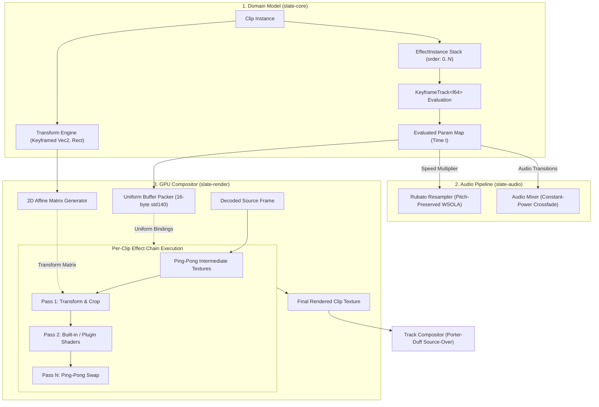
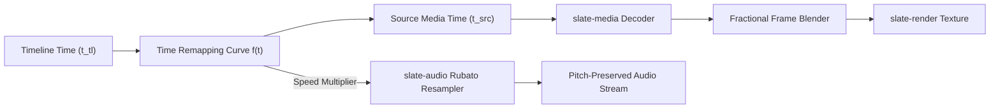

# 11 — Effects System & GPU Shader Architecture (`slate-render` & `slate-core`)

> **Specification & Technical Architecture Document**  
> **Crates:** `slate-render`, `slate-core`, `slate-audio`  
> **Target Path:** `docs/11-effects-system.md`  
> **Status:** READY FOR IMPLEMENTATION  
> **Release Target:** v1.0 (Zero feature deferral — all built-in effects, transforms, transitions, and plugin architecture ship in v1)  

---

## 1. Overview & Architectural Boundaries

The Slate Effects System is a hybrid, GPU-accelerated video manipulation framework operating across `slate-core`, `slate-render`, and `slate-audio`. It enables non-destructive, per-clip visual transformations, primary and secondary color grading, look-up table (LUT) processing, spatial blurs, chroma extraction, time-remapping, audio pitch correction, and third-party WebGPU Shading Language (WGSL) plugins.



### Core Tenets
1. **Zero Feature Deferral (v1 Target)**: Color Adjustment, 3D LUT Apply, Two-Pass Gaussian Blur, Chroma Key (Green/Blue Screen), Speed Change & Time Remapping, 2D Transforms, Transitions (Cross-Dissolve, Dip-to-Color), and WGSL Plugins are core v1 deliverables.
2. **Deterministic Evaluation**: Given timeline timestamp $t$ and identical keyframes, parameter evaluation yields exact floating-point uniforms. Shaders adhere to IEEE 754 precision guarantees within WGSL specification limits.
3. **Zero Runtime GPU Allocations**: Effect chains execute through a pooled ping-pong scratch texture pair (`tex_a` and `tex_b`) recycled from `TexturePool`. Adding, removing, or reordering effects incurs zero VRAM reallocations during active playback.
4. **Sandboxed Extensibility**: Custom effects run as pure WGSL fragment shaders bounded by strict uniform and texture binding contracts, validated at load-time via `naga` AST analysis.

---

## 2. Built-in Effects

Every built-in effect provides a mathematical specification, a Rust uniform layout adhering to WebGPU buffer alignment rules, and a complete, production-ready WGSL shader module.

### 2.1 Color Adjustment

The `ColorAdjust` effect performs primary color correction in linear and Rec.709 color spaces. It provides photographic exposure control, linear contrast pivoting around $18\%$ scene gray, saturation, correlated color temperature (CCT) Kelvin shifting, tint adjustments, and four-band tonal zone manipulation (Whites, Highlights, Shadows, Blacks).

#### Parameter Specifications

| Parameter | Unit / Range | Default | Math Formulation |
| :--- | :--- | :--- | :--- |
| **`exposure`** | EV stops $[-3.0, +3.0]$ | `0.0` | $C_{\text{exp}} = C \cdot 2^{\text{exposure}}$ |
| **`contrast`** | Ratio $[0.0, 2.0]$ ($0\% - 200\%$) | `1.0` | $C_{\text{cont}} = (C - 0.18) \cdot \text{contrast} + 0.18$ |
| **`saturation`** | Ratio $[0.0, 2.0]$ ($0\% - 200\%$) | `1.0` | $C_{\text{sat}} = \text{mix}(Y, C, \text{saturation})$ where $Y = \mathbf{C} \cdot \mathbf{w}_{\text{rec709}}$ |
| **`temperature`** | Shift $[-1.0, +1.0]$ | `0.0` | Approximates Kelvin shift ($2000\text{K} \leftrightarrow 12000\text{K}$) along yellow-blue axis |
| **`tint`** | Shift $[-1.0, +1.0]$ | `0.0` | Orthogonal green-magenta chromaticity balance |
| **`highlights`** | Offset $[-1.0, +1.0]$ | `0.0` | Parabolic gain centered on high luminance ($Y \in [0.5, 1.0]$) |
| **`shadows`** | Offset $[-1.0, +1.0]$ | `0.0` | Parabolic gain centered on low luminance ($Y \in [0.0, 0.5]$) |
| **`whites`** | Offset $[-1.0, +1.0]$ | `0.0` | Peak specular ceiling scaling ($Y \in [0.75, 1.0]$) |
| **`blacks`** | Offset $[-1.0, +1.0]$ | `0.0` | Floor pedestal offset ($Y \in [0.0, 0.25]$) |

#### Rust Uniform Layout (`bytemuck`)

```rust
#[repr(C)]
#[derive(Debug, Clone, Copy, bytemuck::Pod, bytemuck::Zeroable)]
pub struct ColorAdjustUniforms {
    pub exposure: f32,       // 0: EV stops [-3.0, 3.0]
    pub contrast: f32,       // 4: Ratio [0.0, 2.0]
    pub saturation: f32,     // 8: Ratio [0.0, 2.0]
    pub temperature: f32,    // 12: Cool/Warm [-1.0, 1.0]
    pub tint: f32,           // 16: Green/Magenta [-1.0, 1.0]
    pub highlights: f32,     // 20: Tonal shift [-1.0, 1.0]
    pub shadows: f32,        // 24: Tonal shift [-1.0, 1.0]
    pub whites: f32,         // 28: Peak shift [-1.0, 1.0]
    pub blacks: f32,         // 32: Pedestal shift [-1.0, 1.0]
    pub _padding: [f32; 3],  // 36..48: Align to 16-byte boundary (48 bytes total)
}
```

#### Complete WGSL Shader (`color_adjust.wgsl`)

```wgsl
struct VertexOutput {
    @builtin(position) position: vec4<f32>,
    @location(0) uv: vec2<f32>,
};

struct ColorAdjustUniforms {
    exposure: f32,
    contrast: f32,
    saturation: f32,
    temperature: f32,
    tint: f32,
    highlights: f32,
    shadows: f32,
    whites: f32,
    blacks: f32,
    _pad0: f32,
    _pad1: f32,
    _pad2: f32,
};

@group(0) @binding(0) var<uniform> uniforms: ColorAdjustUniforms;
@group(0) @binding(1) var t_input: texture_2d<f32>;
@group(0) @binding(2) var s_input: sampler;

// Full-screen triangle vertex shader (eliminates vertex buffer overhead)
@vertex
fn vs_main(@builtin(vertex_index) vertex_index: u32) -> VertexOutput {
    var out: VertexOutput;
    let x = f32(i32(vertex_index << 1u) & 2) * 2.0 - 1.0;
    let y = f32(i32(vertex_index & 2u)) * -2.0 + 1.0;
    out.position = vec4<f32>(x, y, 0.0, 1.0);
    out.uv = vec2<f32>((x + 1.0) * 0.5, (1.0 - y) * 0.5);
    return out;
}

const REC709_LUMA: vec3<f32> = vec3<f32>(0.2126, 0.7152, 0.0722);

// Converts sRGB gamma to linear RGB
fn srgb_to_linear(c: vec3<f32>) -> vec3<f32> {
    let cutoff = step(vec3<f32>(0.04045), c);
    let lower = c / 12.92;
    let higher = pow((c + vec3<f32>(0.055)) / 1.055, vec3<f32>(2.4));
    return mix(lower, higher, cutoff);
}

// Converts linear RGB to sRGB gamma
fn linear_to_srgb(c: vec3<f32>) -> vec3<f32> {
    let cutoff = step(vec3<f32>(0.0031308), c);
    let lower = c * 12.92;
    let higher = 1.055 * pow(c, vec3<f32>(1.0 / 2.4)) - 0.055;
    return mix(lower, higher, cutoff);
}

@fragment
fn fs_main(in: VertexOutput) -> @location(0) vec4<f32> {
    let src = textureSample(t_input, s_input, in.uv);
    if (src.a <= 0.0) {
        return vec4<f32>(0.0, 0.0, 0.0, 0.0);
    }

    // Demultiply alpha for accurate color adjustments
    var rgb = src.rgb / src.a;
    rgb = srgb_to_linear(rgb);

    // 1. Exposure: 2^(EV)
    rgb = rgb * exp2(uniforms.exposure);

    // 2. White Balance: Temperature & Tint
    // Temperature: warm adds red/removes blue; cool adds blue/removes red
    let temp_shift = vec3<f32>(
        uniforms.temperature * 0.15,
        uniforms.temperature * 0.02,
        -uniforms.temperature * 0.15
    );
    // Tint: green/magenta orthogonal axis
    let tint_shift = vec3<f32>(
        uniforms.tint * 0.08,
        -uniforms.tint * 0.12,
        uniforms.tint * 0.08
    );
    rgb = max(rgb + temp_shift + tint_shift, vec3<f32>(0.0));

    // 3. Contrast: pivoted around 0.18 linear scene gray
    rgb = max((rgb - vec3<f32>(0.18)) * uniforms.contrast + vec3<f32>(0.18), vec3<f32>(0.0));

    // 4. Four-band Tonal Controls (Whites, Highlights, Shadows, Blacks)
    let luma = dot(rgb, REC709_LUMA);

    // Blacks zone: [0.0, 0.25]
    let black_mask = 1.0 - smoothstep(0.0, 0.25, luma);
    rgb = rgb + vec3<f32>(uniforms.blacks * black_mask * 0.1);

    // Shadows zone: [0.0, 0.5]
    let shadow_mask = 1.0 - smoothstep(0.05, 0.5, luma);
    rgb = rgb + (rgb * uniforms.shadows * shadow_mask * 0.4);

    // Highlights zone: [0.5, 1.0]
    let highlight_mask = smoothstep(0.5, 0.95, luma);
    rgb = rgb + (rgb * uniforms.highlights * highlight_mask * 0.4);

    // Whites zone: [0.75, 1.0+]
    let white_mask = smoothstep(0.75, 1.2, luma);
    rgb = rgb + vec3<f32>(uniforms.whites * white_mask * 0.2);

    rgb = max(rgb, vec3<f32>(0.0));

    // 5. Saturation in linear Rec.709 space
    let final_luma = dot(rgb, REC709_LUMA);
    rgb = mix(vec3<f32>(final_luma), rgb, uniforms.saturation);
    rgb = max(rgb, vec3<f32>(0.0));

    // Return to sRGB and premultiply alpha
    rgb = linear_to_srgb(rgb);
    return vec4<f32>(rgb * src.a, src.a);
}
```

---

### 2.2 LUT Apply (3D Look-Up Table)

The `LutApply` effect evaluates 3D color look-up tables in `.cube` (Adobe / DaVinci) or `.3dl` (Autodesk) formats. Tables are loaded into 3D GPU textures (`wgpu::TextureViewDimension::D3`) with trilinear filtering.

#### `.cube` File Parser Specification (`lut.rs`)

```rust
use std::io::{BufRead, BufReader, Read};
use thiserror::Error;

#[derive(Error, Debug)]
pub enum LutParseError {
    #[error("Invalid .cube format: {0}")]
    InvalidFormat(String),
    #[error("Unsupported LUT dimension (only 3D LUTs supported)")]
    UnsupportedDimension,
    #[error("Invalid table size: {0}")]
    InvalidSize(usize),
    #[error("Unexpected EOF while parsing LUT values")]
    UnexpectedEof,
}

pub struct Lut3DData {
    pub title: String,
    pub size: usize,
    pub domain_min: [f32; 3],
    pub domain_max: [f32; 3],
    pub table: Vec<[f32; 4]>, // RGBA32F linear array formatted for 3D texture upload
}

impl Lut3DData {
    pub fn parse_cube<R: Read>(reader: R) -> Result<Self, LutParseError> {
        let buf = BufReader::new(reader);
        let mut title = String::from("Untitled LUT");
        let mut size: Option<usize> = None;
        let mut domain_min = [0.0f32; 3];
        let mut domain_max = [1.0f32; 3];
        let mut raw_samples: Vec<[f32; 3]> = Vec::new();

        for line_res in buf.lines() {
            let line = line_res.map_err(|e| LutParseError::InvalidFormat(e.to_string()))?;
            let trimmed = line.trim();
            if trimmed.is_empty() || trimmed.starts_with('#') {
                continue;
            }

            let mut tokens = trimmed.split_whitespace();
            let first = match tokens.next() {
                Some(t) => t,
                None => continue,
            };

            match first.to_uppercase().as_str() {
                "TITLE" => {
                    title = tokens.collect::<Vec<&str>>().join(" ").trim_matches('"').to_string();
                }
                "LUT_3D_SIZE" => {
                    let s = tokens.next()
                        .ok_or_else(|| LutParseError::InvalidFormat("Missing LUT_3D_SIZE value".into()))?
                        .parse::<usize>()
                        .map_err(|_| LutParseError::InvalidFormat("Malformed LUT_3D_SIZE".into()))?;
                    if s < 2 || s > 256 {
                        return Err(LutParseError::InvalidSize(s));
                    }
                    size = Some(s);
                }
                "LUT_1D_SIZE" => return Err(LutParseError::UnsupportedDimension),
                "DOMAIN_MIN" => {
                    domain_min[0] = tokens.next().unwrap_or("0").parse().unwrap_or(0.0);
                    domain_min[1] = tokens.next().unwrap_or("0").parse().unwrap_or(0.0);
                    domain_min[2] = tokens.next().unwrap_or("0").parse().unwrap_or(0.0);
                }
                "DOMAIN_MAX" => {
                    domain_max[0] = tokens.next().unwrap_or("1").parse().unwrap_or(1.0);
                    domain_max[1] = tokens.next().unwrap_or("1").parse().unwrap_or(1.0);
                    domain_max[2] = tokens.next().unwrap_or("1").parse().unwrap_or(1.0);
                }
                _ => {
                    // Try parsing 3 floating point numbers
                    if let (Ok(r), Some(g_tok), Some(b_tok)) = (first.parse::<f32>(), tokens.next(), tokens.next()) {
                        let g = g_tok.parse::<f32>().map_err(|_| LutParseError::InvalidFormat("Bad G value".into()))?;
                        let b = b_tok.parse::<f32>().map_err(|_| LutParseError::InvalidFormat("Bad B value".into()))?;
                        raw_samples.push([r, g, b]);
                    }
                }
            }
        }

        let lut_size = size.ok_or_else(|| LutParseError::InvalidFormat("LUT_3D_SIZE missing".into()))?;
        let expected_samples = lut_size * lut_size * lut_size;
        if raw_samples.len() != expected_samples {
            return Err(LutParseError::InvalidFormat(format!(
                "Sample count mismatch: expected {}, parsed {}",
                expected_samples,
                raw_samples.len()
            )));
        }

        // Convert to RGBA32F layout for GPU upload
        let mut table = Vec::with_capacity(expected_samples);
        for s in raw_samples {
            table.push([s[0], s[1], s[2], 1.0]);
        }

        Ok(Self { title, size: lut_size, domain_min, domain_max, table })
    }
}
```

#### Rust Uniform Layout

```rust
#[repr(C)]
#[derive(Debug, Clone, Copy, bytemuck::Pod, bytemuck::Zeroable)]
pub struct LutUniforms {
    pub lut_size: f32,       // 0: Dimension N (e.g., 33.0 or 65.0)
    pub intensity: f32,      // 4: Blend weight [0.0, 1.0]
    pub _padding: [f32; 2],  // 8..16: 16-byte alignment
}
```

#### Complete WGSL Shader (`lut_apply.wgsl`)

```wgsl
struct VertexOutput {
    @builtin(position) position: vec4<f32>,
    @location(0) uv: vec2<f32>,
};

struct LutUniforms {
    lut_size: f32,
    intensity: f32,
    _pad0: f32,
    _pad1: f32,
};

@group(0) @binding(0) var<uniform> uniforms: LutUniforms;
@group(0) @binding(1) var t_input: texture_2d<f32>;
@group(0) @binding(2) var s_input: sampler;
@group(0) @binding(3) var t_lut: texture_3d<f32>;
@group(0) @binding(4) var s_lut: sampler; // Trilinear hardware sampler

@vertex
fn vs_main(@builtin(vertex_index) vertex_index: u32) -> VertexOutput {
    var out: VertexOutput;
    let x = f32(i32(vertex_index << 1u) & 2) * 2.0 - 1.0;
    let y = f32(i32(vertex_index & 2u)) * -2.0 + 1.0;
    out.position = vec4<f32>(x, y, 0.0, 1.0);
    out.uv = vec2<f32>((x + 1.0) * 0.5, (1.0 - y) * 0.5);
    return out;
}

@fragment
fn fs_main(in: VertexOutput) -> @location(0) vec4<f32> {
    let src = textureSample(t_input, s_input, in.uv);
    if (src.a <= 0.0 || uniforms.intensity <= 0.0) {
        return src;
    }

    // Demultiply alpha
    let rgb = src.rgb / src.a;
    let clamped_rgb = clamp(rgb, vec3<f32>(0.0), vec3<f32>(1.0));

    // Exact half-texel offset correction for 3D LUT sampling:
    // coord = (color * (size - 1.0) + 0.5) / size
    let scale = (uniforms.lut_size - 1.0) / uniforms.lut_size;
    let offset = 0.5 / uniforms.lut_size;
    let lut_coord = clamped_rgb * scale + vec3<f32>(offset);

    // Trilinear sample from 3D LUT texture
    let graded = textureSample(t_lut, s_lut, lut_coord).rgb;

    // Linear blend with original source
    let final_rgb = mix(rgb, graded, uniforms.intensity);

    return vec4<f32>(final_rgb * src.a, src.a);
}
```

---

### 2.3 Gaussian Blur

The `GaussianBlur` effect implements a two-pass separable convolution (Horizontal Pass followed by Vertical Pass). This reduces algorithmic complexity from $O(W \cdot H \cdot R^2)$ to $O(W \cdot H \cdot 2R)$ per frame.

$$\text{Kernel}(x) = \frac{1}{\sqrt{2\pi}\sigma} \exp\left(-\frac{x^2}{2\sigma^2}\right), \quad \sigma = \max\left(\frac{R}{3.0}, 0.5\right)$$

#### Bilinear Tap Optimization
Rather than evaluating every integer sample, the engine leverages GPU hardware bilinear filtering to sample two adjacent texel taps simultaneously with a single texture fetch:

$$\Delta x = \frac{w_{i+1}}{w_i + w_{i+1}}, \quad W = w_i + w_{i+1}$$

This halves the total texture samples required, enabling real-time $100\text{px}$ blur at 60 FPS on 4K textures.

#### Rust Uniform Layout

```rust
#[repr(C)]
#[derive(Debug, Clone, Copy, bytemuck::Pod, bytemuck::Zeroable)]
pub struct BlurUniforms {
    /// Direction vector in normalized UV space:
    /// Horizontal: [1.0 / canvas_width, 0.0]
    /// Vertical:   [0.0, 1.0 / canvas_height]
    pub direction: [f32; 2],
    pub radius: i32,         // Number of discrete taps (1..32)
    pub _pad0: f32,
    /// Packed weights (4 weights per vec4 for 16-byte GPU std140 alignment)
    pub weights: [[f32; 4]; 8], // Supports up to 32 tap weights
}
```

#### Complete WGSL Shader (`blur_separable.wgsl`)

```wgsl
struct VertexOutput {
    @builtin(position) position: vec4<f32>,
    @location(0) uv: vec2<f32>,
};

struct BlurUniforms {
    direction: vec2<f32>,
    radius: i32,
    _pad0: f32,
    weights_0: vec4<f32>,
    weights_1: vec4<f32>,
    weights_2: vec4<f32>,
    weights_3: vec4<f32>,
    weights_4: vec4<f32>,
    weights_5: vec4<f32>,
    weights_6: vec4<f32>,
    weights_7: vec4<f32>,
};

@group(0) @binding(0) var<uniform> uniforms: BlurUniforms;
@group(0) @binding(1) var t_input: texture_2d<f32>;
@group(0) @binding(2) var s_input: sampler;

@vertex
fn vs_main(@builtin(vertex_index) vertex_index: u32) -> VertexOutput {
    var out: VertexOutput;
    let x = f32(i32(vertex_index << 1u) & 2) * 2.0 - 1.0;
    let y = f32(i32(vertex_index & 2u)) * -2.0 + 1.0;
    out.position = vec4<f32>(x, y, 0.0, 1.0);
    out.uv = vec2<f32>((x + 1.0) * 0.5, (1.0 - y) * 0.5);
    return out;
}

fn fetch_weight(idx: i32) -> f32 {
    let clamped_idx = clamp(idx, 0, 31);
    let vec_idx = clamped_idx / 4;
    let comp_idx = clamped_idx % 4;

    var w_vec: vec4<f32>;
    switch vec_idx {
        case 0: { w_vec = uniforms.weights_0; }
        case 1: { w_vec = uniforms.weights_1; }
        case 2: { w_vec = uniforms.weights_2; }
        case 3: { w_vec = uniforms.weights_3; }
        case 4: { w_vec = uniforms.weights_4; }
        case 5: { w_vec = uniforms.weights_5; }
        case 6: { w_vec = uniforms.weights_6; }
        default: { w_vec = uniforms.weights_7; }
    }
    return w_vec[comp_idx];
}

@fragment
fn fs_main(in: VertexOutput) -> @location(0) vec4<f32> {
    let center_weight = fetch_weight(0);
    var accum = textureSample(t_input, s_input, in.uv) * center_weight;
    let tap_count = min(uniforms.radius, 31);

    for (var i = 1; i <= tap_count; i = i + 1) {
        let weight = fetch_weight(i);
        let offset = uniforms.direction * f32(i);
        let sample_pos = textureSample(t_input, s_input, in.uv + offset);
        let sample_neg = textureSample(t_input, s_input, in.uv - offset);
        accum = accum + (sample_pos + sample_neg) * weight;
    }

    return accum;
}
```

---

### 2.4 Chroma Key (Green / Blue Screen)

The `ChromaKey` effect isolates color backdrops using euclidean distance in the Rec.709 $YC_bC_r$ chromaticity plane, feathers edge falloffs, suppresses green/blue spill onto foreground subjects, and clamps color fringes.

#### Parameter Specifications

| Parameter | Unit / Range | Default | Function |
| :--- | :--- | :--- | :--- |
| **`key_color`** | Normalized RGB $[0.0, 1.0]^3$ | `[0.0, 1.0, 0.0]` | The target backdrop color extracted |
| **`similarity`** | Ratio $[0.0, 1.0]$ | `0.40` | Chromaticity threshold distance |
| **`smoothness`** | Ratio $[0.0, 1.0]$ | `0.10` | Edge feathering width using `smoothstep` |
| **`spill`** | Ratio $[0.0, 1.0]$ | `0.50` | Despill intensity suppressing reflected key color |
| **`despill_color`**| Normalized RGB $[0.0, 1.0]^3$ | `[0.0, 0.0, 0.0]` | Neutral replacement tint for despilled fringes |
| **`edge_erosion`** | Offset $[-0.1, 0.1]$ | `0.0` | Inward/outward matte boundary contraction |

#### Rust Uniform Layout

```rust
#[repr(C)]
#[derive(Debug, Clone, Copy, bytemuck::Pod, bytemuck::Zeroable)]
pub struct ChromaKeyUniforms {
    pub key_color: [f32; 4],        // 0..16: Key color RGBA
    pub despill_color: [f32; 4],    // 16..32: Target despill replacement tint
    pub similarity: f32,           // 32: Similarity threshold [0.0, 1.0]
    pub smoothness: f32,           // 36: Smoothness falloff [0.0, 1.0]
    pub spill_suppression: f32,    // 40: Spill factor [0.0, 1.0]
    pub edge_erosion: f32,         // 44: Erosion factor [-0.1, 0.1]
}
```

#### Complete WGSL Shader (`chroma_key.wgsl`)

```wgsl
struct VertexOutput {
    @builtin(position) position: vec4<f32>,
    @location(0) uv: vec2<f32>,
};

struct ChromaKeyUniforms {
    key_color: vec4<f32>,
    despill_color: vec4<f32>,
    similarity: f32,
    smoothness: f32,
    spill_suppression: f32,
    edge_erosion: f32,
};

@group(0) @binding(0) var<uniform> uniforms: ChromaKeyUniforms;
@group(0) @binding(1) var t_input: texture_2d<f32>;
@group(0) @binding(2) var s_input: sampler;

@vertex
fn vs_main(@builtin(vertex_index) vertex_index: u32) -> VertexOutput {
    var out: VertexOutput;
    let x = f32(i32(vertex_index << 1u) & 2) * 2.0 - 1.0;
    let y = f32(i32(vertex_index & 2u)) * -2.0 + 1.0;
    out.position = vec4<f32>(x, y, 0.0, 1.0);
    out.uv = vec2<f32>((x + 1.0) * 0.5, (1.0 - y) * 0.5);
    return out;
}

// Converts RGB to Rec.709 YCbCr
fn rgb_to_ycbcr(rgb: vec3<f32>) -> vec3<f32> {
    let y  =  0.2126 * rgb.r + 0.7152 * rgb.g + 0.0722 * rgb.b;
    let cb = -0.1146 * rgb.r - 0.3854 * rgb.g + 0.5000 * rgb.b;
    let cr =  0.5000 * rgb.r - 0.4542 * rgb.g - 0.0458 * rgb.b;
    return vec3<f32>(y, cb, cr);
}

@fragment
fn fs_main(in: VertexOutput) -> @location(0) vec4<f32> {
    let col = textureSample(t_input, s_input, in.uv);
    if (col.a <= 0.0) {
        return vec4<f32>(0.0);
    }

    var rgb = col.rgb / col.a;
    let sample_yuv = rgb_to_ycbcr(rgb);
    let key_yuv = rgb_to_ycbcr(uniforms.key_color.rgb);

    // Euclidean chromaticity distance (ignoring luma to handle shadow gradients)
    let chroma_dist = distance(sample_yuv.yz, key_yuv.yz);

    // Matte generation with edge smoothness and erosion
    let sim = uniforms.similarity;
    let sm = max(uniforms.smoothness, 1e-4);
    var alpha = smoothstep(sim, sim + sm, chroma_dist);
    alpha = clamp(alpha - uniforms.edge_erosion, 0.0, 1.0);

    // Spill suppression: Green or Blue dominant
    if (uniforms.spill_suppression > 0.0) {
        if (uniforms.key_color.g > uniforms.key_color.b && uniforms.key_color.g > uniforms.key_color.r) {
            // Green Screen Despill: Clamp G to weighted max of R and B
            let max_rb = mix(max(rgb.r, rgb.b), (rgb.r + rgb.b) * 0.5, 0.5);
            if (rgb.g > max_rb) {
                let despilled_g = mix(rgb.g, max_rb, uniforms.spill_suppression);
                let diff = rgb.g - despilled_g;
                rgb.g = despilled_g;
                rgb = rgb + uniforms.despill_color.rgb * diff;
            }
        } else if (uniforms.key_color.b > uniforms.key_color.g && uniforms.key_color.b > uniforms.key_color.r) {
            // Blue Screen Despill: Clamp B to weighted max of R and G
            let max_rg = mix(max(rgb.r, rgb.g), (rgb.r + rgb.g) * 0.5, 0.5);
            if (rgb.b > max_rg) {
                let despilled_b = mix(rgb.b, max_rg, uniforms.spill_suppression);
                let diff = rgb.b - despilled_b;
                rgb.b = despilled_b;
                rgb = rgb + uniforms.despill_color.rgb * diff;
            }
        }
    }

    let final_alpha = col.a * alpha;
    return vec4<f32>(rgb * final_alpha, final_alpha);
}
```

---

### 2.5 Speed Change & Time Remapping

The `SpeedChange` effect handles temporal expansion, compression, directional reversal, and arbitrary time remapping via keyframes.



#### Capabilities
- **Speed Multiplier**: Static speed scaling from $0.1\times$ (slow motion) to $10.0\times$ (hyper-lapse).
- **Direction Reversal**: Negative speed multiplier or reverse flag playing media backwards.
- **Dynamic Time Remapping**: Keyframed mapping $t_{\text{src}} = \Phi(t_{\text{timeline}})$, allowing ramping speed up or down smoothly.
- **Frame Blending**: When playing at non-integer ratios or high slow-motion factors, adjacent frames $F_a$ and $F_b$ are linearly interpolated on the GPU:
  $$F(t) = (1 - \alpha) F_{\lfloor t \rfloor} + \alpha F_{\lceil t \rceil}, \quad \alpha = t - \lfloor t \rfloor$$
- **Audio Pitch Correction**: Audio sample stretching is delegated to `slate-audio` via [`rubato`](https://github.com/HEnquist/rubato) and Waveform Similarity Overlap-Add (WSOLA), keeping vocal pitch constant across all speed shifts.

#### Frame Blending WGSL Shader (`frame_blend.wgsl`)

```wgsl
struct VertexOutput {
    @builtin(position) position: vec4<f32>,
    @location(0) uv: vec2<f32>,
};

struct BlendUniforms {
    alpha: f32, // Fractional blend factor [0.0, 1.0]
    _pad0: f32,
    _pad1: f32,
    _pad2: f32,
};

@group(0) @binding(0) var<uniform> uniforms: BlendUniforms;
@group(0) @binding(1) var t_frame_a: texture_2d<f32>;
@group(0) @binding(2) var t_frame_b: texture_2d<f32>;
@group(0) @binding(3) var s_sampler: sampler;

@vertex
fn vs_main(@builtin(vertex_index) vertex_index: u32) -> VertexOutput {
    var out: VertexOutput;
    let x = f32(i32(vertex_index << 1u) & 2) * 2.0 - 1.0;
    let y = f32(i32(vertex_index & 2u)) * -2.0 + 1.0;
    out.position = vec4<f32>(x, y, 0.0, 1.0);
    out.uv = vec2<f32>((x + 1.0) * 0.5, (1.0 - y) * 0.5);
    return out;
}

@fragment
fn fs_main(in: VertexOutput) -> @location(0) vec4<f32> {
    let col_a = textureSample(t_frame_a, s_sampler, in.uv);
    let col_b = textureSample(t_frame_b, s_sampler, in.uv);
    return mix(col_a, col_b, uniforms.alpha);
}
```

---

## 3. Effect Data Model (`slate-core`)

The effect data model resides in `slate-core` and is completely decoupled from WebGPU drivers. All parameters are stored as keyframable tracks.

```rust
use std::collections::HashMap;
use std::path::PathBuf;
use schemars::JsonSchema;
use serde::{Deserialize, Serialize};
use uuid::Uuid;
use crate::id::EffectId;
use crate::model::keyframe::KeyframeTrack;

#[derive(Debug, Clone, PartialEq, Eq, Hash, Serialize, Deserialize, JsonSchema)]
#[serde(rename_all = "snake_case")]
pub enum EffectType {
    ColorAdjust,
    LutApply,
    GaussianBlur,
    ChromaKey,
    SpeedChange,
    Plugin {
        shader_path: PathBuf,
        name: String,
    },
}

#[derive(Debug, Clone, PartialEq, Serialize, Deserialize, JsonSchema)]
#[serde(rename_all = "camelCase")]
pub struct EffectInstance {
    pub id: EffectId,
    pub effect_type: EffectType,
    pub enabled: bool,
    /// All effect parameters are keyframable floating-point tracks
    pub params: HashMap<String, KeyframeTrack<f64>>,
    /// Rendering order index within the clip's effect stack (0 = first executed)
    pub order: usize,
}

impl EffectInstance {
    pub fn new(effect_type: EffectType, order: usize) -> Self {
        let mut inst = Self {
            id: EffectId::new(),
            effect_type: effect_type.clone(),
            enabled: true,
            params: HashMap::new(),
            order,
        };
        inst.init_default_params();
        inst
    }

    fn init_default_params(&mut self) {
        let defs = get_effect_param_definitions(&self.effect_type);
        for def in defs {
            let default_val = match &def.default {
                serde_json::Value::Number(n) => n.as_f64().unwrap_or(0.0),
                serde_json::Value::Bool(b) => if *b { 1.0 } else { 0.0 },
                _ => 0.0,
            };
            self.params.insert(def.name, KeyframeTrack::constant(default_val));
        }
    }
}
```

### Parameter Schema Definitions

```rust
#[derive(Debug, Clone, Copy, PartialEq, Eq, Serialize, Deserialize, JsonSchema)]
#[serde(rename_all = "snake_case")]
pub enum ParamType {
    Float,
    Int,
    Color,
    Bool,
    Enum,
}

#[derive(Debug, Clone, Serialize, Deserialize, JsonSchema)]
#[serde(rename_all = "camelCase")]
pub struct EffectParamDef {
    pub name: String,
    pub display_name: String,
    pub param_type: ParamType,
    pub default: serde_json::Value,
    pub min: Option<f64>,
    pub max: Option<f64>,
    pub step: Option<f64>,
    pub options: Option<Vec<String>>, // Applicable for ParamType::Enum
}

/// Registry of parameter definitions for all built-in effects
pub fn get_effect_param_definitions(effect: &EffectType) -> Vec<EffectParamDef> {
    match effect {
        EffectType::ColorAdjust => vec![
            EffectParamDef {
                name: "exposure".into(),
                display_name: "Exposure (EV)".into(),
                param_type: ParamType::Float,
                default: serde_json::json!(0.0),
                min: Some(-3.0),
                max: Some(3.0),
                step: Some(0.05),
                options: None,
            },
            EffectParamDef {
                name: "contrast".into(),
                display_name: "Contrast".into(),
                param_type: ParamType::Float,
                default: serde_json::json!(1.0),
                min: Some(0.0),
                max: Some(2.0),
                step: Some(0.02),
                options: None,
            },
            EffectParamDef {
                name: "saturation".into(),
                display_name: "Saturation".into(),
                param_type: ParamType::Float,
                default: serde_json::json!(1.0),
                min: Some(0.0),
                max: Some(2.0),
                step: Some(0.02),
                options: None,
            },
            EffectParamDef {
                name: "temperature".into(),
                display_name: "Temperature".into(),
                param_type: ParamType::Float,
                default: serde_json::json!(0.0),
                min: Some(-1.0),
                max: Some(1.0),
                step: Some(0.02),
                options: None,
            },
            EffectParamDef {
                name: "tint".into(),
                display_name: "Tint".into(),
                param_type: ParamType::Float,
                default: serde_json::json!(0.0),
                min: Some(-1.0),
                max: Some(1.0),
                step: Some(0.02),
                options: None,
            },
            EffectParamDef {
                name: "highlights".into(),
                display_name: "Highlights".into(),
                param_type: ParamType::Float,
                default: serde_json::json!(0.0),
                min: Some(-1.0),
                max: Some(1.0),
                step: Some(0.02),
                options: None,
            },
            EffectParamDef {
                name: "shadows".into(),
                display_name: "Shadows".into(),
                param_type: ParamType::Float,
                default: serde_json::json!(0.0),
                min: Some(-1.0),
                max: Some(1.0),
                step: Some(0.02),
                options: None,
            },
            EffectParamDef {
                name: "whites".into(),
                display_name: "Whites".into(),
                param_type: ParamType::Float,
                default: serde_json::json!(0.0),
                min: Some(-1.0),
                max: Some(1.0),
                step: Some(0.02),
                options: None,
            },
            EffectParamDef {
                name: "blacks".into(),
                display_name: "Blacks".into(),
                param_type: ParamType::Float,
                default: serde_json::json!(0.0),
                min: Some(-1.0),
                max: Some(1.0),
                step: Some(0.02),
                options: None,
            },
        ],
        EffectType::LutApply => vec![
            EffectParamDef {
                name: "intensity".into(),
                display_name: "Intensity".into(),
                param_type: ParamType::Float,
                default: serde_json::json!(1.0),
                min: Some(0.0),
                max: Some(1.0),
                step: Some(0.01),
                options: None,
            },
        ],
        EffectType::GaussianBlur => vec![
            EffectParamDef {
                name: "radius".into(),
                display_name: "Radius (px)".into(),
                param_type: ParamType::Float,
                default: serde_json::json!(10.0),
                min: Some(0.0),
                max: Some(100.0),
                step: Some(0.5),
                options: None,
            },
        ],
        EffectType::ChromaKey => vec![
            EffectParamDef {
                name: "key_r".into(),
                display_name: "Key Color Red".into(),
                param_type: ParamType::Float,
                default: serde_json::json!(0.0),
                min: Some(0.0),
                max: Some(1.0),
                step: Some(0.01),
                options: None,
            },
            EffectParamDef {
                name: "key_g".into(),
                display_name: "Key Color Green".into(),
                param_type: ParamType::Float,
                default: serde_json::json!(1.0),
                min: Some(0.0),
                max: Some(1.0),
                step: Some(0.01),
                options: None,
            },
            EffectParamDef {
                name: "key_b".into(),
                display_name: "Key Color Blue".into(),
                param_type: ParamType::Float,
                default: serde_json::json!(0.0),
                min: Some(0.0),
                max: Some(1.0),
                step: Some(0.01),
                options: None,
            },
            EffectParamDef {
                name: "similarity".into(),
                display_name: "Similarity".into(),
                param_type: ParamType::Float,
                default: serde_json::json!(0.4),
                min: Some(0.0),
                max: Some(1.0),
                step: Some(0.01),
                options: None,
            },
            EffectParamDef {
                name: "smoothness".into(),
                display_name: "Smoothness".into(),
                param_type: ParamType::Float,
                default: serde_json::json!(0.1),
                min: Some(0.0),
                max: Some(1.0),
                step: Some(0.01),
                options: None,
            },
            EffectParamDef {
                name: "spill_suppression".into(),
                display_name: "Spill Suppression".into(),
                param_type: ParamType::Float,
                default: serde_json::json!(0.5),
                min: Some(0.0),
                max: Some(1.0),
                step: Some(0.01),
                options: None,
            },
            EffectParamDef {
                name: "edge_erosion".into(),
                display_name: "Edge Erosion".into(),
                param_type: ParamType::Float,
                default: serde_json::json!(0.0),
                min: Some(-0.1),
                max: Some(0.1),
                step: Some(0.005),
                options: None,
            },
        ],
        EffectType::SpeedChange => vec![
            EffectParamDef {
                name: "speed".into(),
                display_name: "Speed Multiplier".into(),
                param_type: ParamType::Float,
                default: serde_json::json!(1.0),
                min: Some(0.1),
                max: Some(10.0),
                step: Some(0.1),
                options: None,
            },
            EffectParamDef {
                name: "reverse".into(),
                display_name: "Reverse Playback".into(),
                param_type: ParamType::Bool,
                default: serde_json::json!(false),
                min: None,
                max: None,
                step: None,
                options: None,
            },
            EffectParamDef {
                name: "frame_blend".into(),
                display_name: "Frame Blending".into(),
                param_type: ParamType::Bool,
                default: serde_json::json!(true),
                min: None,
                max: None,
                step: None,
                options: None,
            },
        ],
        EffectType::Plugin { .. } => Vec::new(),
    }
}
```

---

## 4. Effect Pipeline in Compositor (`slate-render`)

Effects are evaluated and rendered during clip pre-compositing in `slate-render`.

### 4.1 Step-by-Step Render Pass Flow

```
Input: Decoded Base Texture (from slate-media or zero-copy upload)
  │
  ▼
[Ping-Pong Init]: Assign Base Texture -> Intermediate Texture A
  │
  ├── For each Effect in sorted order (0..N):
  │     │
  │     ├── 1. Evaluate keyframed tracks at current timestamp t
  │     ├── 2. Pack uniforms into wgpu::Buffer with 16-byte alignment
  │     ├── 3. Bind Intermediate Texture A as input (Group 0, Binding 1)
  │     ├── 4. Set Intermediate Texture B as RenderPass Color Attachment
  │     ├── 5. Execute Effect Render Pipeline (Draw full-screen triangle)
  │     └── 6. Swap pointers: Texture A <-> Texture B
  │
  ▼
Output: Final Texture A -> Passed to Track Porter-Duff Compositor
```

### 4.2 Intermediate Ping-Pong Buffer Architecture

To eliminate runtime memory allocations, the compositor maintains a ping-pong buffer pool within each rendering thread or job context.

```rust
use std::sync::Arc;
use wgpu::{Device, Extent3d, Texture, TextureDescriptor, TextureDimension, TextureFormat, TextureUsages, TextureView};
use crate::texture_pool::TexturePool;

pub struct PingPongPipeline {
    tex_a: Arc<Texture>,
    view_a: TextureView,
    tex_b: Arc<Texture>,
    view_b: TextureView,
    active_is_a: bool,
    width: u32,
    height: u32,
}

impl PingPongPipeline {
    pub fn new(pool: &TexturePool, width: u32, height: u32, format: TextureFormat) -> Self {
        let desc = TextureDescriptor {
            label: Some("PingPong Scratch Texture"),
            size: Extent3d { width, height, depth_or_array_layers: 1 },
            mip_level_count: 1,
            sample_count: 1,
            dimension: TextureDimension::D2,
            format,
            usage: TextureUsages::TEXTURE_BINDING | TextureUsages::RENDER_ATTACHMENT | TextureUsages::COPY_DST | TextureUsages::COPY_SRC,
            view_formats: &[],
        };

        let tex_a = pool.acquire(&desc);
        let view_a = tex_a.create_view(&Default::default());
        let tex_b = pool.acquire(&desc);
        let view_b = tex_b.create_view(&Default::default());

        Self {
            tex_a,
            view_a,
            tex_b,
            view_b,
            active_is_a: true,
            width,
            height,
        }
    }

    /// The current readable source texture view
    pub fn source_view(&self) -> &TextureView {
        if self.active_is_a { &self.view_a } else { &self.view_b }
    }

    /// The target write attachment view
    pub fn target_view(&self) -> &TextureView {
        if self.active_is_a { &self.view_b } else { &self.view_a }
    }

    /// Advances the ping-pong state after a pass finishes rendering
    pub fn swap(&mut self) {
        self.active_is_a = !self.active_is_a;
    }

    /// Final rendered output texture view
    pub fn final_view(&self) -> &TextureView {
        self.source_view()
    }
}
```

---

## 5. Plugin API (WGSL Shader Effects)

Slate enables creators and studios to author bespoke GPU visual effects in WGSL.

### 5.1 Plugin Package Layout

A Slate effect plugin is a directory containing a manifest and shader:

```
~/.config/slate/plugins/vignette/
├── effect.json     # Metadata + parameter schema definitions
└── shader.wgsl     # Pure WGSL vertex + fragment shader
```

### 5.2 Manifest Schema (`effect.json`)

```json
{
  "$schema": "https://slate.video/schemas/effect-v1.json",
  "id": "com.slate.effects.vignette",
  "name": "Cinematic Vignette",
  "version": "1.0.0",
  "author": "Slate Community",
  "description": "Applies a smooth elliptical edge darkening vignette",
  "category": "Stylize",
  "parameters": [
    {
      "name": "radius",
      "display_name": "Radius",
      "type": "float",
      "default": 0.8,
      "min": 0.1,
      "max": 2.0,
      "step": 0.05
    },
    {
      "name": "softness",
      "display_name": "Softness",
      "type": "float",
      "default": 0.5,
      "min": 0.01,
      "max": 1.0,
      "step": 0.01
    },
    {
      "name": "intensity",
      "display_name": "Intensity",
      "type": "float",
      "default": 0.7,
      "min": 0.0,
      "max": 1.0,
      "step": 0.01
    }
  ]
}
```

### 5.3 WGSL Shader Contract

Plugin shaders must adhere to a strict binding interface:

| Group | Binding | Type | Description |
| :--- | :--- | :--- | :--- |
| **0** | **0** | `var<uniform> uniforms: PluginUniforms` | Generated parameter struct + header |
| **0** | **1** | `var t_input: texture_2d<f32>` | Source frame RGBA texture |
| **0** | **2** | `var s_input: sampler` | Bilinear clamping sampler |

#### Built-in Uniform Header
Every plugin uniform buffer begins with a standardized 32-byte system header:

```wgsl
struct PluginHeader {
    resolution: vec2<f32>, // Canvas dimensions in pixels [width, height]
    time: f32,             // Current clip-relative playback time in seconds
    progress: f32,         // Normalized clip progress [0.0, 1.0]
    _header_pad: vec4<f32>,// Alignment padding
};
```

#### Example Plugin WGSL Implementation (`shader.wgsl`)

```wgsl
struct VertexOutput {
    @builtin(position) position: vec4<f32>,
    @location(0) uv: vec2<f32>,
};

struct PluginUniforms {
    // Header (32 bytes)
    resolution: vec2<f32>,
    time: f32,
    progress: f32,
    _pad_h0: f32,
    _pad_h1: f32,
    _pad_h2: f32,
    _pad_h3: f32,

    // Custom Parameters defined in effect.json
    radius: f32,
    softness: f32,
    intensity: f32,
    _pad_p0: f32,
};

@group(0) @binding(0) var<uniform> uniforms: PluginUniforms;
@group(0) @binding(1) var t_input: texture_2d<f32>;
@group(0) @binding(2) var s_input: sampler;

@vertex
fn vs_main(@builtin(vertex_index) vertex_index: u32) -> VertexOutput {
    var out: VertexOutput;
    let x = f32(i32(vertex_index << 1u) & 2) * 2.0 - 1.0;
    let y = f32(i32(vertex_index & 2u)) * -2.0 + 1.0;
    out.position = vec4<f32>(x, y, 0.0, 1.0);
    out.uv = vec2<f32>((x + 1.0) * 0.5, (1.0 - y) * 0.5);
    return out;
}

@fragment
fn fs_main(in: VertexOutput) -> @location(0) vec4<f32> {
    let col = textureSample(t_input, s_input, in.uv);
    
    // Compute distance from center (0.5, 0.5) adjusted for aspect ratio
    let aspect = uniforms.resolution.x / uniforms.resolution.y;
    let centered_uv = (in.uv - vec2<f32>(0.5)) * vec2<f32>(aspect, 1.0);
    let dist = length(centered_uv);

    // Vignette falloff
    let edge0 = uniforms.radius - uniforms.softness;
    let edge1 = uniforms.radius;
    let vignette = 1.0 - smoothstep(edge0, edge1, dist) * uniforms.intensity;

    return vec4<f32>(col.rgb * vignette, col.a);
}
```

### 5.4 Plugin Sandboxing & Naga Validation

To protect against GPU hangs, memory corruption, and host vulnerabilities, custom plugins undergo verification using [`naga`](https://github.com/gfx-rs/wgpu/tree/trunk/naga) before compilation:

1. **No Storage Writes**: Shaders declaring `var<storage, read_write>` are rejected.
2. **Strict Binding Verification**: Must only declare Group 0 with bindings 0, 1, and 2.
3. **Loop Bounds & Termination**: Unbounded `loop` constructs are rejected; loops must use bounded index iteration.
4. **Hot-Reloading Watcher**: Uses the `notify` crate to detect on-disk edits. When a `.wgsl` file changes, it is parsed asynchronously. If valid, the live pipeline is atomically swapped. If invalid, the previous pipeline remains active, and a diagnostic error is pushed to the UI and MCP event stream.

---

## 6. Transition Effects

Transitions are two-input temporal blend operations bridging an outgoing clip ($A$) and an incoming clip ($B$) across an overlapping edit boundary.

```
Clip A: [==================== Cut ====================]
Clip B:                 [==================== Cut ====================]
Transition Window:      [<-------- Duration --------->]
Progress:              0.0 ─────────────────────────▶ 1.0
```

### 6.1 Cross-Dissolve

Cross-Dissolve blends two video streams linearly or via custom perceptual easing curves.

#### Rust Uniform Layout

```rust
#[repr(C)]
#[derive(Debug, Clone, Copy, bytemuck::Pod, bytemuck::Zeroable)]
pub struct CrossDissolveUniforms {
    pub progress: f32,       // 0: Transition progress [0.0, 1.0]
    pub curve_type: u32,     // 4: 0 = Linear, 1 = SmoothStep, 2 = Perceptual S-Curve
    pub _padding: [f32; 2],  // 8..16: 16-byte alignment
}
```

#### Complete WGSL Shader (`cross_dissolve.wgsl`)

```wgsl
struct VertexOutput {
    @builtin(position) position: vec4<f32>,
    @location(0) uv: vec2<f32>,
};

struct CrossDissolveUniforms {
    progress: f32,
    curve_type: u32,
    _pad0: f32,
    _pad1: f32,
};

@group(0) @binding(0) var<uniform> uniforms: CrossDissolveUniforms;
@group(0) @binding(1) var t_clip_a: texture_2d<f32>;
@group(0) @binding(2) var t_clip_b: texture_2d<f32>;
@group(0) @binding(3) var s_sampler: sampler;

@vertex
fn vs_main(@builtin(vertex_index) vertex_index: u32) -> VertexOutput {
    var out: VertexOutput;
    let x = f32(i32(vertex_index << 1u) & 2) * 2.0 - 1.0;
    let y = f32(i32(vertex_index & 2u)) * -2.0 + 1.0;
    out.position = vec4<f32>(x, y, 0.0, 1.0);
    out.uv = vec2<f32>((x + 1.0) * 0.5, (1.0 - y) * 0.5);
    return out;
}

@fragment
fn fs_main(in: VertexOutput) -> @location(0) vec4<f32> {
    let col_a = textureSample(t_clip_a, s_sampler, in.uv);
    let col_b = textureSample(t_clip_b, s_sampler, in.uv);

    var p = clamp(uniforms.progress, 0.0, 1.0);
    if (uniforms.curve_type == 1u) {
        // Smoothstep easing
        p = smoothstep(0.0, 1.0, p);
    } else if (uniforms.curve_type == 2u) {
        // Perceptual cubic S-curve
        if (p < 0.5) {
            p = 4.0 * p * p * p;
        } else {
            let f = (2.0 * p) - 2.0;
            p = 0.5 * f * f * f + 1.0;
        }
    }

    return mix(col_a, col_b, p);
}
```

---

### 6.2 Dip to Color

`DipToColor` fades outgoing clip $A$ into a solid color (e.g. black or white) during the first half of the transition ($p \in [0.0, 0.5]$), then fades from that color into incoming clip $B$ during the second half ($p \in [0.5, 1.0]$).

#### Rust Uniform Layout

```rust
#[repr(C)]
#[derive(Debug, Clone, Copy, bytemuck::Pod, bytemuck::Zeroable)]
pub struct DipToColorUniforms {
    pub dip_color: [f32; 4], // 0..16: Target color (e.g. [0,0,0,1] for black, [1,1,1,1] for white)
    pub progress: f32,       // 16: Normalized progress [0.0, 1.0]
    pub _padding: [f32; 3],  // 20..32: 16-byte alignment
}
```

#### Complete WGSL Shader (`dip_to_color.wgsl`)

```wgsl
struct VertexOutput {
    @builtin(position) position: vec4<f32>,
    @location(0) uv: vec2<f32>,
};

struct DipToColorUniforms {
    dip_color: vec4<f32>,
    progress: f32,
    _pad0: f32,
    _pad1: f32,
    _pad2: f32,
};

@group(0) @binding(0) var<uniform> uniforms: DipToColorUniforms;
@group(0) @binding(1) var t_clip_a: texture_2d<f32>;
@group(0) @binding(2) var t_clip_b: texture_2d<f32>;
@group(0) @binding(3) var s_sampler: sampler;

@vertex
fn vs_main(@builtin(vertex_index) vertex_index: u32) -> VertexOutput {
    var out: VertexOutput;
    let x = f32(i32(vertex_index << 1u) & 2) * 2.0 - 1.0;
    let y = f32(i32(vertex_index & 2u)) * -2.0 + 1.0;
    out.position = vec4<f32>(x, y, 0.0, 1.0);
    out.uv = vec2<f32>((x + 1.0) * 0.5, (1.0 - y) * 0.5);
    return out;
}

@fragment
fn fs_main(in: VertexOutput) -> @location(0) vec4<f32> {
    let p = clamp(uniforms.progress, 0.0, 1.0);

    if (p < 0.5) {
        // First half: Fade clip A into dip color
        let t = p * 2.0;
        let col_a = textureSample(t_clip_a, s_sampler, in.uv);
        return mix(col_a, uniforms.dip_color, t);
    } else {
        // Second half: Fade dip color into clip B
        let t = (p - 0.5) * 2.0;
        let col_b = textureSample(t_clip_b, s_sampler, in.uv);
        return mix(uniforms.dip_color, col_b, t);
    }
}
```

---

### 6.3 Audio Crossfade (`slate-audio`)

Audio crossfading occurs strictly in the software mixer in `slate-audio`. Three crossfade curves are supported:

1. **Linear (Constant Gain)**:
   $$g_A(p) = 1.0 - p, \quad g_B(p) = p$$
   *(Results in a $-3\text{ dB}$ power dip at the center for uncorrelated audio)*
2. **Equal Power (Constant Power)**:
   $$g_A(p) = \cos\left(p \cdot \frac{\pi}{2}\right) \approx \sqrt{1.0 - p}, \quad g_B(p) = \sin\left(p \cdot \frac{\pi}{2}\right) \approx \sqrt{p}$$
   *(Ensures consistent perceived acoustic loudness across the transition)*
3. **S-Curve (Cubic Ease)**:
   $$g_B(p) = 3p^2 - 2p^3, \quad g_A(p) = 1.0 - g_B(p)$$

```rust
pub enum AudioCrossfadeType {
    Linear,
    EqualPower,
    SCurve,
}

pub fn mix_audio_crossfade(
    buffer_a: &[f32],
    buffer_b: &[f32],
    output: &mut [f32],
    crossfade_type: AudioCrossfadeType,
) {
    let len = buffer_a.len().min(buffer_b.len()).min(output.len());
    let inv_len = 1.0 / (len as f32);

    for i in 0..len {
        let p = (i as f32) * inv_len;
        let (gain_a, gain_b) = match crossfade_type {
            AudioCrossfadeType::Linear => (1.0 - p, p),
            AudioCrossfadeType::EqualPower => {
                let rad = p * std::f32::consts::FRAC_PI_2;
                (rad.cos(), rad.sin())
            }
            AudioCrossfadeType::SCurve => {
                let b = p * p * (3.0 - 2.0 * p);
                (1.0 - b, b)
            }
        };
        output[i] = buffer_a[i] * gain_a + buffer_b[i] * gain_b;
    }
}
```

---

## 7. Transform System

Every clip contains a 2D spatial `Transform` evaluated as an affine transformation matrix on the GPU, combined with a 4-sided crop and opacity multiplier.

### 7.1 Rust Data Structures

```rust
use glam::Vec2;
use schemars::JsonSchema;
use serde::{Deserialize, Serialize};
use crate::model::keyframe::KeyframeTrack;

#[derive(Debug, Clone, Copy, PartialEq, Serialize, Deserialize, JsonSchema)]
pub struct Rect {
    pub left: f64,
    pub top: f64,
    pub right: f64,
    pub bottom: f64,
}

impl Default for Rect {
    fn default() -> Self {
        Self { left: 0.0, top: 0.0, right: 0.0, bottom: 0.0 }
    }
}

#[derive(Debug, Clone, PartialEq, Serialize, Deserialize, JsonSchema)]
#[serde(rename_all = "camelCase")]
pub struct Transform {
    /// Canvas offset in normalized coordinates (-1.0 to +1.0)
    pub position: KeyframeTrack<Vec2>,
    /// Scale multipliers (1.0 = 100%)
    pub scale: KeyframeTrack<Vec2>,
    /// Clockwise rotation in degrees
    pub rotation: KeyframeTrack<f64>,
    /// Normalized rotation and scale center (0.5, 0.5 = clip center)
    pub anchor: Vec2,
    /// Crop margins (left, top, right, bottom in 0.0..1.0 range)
    pub crop: KeyframeTrack<Rect>,
    /// Alpha transparency (0.0 = transparent, 1.0 = opaque)
    pub opacity: KeyframeTrack<f64>,
}

impl Default for Transform {
    fn default() -> Self {
        Self {
            position: KeyframeTrack::constant(Vec2::ZERO),
            scale: KeyframeTrack::constant(Vec2::splat(1.0)),
            rotation: KeyframeTrack::constant(0.0),
            anchor: Vec2::splat(0.5),
            crop: KeyframeTrack::constant(Rect::default()),
            opacity: KeyframeTrack::constant(1.0),
        }
    }
}
```

### 7.2 Affine Transformation Matrix Formulation

To transform normalized texture coordinates in the fragment shader, the CPU generates an **Inverse Affine Matrix** mapping destination canvas UVs back to source texture UVs:

$$M = T(\text{anchor} + \text{position}) \cdot R(\theta) \cdot S(\text{scale}) \cdot T(-\text{anchor})$$

$$M^{-1} = T(\text{anchor}) \cdot S\left(\frac{1}{\text{scale}}\right) \cdot R(-\theta) \cdot T(-(\text{anchor} + \text{position}))$$

```rust
use glam::{Mat3, Vec2};

pub fn compute_inverse_transform_matrix(
    position: Vec2,
    scale: Vec2,
    rotation_degrees: f32,
    anchor: Vec2,
) -> Mat3 {
    let rad = rotation_degrees.to_radians();
    let safe_scale = Vec2::new(
        if scale.x.abs() < 1e-6 { 1e-6 } else { scale.x },
        if scale.y.abs() < 1e-6 { 1e-6 } else { scale.y },
    );

    // Forward transformation
    let m = Mat3::from_translation(anchor + position)
        * Mat3::from_angle(rad)
        * Mat3::from_scale(safe_scale)
        * Mat3::from_translation(-anchor);

    // Return matrix inverse for backward texture sampling
    m.inverse()
}
```

#### Rust Uniform Layout

```rust
#[repr(C)]
#[derive(Debug, Clone, Copy, bytemuck::Pod, bytemuck::Zeroable)]
pub struct TransformUniforms {
    pub inv_transform: [[f32; 4]; 3], // 3x3 matrix packed as 3 x vec4 for WGSL std140 alignment
    pub crop: [f32; 4],               // [left, top, right, bottom] in 0.0..1.0
    pub opacity: f32,                // Overall clip alpha
    pub feather: f32,                // Crop boundary edge feathering
    pub _padding: [f32; 2],
}
```

#### Complete WGSL Shader (`transform.wgsl`)

```wgsl
struct VertexOutput {
    @builtin(position) position: vec4<f32>,
    @location(0) uv: vec2<f32>,
};

struct TransformUniforms {
    mat_row0: vec4<f32>,
    mat_row1: vec4<f32>,
    mat_row2: vec4<f32>,
    crop: vec4<f32>,     // x: left, y: top, z: right, w: bottom
    opacity: f32,
    feather: f32,
    _pad0: f32,
    _pad1: f32,
};

@group(0) @binding(0) var<uniform> uniforms: TransformUniforms;
@group(0) @binding(1) var t_input: texture_2d<f32>;
@group(0) @binding(2) var s_input: sampler; // Bilinear clamp sampler

@vertex
fn vs_main(@builtin(vertex_index) vertex_index: u32) -> VertexOutput {
    var out: VertexOutput;
    let x = f32(i32(vertex_index << 1u) & 2) * 2.0 - 1.0;
    let y = f32(i32(vertex_index & 2u)) * -2.0 + 1.0;
    out.position = vec4<f32>(x, y, 0.0, 1.0);
    out.uv = vec2<f32>((x + 1.0) * 0.5, (1.0 - y) * 0.5);
    return out;
}

@fragment
fn fs_main(in: VertexOutput) -> @location(0) vec4<f32> {
    // Reconstruct 3x3 inverse affine matrix
    let inv_m = mat3x3<f32>(
        uniforms.mat_row0.xyz,
        uniforms.mat_row1.xyz,
        uniforms.mat_row2.xyz,
    );

    // Map screen UV to source texture UV
    let src_h = inv_m * vec3<f32>(in.uv, 1.0);
    let src_uv = src_h.xy / src_h.z;

    // Check boundary bounds (clip geometry outside texture quad)
    if (src_uv.x < 0.0 || src_uv.x > 1.0 || src_uv.y < 0.0 || src_uv.y > 1.0) {
        return vec4<f32>(0.0);
    }

    // Parametric Crop with edge feathering
    let left = uniforms.crop.x;
    let top = uniforms.crop.y;
    let right = 1.0 - uniforms.crop.z;
    let bottom = 1.0 - uniforms.crop.w;
    let f = max(uniforms.feather, 1e-4);

    let edge_l = smoothstep(left, left + f, src_uv.x);
    let edge_r = smoothstep(right, right - f, src_uv.x);
    let edge_t = smoothstep(top, top + f, src_uv.y);
    let edge_b = smoothstep(bottom, bottom - f, src_uv.y);
    let crop_mask = edge_l * edge_r * edge_t * edge_b;

    if (crop_mask <= 0.0) {
        return vec4<f32>(0.0);
    }

    let col = textureSample(t_input, s_input, src_uv);
    let final_alpha = col.a * uniforms.opacity * crop_mask;

    return vec4<f32>(col.rgb * uniforms.opacity * crop_mask, final_alpha);
}
```

---

## 8. Keyframe Interpolation Engine

The keyframe interpolation engine supports linear, hold, cubic Bezier, ease-in, ease-out, and ease-in-out curves.

```rust
use glam::Vec2;
use schemars::JsonSchema;
use serde::{Deserialize, Serialize};
use slate_core::time::RationalTime;

#[derive(Debug, Clone, Copy, PartialEq, Serialize, Deserialize, JsonSchema)]
#[serde(rename_all = "snake_case")]
pub enum Interpolation {
    Linear,
    Hold,
    Bezier {
        cp1: Vec2, // First control point (normalized 0.0 to 1.0)
        cp2: Vec2, // Second control point
    },
    EaseIn,
    EaseOut,
    EaseInOut,
}

pub trait Interpolatable: Copy + Send + Sync + 'static {
    fn interpolate(v0: Self, v1: Self, t: f64) -> Self;
}

impl Interpolatable for f64 {
    #[inline]
    fn interpolate(v0: Self, v1: Self, t: f64) -> Self {
        v0 + (v1 - v0) * t
    }
}

impl Interpolatable for Vec2 {
    #[inline]
    fn interpolate(v0: Self, v1: Self, t: f64) -> Self {
        v0 + (v1 - v0) * (t as f32)
    }
}

impl Interpolatable for Rect {
    #[inline]
    fn interpolate(v0: Self, v1: Self, t: f64) -> Self {
        Self {
            left: f64::interpolate(v0.left, v1.left, t),
            top: f64::interpolate(v0.top, v1.top, t),
            right: f64::interpolate(v0.right, v1.right, t),
            bottom: f64::interpolate(v0.bottom, v1.bottom, t),
        }
    }
}
```

### 8.1 Interpolation Solver Implementation

```rust
/// Evaluates an interpolation factor t ∈ [0.0, 1.0] given an Interpolation curve
pub fn evaluate_interpolation_factor(mode: Interpolation, t: f64) -> f64 {
    let t = t.clamp(0.0, 1.0);
    match mode {
        Interpolation::Hold => 0.0, // Stays at v0 until next keyframe is reached
        Interpolation::Linear => t,
        Interpolation::EaseIn => {
            // Standard CSS cubic-bezier(0.42, 0.0, 1.0, 1.0)
            solve_cubic_bezier(t, 0.42, 0.0, 1.0, 1.0)
        }
        Interpolation::EaseOut => {
            // Standard CSS cubic-bezier(0.0, 0.0, 0.58, 1.0)
            solve_cubic_bezier(t, 0.0, 0.0, 0.58, 1.0)
        }
        Interpolation::EaseInOut => {
            // Standard CSS cubic-bezier(0.42, 0.0, 0.58, 1.0)
            solve_cubic_bezier(t, 0.42, 0.0, 0.58, 1.0)
        }
        Interpolation::Bezier { cp1, cp2 } => {
            solve_cubic_bezier(t, cp1.x as f64, cp1.y as f64, cp2.x as f64, cp2.y as f64)
        }
    }
}

/// Solves a 1D cubic Bezier curve x(u) = t using Newton-Raphson with bisection fallback,
/// then returns y(u).
fn solve_cubic_bezier(t: f64, x1: f64, y1: f64, x2: f64, y2: f64) -> f64 {
    if t <= 0.0 { return 0.0; }
    if t >= 1.0 { return 1.0; }

    // Initial guess u = t
    let mut u = t;

    // 1. Newton-Raphson iteration (up to 8 iterations)
    for _ in 0..8 {
        let x = sample_bezier(u, x1, x2);
        let dx = sample_bezier_derivative(u, x1, x2);
        if dx.abs() < 1e-6 {
            break;
        }
        let err = x - t;
        if err.abs() < 1e-7 {
            return sample_bezier(u, y1, y2);
        }
        u -= err / dx;
        u = u.clamp(0.0, 1.0);
    }

    // 2. Binary bisection fallback for non-convergent cases
    let mut low = 0.0;
    let mut high = 1.0;
    u = t;

    for _ in 0..16 {
        let x = sample_bezier(u, x1, x2);
        if (x - t).abs() < 1e-6 {
            return sample_bezier(u, y1, y2);
        }
        if x > t {
            high = u;
        } else {
            low = u;
        }
        u = 0.5 * (low + high);
    }

    sample_bezier(u, y1, y2)
}

#[inline]
fn sample_bezier(u: f64, p1: f64, p2: f64) -> f64 {
    let u_inv = 1.0 - u;
    3.0 * u_inv * u_inv * u * p1 + 3.0 * u_inv * u * u * p2 + u * u * u
}

#[inline]
fn sample_bezier_derivative(u: f64, p1: f64, p2: f64) -> f64 {
    let u_inv = 1.0 - u;
    3.0 * u_inv * u_inv * p1 + 6.0 * u_inv * u * (p2 - p1) + 3.0 * u * u * (1.0 - p2)
}
```

---

## 9. Testing & Quality Assurance Plan

The effects system uses a rigorous test matrix to guarantee pixel-deterministic results across operating systems and GPU drivers.

### 9.1 Verification Metrics & Thresholds

| Metric | Minimum Threshold | Purpose |
| :--- | :--- | :--- |
| **Peak Signal-to-Noise Ratio (PSNR)** | $\ge 48.0\text{ dB}$ | High-fidelity numerical validation against CPU ground-truth frames |
| **Structural Similarity (SSIM)** | $\ge 0.995$ | Perceptual visual regression test |
| **Frame Timing Deadline (1080p60)** | $\le 2.0\text{ ms}$ per effect | Guarantees $\le 16.6\text{ ms}$ total compositing frame budget |
| **Frame Timing Deadline (4K30)** | $\le 6.0\text{ ms}$ per effect | Guarantees $\le 33.3\text{ ms}$ 4K playback budget |

### 9.2 Test Suite Matrix

```rust
#[cfg(test)]
mod tests {
    use super::*;
    use approx::assert_relative_eq;

    #[test]
    fn test_bezier_interpolation_endpoints() {
        let factor_start = evaluate_interpolation_factor(Interpolation::EaseInOut, 0.0);
        let factor_end = evaluate_interpolation_factor(Interpolation::EaseInOut, 1.0);
        assert_relative_eq!(factor_start, 0.0, epsilon = 1e-5);
        assert_relative_eq!(factor_end, 1.0, epsilon = 1e-5);
    }

    #[test]
    fn test_hold_interpolation() {
        assert_eq!(evaluate_interpolation_factor(Interpolation::Hold, 0.0), 0.0);
        assert_eq!(evaluate_interpolation_factor(Interpolation::Hold, 0.5), 0.0);
        assert_eq!(evaluate_interpolation_factor(Interpolation::Hold, 0.999), 0.0);
    }

    #[test]
    fn test_lut_cube_parser() {
        let sample_cube = r#"
        TITLE "Test Neutral"
        LUT_3D_SIZE 2
        0.0 0.0 0.0
        1.0 0.0 0.0
        0.0 1.0 0.0
        1.0 1.0 0.0
        0.0 0.0 1.0
        1.0 0.0 1.0
        0.0 1.0 1.0
        1.0 1.0 1.0
        "#;
        let lut = Lut3DData::parse_cube(sample_cube.as_bytes()).expect("Valid 3D cube");
        assert_eq!(lut.size, 2);
        assert_eq!(lut.table.len(), 8);
        assert_eq!(lut.table[0], [0.0, 0.0, 0.0, 1.0]);
        assert_eq!(lut.table[7], [1.0, 1.0, 1.0, 1.0]);
    }

    #[test]
    fn test_transform_matrix_identity() {
        let inv_m = compute_inverse_transform_matrix(
            Vec2::ZERO,
            Vec2::splat(1.0),
            0.0,
            Vec2::splat(0.5),
        );
        let sample = inv_m * glam::vec3(0.5, 0.5, 1.0);
        assert_relative_eq!(sample.x, 0.5, epsilon = 1e-5);
        assert_relative_eq!(sample.y, 0.5, epsilon = 1e-5);
    }
}
```

---

## 10. Step-by-Step Implementation Checklist

### Phase 1: Core Domain Modeling (`slate-core`)
- [ ] Implement `EffectType` enum with all v1 variants in `slate-core/src/model/effect.rs`.
- [ ] Implement `EffectInstance` struct with keyframed parameter tracks.
- [ ] Implement `EffectParamDef` and default parameter factory (`get_effect_param_definitions`).
- [ ] Implement `Interpolation` enum and cubic Bezier Newton-Raphson solver in `slate-core/src/model/keyframe.rs`.
- [ ] Implement `Transform` and `Rect` types in `slate-core/src/model/transform.rs`.
- [ ] Add unit tests verifying keyframe interpolation evaluation across all curve types.

### Phase 2: Built-in GPU Shaders & Pipelines (`slate-render`)
- [ ] Write `color_adjust.wgsl` supporting exposure, contrast, saturation, temperature, tint, and tonal bands.
- [ ] Implement `ColorAdjustPipeline` in `slate-render/src/pipelines/color_adjust.rs`.
- [ ] Write `.cube` parser and 3D texture uploader in `slate-render/src/pipelines/lut.rs`.
- [ ] Write `lut_apply.wgsl` with trilinear hardware interpolation and half-texel offset correction.
- [ ] Write separable `blur_separable.wgsl` and dynamic Gaussian kernel generator in `slate-render/src/pipelines/blur.rs`.
- [ ] Write `chroma_key.wgsl` with YCbCr chromaticity distance, despill suppression, and edge erosion.
- [ ] Write `frame_blend.wgsl` for time-remapped speed changes.
- [ ] Write `transform.wgsl` supporting 2D inverse affine transformations and feathered cropping.

### Phase 3: Transition Engine (`slate-render` & `slate-audio`)
- [ ] Write `cross_dissolve.wgsl` supporting linear, smoothstep, and perceptual S-curves.
- [ ] Write `dip_to_color.wgsl` supporting customizable dip targets.
- [ ] Implement transition render passes in `slate-render/src/pipelines/transitions.rs`.
- [ ] Implement `mix_audio_crossfade` in `slate-audio/src/mixer.rs` with linear, equal-power, and S-curve modes.
- [ ] Hook up audio time-stretching with pitch preservation using `rubato` and WSOLA in `slate-audio`.

### Phase 4: Compositor Ping-Pong Execution (`slate-render`)
- [ ] Implement `PingPongPipeline` managing texture pointer swapping without allocations.
- [ ] Implement sequential effect chain pass executor in `GpuCompositor::render_clip_effects`.
- [ ] Integrate intermediate textures with the global `TexturePool`.
- [ ] Verify zero runtime GPU buffer allocations over 10,000 continuous frames.

### Phase 5: Plugin Architecture & Hot-Reloading (`slate-render`)
- [ ] Implement `effect.json` manifest deserializer and JSON Schema validator in `slate-render/src/plugins/schema.rs`.
- [ ] Implement `naga` static validator rejecting disallowed bindings and `var<storage, read_write>`.
- [ ] Implement plugin scanner reading from `~/.config/slate/plugins/`.
- [ ] Implement dynamic WGSL pipeline compilation and hot-reload file watcher using `notify`.
- [ ] Write fallback pass rendering a neutral bypass if a plugin fails compilation.

### Phase 6: Golden Frame Verification & Benchmarks
- [ ] Implement automated Golden Frame regression test harness computing PSNR and SSIM.
- [ ] Generate golden frames for `ColorAdjust`, `LutApply`, `GaussianBlur`, `ChromaKey`, `Transform`, and `CrossDissolve`.
- [ ] Benchmark per-effect GPU execution time on 1080p and 4K textures, verifying $< 2.0\text{ ms}$ (1080p) and $< 6.0\text{ ms}$ (4K) budgets.
- [ ] Document final performance metrics and architecture in developer docs.
