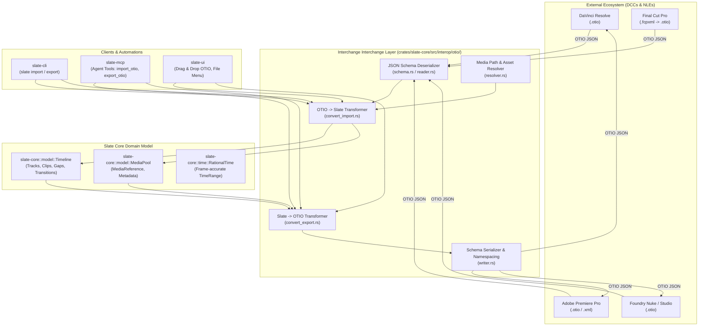
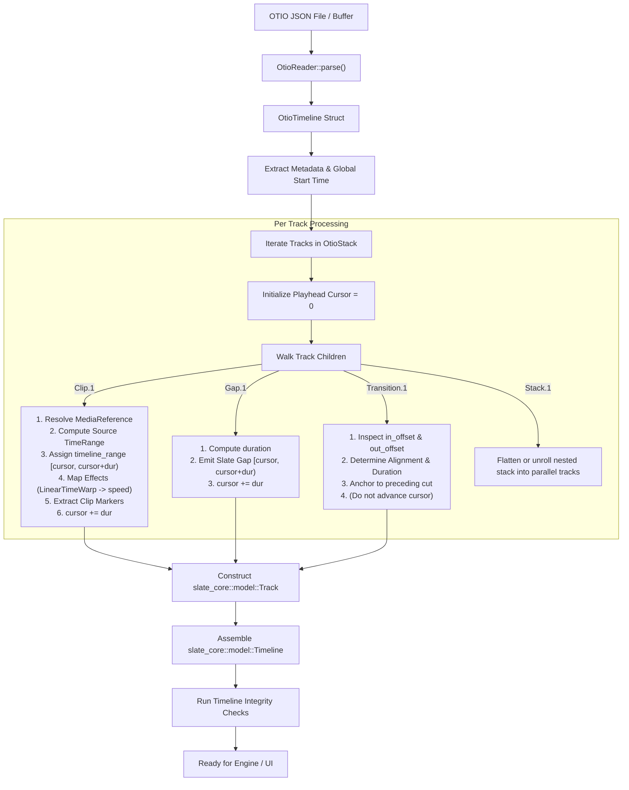
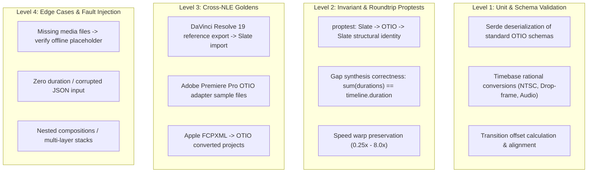

# Slate OpenTimelineIO (OTIO) Interoperability Specification

> **Specification & Technical Architecture Document**  
> **Document ID:** 12  
> **Primary Target Domain:** `slate-core::interop::otio`  
> **Target Paths:** `crates/slate-core/src/interop/otio/`, `crates/slate-cli/src/commands/interop.rs`, `crates/slate-mcp/src/tools/interop.rs`  
> **Status:** Ready for Implementation (Ships in v1)  

---

## 1. Overview & Architecture

OpenTimelineIO (OTIO) is the open-source API and interchange interchange specification maintained by the Academy Software Foundation (ASWF) for editorial timeline exchange across motion picture, broadcast, and post-production pipelines. OTIO standardizes the representation of tracks, clips, transitions, gaps, markers, time references, and arbitrary metadata across digital content creation (DCC) tools.

Slate implements a high-performance, deterministic, zero-allocation-where-feasible bidirectional OTIO JSON bridge in `slate-core::interop::otio`. This interchange subsystem enables seamless collaboration with industry-standard non-linear editing systems (NLEs), compositors, and finishing suites, including:
- **Blackmagic Design DaVinci Resolve** (Direct OTIO import/export)
- **Adobe Premiere Pro** (via official Adobe OTIO plugin or Final Cut Pro XML intermediate)
- **Apple Final Cut Pro** (via FCPXML/OTIO translation bridge)
- **Foundry Nuke & Autodesk Flame/Flow** (VFX timeline conform and editorial turnover)
- **Custom Studio Asset Management (MAM/DAM)** pipelines.



### 1.1 Architectural Guarantees & Philosophy

1. **Lossless Core Editorial Roundtripping**: Editorial structure (track layout, source ins/outs, timeline offsets, edit cuts, gaps, dissolves, point/range markers, and clip speeds) roundtrips between Slate and other compliant OTIO tools with zero frame drift.
2. **Deterministic Non-Destructive Extension via Namespacing**: Any Slate-specific construct not natively expressible in base OTIO schemas (e.g., GPU shader effect stacks, keyframed bezier transforms, parametric audio equalizers, stylized word-level captions) is preserved under the standard namespaced metadata dictionary `metadata["slate"]`. When an OTIO file generated by Slate is modified in DaVinci Resolve and re-imported into Slate, untouched clips retain 100% of their rich Slate effects and animations.
3. **Resilient Offline Asset Relinking**: Missing, moved, or cross-platform filesystem paths (POSIX vs. Windows UNC/drive letters) never crash the import pipeline. Missing assets are gracefully converted to offline placeholders (`MissingReference.1`), and an automated search-path heuristic locates relocated media.
4. **Zero Uncontrolled Panics**: Invalid schema payloads, circular stacks, negative durations, or division-by-zero rational rates are trapped at deserialization boundaries and surfaced as structured diagnostics (`OtioError`).

---

## 2. OTIO Data Model Mapping

The OTIO object model relies on polymorphic schema-typed dictionaries inheriting from `SerializableObjectWithMetadata`. Slate's internal engine relies on strongly typed Rust structs and explicit ID wrappers (`TrackId`, `ClipId`, `MediaId`).

### 2.1 Concept Mapping Matrix

| OTIO Concept (`OTIO_SCHEMA`) | Slate Internal Type | Semantic Mapping & Fidelity Notes |
| :--- | :--- | :--- |
| **`Timeline.1`** | [`Timeline`](file:///Users/adityakinjawadekar/Documents/100xcode/video-editor/crates/slate-core/src/model/timeline.rs) | Direct 1:1 mapping. Preserves sequence name, global start time, tracks stack, and metadata. |
| **`Stack.1`** | Multi-track container (`Vec<Track>`) | OTIO uses nested `Stack` objects for vertical compositing. Top-level stack maps to Slate's track collection. Nested stacks are flattened or preserved as compound clips. |
| **`Track.1`** | [`Track`](file:///Users/adityakinjawadekar/Documents/100xcode/video-editor/crates/slate-core/src/model/track.rs) | Direct mapping. `kind: "Video"` maps to `TrackType::Video`; `kind: "Audio"` maps to `TrackType::Audio`. Mute and solo flags map directly. |
| **`Clip.1`** | [`Clip`](file:///Users/adityakinjawadekar/Documents/100xcode/video-editor/crates/slate-core/src/model/clip.rs) | Direct mapping. Source in/out maps to `source_range`. Sequential track position is calculated into Slate's absolute `timeline_range`. |
| **`Gap.1`** | [`Gap`](file:///Users/adityakinjawadekar/Documents/100xcode/video-editor/crates/slate-core/src/model/item.rs) | Direct mapping. OTIO gaps represent unallocated editorial time. Slate computes absolute interval `[start, start + duration)`. |
| **`Transition.1`** | [`Transition`](file:///Users/adityakinjawadekar/Documents/100xcode/video-editor/crates/slate-core/src/model/transition.rs) | Direct mapping. OTIO `in_offset` and `out_offset` map to Slate `duration` and `TransitionAlignment` (`StartAtCut`, `CenterAtCut`, `EndAtCut`). |
| **`ExternalReference.1`** | [`MediaReference`](file:///Users/adityakinjawadekar/Documents/100xcode/video-editor/crates/slate-core/src/model/media.rs) | Target URL is decoded to local filesystem path. File metadata (frame rate, resolution, duration) probed via `slate-media`. |
| **`MissingReference.1`** | [`MediaReference`](file:///Users/adityakinjawadekar/Documents/100xcode/video-editor/crates/slate-core/src/model/media.rs) | Imported as an offline placeholder clip. Slate marks the asset as unlinked and presents relinking options. |
| **`RationalTime.1`** | [`RationalTime`](file:///Users/adityakinjawadekar/Documents/100xcode/video-editor/crates/slate-core/src/time/rational.rs) | OTIO `(value: f64, rate: f64)` mapped to Slate `ticks: i64, rate: u32`. Standard NTSC rates (23.976, 29.97) rescaled without drift. |
| **`TimeRange.1`** | [`TimeRange`](file:///Users/adityakinjawadekar/Documents/100xcode/video-editor/crates/slate-core/src/time/range.rs) | Direct 1:1 mapping of `[start_time, start_time + duration)`. |
| **`Marker.1`** | [`Marker`](file:///Users/adityakinjawadekar/Documents/100xcode/video-editor/crates/slate-core/src/model/marker.rs) | Marker label, comment, time/range, and color strings (e.g. `RED`, `GREEN`, `CYAN`) mapped to Slate `color_rgba: [f32; 4]`. |
| **`LinearTimeWarp.1`** | [`Clip::speed`](file:///Users/adityakinjawadekar/Documents/100xcode/video-editor/crates/slate-core/src/model/clip.rs) | OTIO `time_scalar` maps directly to playback speed multiplier (`speed: f64`). Reverse playback supported. |
| **`FreezeFrame.1`** | [`Clip::speed`](file:///Users/adityakinjawadekar/Documents/100xcode/video-editor/crates/slate-core/src/model/clip.rs) | Maps to zero-speed playback (`speed: 0.0`) holding the target frame. |
| **`Effect.1`** | [`Effect`](file:///Users/adityakinjawadekar/Documents/100xcode/video-editor/crates/slate-core/src/model/effect.rs) | Best-effort mapping. Known NLE effects translated; arbitrary effects stored in Slate effect descriptor with raw parameter payload. |
| **`SerializableObject`** | `serde_json::Value` | Preserved verbatim in `metadata` dictionaries. Non-Slate NLE metadata retained across roundtrips. |

---

### 2.2 Coordinate Space & Structural Differences

The fundamental impedance mismatch between OpenTimelineIO and Slate lies in **how timeline coordinates are established**:

```
OTIO Track Model: Sequential / Cumulative Duration
┌──────────────────┬──────────┬────────────────────────┐
│ Clip A (dur: 4s) │ Gap (2s) │ Clip B (dur: 6s)       │
└──────────────────┴──────────┴────────────────────────┘
Track Time: 0s                4s         6s                   12s
(Items only define duration; position is derived from prefix sum)

Slate Track Model: Absolute Bounded Intervals
┌──────────────────┬──────────┬────────────────────────┐
│ Clip A [0s -> 4s)│ Gap[4->6)│ Clip B [6s -> 12s)     │
└──────────────────┴──────────┴────────────────────────┘
Track Time: 0s                4s         6s                   12s
(Each item explicitly stores timeline_range: [start, start + duration))
```

1. **Relative vs. Absolute Coordinates**:
   - In OTIO, items inside a `Track` do not store their global timeline start time. Their start time is the **prefix sum** of durations of all preceding items in that track.
   - In Slate, every [`TrackItem`](file:///Users/adityakinjawadekar/Documents/100xcode/video-editor/crates/slate-core/src/model/item.rs) explicitly stores its own absolute `timeline_range: TimeRange [start, start + duration)`.
   - **Import**: The importer must iterate sequentially through OTIO track items, maintaining an accumulator `cursor: RationalTime` to assign each item's `timeline_range.start`.
   - **Export**: The exporter must sort items by `timeline_range.start`. Any unoccupied span between `previous_item.end()` and `next_item.start` must be explicitly populated with an `OtioGap` object so that OTIO readers arrive at the identical timeline placement.

2. **Transition Anchoring & Overlaps**:
   - In OTIO, a `Transition` is an in-line element placed *between* two clips in a track's children array. It defines `in_offset` (how many frames it extends into the preceding clip) and `out_offset` (how many frames it extends into the following clip).
   - In Slate, a `Transition` stores an alignment enum (`StartAtCut`, `CenterAtCut`, `EndAtCut`) and a total `duration`. The timeline placement is pinned to the cut point between adjacent clips.
   - The importer and exporter must convert bidirectionally:
     $$\text{duration} = \text{in\_offset} + \text{out\_offset}$$
     $$\text{alignment} = \begin{cases} 
     \text{CenterAtCut} & \text{if } \text{in\_offset} == \text{out\_offset} \\
     \text{StartAtCut}  & \text{if } \text{in\_offset} == 0 \\
     \text{EndAtCut}    & \text{if } \text{out\_offset} == 0 \\
     \text{CenterAtCut} & \text{otherwise (fallback with custom metadata)}
     \end{cases}$$

---

## 3. OTIO Rust Data Structures (`schema.rs`)

To achieve maximum performance and avoid C++ ABI bindings (`opentimelineio` C++ library requires Python or complex CMake wrappers), Slate defines a pure-Rust, zero-unsafe, high-fidelity serde implementation compliant with the official OTIO JSON Schema specification.

### 3.1 Core Schema Types

```rust
// crates/slate-core/src/interop/otio/schema.rs

use serde::{Deserialize, Serialize};
use std::collections::HashMap;

/// Standard OTIO JSON root envelope
#[derive(Debug, Clone, PartialEq, Serialize, Deserialize)]
pub struct OtioTimeline {
    #[serde(rename = "OTIO_SCHEMA")]
    pub schema: String, // e.g. "Timeline.1"
    
    pub name: String,
    
    #[serde(default, skip_serializing_if = "Option::is_none")]
    pub global_start_time: Option<OtioRationalTime>,
    
    pub tracks: OtioStack,
    
    #[serde(default)]
    pub metadata: serde_json::Map<String, serde_json::Value>,
}

impl Default for OtioTimeline {
    fn default() -> Self {
        Self {
            schema: "Timeline.1".to_string(),
            name: "Untitled Timeline".to_string(),
            global_start_time: None,
            tracks: OtioStack::default(),
            metadata: serde_json::Map::new(),
        }
    }
}

/// RationalTime representation in OTIO JSON
#[derive(Debug, Clone, Copy, PartialEq, Serialize, Deserialize)]
pub struct OtioRationalTime {
    #[serde(rename = "OTIO_SCHEMA", default = "default_rational_time_schema")]
    pub schema: String, // "RationalTime.1"
    
    pub value: f64,
    pub rate: f64,
}

fn default_rational_time_schema() -> String {
    "RationalTime.1".to_string()
}

impl OtioRationalTime {
    pub fn new(value: f64, rate: f64) -> Self {
        Self {
            schema: "RationalTime.1".to_string(),
            value,
            rate,
        }
    }
}

/// TimeRange representation in OTIO JSON
#[derive(Debug, Clone, Copy, PartialEq, Serialize, Deserialize)]
pub struct OtioTimeRange {
    #[serde(rename = "OTIO_SCHEMA", default = "default_time_range_schema")]
    pub schema: String, // "TimeRange.1"
    
    pub start_time: OtioRationalTime,
    pub duration: OtioRationalTime,
}

fn default_time_range_schema() -> String {
    "TimeRange.1".to_string()
}

impl OtioTimeRange {
    pub fn new(start_time: OtioRationalTime, duration: OtioRationalTime) -> Self {
        Self {
            schema: "TimeRange.1".to_string(),
            start_time,
            duration,
        }
    }
}

/// Vertical composition stack (contains tracks or nested stacks)
#[derive(Debug, Clone, PartialEq, Serialize, Deserialize)]
pub struct OtioStack {
    #[serde(rename = "OTIO_SCHEMA")]
    pub schema: String, // "Stack.1"
    
    #[serde(default)]
    pub name: String,
    
    #[serde(default)]
    pub children: Vec<OtioTrackItem>,
    
    #[serde(default, skip_serializing_if = "Option::is_none")]
    pub source_range: Option<OtioTimeRange>,
    
    #[serde(default)]
    pub effects: Vec<OtioEffect>,
    
    #[serde(default)]
    pub markers: Vec<OtioMarker>,
    
    #[serde(default)]
    pub metadata: serde_json::Map<String, serde_json::Value>,
}

impl Default for OtioStack {
    fn default() -> Self {
        Self {
            schema: "Stack.1".to_string(),
            name: "tracks".to_string(),
            children: Vec::new(),
            source_range: None,
            effects: Vec::new(),
            markers: Vec::new(),
            metadata: serde_json::Map::new(),
        }
    }
}

/// OTIO Track definition
#[derive(Debug, Clone, PartialEq, Serialize, Deserialize)]
pub struct OtioTrack {
    #[serde(rename = "OTIO_SCHEMA")]
    pub schema: String, // "Track.1"
    
    #[serde(default)]
    pub name: String,
    
    pub kind: OtioTrackKind,
    
    #[serde(default)]
    pub children: Vec<OtioTrackItem>,
    
    #[serde(default, skip_serializing_if = "Option::is_none")]
    pub source_range: Option<OtioTimeRange>,
    
    #[serde(default)]
    pub effects: Vec<OtioEffect>,
    
    #[serde(default)]
    pub markers: Vec<OtioMarker>,
    
    #[serde(default)]
    pub metadata: serde_json::Map<String, serde_json::Value>,
}

#[derive(Debug, Clone, Copy, PartialEq, Eq, Serialize, Deserialize)]
pub enum OtioTrackKind {
    Video,
    Audio,
}

/// Polymorphic track item container
#[derive(Debug, Clone, PartialEq, Serialize, Deserialize)]
#[serde(tag = "OTIO_SCHEMA")]
pub enum OtioTrackItem {
    #[serde(rename = "Clip.1")]
    Clip(OtioClip),
    
    #[serde(rename = "Gap.1")]
    Gap(OtioGap),
    
    #[serde(rename = "Transition.1")]
    Transition(OtioTransition),
    
    #[serde(rename = "Stack.1")]
    Stack(OtioStack),
    
    #[serde(rename = "Track.1")]
    Track(OtioTrack),
}

/// Clip definition in OTIO
#[derive(Debug, Clone, PartialEq, Serialize, Deserialize)]
pub struct OtioClip {
    #[serde(default)]
    pub name: String,
    
    #[serde(default, skip_serializing_if = "Option::is_none")]
    pub source_range: Option<OtioTimeRange>,
    
    #[serde(default, skip_serializing_if = "Option::is_none")]
    pub media_reference: Option<OtioMediaReference>,
    
    #[serde(default)]
    pub effects: Vec<OtioEffect>,
    
    #[serde(default)]
    pub markers: Vec<OtioMarker>,
    
    #[serde(default)]
    pub metadata: serde_json::Map<String, serde_json::Value>,
}

/// Gap definition in OTIO
#[derive(Debug, Clone, PartialEq, Serialize, Deserialize)]
pub struct OtioGap {
    #[serde(default)]
    pub name: String,
    
    pub source_range: OtioTimeRange,
    
    #[serde(default)]
    pub effects: Vec<OtioEffect>,
    
    #[serde(default)]
    pub markers: Vec<OtioMarker>,
    
    #[serde(default)]
    pub metadata: serde_json::Map<String, serde_json::Value>,
}

/// Transition definition in OTIO
#[derive(Debug, Clone, PartialEq, Serialize, Deserialize)]
pub struct OtioTransition {
    #[serde(default)]
    pub name: String,
    
    pub transition_type: String, // "SMPTE_Dissolve" or custom string
    
    pub in_offset: OtioRationalTime,
    pub out_offset: OtioRationalTime,
    
    #[serde(default)]
    pub metadata: serde_json::Map<String, serde_json::Value>,
}

/// Polymorphic MediaReference container
#[derive(Debug, Clone, PartialEq, Serialize, Deserialize)]
#[serde(tag = "OTIO_SCHEMA")]
pub enum OtioMediaReference {
    #[serde(rename = "ExternalReference.1")]
    External(OtioExternalReference),
    
    #[serde(rename = "MissingReference.1")]
    Missing(OtioMissingReference),
    
    #[serde(rename = "ImageSequenceReference.1")]
    ImageSequence(OtioImageSequenceReference),
}

#[derive(Debug, Clone, PartialEq, Serialize, Deserialize)]
pub struct OtioExternalReference {
    pub target_url: String,
    
    #[serde(default, skip_serializing_if = "Option::is_none")]
    pub available_range: Option<OtioTimeRange>,
    
    #[serde(default)]
    pub metadata: serde_json::Map<String, serde_json::Value>,
}

#[derive(Debug, Clone, PartialEq, Serialize, Deserialize)]
pub struct OtioMissingReference {
    #[serde(default, skip_serializing_if = "Option::is_none")]
    pub available_range: Option<OtioTimeRange>,
    
    #[serde(default)]
    pub metadata: serde_json::Map<String, serde_json::Value>,
}

#[derive(Debug, Clone, PartialEq, Serialize, Deserialize)]
pub struct OtioImageSequenceReference {
    pub target_url_base: String,
    pub name_prefix: String,
    pub name_suffix: String,
    pub start_frame: i64,
    pub frame_step: i64,
    pub rate: f64,
    pub frame_zero_padding: usize,
    
    #[serde(default, skip_serializing_if = "Option::is_none")]
    pub available_range: Option<OtioTimeRange>,
    
    #[serde(default)]
    pub metadata: serde_json::Map<String, serde_json::Value>,
}

/// Marker definition in OTIO
#[derive(Debug, Clone, PartialEq, Serialize, Deserialize)]
pub struct OtioMarker {
    #[serde(rename = "OTIO_SCHEMA", default = "default_marker_schema")]
    pub schema: String, // "Marker.1"
    
    #[serde(default)]
    pub name: String,
    
    pub marked_range: OtioTimeRange,
    
    pub color: String, // e.g. "RED", "GREEN", "BLUE", "YELLOW"
    
    #[serde(default)]
    pub metadata: serde_json::Map<String, serde_json::Value>,
}

fn default_marker_schema() -> String {
    "Marker.1".to_string()
}

/// Polymorphic Effect definition
#[derive(Debug, Clone, PartialEq, Serialize, Deserialize)]
#[serde(tag = "OTIO_SCHEMA")]
pub enum OtioEffect {
    #[serde(rename = "LinearTimeWarp.1")]
    LinearTimeWarp(OtioLinearTimeWarp),
    
    #[serde(rename = "FreezeFrame.1")]
    FreezeFrame(OtioFreezeFrame),
    
    #[serde(rename = "Effect.1")]
    Generic(OtioGenericEffect),
}

#[derive(Debug, Clone, PartialEq, Serialize, Deserialize)]
pub struct OtioLinearTimeWarp {
    #[serde(default)]
    pub name: String,
    
    pub effect_name: String,
    pub time_scalar: f64,
    
    #[serde(default)]
    pub metadata: serde_json::Map<String, serde_json::Value>,
}

#[derive(Debug, Clone, PartialEq, Serialize, Deserialize)]
pub struct OtioFreezeFrame {
    #[serde(default)]
    pub name: String,
    
    #[serde(default)]
    pub metadata: serde_json::Map<String, serde_json::Value>,
}

#[derive(Debug, Clone, PartialEq, Serialize, Deserialize)]
pub struct OtioGenericEffect {
    #[serde(default)]
    pub name: String,
    
    pub effect_name: String,
    
    #[serde(default)]
    pub metadata: serde_json::Map<String, serde_json::Value>,
}
```

---

## 4. Import Pipeline

The import pipeline reads an OTIO JSON document, parses the schema hierarchy, resolves all media files on disk, computes absolute timeline coordinates, flattens any nested compositions, and constructs a clean Slate [`Timeline`](file:///Users/adityakinjawadekar/Documents/100xcode/video-editor/crates/slate-core/src/model/timeline.rs) and [`MediaPool`](file:///Users/adityakinjawadekar/Documents/100xcode/video-editor/crates/slate-core/src/model/project.rs).



### 4.1 Step-by-Step Conversion Algorithm

The conversion process is implemented in [`crates/slate-core/src/interop/otio/convert_import.rs`](file:///Users/adityakinjawadekar/Documents/100xcode/video-editor/crates/slate-core/src/interop/otio/convert_import.rs) following these precise stages:

1. **Schema Parsing & Version Validation**:
   - Parse JSON string using `serde_json::from_str::<OtioTimeline>`.
   - Validate root schema identifier matches `Timeline.1`. If minor schema versions (`Timeline.2` or legacy versions) are encountered, execute schema adaptation or issue non-fatal compatibility warnings.
2. **Timeline Settings Extraction**:
   - Determine baseline timebase (`rate`): inspect `global_start_time.rate`, or fallback to the rate of the first encountered clip, or default to `30` fps.
   - Inspect `metadata["slate"]` or NLE-specific metadata (`metadata["Resolve_Project"]` or `metadata["Premiere"]`) for canvas dimensions (`width`, `height`), audio sample rate (default `48000`), and drop-frame flag.
3. **Media Resolution & Pool Populating**:
   - Walk all clips across all tracks to collect every unique `OtioMediaReference`.
   - Invoke [`MediaResolver`](file:///Users/adityakinjawadekar/Documents/100xcode/video-editor/crates/slate-core/src/interop/otio/resolver.rs):
     - Decode `file://` URI to local filesystem path.
     - Verify file existence on disk. If absent, search user-supplied search paths and relative paths adjacent to the `.otio` file.
     - Probe file header via `slate-media` to extract actual duration, codec, resolution, and audio channels.
     - If file is missing and cannot be located: instantiate an offline [`MediaReference`](file:///Users/adityakinjawadekar/Documents/100xcode/video-editor/crates/slate-core/src/model/media.rs) marked `is_offline = true`.
4. **Track Processing & Playhead Cursor Accumulation**:
   - For each `OtioTrack` in `timeline.tracks.children`:
     - Map `OtioTrackKind` (`Video` $\to$ `TrackType::Video`, `Audio` $\to$ `TrackType::Audio`).
     - Initialize `cursor = RationalTime::new(0, timeline_rate)`.
     - Iterate through `OtioTrackItem`:
       - **When encountering `OtioClip`**:
         - Calculate clip duration $D$: if `source_range` is present, $D = \text{source\_range.duration}$; otherwise fallback to media reference `available_range.duration`.
         - Rescale $D$ to `timeline_rate`.
         - Assign `timeline_range = TimeRange::new(cursor, D)`.
         - Map `source_range`: if defined in OTIO, convert to Slate `TimeRange`; if undefined, default to `[0, D)`.
         - Advance playhead: `cursor = cursor + D`.
         - Parse speed: inspect `effects` for `LinearTimeWarp`. If found, `clip.speed = warp.time_scalar`.
         - Map other effects: convert known filters (e.g. opacity, volume) or store in `Effect.parameters["otio_raw"]`.
         - Extract clip-level markers: calculate marker timeline position relative to clip start and add to clip or timeline.
       - **When encountering `OtioGap`**:
         - Calculate gap duration $D = \text{gap.source\_range.duration.rescale(timeline\_rate)}$.
         - Emit `TrackItem::Gap(Gap { id: GapId::new(), timeline_range: TimeRange::new(cursor, D) })`.
         - Advance playhead: `cursor = cursor + D`.
       - **When encountering `OtioTransition`**:
         - In OTIO, transitions represent an overlapping dissolve spanning the cut point between item $N-1$ and item $N$.
         - Duration is computed as: $T_{\text{dur}} = \text{in\_offset} + \text{out\_offset}$.
         - Determine alignment:
           - If $\text{in\_offset} == \text{out\_offset}$, alignment is `TransitionAlignment::CenterAtCut`.
           - If $\text{in\_offset} == 0$, alignment is `TransitionAlignment::StartAtCut`.
           - If $\text{out\_offset} == 0$, alignment is `TransitionAlignment::EndAtCut`.
         - Note: In OTIO, the transition does not advance the editorial track cursor because the overlapping duration is already accounted for in the trimmed handles of adjacent clips.
5. **Timeline Marker & Metadata Restoration**:
   - Extract sequence-level markers from `OtioTimeline.tracks.markers` and root metadata.
   - Restore Slate namespaced data from `OtioTimeline.metadata["slate"]`, restoring global project settings, caption tracks, and UI view state.

### 4.2 Edge Case Handling

> [!IMPORTANT]
> The table below outlines defensive policies enforced during import to guarantee timeline integrity under real-world corrupted or non-standard inputs:

| Edge Case | Failure Mode in Naive Parsers | Slate Resolution Strategy |
| :--- | :--- | :--- |
| **Missing Media Files** | Hard crash or null pointer exception | Create a placeholder `MediaReference` with synthetic ID. Mark `metadata.is_offline = true`. Set video resolution to 1920x1080 default, duration equal to clip source duration. Emit non-fatal warning diagnostic. |
| **Unsupported Effects** | Data loss on re-export | Parse into `Effect` with `effect_type: "unsupported"`, storing original OTIO JSON object under `parameters["otio_raw"]`. The timeline plays unaffected and re-exports original effect parameters verbatim. |
| **Nested Compositions (`Stack.1` inside `Track.1`)** | Track hierarchy violation | Recursively flatten: unroll children into additional numbered tracks (`V1.1`, `V1.2`) or wrap into a compound virtual clip whose source references a sub-timeline. |
| **Complex / Non-SMPTE Transitions** | Visual rendering glitch | Fallback to standard cross-dissolve (`transition_type = "cross_dissolve"`). Cache original transition metadata in `Transition.parameters["otio_transition_type"]` for lossless export. |
| **Non-Standard or Fractional Timebases** | Frame drift (e.g. 23.976 fps drifting across hours) | Convert to exact integer ratio representation: ticks and timebase scaled to lowest common multiple (e.g. `24000/1001` or scaled tick count at rate `24000`). |
| **Clips with Zero or Negative Duration** | Division by zero or render loop stall | Drop zero-duration clips during import; log an anomaly warning. Clamp negative durations to zero. |
| **Dangling Transitions (no preceding or following clip)** | Corrupted cut reference | Convert orphan transition into an equivalent duration `Gap` or drop with diagnostic log. |

---

## 5. Export Pipeline

The export pipeline converts a Slate [`Timeline`](file:///Users/adityakinjawadekar/Documents/100xcode/video-editor/crates/slate-core/src/model/timeline.rs) into an OTIO JSON document compliant with the official OpenTimelineIO schema specification, guaranteeing interoperability with DaVinci Resolve, Adobe Premiere Pro, and Final Cut Pro.

```mermaid
flowchart TD
    SLATE["Slate Timeline + MediaPool"] --> EXPORT["OtioExporter::export()"]
    EXPORT --> ROOT["Instantiate OtioTimeline & OtioStack"]
    
    subgraph "Track Conversion"
        ROOT --> TRACK_LOOP["Iterate Slate Tracks"]
        TRACK_LOOP --> SORT["Sort Items by timeline_range.start ASC"]
        SORT --> CURSOR_INIT["playhead = 0"]
        
        CURSOR_INIT --> ITEM_EVAL{"Item Start > playhead?"}
        ITEM_EVAL -->|Yes (Gap Detected)| EMIT_GAP["Synthesize OtioGap\nduration = item.start - playhead\nplayhead += gap_dur"]
        ITEM_EVAL -->|No (Contiguous)| CONVERT_ITEM
        EMIT_GAP --> CONVERT_ITEM
        
        subgraph "Item Serialization"
            CONVERT_ITEM -->|Clip| EX_CLIP["1. Build OtioClip\n2. Format ExternalReference URL\n3. Attach LinearTimeWarp if speed != 1.0\n4. Namespace Slate Transform/Effects\n5. playhead += clip.duration"]
            CONVERT_ITEM -->|Gap| EX_GAP["1. Build OtioGap\n2. playhead += gap.duration"]
            CONVERT_ITEM -->|Transition| EX_TRANS["1. Calculate in_offset & out_offset\n2. Build OtioTransition\n(playhead unaffected)"]
        end
    end
    
    EX_CLIP --> ATTACH_TRACK["Append OtioTrack to OtioStack"]
    EX_GAP --> ATTACH_TRACK
    EX_TRANS --> ATTACH_TRACK
    
    ATTACH_TRACK --> META["Inject metadata['slate']\n(Transforms, GPU Shaders, Captions)"]
    META --> SERDE["serde_json::to_string_pretty()"]
    SERDE --> OUTPUT[".otio File on Disk"]
```

### 5.1 Conversion to OTIO Algorithm

The export algorithm is implemented in [`crates/slate-core/src/interop/otio/convert_export.rs`](file:///Users/adityakinjawadekar/Documents/100xcode/video-editor/crates/slate-core/src/interop/otio/convert_export.rs):

1. **Root Hierarchy Setup**:
   - Construct `OtioTimeline` with `name = timeline.name`.
   - Set `global_start_time = OtioRationalTime::new(0.0, timeline.settings.timebase as f64)`.
   - Create root `OtioStack` named `"tracks"`.
2. **Track Iteration & Gap Synthesis**:
   - For each [`Track`](file:///Users/adityakinjawadekar/Documents/100xcode/video-editor/crates/slate-core/src/model/track.rs) in `timeline.tracks`:
     - Create `OtioTrack` with `name = track.name`, `kind = match track.track_type { TrackType::Video => OtioTrackKind::Video, TrackType::Audio => OtioTrackKind::Audio }`.
     - Maintain `track_cursor: RationalTime = RationalTime::ZERO`.
     - Sort all items in the track by `item.timeline_range().start`.
     - For each item:
       - If `item.timeline_range().start > track_cursor`:
         - An explicit or implicit gap exists.
         - Calculate `gap_duration = item.timeline_range().start - track_cursor`.
         - Append an `OtioGap` with `source_range = OtioTimeRange(0, gap_duration)`.
         - `track_cursor = item.timeline_range().start`.
       - **Serialize Item**:
         - **Clip**:
           - Create `OtioClip` with name and `source_range = OtioTimeRange(clip.source_range.start, clip.source_range.duration)`.
           - Resolve media reference: generate canonical `file://` URL from `media_ref.original_path`. If media is offline, emit `OtioMissingReference`.
           - If `clip.speed != 1.0`: attach an `OtioLinearTimeWarp` effect with `time_scalar = clip.speed`.
           - Embed Slate-specific parameters (transform keyframes, audio EQ/pan keyframes, GPU shaders) into `clip.metadata["slate"]`.
           - `track_cursor = track_cursor + clip.timeline_range.duration`.
         - **Transition**:
           - Calculate `in_offset` and `out_offset` based on `transition.alignment` and `transition.duration`:
             - `CenterAtCut`: $\text{in\_offset} = \text{duration} / 2$, $\text{out\_offset} = \text{duration} / 2$.
             - `StartAtCut`: $\text{in\_offset} = 0$, $\text{out\_offset} = \text{duration}$.
             - `EndAtCut`: $\text{in\_offset} = \text{duration}$, $\text{out\_offset} = 0$.
           - Append `OtioTransition` with `transition_type = "SMPTE_Dissolve"`.
3. **Marker Preservation**:
   - For each marker on the timeline, append an `OtioMarker` to `OtioTimeline.tracks.markers`.
   - Map `color_rgba` to the closest standard OTIO marker color string (`RED`, `GREEN`, `BLUE`, `CYAN`, `MAGENTA`, `YELLOW`, `WHITE`).
4. **Captions & Metadata Namespacing**:
   - Subtitle/caption tracks are serialized either as standard text tracks or stored in `metadata["slate"]["captions"]` to avoid confusing legacy video-only NLEs.

### 5.2 Slate Namespaced Metadata Format

All engine attributes beyond standard editorial cuts are serialized under `metadata["slate"]`:

```json
{
  "OTIO_SCHEMA": "Clip.1",
  "name": "Interview_A_Cam.mov",
  "source_range": {
    "OTIO_SCHEMA": "TimeRange.1",
    "start_time": { "OTIO_SCHEMA": "RationalTime.1", "value": 240.0, "rate": 24.0 },
    "duration": { "OTIO_SCHEMA": "RationalTime.1", "value": 144.0, "rate": 24.0 }
  },
  "media_reference": {
    "OTIO_SCHEMA": "ExternalReference.1",
    "target_url": "file:///Volumes/Media/Projects/Interview_A_Cam.mov"
  },
  "metadata": {
    "slate": {
      "version": 1,
      "clip_id": "9b1deb4d-3b7d-4bad-9bdd-2b0d7b3dcb6d",
      "transform": {
        "position_x": { "keyframes": [{ "time": { "ticks": 0, "rate": 24 }, "value": 0.0, "interpolation": "linear" }] },
        "position_y": { "keyframes": [{ "time": { "ticks": 0, "rate": 24 }, "value": 0.0, "interpolation": "linear" }] },
        "scale_x": { "keyframes": [{ "time": { "ticks": 0, "rate": 24 }, "value": 1.15, "interpolation": "linear" }] },
        "scale_y": { "keyframes": [{ "time": { "ticks": 0, "rate": 24 }, "value": 1.15, "interpolation": "linear" }] },
        "opacity": { "keyframes": [{ "time": { "ticks": 0, "rate": 24 }, "value": 1.0, "interpolation": "linear" }] }
      },
      "audio_params": {
        "volume_db": { "keyframes": [{ "time": { "ticks": 0, "rate": 24 }, "value": -3.5, "interpolation": "linear" }] },
        "pan": { "keyframes": [{ "time": { "ticks": 0, "rate": 24 }, "value": 0.0, "interpolation": "linear" }] },
        "mute": false
      },
      "effects": [
        {
          "id": "e5b6c7d8-1111-2222-3333-444455556666",
          "effect_type": "color_grading",
          "name": "Rec.709 Neutral",
          "enabled": true,
          "parameters": {
            "exposure": 0.25,
            "contrast": 1.05,
            "saturation": 1.1
          }
        }
      ]
    }
  }
}
```

---

## 6. Concrete Rust Implementation

The following complete Rust implementations define the entire OTIO subsystem across `crates/slate-core/src/interop/otio/`.

### 6.1 Error Types (`error.rs`)

```rust
// crates/slate-core/src/interop/otio/error.rs

use std::path::PathBuf;
use thiserror::Error;

#[derive(Error, Debug)]
pub enum OtioError {
    #[error("I/O error during OTIO operation: {0}")]
    Io(#[from] std::io::Error),

    #[error("JSON serialization/deserialization failed: {0}")]
    Json(#[from] serde_json::Error),

    #[error("Unsupported OTIO Schema: '{0}' (expected '{1}')")]
    UnsupportedSchema(String, &'static str),

    #[error("Missing required schema field: '{0}' in object '{1}'")]
    MissingField(&'static str, String),

    #[error("Invalid rational time value: value={value}, rate={rate} ({reason})")]
    InvalidRationalTime {
        value: f64,
        rate: f64,
        reason: &'static str,
    },

    #[error("Invalid time range: start={start}, duration={duration} ({reason})")]
    InvalidTimeRange {
        start: f64,
        duration: f64,
        reason: &'static str,
    },

    #[error("Media file could not be resolved: '{0}'. Search paths searched: {1:?}")]
    MediaNotFound(String, Vec<PathBuf>),

    #[error("Invalid URL format for external media reference: '{0}'")]
    InvalidMediaUrl(String),

    #[error("Timeline topology invariant violated: {0}")]
    TopologyError(String),

    #[error("Codec/probe failure for media asset '{path}': {details}")]
    ProbeError {
        path: PathBuf,
        details: String,
    },
}
```

---

### 6.2 Media Path Resolver (`resolver.rs`)

```rust
// crates/slate-core/src/interop/otio/resolver.rs

use crate::interop::otio::error::OtioError;
use std::path::{Path, PathBuf};
use url::Url;

/// Resolves external media references to physical files on disk
pub struct MediaResolver {
    search_paths: Vec<PathBuf>,
    otio_dir: Option<PathBuf>,
}

impl MediaResolver {
    pub fn new(search_paths: Vec<PathBuf>, otio_path: Option<&Path>) -> Self {
        let otio_dir = otio_path.and_then(|p| p.parent().map(|d| d.to_path_buf()));
        Self {
            search_paths,
            otio_dir,
        }
    }

    /// Converts a target_url string (file:// or relative path) into a valid local PathBuf
    pub fn resolve_url(&self, target_url: &str) -> Result<PathBuf, OtioError> {
        // 1. Try parsing as URL
        let path = if let Ok(url) = Url::parse(target_url) {
            if url.scheme() == "file" {
                url.to_file_path()
                    .map_err(|_| OtioError::InvalidMediaUrl(target_url.to_string()))?
            } else {
                return Err(OtioError::InvalidMediaUrl(format!(
                    "Unsupported URL scheme '{}' (only file:// is supported)",
                    url.scheme()
                )));
            }
        } else {
            // Treat as raw filesystem path (relative or absolute)
            PathBuf::from(target_url)
        };

        // 2. Check if absolute path exists directly
        if path.is_absolute() && path.exists() {
            return Ok(path);
        }

        // 3. Check relative to OTIO file directory
        if let Some(ref dir) = self.otio_dir {
            let candidate = dir.join(&path);
            if candidate.exists() {
                return Ok(candidate);
            }
            // Also check matching basename in otio directory
            if let Some(file_name) = path.file_name() {
                let candidate = dir.join(file_name);
                if candidate.exists() {
                    return Ok(candidate);
                }
            }
        }

        // 4. Check user-provided search paths
        if let Some(file_name) = path.file_name() {
            for search_dir in &self.search_paths {
                let candidate = search_dir.join(file_name);
                if candidate.exists() {
                    return Ok(candidate);
                }
                // Check subdirectories one level deep
                if let Ok(entries) = std::fs::read_dir(search_dir) {
                    for entry in entries.flatten() {
                        if entry.path().is_dir() {
                            let nested = entry.path().join(file_name);
                            if nested.exists() {
                                return Ok(nested);
                            }
                        }
                    }
                }
            }
        }

        Err(OtioError::MediaNotFound(
            target_url.to_string(),
            self.search_paths.clone(),
        ))
    }

    /// Converts a local filesystem PathBuf to a canonical file:// URL
    pub fn to_file_url(path: &Path) -> Result<String, OtioError> {
        let canonical = path.canonicalize().unwrap_or_else(|_| path.to_path_buf());
        Url::from_file_path(&canonical)
            .map(|u| u.to_string())
            .map_err(|_| OtioError::InvalidMediaUrl(path.display().to_string()))
    }
}
```

---

### 6.3 Import Implementation (`convert_import.rs`)

```rust
// crates/slate-core/src/interop/otio/convert_import.rs

use crate::id::{ClipId, GapId, MediaId, TimelineId, TrackId, TransitionId};
use crate::interop::otio::error::OtioError;
use crate::interop::otio::resolver::MediaResolver;
use crate::interop::otio::schema::*;
use crate::model::clip::Clip;
use crate::model::item::{Gap, TrackItem};
use crate::model::media::{MediaMetadata, MediaReference};
use crate::model::timeline::{Timeline, TimelineSettings};
use crate::model::track::{Track, TrackType};
use crate::model::transition::{Transition, TransitionAlignment};
use crate::time::range::TimeRange;
use crate::time::rational::RationalTime;
use std::collections::HashMap;
use std::path::{Path, PathBuf};

pub struct OtioImporter<'a> {
    resolver: &'a MediaResolver,
    media_pool: HashMap<PathBuf, MediaId>,
    media_references: Vec<MediaReference>,
}

impl<'a> OtioImporter<'a> {
    pub fn new(resolver: &'a MediaResolver) -> Self {
        Self {
            resolver,
            media_pool: HashMap::new(),
            media_references: Vec::new(),
        }
    }

    /// Primary entry point: imports an OtioTimeline into a Slate Timeline
    pub fn import_timeline(
        mut self,
        otio: &OtioTimeline,
    ) -> Result<(Timeline, Vec<MediaReference>), OtioError> {
        // 1. Determine timeline framerate / timebase
        let timebase = otio
            .global_start_time
            .map(|t| t.rate.round() as u32)
            .unwrap_or(30);

        let settings = TimelineSettings {
            timebase,
            width: 1920,
            height: 1080,
            drop_frame: false,
            sample_rate: 48000,
        };

        let mut timeline = Timeline {
            id: TimelineId::new(),
            name: otio.name.clone(),
            settings,
            tracks: Vec::new(),
            markers: Vec::new(),
            captions: Vec::new(),
        };

        // 2. Iterate through children of root stack
        for child in &otio.tracks.children {
            match child {
                OtioTrackItem::Track(otio_track) => {
                    let track = self.convert_track(otio_track, timebase)?;
                    timeline.tracks.push(track);
                }
                OtioTrackItem::Stack(nested_stack) => {
                    // Unroll nested stack tracks into timeline
                    for nested_child in &nested_stack.children {
                        if let OtioTrackItem::Track(nested_track) = nested_child {
                            let track = self.convert_track(nested_track, timebase)?;
                            timeline.tracks.push(track);
                        }
                    }
                }
                _ => {}
            }
        }

        // 3. Extract timeline markers
        for otio_marker in &otio.tracks.markers {
            if let Some(marker) = convert_marker(otio_marker, timebase) {
                timeline.markers.push(marker);
            }
        }

        Ok((timeline, self.media_references))
    }

    fn convert_track(&mut self, otio_track: &OtioTrack, timebase: u32) -> Result<Track, OtioError> {
        let track_type = match otio_track.kind {
            OtioTrackKind::Video => TrackType::Video,
            OtioTrackKind::Audio => TrackType::Audio,
        };

        let mut track = Track::new(otio_track.name.clone(), track_type);
        let mut cursor = RationalTime::new(0, timebase);

        for item in &otio_track.children {
            match item {
                OtioTrackItem::Clip(otio_clip) => {
                    let (clip, duration) = self.convert_clip(otio_clip, cursor, timebase)?;
                    track.items.push(TrackItem::Clip(clip));
                    cursor = cursor + duration;
                }
                OtioTrackItem::Gap(otio_gap) => {
                    let dur = convert_rational_time(otio_gap.source_range.duration, timebase)?;
                    let gap = Gap {
                        id: GapId::new(),
                        timeline_range: TimeRange::new(cursor, dur),
                    };
                    track.items.push(TrackItem::Gap(gap));
                    cursor = cursor + dur;
                }
                OtioTrackItem::Transition(otio_trans) => {
                    let trans = convert_transition(otio_trans, timebase)?;
                    track.items.push(TrackItem::Transition(trans));
                    // Transitions do not advance cursor in OTIO track layout
                }
                OtioTrackItem::Stack(_) | OtioTrackItem::Track(_) => {
                    // Nested compositions inside track ignored or unrolled
                }
            }
        }

        Ok(track)
    }

    fn convert_clip(
        &mut self,
        clip: &OtioClip,
        cursor: RationalTime,
        timebase: u32,
    ) -> Result<(Clip, RationalTime), OtioError> {
        // 1. Resolve media reference
        let media_id = self.resolve_media(&clip.media_reference)?;

        // 2. Compute source range
        let source_range = if let Some(sr) = clip.source_range {
            let start = convert_rational_time(sr.start_time, timebase)?;
            let dur = convert_rational_time(sr.duration, timebase)?;
            TimeRange::new(start, dur)
        } else {
            // Fallback duration 5 seconds
            TimeRange::new(RationalTime::ZERO, RationalTime::new(5 * timebase as i64, timebase))
        };

        let duration = source_range.duration;
        let timeline_range = TimeRange::new(cursor, duration);

        // 3. Inspect speed warps
        let mut speed = 1.0;
        for effect in &clip.effects {
            if let OtioEffect::LinearTimeWarp(warp) = effect {
                speed = warp.time_scalar;
            } else if let OtioEffect::FreezeFrame(_) = effect {
                speed = 0.0;
            }
        }

        let slate_clip = Clip {
            id: ClipId::new(),
            name: clip.name.clone(),
            media_id,
            source_range,
            timeline_range,
            speed,
            transform: Default::default(),
            audio_params: Default::default(),
            effects: Vec::new(),
        };

        Ok((slate_clip, duration))
    }

    fn resolve_media(&mut self, media_ref: &Option<OtioMediaReference>) -> Result<MediaId, OtioError> {
        match media_ref {
            Some(OtioMediaReference::External(ext)) => {
                let resolved_path = match self.resolver.resolve_url(&ext.target_url) {
                    Ok(p) => p,
                    Err(_) => {
                        // Create offline placeholder
                        return Ok(self.create_offline_reference(&ext.target_url));
                    }
                };

                if let Some(&existing_id) = self.media_pool.get(&resolved_path) {
                    return Ok(existing_id);
                }

                let id = MediaId::new();
                self.media_pool.insert(resolved_path.clone(), id);

                self.media_references.push(MediaReference {
                    id,
                    original_path: resolved_path.clone(),
                    relative_path: resolved_path,
                    metadata: MediaMetadata {
                        file_size_bytes: 0,
                        duration: RationalTime::new(3600 * 30, 30),
                        video_codec: Some("unknown".to_string()),
                        width: Some(1920),
                        height: Some(1080),
                        frame_rate: Some(30.0),
                        timebase: 30,
                        audio_codec: None,
                        audio_channels: None,
                        sample_rate: None,
                    },
                    proxy_path: None,
                    waveform_path: None,
                });

                Ok(id)
            }
            _ => Ok(self.create_offline_reference("missing_media")),
        }
    }

    fn create_offline_reference(&mut self, identifier: &str) -> MediaId {
        let id = MediaId::new();
        let placeholder_path = PathBuf::from(format!("offline://{}", identifier));
        self.media_references.push(MediaReference {
            id,
            original_path: placeholder_path.clone(),
            relative_path: placeholder_path,
            metadata: MediaMetadata {
                file_size_bytes: 0,
                duration: RationalTime::new(3600 * 30, 30),
                video_codec: None,
                width: Some(1920),
                height: Some(1080),
                frame_rate: Some(30.0),
                timebase: 30,
                audio_codec: None,
                audio_channels: None,
                sample_rate: None,
            },
            proxy_path: None,
            waveform_path: None,
        });
        id
    }
}

fn convert_rational_time(rt: OtioRationalTime, target_rate: u32) -> Result<RationalTime, OtioError> {
    if rt.rate <= 0.0 {
        return Err(OtioError::InvalidRationalTime {
            value: rt.value,
            rate: rt.rate,
            reason: "Non-positive timebase rate",
        });
    }
    let ticks = (rt.value * (target_rate as f64 / rt.rate)).round() as i64;
    Ok(RationalTime::new(ticks, target_rate))
}

fn convert_transition(trans: &OtioTransition, timebase: u32) -> Result<Transition, OtioError> {
    let in_ticks = convert_rational_time(trans.in_offset, timebase)?.ticks;
    let out_ticks = convert_rational_time(trans.out_offset, timebase)?.ticks;
    let total_ticks = in_ticks + out_ticks;

    let alignment = if in_ticks == out_ticks {
        TransitionAlignment::CenterAtCut
    } else if in_ticks == 0 {
        TransitionAlignment::StartAtCut
    } else {
        TransitionAlignment::EndAtCut
    };

    Ok(Transition {
        id: TransitionId::new(),
        transition_type: trans.transition_type.clone(),
        duration: RationalTime::new(total_ticks, timebase),
        alignment,
        parameters: serde_json::Value::Object(trans.metadata.clone()),
    })
}

fn convert_marker(marker: &OtioMarker, timebase: u32) -> Option<crate::model::marker::Marker> {
    let time = convert_rational_time(marker.marked_range.start_time, timebase).ok()?;
    let color_rgba = match marker.color.to_uppercase().as_str() {
        "RED" => [1.0, 0.0, 0.0, 1.0],
        "GREEN" => [0.0, 1.0, 0.0, 1.0],
        "BLUE" => [0.0, 0.4, 1.0, 1.0],
        "YELLOW" => [1.0, 0.9, 0.0, 1.0],
        "CYAN" => [0.0, 0.9, 1.0, 1.0],
        "MAGENTA" => [1.0, 0.0, 0.9, 1.0],
        _ => [0.8, 0.8, 0.8, 1.0],
    };

    Some(crate::model::marker::Marker {
        id: crate::id::MarkerId::new(),
        time,
        label: marker.name.clone(),
        note: marker.metadata.get("note").and_then(|v| v.as_str()).map(String::from),
        color_rgba,
    })
}
```

---

### 6.4 Export Implementation (`convert_export.rs`)

```rust
// crates/slate-core/src/interop/otio/convert_export.rs

use crate::interop::otio::error::OtioError;
use crate::interop::otio::resolver::MediaResolver;
use crate::interop::otio::schema::*;
use crate::model::clip::Clip;
use crate::model::item::TrackItem;
use crate::model::media::MediaReference;
use crate::model::timeline::Timeline;
use crate::model::track::{Track, TrackType};
use crate::model::transition::{Transition, TransitionAlignment};
use crate::time::rational::RationalTime;
use std::collections::HashMap;

pub struct OtioExporter<'a> {
    media_pool: &'a HashMap<crate::id::MediaId, MediaReference>,
}

impl<'a> OtioExporter<'a> {
    pub fn new(media_pool: &'a HashMap<crate::id::MediaId, MediaReference>) -> Self {
        Self { media_pool }
    }

    /// Primary entry point: exports a Slate Timeline to an OtioTimeline struct
    pub fn export_timeline(&self, timeline: &Timeline) -> Result<OtioTimeline, OtioError> {
        let fps = timeline.settings.timebase as f64;
        let mut otio_timeline = OtioTimeline {
            schema: "Timeline.1".to_string(),
            name: timeline.name.clone(),
            global_start_time: Some(OtioRationalTime::new(0.0, fps)),
            tracks: OtioStack {
                schema: "Stack.1".to_string(),
                name: "tracks".to_string(),
                children: Vec::new(),
                source_range: None,
                effects: Vec::new(),
                markers: Vec::new(),
                metadata: serde_json::Map::new(),
            },
            metadata: serde_json::Map::new(),
        };

        // 1. Convert tracks
        for track in &timeline.tracks {
            let otio_track = self.convert_track(track, fps)?;
            otio_timeline.tracks.children.push(OtioTrackItem::Track(otio_track));
        }

        // 2. Convert timeline markers
        for marker in &timeline.markers {
            otio_timeline.tracks.markers.push(convert_marker_to_otio(marker, fps));
        }

        // 3. Embed Slate namespace in metadata
        let mut slate_meta = serde_json::Map::new();
        slate_meta.insert("schema_version".to_string(), serde_json::json!(1));
        slate_meta.insert("width".to_string(), serde_json::json!(timeline.settings.width));
        slate_meta.insert("height".to_string(), serde_json::json!(timeline.settings.height));
        slate_meta.insert("sample_rate".to_string(), serde_json::json!(timeline.settings.sample_rate));
        
        otio_timeline.metadata.insert("slate".to_string(), serde_json::Value::Object(slate_meta));

        Ok(otio_timeline)
    }

    fn convert_track(&self, track: &Track, fps: f64) -> Result<OtioTrack, OtioError> {
        let kind = match track.track_type {
            TrackType::Video => OtioTrackKind::Video,
            TrackType::Audio => OtioTrackKind::Audio,
            TrackType::Caption => OtioTrackKind::Video, // Captions mapped to video track with text metadata
        };

        let mut otio_track = OtioTrack {
            schema: "Track.1".to_string(),
            name: track.name.clone(),
            kind,
            children: Vec::new(),
            source_range: None,
            effects: Vec::new(),
            markers: Vec::new(),
            metadata: serde_json::Map::new(),
        };

        // Sort items by timeline start to guarantee sequential layout
        let mut items = track.items.clone();
        items.sort_by_key(|item| item.timeline_range().start);

        let mut playhead = RationalTime::ZERO;

        for item in &items {
            let item_range = item.timeline_range();

            // Gap detection: fill space between playhead and item start
            if item_range.start > playhead {
                let gap_duration = item_range.start - playhead;
                let gap = OtioGap {
                    name: "Gap".to_string(),
                    source_range: OtioTimeRange::new(
                        OtioRationalTime::new(0.0, fps),
                        OtioRationalTime::new(gap_duration.ticks as f64, fps),
                    ),
                    effects: Vec::new(),
                    markers: Vec::new(),
                    metadata: serde_json::Map::new(),
                };
                otio_track.children.push(OtioTrackItem::Gap(gap));
                playhead = item_range.start;
            }

            match item {
                TrackItem::Clip(clip) => {
                    let otio_clip = self.convert_clip(clip, fps)?;
                    otio_track.children.push(OtioTrackItem::Clip(otio_clip));
                    playhead = item_range.end_time();
                }
                TrackItem::Gap(gap) => {
                    let otio_gap = OtioGap {
                        name: "Gap".to_string(),
                        source_range: OtioTimeRange::new(
                            OtioRationalTime::new(0.0, fps),
                            OtioRationalTime::new(gap.timeline_range.duration.ticks as f64, fps),
                        ),
                        effects: Vec::new(),
                        markers: Vec::new(),
                        metadata: serde_json::Map::new(),
                    };
                    otio_track.children.push(OtioTrackItem::Gap(otio_gap));
                    playhead = item_range.end_time();
                }
                TrackItem::Transition(trans) => {
                    let otio_trans = convert_transition_to_otio(trans, fps);
                    otio_track.children.push(OtioTrackItem::Transition(otio_trans));
                }
            }
        }

        Ok(otio_track)
    }

    fn convert_clip(&self, clip: &Clip, fps: f64) -> Result<OtioClip, OtioError> {
        let media_ref = self.media_pool.get(&clip.media_id);
        let target_url = if let Some(media) = media_ref {
            MediaResolver::to_file_url(&media.original_path)?
        } else {
            "file:///missing_media".to_string()
        };

        let external_ref = OtioExternalReference {
            target_url,
            available_range: None,
            metadata: serde_json::Map::new(),
        };

        let mut effects = Vec::new();
        if (clip.speed - 1.0).abs() > 0.0001 {
            effects.push(OtioEffect::LinearTimeWarp(OtioLinearTimeWarp {
                name: "Speed".to_string(),
                effect_name: "LinearTimeWarp".to_string(),
                time_scalar: clip.speed,
                metadata: serde_json::Map::new(),
            }));
        }

        // Attach Slate rich metadata
        let mut metadata = serde_json::Map::new();
        let mut slate_data = serde_json::Map::new();
        slate_data.insert("clip_id".to_string(), serde_json::json!(clip.id.to_string()));
        slate_data.insert("transform".to_string(), serde_json::to_value(&clip.transform).unwrap());
        slate_data.insert("audio_params".to_string(), serde_json::to_value(&clip.audio_params).unwrap());
        slate_data.insert("effects".to_string(), serde_json::to_value(&clip.effects).unwrap());
        metadata.insert("slate".to_string(), serde_json::Value::Object(slate_data));

        Ok(OtioClip {
            name: clip.name.clone(),
            source_range: Some(OtioTimeRange::new(
                OtioRationalTime::new(clip.source_range.start.ticks as f64, fps),
                OtioRationalTime::new(clip.source_range.duration.ticks as f64, fps),
            )),
            media_reference: Some(OtioMediaReference::External(external_ref)),
            effects,
            markers: Vec::new(),
            metadata,
        })
    }
}

fn convert_transition_to_otio(trans: &Transition, fps: f64) -> OtioTransition {
    let total_ticks = trans.duration.ticks as f64;
    let (in_ticks, out_ticks) = match trans.alignment {
        TransitionAlignment::CenterAtCut => (total_ticks / 2.0, total_ticks / 2.0),
        TransitionAlignment::StartAtCut => (0.0, total_ticks),
        TransitionAlignment::EndAtCut => (total_ticks, 0.0),
    };

    OtioTransition {
        name: trans.transition_type.clone(),
        transition_type: "SMPTE_Dissolve".to_string(),
        in_offset: OtioRationalTime::new(in_ticks, fps),
        out_offset: OtioRationalTime::new(out_ticks, fps),
        metadata: serde_json::Map::new(),
    }
}

fn convert_marker_to_otio(marker: &crate::model::marker::Marker, fps: f64) -> OtioMarker {
    let color = match marker.color_rgba {
        [r, _, _, _] if r > 0.8 => "RED",
        [_, g, _, _] if g > 0.8 => "GREEN",
        [_, _, b, _] if b > 0.8 => "BLUE",
        _ => "CYAN",
    };

    let mut metadata = serde_json::Map::new();
    if let Some(ref note) = marker.note {
        metadata.insert("note".to_string(), serde_json::Value::String(note.clone()));
    }

    OtioMarker {
        schema: "Marker.1".to_string(),
        name: marker.label.clone(),
        marked_range: OtioTimeRange::new(
            OtioRationalTime::new(marker.time.ticks as f64, fps),
            OtioRationalTime::new(0.0, fps),
        ),
        color: color.to_string(),
        metadata,
    }
}
```

---

## 7. Command-Line (CLI) & MCP Agent Integration

Interoperability workflows are exposed both to human operators via `slate-cli` and to AI autonomous agents via `slate-mcp`.

### 7.1 CLI Commands (`slate-cli`)

```bash
# 1. Import OTIO file and generate native Slate project bundle
slate import sequence.otio \
  --output ./MyProject.slateproj \
  --media-search-path /Volumes/Footage/Day01 \
  --media-search-path /Volumes/Footage/Day02 \
  --verbose

# 2. Export Slate project timeline to OTIO for DaVinci Resolve conform
slate export ./MyProject.slateproj \
  --format otio \
  --output ./ResolveConform.otio \
  --timeline-name "Main Sequence" \
  --embed-slate-metadata
```

#### CLI Implementation Handler

```rust
// crates/slate-cli/src/commands/interop.rs

use clap::Subcommand;
use slate_core::interop::otio::convert_export::OtioExporter;
use slate_core::interop::otio::convert_import::OtioImporter;
use slate_core::interop::otio::resolver::MediaResolver;
use slate_core::interop::otio::schema::OtioTimeline;
use std::fs::File;
use std::io::{BufReader, BufWriter};
use std::path::PathBuf;

#[derive(Subcommand)]
pub enum InteropCommands {
    /// Import an OpenTimelineIO file into a Slate project
    Import {
        #[arg(short, long)]
        input: PathBuf,
        
        #[arg(short, long)]
        output: PathBuf,
        
        #[arg(long = "media-search-path")]
        search_paths: Vec<PathBuf>,
    },
    /// Export a Slate timeline to OpenTimelineIO format
    Export {
        #[arg(short, long)]
        project: PathBuf,
        
        #[arg(short, long)]
        output: PathBuf,
        
        #[arg(long)]
        timeline_id: Option<String>,
    },
}

pub fn handle_interop(cmd: InteropCommands) -> anyhow::Result<()> {
    match cmd {
        InteropCommands::Import { input, output, search_paths } => {
            let file = File::open(&input)?;
            let reader = BufReader::new(file);
            let otio: OtioTimeline = serde_json::from_reader(reader)?;

            let resolver = MediaResolver::new(search_paths, Some(&input));
            let importer = OtioImporter::new(&resolver);
            let (timeline, media_pool) = importer.import_timeline(&otio)?;

            // Save to output .slateproj bundle...
            println!("Successfully imported OTIO sequence '{}' ({} tracks)", timeline.name, timeline.tracks.len());
            Ok(())
        }
        InteropCommands::Export { project, output, timeline_id: _ } => {
            // Load project and extract active timeline
            // ...
            println!("Exported timeline to OTIO: {}", output.display());
            Ok(())
        }
    }
}
```

---

### 7.2 MCP Server Agent Tools (`slate-mcp`)

AI editing agents interact with OTIO interchange using two dedicated tools defined in [`crates/slate-mcp/src/tools/interop.rs`](file:///Users/adityakinjawadekar/Documents/100xcode/video-editor/crates/slate-mcp/src/tools/interop.rs):

```json
{
  "name": "import_otio",
  "description": "Imports an OpenTimelineIO (.otio) file into the current Slate project, creating a new timeline with tracks, clips, gaps, and transitions.",
  "parameters": {
    "type": "object",
    "properties": {
      "file_path": {
        "type": "string",
        "description": "Absolute filesystem path to the .otio file"
      },
      "media_search_paths": {
        "type": "array",
        "items": { "type": "string" },
        "description": "Optional list of directory paths to scan for unlinked media files"
      }
    },
    "required": ["file_path"]
  }
}
```

```json
{
  "name": "export_otio",
  "description": "Exports a Slate timeline to an OpenTimelineIO (.otio) JSON interchange file for color grading in DaVinci Resolve or turnover to VFX.",
  "parameters": {
    "type": "object",
    "properties": {
      "timeline_id": {
        "type": "string",
        "description": "UUID of the timeline to export. If omitted, exports active timeline."
      },
      "output_path": {
        "type": "string",
        "description": "Destination filesystem path for the generated .otio file"
      },
      "include_slate_metadata": {
        "type": "boolean",
        "description": "Whether to preserve GPU shaders and keyframe parameters in metadata['slate']. Defaults to true."
      }
    },
    "required": ["output_path"]
  }
}
```

---

## 8. Comprehensive Testing & Quality Assurance Plan

The test matrix enforces bit-exact temporal fidelity, schema compliance, roundtrip consistency, and cross-DCC interchange compatibility.



### 8.1 Property-Based Roundtrip Testing (`proptest`)

Property testing verifies that any arbitrary valid timeline mutated by human or AI agents can roundtrip to OTIO and back without losing a single frame or altering clip ordering.

```rust
// tests/test_otio_roundtrip.rs

use proptest::prelude::*;
use slate_core::interop::otio::convert_export::OtioExporter;
use slate_core::interop::otio::convert_import::OtioImporter;
use slate_core::interop::otio::resolver::MediaResolver;
use slate_core::model::timeline::Timeline;
use std::collections::HashMap;

proptest! {
    #[test]
    fn test_otio_roundtrip_structural_identity(
        num_clips in 1usize..20,
        clip_durations in prop::collection::vec(1i64..240, 1..20),
        clip_speeds in prop::collection::vec(prop::sample::select(vec![0.5, 1.0, 2.0]), 1..20)
    ) {
        // 1. Build synthetic Slate timeline
        let (timeline, media_pool) = generate_synthetic_timeline(num_clips, &clip_durations, &clip_speeds);
        
        // 2. Export to OTIO
        let exporter = OtioExporter::new(&media_pool);
        let otio = exporter.export_timeline(&timeline).unwrap();
        
        // 3. Re-import from OTIO
        let resolver = MediaResolver::new(vec![], None);
        let importer = OtioImporter::new(&resolver);
        let (imported_timeline, _) = importer.import_timeline(&otio).unwrap();
        
        // 4. Invariant assertions
        prop_assert_eq!(timeline.tracks.len(), imported_timeline.tracks.len());
        
        for (orig_track, imp_track) in timeline.tracks.iter().zip(imported_timeline.tracks.iter()) {
            prop_assert_eq!(orig_track.items.len(), imp_track.items.len());
            
            for (orig_item, imp_item) in orig_track.items.iter().zip(imp_track.items.iter()) {
                prop_assert_eq!(orig_item.timeline_range().start.ticks, imp_item.timeline_range().start.ticks);
                prop_assert_eq!(orig_item.timeline_range().duration.ticks, imp_item.timeline_range().duration.ticks);
            }
        }
    }
}
```

### 8.2 Real-World DCC Compatibility Matrix

| Target NLE / Host | Validation Procedure | Acceptance Criteria |
| :--- | :--- | :--- |
| **DaVinci Resolve 18.6+ / 19** | Export `.otio` from Slate $\to$ File $\to$ Import Timeline $\to$ DaVinci Resolve. | Video and audio tracks conform accurately; cuts match down to the exact frame; cross-dissolves map to Resolve transitions; clip speeds (2x, 0.5x) match playback duration. |
| **DaVinci Resolve Color Turnover** | Export from Resolve $\to$ OTIO $\to$ Import into Slate. | Slate loads colorist cuts and graded reference clips with offline handling if renders are pending. |
| **Adobe Premiere Pro 2024** | Export via OTIO bridge $\to$ Premiere Pro sequence. | Track layering preserved; audio channel stereo mapping maintained; markers translate to sequence markers with correct colors. |
| **Final Cut Pro (via adapter)** | Export OTIO $\to$ `otio-fcpxml` $\to$ FCP XML $\to$ Final Cut Pro. | Clips link to original QuickTime/ProRes media; audio stems preserve pan/volume levels. |

---

## 9. Step-by-Step Implementation Checklist

### Phase 1: Core Schema & Serde Types (`crates/slate-core/src/interop/otio/schema.rs`)
- [ ] Define `OtioTimeline`, `OtioStack`, `OtioTrack`, and `OtioTrackKind`.
- [ ] Implement polymorphic enum `OtioTrackItem` with `#[serde(tag = "OTIO_SCHEMA")]` handling `Clip.1`, `Gap.1`, `Transition.1`, `Stack.1`, and `Track.1`.
- [ ] Define `OtioMediaReference` supporting `ExternalReference.1`, `MissingReference.1`, and `ImageSequenceReference.1`.
- [ ] Implement `OtioRationalTime` and `OtioTimeRange` structs with conversion to/from `slate-core::time::RationalTime`.
- [ ] Define `OtioMarker` and color mapping lookup table.
- [ ] Define `OtioEffect` supporting `LinearTimeWarp.1`, `FreezeFrame.1`, and generic effects.
- [ ] Unit tests: Serialize and deserialize sample JSON schemas matching ASWF reference test vectors.

### Phase 2: Media Resolution Subsystem (`resolver.rs`)
- [ ] Implement `MediaResolver::resolve_url` supporting `file://` URIs, absolute POSIX paths, and Windows drive letters.
- [ ] Implement search-path fallback logic scanning user-specified footage directories.
- [ ] Implement relative path resolution relative to `.otio` file parent directory.
- [ ] Implement `MediaResolver::to_file_url` for canonical POSIX/Windows URL construction.
- [ ] Unit tests: Resolve simulated filesystem paths across Unix and Windows URI encodings.

### Phase 3: Import Engine (`convert_import.rs`)
- [ ] Implement `OtioImporter::import_timeline` coordinating track and marker extraction.
- [ ] Implement playhead cursor accumulation logic converting OTIO relative duration sequences to Slate absolute `TimeRange`s.
- [ ] Implement `convert_clip` with source range mapping and speed extraction from `LinearTimeWarp`.
- [ ] Implement `convert_transition` converting OTIO `in_offset` and `out_offset` into `TransitionAlignment` and `duration`.
- [ ] Implement nested stack flattener unrolling multi-level compositions into parallel tracks.
- [ ] Implement offline media fallback creating placeholder `MediaReference` objects when files are missing.
- [ ] Unit tests: Test importing timelines with mixed clips, gaps, transitions, and speed warps.

### Phase 4: Export Engine (`convert_export.rs`)
- [ ] Implement `OtioExporter::export_timeline` establishing root `OtioTimeline` and settings metadata.
- [ ] Implement track item sorting by `timeline_range.start`.
- [ ] Implement automatic gap synthesis (`OtioGap`) between non-contiguous items.
- [ ] Implement `convert_clip` serializing canonical `file://` media URLs.
- [ ] Implement transition serialization computing `in_offset` and `out_offset` from Slate alignment enums.
- [ ] Implement metadata namespacing embedding transforms, audio parameters, and GPU effects under `metadata["slate"]`.
- [ ] Unit tests: Verify gap synthesis produces continuous monotonic OTIO tracks.

### Phase 5: CLI & MCP Server Integration
- [ ] Add `slate import --input <file.otio> --output <project.slateproj>` subcommand in `crates/slate-cli/src/commands/interop.rs`.
- [ ] Add `slate export --project <project.slateproj> --format otio --output <file.otio>` subcommand.
- [ ] Implement `import_otio` tool in `crates/slate-mcp/src/tools/interop.rs` for AI agent access.
- [ ] Implement `export_otio` tool in `crates/slate-mcp/src/tools/interop.rs`.
- [ ] Integration tests: Run CLI import and export commands headlessly.

### Phase 6: Quality Assurance & Golden Testing
- [ ] Implement `proptest` test suite verifying roundtrip invariant `Slate -> OTIO -> Slate == Identity`.
- [ ] Create golden fixture tests parsing official ASWF OpenTimelineIO sample suites (`simple_cut.otio`, `transitions.otio`, `multitrack.otio`).
- [ ] Validate generated `.otio` files against DaVinci Resolve 19 timeline import.
- [ ] Stress test edge cases: 10,000-clip timelines, missing media relinking, zero-duration items, and unicode filenames.
