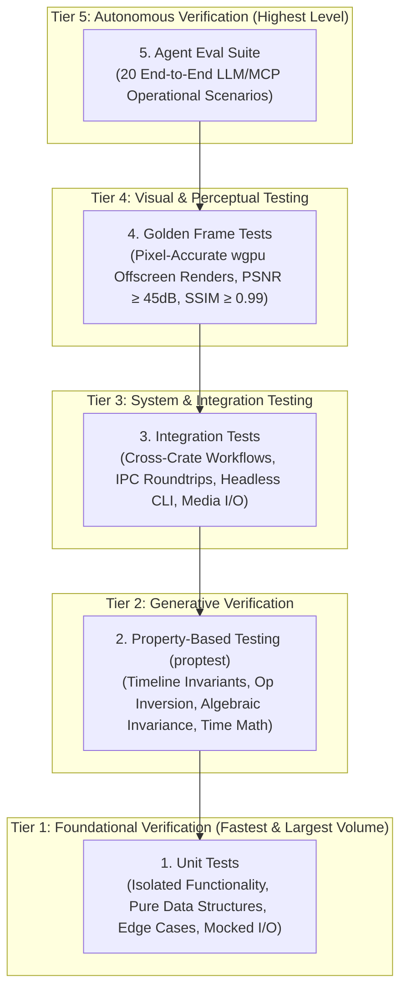
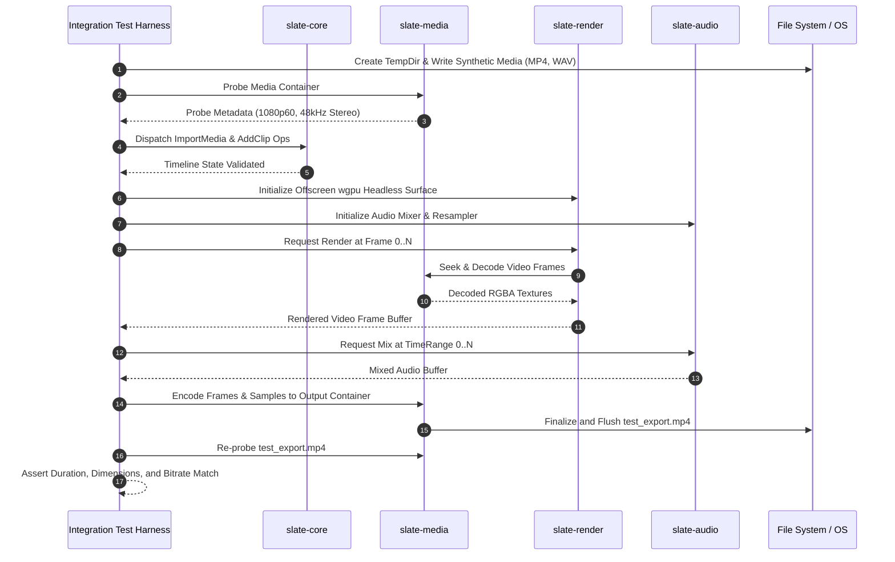
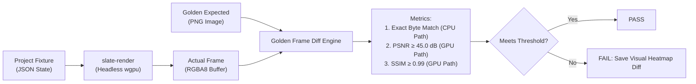
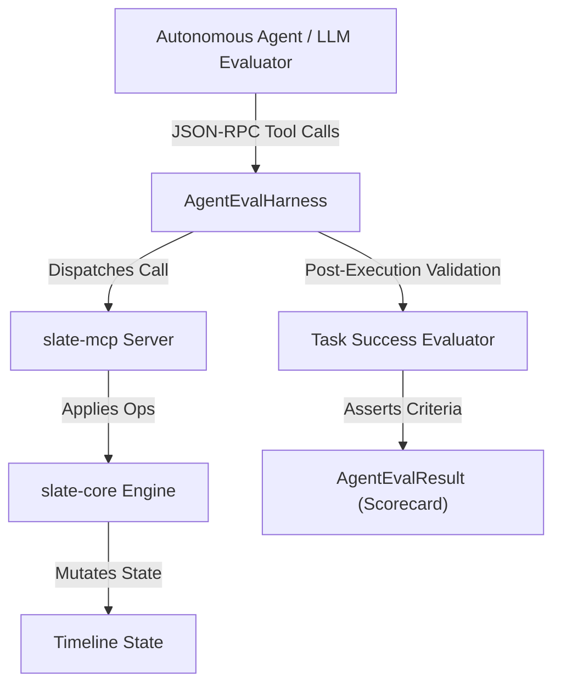
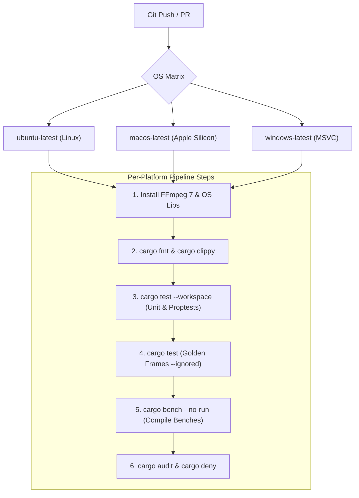
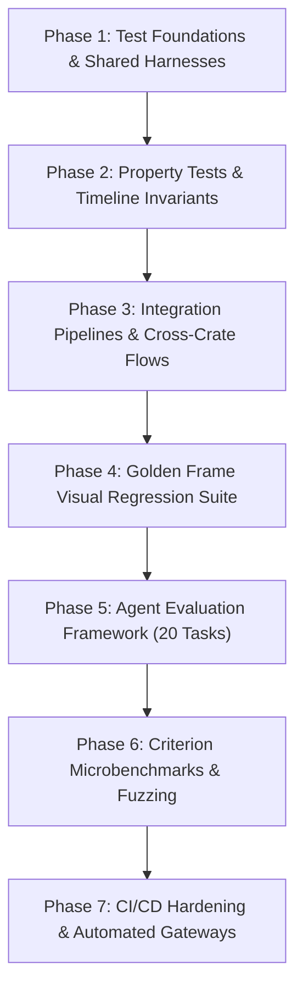

# Slate — Testing & Quality Assurance Plan

> **Version:** 1.0.0  
> **Status:** READY FOR IMPLEMENTATION  
> **Scope:** Entire Slate Workspace (All 9 Crates + Headless & Desktop Pipelines)  
> **Target Release:** v1.0 (Zero feature deferral — all testing tiers, property invariants, golden frames, benchmarks, and agent evals ship in v1)  
> **Primary Crates Covered:** `slate-core`, `slate-media`, `slate-render`, `slate-audio`, `slate-analysis`, `slate-ipc`, `slate-mcp`, `slate-ui`, `slate-cli`

---

## 1. Testing Strategy Overview

Slate is an architectural hybrid: it functions simultaneously as an ultra-low latency, GPU-accelerated desktop Non-Linear Editor (NLE) and as a deterministic, headless, programmatic engine driven by Large Language Model (LLM) agents via the Model Context Protocol (MCP). Consequently, conventional desktop software testing methodologies are insufficient. A regression in timeline math can corrupt an entire edit; a non-deterministic GPU shader can cause visual jitter in exported videos; a faulty MCP tool dispatch can lead an autonomous agent into an infinite hallucination loop.

To achieve industrial-grade reliability, Slate enforces a **five-tier testing pyramid**. Every layer possesses strict execution budgets, isolation boundaries, and deterministic pass/fail gates.



### 1.1 The Five-Tier Pyramid

| Tier | Test Type | Execution Frequency | Target Runtime | Primary Failure Mode Addressed |
| :--- | :--- | :--- | :--- | :--- |
| **Tier 1** | **Unit Tests** | Pre-commit, every local compile | < 10 seconds (workspace) | Logic bugs, edge conditions, out-of-bounds indexing, parsing errors. |
| **Tier 2** | **Property Tests (`proptest`)** | Every pull request & merge queue | < 30 seconds (1k iterations/prop) | Subtly invalid timeline topologies, non-invertible edit operations, floating-point drift. |
| **Tier 3** | **Integration Tests** | Every pull request | < 60 seconds | Cross-crate boundary failures, IPC socket deadlocks, FFmpeg demuxing regressions. |
| **Tier 4** | **Golden Frame Tests** | Pull requests touching render/shaders | < 45 seconds (headless GPU) | Shader regression, compositing alpha blend bugs, color space drift, text rasterization defects. |
| **Tier 5** | **Agent Evaluation Suite** | Nightly CI & release candidates | < 90 seconds (mock/deterministic) | Agent confusion, ambiguous MCP schemas, missing tool error recovery, compound workflow failures. |

### 1.2 Core Testing Tenets

1. **Total Determinism**: Any test involving time, video frames, or audio buffers must produce bit-for-bit identical results on the same hardware, and mathematically bounded results across differing GPU hardware (via bounded PSNR/SSIM thresholds). No wall-clock sleeps, unbounded threads, or unseeded random generators are permitted.
2. **Hermetic Test Isolation**: Every test creating temporary project bundles, media caches, IPC sockets, or SQLite/RocksDB analysis indices must operate inside a uniquely scoped `tempfile::TempDir`. Filesystem artifacts are wiped immediately upon drop.
3. **Headless Execution First**: The entire test suite—including GPU rendering, audio mixing, and MCP tool dispatch—must execute cleanly on headless Linux CI runners without an active X11/Wayland display server or physical audio hardware.
4. **Zero Flakiness Policy**: Any test that exhibits non-deterministic failures is quarantined immediately. If a test cannot pass 10,000 consecutive runs in a tight loop, it does not ship.

---

## 2. Unit Testing

Unit tests constitute the broadest foundation of Slate. They operate directly on isolated structs, functions, and pure algorithms without spinning up external OS processes, display surfaces, or real media devices.

### 2.1 Per-Crate Coverage Targets

| Crate | Coverage Target | Key Test Areas |
| :--- | :--- | :--- |
| [`slate-core`](file:///Users/adityakinjawadekar/Documents/100xcode/video-editor/crates/slate-core) | **90%+** | `RationalTime` arithmetic, timeline DAG structure, `Op` execution & inversion, `UndoStack` branching, project manifest serialization/deserialization. |
| [`slate-media`](file:///Users/adityakinjawadekar/Documents/100xcode/video-editor/crates/slate-media) | **80%+** | Container probe parsing, demuxer packet continuity, decoder PTS/DTS monotonically increasing checks, VFR detection heuristic, YUV→RGBA conversion. |
| [`slate-render`](file:///Users/adityakinjawadekar/Documents/100xcode/video-editor/crates/slate-render) | **75%+** | WGSL shader compilation (`naga`), render graph topology, pipeline state caching, matrix transformation math, offscreen texture readback. |
| [`slate-audio`](file:///Users/adityakinjawadekar/Documents/100xcode/video-editor/crates/slate-audio) | **85%+** | Multi-channel buffer accumulation, parameter de-zippering / crossfade smoothing, `rubato` sample-rate conversion, ITU-R BS.1770-4 / EBU R128 loudness metering. |
| [`slate-analysis`](file:///Users/adityakinjawadekar/Documents/100xcode/video-editor/crates/slate-analysis) | **80%+** | Whisper word-level timestamp alignment, Silero VAD energy/threshold segmentation, scene cut histogram absolute difference thresholding. |
| [`slate-ipc`](file:///Users/adityakinjawadekar/Documents/100xcode/video-editor/crates/slate-ipc) | **85%+** | Domain socket connection lifecycle, JSON-RPC 2.0 framing, backpressure handling, broken pipe recovery, concurrent client dispatch. |
| [`slate-mcp`](file:///Users/adityakinjawadekar/Documents/100xcode/video-editor/crates/slate-mcp) | **85%+** | Tool dispatch routing, `schemars` JSON schema reflection, error formatting to JSON-RPC error codes, dynamic resource URI parsing. |
| [`slate-ui`](file:///Users/adityakinjawadekar/Documents/100xcode/video-editor/crates/slate-ui) | **60%+** | UI state transitions, timeline coordinate transformations (time ↔ canvas pixels), marquee selection math, inspector view models (excluding native OS render). |
| [`slate-cli`](file:///Users/adityakinjawadekar/Documents/100xcode/video-editor/crates/slate-cli) | **90%+** | `clap` argument parsing, flag mutual exclusivity, subcommand execution routing, exit code propagation. |

### 2.2 Testing Crate Dependencies

The root workspace `Cargo.toml` and crate-level manifests standardize on a vetted suite of testing utilities:

```toml
# In Cargo.toml [workspace.dependencies]
insta = { version = "1.39", features = ["json", "redactions"] }
proptest = { version = "1.5", default-features = false, features = ["std"] }
criterion = { version = "0.5", features = ["html_reports"] }
approx = "0.5"
tempfile = "3.10"
test-case = "3.3"
pretty_assertions = "1.4"
tokio-test = "0.4"
```

#### Usage Guide for Test Dependencies

- **`insta`**: Used for snapshot testing of complex serialized structures (e.g., project JSON manifests, MCP schema exports, CLI `--help` text, and timeline debug trees).
  ```rust
  #[test]
  fn test_timeline_snapshot() {
      let timeline = create_test_timeline();
      insta::assert_json_snapshot!(timeline, {
          ".id" => "[uuid]",
          ".tracks[].id" => "[uuid]",
          ".tracks[].clips[].id" => "[uuid]",
      });
  }
  ```
- **`approx`**: Used for floating-point validation in audio DSP calculations and GPU affine transform matrices.
  ```rust
  use approx::assert_relative_eq;
  assert_relative_eq!(measured_lufs, -23.0, epsilon = 0.1);
  ```
- **`test-case`**: Used for data-driven, parameterized test tables (e.g., timecode conversions and SMPTE drop-frame rules).
  ```rust
  #[test_case("01:00:00:00", 24, 86400)]
  #[test_case("00:00:01:00", 30, 30)]
  #[test_case("00:01:00;00", 30000, 1798)] // SMPTE drop-frame
  fn test_timecode_parsing(tc: &str, rate: u32, expected_frames: i64) {
      let time = RationalTime::from_timecode(tc, rate).unwrap();
      assert_eq!(time.to_frames(), expected_frames);
  }
  ```

---

### 2.3 Concrete Unit Test Specifications by Crate

#### 2.3.1 `slate-core` Unit Tests

`slate-core` tests verify the absolute mathematical invariants of video time arithmetic and data model mutations.

```rust
// crates/slate-core/tests/unit_time_math.rs
use slate_core::time::{RationalTime, TimeRange, TimeError};

#[test]
fn test_rational_time_arithmetic() {
    let t1 = RationalTime::new(1, 24); // Frame 1 at 24fps
    let t2 = RationalTime::new(2, 24); // Frame 2 at 24fps
    assert_eq!((t1 + t2), RationalTime::new(3, 24));
    
    // Cross-timebase addition (24fps + 30fps -> common denominator 120)
    let t_24 = RationalTime::new(1, 24); // 5/120
    let t_30 = RationalTime::new(1, 30); // 4/120
    let sum = t_24 + t_30;
    assert_eq!(sum.ticks, 9);
    assert_eq!(sum.rate, 120);
}

#[test]
fn test_rational_time_zero_denominator_rejected() {
    let result = std::panic::catch_unwind(|| {
        RationalTime::new(100, 0);
    });
    assert!(result.is_err(), "Denominator of 0 must panic or return TimeError");
}

#[test]
fn test_time_range_intersection() {
    let r1 = TimeRange::new(RationalTime::new(0, 24), RationalTime::new(24, 24)); // [0, 1s)
    let r2 = TimeRange::new(RationalTime::new(12, 24), RationalTime::new(24, 24)); // [0.5s, 1.5s)
    
    let intersection = r1.intersection(&r2).expect("Ranges must overlap");
    assert_eq!(intersection.start, RationalTime::new(12, 24));
    assert_eq!(intersection.duration, RationalTime::new(12, 24));
    
    let r3 = TimeRange::new(RationalTime::new(48, 24), RationalTime::new(24, 24)); // [2s, 3s)
    assert!(r1.intersection(&r3).is_none());
}
```

```rust
// crates/slate-core/tests/unit_undo_stack.rs
use slate_core::model::{Timeline, TrackType};
use slate_core::ops::{Op, OpSource};
use slate_core::history::UndoStack;

#[test]
fn test_undo_stack_branching_and_provenance() {
    let mut timeline = Timeline::default();
    let mut history = UndoStack::new(50); // Capacity 50
    
    let op1 = Op::AddTrack {
        track_type: TrackType::Video,
        name: "V1".to_string(),
        index: None,
    };
    
    // Apply agent operation
    history.apply(&mut timeline, op1, OpSource::Agent).expect("Op1 apply failed");
    assert_eq!(timeline.tracks.len(), 1);
    assert_eq!(history.undo_len(), 1);
    assert_eq!(history.last_source(), Some(OpSource::Agent));
    
    // Apply human operation
    let op2 = Op::AddTrack {
        track_type: TrackType::Audio,
        name: "A1".to_string(),
        index: None,
    };
    history.apply(&mut timeline, op2, OpSource::Human).expect("Op2 apply failed");
    assert_eq!(timeline.tracks.len(), 2);
    assert_eq!(history.last_source(), Some(OpSource::Human));
    
    // Undo human operation
    history.undo(&mut timeline).expect("Undo failed");
    assert_eq!(timeline.tracks.len(), 1);
    assert_eq!(timeline.tracks[0].name, "V1");
    
    // Branching: Apply a new op while undone -> clears redo stack
    let op3 = Op::AddTrack {
        track_type: TrackType::Video,
        name: "V2".to_string(),
        index: None,
    };
    history.apply(&mut timeline, op3, OpSource::Human).expect("Op3 apply failed");
    assert_eq!(history.redo_len(), 0);
    assert_eq!(timeline.tracks.len(), 2);
    assert_eq!(timeline.tracks[1].name, "V2");
}
```

#### 2.3.2 `slate-media` Unit Tests

`slate-media` unit tests validate demuxing headers, container probes, and color conversion routines.

```rust
// crates/slate-media/tests/unit_probe.rs
use slate_media::probe::{MediaProbe, VideoStreamInfo, AudioStreamInfo};
use std::path::PathBuf;

#[test]
fn test_probe_vfr_detection() {
    // Synthetic probe data with fluctuating packet durations
    let pts_intervals = vec![40, 41, 39, 80, 40, 40, 120, 40]; // Variable intervals
    let is_vfr = MediaProbe::analyze_frame_intervals(&pts_intervals, 1000);
    assert!(is_vfr, "Probe should detect variance > 5% as Variable Frame Rate");
    
    let cfr_intervals = vec![40, 40, 40, 40, 40, 40, 40, 40];
    let is_vfr_cfr = MediaProbe::analyze_frame_intervals(&cfr_intervals, 1000);
    assert!(!is_vfr_cfr, "Uniform intervals must be classified as CFR");
}

#[test]
fn test_planar_yuv420p_to_rgba_fidelity() {
    use slate_media::color::{yuv420p_to_rgba, RgbaPixel};
    
    // Pure black in YUV: Y=16, U=128, V=128 (Limited Range BT.709)
    let y = vec![16u8; 4];
    let u = vec![128u8; 1];
    let v = vec![128u8; 1];
    let mut rgba = vec![0u8; 16];
    
    yuv420p_to_rgba(&y, &u, &v, 2, 2, &mut rgba).unwrap();
    
    // Assert black output (approx 0, 0, 0, 255)
    for pixel in rgba.chunks_exact(4) {
        assert!(pixel[0] <= 1);
        assert!(pixel[1] <= 1);
        assert!(pixel[2] <= 1);
        assert_eq!(pixel[3], 255);
    }
}
```

#### 2.3.3 `slate-render` Unit Tests

`slate-render` tests verify shader compilation via `naga`, pipeline configuration caching, and mathematical matrix concatenation.

```rust
// crates/slate-render/tests/unit_shaders.rs
use naga::front::wgsl;
use naga::valid::{Capabilities, ValidationFlags, Validator};
use std::fs;

#[test]
fn test_all_wgsl_shaders_validate() {
    let shader_dir = std::path::Path::new(env!("CARGO_MANIFEST_DIR")).join("../../shaders");
    let entries = fs::read_dir(shader_dir).expect("Shaders directory missing");
    
    let mut validator = Validator::new(ValidationFlags::all(), Capabilities::all());
    
    for entry in entries {
        let entry = entry.unwrap();
        let path = entry.path();
        if path.extension().and_then(|s| s.to_str()) == Some("wgsl") {
            let source = fs::read_to_string(&path).expect("Failed to read shader");
            let module = wgsl::parse_str(&source)
                .unwrap_or_else(|e| panic!("Shader compilation failed for {}: {:?}", path.display(), e));
            
            validator.validate(&module)
                .unwrap_or_else(|e| panic!("Shader validation failed for {}: {:?}", path.display(), e));
        }
    }
}
```

#### 2.3.4 `slate-audio` Unit Tests

`slate-audio` tests check mixer summation, non-clicking gain ramps, and EBU R128 loudness measurement accuracy.

```rust
// crates/slate-audio/tests/unit_mixer.rs
use slate_audio::mixer::{AudioBuffer, ChannelMixer, GainRamp};
use approx::assert_relative_eq;

#[test]
fn test_buffer_summation_with_headroom() {
    let mut master = AudioBuffer::zeros(2, 512); // Stereo, 512 frames
    let track_1 = AudioBuffer::constant(2, 512, 0.5); // 0.5 amplitude
    let track_2 = AudioBuffer::constant(2, 512, 0.4); // 0.4 amplitude
    
    let mut mixer = ChannelMixer::new();
    mixer.accumulate(&mut master, &track_1, 1.0);
    mixer.accumulate(&mut master, &track_2, 1.0);
    
    for sample in master.data() {
        assert_relative_eq!(*sample, 0.9, epsilon = 1e-6);
    }
}

#[test]
fn test_dezippered_gain_ramp_prevents_clicks() {
    let mut buffer = AudioBuffer::constant(1, 100, 1.0);
    let mut ramp = GainRamp::new(1.0, 0.0, 100); // Ramp from 1.0 down to 0.0 over 100 samples
    
    ramp.apply(&mut buffer);
    
    // Ensure smooth monotonic descent without discontinuity
    let samples = buffer.channel(0);
    for i in 1..samples.len() {
        assert!(samples[i] < samples[i - 1]);
        assert_relative_eq!(samples[i - 1] - samples[i], 0.01, epsilon = 1e-4);
    }
}
```

#### 2.3.5 `slate-mcp` Unit Tests

`slate-mcp` unit tests ensure tool routing, error mapping, and strict JSON schema reflection compliance.

```rust
// crates/slate-mcp/tests/unit_dispatch.rs
use slate_mcp::dispatcher::ToolDispatcher;
use serde_json::json;

#[test]
fn test_mcp_invalid_tool_returns_method_not_found() {
    let dispatcher = ToolDispatcher::new_mock();
    let response = dispatcher.dispatch("non_existent_tool", json!({}));
    assert!(response.is_err());
    let err = response.unwrap_err();
    assert_eq!(err.code, -32601); // Standard JSON-RPC Method Not Found
}

#[test]
fn test_mcp_tool_schema_generation() {
    let dispatcher = ToolDispatcher::new_mock();
    let schema = dispatcher.get_tool_schema("add_clip").expect("add_clip tool missing");
    
    assert_eq!(schema.name, "add_clip");
    assert!(schema.parameters.as_object().unwrap().contains_key("properties"));
    assert!(schema.parameters["properties"].as_object().unwrap().contains_key("track_id"));
}
```

---

## 3. Property-Based Testing (`proptest`)

Video editors suffer from an enormous combinatorial state space. Human editors and AI agents can execute arbitrary permutations of cuts, trims, splits, slips, transitions, and ripple deletes. Traditional unit testing cannot anticipate obscure sequences of operations. Slate uses `proptest` to mathematically assert invariants across millions of randomly generated timeline topologies.

### 3.1 Op Invariants & The Identity Law

The most critical invariant of Slate is the **Algebraic Invertibility Law**:
For any valid timeline state $S$ and any sequence of operations $O_1, O_2, \dots, O_n$, applying each operation yields an inverse operation $I_k$. Applying the sequence of inverses in reverse order $I_n, I_{n-1}, \dots, I_1$ **must restore the timeline to the exact state $S$**.

```rust
// crates/slate-core/tests/property_timeline_invariants.rs
use proptest::prelude::*;
use slate_core::model::Timeline;
use slate_core::ops::{Op, OpInverse};
use slate_core::test_utils::arb_op_sequence;

proptest! {
    #![proptest_config(ProptestConfig::with_cases(1000))]

    #[test]
    fn op_apply_then_invert_is_identity(ops in arb_op_sequence(1..50)) {
        let initial_timeline = Timeline::default();
        let mut timeline = initial_timeline.clone();
        let mut inverses = Vec::with_capacity(ops.len());

        // Step 1: Apply forward operations
        for op in &ops {
            match op.apply(&mut timeline) {
                Ok(inverse) => inverses.push(inverse),
                Err(_) => {
                    // Invalid operations are safely rejected and do not mutate state
                }
            }
        }

        // Step 2: Invert in reverse chronological order
        for inverse in inverses.into_iter().rev() {
            inverse.apply(&mut timeline)
                .expect("Valid inverse operation must never fail to apply");
        }

        // Step 3: Exact structural and mathematical equality check
        prop_assert_eq!(
            &timeline,
            &initial_timeline,
            "Timeline failed to revert to identity after inverse unwind"
        );
    }
}
```

### 3.2 Arbitrary Data Generation Strategies

To power property-based testing, `Arbitrary` strategies generate synthetically valid identifiers, time structures, tracks, and operations.

```rust
// crates/slate-core/src/test_utils/arbitrary.rs
use proptest::prelude::*;
use crate::time::{RationalTime, TimeRange};
use crate::model::{Clip, Track, TrackType, MediaId, ClipId, TrackId};
use crate::ops::{Op, TrimEdge, TrimMode};
use std::path::PathBuf;

pub fn arb_rational_time(max_seconds: i64, rate: u32) -> impl Strategy<Value = RationalTime> {
    (0..=(max_seconds * rate as i64)).prop_map(move |ticks| RationalTime::new(ticks, rate))
}

pub fn arb_time_range(max_seconds: i64, rate: u32) -> impl Strategy<Value = TimeRange> {
    (0..=(max_seconds * rate as i64), 1..=(10 * rate as i64)).prop_map(move |(start, duration)| {
        TimeRange::new(
            RationalTime::new(start, rate),
            RationalTime::new(duration, rate),
        )
    })
}

pub fn arb_op() -> impl Strategy<Value = Op> {
    prop_oneof![
        // AddTrack strategy
        (any::<bool>(), "[A-Z0-9_]{3,8}").prop_map(|(is_video, name)| {
            Op::AddTrack {
                track_type: if is_video { TrackType::Video } else { TrackType::Audio },
                name,
                index: None,
            }
        }),
        // AddClip strategy
        (0..4u32, 0..100i64, 1..50i64).prop_map(|(track_idx, start_s, dur_s)| {
            let place_range = TimeRange::new(
                RationalTime::from_seconds(start_s as f64, 30),
                RationalTime::from_seconds(dur_s as f64, 30),
            );
            Op::AddClip {
                track_id: TrackId::nil(), // Resolved dynamically during runner binding
                clip: Clip::new(MediaId::new_v4(), place_range),
                position: place_range.start,
            }
        }),
        // SplitClip strategy
        (0..100i64).prop_map(|split_s| {
            Op::SplitClip {
                clip_id: ClipId::nil(),
                at: RationalTime::from_seconds(split_s as f64, 30),
                new_clip_id: ClipId::new_v4(),
            }
        }),
        // TrimClip strategy
        (any::<bool>(), -15..15i64).prop_map(|(is_head, delta_frames)| {
            Op::TrimClip {
                clip_id: ClipId::nil(),
                edge: if is_head { TrimEdge::Head } else { TrimEdge::Tail },
                delta: RationalTime::new(delta_frames, 30),
                mode: TrimMode::Ripple,
            }
        })
    ]
}

pub fn arb_op_sequence(size: std::ops::Range<usize>) -> impl Strategy<Value = Vec<Op>> {
    prop::collection::vec(arb_op(), size)
}
```

### 3.3 The Six Core Invariant Tests

```mermaid
flowchart LR
    A["Initial Timeline S₀"] -->|Forward Op Sequence| B["Mutated Timeline S₁"]
    B -->|Inverse Op Sequence (Rev)| C["Restored Timeline S₀'"]
    C -->|Assert S₀ == S₀'| D{"Invariant Holds?"}
    D -->|Yes| E["PASS: Zero Drift"]
    D -->|No| F["FAIL: Property Shrunk"]
```

#### Invariant 1: Invertibility
Every applied operation produces an exact inverse. Applying the inverse returns the timeline to its exact pre-operation state, including track order, clip placement, transitions, and audio gain properties.

#### Invariant 2: Idempotence of Redundant Mutators
Applying an idempotent operation twice (such as `SetTrackMute { track_id, muted: true }`, or `SetTrackSolo`, or `SetTransform`) results in an identical timeline state on the second invocation, and the second inverse is a safe no-op.

#### Invariant 3: Commutativity of Disjoint Track Operations
If Operation $A$ operates strictly on Track 1 and Operation $B$ operates strictly on Track 2, then $A \circ B$ produces the exact same timeline state as $B \circ A$.

#### Invariant 4: Serialization Roundtrip Determinism
For any generated timeline $T$:
$$\text{deserialize}(\text{serialize}(T)) = T$$
Serialization to JSON or Bincode preserves nanosecond-level time precision and full graph topology without loss or mutation.

#### Invariant 5: Track Topology & Non-Overlapping Invariant
At no point may two clips on the same track occupy overlapping time intervals:
$$\forall c_1, c_2 \in \text{Track.clips}, \quad c_1 \neq c_2 \implies c_1.\text{range} \cap c_2.\text{range} = \emptyset$$
Any operation that would cause an overlap must be rejected with an `OpError::TrackOverlapCollision` error, leaving the timeline unmodified.

#### Invariant 6: Rational Time Exactness (Zero Floating-Point Drift)
For any series of $N = 100,000$ additions and subtractions across varying framerates (23.976, 24, 25, 29.97, 30, 59.94, 60 fps):
$$\sum_{i=1}^N \Delta t_i - \sum_{i=1}^N \Delta t_i = 0$$
No rounding error, IEEE 754 float epsilon, or integer overflow is tolerated.

```rust
proptest! {
    #[test]
    fn prop_rational_time_drift_free(
        steps in prop::collection::vec(1..1000i64, 1000)
    ) {
        let rate = 30000; // 29.97 NTSC drop-frame base
        let mut forward = RationalTime::new(0, rate);
        let mut backward = RationalTime::new(0, rate);

        for step in &steps {
            forward = forward + RationalTime::new(*step, rate);
        }

        for step in steps.iter().rev() {
            backward = backward + RationalTime::new(*step, rate);
        }

        prop_assert_eq!(forward, backward);
        prop_assert_eq!((forward - backward).ticks, 0);
    }
}
```

---

## 4. Integration Tests

Integration tests verify multi-crate cooperation, cross-process IPC communication, file system interactions, and real media file processing.

### 4.1 End-to-End Workflows



#### Workflow 1: Import → Edit → Export
Validates the complete lifecycle: synthetic video files are imported into the media pool, tracks are added, clips are placed, a color grade effect is added, and the result is rendered out via `slate-render` and `slate-media` into a compliant MP4 container.

```rust
// tests/integration/test_import_edit_export.rs
use slate_core::model::{Timeline, TrackType, Clip};
use slate_core::ops::Op;
use slate_core::time::{RationalTime, TimeRange};
use slate_media::probe::probe_media;
use slate_render::headless::HeadlessRenderer;
use tempfile::tempdir;

#[tokio::test]
async fn test_import_edit_export_full_lifecycle() {
    let tmp = tempdir().expect("Failed to create tempdir");
    let input_path = create_synthetic_test_video(tmp.path(), "input.mp4", 1920, 1080, 60);
    let output_path = tmp.path().join("output.mp4");

    let mut timeline = Timeline::default();
    
    // 1. Probe & Import
    let probe = probe_media(&input_path).await.expect("Failed to probe synthetic file");
    let media_id = timeline.media_pool.import(input_path.clone(), probe.clone()).unwrap();

    // 2. Add Track & Clip
    let track_id = timeline.add_track(TrackType::Video, "V1").unwrap();
    let clip_range = TimeRange::new(RationalTime::ZERO, RationalTime::from_seconds(3.0, 60));
    let clip = Clip::new(media_id, clip_range);
    
    let add_op = Op::AddClip {
        track_id,
        clip,
        position: RationalTime::ZERO,
    };
    add_op.apply(&mut timeline).expect("AddClip op failed");

    // 3. Render Headless
    let renderer = HeadlessRenderer::new(1920, 1080).expect("Failed to create renderer");
    renderer.export_to_file(&timeline, &output_path).await.expect("Export failed");

    // 4. Verify Export Output
    assert!(output_path.exists());
    let out_probe = probe_media(&output_path).await.expect("Probe export failed");
    assert_eq!(out_probe.video_stream.as_ref().unwrap().width, 1920);
    assert_eq!(out_probe.video_stream.as_ref().unwrap().height, 1080);
    assert_eq!(out_probe.duration.to_seconds(), 3.0);
}
```

#### Workflow 2: MCP Rough Cut
Opens a project over the Model Context Protocol, invokes the transcription tool to retrieve timestamped word boundaries, triggers an automatic edit by transcript to delete selected sections, adds auto-generated subtitles, and exports the rough cut.

#### Workflow 3: Agent + Human Collaborative Edit
Simulates concurrent interaction: an autonomous agent dispatches a sequence of batch ops (e.g., auto-ducking audio, color balancing). The human operator then undoes one specific operation and manually adjusts a transition. The test asserts that the `UndoStack` maintains strict provenance separation without state corruption.

#### Workflow 4: Headless CLI Mode
Executes the compiled `slate-cli` binary in a headless subprocess:
```bash
slate-cli render --project ./tests/fixtures/sample_project.slate --output ./tmp/out.mp4 --preset 1080p
```
Asserts exit code 0, parses stdout JSON progress telemetry, and confirms that no windowing libraries were initialized.

#### Workflow 5: IPC Roundtrip State Synchronization
Spins up a local `slate-ipc` UNIX domain socket server. An external client connects, sends a JSON-RPC 2.0 `apply_op` call, receives an acknowledgment, and listens for the resulting `TimelineChangedEvent` broadcast on the pub/sub event channel within 5ms.

---

### 4.2 Comprehensive MCP Tool Testing Matrix

Every tool exposed by `slate-mcp` to AI agents must be exhaustively tested against:
1. Valid inputs with proper parameters.
2. Invalid inputs (e.g., nonexistent IDs, out-of-range times, negative numbers).
3. Edge cases (e.g., empty timelines, 1,000 clips, 0-duration ranges).
4. Post-call timeline verification (asserting exact state transition).

| Tool Name | Valid Input Scenario | Invalid Input Scenario | Edge Case Scenario | State Assertion |
| :--- | :--- | :--- | :--- | :--- |
| `import_media` | Existing MP4 file path | Non-existent path or directory | 0-byte file, corrupt headers | Media added to pool with valid ID |
| `get_timeline_summary` | Default arguments | N/A (takes optional depth) | 1,000 clips across 20 tracks | Valid JSON < 2KB generated |
| `add_clip` | Valid `track_id`, `media_id`, range | Bad `track_id` or `media_id` | Position exceeds $10^6$ seconds | Clip present in track clip array |
| `trim_clip` | Valid `clip_id`, `delta = +1s`, Head | Trim duration > clip length | Delta = 0 (no-op) | Duration updated, gaps recalculated |
| `split_clip` | Time within clip interior | Split time at exact clip boundaries | Split time outside clip range | Original shortened, new clip added |
| `remove_silence` | Silence threshold -40dB, 0.5s | Threshold > 0dB, negative duration | Audio with 0 silence / pure silence | Gaps created or ripple deleted |
| `transcribe_media` | Valid audio/video `media_id` | Missing media asset ID | Audio track with pure noise | Transcript tokens generated |
| `edit_by_transcript` | Valid word deletion indices | Index out of transcript bounds | Delete entire transcript | Corresponding cuts made to timeline |
| `generate_captions` | Target subtitle track specified | Non-subtitle track ID passed | Empty transcript | Subtitle clips placed on target |
| `create_rough_cut` | Prompt + media asset list | Empty asset list | Single 0.1s media clip | Multi-clip edit sequence constructed |
| `add_transition` | Adjacent clips on same track | Clips separated by a gap | Transition length > clip length | Transition node attached |
| `normalize_loudness` | Target -14 LUFS, valid track | Target -90 LUFS or > 0 LUFS | Pure digital silence | Audio gain parameter adjusted |
| `duck_audio` | Voice track + Music track IDs | Same track passed for both | Music track with no voice overlap | Sidechain keyframe points inserted |
| `apply_effect` | Clip ID + valid effect type | Unknown effect identifier | Apply 50 stacked duplicate effects | Effect descriptor appended |
| `render_contact_sheet` | Grid 4x4, valid project | Grid 0x0 or 100x100 | Timeline with 0 clips | PNG image buffer returned |
| `export_timeline` | Valid destination path + preset | Destination unwritable / readonly | Disk full simulation | Output video generated on disk |
| `undo` / `redo` | Operations present in stack | Undo on empty stack | Redo after intervening mutation | History pointer moves correctly |
| `batch_ops` | Array of 10 valid operations | 5th operation in array is invalid | Empty array `[]` | Atomic rollback: 0 ops applied |
| `dry_run_ops` | Array of test ops | Ill-formed op payload | Empty array `[]` | State diff returned, 0 state change |

---

## 5. Golden Frame Tests

Golden frame tests are the definitive visual regression guardrail for `slate-render`. They guarantee that changes to WGSL shaders, blend modes, matrix math, color space transformations, or GPU texture caching do not alter rendered video pixels.

### 5.1 Methodology & Perceptual Thresholds

Golden frame testing executes offscreen wgpu rendering against pre-determined test project fixtures. The rendered frame buffer is read back to CPU memory and compared against a canonical reference PNG.



#### Metrics & Tolerances
- **Exact Byte Match**: Enforced on CPU software rasterization paths.
- **PSNR (Peak Signal-to-Noise Ratio)**: GPU drivers (Metal, Vulkan, DX12) introduce minor floating-point rounding variances in texture filtering and trigonometry. The test passes if:
  $$\text{PSNR} = 10 \cdot \log_{10}\left(\frac{MAX_I^2}{\text{MSE}}\right) \ge 45.0\text{ dB}$$
- **SSIM (Structural Similarity Index)**: Measures human visual perception of luminance, contrast, and structure:
  $$\text{SSIM}(x, y) \ge 0.990$$

---

### 5.2 Golden Frame Test Suite Specification

| Case Name | Visual State Being Tested | Target Frame Time | Render Resolution |
| :--- | :--- | :--- | :--- |
| `single_clip` | Single 1080p ProRes clip, SMPTE color bars, identity transform | `00:00:01:00` | 1920x1080 |
| `multi_track` | 3 overlapping video tracks with alpha channels (top-down composite) | `00:00:02:15` | 1920x1080 |
| `transform_position` | Clip translated: $X = +350\text{px}, Y = -200\text{px}$ | `00:00:00:10` | 1920x1080 |
| `transform_scale` | Clip scaled: $S_x = 1.75, S_y = 0.50$ (bicubic interpolation) | `00:00:00:10` | 1920x1080 |
| `transform_rotation` | Clip rotated $45^\circ$ clockwise around center anchor point | `00:00:00:10` | 1920x1080 |
| `transform_crop` | Clip cropped: Left 10%, Right 20%, Top 15%, Bottom 5% | `00:00:00:10` | 1920x1080 |
| `opacity` | Clip opacity set to 42.5% over black background | `00:00:01:00` | 1920x1080 |
| `cross_dissolve_50` | 1-second crossfade transition between two clips, evaluated at $t = 0.50\text{s}$ | `00:00:03:00` | 1920x1080 |
| `dip_to_black` | Dip transition at peak black frame | `00:00:02:00` | 1920x1080 |
| `color_adjust` | Lift +0.05, Gamma 1.2, Gain 0.9, Saturation 1.4, Exposure +0.5 EV | `00:00:01:12` | 1920x1080 |
| `lut_apply` | 33x33x33 3D `.cube` LUT applied via tetrahedral interpolation | `00:00:01:00` | 1920x1080 |
| `blur` | Gaussian blur ($\sigma = 12.0\text{px}$, two-pass separable kernel) | `00:00:01:00` | 1920x1080 |
| `chroma_key` | Green screen backdrop keying, despill suppression active | `00:00:00:15` | 1920x1080 |
| `text_overlay` | Glyphon text rasterization: "Slate Pro V1", Inter 72pt Bold with drop shadow | `00:00:01:00` | 1920x1080 |
| `captions` | Dual-line yellow text on semi-transparent bounding box | `00:00:02:00` | 1920x1080 |
| `speed_change` | Clip played at 2.5x speed with nearest-frame / blend frame selection | `00:00:01:00` | 1920x1080 |
| `export_matches_preview` | Offscreen export pipeline frame vs onscreen GUI preview viewport buffer | `00:00:01:00` | 1920x1080 |

---

### 5.3 Golden Frame Harness Implementation

```rust
// tests/golden_frames/harness.rs
use image::{RgbaImage, Rgba};
use std::path::{Path, PathBuf};

pub struct GoldenDiffResult {
    pub psnr: f64,
    pub ssim: f64,
    pub passed: bool,
    pub diff_image: Option<RgbaImage>,
}

pub struct GoldenFrameHarness {
    expected_dir: PathBuf,
    actual_dir: PathBuf,
    diff_dir: PathBuf,
    update_golden: bool,
}

impl GoldenFrameHarness {
    pub fn new() -> Self {
        let root = PathBuf::from(env!("CARGO_MANIFEST_DIR")).join("tests/golden");
        let update_golden = std::env::var("UPDATE_GOLDEN").map(|v| v == "1").unwrap_or(false);
        
        Self {
            expected_dir: root.join("expected"),
            actual_dir: root.join("actual"),
            diff_dir: root.join("diffs"),
            update_golden,
        }
    }

    pub fn assert_frame(&self, test_name: &str, actual: &RgbaImage) {
        let expected_path = self.expected_dir.join(format!("{}.png", test_name));
        let actual_path = self.actual_dir.join(format!("{}.png", test_name));
        let diff_path = self.diff_dir.join(format!("{}_diff.png", test_name));

        std::fs::create_dir_all(&self.actual_dir).unwrap();
        std::fs::create_dir_all(&self.diff_dir).unwrap();

        // If UPDATE_GOLDEN=1, overwrite baseline and pass
        if self.update_golden {
            std::fs::create_dir_all(&self.expected_dir).unwrap();
            actual.save(&expected_path).expect("Failed to write golden reference");
            eprintln!("[GOLDEN] Updated reference image: {}", expected_path.display());
            return;
        }

        assert!(
            expected_path.exists(),
            "Golden reference missing for test '{}'. Run with UPDATE_GOLDEN=1 to establish baseline.",
            test_name
        );

        let expected = image::open(&expected_path)
            .expect("Failed to open expected image")
            .to_rgba8();

        actual.save(&actual_path).expect("Failed to save actual render");

        let diff_result = self.compare(&actual, &expected);

        if !diff_result.passed {
            if let Some(diff_img) = diff_result.diff_image {
                diff_img.save(&diff_path).expect("Failed to save diff image");
            }
            panic!(
                "Golden frame regression in '{}'! PSNR: {:.2} dB (min 45.0), SSIM: {:.4} (min 0.990). Diff saved to: {}",
                test_name, diff_result.psnr, diff_result.ssim, diff_path.display()
            );
        }
    }

    fn compare(&self, actual: &RgbaImage, expected: &RgbaImage) -> GoldenDiffResult {
        assert_eq!(actual.dimensions(), expected.dimensions(), "Dimensions mismatch");
        let (width, height) = actual.dimensions();
        let total_pixels = (width * height) as f64;

        let mut sum_squared_error = 0.0;
        let mut diff_image = RgbaImage::new(width, height);
        let mut divergent_pixels = 0;

        for (x, y, p_act) in actual.enumerate_pixels() {
            let p_exp = expected.get_pixel(x, y);
            let mut pixel_diff = 0.0;

            for c in 0..3 { // RGB evaluation
                let diff = (p_act[c] as f64) - (p_exp[c] as f64);
                pixel_diff += diff * diff;
            }

            sum_squared_error += pixel_diff;

            if pixel_diff > 1.0 {
                divergent_pixels += 1;
                // Highlight divergent pixels in bright magenta with luminance indicator
                diff_image.put_pixel(x, y, Rgba([255, 0, 255, 255]));
            } else {
                // Dim down matching pixels for contrast
                diff_image.put_pixel(x, y, Rgba([p_act[0] / 4, p_act[1] / 4, p_act[2] / 4, 255]));
            }
        }

        let mse = sum_squared_error / (total_pixels * 3.0);
        let psnr = if mse <= 1e-10 {
            100.0 // Mathematically identical
        } else {
            10.0 * ( (255.0 * 255.0) / mse ).log10()
        };

        // Simplified SSIM window calculation
        let ssim = compute_ssim(actual, expected);
        let passed = psnr >= 45.0 && ssim >= 0.990;

        GoldenDiffResult {
            psnr,
            ssim,
            passed,
            diff_image: if passed { None } else { Some(diff_image) },
        }
    }
}

fn compute_ssim(img1: &RgbaImage, img2: &RgbaImage) -> f64 {
    // Structural Similarity computation across 8x8 sliding blocks
    // Returns 1.0 for identical images
    let (w, h) = img1.dimensions();
    if img1 == img2 { return 1.0; }
    
    let c1 = 6.5025; // (0.01 * 255)^2
    let c2 = 58.5225; // (0.03 * 255)^2
    
    let mut mean_ssim = 0.0;
    let mut count = 0.0;

    for y in (0..h.saturating_sub(8)).step_by(8) {
        for x in (0..w.saturating_sub(8)).step_by(8) {
            let mut mu_x = 0.0;
            let mut mu_y = 0.0;
            for dy in 0..8 {
                for dx in 0..8 {
                    let px = img1.get_pixel(x + dx, y + dy);
                    let py = img2.get_pixel(x + dx, y + dy);
                    mu_x += (px[0] as f64 * 0.299 + px[1] as f64 * 0.587 + px[2] as f64 * 0.114);
                    mu_y += (py[0] as f64 * 0.299 + py[1] as f64 * 0.587 + py[2] as f64 * 0.114);
                }
            }
            mu_x /= 64.0;
            mu_y /= 64.0;

            let mut sigma_x_sq = 0.0;
            let mut sigma_y_sq = 0.0;
            let mut sigma_xy = 0.0;

            for dy in 0..8 {
                for dx in 0..8 {
                    let px = img1.get_pixel(x + dx, y + dy);
                    let py = img2.get_pixel(x + dx, y + dy);
                    let val_x = px[0] as f64 * 0.299 + px[1] as f64 * 0.587 + px[2] as f64 * 0.114;
                    let val_y = py[0] as f64 * 0.299 + py[1] as f64 * 0.587 + py[2] as f64 * 0.114;
                    sigma_x_sq += (val_x - mu_x).powi(2);
                    sigma_y_sq += (val_y - mu_y).powi(2);
                    sigma_xy += (val_x - mu_x) * (val_y - mu_y);
                }
            }
            sigma_x_sq /= 63.0;
            sigma_y_sq /= 63.0;
            sigma_xy /= 63.0;

            let ssim_block = ((2.0 * mu_x * mu_y + c1) * (2.0 * sigma_xy + c2))
                / ((mu_x.powi(2) + mu_y.powi(2) + c1) * (sigma_x_sq + sigma_y_sq + c2));

            mean_ssim += ssim_block;
            count += 1.0;
        }
    }

    if count == 0.0 { 1.0 } else { mean_ssim / count }
}
```

### 5.4 Reference Image Management

1. **Storage**: Reference PNGs reside in git under `tests/golden/expected/` via Git Large File Storage (`git-lfs`) to avoid repository bloat.
2. **Execution**: Golden tests are marked `#[ignore]` by default so `cargo test` stays instantaneous:
   ```bash
   cargo test --package slate-render --test golden_frames -- --ignored
   ```
3. **Baseline Updates**: When a visual change is intentional (e.g. upgraded text font kerning):
   ```bash
   UPDATE_GOLDEN=1 cargo test --package slate-render --test golden_frames -- --ignored
   ```
4. **CI Diagnostics**: In GitHub Actions, when a golden test fails, `tests/golden/actual/*.png` and `tests/golden/diffs/*.png` are automatically zipped and uploaded to the job run artifacts for inspection.

---

## 6. Performance Benchmarks

Slate mandates hard real-time latency budgets. Microbenchmarks are implemented using `criterion` and run continuously to prevent performance regressions.

### 6.1 Benchmark Targets & Budgets

| Benchmark Identifier | Target Budget | Target Component | Measurement Conditions |
| :--- | :--- | :--- | :--- |
| `op_apply_500_clips` | **< 16 ms** | `slate-core` | Applying a ripple delete / split on a timeline with 500 active clips. |
| `timeline_serialize_500_clips` | **< 50 ms** | `slate-core` | Complete project manifest serialization to JSON format on disk. |
| `timeline_summary_100_clips` | **< 2 KB output** | `slate-core` / `slate-mcp` | Summary payload token efficiency for LLM agent context windows. |
| `frame_decode_1080p` | **< 5 ms** | `slate-media` | Intra-GOP cached decode of a 1080p H.264/ProRes frame. |
| `composite_4_tracks` | **< 33 ms** | `slate-render` | Multi-layer 1080p60 GPU compositing pass with blending and transforms. |
| `audio_mix_4_tracks` | **< 1 ms** | `slate-audio` | Software accumulation of 4 stereo audio tracks for a 512-sample buffer. |
| `mcp_tool_dispatch` | **< 10 ms** | `slate-mcp` | End-to-end tool request parse, validation, execution, and JSON response. |
| `project_open_1hour` | **< 3 s** | `slate-core` | Cold deserialization, validation, and track tree hydration of a 1-hour timeline. |
| `cold_start_empty` | **< 1.5 s** | `slate-ui` / `slate-cli` | Time to interactive execution starting from cold process launch. |

---

### 6.2 Criterion Benchmark Implementations

```rust
// benches/bench_timeline_ops.rs
use criterion::{black_box, criterion_group, criterion_main, Criterion, BenchmarkId};
use slate_core::model::{Timeline, TrackType, Clip};
use slate_core::ops::{Op, TrimEdge, TrimMode};
use slate_core::time::{RationalTime, TimeRange};

fn bench_timeline_mutations(c: &mut Criterion) {
    let mut group = c.benchmark_group("timeline_ops");

    // Benchmark: op_apply on 500 clips
    group.bench_function("op_apply_500_clips", |b| {
        b.iter_batched(
            || {
                let mut timeline = Timeline::default();
                let track_id = timeline.add_track(TrackType::Video, "V1").unwrap();
                for i in 0..500 {
                    let range = TimeRange::new(
                        RationalTime::from_seconds((i * 2) as f64, 30),
                        RationalTime::from_seconds(1.0, 30),
                    );
                    timeline.tracks[0].clips.push(Clip::new_dummy(range));
                }
                (timeline, track_id)
            },
            |(mut timeline, track_id)| {
                // Execute a trim operation on the 250th clip
                let clip_id = timeline.tracks[0].clips[250].id;
                let op = Op::TrimClip {
                    clip_id,
                    edge: TrimEdge::Tail,
                    delta: RationalTime::from_seconds(0.5, 30),
                    mode: TrimMode::Ripple,
                };
                black_box(op.apply(&mut timeline).unwrap());
            },
            criterion::BatchSize::SmallInput,
        );
    });

    // Benchmark: JSON serialization of 500 clips
    group.bench_function("timeline_serialize_500_clips", |b| {
        let mut timeline = Timeline::default();
        timeline.add_track(TrackType::Video, "V1").unwrap();
        for i in 0..500 {
            let range = TimeRange::new(
                RationalTime::from_seconds((i * 2) as f64, 30),
                RationalTime::from_seconds(1.0, 30),
            );
            timeline.tracks[0].clips.push(Clip::new_dummy(range));
        }

        b.iter(|| {
            let serialized = serde_json::to_string(black_box(&timeline)).unwrap();
            black_box(serialized);
        });
    });

    group.finish();
}

criterion_group!(benches, bench_timeline_mutations);
criterion_main!(benches);
```

```rust
// benches/bench_audio_mixer.rs
use criterion::{black_box, criterion_group, criterion_main, Criterion};
use slate_audio::mixer::{AudioBuffer, ChannelMixer};

fn bench_audio_mixing(c: &mut Criterion) {
    let mut group = c.benchmark_group("audio_mixer");

    group.bench_function("audio_mix_4_tracks_512_samples", |b| {
        let mut master = AudioBuffer::zeros(2, 512);
        let t1 = AudioBuffer::constant(2, 512, 0.2);
        let t2 = AudioBuffer::constant(2, 512, 0.3);
        let t3 = AudioBuffer::constant(2, 512, 0.1);
        let t4 = AudioBuffer::constant(2, 512, 0.25);
        let mut mixer = ChannelMixer::new();

        b.iter(|| {
            master.silence();
            mixer.accumulate(&mut master, black_box(&t1), 0.8);
            mixer.accumulate(&mut master, black_box(&t2), 0.9);
            mixer.accumulate(&mut master, black_box(&t3), 1.0);
            mixer.accumulate(&mut master, black_box(&t4), 0.7);
            black_box(&master);
        });
    });

    group.finish();
}

criterion_group!(audio_benches, bench_audio_mixing);
criterion_main!(audio_benches);
```

---

## 7. Agent Evaluation Suite

The Model Context Protocol (MCP) allows autonomous AI agents to drive video editing. However, LLMs are prone to hallucinating parameters, calling tools out of sequence, or failing to handle tool error codes. Slate includes an automated **20-Task Agent Evaluation Suite** that grades model capability and guards against MCP interface regressions.

### 7.1 The 20-Task Evaluation Matrix



| Task # | Task Name | Description & Intent | Input Prompt / Simulated Agent Goal | Success Criteria |
| :---: | :--- | :--- | :--- | :--- |
| **1** | **Import a video file** | Verifies media registration and metadata retrieval | *"Import the footage located at `/media/interview.mp4`"* | File probed, asset added to media pool, valid `media_id` returned. |
| **2** | **Get timeline summary** | Verifies token-efficient project graph reflection | *"Summarize the current timeline tracks and clips"* | Valid JSON returned; payload $\le 2\text{KB}$; matches internal state. |
| **3** | **Add a clip to timeline** | Tests spatial-temporal placement on a track | *"Place `interview.mp4` on track V1 at 00:00:00:00"* | Clip created on V1; `place_range.start == 0`; clip duration matches asset. |
| **4** | **Trim a clip** | Tests non-destructive head/tail edge trimming | *"Trim the head of the clip on V1 by 2 seconds"* | Clip `place_range.start` advanced by 2s; `source_range` updated; no overlap. |
| **5** | **Split a clip** | Tests cutting an existing clip into two distinct clips | *"Cut the clip on V1 in half at timestamp 00:00:05:00"* | Original clip truncated at 5s; second clip created at 5s with new ID. |
| **6** | **Remove silence from audio** | Tests Silero VAD analysis and ripple gap removal | *"Find all silences below -35dB longer than 700ms and cut them out"* | Silence segments identified; clips split; silent regions ripple deleted. |
| **7** | **Transcribe a video** | Tests speech-to-text Whisper model execution | *"Transcribe the audio track of clip C1"* | Transcript resource generated with word-level timestamps and text tokens. |
| **8** | **Edit by transcript** | Tests transcript-driven semantic editing | *"Remove all filler words ('um', 'uh', 'like') from the interview"* | Targeted word timestamps located; timeline cut precisely at word boundaries. |
| **9** | **Generate captions** | Tests automated subtitle track generation | *"Generate open captions from the transcript on a new subtitle track"* | Subtitle track created; styled text clips positioned matching speech. |
| **10** | **Create rough cut** | Tests multi-clip storyboard assembly from transcript | *"Assemble a 60-second rough cut highlighting the product announcement"* | Multi-clip sequence placed on timeline; total duration $\le 65\text{s}$. |
| **11** | **Add cross-dissolve** | Tests transition node insertion between clips | *"Add a 1-second cross dissolve between clip C1 and clip C2"* | Transition object inserted between adjacent clips with length 1.0s. |
| **12** | **Normalize loudness** | Tests EBU R128 audio normalization | *"Normalize master audio loudness to -14 LUFS for YouTube"* | Integrated loudness measured; track gain parameter keyframed to target. |
| **13** | **Duck music under voice** | Tests automated sidechain keyframing | *"Duck background music track A2 by 12dB whenever voice on A1 is active"* | VAD voice boundaries detected; keyframe envelopes inserted on A2. |
| **14** | **Apply color correction** | Tests video effect parameters | *"Increase contrast by 15% and warm up temperature on clip C1"* | Color grade effect added to clip stack; shader parameters match prompt. |
| **15** | **Render contact sheet** | Tests fast visual thumbnail grid extraction | *"Generate a 3x3 contact sheet of the entire video"* | Valid PNG contact sheet buffer returned with 9 distinct time samples. |
| **16** | **Export to H.264 MP4** | Tests headless export invocation | *"Export the project to `/tmp/final.mp4` using the 1080p preset"* | Export job completed successfully; compliant MP4 file exists on disk. |
| **17** | **Undo last N operations** | Tests atomic undo rollback through MCP | *"Undo the last 3 changes made to the timeline"* | Timeline state matches history 3 steps prior; redos available. |
| **18** | **Batch apply operations** | Tests atomic compound operation transaction | *"Add an audio track, move 3 clips, and set volume atomically"* | All operations applied together; single atomic undo unit recorded. |
| **19** | **Dry run a batch of ops** | Tests speculative dry-run execution and diffing | *"Validate if these 5 cuts will cause track collisions without applying"* | Simulation executes; diff returned; timeline state completely unchanged. |
| **20** | **Create 9:16 short** | Tests aspect ratio reframing and vertical cropping | *"Convert this 16:9 interview into a 9:16 vertical short with centered crop"* | Timeline dimensions set to 1080x1920; clip transform reframed and scaled. |

---

### 7.2 Evaluation Harness Architecture & Types

```rust
// crates/slate-mcp/tests/agent_eval/harness.rs
use std::time::{Duration, Instant};
use serde::{Deserialize, Serialize};
use slate_core::model::Timeline;
use slate_mcp::dispatcher::ToolDispatcher;

#[derive(Debug, Clone, Serialize, Deserialize)]
pub struct AgentEvalResult {
    pub task_id: usize,
    pub task_name: String,
    pub success: bool,
    pub tool_calls: usize,
    pub errors: Vec<String>,
    pub wall_time: Duration,
    pub score: f32, // 0.0 to 1.0 based on efficiency and correctness
}

#[async_trait::async_trait]
pub trait AgentEvalTask: Send + Sync {
    fn id(&self) -> usize;
    fn name(&self) -> &'static str;
    fn prompt(&self) -> &'static str;
    
    /// Setup initial timeline state before agent intervention
    async fn setup(&self) -> (Timeline, ToolDispatcher);
    
    /// Run the simulated agent or feed prompt to the evaluation runner
    async fn execute(&self, dispatcher: &mut ToolDispatcher) -> Result<usize, String>;
    
    /// Verify that the timeline meets task success criteria
    async fn verify(&self, timeline: &Timeline) -> Result<(), String>;
}

pub struct AgentEvalRunner {
    tasks: Vec<Box<dyn AgentEvalTask>>,
}

impl AgentEvalRunner {
    pub fn new() -> Self {
        Self { tasks: Vec::new() }
    }

    pub fn register<T: AgentEvalTask + 'static>(&mut self, task: T) {
        self.tasks.push(Box::new(task));
    }

    pub async fn run_all(&self) -> Vec<AgentEvalResult> {
        let mut results = Vec::new();

        for task in &self.tasks {
            let start = Instant::now();
            let (mut timeline, mut dispatcher) = task.setup().await;
            
            let mut errors = Vec::new();
            let tool_calls = match task.execute(&mut dispatcher).await {
                Ok(calls) => calls,
                Err(e) => {
                    errors.push(format!("Execution failure: {}", e));
                    0
                }
            };

            let success = if errors.is_empty() {
                match task.verify(&timeline).await {
                    Ok(_) => true,
                    Err(e) => {
                        errors.push(format!("Verification failed: {}", e));
                        false
                    }
                }
            } else {
                false
            };

            let wall_time = start.elapsed();
            let score = if success {
                // Efficiency penalty if agent required excessive tool calls
                (1.0 - (tool_calls.saturating_sub(5) as f32 * 0.05)).clamp(0.1, 1.0)
            } else {
                0.0
            };

            results.push(AgentEvalResult {
                task_id: task.id(),
                task_name: task.name().to_string(),
                success,
                tool_calls,
                errors,
                wall_time,
                score,
            });
        }

        results
    }
}
```

### 7.3 Concrete Task Implementations

#### Task 6: Remove Silence from Audio
```rust
// crates/slate-mcp/tests/agent_eval/task_06_silence.rs
use super::harness::AgentEvalTask;
use slate_core::model::{Timeline, TrackType, Clip};
use slate_core::time::{RationalTime, TimeRange};
use slate_mcp::dispatcher::ToolDispatcher;
use serde_json::json;

pub struct TaskRemoveSilence;

#[async_trait::async_trait]
impl AgentEvalTask for TaskRemoveSilence {
    fn id(&self) -> usize { 6 }
    fn name(&self) -> &'static str { "Remove silence from audio" }
    fn prompt(&self) -> &'static str { "Remove silence below -35dB longer than 700ms" }

    async fn setup(&self) -> (Timeline, ToolDispatcher) {
        let mut timeline = Timeline::default();
        let track_id = timeline.add_track(TrackType::Audio, "Voice").unwrap();
        
        // Add a 10s audio clip with silent gaps between 3s..5s and 7s..8s
        let clip = Clip::new_dummy(TimeRange::new(RationalTime::ZERO, RationalTime::from_seconds(10.0, 30)));
        timeline.tracks[0].clips.push(clip);
        
        let dispatcher = ToolDispatcher::new(timeline.clone());
        (timeline, dispatcher)
    }

    async fn execute(&self, dispatcher: &mut ToolDispatcher) -> Result<usize, String> {
        // Agent calls remove_silence tool
        let params = json!({
            "track_id": dispatcher.timeline().tracks[0].id.to_string(),
            "threshold_db": -35.0,
            "min_duration_ms": 700,
            "mode": "ripple"
        });
        dispatcher.dispatch("remove_silence", params).map_err(|e| e.message)?;
        Ok(1)
    }

    async fn verify(&self, timeline: &Timeline) -> Result<(), String> {
        let clips = &timeline.tracks[0].clips;
        if clips.len() < 3 {
            return Err(format!("Expected at least 3 clips after cutting silence, found {}", clips.len()));
        }
        let total_duration: f64 = clips.iter().map(|c| c.place_range.duration.to_seconds()).sum();
        if total_duration > 7.5 {
            return Err(format!("Silence was not removed: total duration is {:.2}s (expected ~7.0s)", total_duration));
        }
        Ok(())
    }
}
```

#### Task 18: Batch Apply Multiple Operations
```rust
// crates/slate-mcp/tests/agent_eval/task_18_batch_ops.rs
use super::harness::AgentEvalTask;
use slate_core::model::{Timeline, TrackType};
use slate_mcp::dispatcher::ToolDispatcher;
use serde_json::json;

pub struct TaskBatchOps;

#[async_trait::async_trait]
impl AgentEvalTask for TaskBatchOps {
    fn id(&self) -> usize { 18 }
    fn name(&self) -> &'static str { "Batch apply multiple ops" }
    fn prompt(&self) -> &'static str { "Add 2 audio tracks and 1 video track atomically" }

    async fn setup(&self) -> (Timeline, ToolDispatcher) {
        let timeline = Timeline::default();
        let dispatcher = ToolDispatcher::new(timeline.clone());
        (timeline, dispatcher)
    }

    async fn execute(&self, dispatcher: &mut ToolDispatcher) -> Result<usize, String> {
        let batch = json!({
            "ops": [
                { "type": "addTrack", "payload": { "trackType": "audio", "name": "A1" } },
                { "type": "addTrack", "payload": { "trackType": "audio", "name": "A2" } },
                { "type": "addTrack", "payload": { "trackType": "video", "name": "V1" } }
            ]
        });
        dispatcher.dispatch("batch_ops", batch).map_err(|e| e.message)?;
        Ok(1)
    }

    async fn verify(&self, timeline: &Timeline) -> Result<(), String> {
        if timeline.tracks.len() != 3 {
            return Err(format!("Expected 3 tracks created atomically, found {}", timeline.tracks.len()));
        }
        Ok(())
    }
}
```

---

## 8. Continuous Integration & CD Pipeline

Every commit and pull request runs through a deterministic GitHub Actions workflow spanning Linux, macOS, and Windows.



### 8.1 Complete GitHub Actions Workflow (`.github/workflows/ci.yml`)

```yaml
name: CI

on:
  push:
    branches: [main, release/*]
  pull_request:
    branches: [main]

env:
  CARGO_TERM_COLOR: always
  RUSTFLAGS: "-D warnings"

jobs:
  lint-and-format:
    name: Code Quality & Lints
    runs-on: ubuntu-latest
    steps:
      - uses: actions/checkout@v4

      - name: Install Stable Rust Toolchain
        uses: dtolnay/rust-toolchain@stable
        with:
          components: rustfmt, clippy

      - name: Cargo Cache
        uses: Swatinem/rust-cache@v2

      - name: Check Formatting
        run: cargo fmt --all -- --check

      - name: Clippy Linter
        run: cargo clippy --workspace --all-targets --all-features -- -D warnings

  test-matrix:
    name: Test Suite (${{ matrix.os }})
    needs: lint-and-format
    runs-on: ${{ matrix.os }}
    strategy:
      fail-fast: false
      matrix:
        os: [ubuntu-latest, macos-latest, windows-latest]

    steps:
      - uses: actions/checkout@v4
        with:
          lfs: true

      - name: Checkout LFS Assets
        run: git lfs pull

      - name: Install System Dependencies (Linux)
        if: runner.os == 'Linux'
        run: |
          sudo apt-get update
          sudo apt-get install -y ffmpeg libavcodec-dev libavformat-dev libavutil-dev \
                                  libswscale-dev libswresample-dev libasound2-dev \
                                  libvulkan-dev vulkan-tools libxkbcommon-dev

      - name: Install System Dependencies (macOS)
        if: runner.os == 'macOS'
        run: |
          brew install ffmpeg pkg-config

      - name: Install System Dependencies (Windows)
        if: runner.os == 'Windows'
        run: |
          choco install ffmpeg pkgconfiglite

      - name: Install Rust Toolchain
        uses: dtolnay/rust-toolchain@stable

      - name: Cargo Cache
        uses: Swatinem/rust-cache@v2

      - name: Run Workspace Unit & Property Tests
        run: cargo test --workspace --locked

      - name: Run Golden Frame Tests
        run: cargo test --package slate-render --test golden_frames -- --ignored

      - name: Upload Golden Frame Diffs (On Failure)
        if: failure()
        uses: actions/upload-artifact@v4
        with:
          name: golden-diffs-${{ matrix.os }}
          path: |
            tests/golden/actual/
            tests/golden/diffs/
          retention-days: 7

      - name: Compile Benchmarks
        run: cargo bench --workspace --no-run

  security-audit:
    name: Security & License Audit
    runs-on: ubuntu-latest
    steps:
      - uses: actions/checkout@v4

      - name: Install Audit Tools
        run: |
          cargo install cargo-audit cargo-deny

      - name: Run Security Audit
        run: cargo audit

      - name: Run License & Dependency Bans Check
        run: cargo deny check
```

---

## 9. Fuzzing

Slate uses `cargo-fuzz` (backed by LLVM `libFuzzer`) to continuously search for panics, memory corruptions, and unbounded memory allocations in untrusted inputs.

### 9.1 Fuzz Targets

```
fuzz/
├── Cargo.toml
└── fuzz_targets/
    ├── fuzz_op_deserialize.rs     # Fuzzing arbitrary JSON into Op enum
    ├── fuzz_project_json.rs       # Fuzzing full .slate project bundles
    ├── fuzz_mcp_input.rs          # Fuzzing raw agent JSON-RPC strings
    └── fuzz_rational_time.rs      # Fuzzing arithmetic over arbitrary numerator/denominator
```

### 9.2 Fuzz Implementations

```rust
// fuzz/fuzz_targets/fuzz_op_deserialize.rs
#![no_main]
use libfuzzer_sys::fuzz_target;
use slate_core::ops::Op;

fuzz_target!(|data: &[u8]| {
    if let Ok(json_str) = std::str::from_utf8(data) {
        // Must never panic, crash, or allocate unbounded memory
        let _ = serde_json::from_str::<Op>(json_str);
    }
});
```

```rust
// fuzz/fuzz_targets/fuzz_rational_time.rs
#![no_main]
use libfuzzer_sys::fuzz_target;
use slate_core::time::RationalTime;

#[derive(arbitrary::Arbitrary, Debug)]
struct TimeInput {
    ticks1: i64,
    rate1: u32,
    ticks2: i64,
    rate2: u32,
}

fuzz_target!(|input: TimeInput| {
    if input.rate1 > 0 && input.rate2 > 0 {
        let t1 = RationalTime::new(input.ticks1, input.rate1);
        let t2 = RationalTime::new(input.ticks2, input.rate2);

        // Assert operations never panic on valid rates (overflows handled safely)
        let _ = std::panic::catch_unwind(|| {
            let _ = t1 + t2;
            let _ = t1 - t2;
            let _ = t1.to_seconds();
        });
    }
});
```

### 9.3 Fuzzing Execution in CI / Nightly
Fuzzers run for 4 hours nightly on dedicated cluster workers with AddressSanitizer (ASan) and UndefinedBehaviorSanitizer (UBSan):
```bash
cargo +nightly fuzz run fuzz_op_deserialize -- -max_total_time=14400 -timeout=5
```

---

## 10. Code Quality & Standards

Slate maintains zero tolerance for technical debt, unvetted dependencies, or undocumented unsafe blocks.

### 10.1 Clippy Configuration

The workspace enforces strict linter rules in `Cargo.toml`:

```toml
[workspace.lints.rust]
unsafe_code = "deny"
missing_docs = "warn"
rust_2024_compatibility = "warn"

[workspace.lints.clippy]
all = { level = "deny", priority = -1 }
pedantic = { level = "warn", priority = -1 }
unwrap_used = "deny"
expect_used = "warn"
panic = "deny"
float_cmp = "deny"
indexing_slicing = "deny"
```

> [!IMPORTANT]
> `unwrap()` is strictly forbidden in production crates (`slate-core`, `slate-media`, `slate-render`, `slate-audio`, `slate-ipc`, `slate-mcp`, `slate-ui`, `slate-cli`). Every error must be typed using `thiserror` and propagated via `Result<T, E>`.

### 10.2 Rustfmt Standard (`rustfmt.toml`)

```toml
max_width = 100
tab_spaces = 4
edition = "2021"
use_field_init_shorthand = true
use_try_shorthand = true
reorder_imports = true
reorder_modules = true
wrap_comments = true
format_strings = true
```

### 10.3 Unsafe Code Auditing Policy

1. **Core Crates**: `#![forbid(unsafe_code)]` is enforced in `slate-core`, `slate-ipc`, `slate-mcp`, and `slate-cli`.
2. **FFI Boundary Crates**: `slate-media` (FFmpeg FFI) and `slate-render` (raw GPU texture buffers) permit unsafe code solely at driver boundaries.
3. **Safety Comment Mandate**: Every single `unsafe` block must be accompanied by an explicit `// SAFETY:` rationale explaining pointer validity, lifetime bounds, and invariant guarantees:
   ```rust
   // SAFETY: `av_frame` is allocated by `av_frame_alloc` and verified non-null above.
   // The buffer remains valid until `av_frame_free` is called in Drop.
   unsafe {
       av_frame_unref(self.ptr);
   }
   ```
4. **Automated Audits**: `cargo-geiger` runs in CI to monitor unsafe code count across the dependency tree.

---

## 11. Step-by-Step Implementation Checklist

This checklist defines the phased roadmap for building out the Slate testing infrastructure across all crates.



### Phase 1: Test Foundations & Shared Harnesses
- [ ] Configure workspace-level `dev-dependencies` (`insta`, `proptest`, `approx`, `criterion`, `test-case`, `tempfile`).
- [ ] Implement synthetic media generators (generating deterministic test MP4s, WAV files, and SMPTE color bars in `tests/fixtures`).
- [ ] Create `slate-core::test_utils` containing mock models, dummy clip builders, and assertion macros.
- [ ] Set up snapshot testing directory structure for `insta` in `slate-core` and `slate-mcp`.
- [ ] Establish initial unit test coverage for `RationalTime` and `TimeRange` reaching 90%+.

### Phase 2: Property Tests & Timeline Invariants
- [ ] Implement `proptest::Arbitrary` for `RationalTime`, `TimeRange`, `TrackType`, `Clip`, `Transition`, `Effect`, and `Op`.
- [ ] Implement `arb_timeline()` and `arb_op_sequence()` generators.
- [ ] Implement and verify Invariant 1: `op_apply_then_invert_is_identity` (1,000 cases).
- [ ] Implement and verify Invariant 2: Idempotence of redundant mutators.
- [ ] Implement and verify Invariant 3: Commutativity of disjoint track operations.
- [ ] Implement and verify Invariant 4: Serialization roundtrip preservation.
- [ ] Implement and verify Invariant 5: Track non-overlapping topology validation.
- [ ] Implement and verify Invariant 6: Floating-point drift freedom across $10^5$ operations.

### Phase 3: Integration Pipelines & Cross-Crate Flows
- [ ] Build end-to-end Workflow 1: Import → Edit → Render → Export MP4.
- [ ] Build end-to-end Workflow 2: In-process MCP server rough-cut assembly.
- [ ] Build end-to-end Workflow 3: Collaborative agent + human undo/redo provenance verification.
- [ ] Build end-to-end Workflow 4: Headless CLI invocation (`slate-cli render`).
- [ ] Build end-to-end Workflow 5: IPC domain socket JSON-RPC roundtrip and event subscription.
- [ ] Implement unit test suites for all individual MCP tools in `slate-mcp` (valid, invalid, and edge cases).

### Phase 4: Golden Frame Visual Regression Suite
- [ ] Construct `GoldenFrameHarness` with PSNR, SSIM, and false-color heatmap diff generation.
- [ ] Configure Git LFS in repository for golden image storage under `tests/golden/expected/`.
- [ ] Implement the first 8 baseline golden frame tests (`single_clip`, `multi_track`, `transform_*`, `opacity`, `cross_dissolve_50`, `dip_to_black`).
- [ ] Implement remaining 9 advanced golden tests (`color_adjust`, `lut_apply`, `blur`, `chroma_key`, `text_overlay`, `captions`, `speed_change`, `export_matches_preview`).
- [ ] Verify headless wgpu offscreen surface execution on Linux CI runners (via Vulkan/Mesa software rasterizer).

### Phase 5: Agent Evaluation Framework (20 Tasks)
- [ ] Implement `AgentEvalHarness` and `AgentEvalTask` trait in `crates/slate-mcp/tests/agent_eval`.
- [ ] Implement evaluation tasks 1 through 5 (Media import, summary, clip addition, trimming, splitting).
- [ ] Implement evaluation tasks 6 through 10 (Silence removal, transcription, edit by transcript, captions, rough cut).
- [ ] Implement evaluation tasks 11 through 15 (Transitions, loudness normalization, ducking, color correction, contact sheets).
- [ ] Implement evaluation tasks 16 through 20 (MP4 export, undo stack, batch operations, dry run diffs, 9:16 vertical reframe).
- [ ] Build automated scorecard reporter outputting JSON and Markdown summaries.

### Phase 6: Criterion Microbenchmarks & Fuzzing
- [ ] Setup `benches/` directory with `bench_timeline_ops.rs`, `bench_audio_mixer.rs`, and `bench_render.rs`.
- [ ] Validate baseline performance against targets (`op_apply_500_clips` < 16ms, `audio_mix_4_tracks` < 1ms, `timeline_summary_100_clips` < 2KB).
- [ ] Initialize `cargo-fuzz` workspace under `fuzz/`.
- [ ] Write fuzz targets: `fuzz_op_deserialize`, `fuzz_project_json`, `fuzz_mcp_input`, `fuzz_rational_time`.
- [ ] Run 1-hour fuzzing soak test without panics or memory leaks.

### Phase 7: CI/CD Hardening & Automated Gateways
- [ ] Deploy multi-platform GitHub Actions workflow (`ubuntu-latest`, `macos-latest`, `windows-latest`).
- [ ] Integrate `cargo-audit` and `cargo-deny` security scanning.
- [ ] Configure `cargo-llvm-cov` to enforce crate-level code coverage thresholds.
- [ ] Set up automated PR comments posting benchmark deltas and golden frame diff images.
- [ ] Enforce branch protection rules requiring all CI test tiers to pass before merge.
