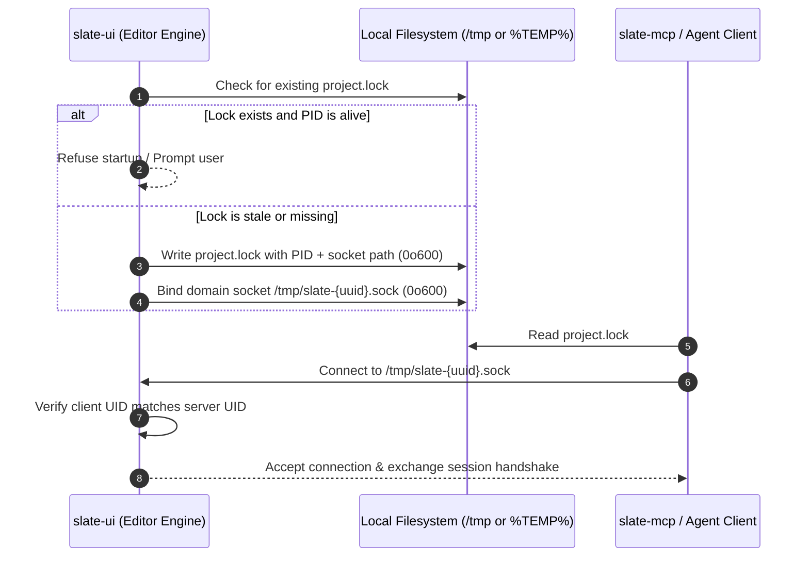
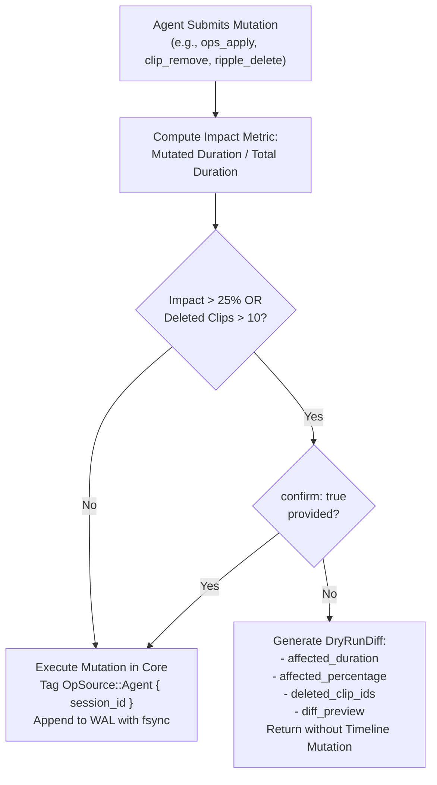
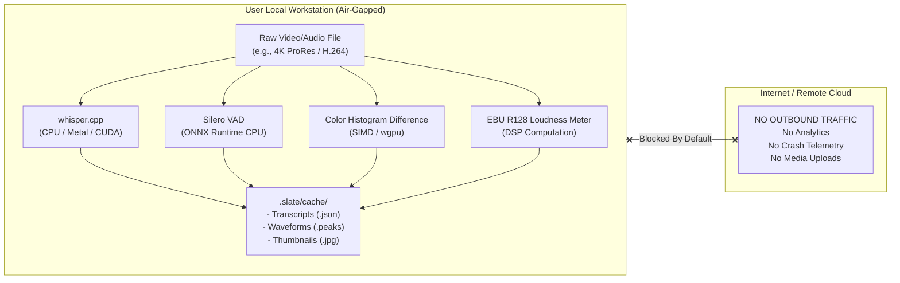
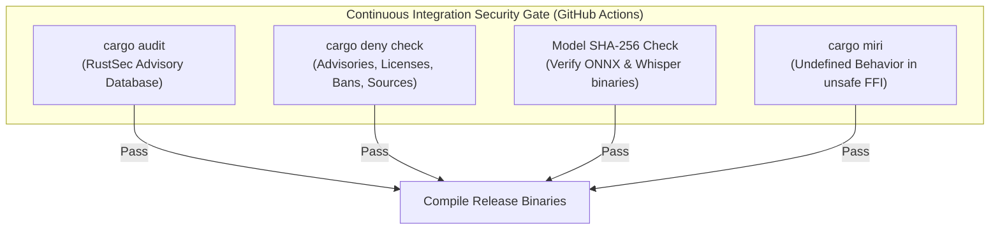
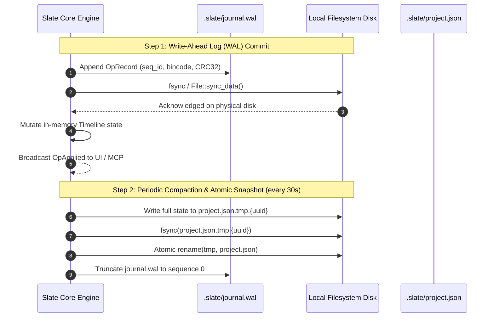
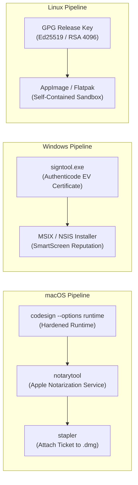

# Slate Security, Sandboxing & Privacy (`slate-security`) Implementation Plan

> **Specification & Technical Architecture Document**  
> **Crates:** `slate-mcp`, `slate-ipc`, `slate-core`, `slate-media`, `slate-analysis`, `slate-ui`  
> **Target Path:** `docs/15-security-privacy.md`  
> **Status:** APPROVED FOR IMPLEMENTATION  
> **Target Release:** v1.0 (Zero feature deferral — ALL security & privacy guarantees ship in v1)  
> **Architectural Role:** Defense-in-Depth Security Architecture, Filesystem Sandboxing, Agent Guardrails, Zero-Telemetry Local Privacy, Data Resilience & License Compliance  
> **Related Documents:**  
> - [docs/00-master-plan.md](file:///Users/adityakinjawadekar/Documents/100xcode/video-editor/docs/00-master-plan.md) — Master Architecture & Workspace Layout  
> - [docs/01-core-engine.md](file:///Users/adityakinjawadekar/Documents/100xcode/video-editor/docs/01-core-engine.md) — Timeline Model, Operations & Undo Stack  
> - [docs/06-mcp-server.md](file:///Users/adityakinjawadekar/Documents/100xcode/video-editor/docs/06-mcp-server.md) — Model Context Protocol Architecture  
> - [docs/07-ipc-protocol.md](file:///Users/adityakinjawadekar/Documents/100xcode/video-editor/docs/07-ipc-protocol.md) — IPC Protocol & Local Domain Sockets  

---

## 1. Overview & Threat Philosophy

Slate is engineered as a **local-first, dual-surface non-linear video editor (NLE)**. It operates in an operational regime distinct from traditional cloud-connected SaaS editors: all video decoding, timeline transformations, GPU compositing, audio mixing, speech transcription, voice activity detection, and export encoding occur entirely on the user's local hardware.

At the same time, Slate introduces an autonomous control plane via the **Model Context Protocol (MCP)** and local **JSON-RPC Inter-Process Communication (IPC)**. External Large Language Model (LLM) agents (such as Claude Desktop, Cursor, or automated batch daemons) can issue commands to inspect project state, slice audio, add B-roll, and export finished compositions.

This dual architecture introduces unique attack surfaces and threat dynamics:
1. **The Autonomous Agent Risk**: An AI agent operating under hallucinated or ambiguous instructions could execute destructive operations (e.g., wiping 45 minutes of synchronized interview footage) in milliseconds.
2. **The Local Automation Exposure**: An open MCP or IPC port without authentication could allow untrusted processes or malicious scripts on the local host to command the editor, exfiltrate sensitive unreleased video footage, or trigger arbitrary disk writes.
3. **The Untrusted Media Risk**: Media decoders are notoriously prone to memory corruption bugs (e.g., malformed MP4 atoms or corrupted MKV headers). Slate must shield itself against zero-day container exploits.
4. **The Privacy Imperative**: Video editing workflows regularly handle unreleased intellectual property, private personal recordings, and proprietary company assets. Slate mandates an absolute **Zero-Telemetry, Air-Gapped Default** — no audio, frame, waveform, or metadata ever leaves the physical machine.

```mermaid
flowchart TD
    classDef agent fill:#1e293b,stroke:#38bdf8,stroke-width:2px,color:#fff;
    classDef boundary fill:#334155,stroke:#f59e0b,stroke-width:2px,stroke-dasharray: 5 5,color:#fff;
    classDef core fill:#0f172a,stroke:#10b981,stroke-width:2px,color:#fff;
    classDef disk fill:#1e1e2e,stroke:#a855f7,stroke-width:2px,color:#fff;

    subgraph Trust_Domain_Agent ["Untrusted / Semi-Trusted AI Agents"]
        Claude["Claude Desktop / IDE Agent"]:::agent
        Script["Automation Script / CLI Client"]:::agent
    end

    subgraph Security_Boundary ["Security Perimeter (slate-mcp / slate-ipc)"]
        Auth["Bearer Token Auth\n(CSPRNG 256-bit)"]:::boundary
        RateLimit["Tower Rate Limiter\n(100 req/min)"]:::boundary
        Jail["Filesystem Sandbox\n(Allowed Roots Whitelist)"]:::boundary
        Guard["Agent Destructive Guard\n(25% Mutation Check + Dry-Run)"]:::boundary
    end

    subgraph Trust_Domain_Host ["Slate Core Engine (Local Host Memory)"]
        Engine["slate-core\n(Timeline Invariants, Undo Stack)"]:::core
        LocalAI["slate-analysis\n(Offline Whisper + Silero ONNX)"]:::core
        MediaWorker["slate-media\n(Worker Decode Sandbox)"]:::core
        UI["slate-ui\n(Desktop UI & Visual Agent Revert)"]:::core
    end

    subgraph Storage_Boundary ["Local Persistent Storage"]
        WAL["Write-Ahead Log (WAL)\n(.slate/journal.wal + fsync)"]:::disk
        AtomicProject["Double-Buffered Project\n(Atomic Temp + Rename)"]:::disk
        MediaFiles["User Media Assets\n(Read-Only Reference)"]:::disk
    end

    Claude -->|stdio (OS pipe isolation)| Auth
    Script -->|HTTP Bearer 127.0.0.1| Auth
    Auth --> RateLimit
    RateLimit --> Jail
    Jail --> Guard
    Guard -->|Validated Op| Engine
    Guard -.->|Exceeds 25% & Unconfirmed| DryRun["Return DryRunDiff (No Mutation)"]
    Engine --> UI
    Engine --> LocalAI
    Engine --> MediaWorker
    Engine -->|fsync record| WAL
    Engine -->|Atomic snapshot| AtomicProject
    MediaWorker --> MediaFiles
```

### 1.1 Core Security Tenets

1. **Defense in Depth**: Security does not depend on a single barrier. A tool invocation must pass network binding rules, bearer token verification, rate limiting, filesystem sandbox validation, and agent mutation thresholds before mutating engine memory.
2. **Local Processing Sovereignty**: Zero cloud dependencies. No external API calls are made for any perceptual feature (speech transcription, silence detection, scene boundary indexing, loudness calculation).
3. **Deterministic Recoverability**: The storage engine guarantees zero data loss on immediate process termination (`kill -9`, kernel panic, power failure) using append-only Write-Ahead Logging (`fsync`) and atomic manifest replacement.
4. **Agent Accountability & Provenance**: Human editors maintain ultimate authority. Every operation generated by an agent is cryptographically stamped with its `SessionId`, badged in the UI, and individually reversible without unwinding subsequent human edits.
5. **Auditable Supply Chain & Open Source Compliance**: Automated CI enforcement guarantees zero high/critical CVEs in dependencies, pure dynamic LGPL linkage for FFmpeg, and automated software bill of materials (SBOM) generation.

---

## 2. MCP Server Security

The `slate-mcp` crate exposes the Model Context Protocol over two transports:
- **Streamable HTTP / Server-Sent Events (SSE)**: For remote processes, local scripts, and web-based orchestrators.
- **Standard Input/Output (stdio)**: For desktop MCP clients (such as Claude Desktop or Cursor) launched as parent processes.

Each transport implements strict access controls tailored to its execution environment.

### 2.1 Localhost Binding & Network Isolation

By default, the HTTP server binds strictly to the IPv4 loopback interface (`127.0.0.1`). It will never listen on all network interfaces (`0.0.0.0`) or IPv6 wildcard addresses (`::`) unless explicitly commanded by an operator via command-line flags.

#### CLI Network Configuration
```rust
// crates/slate-mcp/src/cli.rs
use clap::Parser;
use std::net::{IpAddr, Ipv4Addr, SocketAddr};

#[derive(Parser, Debug, Clone)]
pub struct ServerNetworkConfig {
    /// Network address for HTTP MCP transport
    #[arg(long, default_value = "127.0.0.1")]
    pub bind: IpAddr,

    /// Listening port for HTTP MCP transport
    #[arg(long, default_value_t = 8765)]
    pub port: u16,

    /// Explicit opt-in flag required when binding to non-loopback addresses
    #[arg(long, default_value_t = false)]
    pub allow_external: bool,

    /// Maximum requests allowed per minute per client
    #[arg(long, default_value_t = 100)]
    pub rate_limit: u32,
}
```

#### Binding Validation Logic
If an operator configures `--bind 0.0.0.0` or any non-loopback address without specifying `--allow-external`, `slate-mcp` refuses to boot:

```rust
// crates/slate-mcp/src/server/network.rs
use crate::error::SecurityError;
use std::net::IpAddr;
use tracing::{error, warn};

pub fn validate_bind_address(config: &ServerNetworkConfig) -> Result<SocketAddr, SecurityError> {
    let is_loopback = match config.bind {
        IpAddr::V4(ipv4) => ipv4.is_loopback(),
        IpAddr::V6(ipv6) => ipv6.is_loopback(),
    };

    if !is_loopback {
        if !config.allow_external {
            error!(
                target: "slate_mcp::security",
                "Refusing to bind MCP server to non-localhost address ({}) without --allow-external flag.",
                config.bind
            );
            return Err(SecurityError::InsecureBindingAttempted(config.bind));
        }

        // Prominent warning on non-localhost binding
        eprintln!("==================================================================");
        eprintln!("⚠️  SECURITY WARNING: Slate MCP server is bound to {}", config.bind);
        eprintln!("⚠️  Any machine on your local network could attempt MCP tool calls.");
        eprintln!("⚠️  Ensure firewall rules restrict access to authorized clients only.");
        eprintln!("==================================================================");
        warn!(target: "slate_mcp::security", "MCP server bound to non-localhost address: {}", config.bind);
    }

    Ok(SocketAddr::new(config.bind, config.port))
}
```

---

### 2.2 Cryptographic Authentication & Token Lifecycle

Every HTTP request to the MCP server must provide a cryptographically secure Bearer token in the standard HTTP header:
```http
Authorization: Bearer <token>
```

#### 2.2.1 Token Generation (CSPRNG)
On server startup, `slate-mcp` generates a 256-bit (32-byte) cryptographically secure pseudorandom token using the operating system's entropy pool (`ring::rand::SystemRandom` or `rand::rngs::OsRng`), encoded as a 64-character lowercase hexadecimal string:

```rust
// crates/slate-mcp/src/auth/token.rs
use ring::rand::{SecureRandom, SystemRandom};
use std::fmt::Write;
use crate::error::SecurityError;

#[derive(Clone)]
pub struct BearerToken {
    hex_representation: String,
}

impl BearerToken {
    /// Generates a high-entropy 256-bit token from OS entropy pool
    pub fn generate() -> Result<Self, SecurityError> {
        let rng = SystemRandom::new();
        let mut raw_bytes = [0u8; 32];
        rng.fill(&mut raw_bytes)
            .map_err(|_| SecurityError::EntropyGenerationFailed)?;

        let mut hex = String::with_capacity(64);
        for byte in raw_bytes {
            write!(&mut hex, "{:02x}", byte).expect("formatting hex failed");
        }

        Ok(Self { hex_representation: hex })
    }

    pub fn as_str(&self) -> &str {
        &self.hex_representation
    }
}
```

#### 2.2.2 Secure Storage & Stderr Emission
To ensure other processes or scripts executed by the user can discover the active token without human copy-pasting:
1. **Written to user-only configuration file**: `~/.config/slate/mcp-token`.
   - On Unix, file permissions are explicitly forced to `0o600` (`S_IRUSR | S_IWUSR`).
   - On Windows, file security descriptors are created with an ACL granting access solely to `CURRENT_USER`.
2. **Printed exclusively to `stderr`**:
   - `stdout` is strictly reserved for JSON-RPC messages during `stdio` transport mode. Writing tokens to `stdout` would corrupt the JSON-RPC stream and break Claude Desktop.
3. **Ephemeral Lifecycle (Token Rotation)**: A new token is generated on every server startup. Old tokens are immediately invalidated.

```rust
// crates/slate-mcp/src/auth/storage.rs
use std::fs::{self, OpenOptions};
use std::io::Write;
use std::path::PathBuf;
use crate::auth::BearerToken;
use crate::error::SecurityError;

pub struct TokenStorage;

impl TokenStorage {
    pub fn save_and_publish(token: &BearerToken) -> Result<PathBuf, SecurityError> {
        let config_dir = dirs::config_dir()
            .ok_or(SecurityError::ConfigurationDirectoryUnavailable)?
            .join("slate");

        fs::create_dir_all(&config_dir).map_err(SecurityError::Io)?;

        let token_path = config_dir.join("mcp-token");

        // Open with user-only write/read permissions
        #[cfg(unix)]
        {
            use std::os::unix::fs::OpenOptionsExt;
            let mut file = OpenOptions::new()
                .create(true)
                .write(true)
                .truncate(true)
                .mode(0o600) // -rw-------
                .open(&token_path)
                .map_err(SecurityError::Io)?;
            file.write_all(token.as_str().as_bytes())
                .map_err(SecurityError::Io)?;
            file.sync_all().map_err(SecurityError::Io)?;
        }

        #[cfg(windows)]
        {
            // Windows ACL hardening
            let mut file = OpenOptions::new()
                .create(true)
                .write(true)
                .truncate(true)
                .open(&token_path)
                .map_err(SecurityError::Io)?;
            file.write_all(token.as_str().as_bytes())
                .map_err(SecurityError::Io)?;
            file.sync_all().map_err(SecurityError::Io)?;
            // Apply Windows File Security Descriptor restricting to CURRENT_USER
            crate::auth::windows_acl::harden_file_permissions(&token_path)?;
        }

        // Print to STDERR so stdio transport stream on STDOUT is not corrupted
        eprintln!("[slate-mcp] Server running. Bearer token saved to: {}", token_path.display());
        eprintln!("[slate-mcp] Authentication Bearer: {}", token.as_str());

        Ok(token_path)
    }
}
```

#### 2.2.3 Constant-Time Authentication Middleware
To defend against side-channel timing attacks that leak token prefixes, incoming tokens are compared using `subtle::ConstantTimeEq`:

```rust
// crates/slate-mcp/src/auth/middleware.rs
use axum::{
    body::Body,
    extract::State,
    http::{header, Request, Response, StatusCode},
    middleware::Next,
    response::IntoResponse,
};
use subtle::ConstantTimeEq;
use crate::auth::BearerToken;

pub async fn require_bearer_auth(
    State(expected_token): State<BearerToken>,
    req: Request<Body>,
    next: Next,
) -> Result<Response<Body>, StatusCode> {
    // 1. Extract Authorization header
    let auth_header = req
        .headers()
        .get(header::AUTHORIZATION)
        .and_then(|h| h.to_str().ok());

    let token_candidate = match auth_header {
        Some(header_val) if header_val.starts_with("Bearer ") => {
            &header_val["Bearer ".len()..]
        }
        _ => return Err(StatusCode::UNAUTHORIZED),
    };

    // 2. Constant-time byte-wise comparison
    let candidate_bytes = token_candidate.as_bytes();
    let expected_bytes = expected_token.as_str().as_bytes();

    if candidate_bytes.len() != expected_bytes.len() {
        return Err(StatusCode::UNAUTHORIZED);
    }

    if candidate_bytes.ct_eq(expected_bytes).unwrap_u8() == 1 {
        Ok(next.run(req).await)
    } else {
        Err(StatusCode::UNAUTHORIZED)
    }
}
```

---

### 2.3 stdio Transport Security

When `slate-mcp` is invoked via `slate mcp` without `--http`, it defaults to the standard **stdio JSON-RPC transport**:
1. **Inherited OS Process Handles**: Standard input and output pipes are established directly by the host operating system's process manager (`posix_spawn`, `fork`/`exec`, or `CreateProcess`).
2. **Zero Network Attack Surface**: No TCP/IP sockets or Unix domain sockets are bound. A remote or local network attacker cannot connect to an stdio-based server.
3. **Process Sandboxing**: The MCP server runs under the identity of the spawning parent process. If Claude Desktop runs in an unprivileged user session, `slate-mcp` cannot escalate privileges beyond that user.

---

### 2.4 Rate Limiting & DoS Protection

To prevent runaway loops from recursive agent workflows (e.g., an LLM prompt getting stuck in an infinite query loop) or denial-of-service via tool flood, `slate-mcp` embeds a token-bucket rate limiter via `tower::limit::RateLimit`:

```rust
// crates/slate-mcp/src/server/rate_limit.rs
use std::time::Duration;
use tower::limit::RateLimitLayer;

pub fn create_rate_limit_layer(requests_per_minute: u32) -> RateLimitLayer {
    // Convert requests per minute to duration per tick
    let rate = requests_per_minute.max(1);
    RateLimitLayer::new(rate as u64, Duration::from_secs(60))
}
```

When the client exceeds the limit, the server immediately returns HTTP 429 Too Many Requests with a `Retry-After: 60` response header, preventing CPU and disk saturation.

---

## 3. File System Access Control

A major risk in autonomous LLM video editing is **arbitrary file access**. An agent could be instructed by a prompt injection to inspect `/etc/passwd`, read private SSH keys in `~/.ssh`, or overwrite system libraries. `slate-mcp` enforces a strict **Filesystem Jail** with path canonicalization and directory traversal prevention.

### 3.1 Allowed Roots Jailing

All MCP tools dealing with filesystem paths (`project_open`, `media_import`, `export_start`, `render_frame`) must pass paths through `PathSanitizer`:

```rust
// crates/slate-mcp/src/security/jail.rs
use std::path::{Path, PathBuf};
use crate::error::SecurityError;

#[derive(Debug, Clone)]
pub struct AllowedRoots {
    roots: Vec<PathBuf>,
}

impl AllowedRoots {
    /// Initialize with project root and user home directory by default
    pub fn new(custom_roots: Vec<PathBuf>, project_dir: Option<PathBuf>) -> Result<Self, SecurityError> {
        let mut canonical_roots = Vec::new();

        // 1. Add current project directory if active
        if let Some(proj) = project_dir {
            if let Ok(canon) = proj.canonicalize() {
                canonical_roots.push(canon);
            }
        }

        // 2. Add user's home directory by default
        if let Some(home) = dirs::home_dir() {
            if let Ok(canon) = home.canonicalize() {
                canonical_roots.push(canon);
            }
        }

        // 3. Add explicit user-specified roots from --allowed-roots flag
        for root in custom_roots {
            let canon = root.canonicalize().map_err(|e| {
                SecurityError::InvalidAllowedRoot(root.display().to_string(), e.to_string())
            })?;
            canonical_roots.push(canon);
        }

        if canonical_roots.is_empty() {
            return Err(SecurityError::NoValidAllowedRootsConfigured);
        }

        Ok(Self { roots: canonical_roots })
    }

    /// Validates that a requested target path lies strictly inside an allowed root
    pub fn sanitize_path<P: AsRef<Path>>(&self, untrusted_path: P) -> Result<PathBuf, SecurityError> {
        let path = untrusted_path.as_ref();

        // Prevent empty paths or immediate traversal attempts
        if path.as_os_str().is_empty() {
            return Err(SecurityError::EmptyPathNotAllowed);
        }

        // Check for null bytes (poisoned strings)
        #[cfg(unix)]
        {
            use std::os::unix::ffi::OsStrExt;
            if path.as_os_str().as_bytes().contains(&0) {
                return Err(SecurityError::NullByteInPath);
            }
        }

        // Canonicalize to resolve symlinks and normalize '..' traversal segments
        let canonical_target = if path.exists() {
            path.canonicalize().map_err(|e| SecurityError::PathResolutionFailed(path.display().to_string(), e.to_string()))?
        } else {
            // For files being created (e.g. export target), canonicalize the parent directory
            let parent = path.parent().ok_or_else(|| SecurityError::InvalidParentDirectory(path.display().to_string()))?;
            let canonical_parent = parent.canonicalize().map_err(|e| SecurityError::PathResolutionFailed(parent.display().to_string(), e.to_string()))?;
            let file_name = path.file_name().ok_or_else(|| SecurityError::MissingFileName(path.display().to_string()))?;
            canonical_parent.join(file_name)
        };

        // Enforce boundary containment: target must start with at least one allowed root
        let is_contained = self.roots.iter().any(|root| canonical_target.starts_with(root));

        if !is_contained {
            return Err(SecurityError::PathOutsideAllowedRoots {
                attempted: canonical_target.display().to_string(),
                allowed_roots: self.roots.iter().map(|r| r.display().to_string()).collect(),
            });
        }

        Ok(canonical_target)
    }
}
```

#### Traversal Prevention Guarantees:
- **`../` Elimination**: Paths like `/Users/aditya/project/../../etc/passwd` are resolved by `canonicalize()` to `/etc/passwd`. Because `/etc/passwd` does not begin with `/Users/aditya`, it is rejected.
- **Symlink Breakout Prevention**: A symlink inside the project pointing to `/root` or `/System` will be resolved to its actual target by `canonicalize()`. If the target is outside allowed roots, it is rejected with `SecurityError::PathOutsideAllowedRoots`.
- **Media Ingestion Enforcement**: `media_import` fails immediately if the user attempts to import media outside allowed roots.

---

### 3.2 Project Isolation & IPC Socket Security

Slate supports running multiple projects simultaneously or connecting multiple external agents. To prevent cross-project interference or unauthorized local socket hijacking:



#### 3.2.1 Dedicated Per-Project Sockets
Rather than a single global socket, each project instance allocates a unique socket path bound to its project UUID:
- **Unix**: `/tmp/slate-<project_uuid>.sock` or `$XDG_RUNTIME_DIR/slate/<project_uuid>.sock`
- **Windows**: `\\.\pipe\slate-<project_uuid>`

#### 3.2.2 Strict Permissions (`0o600`)
On Unix platforms, domain sockets are protected by the operating system's filesystem ACLs:
```rust
// crates/slate-ipc/src/transport/unix.rs
use std::os::unix::fs::PermissionsExt;
use std::path::Path;
use tokio::net::UnixListener;
use crate::error::IpcError;

pub fn bind_secure_unix_socket(path: &Path) -> Result<UnixListener, IpcError> {
    // Unlink old socket file if it exists
    if path.exists() {
        std::fs::remove_file(path).map_err(IpcError::Io)?;
    }

    // Set process umask so created socket is rw------- (0o600)
    let prev_mask = unsafe { nix::sys::stat::umask(nix::sys::stat::Mode::from_bits_truncate(0o077)) };
    let listener = UnixListener::bind(path).map_err(IpcError::Io);
    // Restore previous umask
    unsafe { nix::sys::stat::umask(prev_mask) };

    let listener = listener?;

    // Explicitly enforce permissions on the socket inode
    let permissions = std::fs::Permissions::from_mode(0o600);
    std::fs::set_permissions(path, permissions).map_err(IpcError::Io)?;

    Ok(listener)
}
```

#### 3.2.3 Lockfile Concurrency Protection
To prevent two editor instances or multiple headless batch commands from corrupting the same `.slate` bundle:
1. `project.lock` is acquired using non-blocking OS locks (`flock` on Unix, `LockFileEx` on Windows).
2. The lockfile contains JSON metadata: `{"pid": 12345, "created_at": "2026-10-14T12:00:00Z", "socket": "/tmp/slate-xyz.sock"}`.
3. If an existing lockfile is found, Slate issues `kill(pid, 0)` on Unix or `OpenProcess` on Windows. If the PID is dead, the stale lock is safely pruned and logged. If alive, the new instance aborts cleanly with `IpcError::ProjectLockedByAnotherProcess(pid)`.

---

## 4. Agent Safety & Guardrails

When AI agents perform autonomous editing, an unconstrained operation can wipe out days of manual editorial assembly. Slate enforces safety guardrails that protect the timeline while allowing agents to execute complex edits safely.



### 4.1 Destructive Operation Guards & The 25% Threshold

An operation is classified as **destructive** if it:
1. Deletes clips or tracks (`clip_remove`, `track_remove`).
2. Slices out a contiguous time range across tracks (`ripple_delete_ranges`).
3. Mutates more than **25% of the total current timeline duration**.
4. Deletes more than **10 clips** in a single operation.

#### Dry-Run Response Diff Structure
When an agent submits a destructive operation without `confirm: true`, the engine **does not modify the timeline**. Instead, it generates a comprehensive dry-run diff:

```rust
// crates/slate-mcp/src/guardrails/destructive.rs
use serde::{Deserialize, Serialize};
use schemars::JsonSchema;
use slate_core::{RationalTime, Timeline, Uuid};

#[derive(Debug, Clone, Serialize, Deserialize, JsonSchema)]
#[serde(rename_all = "camelCase")]
pub struct DryRunDiff {
    pub requires_confirmation: bool,
    pub warning: String,
    pub total_timeline_duration_secs: f64,
    pub affected_duration_secs: f64,
    pub affected_percentage: f64,
    pub deleted_clip_count: usize,
    pub affected_clip_ids: Vec<Uuid>,
    pub summary_diff: String,
    pub confirmation_hint: String,
}

pub struct DestructiveOpGuard;

impl DestructiveOpGuard {
    pub const MUTATION_THRESHOLD_PERCENT: f64 = 25.0;
    pub const CLIP_COUNT_THRESHOLD: usize = 10;

    pub fn check_mutation_safety(
        timeline: &Timeline,
        affected_duration: RationalTime,
        deleted_clips: &[Uuid],
        confirm: bool,
    ) -> Result<(), DryRunDiff> {
        let total_duration = timeline.duration();
        let total_secs = total_duration.to_seconds();
        let affected_secs = affected_duration.to_seconds();

        let percentage = if total_secs > 0.0 {
            (affected_secs / total_secs) * 100.0
        } else {
            0.0
        };

        let is_destructive = percentage > Self::MUTATION_THRESHOLD_PERCENT 
            || deleted_clips.len() >= Self::CLIP_COUNT_THRESHOLD;

        if is_destructive && !confirm {
            return Err(DryRunDiff {
                requires_confirmation: true,
                warning: format!(
                    "Operation affects {:.1}% of the timeline (threshold: {:.1}%) and {} clips. Mutation blocked.",
                    percentage, Self::MUTATION_THRESHOLD_PERCENT, deleted_clips.len()
                ),
                total_timeline_duration_secs: total_secs,
                affected_duration_secs: affected_secs,
                affected_percentage: percentage,
                deleted_clip_count: deleted_clips.len(),
                affected_clip_ids: deleted_clips.to_vec(),
                summary_diff: format!("Will remove/modify {:.2}s across {} clips", affected_secs, deleted_clips.len()),
                confirmation_hint: "Re-run the tool invocation with `confirm: true` to execute this edit.".to_string(),
            });
        }

        Ok(())
    }
}
```

---

### 4.2 Agent Provenance & Per-Operation UI Revert

Every operation in Slate carries an explicit provenance tag in its metadata:

```rust
// crates/slate-core/src/op.rs
use uuid::Uuid;
use chrono::{DateTime, Utc};

#[derive(Debug, Clone, PartialEq, Serialize, Deserialize)]
pub enum OpSource {
    Human { user_id: String },
    Agent { session_id: Uuid, agent_name: String },
    Script { script_name: String },
    UndoRollback { original_op_id: Uuid },
}

#[derive(Debug, Clone, Serialize, Deserialize)]
pub struct OpRecord {
    pub id: Uuid,
    pub timestamp: DateTime<Utc>,
    pub source: OpSource,
    pub description: String,
    pub op_bytes: Vec<u8>,
    pub inverse_bytes: Vec<u8>,
}
```

#### Visual Differentiation & Selective Revert in `slate-ui`
In the desktop UI:
1. **Agent Badges**: Edits made by agents display a subtle cyan outline and an agent badge (`AI: claude-desktop`) in the timeline inspector.
2. **Selective Per-Op Revert**: Traditional NLEs force the user to undo chronologically, discarding subsequent manual adjustments. Slate's operational inverse algebra allows the user to right-click an agent operation in the history panel and click **"Revert Agent Edit"**. The engine computes the inverse of that specific operation, re-validates timeline invariants, and applies the compensation delta cleanly.

---

### 4.3 Strict Op Validation & Consistency Invariants

The Slate core engine guarantees a **Zero-Panic Policy**. Operations submitted via MCP or IPC are rigorously validated against timeline invariants before execution:

```rust
// crates/slate-core/src/validation.rs
use crate::{Timeline, TrackKind, TimeRange, CoreError};

pub struct OpValidator;

impl OpValidator {
    pub fn validate_clip_placement(
        timeline: &Timeline,
        track_id: uuid::Uuid,
        placement: TimeRange,
    ) -> Result<(), CoreError> {
        // Invariant 1: Duration must be strictly positive
        if placement.duration.is_zero() || placement.duration.is_negative() {
            return Err(CoreError::InvalidDuration("Clip duration must be positive".into()));
        }

        // Invariant 2: Track must exist
        let track = timeline.find_track(track_id)
            .ok_or_else(|| CoreError::TrackNotFound(track_id))?;

        // Invariant 3: Single-track non-overlap rule (for video tracks)
        if track.kind == TrackKind::Video {
            for existing_clip in &track.clips {
                if existing_clip.place_range.overlaps(&placement) {
                    return Err(CoreError::ClipCollision {
                        track_id,
                        existing_clip_id: existing_clip.id,
                        collision_range: placement,
                    });
                }
            }
        }

        Ok(())
    }
}
```

If an agent specifies an invalid clip offset or an overlapping time range, `slate-mcp` returns a structured JSON-RPC error containing actionable guidance (e.g., suggested valid offsets), without crashing the editor thread.

---

## 5. Local-Only Privacy Architecture

Slate guarantees complete user media privacy through an air-gapped processing model.



### 5.1 Local-Only Perceptual Processing Engines

| Analysis Domain | Engine / Crate | Offline Verification Method |
| :--- | :--- | :--- |
| **Speech Transcription** | `whisper.cpp` (`slate-analysis`) | Fully embedded C++ runtime; models loaded from local filesystem; zero network sockets open. |
| **Voice Activity Detection** | Silero VAD (`slate-analysis`) | Pre-packaged ONNX model executed via local ONNX Runtime (`ort`); no remote inference endpoints. |
| **Scene Cut Detection** | HSV Histogram Metric (`slate-analysis`) | Native Rust SIMD algorithm comparing pixel differences between consecutive decoded frames. |
| **Audio Loudness (LUFS)** | EBU R128 DSP (`slate-audio`) | Pure mathematics (K-weighting filter, ITU-R BS.1770-4 gated integration) in local CPU memory. |

---

### 5.2 Zero-Telemetry By Default

Slate adheres to a strict privacy covenant:
1. **No Analytics Pings**: Slate contains no Google Analytics, PostHog, Mixpanel, or telemetry collectors.
2. **No Crash Reporting Beacons**: Crashing does not automatically transmit stack traces or system dumps to a remote server. Crash dumps are written locally to `.slate/logs/crash.log`.
3. **Optional Opt-In Telemetry**: If the user explicitly checks *"Help improve Slate by sharing anonymous crash reports"* in Preferences:
   - **Data Sanitization**: All file paths are stripped of user directories (e.g., `/Users/aditya/Projects/SecretFilm` becomes `<USER_DIR>/SecretFilm`).
   - **No Media Content**: Transcripts, file names, clip tags, audio samples, and video frames are **strictly excluded**.
   - **Full Transparency**: The UI provides a **"Preview Telemetry Payload"** button, showing the exact JSON payload prior to submission.

---

### 5.3 Media Privacy & Cache Containment

- **Reference-Based Editing**: Media files are not duplicated into hidden cloud directories. Slate references media on the user's filesystem in-place.
- **Project Cache Enclosure**: Waveform peak data (`.peaks`), proxy media (`.proxy.mp4`), and speech transcripts (`.transcript.json`) reside strictly in `.slate/cache/` inside the project bundle directory.
- **Clean Disposal**: Deleting or archiving a `.slate` bundle removes all associated analysis artifacts, leaving no dangling metadata across the host system.

---

## 6. Dependency & Supply Chain Security

Slate incorporates multiple heavy native dependencies (`ffmpeg`, `whisper.cpp`, `onnxruntime`, `wgpu`). Protecting the build against malicious supply chain tampering requires strict dependency controls.



### 6.1 Dependency Auditing & `cargo-deny`

Slate commits `Cargo.lock` and requires clean passes from `cargo-audit` and `cargo-deny` on every pull request.

#### Complete `deny.toml` Specification
```toml
# deny.toml - Workspace Supply Chain Security Configuration
[advisories]
vulnerability = "deny"
unmaintained = "warn"
yanked = "deny"
ignore = []

[licenses]
unlicensed = "deny"
allow = [
    "MIT",
    "Apache-2.0",
    "Apache-2.0 WITH LLVM-exception",
    "BSD-2-Clause",
    "BSD-3-Clause",
    "ISC",
    "CC0-1.0",
    "LGPL-2.1-only",
    "LGPL-2.1-or-later",
]
confidence-threshold = 0.8

[bans]
multiple-versions = "deny"
wildcards = "deny"
deny = [
    { name = "openssl", reason = "Use rustls for all TLS networking to eliminate OpenSSL C-vulnerabilities." },
]

[sources]
unknown-registry = "deny"
unknown-git = "deny"
allow-registry = ["https://github.com/rust-lang/crates.io-index"]
```

---

### 6.2 FFmpeg Linkage & LGPL Compliance

FFmpeg is the media engine of Slate. To guarantee both security and legal compliance:
1. **Dynamic Linkage Only**: Slate dynamically links to FFmpeg libraries (`libavcodec.dylib`/`.so`/`.dll`, `libavformat`, `libavutil`, `libswscale`, `libswresample`). FFmpeg is never statically compiled into the Slate executable.
2. **LGPL Build Configuration**:
   - Built with `--enable-shared --disable-static --enable-pic`.
   - Explicitly configured with `--disable-gpl` and `--disable-nonfree`.
   - Proprietary/GPL codecs (such as x264, x265) are excluded from the default distributed bundle.
   - Video encoding utilizes OS-provided hardware encoders:
     - macOS: Apple VideoToolbox (`h264_videotoolbox`, `hevc_videotoolbox`, `prores_videotoolbox`)
     - Windows: NVIDIA NVENC, Intel QSV, or AMD AMF
     - Linux: VAAPI / Intel QSV, plus open-source royalty-free codecs (`libsvtav1`, `libvpx-vp9`).
3. **Decoupled Worker Sandboxing**: Decoders operate within isolated worker threads bounded by strict memory limits. If a corrupted frame triggers a decoder fault, the worker thread terminates and reports `MediaError::DecoderCrash` to `slate-media` without taking down the entire UI or rendering pipeline.

---

### 6.3 ONNX Runtime & Machine Learning Model Integrity

Pre-trained models utilized by `slate-analysis` (e.g., Silero VAD) are verified against hardcoded SHA-256 cryptographic hashes prior to memory mapping:

```rust
// crates/slate-analysis/src/model_integrity.rs
use sha2::{Digest, Sha256};
use std::fs::File;
use std::io::{self, Read};
use std::path::Path;
use crate::error::AnalysisError;

pub struct ModelIntegrityVerifier;

impl ModelIntegrityVerifier {
    pub const SILERO_VAD_V4_SHA256: &'static str = 
        "6c6e1c27803e051c726a11e1140089ffb5ec8e8587ca827f3c4c92b95764d1f2";

    pub fn verify_model_file(path: &Path, expected_sha256: &str) -> Result<(), AnalysisError> {
        let mut file = File::open(path).map_err(AnalysisError::Io)?;
        let mut hasher = Sha256::new();
        let mut buffer = [0u8; 65536];

        loop {
            let bytes_read = file.read(&mut buffer).map_err(AnalysisError::Io)?;
            if bytes_read == 0 {
                break;
            }
            hasher.update(&buffer[..bytes_read]);
        }

        let actual_hash = format!("{:x}", hasher.finalize());

        if actual_hash != expected_sha256 {
            return Err(AnalysisError::ModelIntegrityMismatch {
                model_path: path.display().to_string(),
                expected: expected_sha256.to_string(),
                actual: actual_hash,
            });
        }

        Ok(())
    }
}
```

No models are downloaded dynamically from unverified HTTP endpoints at runtime.

---

## 7. Data Safety & Crash Resilience

Non-linear video editors must survive unexpected application crashes or hardware power loss without corrupting timeline projects. Slate implements a database-grade storage engine featuring an append-only **Write-Ahead Log (WAL)** and **Double-Buffered Atomic File Swapping**.



### 7.1 Write-Ahead Log (WAL) Architecture

Every operation is written to the append-only journal before in-memory timeline state is updated.

#### WAL Record Structure
```
+---------------+-------------------+--------------------+------------------------+----------------+
| Magic (4B)    | Seq ID (8B, u64)  | Payload Len (4B)   | Bincode Payload (Var)  | CRC32 (4B, LE) |
| "SPJ1"        | Monotonic Counter | Byte count (N)     | Serialized OpRecord    | Castagnoli     |
+---------------+-------------------+--------------------+------------------------+----------------+
```

#### WAL Implementation with `fsync`
```rust
// crates/slate-core/src/journal.rs
use std::fs::{File, OpenOptions};
use std::io::{self, Write, Read, Seek, SeekFrom};
use std::path::{Path, PathBuf};
use crc32fast::Hasher;
use crate::error::CoreError;
use crate::op::OpRecord;

pub struct JournalWriter {
    file: File,
    path: PathBuf,
    current_seq: u64,
}

impl JournalWriter {
    pub const MAGIC: &'static [u8; 4] = b"SPJ1";

    pub fn open(path: &Path) -> Result<Self, CoreError> {
        let mut file = OpenOptions::new()
            .create(true)
            .append(true)
            .read(true)
            .open(path)
            .map_err(CoreError::Io)?;

        // Inspect file length to recover sequence number
        let len = file.seek(SeekFrom::End(0)).map_err(CoreError::Io)?;
        let current_seq = if len == 0 { 0 } else { Self::scan_highest_seq(&mut file)? };

        Ok(Self {
            file,
            path: path.to_path_buf(),
            current_seq,
        })
    }

    pub fn append_record(&mut self, record: &OpRecord) -> Result<u64, CoreError> {
        let payload_bytes = bincode::serialize(record).map_err(|e| CoreError::Serialization(e.to_string()))?;
        let next_seq = self.current_seq + 1;

        // Calculate CRC32 checksum
        let mut hasher = Hasher::new();
        hasher.update(Self::MAGIC);
        hasher.update(&next_seq.to_le_bytes());
        hasher.update(&(payload_bytes.len() as u32).to_le_bytes());
        hasher.update(&payload_bytes);
        let checksum = hasher.finalize();

        // Write contiguous block
        self.file.write_all(Self::MAGIC).map_err(CoreError::Io)?;
        self.file.write_all(&next_seq.to_le_bytes()).map_err(CoreError::Io)?;
        self.file.write_all(&(payload_bytes.len() as u32).to_le_bytes()).map_err(CoreError::Io)?;
        self.file.write_all(&payload_bytes).map_err(CoreError::Io)?;
        self.file.write_all(&checksum.to_le_bytes()).map_err(CoreError::Io)?;

        // Force synchronous disk flush
        self.file.sync_data().map_err(CoreError::Io)?;

        self.current_seq = next_seq;
        Ok(next_seq)
    }

    fn scan_highest_seq(file: &mut File) -> Result<u64, CoreError> {
        file.seek(SeekFrom::Start(0)).map_err(CoreError::Io)?;
        let mut highest = 0;
        let mut magic = [0u8; 4];
        let mut seq_bytes = [0u8; 8];
        let mut len_bytes = [0u8; 4];

        while file.read_exact(&mut magic).is_ok() {
            if &magic != Self::MAGIC {
                break;
            }
            file.read_exact(&mut seq_bytes).map_err(CoreError::Io)?;
            let seq = u64::from_le_bytes(seq_bytes);
            file.read_exact(&mut len_bytes).map_err(CoreError::Io)?;
            let len = u32::from_le_bytes(len_bytes) as i64;
            // Skip payload and 4-byte CRC32
            file.seek(SeekFrom::Current(len + 4)).map_err(CoreError::Io)?;
            highest = seq;
        }

        Ok(highest)
    }
}
```

---

### 7.2 Double-Buffered Atomic Manifest Commits

When writing the full consolidated `project.json` project manifest:
1. Write JSON data to a sibling file: `project.json.tmp.<uuid>`.
2. Issue `File::sync_all()` to ensure all blocks and directory metadata are written to physical media.
3. Perform an atomic filesystem rename:
   - On POSIX (macOS/Linux): `rename()` is guaranteed to be atomic by the OS kernel.
   - On Windows: Uses `SetFileInformationByHandle` with `FileRenameInfoEx` and `FILE_RENAME_REPLACE_IF_EXISTS`.
4. If a power failure occurs at any point during writing, `project.json` remains intact; the partial `.tmp` file is simply discarded on next boot.

---

### 7.3 Autosave & Journal Compaction

- **30-Second Cadence**: A background tokio timer executes an autosave checkpoint every 30 seconds if the timeline is marked dirty.
- **Compaction**: When the journal exceeds 100 operations or 5 MB in size, the engine commits an atomic snapshot of `project.json` and truncates `journal.wal` to 0 bytes, preventing unbounded file growth.
- **Corrupted Project Recovery Wizard**: If `project.json` fails to parse (e.g. disk sector corruption), the engine automatically scans `journal.wal`, verifies checksums, and replays valid operations up to the last clean CRC32 block, prompting the user with a single-click recovery dialog.

---

## 8. Secure Coding Practices & Engine Hardening

### 8.1 Memory Safety & Unsafe Code Policy

Slate enforces workspace-wide compile-time restrictions:
```rust
// In crates/slate-core/src/lib.rs and crates/slate-mcp/src/lib.rs
#![deny(unsafe_code)]
```

#### FFI Exception Boundaries
Unsafe code is strictly limited to low-level FFI interaction in three crates:
1. `slate-media`: Native C bindings to FFmpeg (`libavcodec`).
2. `slate-analysis`: Native C bindings to `onnxruntime` and `whisper.cpp`.
3. `slate-ipc`: Platform-specific socket permissions (`nix::sys::stat::umask`).

Every `unsafe` block must include a mandatory `// SAFETY:` rationale explaining pointer provenance, lifetime guarantees, and null checks:

```rust
// Example from crates/slate-media/src/ffmpeg.rs
// SAFETY:
// 1. `codec_ctx` is verified non-null before invocation.
// 2. `av_packet` is allocated via `av_packet_alloc` and pinned in memory.
// 3. The return code is checked immediately; errors bubble up to `MediaError`.
let ret = unsafe { ffi::avcodec_send_packet(codec_ctx, av_packet) };
if ret < 0 {
    return Err(MediaError::from_ffmpeg_code(ret));
}
```

---

### 8.2 Input Validation & Integer Overflow Hardening

Video editors perform frequent time calculations (e.g. frame offsets, nanosecond durations, SMPTE conversions). Naive 32-bit or unchecked 64-bit integer arithmetic can cause integer wrap-around vulnerabilities.

Slate mandates `RationalTime` using checked arithmetic:
```rust
// crates/slate-core/src/time.rs
use num_rational::Rational64;
use crate::error::CoreError;

#[derive(Debug, Clone, Copy, PartialEq, Eq, PartialOrd, Ord, Hash, Serialize, Deserialize)]
pub struct RationalTime {
    inner: Rational64,
}

impl RationalTime {
    pub fn checked_add(self, other: Self) -> Result<Self, CoreError> {
        let (n1, d1) = (*self.inner.numer(), *self.inner.denom());
        let (n2, d2) = (*other.inner.numer(), *other.inner.denom());

        // Checked cross-multiplication: (n1 * d2 + n2 * d1) / (d1 * d2)
        let n1_d2 = n1.checked_mul(d2).ok_or(CoreError::TimeArithmeticOverflow)?;
        let n2_d1 = n2.checked_mul(d1).ok_or(CoreError::TimeArithmeticOverflow)?;
        let num = n1_d2.checked_add(n2_d1).ok_or(CoreError::TimeArithmeticOverflow)?;
        let den = d1.checked_mul(d2).ok_or(CoreError::TimeArithmeticOverflow)?;

        Ok(Self { inner: Rational64::new(num, den) })
    }
}
```

---

### 8.3 Error Handling & Panic Elimination

Library crates (`slate-core`, `slate-media`, `slate-render`, `slate-audio`, `slate-mcp`) must never invoke `panic!`, `unwrap()`, or `expect()` on user-controlled input paths.
- All errors are modeled as strongly typed `thiserror` enums.
- Recoverable errors bubble up to caller threads.
- In UI and MCP daemon entry points, a custom `std::panic::set_hook` intercepts any unexpected panics, flushes the journal, and writes sanitized diagnostics to `.slate/logs/crash.log` without exposing sensitive file paths.

---

## 9. Packaging & Platform Security



### 9.1 Code Signing & Notarization

Every release binary is signed and attested to ensure operating system trust.

#### macOS Hardened Runtime & Entitlements
Binaries are compiled with the Hardened Runtime (`--options runtime`) and signed with an active Apple Developer ID certificate:
```xml
<!-- build/macos/entitlements.plist -->
<?xml version="1.0" encoding="UTF-8"?>
<!DOCTYPE plist PUBLIC "-//Apple//DTD PLIST 1.0//EN" "http://www.apple.com/DTDs/PropertyList-1.0.dtd">
<plist version="1.0">
<dict>
    <!-- Audio microphone recording for voiceover recording -->
    <key>com.apple.security.device.audio-input</key>
    <true/>
    <!-- GPU acceleration and Metal execution -->
    <key>com.apple.security.cs.allow-unsigned-executable-memory</key>
    <false/>
</dict>
</plist>
```
Notarization is validated in CI using `xcrun notarytool` and sealed via `xcrun stapler`.

#### Windows Authenticode
Windows executables (`slate.exe`, `slate-mcp.exe`) are signed with an Extended Validation (EV) Authenticode certificate via `signtool.exe` with RFC 3161 timestamping.

#### Linux GPG Attestation
Linux AppImages and distribution packages are cryptographically signed using the official Slate Release GPG Key, with detached `.asc` signatures and SHA-256 checksums published alongside every GitHub release.

---

### 9.2 Secure Update Delivery

1. **HTTPS Only**: Update checks query `https://releases.slate-editor.org/v1/update.json`.
2. **Cryptographic Signature Verification**: Update archives contain a detached Ed25519 signature generated by the Slate core maintainer team. The updater verifies the signature using an embedded public key before decompressing or executing any binary.
3. **User-Initiated Consent**: Slate will **never** perform silent background updates. When an update is verified, a non-intrusive prompt appears: *"Slate 1.1.0 is available. Would you like to restart and update?"*

---

## 10. Threat Model & Risk Analysis

The following threat model identifies primary attack vectors, assesses severity, and details corresponding mitigations and validation tests:

| Threat ID | Threat & Attack Vector | Impact | Severity | Mitigation Strategy | Verification Test |
| :--- | :--- | :--- | :--- | :--- | :--- |
| **TH-01** | **Unauthorized Local MCP Access**<br>Malicious script on localhost attempts to connect to MCP HTTP transport. | Project tampering, unauthorized video export, exfiltration. | **HIGH** | Bearer token generated via CSPRNG; stored in `0o600` config file; localhost binding default; constant-time token comparison. | `tests/test_mcp_auth.rs`:<br>Assert HTTP requests without valid token receive 401 Unauthorized. |
| **TH-02** | **Agent Destructive Timeline Wipe**<br>Hallucinating LLM issues commands to clear tracks or delete all clips. | Irreversible loss of editorial work. | **HIGH** | Destructive op guard: mutations $>25\%$ or $>10$ clips require `confirm: true`. Without confirm, returns `DryRunDiff`. Ops tagged `source: agent` for selective UI revert. | `tests/test_agent_guardrails.rs`:<br>Assert unconfirmed 50% cut returns DryRunDiff without mutating timeline. |
| **TH-03** | **Malicious Media File Exploitation**<br>Specially crafted MP4/MKV file exploiting buffer overflow in FFmpeg demuxer. | Potential code execution or engine crash. | **CRITICAL** | Decode processes run in sandboxed worker threads; dynamic LGPL FFmpeg pinned to patched releases; pure Rust demux validation where possible. | `tests/test_media_fuzz.rs`:<br>Fuzzing pipeline with corrupted container headers; assert graceful `MediaError`. |
| **TH-04** | **Filesystem Traversal via Tool Arguments**<br>Agent requests `media_import` with `../../../../etc/shadow`. | Local file read or unauthorized directory traversal. | **HIGH** | `AllowedRoots` whitelist check; path canonicalization (`std::fs::canonicalize`); path prefix validation; rejection of null bytes and relative traversals. | `tests/test_path_jail.rs`:<br>Assert paths escaping allowed roots fail with `SecurityError::PathOutsideAllowedRoots`. |
| **TH-05** | **Supply Chain Dependency Compromise**<br>Malicious dependency introduced via crates.io update. | Remote code execution or key exfiltration during build/runtime. | **CRITICAL** | Pinned `Cargo.lock` in git; `cargo-deny` in CI blocking unvetted sources and known CVEs; `cargo-audit` advisory enforcement. | `ci.yml`:<br>Automated check enforcing zero advisories in dependency graph. |
| **TH-06** | **Media Data Exfiltration**<br>Telemetry or crash reporter transmitting user transcripts or media over network. | Confidentiality breach of unreleased media. | **HIGH** | Air-gapped local processing; Whisper/Silero run offline; zero analytics beacons; opt-in sanitized crash logs only. | `tests/test_network_airgap.rs`:<br>Network monitor asserting zero outbound packets during full edit/export cycle. |
| **TH-07** | **Stale Socket Hijacking**<br>Attacker creates rogue socket at `/tmp/slate.sock` before user launches editor. | Man-in-the-middle IPC commands. | **MEDIUM** | Project-specific socket paths with UUID; strict `0o600` permissions; PID check on existing lockfiles; UID validation on connection. | `tests/test_ipc_security.rs`:<br>Assert server refuses startup if existing socket is owned by different UID. |
| **TH-08** | **Timecode Arithmetic Overflow Exploit**<br>Agent inputs astronomical frame values (`i64::MAX`) triggering panic. | Denial of service / editor crash. | **MEDIUM** | `RationalTime` uses checked arithmetic (`checked_add`, `checked_mul`); bounds checking on input frames. | `tests/test_time_overflow.rs`:<br>Assert max frame arithmetic returns `CoreError::TimeArithmeticOverflow`. |
| **TH-09** | **Sudden Process Crash / Power Loss**<br>Process terminated (`kill -9`) mid-edit. | Corrupted project bundle or lost edits. | **HIGH** | Append-only Write-Ahead Log (WAL) with `fsync`; double-buffered atomic manifest write (`rename`); CRC32 checksum recovery. | `tests/test_crash_recovery.rs`:<br>SIGKILL simulation mid-op; assert complete recovery of committed ops. |
| **TH-10** | **Rate Limit Exhaustion / Agent Runaway**<br>Agent stuck in infinite recursive loop calling `timeline_summary`. | CPU / Disk I/O resource starvation. | **MEDIUM** | Tower token-bucket rate limiter (100 req/min default); HTTP 429 response with `Retry-After`. | `tests/test_mcp_rate_limit.rs`:<br>Assert 101st request within 60s returns HTTP 429. |

---

## 11. Legal & License Compliance

### 11.1 LGPL Compliance (FFmpeg)

Slate strictly respects the GNU Lesser General Public License (LGPL) v2.1/v3 under which FFmpeg is licensed:
1. **Dynamic Linking Exclusivity**: Slate links dynamically to FFmpeg shared libraries (`.so`, `.dylib`, `.dll`). No FFmpeg source or static object code is embedded into the Slate binary.
2. **User Relinkability**: Users are legally and technically empowered to replace the shipped FFmpeg dynamic libraries with their own custom-compiled or newer versions. Slate looks for FFmpeg libraries in standard system paths (`/usr/local/lib`, `/opt/homebrew/lib`, `%PATH%`) or adjacent to the executable.
3. **GPL Codec Segregation**: Shipped binaries do not enable GPL-only modules (`--enable-gpl` is omitted). Patent-encumbered or proprietary codecs (e.g. standard H.264 / HEVC) use OS hardware frameworks (VideoToolbox / NVENC / VAAPI) or royalty-free open codecs (AV1 via SVT-AV1, VP9).
4. **Source Code Availability**: For any modifications made to FFmpeg itself (none in standard release), source patches will be hosted in a public git repository alongside releases.

---

### 11.2 Open Source Licenses & Attribution

- **Automated License Audit**: `cargo deny check licenses` validates all transitive dependencies against an approved whitelist (MIT, Apache-2.0, BSD-2/3, ISC, CC0, LGPL-2.1).
- **Attribution Bundling**: Every distributed release includes an exhaustive `NOTICE` file containing:
  - Full license texts for all transitive Rust crates.
  - FFmpeg LGPL attribution and compilation flags.
  - Whisper.cpp / OpenAI Whisper MIT license attributions.
  - Silero VAD MIT license attribution.
- **In-App About Screen**: `slate-ui` exposes an accessible **"Open Source Licenses"** dialog displaying third-party credits and licenses.

---

## 12. Step-by-Step Implementation Checklist

This checklist defines the complete, non-deferrable implementation roadmap for all security and privacy components shipping in Slate v1.0.

### Phase 1: Security Foundation & Filesystem Sandboxing (`slate-core`, `slate-mcp`)
- [ ] Define `SecurityError` enum in `crates/slate-mcp/src/error.rs` covering all sandbox and authentication failure modes.
- [ ] Implement `AllowedRoots` jail in `crates/slate-mcp/src/security/jail.rs`.
- [ ] Implement path canonicalization, traversal checks, and null-byte elimination in `PathSanitizer`.
- [ ] Wire `AllowedRoots` into `media_import`, `project_open`, and `export_start` tool handlers.
- [ ] Write unit tests verifying rejection of `../`, symlink escapes, and unauthorized directory paths (`tests/test_path_jail.rs`).

### Phase 2: MCP Server Authentication & Network Hardening (`slate-mcp`)
- [ ] Implement `BearerToken::generate()` using OS CSPRNG (`ring::rand::SystemRandom`).
- [ ] Implement `TokenStorage::save_and_publish()` writing to `~/.config/slate/mcp-token` with `0o600` permissions.
- [ ] Ensure token is logged to `stderr` only, preserving `stdout` for stdio transport.
- [ ] Implement `require_bearer_auth` Axum middleware using `subtle::ConstantTimeEq`.
- [ ] Implement `validate_bind_address()`: default to `127.0.0.1`, require `--allow-external` for `0.0.0.0`, log security banners.
- [ ] Integrate Tower token-bucket rate limiter (`RateLimitLayer`) defaulting to 100 req/min with HTTP 429 responses.
- [ ] Write integration tests for auth enforcement, invalid token rejection, and rate limit exhaustion.

### Phase 3: Agent Guardrails & Dry-Run Engine (`slate-mcp`)
- [ ] Define `DryRunDiff` schema with `schemars` in `crates/slate-mcp/src/guardrails/destructive.rs`.
- [ ] Implement `DestructiveOpGuard::check_mutation_safety()` evaluating $>25\%$ timeline duration mutation or $>10$ deleted clips.
- [ ] Connect `confirm: bool` parameter to all mutation tools (`clip_remove`, `ripple_delete_ranges`, `ops_apply`).
- [ ] Ensure unconfirmed destructive edits return structured `DryRunDiff` with zero state mutation.
- [ ] Implement `OpSource::Agent { session_id, agent_name }` tagging on all operations applied via MCP.
- [ ] Write tests verifying the 25% threshold triggers dry-run diffs when `confirm: false`.

### Phase 4: IPC Socket Security & Concurrency Lockfiles (`slate-ipc`)
- [ ] Implement dedicated per-project socket path generation (`/tmp/slate-<uuid>.sock`).
- [ ] Implement `bind_secure_unix_socket()` enforcing `0o600` mode via `nix::sys::stat::umask`.
- [ ] Implement Windows Named Pipe security attributes restricting access to `CURRENT_USER`.
- [ ] Implement `LockfileManager` with PID validation (`kill(pid, 0)`) and stale lock cleanup.
- [ ] Add client UID vs. server UID validation on incoming IPC connections.
- [ ] Write tests simulating concurrent instance launching and stale lock cleanup.

### Phase 5: Crash Resilience & Atomic WAL Storage (`slate-core`)
- [ ] Implement append-only `JournalWriter` with `SPJ1` magic header, sequence counter, and Castagnoli CRC32.
- [ ] Enforce `File::sync_data()` (`fsync`) after every committed operation record.
- [ ] Implement double-buffered atomic JSON save (`project.json.tmp.<uuid>` $\to$ `sync_all()` $\to$ `rename()`).
- [ ] Implement 30-second autosave timer and journal compaction after 100 operations / 5 MB.
- [ ] Implement `JournalReader` startup replay wizard for crash recovery.
- [ ] Write integration test simulating `kill -9` during edit batch, verifying zero committed data loss.

### Phase 6: Privacy Verification & ML Model Integrity (`slate-analysis`)
- [ ] Implement `ModelIntegrityVerifier` asserting hardcoded SHA-256 hash for Silero VAD ONNX model.
- [ ] Verify `whisper.cpp` model loader operates purely offline with zero network socket allocation.
- [ ] Enforce zero telemetry collectors in codebase; add compile-time checks preventing telemetry crates.
- [ ] Implement project cache directory isolation (`.slate/cache/`) for waveforms, transcripts, and proxies.
- [ ] Write network monitoring test asserting zero outbound packets during transcription and editing.

### Phase 7: Supply Chain Hardening & CI Automation
- [ ] Commit `deny.toml` with strict advisory, license, and duplicate version policies.
- [ ] Integrate `cargo deny check` and `cargo audit` as blocking checks in GitHub Actions CI.
- [ ] Audit all workspace crates to ensure `#![deny(unsafe_code)]` with documented `// SAFETY:` rationales on FFI boundaries.
- [ ] Add `cargo miri test` step for FFI boundary verification in `slate-media` and `slate-analysis`.
- [ ] Automate generation of `NOTICE` file containing all third-party license attributions during release build.

### Phase 8: Platform Packaging & Code Signing (`ci/release`)
- [ ] Create macOS `entitlements.plist` enabling Hardened Runtime and minimal required permissions.
- [ ] Configure GitHub Actions workflow for Apple Developer ID codesigning and `notarytool` notarization.
- [ ] Configure Windows Authenticode signing workflow via `signtool.exe` with RFC 3161 timestamps.
- [ ] Configure Linux release pipeline building AppImages with detached GPG signatures.
- [ ] Implement update client verifying Ed25519 signatures over HTTPS with explicit user consent prompt.
