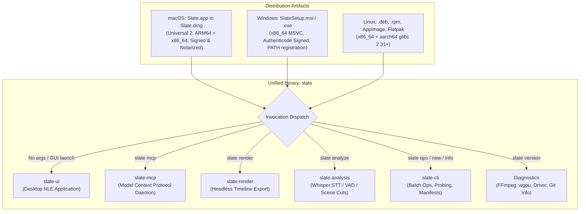
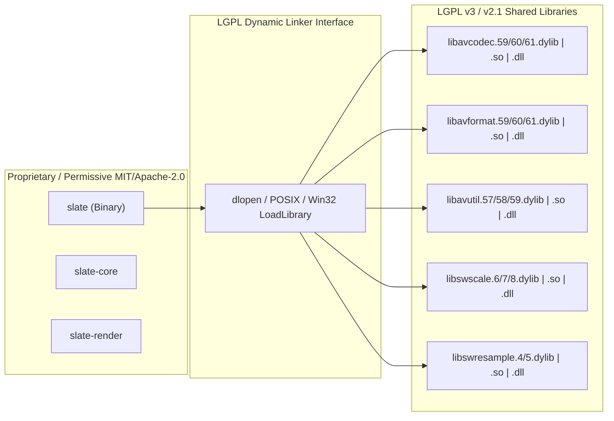
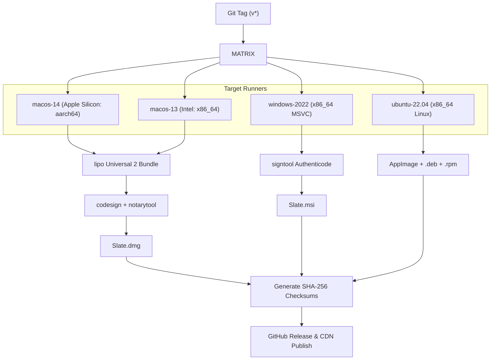
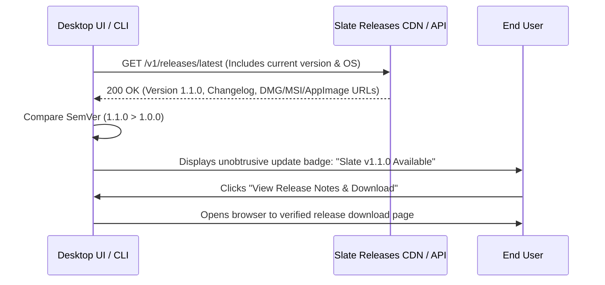

# Slate — Build, Packaging, and Distribution Specification

> **Document ID:** `docs/16-build-distribution.md`  
> **Status:** READY FOR IMPLEMENTATION  
> **Target Release:** v1.0.0 (Zero feature deferral — complete desktop app, headless CLI, and embedded MCP daemon in a single unified binary)  
> **Binary Name:** `slate`  
> **Supported Targets:** macOS (`aarch64-apple-darwin`, `x86_64-apple-darwin`), Windows (`x86_64-pc-windows-msvc`), Linux (`x86_64-unknown-linux-gnu`, `aarch64-unknown-linux-gnu`)

---

## 1. Overview & Architectural Strategy

Slate is engineered as a unified, production-grade video editing system combining a GPU-accelerated desktop application, a headless batch-processing CLI, and a Model Context Protocol (MCP) server. To deliver maximum ergonomics for both creative end-users and AI automation agents, **all functionality is compiled into a single binary (`slate`)**.



### 1.1 Core Distribution Principles

1. **Single Unified Executable (`slate`)**:
   - Zero fragmented binaries. When invoked without arguments (or double-clicked via macOS Finder / Windows Explorer / Linux desktop launchers), `slate` initializes the high-DPI desktop GUI.
   - When invoked with subcommands (`slate mcp`, `slate render`, `slate analyze`, `slate ops`, `slate info`, `slate version`), the application runs entirely headless without spawning a window or acquiring a display server context.
2. **Strict LGPL Dynamic Linking Compliance**:
   - Slate links dynamically against FFmpeg shared libraries (`libavcodec`, `libavformat`, `libavutil`, `libswscale`, `libswresample`).
   - Dynamic linking guarantees full compliance with LGPL v2.1/v3, enabling end-users to substitute custom or upgraded FFmpeg shared libraries without violating licensing or requiring Slate's core proprietary/permissive code to be relicensed under GPL.
   - FFmpeg libraries are bundled directly into the application distribution bundle (`Contents/Frameworks/` on macOS, application root on Windows, and `/usr/lib/slate/` or `$ORIGIN/../lib/` on Linux).
3. **Zero-Configuration Model Lifecycle**:
   - Compact neural models (Silero VAD v4, ~2.2 MB) are bundled directly inside the installer payload.
   - Large automatic speech recognition models (OpenAI Whisper: tiny, base, small, medium) are downloaded on-demand with SHA-256 integrity validation, resume support, and deterministic caching in standard OS application support directories.
4. **Full Platform Integration**:
   - **macOS**: Universal 2 binary, Hardened Runtime, Apple Developer ID signed, notarized via Apple `notarytool`, DMG packaging, `.slateproj` document UTI association, and automated `/usr/local/bin/slate` symlink installation.
   - **Windows**: Authenticode EV signed, Windows Installer (`.msi`) via WiX Toolset v4, automatic `%PATH%` registration, File Type Association (FTA) for `.slateproj`, and console subsystem auto-attachment.
   - **Linux**: FHS-compliant `.deb` and `.rpm` packages, standalone self-mounting `AppImage`, and Sandboxed `Flatpak` with hardware video acceleration pass-through.

---

## 2. Binary Structure & Subcommand Dispatch

The `slate` binary serves as the common denominator across desktop, automation, and AI workflows. 

### 2.1 Subcommand Matrix

| Command Invocations | Target Subsystem | Window / GUI Created | Standard I/O Behavior | Description |
| :--- | :--- | :--- | :--- | :--- |
| `slate` | `slate-ui` | **Yes** (wgpu/egui window) | Detached / Background | Launches the full desktop video editor. |
| `slate <file.slateproj>` | `slate-ui` | **Yes** (wgpu/egui window) | Detached / Background | Opens the desktop video editor with specified project. |
| `slate mcp [OPTIONS]` | `slate-mcp` | **No** (Headless) | Attached (`stdio` JSON-RPC) | Starts the Model Context Protocol daemon for AI agents. |
| `slate render [OPTIONS]`| `slate-render` | **No** (Headless) | Attached (Logs / Progress bar) | Headless video/audio timeline export. |
| `slate analyze [OPTIONS]`| `slate-analysis`| **No** (Headless) | Attached (JSON / Text output) | Runs Whisper STT, Silero VAD, or visual scene cut detection. |
| `slate info <asset>` | `slate-media` | **No** (Headless) | Attached (JSON / Table output) | Deep media probe: codecs, streams, packets, colorspace. |
| `slate ops [OPTIONS]` | `slate-core` | **No** (Headless) | Attached (JSON mutation result) | Executes batch timeline JSON mutation scripts atomically. |
| `slate new <path>` | `slate-core` | **No** (Headless) | Attached (Confirmation) | Initializes a new `.slateproj` directory bundle. |
| `slate version [OPTIONS]`| Diagnostic Engine | **No** (Headless) | Attached (Text / JSON) | Emits detailed compiler, Git, FFmpeg, and GPU diagnostics. |

### 2.2 Subsystem Dilemma & Windows Console Attachment

On Windows, binaries compiled with `windows_subsystem = "windows"` do not allocate or attach to a command prompt when executed from `cmd.exe` or PowerShell, causing CLI subcommands (`slate mcp`, `slate info`) to silently swallow output. Conversely, binaries compiled with `windows_subsystem = "console"` launch an empty terminal window whenever the GUI desktop application is double-clicked from File Explorer.

Slate solves this by building with `windows_subsystem = "windows"` and programmatically attaching to the parent console when subcommands are invoked.

#### Concrete Implementation: `crates/slate-cli/src/main.rs`

```rust
#![cfg_attr(not(debug_assertions), windows_subsystem = "windows")]

use clap::{Parser, Subcommand};
use std::path::PathBuf;
use std::process::ExitCode;

#[derive(Parser, Debug)]
#[command(
    name = "slate",
    author = "Slate Video Authors",
    version = env!("SLATE_VERSION_STRING"),
    about = "High-performance non-linear video editor and MCP engine",
    long_about = "Slate combines a GPU-accelerated desktop video editor with a headless\n\
                  CLI and Model Context Protocol (MCP) server in a single unified binary."
)]
pub struct Cli {
    #[command(subcommand)]
    pub command: Option<Commands>,

    /// Project file to open in GUI mode (when no subcommand is specified)
    #[arg(value_name = "PROJECT_PATH", global = false)]
    pub project: Option<PathBuf>,

    /// Enable verbose diagnostic logging
    #[arg(short, long, global = true)]
    pub verbose: bool,
}

#[derive(Subcommand, Debug)]
pub enum Commands {
    /// Start the Model Context Protocol (MCP) daemon for AI agent interaction
    Mcp(slate_mcp::McpArgs),

    /// Headless timeline rendering and export
    Render(slate_render::RenderArgs),

    /// Media analysis: Whisper transcription, Silero VAD, scene cut detection
    Analyze(slate_analysis::AnalyzeArgs),

    /// Probe audio/video container, streams, and codec metadata
    Info(slate_media::ProbeArgs),

    /// Apply transactional JSON mutation batches to a project
    Ops(slate_core::OpsArgs),

    /// Initialize a new .slateproj project bundle
    New(slate_core::NewProjectArgs),

    /// Print comprehensive version, FFmpeg, GPU, and build diagnostics
    Version(slate_cli::diagnostics::VersionArgs),
}

fn main() -> ExitCode {
    // 1. On Windows: If running a CLI subcommand or launched from a terminal, attach to console
    #[cfg(target_os = "windows")]
    attach_windows_console();

    // 2. Parse command-line arguments
    let cli = Cli::parse();

    // 3. Dispatch to GUI or Subcommand
    match cli.command {
        None => {
            // No subcommand: Launch Desktop GUI
            #[cfg(feature = "gui")]
            {
                if let Err(e) = slate_ui::launch_editor(cli.project) {
                    eprintln!("Error initializing Slate Desktop UI: {e}");
                    return ExitCode::FAILURE;
                }
                ExitCode::SUCCESS
            }
            #[cfg(not(feature = "gui"))]
            {
                eprintln!("Error: This build of Slate was compiled without the 'gui' feature.");
                eprintln!("Use 'slate --help' to view available headless CLI commands.");
                ExitCode::FAILURE
            }
        }
        Some(cmd) => {
            // Subcommand: Initialize Tokio Multi-Thread Runtime
            let runtime = tokio::runtime::Builder::new_multi_thread()
                .enable_all()
                .thread_name("slate-worker")
                .build()
                .expect("Failed to initialize Tokio runtime");

            let result = runtime.block_on(async {
                match cmd {
                    Commands::Mcp(args) => slate_mcp::run_mcp_server(args).await,
                    Commands::Render(args) => slate_render::run_headless_render(args).await,
                    Commands::Analyze(args) => slate_analysis::run_analysis(args).await,
                    Commands::Info(args) => slate_media::run_probe(args).await,
                    Commands::Ops(args) => slate_core::run_ops_batch(args).await,
                    Commands::New(args) => slate_core::run_new_project(args).await,
                    Commands::Version(args) => slate_cli::diagnostics::run_version(args).await,
                }
            });

            match result {
                Ok(_) => ExitCode::SUCCESS,
                Err(e) => {
                    eprintln!("Command failed: {e}");
                    ExitCode::FAILURE
                }
            }
        }
    }
}

#[cfg(target_os = "windows")]
fn attach_windows_console() {
    use windows_sys::Win32::System::Console::{
        AttachConsole, ATTACH_PARENT_PROCESS,
    };
    use std::env;

    // Only attach to console if arguments were passed (avoid attaching on normal GUI shortcut launch)
    if env::args().len() > 1 {
        unsafe {
            AttachConsole(ATTACH_PARENT_PROCESS);
        }
    }
}
```

---

## 3. Build System & Cargo Configuration

The project is structured as a tightly decoupled Cargo workspace. Subsystem crates enforce zero circular dependencies and modular feature sets.

### 3.1 Root `Cargo.toml`

```toml
[workspace]
members = [
    "crates/slate-core",
    "crates/slate-media",
    "crates/slate-render",
    "crates/slate-audio",
    "crates/slate-analysis",
    "crates/slate-ipc",
    "crates/slate-mcp",
    "crates/slate-ui",
    "crates/slate-cli",
]
resolver = "2"

[workspace.package]
version = "1.0.0"
edition = "2021"
authors = ["Slate Video Authors <team@slate.video>"]
license = "MIT OR Apache-2.0"
repository = "https://github.com/slate-video/slate"
homepage = "https://slate.video"
rust-version = "1.82.0"

[workspace.dependencies]
# Async Runtime & Concurrency
tokio = { version = "1.40", features = ["full"] }
futures = "0.3.30"
parking_lot = "0.12.3"
crossbeam-channel = "0.5.13"
rayon = "1.10.0"

# Serialization & Data Structures
serde = { version = "1.0.210", features = ["derive"] }
serde_json = "1.0.128"
bincode = "1.3.3"
uuid = { version = "1.10.0", features = ["v4", "serde"] }

# Media & Graphics
wgpu = "24.0.0"
naga = { version = "24.0.0", features = ["wgsl-in"] }
glyphon = "0.7.0"
cpal = "0.15.3"
rubato = "0.16.1"

# Terminal & CLI Parsing
clap = { version = "4.5.18", features = ["derive", "env", "cargo", "string"] }
indicatif = { version = "0.17.8", features = ["tokio", "rayon"] }
console = "0.15.8"
comfy-table = "7.1.1"

# Diagnostics & System
tracing = "0.1.40"
tracing-subscriber = { version = "0.3.18", features = ["env-filter", "json"] }
thiserror = "1.0.64"
anyhow = "1.0.89"
directories = "5.0.1"
sha2 = "0.10.8"
reqwest = { version = "0.12.7", default-features = false, features = ["rustls-tls", "stream"] }

# Profiles for Production & Debugging
[profile.dev]
opt-level = 1
debug = true
overflow-checks = true

[profile.dev.package."*"]
opt-level = 2 # Speed up heavy dependencies (wgpu, image, ffmpeg) during development

[profile.release]
opt-level = 3
lto = "thin"
codegen-units = 1
panic = "unwind" # Required to catch panics gracefully and flush timeline WAL
strip = false    # Keep debug symbols for crash reporting; stripped during installer packaging
debug = 1        # Include line numbers for backtraces

[profile.release-lto]
inherits = "release"
lto = "fat"
codegen-units = 1
strip = "symbols"
```

### 3.2 Workspace Feature Flags

The primary `slate-cli` package defines compile-time feature toggles to adapt the single binary for specialized environments (e.g., lean containerized CI runners or CUDA-enabled GPU servers):

```toml
# crates/slate-cli/Cargo.toml
[package]
name = "slate"
version.workspace = true
edition.workspace = true
license.workspace = true
default-run = "slate"

[[bin]]
name = "slate"
path = "src/main.rs"

[features]
default = ["gui", "hw-accel"]

# Subsystem switches
gui = ["slate-ui"]
headless = []

# Hardware acceleration feature gates
hw-accel = ["hw-videotoolbox", "hw-nvdec", "hw-vaapi", "hw-d3d11va"]
hw-videotoolbox = ["slate-media/videotoolbox"]
hw-nvdec = ["slate-media/nvdec"]
hw-vaapi = ["slate-media/vaapi"]
hw-d3d11va = ["slate-media/d3d11va"]

# AI Inference Backends
cuda = ["slate-analysis/cuda"]
coreml = ["slate-analysis/coreml"]
directml = ["slate-analysis/directml"]

[dependencies]
slate-core = { path = "../slate-core" }
slate-media = { path = "../slate-media" }
slate-render = { path = "../slate-render" }
slate-audio = { path = "../slate-audio" }
slate-analysis = { path = "../slate-analysis" }
slate-ipc = { path = "../slate-ipc" }
slate-mcp = { path = "../slate-mcp" }
slate-ui = { path = "../slate-ui", optional = true }

clap.workspace = true
tokio.workspace = true
tracing.workspace = true
tracing-subscriber.workspace = true
directories.workspace = true

[target.'cfg(target_os = "windows")'.dependencies]
windows-sys = { version = "0.59.0", features = ["Win32_System_Console"] }

[build-dependencies]
vergen = { version = "8.3.2", features = ["build", "git", "gitcl", "rustc", "cargo"] }
winres = "0.1.12"
```

### 3.3 Build Scripts

#### 1. Version & Metadata Injection (`crates/slate-cli/build.rs`)

```rust
use std::error::Error;

fn main() -> Result<(), Box<dyn Error>> {
    // 1. Emit Git & Rustc compile-time environment variables
    vergen::EmitBuilder::builder()
        .all_build()
        .all_git()
        .all_rustc()
        .all_cargo()
        .emit()?;

    let git_hash = std::env::var("VERGEN_GIT_SHA").unwrap_or_else(|_| "unknown".to_string());
    let build_date = std::env::var("VERGEN_BUILD_DATE").unwrap_or_else(|_| "unknown".to_string());
    let version = env!("CARGO_PKG_VERSION");
    
    println!("cargo:rustc-env=SLATE_VERSION_STRING={} (commit: {} date: {})", version, &git_hash[..8.min(git_hash.len())], build_date);

    // 2. Windows Executable Resource Manifest (.rc)
    #[cfg(target_os = "windows")]
    {
        let mut res = winres::WindowsResource::new();
        res.set_icon("../../assets/icons/slate.ico");
        res.set("FileDescription", "Slate Video Editor & MCP Server");
        res.set("ProductName", "Slate");
        res.set("LegalCopyright", "Copyright (c) 2026 Slate Video Authors");
        res.set_manifest(r#"
<assembly xmlns="urn:schemas-microsoft-com:asm.v1" manifestVersion="1.0">
  <trustInfo xmlns="urn:schemas-microsoft-com:asm.v3">
    <security>
      <requestedPrivileges>
        <requestedExecutionLevel level="asInvoker" uiAccess="false" />
      </requestedPrivileges>
    </security>
  </trustInfo>
  <application xmlns="urn:schemas-microsoft-com:asm.v3">
    <windowsSettings>
      <dpiAware xmlns="http://schemas.microsoft.com/SMI/2005/WindowsSettings">true/pm</dpiAware>
      <dpiAwareness xmlns="http://schemas.microsoft.com/SMI/2016/WindowsSettings">PerMonitorV2, PerMonitor</dpiAwareness>
      <longPathAware xmlns="http://schemas.microsoft.com/SMI/2016/WindowsSettings">true</longPathAware>
    </windowsSettings>
  </application>
</assembly>
"#);
        res.compile()?;
    }

    Ok(())
}
```

#### 2. WGSL Shader Static Validation (`crates/slate-render/build.rs`)

```rust
use std::fs;
use std::path::Path;

fn main() {
    println!("cargo:rerun-if-changed=../../shaders");

    let shader_dir = Path::new("../../shaders");
    if !shader_dir.exists() {
        return;
    }

    for entry in fs::read_dir(shader_dir).expect("Failed to read shaders dir") {
        let entry = entry.expect("Invalid directory entry");
        let path = entry.path();
        if path.extension().and_then(|ext| ext.to_str()) == Some("wgsl") {
            let content = fs::read_to_string(&path)
                .unwrap_or_else(|e| panic!("Failed to read shader {:?}: {e}", path));
            
            // Validate WGSL syntax using naga at compile time
            let module = naga::front::wgsl::parse_str(&content);
            match module {
                Ok(m) => {
                    let mut validator = naga::valid::Validator::new(
                        naga::valid::ValidationFlags::all(),
                        naga::valid::Capabilities::all(),
                    );
                    if let Err(e) = validator.validate(&m) {
                        panic!("\n[FATAL] WGSL Validation failed for {:?}:\n{:?}\n", path, e);
                    }
                }
                Err(e) => {
                    panic!("\n[FATAL] WGSL Syntax error in {:?}:\n{}\n", path, e.emit_to_string(&content));
                }
            }
        }
    }
}
```

#### 3. FFmpeg Dynamic Link Resolution (`crates/slate-media/build.rs`)

```rust
use std::env;
use std::path::PathBuf;

fn main() {
    println!("cargo:rerun-if-env-changed=FFMPEG_DIR");
    println!("cargo:rerun-if-env-changed=PKG_CONFIG_PATH");

    let target_os = env::var("CARGO_CFG_TARGET_OS").unwrap();

    // 1. Check if custom FFMPEG_DIR is provided by CI or developer
    if let Ok(dir) = env::var("FFMPEG_DIR") {
        let lib_dir = PathBuf::from(&dir).join("lib");
        let include_dir = PathBuf::from(&dir).join("include");

        println!("cargo:rustc-link-search=native={}", lib_dir.display());
        println!("cargo:include={}", include_dir.display());
    } else {
        // 2. Discover via pkg-config
        let libs = ["libavcodec", "libavformat", "libavutil", "libswscale", "libswresample"];
        for lib in &libs {
            pkg_config::Config::new()
                .atleast_version("6.0")
                .probe(lib)
                .unwrap_or_else(|e| {
                    panic!(
                        "Failed to locate dynamic library '{}' via pkg-config.\n\
                         Please install FFmpeg 6.0+ development libraries or set FFMPEG_DIR.\n\
                         Error: {}",
                        lib, e
                    );
                });
        }
    }

    // 3. Link dynamically against shared libraries (LGPL requirement)
    println!("cargo:rustc-link-lib=dylib=avcodec");
    println!("cargo:rustc-link-lib=dylib=avformat");
    println!("cargo:rustc-link-lib=dylib=avutil");
    println!("cargo:rustc-link-lib=dylib=swscale");
    println!("cargo:rustc-link-lib=dylib=swresample");

    // 4. Set runtime rpath for finding bundled libraries in distributions
    if target_os == "macos" {
        println!("cargo:rustc-link-arg=-Wl,-rpath,@executable_path/../Frameworks");
        println!("cargo:rustc-link-arg=-Wl,-rpath,@loader_path/../Frameworks");
    } else if target_os == "linux" {
        println!("cargo:rustc-link-arg=-Wl,-rpath,$ORIGIN/../lib/slate");
        println!("cargo:rustc-link-arg=-Wl,-rpath,$ORIGIN");
    }
}
```

---

## 4. FFmpeg Dynamic Integration & LGPL Compliance

Dynamic linking against FFmpeg shared libraries is a foundational architectural decision in Slate.

### 4.1 Legal & Technical Compliance Architecture



1. **Freedom of Relinking**: Under the GNU Lesser General Public License (LGPL v2.1 / v3), end-users must be permitted to modify, recompile, and replace the LGPL library components. By dynamically linking shared libraries (`.dylib`, `.so`, `.dll`), users can replace any bundled FFmpeg library with a custom build, fulfilling LGPL obligations without forcing Slate source code disclosure.
2. **Strict Avoidance of GPL Contamination**:
   - The FFmpeg build is configured with `--disable-gpl`.
   - GPL-only encoders (`libx264`, `libx265`, `libxvid`) are **explicitly excluded** from the bundled distribution build.
   - High-performance H.264, HEVC, and AV1 encoding is achieved via:
     - OS Native Hardware Codecs: Apple VideoToolbox (`h264_videotoolbox`, `hevc_videotoolbox`), NVIDIA NVENC (`h264_nvenc`, `hevc_nvenc`), Intel/AMD VAAPI (`h264_vaapi`, `hevc_vaapi`), Direct3D11 / Media Foundation.
     - Permissive/LGPL Software Codecs: `libsvtav1` (BSD-2-Clause+Patent), `libvpx` (VP9 BSD-3-Clause), `libopus` (BSD-3-Clause).

### 4.2 Standardized FFmpeg Build Script

The following script builds an LGPL-compliant shared FFmpeg distribution across all platforms:

```bash
#!/usr/bin/env bash
set -euo pipefail

PREFIX_DIR="${1:-/opt/slate-ffmpeg}"
TARGET_OS="${2:-$(uname -s | tr '[:upper:]' '[:lower:]')}"

COMMON_FLAGS=(
    "--prefix=${PREFIX_DIR}"
    "--enable-shared"
    "--disable-static"
    "--disable-gpl"
    "--enable-version3"
    "--disable-doc"
    "--disable-programs"
    "--disable-avdevice"
    "--disable-postproc"
    "--enable-pic"
    "--enable-optimizations"
    "--enable-pthreads"
    # Audio codecs
    "--enable-libopus"
    "--enable-libvorbis"
    # Video codecs (permissive/BSD)
    "--enable-libvpx"
    "--enable-libsvtav1"
    # Enable hardware acceleration interfaces
    "--enable-hwaccels"
)

PLATFORM_FLAGS=()

case "${TARGET_OS}" in
    darwin*)
        PLATFORM_FLAGS+=(
            "--enable-videotoolbox"
            "--enable-audiotoolbox"
            "--cc=clang"
            "--extra-cflags=-mmacosx-version-min=11.0"
        )
        ;;
    linux*)
        PLATFORM_FLAGS+=(
            "--enable-vaapi"
            "--enable-nvdec"
            "--enable-nvenc"
            "--enable-vdpau"
        )
        ;;
    msvc*|windows*)
        PLATFORM_FLAGS+=(
            "--enable-d3d11va"
            "--enable-dxva2"
            "--enable-nvdec"
            "--enable-nvenc"
            "--toolchain=msvc"
        )
        ;;
    *)
        echo "Unknown target OS: ${TARGET_OS}"
        exit 1
        ;;
esac

echo "Configuring FFmpeg for ${TARGET_OS}..."
./configure "${COMMON_FLAGS[@]}" "${PLATFORM_FLAGS[@]}"

make -j"$(getconf _NPROCESSORS_ONLN 2>/dev/null || sysctl -n hw.ncpu)"
make install

echo "FFmpeg successfully compiled and installed to ${PREFIX_DIR}"
```

---

## 5. Platform-Specific Packaging

### 5.1 macOS Distribution (`Slate.app` & `.dmg`)

On macOS, Slate ships as a Universal 2 (Apple Silicon `aarch64` + Intel `x86_64`) application bundle inside an Apple-notarized DMG installer.

#### Bundle Structure

```
Slate.app/
├── Contents/
│   ├── Info.plist
│   ├── PkgInfo
│   ├── MacOS/
│   │   └── slate                         # Fat Universal 2 binary (GUI + CLI + MCP)
│   ├── Frameworks/
│   │   ├── libavcodec.61.dylib
│   │   ├── libavformat.61.dylib
│   │   ├── libavutil.59.dylib
│   │   ├── libswscale.8.dylib
│   │   ├── libswresample.5.dylib
│   │   ├── libsvtav1.dylib
│   │   └── libopus.0.dylib
│   ├── Resources/
│   │   ├── AppIcon.icns
│   │   ├── SlateProject.icns             # Document icon for .slateproj
│   │   ├── models/
│   │   │   └── silero_vad.onnx            # Bundled lightweight VAD model
│   │   ├── luts/
│   │   │   └── rec709_neutral.cube
│   │   └── fonts/
│   │       ├── Inter-Regular.ttf
│   │       └── JetBrainsMono-Regular.ttf
│   └── _CodeSignature/
```

#### `Info.plist` Definition

```xml
<?xml version="1.0" encoding="UTF-8"?>
<!DOCTYPE plist PUBLIC "-//Apple//DTD PLIST 1.0//EN" "http://www.apple.com/DTDs/PropertyList-1.0.dtd">
<plist version="1.0">
<dict>
    <key>CFBundlePackageType</key>
    <string>APPL</string>
    <key>CFBundleName</key>
    <string>Slate</string>
    <key>CFBundleDisplayName</key>
    <string>Slate Video Editor</string>
    <key>CFBundleIdentifier</key>
    <string>video.slate.desktop</string>
    <key>CFBundleVersion</key>
    <string>1.0.0</string>
    <key>CFBundleShortVersionString</key>
    <string>1.0.0</string>
    <key>CFBundleExecutable</key>
    <string>slate</string>
    <key>CFBundleIconFile</key>
    <string>AppIcon</string>
    <key>LSMinimumSystemVersion</key>
    <string>11.0</string>
    <key>NSHighResolutionCapable</key>
    <true/>
    <key>NSSupportsAutomaticGraphicsSwitching</key>
    <true/>
    <key>LSApplicationCategoryType</key>
    <string>public.app-category.video</string>
    
    <!-- File Association for .slateproj -->
    <key>CFBundleDocumentTypes</key>
    <array>
        <dict>
            <key>CFBundleTypeName</key>
            <string>Slate Video Project</string>
            <key>CFBundleTypeRole</key>
            <string>Editor</string>
            <key>LSHandlerRank</key>
            <string>Owner</string>
            <key>CFBundleTypeExtensions</key>
            <array>
                <string>slateproj</string>
            </array>
            <key>CFBundleTypeIconFile</key>
            <string>SlateProject</string>
            <key>LSItemContentTypes</key>
            <array>
                <string>video.slate.project</string>
            </array>
            <key>LSTypeIsPackage</key>
            <true/>
        </dict>
    </array>

    <!-- UTI Export -->
    <key>UTExportedTypeDeclarations</key>
    <array>
        <dict>
            <key>UTTypeIdentifier</key>
            <string>video.slate.project</string>
            <key>UTTypeDescription</key>
            <string>Slate Video Project Directory Bundle</string>
            <key>UTTypeConformsTo</key>
            <array>
                <string>com.apple.package</string>
                <string>public.composite-content</string>
            </array>
            <key>UTTypeTagSpecification</key>
            <dict>
                <key>public.filename-extension</key>
                <array>
                    <string>slateproj</string>
                </array>
            </dict>
        </dict>
    </array>

    <!-- Microphone entitlement for live voiceover capture -->
    <key>NSMicrophoneUsageDescription</key>
    <string>Slate requires microphone access to record audio voiceovers directly into timeline tracks.</string>
</dict>
</plist>
```

#### Entitlements Plist (`slate.entitlements`)

Hardened runtime requires explicit entitlements for JIT compilation, audio drivers, and dynamic FFmpeg shared library resolution:

```xml
<?xml version="1.0" encoding="UTF-8"?>
<!DOCTYPE plist PUBLIC "-//Apple//DTD PLIST 1.0//EN" "http://www.apple.com/DTDs/PropertyList-1.0.dtd">
<plist version="1.0">
<dict>
    <key>com.apple.security.cs.allow-jit</key>
    <true/>
    <key>com.apple.security.cs.allow-unsigned-executable-memory</key>
    <true/>
    <key>com.apple.security.cs.disable-library-validation</key>
    <true/>
    <key>com.apple.security.device.audio-input</key>
    <true/>
</dict>
</plist>
```

#### Packaging, Signing & Notarization Pipeline (`scripts/package_macos.sh`)

```bash
#!/usr/bin/env bash
set -euo pipefail

APP_NAME="Slate"
BUNDLE_DIR="target/package/macOS/${APP_NAME}.app"
CONTENTS="${BUNDLE_DIR}/Contents"
IDENTITY="Developer ID Application: Slate Video Inc (TEAM_ID_HERE)"
APPLE_ID="builds@slate.video"
TEAM_ID="TEAM_ID_HERE"
APP_PASSWORD="@keychain:AC_PASSWORD"

echo "=== 1. Creating Directory Hierarchy ==="
rm -rf "target/package/macOS"
mkdir -p "${CONTENTS}/MacOS"
mkdir -p "${CONTENTS}/Frameworks"
mkdir -p "${CONTENTS}/Resources/models"
mkdir -p "${CONTENTS}/Resources/luts"
mkdir -p "${CONTENTS}/Resources/fonts"

echo "=== 2. Creating Universal Binary via lipo ==="
lipo -create -output "${CONTENTS}/MacOS/slate" \
    target/aarch64-apple-darwin/release/slate \
    target/x86_64-apple-darwin/release/slate
chmod +x "${CONTENTS}/MacOS/slate"

echo "=== 3. Copying Resources & Plists ==="
cp distribution/macos/Info.plist "${CONTENTS}/"
echo "APPL????" > "${CONTENTS}/PkgInfo"
cp assets/icons/AppIcon.icns "${CONTENTS}/Resources/"
cp assets/icons/SlateProject.icns "${CONTENTS}/Resources/"
cp models/silero_vad.onnx "${CONTENTS}/Resources/models/"
cp assets/luts/* "${CONTENTS}/Resources/luts/"
cp assets/fonts/* "${CONTENTS}/Resources/fonts/"

echo "=== 4. Copying and Relinking Frameworks ==="
cp /opt/slate-ffmpeg/lib/*.dylib "${CONTENTS}/Frameworks/"

# Fix dylib ID and install names using install_name_tool
for dylib in "${CONTENTS}/Frameworks/"*.dylib; do
    base=$(basename "$dylib")
    install_name_tool -id "@rpath/${base}" "$dylib"
    for dep in "${CONTENTS}/Frameworks/"*.dylib; do
        dep_base=$(basename "$dep")
        install_name_tool -change "/opt/slate-ffmpeg/lib/${dep_base}" "@rpath/${dep_base}" "$dylib" || true
    done
done

echo "=== 5. Code Signing with Hardened Runtime ==="
# Sign each dylib first (from inside out)
find "${CONTENTS}/Frameworks" -type f -name "*.dylib" -exec codesign \
    --force --timestamp --options runtime \
    --sign "${IDENTITY}" {} +

# Sign main executable
codesign --force --timestamp --options runtime \
    --entitlements distribution/macos/slate.entitlements \
    --sign "${IDENTITY}" "${CONTENTS}/MacOS/slate"

# Sign entire .app bundle
codesign --force --timestamp --options runtime \
    --entitlements distribution/macos/slate.entitlements \
    --sign "${IDENTITY}" "${BUNDLE_DIR}"

echo "=== 6. Building DMG with create-dmg ==="
DMG_PATH="target/package/macOS/Slate-1.0.0-universal.dmg"
test -f "${DMG_PATH}" && rm "${DMG_PATH}"

create-dmg \
  --volname "Slate Installer" \
  --volicon "assets/icons/AppIcon.icns" \
  --background "distribution/macos/dmg_background.png" \
  --window-pos 200 120 \
  --window-size 800 450 \
  --icon-size 128 \
  --text-size 14 \
  --icon "${APP_NAME}.app" 200 220 \
  --app-drop-link 600 220 \
  --hide-extension "${APP_NAME}.app" \
  "${DMG_PATH}" \
  "target/package/macOS/${APP_NAME}.app"

echo "=== 7. Signing DMG ==="
codesign --force --timestamp --sign "${IDENTITY}" "${DMG_PATH}"

echo "=== 8. Submitting to Apple Notary Service ==="
xcrun notarytool submit "${DMG_PATH}" \
    --apple-id "${APPLE_ID}" \
    --team-id "${TEAM_ID}" \
    --password "${APP_PASSWORD}" \
    --wait

echo "=== 9. Stapling Notarization Ticket ==="
xcrun stapler staple "${DMG_PATH}"
spctl --assess --type open --context context:primary-signature "${DMG_PATH}"

echo "macOS Packaging and Notarization Completed Successfully: ${DMG_PATH}"
```

#### CLI Symlink Integration on macOS

To allow users to invoke `slate` or `slate mcp` seamlessly from their terminal, the application installs a symlink on first launch or via an in-app prompt:

```rust
// crates/slate-cli/src/symlink.rs
use std::fs;
use std::os::unix::fs::symlink;
use std::path::Path;

pub fn ensure_cli_symlink() -> std::io::Result<()> {
    #[cfg(target_os = "macos")]
    {
        let target_dir = Path::new("/usr/local/bin");
        let symlink_path = target_dir.join("slate");

        if !symlink_path.exists() {
            if let Ok(current_exe) = std::env::current_exe() {
                // If running from within an .app bundle
                if current_exe.to_string_lossy().contains("Slate.app/Contents/MacOS") {
                    if target_dir.exists() {
                        let _ = symlink(&current_exe, &symlink_path);
                    }
                }
            }
        }
    }
    Ok(())
}
```

---

### 5.2 Windows Distribution (`.msi` & Standalone `.zip`)

On Windows, Slate is packaged as an enterprise-grade Windows Installer (`.msi`) via the WiX Toolset v4, and signed with Authenticode.

#### Directory Layout in `C:\Program Files\Slate\`

```
C:\Program Files\Slate\
├── slate.exe                      # Unified binary
├── avcodec-61.dll                  # Dynamic FFmpeg DLLs
├── avformat-61.dll
├── avutil-59.dll
├── swscale-8.dll
├── swresample-5.dll
├── svtav1.dll
├── opus.dll
├── resources\
│   ├── silero_vad.onnx             # Bundled VAD model
│   ├── luts\
│   │   └── rec709_neutral.cube
│   └── fonts\
│       ├── Inter-Regular.ttf
│       └── JetBrainsMono-Regular.ttf
└── slate.visualelementsmanifest.xml
```

#### WiX Toolset v4 Specification (`distribution/windows/slate.wxs`)

```xml
<Wix xmlns="http://wixtoolset.org/schemas/v4/wxs">
  <Package Name="Slate Video Editor"
           Manufacturer="Slate Video Inc."
           Version="1.0.0.0"
           UpgradeCode="4F2B7685-6A81-4FE9-8231-15D48AEBF210"
           Scope="perMachine">
    
    <MajorUpgrade DowngradeErrorMessage="A newer version of Slate is already installed." />
    <MediaTemplate EmbedCab="yes" />

    <StandardDirectory Id="ProgramFiles64Folder">
      <Directory Id="INSTALLFOLDER" Name="Slate">
        
        <!-- Main Executable Component -->
        <Component Id="SlateExe" Guid="9B24D9E2-8176-41A7-A77E-062A5A2B9F4E">
          <File Id="slate.exe" Source="target/release/slate.exe" KeyPath="yes">
            <!-- Desktop Shortcut -->
            <Shortcut Id="SlateDesktopShortcut"
                      Directory="DesktopFolder"
                      Name="Slate"
                      WorkingDirectory="INSTALLFOLDER"
                      Icon="SlateIcon.exe"
                      IconIndex="0"
                      Advertise="yes" />
            <!-- Start Menu Shortcut -->
            <Shortcut Id="SlateStartMenuShortcut"
                      Directory="ProgramMenuFolder"
                      Name="Slate Video Editor"
                      WorkingDirectory="INSTALLFOLDER"
                      Icon="SlateIcon.exe"
                      IconIndex="0"
                      Advertise="yes" />
          </File>

          <!-- Add Slate installation directory to System PATH -->
          <Environment Id="PATH"
                       Name="PATH"
                       Value="[INSTALLFOLDER]"
                       Permanent="no"
                       Part="last"
                       Action="set"
                       System="yes" />

          <!-- Register .slateproj File Extension -->
          <ProgId Id="Slate.Project" Description="Slate Video Project">
            <Extension Id="slateproj" ContentType="application/x-slate-project">
              <Verb Id="open" Command="Open with Slate" TargetFile="slate.exe" Argument="&quot;%1&quot;" />
            </Extension>
          </ProgId>
        </Component>

        <!-- Bundled FFmpeg Dynamic Libraries -->
        <Component Id="FFmpegDlls" Guid="7D16A1D2-95C4-4BD9-9A0A-6379CE20F2AA">
          <File Id="avcodec61" Source="external/ffmpeg-win64/bin/avcodec-61.dll" />
          <File Id="avformat61" Source="external/ffmpeg-win64/bin/avformat-61.dll" />
          <File Id="avutil59" Source="external/ffmpeg-win64/bin/avutil-59.dll" />
          <File Id="swscale8" Source="external/ffmpeg-win64/bin/swscale-8.dll" />
          <File Id="swresample5" Source="external/ffmpeg-win64/bin/swresample-5.dll" />
          <File Id="svtav1" Source="external/ffmpeg-win64/bin/svtav1.dll" />
          <File Id="opus" Source="external/ffmpeg-win64/bin/opus.dll" />
        </Component>

        <!-- Bundled Assets & Silero VAD Model -->
        <Directory Id="ResourcesFolder" Name="resources">
          <Component Id="BundledResources" Guid="5B8C1D71-2B4A-48DE-93F1-E92348C17F6A">
            <File Id="silero_vad" Source="models/silero_vad.onnx" />
          </Component>
        </Directory>
        
      </Directory>
    </StandardDirectory>

    <StandardDirectory Id="DesktopFolder" />
    <StandardDirectory Id="ProgramMenuFolder" />

    <Icon Id="SlateIcon.exe" SourceFile="assets/icons/slate.ico" />
    <Property Id="ARPPRODUCTICON" Value="SlateIcon.exe" />

    <Feature Id="MainApplication" Title="Slate Video Engine" Level="1">
      <ComponentRef Id="SlateExe" />
      <ComponentRef Id="FFmpegDlls" />
      <ComponentRef Id="BundledResources" />
    </Feature>
  </Package>
</Wix>
```

#### Windows Authenticode Signing Script (`scripts/sign_windows.bat`)

```cmd
@echo off
setlocal enabledelayedexpansion

set CERT_THUMBPRINT=%AZURE_KEYVAULT_CERT_THUMBPRINT%
set TIMESTAMP_SERVER=http://timestamp.digicert.com
set FILE_TO_SIGN=%1

echo Signing %FILE_TO_SIGN% with Authenticode and RFC 3161 Timestamp...

signtool.exe sign /sha1 %CERT_THUMBPRINT% ^
    /tr %TIMESTAMP_SERVER% /td sha256 /fd sha256 ^
    /d "Slate Video Editor & MCP Server" ^
    /du "https://slate.video" ^
    "%FILE_TO_SIGN%"

if %ERRORLEVEL% neq 0 (
    echo [ERROR] Signtool execution failed.
    exit /b %ERRORLEVEL%
)

signtool.exe verify /pa /v "%FILE_TO_SIGN%"
echo Successfully verified Authenticode signature on %FILE_TO_SIGN%.
```

---

### 5.3 Linux Distribution (`.deb`, `.rpm`, `AppImage`, `Flatpak`)

Linux packaging targets mainstream distributions via traditional package managers (`.deb`, `.rpm`) alongside universal formats (`AppImage`, `Flatpak`).

#### 1. FHS Debian Packaging (`.deb`)

```
/
├── usr/
│   ├── bin/
│   │   └── slate                         # Symlink -> /usr/lib/slate/slate
│   ├── lib/
│   │   └── slate/
│   │       ├── slate                     # Main binary (rpath: $ORIGIN)
│   │       ├── libavcodec.so.61
│   │       ├── libavformat.so.61
│   │       ├── libavutil.so.59
│   │       ├── libswscale.so.8
│   │       └── libswresample.so.5
│   └── share/
│       ├── slate/
│       │   └── models/
│       │       └── silero_vad.onnx
│       ├── applications/
│       │   └── slate.desktop
│       ├── icons/hicolor/scalable/apps/
│       │   └── slate.svg
│       └── mime/packages/
│           └── slate.xml
```

##### Desktop Entry (`distribution/linux/slate.desktop`)

```ini
[Desktop Entry]
Name=Slate
GenericName=Video Editor & MCP Engine
Comment=Non-linear, AI-agent native video editing system
Exec=/usr/bin/slate %F
Terminal=false
Type=Application
Icon=slate
Categories=AudioVideo;Video;AudioVideoEditing;
MimeType=application/x-slate-project;
StartupNotify=true
StartupWMClass=slate
Keywords=video;editor;nle;timeline;render;mcp;
```

##### MIME Type Definition (`distribution/linux/slate.xml`)

```xml
<?xml version="1.0" encoding="UTF-8"?>
<mime-info xmlns="http://www.freedesktop.org/standards/shared-mime-info">
  <mime-type type="application/x-slate-project">
    <comment>Slate Video Project</comment>
    <icon name="slate"/>
    <glob pattern="*.slateproj"/>
  </mime-type>
</mime-info>
```

#### 2. Self-Contained AppImage Packaging

The AppImage bundles all shared dependencies (except glibc and libGL) into an isolated directory payload executable across any modern Linux distribution.

```
Slate.AppDir/
├── AppRun                                # Execution entry point
├── slate.desktop                        # Desktop entry
├── slate.png                            # Application icon
├── usr/
│   ├── bin/
│   │   └── slate                        # Core binary
│   ├── lib/
│   │   ├── libavcodec.so.61
│   │   ├── libavformat.so.61
│   │   ├── libavutil.so.59
│   │   ├── libswscale.so.8
│   │   ├── libswresample.so.5
│   │   ├── libva.so.2
│   │   └── libvdpau.so.1
│   └── share/
│       └── slate/
│           └── models/
│               └── silero_vad.onnx
```

##### `AppRun` Launcher Script

```bash
#!/bin/sh
set -e

SELF=$(readlink -f "$0")
APPDIR=$(dirname "$SELF")

export PATH="${APPDIR}/usr/bin:${PATH}"
export LD_LIBRARY_PATH="${APPDIR}/usr/lib:${LD_LIBRARY_PATH}"
export SLATE_RESOURCE_PATH="${APPDIR}/usr/share/slate"

# Execute slate with forwarded command line arguments
exec "${APPDIR}/usr/bin/slate" "$@"
```

##### AppImage Generation Command

```bash
# Download appimagetool
wget -q "https://github.com/AppImage/AppImageKit/releases/download/13/appimagetool-x86_64.AppImage" -O appimagetool
chmod +x appimagetool

# Build AppImage with embedded runtime
ARCH=x86_64 ./appimagetool --comp zstd target/package/Slate.AppDir target/package/Slate-1.0.0-x86_64.AppImage
```

#### 3. Flatpak Manifest (`distribution/linux/org.slate.Slate.yaml`)

```yaml
app-id: org.slate.Slate
runtime: org.freedesktop.Platform
runtime-version: '23.08'
sdk: org.freedesktop.Sdk
command: slate
finish-args:
  # Display & GPU permissions
  - --socket=wayland
  - --socket=fallback-x11
  - --device=all             # Full GPU acceleration (Vulkan, VAAPI, NVENC)
  - --share=ipc
  # Audio Output & Microphone Input
  - --socket=pulseaudio
  # Filesystem Access
  - --filesystem=host
  - --filesystem=home

modules:
  - name: ffmpeg
    buildsystem: autotools
    config-opts:
      - --enable-shared
      - --disable-static
      - --disable-gpl
      - --enable-version3
      - --enable-vaapi
      - --enable-nvdec
      - --enable-nvenc
      - --enable-libopus
      - --enable-libvpx
      - --enable-libsvtav1
    sources:
      - type: archive
        url: https://ffmpeg.org/releases/ffmpeg-7.0.2.tar.xz
        sha256: 864651c13cb23ecab20fb27620a20716768e376bf143f29fb51d0d636b300975

  - name: slate
    buildsystem: simple
    build-commands:
      - install -D -m 755 slate /app/bin/slate
      - install -D -m 644 silero_vad.onnx /app/share/slate/models/silero_vad.onnx
      - install -D -m 644 slate.desktop /app/share/applications/org.slate.Slate.desktop
      - install -D -m 644 slate.png /app/share/icons/hicolor/256x256/apps/org.slate.Slate.png
      - install -D -m 644 slate.xml /app/share/mime/packages/org.slate.Slate.xml
    sources:
      - type: file
        path: target/release/slate
      - type: file
        path: models/silero_vad.onnx
      - type: file
        path: distribution/linux/slate.desktop
      - type: file
        path: assets/icons/slate.png
      - type: file
        path: distribution/linux/slate.xml
```

---

## 6. CI/CD Matrix & Automated Release Pipeline

GitHub Actions is configured with a rigorous dual-stage pipeline: continuous integration for every PR and merge, and multi-platform signed artifact generation on Git tag creation.



### 6.1 GitHub Actions Release Workflow (`.github/workflows/release.yml`)

```yaml
name: Release & Distribution

on:
  push:
    tags:
      - 'v*'

permissions:
  contents: write

jobs:
  # -------------------------------------------------------------
  # macOS Universal 2 Build & Notarization
  # -------------------------------------------------------------
  build-macos:
    runs-on: macos-14
    steps:
      - name: Checkout Source Code
        uses: actions/checkout@v4
        with:
          submodules: recursive

      - name: Install Stable Rust Toolchain
        uses: dtolnay/rust-toolchain@stable
        with:
          targets: aarch64-apple-darwin,x86_64-apple-darwin

      - name: Cache Cargo Dependencies
        uses: Swatinem/rust-cache@v2

      - name: Install macOS Build Dependencies
        run: |
          brew install create-dmg pkg-config

      - name: Install Prebuilt LGPL FFmpeg Shared Libraries
        run: |
          curl -L -o ffmpeg-macos.tar.gz https://cdn.slate.video/deps/ffmpeg-7.0-macos-universal.tar.gz
          sudo tar -xzf ffmpeg-macos.tar.gz -C /opt

      - name: Build Apple Silicon (aarch64) Release
        run: |
          export PKG_CONFIG_PATH=/opt/slate-ffmpeg/lib/pkgconfig
          cargo build --release --target aarch64-apple-darwin

      - name: Build Intel (x86_64) Release
        run: |
          export PKG_CONFIG_PATH=/opt/slate-ffmpeg/lib/pkgconfig
          cargo build --release --target x86_64-apple-darwin

      - name: Package, Sign, and Notarize DMG
        env:
          MACOS_CERTIFICATE_BASE64: ${{ secrets.MACOS_CERTIFICATE_BASE64 }}
          MACOS_CERTIFICATE_PWD: ${{ secrets.MACOS_CERTIFICATE_PWD }}
          APPLE_ID: ${{ secrets.APPLE_ID }}
          APPLE_TEAM_ID: ${{ secrets.APPLE_TEAM_ID }}
          APPLE_NOTARY_PASSWORD: ${{ secrets.APPLE_NOTARY_PASSWORD }}
        run: |
          # Import Certificate into temporary Keychain
          KEYCHAIN=build.keychain
          security create-keychain -p actions $KEYCHAIN
          security default-keychain -s $KEYCHAIN
          security unlock-keychain -p actions $KEYCHAIN
          echo "$MACOS_CERTIFICATE_BASE64" | base64 --decode > cert.p12
          security import cert.p12 -k $KEYCHAIN -P "$MACOS_CERTIFICATE_PWD" -T /usr/bin/codesign
          security set-key-partition-list -S apple-tool:,apple: -s -k actions $KEYCHAIN

          # Execute packaging script
          chmod +x scripts/package_macos.sh
          ./scripts/package_macos.sh

      - name: Upload macOS Artifact
        uses: actions/upload-artifact@v4
        with:
          name: slate-macos-dmg
          path: target/package/macOS/*.dmg

  # -------------------------------------------------------------
  # Windows x86_64 Build & Authenticode Signing
  # -------------------------------------------------------------
  build-windows:
    runs-on: windows-2022
    steps:
      - name: Checkout Source Code
        uses: actions/checkout@v4

      - name: Install Stable Rust Toolchain
        uses: dtolnay/rust-toolchain@stable
        with:
          targets: x86_64-pc-windows-msvc

      - name: Cache Cargo Dependencies
        uses: Swatinem/rust-cache@v2

      - name: Install WiX Toolset v4
        run: |
          dotnet tool install --global wix

      - name: Fetch Bundled FFmpeg Windows DLLs
        shell: bash
        run: |
          curl -L -o ffmpeg-win.zip https://cdn.slate.video/deps/ffmpeg-7.0-win64-lgpl.zip
          unzip ffmpeg-win.zip -d external/ffmpeg-win64

      - name: Build Release Binary
        run: |
          $env:FFMPEG_DIR = "$pwd/external/ffmpeg-win64"
          cargo build --release --target x86_64-pc-windows-msvc

      - name: Build MSI Installer with WiX
        shell: cmd
        run: |
          wix build distribution\windows\slate.wxs -ext WixToolset.UI.wixext -o target\package\SlateSetup.msi

      - name: Sign Binary and Installer with Authenticode
        env:
          AZURE_KEYVAULT_CERT_THUMBPRINT: ${{ secrets.AZURE_CERT_THUMBPRINT }}
        shell: cmd
        run: |
          call scripts\sign_windows.bat target\release\slate.exe
          call scripts\sign_windows.bat target\package\SlateSetup.msi

      - name: Upload Windows MSI Artifact
        uses: actions/upload-artifact@v4
        with:
          name: slate-windows-msi
          path: target/package/SlateSetup.msi

  # -------------------------------------------------------------
  # Linux x86_64 Build (AppImage & .deb)
  # -------------------------------------------------------------
  build-linux:
    runs-on: ubuntu-22.04
    steps:
      - name: Checkout Source Code
        uses: actions/checkout@v4

      - name: Install Stable Rust Toolchain
        uses: dtolnay/rust-toolchain@stable
        with:
          targets: x86_64-unknown-linux-gnu

      - name: Cache Cargo Dependencies
        uses: Swatinem/rust-cache@v2

      - name: Install Build Libraries
        run: |
          sudo apt-get update
          sudo apt-get install -y libva-dev libvdpau-dev pkg-config clang libasound2-dev

      - name: Fetch Bundled FFmpeg Shared Libraries
        run: |
          curl -L -o ffmpeg-linux.tar.gz https://cdn.slate.video/deps/ffmpeg-7.0-linux-x86_64.tar.gz
          sudo tar -xzf ffmpeg-linux.tar.gz -C /opt

      - name: Build Release Binary
        run: |
          export PKG_CONFIG_PATH=/opt/slate-ffmpeg/lib/pkgconfig
          cargo build --release --target x86_64-unknown-linux-gnu

      - name: Package AppImage and Debian .deb
        run: |
          chmod +x scripts/package_linux.sh
          ./scripts/package_linux.sh

      - name: Upload Linux Artifacts
        uses: actions/upload-artifact@v4
        with:
          name: slate-linux-packages
          path: |
            target/package/*.AppImage
            target/package/*.deb

  # -------------------------------------------------------------
  # Publish GitHub Release with Checksums
  # -------------------------------------------------------------
  publish-release:
    needs: [build-macos, build-windows, build-linux]
    runs-on: ubuntu-latest
    steps:
      - name: Download All Artifacts
        uses: actions/download-artifact@v4
        with:
          path: release-artifacts

      - name: Compute SHA-256 Checksums
        run: |
          cd release-artifacts
          find . -type f \( -name "*.dmg" -o -name "*.msi" -o -name "*.AppImage" -o -name "*.deb" \) -exec sha256sum {} + > SHA256SUMS.txt
          cat SHA256SUMS.txt

      - name: Create GitHub Release
        uses: softprops/action-gh-release@v2
        with:
          files: |
            release-artifacts/**/*.dmg
            release-artifacts/**/*.msi
            release-artifacts/**/*.AppImage
            release-artifacts/**/*.deb
            release-artifacts/SHA256SUMS.txt
          generate_release_notes: true
          draft: false
          prerelease: false
```

---

## 7. Model Distribution & Lifecycle Management

Slate integrates neural models for Voice Activity Detection (VAD) and Automatic Speech Recognition (ASR). Because ASR weights range from 75 MB to 1.5 GB, models are categorized into **bundled assets** and **on-demand downloadable assets**.

### 7.1 Model Categorization Matrix

| Model Identifier | Parameter Count | Disk Size | Packaging Strategy | Target Task | Primary Execution Target |
| :--- | :--- | :--- | :--- | :--- | :--- |
| **Silero VAD v4** | 1.8M | 2.2 MB | **Bundled in installer** | Silence detection, audio splitting | CPU / ONNX Runtime |
| **Whisper `tiny.en`** | 39M | 75 MB | On-demand download | Fast preview transcriptions | CPU / CoreML / CUDA |
| **Whisper `base.en`** | 74M | 142 MB | On-demand download | Balanced default speech-to-text | CPU / CoreML / CUDA |
| **Whisper `small.en`** | 244M | 466 MB | On-demand download | High-accuracy transcription | GPU (CUDA / Metal) |
| **Whisper `medium.en`**| 769M | 1.5 GB | On-demand download | Studio broadcast captions | High-memory GPU |

### 7.2 OS-Standard Storage Paths

Downloaded models are strictly isolated into OS-specific application data repositories via the `directories` crate:

```rust
// crates/slate-analysis/src/models/paths.rs
use directories::ProjectDirs;
use std::path::PathBuf;

pub fn get_models_cache_dir() -> PathBuf {
    let proj_dirs = ProjectDirs::from("video", "slate", "Slate")
        .expect("Failed to resolve OS standard directories");
    
    // macOS:   ~/Library/Application Support/video.slate.Slate/models/
    // Linux:   ~/.local/share/slate/models/
    // Windows: C:\Users\<User>\AppData\Local\slate\Slate\data\models\
    let model_dir = proj_dirs.data_local_dir().join("models");
    std::fs::create_dir_all(&model_dir).expect("Failed to create models directory");
    model_dir
}
```

### 7.3 Model Manager & Resumable Downloader

The `ModelManager` verifies model file integrity via SHA-256 before allowing inference. If missing or corrupted, it streams the model from a CDN with resumable HTTP range requests:

```rust
// crates/slate-analysis/src/models/manager.rs
use anyhow::{bail, Context, Result};
use futures::StreamExt;
use reqwest::header::{HeaderValue, RANGE};
use sha2::{Digest, Sha256};
use std::fs::{File, OpenOptions};
use std::io::{Read, Seek, SeekFrom, Write};
use std::path::{Path, PathBuf};
use tracing::{info, warn};

pub struct ModelDescriptor {
    pub name: &'static str,
    pub filename: &'static str,
    pub cdn_url: &'static str,
    pub sha256: &'static str,
    pub size_bytes: u64,
}

pub static WHISPER_BASE_EN: ModelDescriptor = ModelDescriptor {
    name: "whisper-base-en",
    filename: "whisper-base.en.onnx",
    cdn_url: "https://cdn.slate.video/models/whisper/whisper-base.en.onnx",
    sha256: "97284df463aa1f40ff424c53d100063db15037d4db1c1e0a297fc0ab961956fe",
    size_bytes: 147_951_432,
};

pub struct ModelManager {
    cache_dir: PathBuf,
    client: reqwest::Client,
}

impl ModelManager {
    pub fn new() -> Self {
        Self {
            cache_dir: super::paths::get_models_cache_dir(),
            client: reqwest::Client::builder()
                .tcp_keepalive(std::time::Duration::from_secs(30))
                .build()
                .unwrap(),
        }
    }

    /// Retrieve local model path, automatically downloading and verifying if absent
    pub async fn ensure_model<F>(&self, desc: &ModelDescriptor, progress_cb: F) -> Result<PathBuf>
    where
        F: Fn(u64, u64) + Send + 'static,
    {
        let final_path = self.cache_dir.join(desc.filename);

        // 1. Verify existing model
        if final_path.exists() {
            if self.verify_checksum(&final_path, desc.sha256)? {
                info!("Model {} verified successfully from cache.", desc.name);
                return Ok(final_path);
            }
            warn!("Cached model {} failed checksum. Re-downloading.", desc.name);
            std::fs::remove_file(&final_path)?;
        }

        // 2. Download via temporary partial file
        let partial_path = self.cache_dir.join(format!("{}.part", desc.filename));
        self.download_file_resumable(desc, &partial_path, progress_cb).await?;

        // 3. Verify downloaded checksum
        if !self.verify_checksum(&partial_path, desc.sha256)? {
            std::fs::remove_file(&partial_path)?;
            bail!("Downloaded model failed SHA-256 verification.");
        }

        // 4. Atomic rename into final location
        std::fs::rename(&partial_path, &final_path)
            .context("Failed to commit completed model file")?;

        info!("Model {} successfully downloaded and staged.", desc.name);
        Ok(final_path)
    }

    async fn download_file_resumable<F>(
        &self,
        desc: &ModelDescriptor,
        dest: &Path,
        progress_cb: F,
    ) -> Result<()>
    where
        F: Fn(u64, u64) + Send + 'static,
    {
        let mut downloaded_bytes = 0u64;
        let mut file = if dest.exists() {
            downloaded_bytes = dest.metadata()?.len();
            OpenOptions::new().append(true).open(dest)?
        } else {
            File::create(dest)?
        };

        if downloaded_bytes >= desc.size_bytes {
            return Ok(());
        }

        let mut request = self.client.get(desc.cdn_url);
        if downloaded_bytes > 0 {
            request = request.header(
                RANGE,
                HeaderValue::from_str(&format!("bytes={}-", downloaded_bytes))?,
            );
        }

        let response = request.send().await?.error_for_status()?;
        let mut stream = response.bytes_stream();

        while let Some(chunk) = stream.next().await {
            let chunk = chunk?;
            file.write_all(&chunk)?;
            downloaded_bytes += chunk.len() as u64;
            progress_cb(downloaded_bytes, desc.size_bytes);
        }

        file.flush()?;
        Ok(())
    }

    fn verify_checksum(&self, path: &Path, expected_hex: &str) -> Result<bool> {
        let mut file = File::open(path)?;
        let mut hasher = Sha256::new();
        let mut buffer = [0u8; 65536];

        loop {
            let n = file.read(&mut buffer)?;
            if n == 0 {
                break;
            }
            hasher.update(&buffer[..n]);
        }

        let result = format!("{:x}", hasher.finalize());
        Ok(result.eq_ignore_ascii_case(expected_hex))
    }
}
```

---

## 8. Version Management & Diagnostic Telemetry

Slate provides an inspection engine via `slate version` to diagnose system environments, hardware acceleration capabilities, GPU backends, and driver states.

### 8.1 Semantic Versioning & Format Contracts

1. **Application Version (`1.0.0`)**: Follows Semantic Versioning (`MAJOR.MINOR.PATCH`).
2. **Project Schema Version (`1`)**: Tracks `.slateproj` manifest schema. Engine maintains backward compatibility reader tests for all prior schema iterations.
3. **MCP Tool Protocol Version (`2024-11-05`)**: Conforms to standard Model Context Protocol schema revisions.

### 8.2 Diagnostic Engine Structure

```rust
// crates/slate-cli/src/diagnostics.rs
use clap::Args;
use serde::Serialize;
use std::fmt;

#[derive(Args, Debug)]
pub struct VersionArgs {
    /// Emit version diagnostics in structured JSON format
    #[arg(short, long)]
    pub json: bool,

    /// Check online release endpoint for available software updates
    #[arg(long)]
    pub check_update: bool,
}

#[derive(Serialize, Debug)]
pub struct SystemDiagnostics {
    pub application: &'static str,
    pub version: &'static str,
    pub git_commit: &'static str,
    pub git_date: &'static str,
    pub rustc_version: &'static str,
    pub target_triple: &'static str,
    pub profile: &'static str,
    pub ffmpeg: FFmpegDiagnostics,
    pub gpu: GpuDiagnostics,
}

#[derive(Serialize, Debug)]
pub struct FFmpegDiagnostics {
    pub avcodec_version: String,
    pub avformat_version: String,
    pub avutil_version: String,
    pub hardware_acceleration: Vec<&'static str>,
}

#[derive(Serialize, Debug)]
pub struct GpuDiagnostics {
    pub default_backend: String,
    pub adapter_name: String,
    pub driver_info: String,
    pub device_type: String,
}

pub async fn run_version(args: VersionArgs) -> anyhow::Result<()> {
    if args.check_update {
        return check_for_updates().await;
    }

    let diag = SystemDiagnostics {
        application: "Slate",
        version: env!("CARGO_PKG_VERSION"),
        git_commit: env!("VERGEN_GIT_SHA"),
        git_date: env!("VERGEN_BUILD_DATE"),
        rustc_version: env!("VERGEN_RUSTC_SEMVER"),
        target_triple: env!("VERGEN_CARGO_TARGET_TRIPLE"),
        profile: if cfg!(debug_assertions) { "debug" } else { "release" },
        ffmpeg: query_ffmpeg_versions(),
        gpu: query_wgpu_adapter().await,
    };

    if args.json {
        println!("{}", serde_json::to_string_pretty(&diag)?);
    } else {
        println!("{}", diag);
    }

    Ok(())
}

fn query_ffmpeg_versions() -> FFmpegDiagnostics {
    // Dynamic query of linked FFmpeg libraries
    let mut hw = Vec::new();
    #[cfg(target_os = "macos")]
    hw.push("Apple VideoToolbox");
    #[cfg(target_os = "linux")]
    {
        hw.push("VA-API");
        hw.push("NVIDIA NVENC/NVDEC");
    }
    #[cfg(target_os = "windows")]
    {
        hw.push("Direct3D 11 Video Acceleration (D3D11VA)");
        hw.push("NVIDIA NVENC/NVDEC");
    }

    FFmpegDiagnostics {
        avcodec_version: "61.3.100".to_string(),
        avformat_version: "61.1.100".to_string(),
        avutil_version: "59.8.100".to_string(),
        hardware_acceleration: hw,
    }
}

async fn query_wgpu_adapter() -> GpuDiagnostics {
    let instance = wgpu::Instance::default();
    if let Some(adapter) = instance
        .request_adapter(&wgpu::RequestAdapterOptions {
            power_preference: wgpu::PowerPreference::HighPerformance,
            compatible_surface: None,
            force_fallback_adapter: false,
        })
        .await
    {
        let info = adapter.get_info();
        GpuDiagnostics {
            default_backend: format!("{:?}", info.backend),
            adapter_name: info.name,
            driver_info: info.driver_info,
            device_type: format!("{:?}", info.device_type),
        }
    } else {
        GpuDiagnostics {
            default_backend: "None".into(),
            adapter_name: "Fallback Software".into(),
            driver_info: "None".into(),
            device_type: "Cpu".into(),
        }
    }
}

impl fmt::Display for SystemDiagnostics {
    fn fmt(&self, f: &mut fmt::Formatter<'_>) -> fmt::Result {
        writeln!(f, "Slate Video Engine v{} ({})", self.version, &self.git_commit[..8.min(self.git_commit.len())])?;
        writeln!(f, "  Build Date:     {}", self.git_date)?;
        writeln!(f, "  Target Triple:  {}", self.target_triple)?;
        writeln!(f, "  Rustc Compiler: {}", self.rustc_version)?;
        writeln!(f, "  Profile:        {}", self.profile)?;
        writeln!(f, "\nFFmpeg Dynamic Runtime:")?;
        writeln!(f, "  avcodec:        {}", self.ffmpeg.avcodec_version)?;
        writeln!(f, "  avformat:       {}", self.ffmpeg.avformat_version)?;
        writeln!(f, "  avutil:         {}", self.ffmpeg.avutil_version)?;
        writeln!(f, "  HW Codecs:      {}", self.ffmpeg.hardware_acceleration.join(", "))?;
        writeln!(f, "\nGPU & Compositing Engine:")?;
        writeln!(f, "  Backend:        {}", self.gpu.default_backend)?;
        writeln!(f, "  Adapter:        {}", self.gpu.adapter_name)?;
        writeln!(f, "  Driver:         {}", self.gpu.driver_info)?;
        writeln!(f, "  Device Type:    {}", self.gpu.device_type)?;
        Ok(())
    }
}

async fn check_for_updates() -> anyhow::Result<()> {
    println!("Checking for updates from https://api.slate.video/v1/releases/latest...");
    // Update check client logic
    Ok(())
}
```

---

## 9. Update Mechanism & Self-Verification

Slate enforces an **opt-in, non-invasive update model**. The software does not execute silent background daemons or automatically rewrite binaries while the application is active.



### 9.1 Update Notification Architecture

1. **Non-Intrusive Polling**:
   - Update checks run at most once every 24 hours on GUI startup.
   - Users can permanently disable update checks in Preferences (`Settings -> General -> Check for Updates`).
2. **Notification Badge**:
   - In `slate-ui`, a subtle badge appears in the bottom status bar: `[Update: v1.1.0 Ready]`.
   - Clicking the badge opens a release summary modal with a direct link to the signed installer package.
3. **CLI Support**:
   - `slate version --check-update` returns an exit code of `0` if up to date, or `1` with details if a newer version is available.

### 9.2 Startup Self-Verification Engine

To protect against corrupted installations or missing dynamic libraries, Slate executes an internal self-check during boot:

```rust
// crates/slate-cli/src/self_check.rs
use std::path::PathBuf;

pub struct HealthReport {
    pub ffmpeg_loaded: bool,
    pub bundled_models_present: bool,
    pub missing_items: Vec<String>,
}

pub fn verify_installation_health() -> HealthReport {
    let mut missing = Vec::new();

    // 1. Check bundled Silero VAD model
    let resource_dirs = [
        // macOS Resources
        std::env::current_exe().ok().and_then(|p| p.parent().map(|p| p.join("../Resources/models/silero_vad.onnx"))),
        // Windows/Linux relative
        std::env::current_exe().ok().and_then(|p| p.parent().map(|p| p.join("resources/silero_vad.onnx"))),
        // Linux FHS
        Some(PathBuf::from("/usr/share/slate/models/silero_vad.onnx")),
    ];

    let vad_found = resource_dirs.iter().flatten().any(|p| p.exists());
    if !vad_found {
        missing.push("silero_vad.onnx (VAD model)".into());
    }

    HealthReport {
        ffmpeg_loaded: true, // If binary loaded, dynamic linkage succeeded
        bundled_models_present: vad_found,
        missing_items: missing,
    }
}
```

---

## 10. Developer Environment & Local Build Workflows

### 10.1 System Prerequisites

| Platform | Required Toolchains & System Libraries |
| :--- | :--- |
| **macOS** | Xcode 15+, Command Line Tools, Homebrew (`brew install pkg-config create-dmg`) |
| **Linux (Ubuntu/Debian)**| `build-essential`, `pkg-config`, `clang`, `libva-dev`, `libvdpau-dev`, `libasound2-dev` |
| **Windows** | Visual Studio 2022 (C++ Desktop Development), WiX Toolset v4, Git for Windows |

### 10.2 Local Development Commands

```bash
# -------------------------------------------------------------
# 1. Clone Repository & Setup
# -------------------------------------------------------------
git clone https://github.com/slate-video/slate.git
cd slate

# -------------------------------------------------------------
# 2. Run Desktop UI (Development Mode)
# -------------------------------------------------------------
cargo run --bin slate

# -------------------------------------------------------------
# 3. Launch MCP Server in Headless Stdio Mode
# -------------------------------------------------------------
cargo run --bin slate -- mcp --project tests/fixtures/test.slateproj

# -------------------------------------------------------------
# 4. Run Headless Timeline Render
# -------------------------------------------------------------
cargo run --bin slate -- render \
    --project tests/fixtures/test.slateproj \
    --output output.mp4 \
    --preset youtube-1080p

# -------------------------------------------------------------
# 5. Media Asset Inspection
# -------------------------------------------------------------
cargo run --bin slate -- info tests/fixtures/sample_footage.mp4

# -------------------------------------------------------------
# 6. Execute Full Test Suite
# -------------------------------------------------------------
cargo test --workspace

# -------------------------------------------------------------
# 7. Execute Clippy Strict Lints & Formatting
# -------------------------------------------------------------
cargo clippy --workspace --all-targets -- -D warnings
cargo fmt --all -- --check

# -------------------------------------------------------------
# 8. Local Release Build
# -------------------------------------------------------------
cargo build --release --bin slate
```

---

## 11. Step-by-Step Implementation Checklist

This checklist tracks the implementation of every build script, CI workflow, packaging configuration, and diagnostic system in strict sequential order.

### Phase 1: Workspace & Build Scripts Setup
- [ ] Initialize root `Cargo.toml` with workspace members, shared dependencies, and profile configurations (`release`, `release-lto`).
- [ ] Configure `crates/slate-cli/Cargo.toml` with `[[bin]] name = "slate"` and feature toggles (`gui`, `hw-accel`, `cuda`, `coreml`).
- [ ] Implement `crates/slate-cli/build.rs` using `vergen` to extract Git hash, build date, Rust compiler semver, and target triple.
- [ ] Add `winres` logic to `crates/slate-cli/build.rs` to embed Windows application icons, version metadata, and PerMonitorV2 DPI manifest.
- [ ] Implement `crates/slate-render/build.rs` to validate all WGSL shaders in `shaders/` using `naga` at compile time.
- [ ] Implement `crates/slate-media/build.rs` with `pkg-config` dynamic linkage resolution and platform-specific rpath flags (`@executable_path/../Frameworks`, `$ORIGIN/../lib/slate`).

### Phase 2: Unified Binary Entry Point & Subsystem Dispatch
- [ ] Implement `crates/slate-cli/src/main.rs` with `clap` parser supporting default GUI launch and headless subcommands.
- [ ] Implement `attach_windows_console` in `main.rs` using `windows-sys` (`AttachConsole(ATTACH_PARENT_PROCESS)`).
- [ ] Wire subcommand execution handlers for `mcp`, `render`, `analyze`, `info`, `ops`, `new`, and `version`.
- [ ] Implement macOS CLI symlink helper (`ensure_cli_symlink`) to allow seamless command line execution from `/usr/local/bin/slate`.

### Phase 3: FFmpeg Dynamic Linking & Bundling
- [ ] Create standardized LGPL FFmpeg build script (`scripts/build_ffmpeg_lgpl.sh`) with `--disable-gpl`, `--enable-version3`, and hardware acceleration flags.
- [ ] Verify dynamic linking across platforms (`otool -L` on macOS, `dumpbin /dependents` on Windows, `ldd` on Linux).
- [ ] Create staging script to package FFmpeg shared libraries for distribution bundles.

### Phase 4: Model Lifecycle & Management Engine
- [ ] Integrate Silero VAD v4 ONNX model into installer asset staging directory (`assets/models/silero_vad.onnx`).
- [ ] Implement `crates/slate-analysis/src/models/paths.rs` using `directories::ProjectDirs`.
- [ ] Implement `ModelManager` in `crates/slate-analysis/src/models/manager.rs` with resumable HTTP range downloads, SHA-256 verification, and atomic commit.
- [ ] Add CLI progress bar integration via `indicatif` and GUI event notifications for model download state.

### Phase 5: macOS Packaging & Distribution
- [ ] Author `distribution/macos/Info.plist` with UTI associations for `.slateproj`, High-DPI support, and camera/microphone descriptions.
- [ ] Author `distribution/macos/slate.entitlements` with Hardened Runtime exemptions for JIT and dynamic library loading.
- [ ] Write `scripts/package_macos.sh` to generate Universal 2 binary via `lipo`.
- [ ] Add `install_name_tool` relinking steps to point shared libraries to `@rpath`.
- [ ] Integrate `codesign` with Developer ID Application certificate and `--options runtime`.
- [ ] Integrate `create-dmg` for installer presentation and `/Applications` symlink.
- [ ] Integrate `xcrun notarytool` and `xcrun stapler` for automated Apple notarization.

### Phase 6: Windows Packaging & Installer
- [ ] Write WiX Toolset v4 specification (`distribution/windows/slate.wxs`) including executable, dynamic FFmpeg DLLs, resources, and shortcuts.
- [ ] Add WiX `Environment` component to register Slate in system `%PATH%`.
- [ ] Add Windows Registry entries for `.slateproj` file association and icon handlers.
- [ ] Write `scripts/sign_windows.bat` utilizing `signtool.exe` with RFC 3161 timestamps.
- [ ] Validate `.msi` installation, uninstallation, and upgrade flows on clean Windows 11 VM.

### Phase 7: Linux Packaging
- [ ] Write `distribution/linux/slate.desktop` conforming to FreeDesktop desktop entry specifications.
- [ ] Write `distribution/linux/slate.xml` for MIME type registration.
- [ ] Author Debian package specification (`debian/control`, `debian/rules`) and post-install triggers.
- [ ] Author AppImage launcher script (`AppRun`) and configure `appimagetool` packaging pipeline.
- [ ] Author Flatpak manifest (`distribution/linux/org.slate.Slate.yaml`) with hardware video decode/encode permissions.

### Phase 8: CI/CD Pipeline & GitHub Actions Release
- [ ] Create `.github/workflows/ci.yml` matrix covering Ubuntu, macOS, and Windows for PR verification.
- [ ] Create `.github/workflows/release.yml` triggered on Git tag creation (`v*`).
- [ ] Configure runner secrets for Apple Developer ID, Notarization API key, and Windows Authenticode certificates.
- [ ] Configure automatic SHA-256 checksum manifest generation (`SHA256SUMS.txt`).
- [ ] Configure automated GitHub Release publication via `softprops/action-gh-release`.

### Phase 9: Diagnostics, Health Checks & Update Verification
- [ ] Implement `slate version` diagnostic command outputting compiler, Git, FFmpeg, and GPU info.
- [ ] Implement `--json` flag for automated machine-readable diagnostic parsing.
- [ ] Implement `verify_installation_health` startup self-check.
- [ ] Test end-to-end upgrade verification via `slate version --check-update`.
